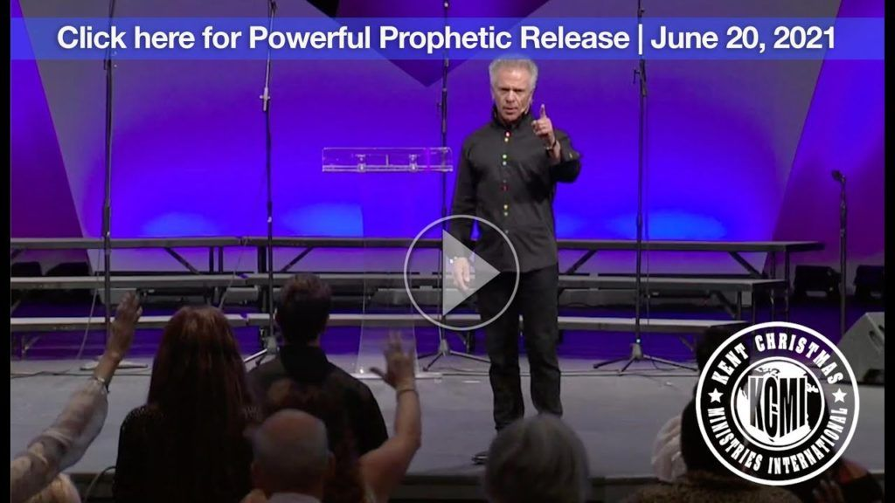
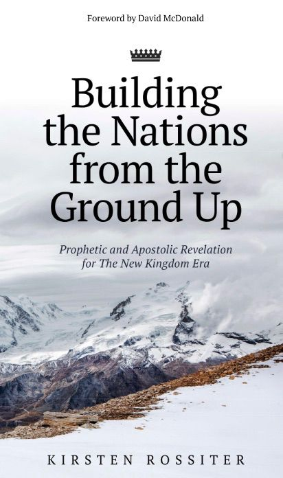

# Kirsten Rossiter — WordPress blog posts

Extracted from the Duplicator archive `20230923_kirstenrossiter_66ceb638a019dc3d6569_20241004074523_archive.zip` (`wp_jesus_posts` table in `dup-database__66ceb63-04074523.sql`).

- Published posts: **279** (2016-08-27 → 2024-05-23)
- Drafts: **14** (listed at the end)
- Order: oldest first. HTML converted to Markdown; WordPress block comments and shortcodes removed.
- Media: the posts reference 56 images/audio/PDF files from the old `wp-content/uploads/`.
  Only **4** were still present in the backup. **3** are kept, under `blog/media/`, and linked
  from the posts below; the fourth (a 30 MB audio file) was recovered and then discarded as
  unneeded. The other **52** are not in the backup at all — they had already been lost before
  it was taken. Every reference to a file that is not here is marked inline and keeps its
  original URL for the record.

## Contents

1. Have Courage to Stand Alone, if You Must — 2016-08-27
2. The Power of His Joy! — 2016-08-27
3. Be Still and Find Your Authentic Self — 2016-08-27
4. Seasons and Opportunities — 2016-08-27
5. Little Steps in a Wide, Open Space — 2016-08-27
6. Worldview Checks — 2016-08-27
7. The Power of Servanthood — 2016-08-27
8. Know your Royal Position in Christ — 2016-08-27
9. Viewpoint Above the Clouds — 2016-08-28
10. The Apple of His Eye — 2016-09-06
11. Run Free — 2016-09-07
12. South Africa — 2016-09-07
13. In Spite of Me — 2016-09-11
14. Love covers — 2016-09-14
15. Deborahs and Davids — 2016-09-18
16. Identity Reveals His Love — 2016-09-19
17. Honouring the Fathers — 2016-09-21
18. Seek Wise Counsel — 2016-09-24
19. Patience Builds Faith — 2016-10-02
20. Tuning in to Hear — 2016-10-02
21. Love is the Key — 2016-10-10
22. Faith Milestones — 2016-10-13
23. Scatter Seed for Multiple Harvest — 2016-10-14
24. Bigger Than Yourself — 2016-10-21
25. Keep Moving Forward — 2016-10-26
26. Ready to run! — 2016-11-03
27. Vote in Godly Leadership — 2016-11-10
28. Manna, day-by-day — 2016-11-17
29. Migrating back — 2016-12-13
30. The Year of The Open Door — 2016-12-18
31. Facing the Giants — 2016-12-28
32. Know Your Season — 2017-01-14
33. This is Your Time — 2017-01-15
34. Families Building Strong — 2017-01-28
35. Miraculous Living — 2017-02-15
36. War for the Nations — 2017-03-12
37. The Power of Fear — 2017-03-12
38. Joshua & Caleb's Report — 2017-03-18
39. Busyness Steals Intimacy — 2017-03-29
40. First Peoples of Our Land — 2017-04-16
41. Repentance and Forgiveness — 2017-04-17
42. The Discomfort of Enlargement — 2017-04-25
43. Breaking the Sound Barrier — 2017-04-29
44. Victory is... — 2017-05-08
45. The Lump of Clay in the Potter's Hands — 2017-05-22
46. Return to Him Again — 2017-05-27
47. Use Me Lord! — 2017-05-28
48. New Kingly Order — 2017-06-05
49. Introducing Prophetic Words — 2017-06-07
50. Prophecy by Chuck Pierce 11.03.2016 — 2017-06-08
51. Prophecy by Charlie Shamp 19.02.2017 - Word for Cape Town — 2017-06-08
52. Prophecy for South Africa by Jim Laffoon 31.03.2017 — 2017-06-08
53. Prophecy for South Africa by Russ and Kitty Walden 8.04.2017 — 2017-06-10
54. Prophetic Song for Africa by Kirsten Rossiter 2016 — 2017-06-10
55. National Shaking — 2017-06-13
56. The Sweetness of Forgiveness — 2017-06-14
57. Your People Will Come From Afar — 2017-06-15
58. God Sees All Things — 2017-06-16
59. Resources: Prophetic and Apostolic Ministry — 2017-06-17
60. Watchman of your street — 2017-06-20
61. How to Walk in His Power — 2017-06-22
62. Resources: Supernatural Living — 2017-06-22
63. Why is Prophecy so Important? — 2017-06-24
64. How do I Vote as a Christian? — 2017-06-24
65. Resources: Intercession — 2017-06-25
66. Resources: Prophetic Revelations for the End-Time Church — 2017-06-25
67. Resources: The Elijah List - Prophetic Words Archive — 2017-06-25
68. My Testimony — 2017-06-27
69. When the Enemy is on His Knees — 2017-06-28
70. The Lord is My Helper — 2017-07-06
71. A New Song — 2017-07-06
72. The Call of The Bride — 2017-07-09
73. Being an Effective, Innovative Entrepreneur — 2017-07-15
74. When Mom moved in — 2017-07-18
75. Leading in Times of War — 2017-07-19
76. When the Enemy Slanders the Righteous — 2017-07-21
77. We Need to Know the God Whom We Serve — 2017-07-26
78. In Whose Strength do we Trust? — 2017-08-04
79. Be Outlandishly Generous! — 2017-08-06
80. What is your Name? — 2017-08-27
81. Name your Facets — 2017-08-28
82. The World of Innovation — 2017-08-31
83. Prophecy by Chuck Pierce - This is a Day of Movement! — 2017-09-03
84. Glory Rain is Coming! — 2017-09-03
85. Prophecy by Lana Vawser - New Beginnings and Angels of Expectancy — 2017-09-03
86. Prophecy by Lana Vawser - Here Comes My Suddenly... — 2017-09-08
87. Prophecy by Cindy Jacobs - Angels are God's Ministering Spirits Sent to Serve You! — 2017-09-09
88. Create New Positions, Services and Products — 2017-09-10
89. Prayer for South Africa - Rise up and Sing out Loud! — 2017-09-11
90. There is Only One Answer for SA's problems! — 2017-09-19
91. We are Brought into Abundance — 2017-10-04
92. Make Haste to Help me, Lord! — 2017-10-11
93. My Response Determines my Outcome — 2017-10-17
94. I will Remember the Works of the Lord — 2017-10-28
95. Substance Precedes Inheritance — 2017-11-06
96. The Lord's Fragrant Balm of Comfort — 2017-11-15
97. Living by Faith is the Standard — 2017-11-18
98. Creativity Demands Space and Time — 2017-11-18
99. Unity is Pivotal in the Process of Inheritance — 2017-12-05
100. Your Will be done on Earth, as it is in Heaven — 2017-12-11
101. 2018 - The Year of Explosion! — 2017-12-14
102. This is the Season of the Holy Spirit — 2018-01-05
103. Taking our Inheritance through Battle — 2018-01-07
104. Will You Drink From My Cup? — 2018-01-11
105. Word of the Lord: 2018 — 2018-01-19
106. Are You Panicked About the Water Crisis in the WC? — 2018-01-20
107. Solomon's Prayer Released Fire from Heaven — 2018-01-21
108. The Lord Gathers the Unrighteous — 2018-01-22
109. Introducing my New Song: I've Been Completely Undone — 2018-01-22
110. The Lord Works Wonders on the Earth — 2018-01-25
111. God can Multiply the Last of your Resources — 2018-01-27
112. The Lord is Raising Up a Holy Remnant — 2018-01-30
113. The Cape Town Drought/Outpouring Prophecy - Charlie Shamp 19.02.2017 — 2018-02-02
114. Southern Tip of Africa Fire Prophecy — 2018-02-10
115. Understanding the Kingdom of God — 2018-02-23
116. Prophecy by Dr Jonathan David — 2018-02-28
117. A Word of Encouragement: A Well-Watered Garden You are — 2018-03-06
118. Prophetic Words for the Bride - Lana Vawser — 2018-03-17
119. Preach to your Soul — 2018-03-22
120. Rise up Africa, and Declare and Decree your Way into your Inheritance! — 2018-04-03
121. The Lord is Calling Forth Enochs — 2018-04-09
122. The Lord is Dancing and Singing over us — 2018-04-19
123. Urgent Word for SA by Veronika West - 30.03.18 — 2018-05-02
124. The Restoration of your Latter Days — 2018-05-07
125. The Fragrance of Mothers — 2018-05-13
126. The Lord is Good to Those who Trust in Him! — 2018-05-15
127. God is Uniting Christians and Jews — 2018-06-03
128. Look into My Face — 2018-06-18
129. The Fire of Delay Produces Endurance — 2018-07-06
130. South Africa will be Born in a Day — 2018-07-12
131. Prophetic Word for SA by André Bronkhorst — 2018-07-20
132. The Lord is reshaping 'Church' as we know it — 2018-07-29
133. The Growing Dispersion of People across the Earth — 2018-08-01
134. Upholding the Ten Commandments in Government — 2018-08-06
135. An URGENT Prophetic Message for the Church Leaders in SA — 2018-08-22
136. Having Understanding in the Midst of Change — 2018-08-24
137. RED ALERT: Urgent Vision for South Africa by Mirjam Horak — 2018-08-28
138. An Oasis in the Midst of the Desert — 2018-09-10
139. How to Build Kingdom-model Businesses that Prosper — 2018-09-17
140. As Bright Lights are sent out, New Lights are brought in — 2018-09-18
141. Word of the Lord for the Prophets by Lana Vawser — 2018-09-18
142. The Fire Has Produced Courageous Warriors! — 2018-09-21
143. God's Strategy and Solution for South Africa — 2018-10-16
144. When we come to the End of Ourselves... Miracles Happen! — 2018-10-18
145. The Prophetic and Apostolic Gifting Builds Nations — 2018-10-31
146. Building the Kingdom bears Good Fruit — 2018-11-04
147. God cares for us all — 2018-11-18
148. The Shaking of the Western World — 2018-11-25
149. Divine Surprises await us! — 2018-11-27
150. Confrontation Invites Change — 2018-12-04
151. Word of the Lord for 2019 - Double Doors of Twin and Multiple Measures — 2018-12-26
152. Just 'do it!' — 2019-01-14
153. Understanding the New Wineskin Season - Introduction — 2019-01-27
154. Apostolic Council of Prophetic Elders: Word for 2019 — 2019-01-29
155. Keywords: Twin-birth and Multiplication — 2019-01-29
156. Keywords: Being Catapulted — 2019-02-12
157. Timeless God — 2019-02-27
158. Keywords: New Wineskin Season — 2019-03-08
159. How to access His JOY! — 2019-03-08
160. I am your Inheritance — 2019-03-12
161. South Africa, South Africa, Land of My Favour! — 2019-03-20
162. The ACDP, God's Vehicle for Change — 2019-03-20
163. The Rain is Coming! The Rain is Coming! — 2019-04-05
164. The Lord is Coming with Chariots of Fire! — 2019-04-09
165. Put your Moneybags OUT, the Gold and Silver is Coming! — 2019-04-17
166. The Lord is Leveling the Ground through His Shaking — 2019-04-20
167. The Lord works through Imperfect People - Election Message — 2019-04-25
168. Gates be Opened: the King of Glory is Coming in! — 2019-05-04
169. Revival Spirit — 2019-05-07
170. Reflecting on 2019 Elections — 2019-05-12
171. Pick up your Sword! — 2019-05-19
172. Obedience and Generosity Release His Miraculous! — 2019-06-08
173. The Unveiling of My Sons and Daughters — 2019-06-21
174. The Violent Shaking of South Africa will Birth New Life — 2019-07-14
175. Prophetic Revelation for South Africa - The humbling of our government — 2019-08-01
176. The Visitation of the Lord on the Wicked — 2019-08-06
177. Your Best Years are Now! — 2019-08-11
178. Let's activate, 'But God!' — 2019-09-01
179. Riding with Him as Kings and Priests — 2019-09-29
180. Radio Cape Pulpit Interview: Riding with Him as Kings and Priests — 2019-10-07
181. Divine Downloads of Heaven's Models — 2019-10-09
182. This Spiritual War demands Spiritual Eyes, Ears and Hands to Fight Effectively — 2019-10-22
183. The Striking on the Earth will bring forth Judeo-Christian Nations — 2019-10-28
184. Give the devil NO place on the battlefield through misunderstandings — 2019-11-07
185. Heaven's Curtains are Opened, Tip over the Oil, Catch the Fire! — 2019-11-12
186. While you are still building, the Lord will bring Movement and Acceleration! — 2019-11-13
187. The Connection between Sexual Immorality and Baal Worship — 2019-11-21
188. The Secret Dens will Implode from the Inside — 2019-11-28
189. The Opposition through Truth will unleash the Battle — 2019-12-07
190. Word of the Lord for 2020 — 2019-12-23
191. The Reaping of your Faithful Seeds — 2020-01-11
192. Prophetic Word by Sharell Barrera: The Rise of a Hidden Tribe — 2020-01-25
193. Word of the Lord for South Africa - Davids Arise! — 2020-01-27
194. Let it be done according to Your Word — 2020-02-13
195. The Lord, our Teacher, will not hide Himself anymore — 2020-02-19
196. What is God saying to South Africa right now? — 2020-02-28
197. The Renaissance of the 21st Century — 2020-03-07
198. The World is being Changed by His 'Reset' Button — 2020-03-16
199. The Third World-War has officially begun — 2020-03-24
200. Understanding the New Era — 2020-03-27
201. The Desert Season of Preparation (1) — 2020-03-27
202. The Desert Season of Preparation (2) — 2020-03-27
203. The Desert Season of Preparation (3) — 2020-03-28
204. The Desert Season of Preparation (4) — 2020-03-29
205. The New Era of Inheritance — 2020-03-30
206. The Lord is Laughing at the Enemy — 2020-04-01
207. Pray in the Spirit in One Accord — 2020-04-03
208. Let Spontaneous Worship Erupt! — 2020-04-06
209. The Red Sea is Open — 2020-04-09
210. Prophetic Song of Comfort — 2020-04-18
211. Preparing for Revival — 2020-04-25
212. Hush and Step Aside so the King of Glory can Enter — 2020-05-02
213. The Trumpet is blowing: This is the Day of the Lord! — 2020-05-07
214. We are going into the Enemy's Camp to take BACK what he stole from us! — 2020-05-10
215. We have entered a Davidic Era — 2020-05-13
216. A Memorial of His Faithfulness — 2020-05-26
217. The Year of the Roar — 2020-06-03
218. Our New Mandate will bring us into a Divine Eclipse — 2020-06-10
219. Embrace the Bends of Change, for they will Accelerate your Ride! — 2020-06-18
220. Salvation is coming to the Nations — 2020-07-02
221. The Second Half of 2020 will Ascend not Descend! — 2020-07-06
222. 'I shall build you a house', says the Lord — 2020-07-18
223. Your testimony will become your teaching — 2020-08-03
224. I am adding and establishing in the midst of the shaking — 2020-08-15
225. What happens in America will affect the whole world — 2020-08-23
226. ‘Brace Yourself, America’ — 2020-09-01
227. Joshua and Caleb — 2020-09-03
228. The Sound of Heaven — 2020-09-04
229. Prophetic song calling forth Davids! — 2020-09-08
230. The Suffering of the Nations is the Fruit of Globalist Abuse — 2020-09-12
231. To all the Faithful Shepherds: Get Ready for an Apostolic Upgrade! — 2020-09-20
232. The Trumpet Sounds: This is the Day of the Manifestation of My Sons and Daughters! — 2020-10-03
233. The Battle Strategy is in the Release of Sound! — 2020-10-12
234. The Time of Judgment has Come — 2020-10-19
235. As Daniel saw a prophetic alignment in his time, so we see the end of our captivity! — 2020-10-30
236. We might be surprised, but God is never surprised by anything! — 2020-11-07
237. God's Throne will be Established through Righteousness and Justice — 2020-11-20
238. The Prayers of the Chinese People have gone forth for China and the Nations! — 2020-12-15
239. 2021: The Year of the Great Exchange! — 2021-01-05
240. The Book of Esther Parallels our Current Crisis in the Nations — 2021-01-17
241. Call your Nation out of the Grave as Jesus Called, 'Lazarus, Come Forth!' — 2021-01-30
242. The Thinning of the Army produces Warrior-Pioneers — 2021-02-14
243. We've been Tested by the Word of the Lord — 2021-03-04
244. 'This is the Hour of My Wonder and Glory', says the Lord — 2021-03-28
245. Battle-Weary or Not, Evict the Locusts Off your Land! — 2021-04-17
246. What You Carry Shakes the Darkness! — 2021-05-22
247. My Testimony — 2021-06-03
248. That Which Seems Upside-Down, is Being Turned Right-Side-Up — 2021-06-14
249. Timely Prophetic Word by Pastor Kent Christmas - 20 June 2021 — 2021-07-03
250. Alliance With Truth Will Bring Unity — 2021-07-20
251. A violent eruption is coming - FEAR NOT! — 2021-08-05
252. God-Enthroned Speaks to Rebel-Kings, Laughing at their Schemes! — 2021-09-03
253. Break Open the Seal of God's Prophetic Promises for NOW! — 2021-09-20
254. Global Systems are Falling, Local Industries are Rising! — 2021-09-29
255. You will know Me as your Deliverer and Comforter — 2021-10-16
256. As we enter to possess, Jesus is saying, 'I AM HERE TO TAKE CHARGE!' — 2021-11-09
257. We will go into battle until justice is restored! — 2021-12-14
258. I hear the Lord say, 'It is Done!' — 2021-12-31
259. New book release: Building the nations from the ground up! — 2022-01-31
260. Recognise the War of Distraction — 2022-02-25
261. On a personal note - expansion time! — 2022-04-27
262. Pentecost Fresh Fire will cause walls to fall and walls to rise! — 2022-06-03
263. Open Gateways and Ring of Fire — 2022-07-01
264. My Irresistible End-Time Bride — 2022-07-27
265. Everything has CHANGED! — 2022-08-16
266. Position yourself for the deluge not the drippings! — 2022-09-19
267. Upskill for the Upgrade — 2022-10-17
268. We hold the keys to lock and unlock! — 2022-11-07
269. Out of rest, we will be flung from His Hand — 2022-12-13
270. 2023: The Year of Prophetic Fulfillment & Divine Protection — 2023-01-21
271. Out of Rest will come the Reset — 2023-06-13
272. Stand Tall while Egypt Falls! — 2023-07-11
273. Three visions of the Lord to give understanding of our times. — 2023-10-04
274. What stands between us and inheriting, is War — 2023-10-17
275. My Name is 'Perfect Love Who casts out all fear' — 2023-11-28
276. Prophetic Word for 2024: Year of Reward — 2023-12-31
277. My finger has pressed the button, labeled, 'CHANGE!' — 2024-02-09
278. Becoming the Place of His Rest — 2024-04-23
279. The Dividing of the Army Ranks — 2024-05-23

---

# Published posts

## Have Courage to Stand Alone, if You Must

- **Date:** 2016-08-27 18:15:08
- **Slug:** `have-courage-to-stand-alone-if-you-must`
- **Categories:** Prophetic Revelation, Uncategorised
- **Tags:** Bravery, Courage, Prophetic
- **Original URL:** https://kirstenrossiter.com/?p=2731

> **Excerpt:** One thing history-makers and shakers have in common, is they have the courage to stand alone, if they must.

**One thing history-makers and shakers have in common, is they have the courage to stand alone, if they must. To be part of the change that they fight and stand for, demands inner-strength and courage to stand in the midst of pointing fingers, criticism and rejection, often joint with violent opposition. They are willing to go against the grain, and keep on pushing until the grain gives way.**

One of my most valuable lessons has been, to see God’s hand turning that which the devil meant for harm, into blessing. God comes and turns our ashes into beauty… Sometimes we despise the hard times and the pain, but if we endure the process of His love at work in our wounded hearts, He will not only bring healing and wholeness, but bring us into freedom where the very chains that bound us, become the flags of freedom that flies in our lives. Let maturity have it’s full working. For it’s out of this process that history-makers are made.

Embrace the fruit of rejection, criticism and judgment. As painful as they are, they teach us to live without needing acceptance, praise and recognition from others. They teach us the courage to walk our road, even if it is completely alone. But most of all, they teach us the power of grace and forgiveness.

Coming through this process, we are grounded in the freedom of Christ to unconditionally love, accept and bless others, not wanting, needing or demanding anything in return. Letting love flow from the Well of Grace and Perfect Love to all around us.

There is no greater history-maker, than one who runs in freedom with pure conviction for truth and unconditional love for others.

> **Romans 8:28**
>
> And we know that all things work together for good to them that love God, to them who are the called according to his purpose.

---

## The Power of His Joy!

- **Date:** 2016-08-27 18:15:55
- **Slug:** `the-power-of-his-joy`
- **Categories:** Prophetic Revelation
- **Tags:** Joy, Miracles, Provision, Sonship, South Africa
- **Original URL:** https://kirstenrossiter.com/?p=2733

> **Excerpt:** The one area that the enemy loves to target in our lives, is our joy. He knows it's power, for there is nothing that can defeat us, and no hold he can have on us, when we walk in His joy.

**The one area that the enemy loves to target in our lives, is our joy. He knows it's power, for there is nothing that can defeat us, and no hold he can have on us, when we walk in His joy. It causes us to see God's hand in every circumstance, allowing Him to turn everything around for our good, and His glory.**

The amazing thing about God’s joy, is that it has nothing to do with us, our circumstance or our feelings. It has all to do with who He is, what He’s done and who we are to Him.

**He is our Joy**

Meditating on His goodness, abiding in His Presence, receiving His grace, leaning on Him with all our might, releasing our burdens and trusting that He holds every answer and miracle we need, allows His joy to swell up in our hearts. We need to see as He sees, feel as He feels.

**Nothing to fear**

Let's embrace walking in the Spirit, living our lives wholly surrendered to the One who holds every living thing in His Hands. What have we to fear when we realise that we are held in the palm of His loving Hand? He is truly perfect love, perfect peace and perfect joy. Drink it in, let it saturate every living cell of your being and let it ignite a fire of joy that will burn, regardless of the circumstance that surrounds you.

> **Isaiah 61:10**
>
> I will greatly rejoice in the LORD, my soul shall be joyful in my God; for he hath clothed me with the garments of salvation, he hath covered me with the robe of righteousness, as a bridegroom decketh himself with ornaments, and as a bride adorneth herself with her jewels.
>
> **1 John 4:18**
>
> There is no fear in love; but perfect love casteth out fear: because fear hath torment. He that feareth is not made perfect in love.

---

## Be Still and Find Your Authentic Self

- **Date:** 2016-08-27 18:17:01
- **Slug:** `be-still-and-find-your-authentic-self`
- **Categories:** Prophetic Revelation
- **Tags:** Authentic, Hear God, Kingdom Perspective
- **Original URL:** https://kirstenrossiter.com/?p=2735

> **Excerpt:** We are most effective in everything we do, when we learn the skill of being still. It's in the quiet that we find our perspectives sharpened, able to hear God with clarity and get in touch with our authentic selves in the process.

**We are most effective in everything we do, when we learn the skill of being still. It's in the quiet that we find our perspectives sharpened, able to hear God with clarity and get in touch with our authentic selves in the process. Comparing, competing and striving are the weeds that need pulling out in the quiet. It always leaves us feeling less than we are, discontent with where we're at and sends us off-course along the way.**

**In quietness is strength**

It's in the quietness, when time stops, that we notice how big God is, and how small our circumstance. Suddenly that which troubled us, and that which made us frail, melts away in the sweetness of His presence. These quiet moments are the oxygen for our souls. They need to form part of our daily living, where we seek those moments out to connect with God and ourselves. Our ears should be tuned into Him at all times, and our spirits open to feel His leading in big and small matters.

Let's not get caught up in the fast-paced world we're living in, but let's purposefully find those quiet moments we so desperately need, so we can make alterations and changes that's needed to remain aligned with God and our authentic selves.

> **Isaiah 32:17,18**
>
> And the effect of righteousness will be peace, and the result of righteousness, quietness and trust forever.
> My people will abide in a peaceful habitation, in secure dwellings, and in quiet resting places.
>
> **Isaiah 30:15**
>
> For thus saith the Lord GOD, the Holy One of Israel; In returning and rest shall ye be saved; in quietness and in confidence shall be your strength

---

## Seasons and Opportunities

- **Date:** 2016-08-27 18:17:46
- **Slug:** `seasons-and-opportunities`
- **Categories:** Prophetic Revelation
- **Tags:** Contentment, Endurance, Seasons
- **Original URL:** https://kirstenrossiter.com/?p=2737

> **Excerpt:** Our lives are filled with different seasons. It is important to know the season we're in. I've had to learn to be patient in one season, embracing the 'now' and be at peace with the laying down of things that are yet to come.

**Our lives are filled with different seasons. It is important to know the season we're in. I've had to learn to be patient in one season, embracing the *'now'* and be at peace with the laying down of things that are yet to come. If we let God work patience and long-suffering in us, the fruit of it is sweet when the next season comes.**

I love to know what the Lord says about my season, as it helps direct and guide me to discern which doors and opportunities are of His hand, and which are of the flesh. Just because we are faced with an open door, doesn't mean it is from the Spirit. An open door of the Spirit will lead to life and blessing for us and our loved ones, but an open door of the flesh will lead to bondage and will steal something from us... our time, our peace, our course. We don't want to give birth to Ishmaels, but we need patience, faith and endurance to carry the seed of Isaac until his birth.

We so often get caught up with the fleshly realm, being distracted by what we see rather than what He says. God wants to make us effective in our current season, being Spirit-led children who hear His voice and know His heart. That is our happiest place in this world. Walking in the centre of His Will... that's the sweet spot where blessing and joy abounds, and contentment abides... regardless of our circumstance.

> **Ecclesiastes 3:1-8**
>
> To every thing there is a season, and a time to every purpose under the heaven: A time to be born, and a time to die; a time to plant, and a time to pluck up that which is planted; A time to kill, and a time to heal; a time to break down, and a time to build up; A time to weep, and a time to laugh; a time to mourn, and a time to dance; A time to cast away stones, and a time to gather stones together; a time to embrace, and a time to refrain from embracing; A time to get, and a time to lose; a time to keep, and a time to cast away; A time to rend, and a time to sew; a time to keep silence, and a time to speak; A time to love, and a time to hate; a time of war, and a time of peace.

---

## Little Steps in a Wide, Open Space

- **Date:** 2016-08-27 18:18:34
- **Slug:** `little-steps-in-a-wide-open-space`
- **Categories:** Prophetic Revelation
- **Tags:** Promotion, Restoration
- **Original URL:** https://kirstenrossiter.com/?p=2739

> **Excerpt:** This is the season of wide, open space for the beloved of the Lord.

**This is the season of wide, open space for the beloved of the Lord. The season of waiting for delayed promises is over, and the time has come where the Spirit of the Lord is declaring, "You have been created for a time such as this, My beloved. Those who have been downtrodden and despised, are the ones who will be my shining prize. Behold my lovely one, My long-awaited Bride, your tears will no more be that of mourning, but will be tears of joy.**

For do not look to the darkness upon the face of the earth, but look at the brightness of My glory and grace. I am arising upon you, and others will find their way through your brightness.

I will build you, adorn you, establish you, and give you honour amongst the nations."

Even I am stepping out into the big, wide open space by releasing the songs that I’ve written for Africa.

I believe this is a birthing season for all God’s beloved. Don’t be intimidated by the ‘new’. We are walking, not alone, but joined intimately and dependently to Jesus, who is capable of doing abundantly more than we can think, expect or dream. It is all because of Him, it is all for Him and it is all about Him.

Go shine, Little Diamonds!

> **Isaiah 60:1-3**
>
> Arise, shine; for thy light is come, and the glory of the LORD is risen upon thee. For, behold, the darkness shall cover the earth, and gross darkness the people: but the LORD shall arise upon thee, and his glory shall be seen upon thee. And the Gentiles shall come to thy light, and kings to the brightness of thy rising.
>
> **Isaiah 54**
>
> Sing, O barren, thou that didst not bear; break forth into singing, and cry aloud, thou that didst not travail with child: for more are the children of the desolate than the children of the married wife, saith the LORD.
> Enlarge the place of thy tent, and let them stretch forth the curtains of thine habitations: spare not, lengthen thy cords, and strengthen thy stakes;
> For thou shalt break forth on the right hand and on the left; and thy seed shall inherit the Gentiles, and make the desolate cities to be inhabited.
> Fear not; for thou shalt not be ashamed: neither be thou confounded; for thou shalt not be put to shame: for thou shalt forget the shame of thy youth, and shalt not remember the reproach of thy widowhood any more.
> For thy Maker is thine husband; the LORD of hosts is his name; and thy Redeemer the Holy One of Israel; The God of the whole earth shall he be called.
> For the LORD hath called thee as a woman forsaken and grieved in spirit, and a wife of youth, when thou wast refused, saith thy God.
> For a small moment have I forsaken thee; but with great mercies will I gather thee.
> In a little wrath I hid my face from thee for a moment; but with everlasting kindness will I have mercy on thee, saith the LORD thy Redeemer.
> For this is as the waters of Noah unto me: for as I have sworn that the waters of Noah should no more go over the earth; so have I sworn that I would not be wroth with thee, nor rebuke thee.
> For the mountains shall depart, and the hills be removed; but my kindness shall not depart from thee, neither shall the covenant of my peace be removed, saith the LORD that hath mercy on thee.
> O thou afflicted, tossed with tempest, and not comforted, behold, I will lay thy stones with fair colours, and lay thy foundations with sapphires.
> And I will make thy windows of agates, and thy gates of carbuncles, and all thy borders of pleasant stones.
> And all thy children shall be taught of the LORD; and great shall be the peace of thy children.
> In righteousness shalt thou be established: thou shalt be far from oppression; for thou shalt not fear: and from terror; for it shall not come near thee.
> Behold, they shall surely gather together, but not by me: whosoever shall gather together against thee shall fall for thy sake.
> Behold, I have created the smith that bloweth the coals in the fire, and that bringeth forth an instrument for his work; and I have created the waster to destroy.
> No weapon that is formed against thee shall prosper; and every tongue that shall rise against thee in judgment thou shalt condemn. This is the heritage of the servants of the LORD, and their righteousness is of me, saith the LORD.

---

## Worldview Checks

- **Date:** 2016-08-27 18:19:11
- **Slug:** `worldview-checks`
- **Categories:** Prophetic Revelation
- **Original URL:** https://kirstenrossiter.com/?p=2741

> **Excerpt:** Sometimes we don't realise that the worldview we hold is polluted and influenced by modern thinking, the media, our own humanistic ideas and/or our own experiences.

**Sometimes we don't realise that the worldview we hold is polluted and influenced by modern thinking, the media, our own humanistic ideas and/or our own experiences.**

It takes a very big, purposeful and earnest desire to know His truth, and to be set free from any wrong thinking, that takes us onto a new path where God shines His bright light upon things we didn't even notice, or recognise in our lives as 'off-the-mark'.

We trust the systems and follow advice so easily, without checking if it's aligned with God and His Kingdom. We are sons and daughters of the King, we live in His Kingdom, and our policies come from Heaven.

It's vital that we check our worldview regularly, and allow God to expose any deception in our minds. We make decisions for our lives, according to our worldview, and build upon that foundation everything we hold dear... areas of parenthood, marriage, careers, education, politics, health, ministry etc.

Holding His worldview unlocks His Will and brings about all the promises of blessing in our lives. We can walk boldly with our Kingly authority, declaring His Will and purposes over our lives, communities and nations, when we stand in His truth.

Our own humanistic worldview will always demand the works of the flesh, where we make decisions based on what we can do, our abilities, our strategies, our strengths and our fears. We will always live a lesser life when we build that way.

Let's reach for the highest prize, which comes at a higher cost, but with priceless rewards. Let's lay down our minds, and ask our Heavenly Father to give us clear minds, filled with Christ, able to think, reason and understand the way of His mind and Kingdom. He gives wisdom and knowledge to those who seek Him. To those who seek Him with all their hearts.

> **Proverbs 3:5-7**
> **5** Trust in the LORD with all thine heart; and lean not unto thine own understanding. **6** In all thy ways acknowledge him, and he shall direct thy paths. **7** Be not wise in thine own eyes: fear the LORD, and depart from evil.
>
> **Proverbs 3:13-24**
> **13** Happy is the man that findeth wisdom, and the man that getteth understanding. **14** For the merchandise of it is better than the merchandise of silver, and the gain thereof than fine gold. **15** She is more precious than rubies: and all the things thou canst desire are not to be compared unto her. **16** Length of days is in her right hand; and in her left hand riches and honour. **17** Her ways are ways of pleasantness, and all her paths are peace. **18** She is a tree of life to them that lay hold upon her: and happy is every one that retaineth her. **19** The LORD by wisdom hath founded the earth; by understanding hath he established the heavens. **20** By his knowledge the depths are broken up, and the clouds drop down the dew. **21** My son, let not them depart from thine eyes: keep sound wisdom and discretion: **22** So shall they be life unto thy soul, and grace to thy neck. **23** Then shalt thou walk in thy way safely, and thy foot shall not stumble. **24** When thou liest down, thou shalt not be afraid: yea, thou shalt lie down, and thy sleep shall be sweet.

---

## The Power of Servanthood

- **Date:** 2016-08-27 18:19:52
- **Slug:** `the-power-of-servant-hood`
- **Categories:** Prophetic Revelation
- **Tags:** Godly Character
- **Original URL:** https://kirstenrossiter.com/?p=2743

> **Excerpt:** The road of servanthood is not discovered by all, but once you tread this ground, you won't veer off this path easily. It brings with it such rich blessings and benefits, joy being the greatest of all.

**The road of servanthood is not discovered by all, but once you tread this ground, you won't veer off this path easily. It brings with it such rich blessings and benefits, joy being the greatest of all.**

The secret to stepping onto this path, is choosing to be a giver and not a taker. Receiving the greatest gift of all, Christ and the life of grace that He so freely gave us, enables us to step with hearts of humility and gratitude in His footsteps, following the path of a servant, driven by love. Seeing every situation as an opportunity to be a blessing, even situations that seem unfair and unjust can be turned around by our attitudes towards it.

It empowers the giver in ways unimaginable. You see eyes light up, hearts change and relationships restoring when you start giving and serving those around you. We are not only called to serve those who appreciate it, but even those who don't notice, regard or recognise. It is only a matter of time, but continual gifts of kindness and generosity will cause a change of heart, a breakdown of walls and an open spirit to receive the love of God reflected through our lives.

Will we lay down the *'me first'*, and clothe ourselves with the spirit of servanthood and humility that is the very character of Christ? Will we let Him mould us and cut back those fleshly bits of self, and make ourselves vulnerable to step out to give, regardless of the response?

The greatest witness of the cross, is not he who only speaks with words, but a life that reflects His grace, kindness and unconditional love to all, friends and foe alike.

> **Luke 6: 35,36**
> **35** But love ye your enemies, and do good, and lend, hoping for nothing again; and your reward shall be great, and ye shall be the children of the Highest: for he is kind unto the unthankful and to the evil. **36** Be ye therefore merciful, as your Father also is merciful.

---

## Know your Royal Position in Christ

- **Date:** 2016-08-27 18:20:58
- **Slug:** `know-your-royal-position-in-christ`
- **Categories:** Prophetic Revelation
- **Tags:** Authority
- **Original URL:** https://kirstenrossiter.com/?p=2745

> **Excerpt:** Remind yourself today of who you are, and what your position is in God's Kingdom. You are the head and not the tail, above and not beneath, favored and not despised, a son and not a slave.

**Remind yourself today of who you are, and what your position is in God's Kingdom. You are the head and not the tail, above and not beneath, favored and not despised, a son and not a slave.**

Everything has been accomplished through Christ on the cross and his resurrection. Our lives are rescued, restored and brought into perfect alignment with our Father through the work of Christ's righteousness. We can come boldly before the throne of Grace, as children and heirs of the Most High God.

**Your position is eternal**

Know your position when you face adversity, know your authority when condemnation, judgement or fear knocks at your door. You are purchased with a price, and have been set free from the chains of sin and death... set apart for a life of holiness and victory, with a vision that's immortal and eternal. No more does death carry a sting, there's nothing to fear. For Perfect Love casts out all fear, and we are living in the shadow of the Almighty, where His presence continually surrounds us. We are seated with Him in heavenly places, to rule and reign over the powers and principalities of this world.

To co-labour with Him, we must know our authority and position in Him. Salt to season and light to guide. Let's build His Kingdom, not by might, but by the Spirit of the Living God.

> **1 Corinthians 15:51-58**
> **51** Behold, I shew you a mystery; We shall not all sleep, but we shall all be changed, **52** In a moment, in the twinkling of an eye, at the last trump: for the trumpet shall sound, and the dead shall be raised incorruptible, and we shall be changed. **53** For this corruptible must put on incorruption, and this mortal must put on immortality. **54** So when this corruptible shall have put on incorruption, and this mortal shall have put on immortality, then shall be brought to pass the saying that is written, Death is swallowed up in victory. **55** O death, where is thy sting? O grave, where is thy victory? **56** The sting of death is sin; and the strength of sin is the law. **57** But thanks be to God, which giveth us the victory through our Lord Jesus Christ. **58** Therefore, my beloved brethren, be ye stedfast, unmovable, always abounding in the work of the Lord, forasmuch as ye know that your labour is not in vain in the Lord.
>
> **Hebrews 4:16**
> **16** Let us therefore come boldly unto the throne of grace, that we may obtain mercy, and find grace to help in time of need.
>
> **1 John 4:4**
> **4** Ye are of God, little children, and have overcome them: because greater is he that is in you, than he that is in the world.
>
> **1 John 4:18**
> **18** There is no fear in love; but perfect love casteth out fear: because fear hath torment. He that feareth is not made perfect in love.

---

## Viewpoint Above the Clouds

- **Date:** 2016-08-28 06:10:15
- **Slug:** `viewpoint-above-the-clouds`
- **Categories:** Prophetic Revelation
- **Original URL:** https://kirstenrossiter.com/?p=2757

> **Excerpt:** Outside the window during a recent flight, was a field of clouds lit up by the bright sun. I was struck by the contrast of viewpoints of land and sky.

**Outside the window during a recent flight, was a field of clouds lit up by the bright sun. I was struck by the contrast of viewpoints of land and sky.**

Our realities might be shaded by dark clouds without a glimmer of light, but when we know that the sun always shines above the clouds - that God is aways there - we can be rest assured that the clouds are temporary and will make way for the rays of light to penetrate through our dark sky.

**We live by faith**
We do not live by sight, we live by faith. Our faith is in a loving God who is the one constant thing in our lives now and forever. His bright light of love, hope and truth never stops shining. He lights up our skies, and moves the clouds out of the way. He brings the winds of change, and rains down refreshing waters that brings forth new life.

**His ways are higher**
Be patient in the waiting, resting in Him. Be encouraged by the knowledge of His presence and light, and shake off the discouragement that wants to settle from ground-perspectives. Let Him take you on a flight, on a journey, where you see from His Heavenly perspective. See as He sees, be expectant for that which is established in the Spirit, and wait expectantly to see it manifest in the natural.

Know that His ways are always higher, and His plans bigger, better and broader than ours.

> 2 Cor 5:7
> **7** For we walk by faith, not by sight
>
> **Isaiah 55:8-13**
> **8** For my thoughts are not your thoughts, neither are your ways my ways, saith the LORD. **9** For as the heavens are higher than the earth, so are my ways higher than your ways, and my thoughts than your thoughts. **10** For as the rain cometh down, and the snow from heaven, and returneth not thither, but watereth the earth, and maketh it bring forth and bud, that it may give seed to the sower, and bread to the eater: **11** So shall my word be that goeth forth out of my mouth: it shall not return unto me void, but it shall accomplish that which I please, and it shall prosper in the thing whereto I sent it. **12** For ye shall go out with joy, and be led forth with peace: the mountains and the hills shall break forth before you into singing, and all the trees of the field shall clap their hands. **13** Instead of the thorn shall come up the fir tree, and instead of the brier shall come up the myrtle tree: and it shall be to the LORD for a name, for an everlasting sign that shall not be cut off.

---

## The Apple of His Eye

- **Date:** 2016-09-06 19:53:44
- **Slug:** `the-apple-of-his-eye`
- **Categories:** Prophetic Revelation
- **Original URL:** https://kirstenrossiter.com/?p=3141

> **Excerpt:** A real 'blow-me-away' thought about God's love, is that when He looks at me, He sees only me... as if I am the only one who exists to Him.

**A real 'blow-me-away' thought about God's love, is that when He looks at me, He sees only me... as if I am the only one who exists to Him. He looks at me with wonder, awe, praise, joy, celebration and pride... for He doesn't get caught up with my imperfections, as I do. He sees me for who I am, who I'm created to be... all my potential, covered by His ever-abounding grace. He sees me as beautiful... always.**

We all long to hear how much we are loved, especially whilst growing up. Our fathers' opinions and words are so very important to us, they have such power when used to build and praise. They form our identities from an early age.

**Our Heavenly Father's words build our identity**
However, many of us have never received those words from our natural fathers, as we needed - they are only human, with many imperfections themselves, covered by grace. When we realise that we can release our earthly fathers and mothers from our unmet expectations of affirmation and acceptance, and turn our hearts to our Heavenly Father Who declares our worth a million times over every day... we are set free to step into our true identity of who we are.

Beautiful, valuable, worthy, precious, unique, adored, loved... forever and ever.

> **Zechariah 2:8**
> **8** For thus saith the LORD of hosts; After the glory hath he sent me unto the nations which spoiled you: for he that toucheth you toucheth the apple of his eye.
>
> **Psalm 139:1-18**
> **1** To the chief Musician, A Psalm of David. O LORD, thou hast searched me, and known me. **2** Thou knowest my downsitting and mine uprising, thou understandest my thought afar off. **3** Thou compassest my path and my lying down, and art acquainted with all my ways. **4** For there is not a word in my tongue, but, lo, O LORD, thou knowest it altogether. **5** Thou hast beset me behind and before, and laid thine hand upon me. **6** Such knowledge is too wonderful for me; it is high, I cannot attain unto it. **7** Whither shall I go from thy spirit? or whither shall I flee from thy presence? **8** If I ascend up into heaven, thou art there: if I make my bed in hell, behold, thou art there. **9** If I take the wings of the morning, and dwell in the uttermost parts of the sea; **10** Even there shall thy hand lead me, and thy right hand shall hold me. **11** If I say, Surely the darkness shall cover me; even the night shall be light about me. **12** Yea, the darkness hideth not from thee; but the night shineth as the day: the darkness and the light are both alike to thee. **13** For thou hast possessed my reins: thou hast covered me in my mother's womb. **14** I will praise thee; for I am fearfully and wonderfully made: marvellous are thy works; and that my soul knoweth right well. **15** My substance was not hid from thee, when I was made in secret, and curiously wrought in the lowest parts of the earth. **16** Thine eyes did see my substance, yet being unperfect; and in thy book all my members were written, which in continuance were fashioned, when as yet there was none of them. **17** How precious also are thy thoughts unto me, O God! how great is the sum of them! **18** If I should count them, they are more in number than the sand: when I awake, I am still with thee.

---

## Run Free

- **Date:** 2016-09-07 05:02:22
- **Slug:** `run-free`
- **Categories:** Prophetic Revelation
- **Tags:** Fatih
- **Original URL:** https://kirstenrossiter.com/?p=3145

> **Excerpt:** We all have a past that has influenced the person we've become. The struggles, hurts, disappointments and even abuse that we've suffered, often cause us to build an armour to protect us throughout our lives.

**We all have a past that has influenced the person we've become. The struggles, hurts, disappointments and even abuse that we've suffered, often cause us to build an armour to protect us throughout our lives. We wear it, as if it's part of who we are, but it is built by fear and control, to secure our position going forward... ensuring that those arrows that have penetrated our hearts in the past, will never penetrate it again.**

Jesus stands before us, and He is saying, 'Will you drop your armour? Will you stand naked and vulnerable before Me, so I can clothe you and cover you with My love? Will you trust Me, and abandon yourself to Me in full surrender with all your heart, soul and mind? For I have a life of freedom awaiting you, but you can't run free unless you drop the armour that has weighed you down.'

Jesus wants to weld His love and truth upon us, that we will wear it until it becomes one with our flesh. He is the one who covers us, and in His love, we are safe and protected from the darts and arrows that life shoots at us. His Word is the truth by which we live. What He says is fact, and keeps me looking and running forward, even in the midst of accusation, judgement and criticism.

**It's time to run free, to trust and to abandon fear once and for all.**

> **Hebrews 12:1**
> **1** Wherefore seeing we also are compassed about with so great a cloud of witnesses, let us lay aside every weight, and the sin which doth so easily beset us, and let us run with patience the race that is set before us, **2** Looking unto Jesus the author and finisher of our faith; who for the joy that was set before him endured the cross, despising the shame, and is set down at the right hand of the throne of God.
>
> **1 John 4:18**
> **18** There is no fear in love; but perfect love casteth out fear: because fear hath torment. He that feareth is not made perfect in love.
>
> **John 8:32,36**
> **32** And ye shall know the truth, and the truth shall make you free. **36** If the Son therefore shall make you free, ye shall be free indeed.

---

## South Africa

- **Date:** 2016-09-07 05:28:20
- **Slug:** `south-africa`
- **Categories:** Poetry
- **Original URL:** https://kirstenrossiter.com/?p=3160

South Africa -
Your beauty is a story
Of colour and texture
Of courage and honour
We remember the ones who fought for you
For freedom and for future
Let us never forget the tears and blood
They poured out for you

One man of honour
Madiba our father
Saw a vision that kept him
From hopeless despair
He saw a land of liberty
Where everyone is free
A land of unity
He saw you and me

Building side by side
A nation of great price
For your children and mine
And theirs to come
Let’s honour this man
No more words, but deeds
He wasn’t a god, only a man

So you too can be a man like he
And take up your place
In this continuing race
Working side by side
And face to face
Let’s open our eyes
And see what he saw

A nation of one
Heart and one mind
Whose vision stretches
Far beyond time
No more complaints
No more asking for change
Wé are the change
You and I

---

## In Spite of Me

- **Date:** 2016-09-11 15:40:58
- **Slug:** `in-spite-of-me`
- **Categories:** Prophetic Revelation
- **Original URL:** https://kirstenrossiter.com/?p=3400

> **Excerpt:** God uses us despite our imperfections. He's looking for hearts that are bowed down before Him in full surrender, love and obedience.

**God uses us despite our imperfections. He's looking for hearts that are bowed down before Him in full surrender, love and obedience. Clay that is sticky, messy and lumpy. He uses us as we are, we don't have to become fully mature and whole before our lives are used to advance the Kingdom of Heaven.**

I've been reading an awesome church history book to my kids, *'Trial and Triumph'* by Richard M. Hannula. What really touched me, was how God used ordinary people, who had great courage, humility and faith in God, but also many imperfections, failures and areas of immaturity. They have impacted the course of history, and are remembered for that which they built, in spite of their many failures.

**Our qualification comes through Christ and His righteousness**
In Christ, we are released from the heavy burden of perfection, qualification and abilities within ourselves. We are qualified in Jesus alone. He is perfect, He is able and He is ready to touch this world through our willingness and obedience. We are conduits that His Spirit moves through. We are work-in-progress, and while we are in the process of becoming as He is, being transformed from glory to glory, He covers us with His love and grace, and uses us as we are.

In fact, the more we are aware of our frailties, limitations and inabilities, the greater our dependency on God and our understanding of the power of His righteousness and grace. All glory be to Him, as we stand with humble hearts before our King.

> **1 Corinthians 1:26-31**
> **26** For ye see your calling, brethren, how that not many wise men after the flesh, not many mighty, not many noble, are called: **27** But God hath chosen the foolish things of the world to confound the wise; and God hath chosen the weak things of the world to confound the things which are mighty; **28** And base things of the world, and things which are despised, hath God chosen, yea, and things which are not, to bring to nought things that are: 29 That no flesh should glory in his presence. **30** But of him are ye in Christ Jesus, who of God is made unto us wisdom, and righteousness, and sanctification, and redemption: **31** That, according as it is written, He that glorieth, let him glory in the Lord
>
> **2 Corinthians 3:17-18**
> **17** Now the Lord is that Spirit: and where the Spirit of the Lord is, there is liberty. **18** But we all, with open face beholding as in a glass the glory of the Lord, are changed into the same image from glory to glory, even as by the Spirit of the Lord.

---

## Love covers

- **Date:** 2016-09-14 12:26:21
- **Slug:** `love-covers`
- **Categories:** Prophetic Revelation
- **Original URL:** https://kirstenrossiter.com/?p=3473

> **Excerpt:** God is calling forth a people who will walk with hearts that are joined to Him, and joined to each other in unity.

**God is calling forth a people who will walk with hearts that are joined to Him, and joined to each other in unity. For too long the church has been fragmented by differences of doctrine and understanding. It is time to move our differences aside, and be joined by the cross and resurrection of our Lord, and turn to each other in love, not judgement.**

With every great move of the Spirit within the church, with every new doctrinal truth established, there were always elements of judgement and disunity accompanying it. I have been amazed how God has used people throughout the generations, regardless their mistakes and even some incorrect doctrinal beliefs, to build His Kingdom. God looks at our hearts, and He uses us when we are willing and obedient. He has patience with us when we have areas that still lack understanding and maturity... and He covers us with His love in the process.

Will we turn to each other, and look with eyes of love and acceptance, regardless of our differences? Will we set aside judgement and criticism, and stretch out our hands in unity, so we can walk as one, building a Kingdom that belongs to our Heavenly King. We are His children... all of us, who are washed with His blood. We are one.

Let's be a family... we don't expose and uncover each other's nakedness, as Noah's youngest son had done, we cover and protect. We love and pray for one another, and wait to see God's purposes unfold in each other's lives.

Believe the best in each other. Set your focus on thát which is beautiful and positive in each other, and let the imperfections blur out into the distance. God is more than able to get us where He wants us to be on our journey. All we need to do, is love one another and walk in unity... so we don't become hindrances in each other's lives, but blessings and gifts of God's grace and love.

> **Col 3: 14 - 17**
>
> **14** And above all these things put on charity, which is the bond of perfectness. **15** And let the peace of God rule in your hearts, to the which also ye are called in one body; and be ye thankful. **16** Let the word of Christ dwell in you richly in all wisdom; teaching and admonishing one another in psalms and hymns and spiritual songs, singing with grace in your hearts to the Lord. **17** And whatsoever ye do in word or deed, do all in the name of the Lord Jesus, giving thanks to God and the Father by him.
>
> **1 Peter 4:8**
>
> **8** And above all things have fervent charity among yourselves: for charity shall cover the multitude of sins.
>
> **Genesis 9:20-24**
>
> **20 **And Noah began *to be* an husbandman, and he planted a vineyard: **21 **And he drank of the wine, and was drunken; and he was uncovered within his tent. **22 **And Ham, the father of Canaan, saw the nakedness of his father, and told his two brethren without. **23 **And Shem and Japheth took a garment, and laid *it* upon both their shoulders, and went backward, and covered the nakedness of their father; and their faces *were*backward, and they saw not their father's nakedness. **24 **And Noah awoke from his wine, and knew what his younger son had done unto him.

---

## Deborahs and Davids

- **Date:** 2016-09-18 06:58:49
- **Slug:** `deborahs-and-davids`
- **Categories:** Prophetic Worship
- **Tags:** Reveletaion
- **Original URL:** https://kirstenrossiter.com/?p=3532

> **Excerpt:** This is the season of the Deborahs and Davids arising to their front-line positions in the army of our King!

**This is the season of the Deborahs and Davids arising to their front-line positions in the army of our King!**

God is calling forth a company of warring, prophetic* worshippers to stand in the front-lines as we take new territory for God, building His Kingdom upon our land. I see musicians and singers in the streets, in the market-places, gathering, worshipping and declaring God's purposes over their cities... I see Heaven opening over their cities and the light of God shining brightly upon the people, as He inhabits the praises of His people.

God is about to transform the nation as we know it. He is about to bring deliverance from bondage and cut loose the chains that have kept her in despair for too long. As Joshua and his people marched around Jericho, praising and declaring God's victory over them, so God is calling forth a prophetic people that will see and declare the victory over their land. A people that will say to the giant, 'Today, my God will defeat you', as David said.

'Rise up, oh people of valour. Rise up, oh people of talent. This is the hour, this is the season of the warring, prophetic worshippers to unlock their poetic, creative flow. Expect new songs from Heaven, receive a new sound from the Spirit. For He is about to build His Kingdom and His Church, and He is sending you out into the cities to gather a people unto Him. That ears will hear the sound of Heaven, and spirits will be quickened by the Presence of God in the midst of a people who have not known Him, who have not seen Him. But as they pass by or enter, they will be overcome by the love of God, the sweet presence of His Spirit and His touch that they can not deny.'

We are the light in our cities, the salt in our streets.

*(* The prophetic always reveals the heart of the Father, which is love and grace, and our potential and purpose as children who stand in Christ's righteousness.)*

> **Matthew 5:13-16**
>
> **13 **Ye are the salt of the earth: but if the salt have lost his savour, wherewith shall it be salted? it is thenceforth good for nothing, but to be cast out, and to be trodden under foot of men. **14 **Ye are the light of the world. A city that is set on an hill cannot be hid. **15 **Neither do men light a candle, and put it under a bushel, but on a candlestick; and it giveth light unto all that are in the house. **16 **Let your light so shine before men, that they may see your good works, and glorify your Father which is in heaven.
>
> **Joshua 6:16**
>
> **16 **And it came to pass at the seventh time, when the priests blew with the trumpets, Joshua said unto the people, Shout; for the LORD hath given you the city.
>
> **Psalm 22:3**
>
> **3 **But you are holy, O you that inhabit the praises of Israel.

---

## Identity Reveals His Love

- **Date:** 2016-09-19 20:58:02
- **Slug:** `identity-reveals-love`
- **Categories:** Prophetic Revelation
- **Original URL:** https://kirstenrossiter.com/?p=3547

> **Excerpt:** Our identities are directly linked to our effectiveness to reveal the love of God.

**Our identities are directly linked to our effectiveness to reveal the love of God. **

How can we reveal a love so great, so perfect, and so complete, if we ourselves are still walking with insecure identities? We are sons of God, born of God.

God wants to heal who we are, our worth and our value. He wants to secure us in His love, and reveal to us the immeasurable depth of His affection and praise, so that we can spill over with His acceptance of us, touching those around us with a love that knows no end.

Know that you are loved. Know that you are adored. Not because of anything you've done, but because you have been bought with a blood that is pure and righteous... you are covered with a love of precious worth.

Your life tells the biggest story of redemption, you are the missionary in your home and community. Live a life that knows your worth, live a life of one who's loved, and you'll reveal God without a single word.

> **Ephesians 3:14 -21**
>
> **14 **For this cause I bow my knees unto the Father of our Lord Jesus Christ, **15 **Of whom the whole family in heaven and earth is named, **16 **That he would grant you, according to the riches of his glory, to be strengthened with might by his Spirit in the inner man; **17 **That Christ may dwell in your hearts by faith; that you, being rooted and grounded in love, **18 **May be able to comprehend with all saints what is the breadth, and length, and depth, and height; **19 **And to know the love of Christ, which passes knowledge, that you might be filled with all the fullness of God. **20 **Now unto him that is able to do exceeding abundantly above all that we ask or think, according to the power that works in us, **21 **Unto him be glory in the church by Christ Jesus throughout all ages, world without end. Amen.
>
> **John 1:12-13**
>
> **12 **But as many as received him, to them gave he power to become the children of God, even to them that believe on his name: **13 **Who were born, not of blood, nor of the will of the flesh, nor of the will of man, but of God.

---

## Honouring the Fathers

- **Date:** 2016-09-21 20:02:51
- **Slug:** `honouring-the-fathers`
- **Categories:** Prophetic Revelation
- **Original URL:** https://kirstenrossiter.com/?p=3566

> **Excerpt:** There is incredible power and a greater forward thrust when the young and old generations take hands and build together.

**There is incredible power and a greater forward thrust when the young and old generations take hands and build together. **

The modern worldly system disregards and discards anything once it's reached 'old age'... from technology to fashion, trends to models... there is a time-limit to your 'usefulness', once that expires, you get replaced by something 'better, younger, trendier and more relevant'. Not surprising that our modern systems are relationally dysfunctional, superficial and competitive.

In the Kingdom, it is the opposite. With age, comes a life filled with many seasons. Those who have endured and matured through their trials and pain, have treasures of priceless worth, wisdom beyond youth and vision that only gets sharpened as the years pass by. God wants their wisdom, skill, knowledge and anointing to be passed on and not lost, woven in and not discarded.

God is calling forth this young generation to honour the mothers and fathers of our society. God has placed dreams and visions in them that have not yet been birthed. On the outside, they might look like they've reached the end of their road, but to God, they are standing at the threshold of their biggest inheritance yet.

Sons and daughters, be ready to be connected with fathers and mothers, for in this season of Kingdom-building, God is turning the hearts of the fathers back to the children, and the children's back to their fathers. For us to build fast, build well and build strong, we have to learn to honour our spiritual parents, and work with them, not run ahead of them, disregarding their spiritual position and anointing.

We need to let them run with us, in the front-lines. Giving them opportunity to lead, to speak and to guide. We need to learn to listen. Learn to wait. Learn to follow. Learn to step aside, and make room for those who have earned the right to walk in the front - men and women of courage, faith and honour.

Let's walk with humble and ready hearts, to be part of bringing our fathers and mothers into their inheritance by joining hands with them in visions that we share. Let the Holy Spirit lead you on your journey, and be open for God to surprise you with **how** and with **who**, He wants you to build the vision in your heart.

We're not walking alone, we are a family, and we build together.

> **Malachi 4:6**
>
> **6** And he shall turn the heart of the fathers to the children, and the heart of the children to their fathers, lest I come and smite the earth with a curse.
>
> **Deut 5:16**
>
> **16** Honor your father and your mother, as the LORD your God has commanded you, that your days may be prolonged and that it may go well with you on the land which the LORD your God gives you.
>
> **Job 42:12**
>
> **12** So the LORD blessed the latter end of Job more than his beginning: for he had fourteen thousand sheep, and six thousand camels, and a thousand yoke of oxen, and a thousand female donkeys.
>
> **Acts 2:17**
>
> **17** And it shall come to pass in the last days, says God, I will pour out of my Spirit upon all flesh: and your sons and your daughters shall prophesy, and your young men shall see visions, and your old men shall dream dreams:

---

## Seek Wise Counsel

- **Date:** 2016-09-24 08:20:38
- **Slug:** `seek-wise-counsel`
- **Categories:** Prophetic Revelation
- **Tags:** Councel, Leadership
- **Original URL:** https://kirstenrossiter.com/?p=3589

> **Excerpt:** When treading new ground, we need to be very selective about who we invite into our territories as advisors and counselors.

**When treading new ground, we need to be very selective about who we invite into our territories as advisors and counselors.**

This is especially important when we come into new positions of authority and leadership, as we need counsel and advice regarding decision-making and direction in areas beyond our own experience. It is vital to be surrounded with people that are wise in counsel, compassionate towards people and driven by a father's heart, not a son's. Fathers see beyond the moment, they see the cause and effect of decisions played out over time. Sons see the moment as an opportunity to gain prominence and, with great ambition and energy, seize it without thinking too far into the future.

A great example of this, is found in 1 Kings 12, when Solomon's son became the next king. When the Israelites approached him, with a request to lift the heavy yoke which Solomon had put upon them, he took three days to seek counsel before responding to them.

In this time, he approached the ***old men*** who stood before Solomon during his reign, their counsel being, that if he serves his people and speak good words to them, they will indeed be his servants for ever. But he forsook the counsel of the wise men, and consulted with the ***young men***, following their advice to greatly increase the weight of their yoke.

He lost the territory of all Israel, except for one, the tribe of Judah. The rest of Israel crowned Jeroboam as their king instead.

Let's be a people who seek God's counsel through His Word and prayer, and be open to hear His guidance through the voices of the fathers who surround us. For our position and territory will increase in the midst of wise counsel, but can be ripped away if foolish, immature voices lead our way.

> **1 Kings 12:3-15**
>
> **3 **That they sent and called him. And Jeroboam and all the congregation of Israel came, and spoke unto Rehoboam, saying,
>
> **4 **Your father made our yoke grievous: now therefore make you the grievous service of your father, and his heavy yoke which he put upon us, lighter, and we will serve you.
>
> **5 **And he said unto them, Depart yet for three days, then come again to me. And the people departed.
>
> **6 **And king Rehoboam consulted with the old men, that stood before Solomon his father while he yet lived, and said, How do you advise that I may answer this people?
>
> **7 **And they spoke unto him, saying, If you will be a servant unto this people this day, and will serve them, and answer them, and speak good words to them, then they will be your servants forever.
>
> **8 **But he forsook the counsel of the old men, which they had given him, and consulted with the young men that were grown up with him, and who stood before him:
>
> **9 **And he said unto them, What counsel give you that we may answer this people, who have spoken to me, saying, Make the yoke which your father did put upon us lighter?
>
> **10 **And the young men that were grown up with him spoke unto him, saying, Thus shall you speak unto this people that spoke unto you, saying, Your father made our yoke heavy, but you make it lighter unto us; thus shall you say unto them, My little finger shall be thicker than my father's loins.
>
> **11 **And now whereas my father did lay upon you with a heavy yoke, I will add to your yoke: my father has chastised you with whips, but I will chastise you with scorpions.
>
> **12 **So Jeroboam and all the people came to Rehoboam the third day, as the king had appointed, saying, Come to me again the third day.
>
> **13 **And the king answered the people roughly, and forsook the old men's counsel that they gave him;
>
> **14 **And spoke to them after the counsel of the young men, saying, My father made your yoke heavy, and I will add to your yoke: my father also chastised you with whips, but I will chastise you with scorpions.
>
> **15 **Therefore the king hearkened not unto the people; for the turn of affairs was from the LORD, that he might perform his saying, which the LORD spoke by Ahijah the Shilonite unto Jeroboam the son of Nebat.
>
> **1 Kings 12: 19, 20**
>
> **19 **So Israel rebelled against the house of David unto this day.
>
> **20 **And it came to pass, when all Israel heard that Jeroboam was come again, that they sent and called him unto the congregation, and made him king over all Israel: there was none that followed the house of David, but the tribe of Judah only.
>
> **Proverbs 1:7**
>
> The fear of the LORD is the beginning of knowledge: but fools despise wisdom and instruction.
>
> **Proverbs 11:14**
>
> Where no counsel is, the people fall: but in the multitude of counselors there is safety.

---

## Patience Builds Faith

- **Date:** 2016-10-02 05:05:43
- **Slug:** `patience-builds-faith`
- **Categories:** Prophetic Revelation
- **Original URL:** https://kirstenrossiter.com/?p=3638

> **Excerpt:** It's so often that I hear people say they lack patience... I remember clearly how impatient I was as a child.

It's so often that I hear people say they lack patience... I remember clearly how impatient I was as a child. At the age of 13, I closed my eyes, and wished that when I opened it, I would be finished with school... as the saying goes, 'in the blink of an eye'. I was very disappointed to see that my faith couldn't make that saying manifest in the natural.

Often the very things we detest and fight against, are the tools God use to instil His fruit and character in us. We live in a 'now' era... where everything must be instant, at our fingertips and within our reach. God's delayed answers bring about patience, endurance and dependancy on Him. Realising that we are not in control, only God is, is a very important life-lesson.

We need to be stubborn in our faith, knowing who God is and what He's promised, not letting go of that bone of promise. It's in that place of pain - for it hurts to wait for God's promises - that we find ourselves surrendering to Him in depths we haven't known before. As Hannah cried desperately before God for a son, she abandoned herself completely to Him in surrender and promise. The time of waiting wounded her, and brought her to a place of brokenness before the Lord. She was humbled, she was broken, she was totally dependant on God... for He was the ONLY one who could answer her prayer.

Whatever it is we face, especially when it is so out of our reach and control, we can be rest assured that God is always with us - even when we don't see Him, feel Him or hear Him. When we feel abandoned and alone, by being left waiting and not seeing the fruit of our prayers or heart's cry, we must remind ourselves that God is 'Emmanuel' - God with us. His promises are what we cling to, for His character is revealed through them. He said, nothing can ever seperate us from His love; He will never leave nor forsake us; His words and promises are yay and amen.

Sometimes the thing that brings the greatest pain and discouragement in the waiting, is the inability to ***understand*** what God is doing. One scripture that really carried me through a time of waiting in my life, was in Isaiah 55:8-11. Surrendering my mind to Him, trusting that He knows what He's doing - even when I don't - put me on a path of trusting in His kindness and love with all my heart.

Holding onto God's promises for our lives, is the oxygen we breathe when we find ourselves in a desert season. Write down scriptures that God has given you, prophetic words spoken over your life and impressions of what God has been showing/saying to you over the years. Read it regularly, and thank God for bringing those promises into fruition. Praise Him, thank Him and see them fulfilled... for though they tarry, God will bring about His promises in His time and His way. Let the process of waiting ground you in patience... it is God's gift to you in the waiting.

> **Isaiah 55:8-11**
>
> **8 **For my thoughts are not your thoughts,
> neither are your ways my ways, declares the LORD.
> **9 **For as the heavens are higher than the earth,
> so are my ways higher than your ways
> and my thoughts than your thoughts.
>
> **10 **“For as the rain and the snow come down from heaven
> and do not return there but water the earth,
> making it bring forth and sprout,
> giving seed to the sower and bread to the eater,
> **11 **so shall my word be that goes out from my mouth;
> it shall not return to me empty,
> but it shall accomplish that which I purpose,
> and shall succeed in the thing for which I sent it.
>
> **1 Samuel 1:1-11**
>
> **1 **There was a certain man of Ramathaim-zophim of the hill country of Ephraim whose name was Elkanah the son of Jeroham, son of Elihu, son of Tohu, son of Zuph, an Ephrathite. **2 **He had two wives. The name of the one was Hannah, and the name of the other, Peninnah. And Peninnah had children, but Hannah had no children.
>
> **3 **Now this man used to go up year by year from his city to worship and to sacrifice to the LORD of hosts at Shiloh, where the two sons of Eli, Hophni and Phinehas, were priests of the LORD. **4 **On the day when Elkanah sacrificed, he would give portions to Peninnah his wife and to all her sons and daughters. **5 **But to Hannah he gave a double portion, because he loved her, though the LORD had closed her womb.[a](http://biblehub.com/esv/1_samuel/1.htm#footnotes) **6 **And her rival used to provoke her grievously to irritate her, because the LORD had closed her womb. **7 **So it went on year by year. As often as she went up to the house of the LORD, she used to provoke her. Therefore Hannah wept and would not eat. **8 **And Elkanah, her husband, said to her, “Hannah, why do you weep? And why do you not eat? And why is your heart sad? Am I not more to you than ten sons?”
>
> **9 **After they had eaten and drunk in Shiloh, Hannah rose. Now Eli the priest was sitting on the seat beside the doorpost of the temple of the LORD. **10 **She was deeply distressed and prayed to the LORD and wept bitterly. **11 **And she vowed a vow and said, “O LORD of hosts, if you will indeed look on the affliction of your servant and remember me and not forget your servant, but will give to your servant a son, then I will give him to the LORD all the days of his life, and no razor shall touch his head.”
>
> **Deuteronomy 31:8**
>
> **8 **It is the LORD who goes before you. He will be with you; he will not leave you or forsake you. Do not fear or be dismayed.”
>
> **Habakkuk 2:2-3**
>
> **2 **And the LORD answered me:
>
> “Write the vision;
> make it plain on tablets,
> so he may run who reads it.
> **3 **For still the vision awaits its appointed time;
> it hastens to the end—it will not lie.
> If it seems slow, wait for it;
> it will surely come; it will not delay.

*(Recommended reads: 'Just enough light for the step I'm on' by Stormie Omartian; 'The Fire of Delayed Answers' by Bob Sorge)*

---

## Tuning in to Hear

- **Date:** 2016-10-02 14:05:22
- **Slug:** `tuning-in-to-hear`
- **Categories:** Prophetic Revelation
- **Original URL:** https://kirstenrossiter.com/?p=3646

> **Excerpt:** We serve a living God who loves to talk to His people. I've been reading the Old Testament over the last few months, and have been so moved by how much God loves His people.

**We serve a living God who loves to talk to His people.**

I've been reading the Old Testament over the last few months, and have been so moved by how much God loves His people, how He talks to them, leads them and always warns them of the consequences of sin, if they choose that way. He shows us the way we should go, and He tells us upfront what will happen if we disobey. His desire is that we walk in blessing and close relationship with Him, that we live our lives to our full potential, inheriting all His promises and blessings.

What really touched me, and drew me closer to God as my father, was seeing how fatherly He is in every way. I have read much of the Bible throughout my life, but never started from the beginning, and read it as a book... from beginning to end. I have fallen in love with God more and more, and my love and trust has deepened from seeing His incredible Father's heart of love for us, His children. It is so easy to trust Him when we see His consistent faithfulness throughout the generations.

Just as He spoke to His children then, He is speaking to us now. His precious gift, the Holy Spirit, lives in us, and He is speaking all the time. If we don't hear Him, it is possible that we are not listening. It's like a radio that needs to tune into the right frequency, so we need to tune our spiritual ears to hear our Heavenly Father speak to us.

**'Silly' doesn't mean it's not God**

During my twenties, I did extensive travelling and lived for short periods of time in various European nations. God used those times to teach me to tune into hearing Him. He would prompt me to do things, that I would initially think would be crazy... but I learnt to have the guts to step out and just do it... even if I made a fool of myself. The incredible thing was, that every time I stepped out and risked, God confirmed that I could actually hear Him, and that built my faith and trust in Him with every gutsy move I made.

Sometimes God asks us to do something that seems really silly... but He's using the silly to teach us to recognise His voice. The one time I was on a train in Italy, travelling to Switzerland, when God told me to offer one of my oranges to a particular girl in front of me, which I felt Him saying, is South African. My first response to God was, 'No, she can't possibly be South African... I've hardly ever met any South Africans in this part of the world, she most probably doesn't even speak English, and will think I'm totally weird for offering her an orange!!' But I gathered my courage, and stretched out my hand to her, offering her the orange. Within a few seconds, I discovered that she was indeed South African, visiting from Durban. We ended up chatting like old friends on an Italian train! I was amazed!

I've had many experiences like that... they have taught me to walk by faith, listen for constant guidance and tune my ears to hear the Holy Spirit speak to me throughout my day. I love asking God what He has to say about things, and then pondering on what He puts in my heart... the exciting part is seeing Him bring the things about that He revealed. That's when our relationship becomes the living relationship that it's meant to be.

**We're born into a living relationship**

Nothing about God is religious. He is our loving father who loves us passionately, Jesus is our closest, most loyal friend and Lord, and His Holy Spirit is our most intimate life-long companion. He is alive and He wants us to discover Him as He really is, not who we think He is.

Let's tune our ears in, by becoming aware that He is speaking all the time. We are His sheep, and the Bible says that His sheep know His voice. What a promise!!

> **John 10:3(b), 4**
>
> **3** The sheep hear his voice, and he calls his own sheep by name and leads them out.** 4 **When he has brought out all his own, he goes before them, and the sheep follow him, for they know his voice.
>
> **John 16:13**
>
> **13 **When the Spirit of truth comes, he will guide you into all the truth, for he will not speak on his own authority, but whatever he hears he will speak, and he will declare to you the things that are to come.

---

## Love is the Key

- **Date:** 2016-10-10 18:37:56
- **Slug:** `love-is-the-key`
- **Categories:** Prophetic Revelation
- **Tags:** Forgiveness, Love
- **Original URL:** https://kirstenrossiter.com/?p=3662

> **Excerpt:** A friend of mine told me that when her grandmother lay on her dying bed, her last words were 'I have lived well, but love is the key'.

**A friend of mine told me that when her grandmother lay on her dying bed, her last words were 'I have lived well, but love is the key'.**

That is a profound statement from a godly woman at the end of her earthly life. It is not a light matter, the Bible repeatedly refers to love throughout the Scriptures. It is our first and second commandment, the whole law is fulfilled in it, and everything we do is worthless when without it, the very God whom we worship, is Love.

The world is seeking to fill a void that only God's love can fill. We as God's children, must drink from God's well of love, drink until our hearts are overflowing, so that it can spill over to everyone around us.

Sometimes we, as Christians, judge and condemn others for not giving us the love that we 'deserve'. Family who don't make the effort/judge us, friends who exclude us, employers/co-workers who don't see our full potential. People are just people, and often their actions follow their own insecurities. The key to changing both our hearts and theirs is love.

We have all suffered wounds, offenses, and judgments at one time or another... letting it go, is vital to moving forward, otherwise we are enslaved by it. One way that has really helped me, has been when I started praying for the people who've hurt me. The most amazing miracle happens... He impresses our hearts with His love for them. Before we know it, we are seeing them as He sees them, weeping over their wounds and speaking His healing over their hearts.

**Unforgiveness, rejection, judgment, hatred, and revenge will never be the keys to our future.**

They are the chains that keep us bound to the past, unable to move forward. We can't change or erase our past, whatever suffering we've endured. But in choosing to let those feelings go, and purposefully choose to pray for and love the ones who 'don't deserve it', we are set free and able to run into our future with a heart of joy, no more weighed down by those heavy chains.

There is no greater weapon in this world than love. We, as children of God, must become one with love. We must breathe it, drink it, eat it, sleep it, live it. For it is everything worth fighting for, worth dying for, worth living for. It is not a feeling, it is a choice.

The more we seek God, the more we'll find His perfect, unconditional, true love.

**Love is the key.**

> **Matthew 5:43-48**
>
> **43 **“You have heard that it was said, ‘You shall love your neighbor and hate your enemy.’ **44 **But I say to you, Love your enemies and pray for those who persecute you, **45 **so that you may be sons of your Father who is in heaven. For he makes his sun rise on the evil and on the good, and sends rain on the just and on the unjust.**46 **For if you love those who love you, what reward do you have? Do not even the tax collectors do the same? **47 **And if you greet only your brothers,[i](http://biblehub.com/esv/matthew/5.htm#footnotes) what more are you doing than others? Do not even the Gentiles do the same? **48 **You therefore must be perfect, as your heavenly Father is perfect.
>
> **Galations 5:14**
>
> **14 **For the whole law is fulfilled in one word: “You shall love your neighbor as yourself.”
>
> **1 Corinthians 13**
>
> **1 **If I speak in the tongues of men and of angels, but have not love, I am a noisy gong or a clanging cymbal. **2** And if I have prophetic powers, and understand all mysteries and all knowledge, and if I have all faith, so as to remove mountains, but have not love, I am nothing. **3 **If I give away all I have, and if I deliver up my body to be burned,[a](http://biblehub.com/esv/1_corinthians/13.htm#footnotes) but have not love, I gain nothing.
>
> **4 **Love is patient and kind; love does not envy or boast; it is not arrogant **5 **or rude. It does not insist on its own way; it is not irritable or resentful;[b](http://biblehub.com/esv/1_corinthians/13.htm#footnotes) **6 **it does not rejoice at wrongdoing, but rejoices with the truth. **7 **Love bears all things, believes all things, hopes all things, endures all things.
>
> **8 **Love never ends. As for prophecies, they will pass away; as for tongues, they will cease; as for knowledge, it will pass away. **9 **For we know in part and we prophesy in part, **10 **but when the perfect comes, the partial will pass away. **11 **When I was a child, I spoke like a child, I thought like a child, I reasoned like a child. When I became a man, I gave up childish ways. **12 **For now we see in a mirror dimly, but then face to face. Now I know in part; then I shall know fully, even as I have been fully known.
>
> **13 **So now faith, hope, and love abide, these three; but the greatest of these is love.
>
> **1 John 4:20,21**
>
> **20 **If anyone says, “I love God,” and hates his brother, he is a liar; for he who does not love his brother whom he has seen cannot[a](http://biblehub.com/esv/1_john/4.htm#footnotes) love God whom he has not seen. **21 **And this commandment we have from him: whoever loves God must also love his brother.

---

## Faith Milestones

- **Date:** 2016-10-13 21:18:58
- **Slug:** `faith-milestones`
- **Categories:** Prophetic Revelation
- **Tags:** Faith, Memorial
- **Original URL:** https://kirstenrossiter.com/?p=3783

> **Excerpt:** Our lives are filled with opportunities to trust God for miracles - big and small. Every answered prayer and miracle performed, lays a memorial stone of remembrance of thát which God has done.

**Our lives are filled with opportunities to trust God for miracles - big and small. Every answered prayer and miracle performed, lays a memorial stone of remembrance of thát which God has done.**

My 12-year-old son faced a faith crisis yesterday morning when his little parrot-darling flew away without us noticing. One minute he was there, the next he was gone. Our world literally spun out of control, as we went searching, calling, and praying for our little feather child.

My son's heart was broken, and I knew that if ever he needed to see that God is real, then this was the moment. Through his tears, I encouraged him to pull himself together and have faith in God to bring Kiki back to us.

We searched until about lunchtime, during which time we actually thought we heard him, but couldn't find him. After a break and distraction with some friends, we returned to our search in the afternoon. I asked God to make Himself known to my son so that he would experience Him as real. I knew that he needed this faith milestone desperately.

As we drove past the 4th house down our street, we heard Kiki respond to our call. After running through a neighbour's garden, we tracked him down, sitting high up in a pine tree. The little monkey!! He was so relieved to see us.

My son managed to lure him down onto a tall branch, and straight into the cage where he happily ate some food... seeing that he got lost before breakfast!

It was the sweetest victory when Kiki was found. His little call was the most beautiful sound in all the world. The relief on my son's face and the confidence in His Heavenly Father's faithfulness was the greatest prize of the day.

Now the words, 'God hears us when we call out to Him', have become alive to him. He relates to God through his own tangible experience... and he will never forget God's faithfulness when he needed it most.

His first milestone has been set in place, for the rest to follow on. Every time we face the impossible, it's vital that we look at the milestones throughout our lives when God answered our prayers and showed Himself faithful.

God often told the Jews to build memorials that would remind them of what God had done for them. Not just for them, but also for the generations to come. Ask God what you can do to keep track of and remember the miracles that He performs in your daily life. In the movie, 'The War Room', the prayer-warrior lady keeps framed memorials of her answered prayers on her wall. It keeps our testimonies alive and keeps reminding us of God's faithfulness.

In the desert, the Jews experienced countless acts of miracles and provision, but they continually forgot the milestones of God's faithfulness with every new challenge. Let's be a people who remember the goodness of our Lord, by setting up memorials that keep His acts of kindness and miracles alive for generations to come.

**Preserve His faithfulness and declare His goodness in the land of the living.**

> **Psalm 27:13**
>
> **13 **I believe that I shall look[f](http://biblehub.com/esv/psalms/27.htm#footnotes) upon the goodness of the LORD
> in the land of the living!
>
> **Exodus 12:14**
>
> **14 **“This day shall be for you a memorial day, and you shall keep it as a feast to the LORD; throughout your generations, as a statute forever, you shall keep it as a feast.
>
> **Deuteronomy 8**
>
> **1 **“The whole commandment that I command you today you shall be careful to do, that you may live and multiply, and go in and possess the land that the LORD swore to give to your fathers. **2 **And you shall remember the whole way that the LORD your God has led you these forty years in the wilderness, that he might humble you, testing you to know what was in your heart, whether you would keep his commandments or not. **3 **And he humbled you and let you hunger and fed you with manna, which you did not know, nor did your fathers know, that he might make you know that man does not live by bread alone, but man lives by every word[a](http://biblehub.com/esv/deuteronomy/8.htm#footnotes) that comes from the mouth of the LORD. **4 **Your clothing did not wear out on you and your foot did not swell these forty years. **5 **Know then in your heart that, as a man disciplines his son, the LORD your God disciplines you. **6 **So you shall keep the commandments of the LORD your God by walking in his ways and by fearing him. **7 **For the LORD your God is bringing you into a good land, a land of brooks of water, of fountains and springs, flowing out in the valleys and hills, **8 **a land of wheat and barley, of vines and fig trees and pomegranates, a land of olive trees and honey, **9 **a land in which you will eat bread without scarcity, in which you will lack nothing, a land whose stones are iron, and out of whose hills you can dig copper. **10 **And you shall eat and be full, and you shall bless the LORD your God for the good land he has given you.
>
> **11 **“Take care lest you forget the LORD your God by not keeping his commandments and his rules and his statutes, which I command you today, **12 **lest, when you have eaten and are full and have built good houses and live in them, **13 **and when your herds and flocks multiply and your silver and gold is multiplied and all that you have is multiplied, **14 **then your heart be lifted up, and you forget the LORD your God, who brought you out of the land of Egypt, out of the house of slavery, **15 **who led you through the great and terrifying wilderness, with its fiery serpents and scorpions and thirsty ground where there was no water, who brought you water out of the flinty rock, **16 **who fed you in the wilderness with manna that your fathers did not know, that he might humble you and test you, to do you good in the end. **17 **Beware lest you say in your heart, ‘My power and the might of my hand have gotten me this wealth.’ **18 **You shall remember theLORD your God, for it is he who gives you power to get wealth, that he may confirm his covenant that he swore to your fathers, as it is this day. **19 **And if you forget the LORD your God and go after other gods and serve them and worship them, I solemnly warn you today that you shall surely perish. **20 **Like the nations that the LORD makes to perish before you, so shall you perish, because you would not obey the voice of the LORD your God.

[Click here to sign up to my weekly devotional newsletter](http://eepurl.com/cg1Jvv)

---

## Scatter Seed for Multiple Harvest

- **Date:** 2016-10-14 20:34:02
- **Slug:** `scatter-seed-multiple-harvest`
- **Categories:** Prophetic Revelation
- **Original URL:** https://kirstenrossiter.com/?p=3801

> **Excerpt:** I see God giving us handfuls of seed - of mixed varieties - and He is saying, 'scatter them, for from this seed will come multiple harvests'.

**I see God giving us handfuls of seed - of mixed varieties - and He is saying, 'scatter them, for from this seed will come multiple harvests'.**

This is a season of new things. Are you ready to step into everything new? Are you ready to inherit an inheritance that is so much bigger, wider, and higher than even your greatest expectations? For we are pulled up into a higher level in this season, our territories have been stretched far beyond our eyes can see... our last season of restriction and 'under the ground' working have prepared and enlarged us to reap the greatest harvest the world has ever known.

Put your army boots on, for the territory is huge... thick soles and durable shoes are needed for the giant steps that you'll be taking as the Spirit of the Lord advances you in this season. You'll find yourself multi-tasking, running at an unprecedented pace, and operating from a capacity that is extraordinary.

We have stepped into the ticking of the clock on God's arm... He is calling forth and commissioning His Bride to build His Kingdom upon the face. He is shooting out His arrows operating in Spirit and Truth, they will penetrate the heart of matters within society... delivering nations from the grip of deception and bondage, and setting them free to run as flame-bearers for Him. He is setting nations aflame to bear His Name in these times and show forth His glory.

**For the earth shall be filled with the knowledge of the glory of the Lord, just as the waters cover the sea.**

Are you ready for your greatest call, your greatest inheritance, and your greatest harvest? **Think BIG, think WIDE, think NEW.** For the Spirit of the Lord is revealing new ways of doing things, new systems in every area of society - from education, government, law, health, industry, technology, finance, creative arts... He is re-wiring the DNA of nations, causing a reform that will catapult the poverty-stricken nations ahead of the core nations. It's the foolish things that confound the wise. Set your eyes on the One who makes a path in the desert, open your ears to the One who speaks with a whisper. For He is about to fill your mind with creativity and innovation from Heaven, releasing you into your destiny and calling as you build His Kingdom upon the soil of our land.

> **Isaiah 54:1-3**
>
> **1 **“Sing, O barren one, who did not bear;
> break forth into singing and cry aloud,
> you who have not been in labor!
> For the children of the desolate one will be more
> than the children of her who is married,” says the LORD.
> **2 **“Enlarge the place of your tent,
> and let the curtains of your habitations be stretched out;
> do not hold back; lengthen your cords
> and strengthen your stakes.
> **3 **For you will spread abroad to the right and to the left,
> and your offspring will possess the nations
> and will people the desolate cities.
>
> **1 Corinthians 1:27**
>
> **27 **But God chose what is foolish in the world to shame the wise; God chose what is weak in the world to shame the strong;
>
> **Habakkuk 2:14**
>
> **14 **For the earth will be filled with the knowledge of the glory of the LORD as the waters cover the sea.
>
> **Matthew 6:10**
>
> **10 **Your kingdom come, your will be done,[b](http://biblehub.com/esv/matthew/6.htm#footnotes) on earth as it is in heaven.

---

## Bigger Than Yourself

- **Date:** 2016-10-21 21:17:43
- **Slug:** `bigger-than-yourself`
- **Categories:** Prophetic Revelation
- **Original URL:** https://kirstenrossiter.com/?p=3808

> **Excerpt:** That which God has called us to, is so much bigger than ourselves. We tend to focus on our own lives, our own vision and our own dreams within our natural abilities... but even our biggest dreams are smaller than that which He has in store for us.

**Thát which God has called us to, is so much bigger than ourselves. We tend to focus on our own lives, our own vision, and our own dreams within our natural abilities... but even our biggest dreams are smaller than thát which He has in store for us.**

I am constantly speechless and amazed at even the smallest hint of His incredible plan. Be ready to receive new ideas and downloads from Heaven, that will stretch you far out of your current sphere... God is handing out mantles and callings to His children who are birthed in the Spirit and will be empowered and propelled by His Spirit, taking you further, higher, and wider into places you haven't tread before.

We live in a world where we like to plan ahead, put things in their proper place, and control the route to the outcome of our vision/dream/desire. In this time, God is interrupting our small, limited perspectives, and stretching them, to transcend from our natural to His Spiritual sphere. He doesn't work the way we work. He doesn't qualify the strong, the mighty, the confident, and the able.

He is looking for humble, ready, willing, surrendered hearts that He can trust, use, and mold. Children that have courage to step into the unknown, as Abraham did, and run with a vision from Heaven that is so big, that they know without God's Spirit's empowerment and guidance, it will never be possible.

I love the story of Moses in the Bible... he was not a great speaker and felt incapable of leading God's people out of slavery and into their inheritance. But God chose him, regardless of his natural limitations. It is important that we ask God to show us His picture for our lives. We must embrace it without fear of our own limitations, for He enables and empowers us for the task He has called us to. God will put the right people around us to help us fulfill our destinies.

God has given me many impressions, words, and promises for my life since I was a young girl. But He is continually opening up those words and shedding more light on the details of His plans... He is showing me angles and perspectives that I have never seen before. It is so much bigger than me... He is a big God, with a big plan, for a big world... and we are part of it.

**The way forward is one step at a time.** Listen for His voice, and obey His call. He shows us the details, step-by-step... even if we don't know how it's going to turn out down the line. Sometimes we only have a general idea, but no detail to get us there, except His small voice for the next step. He leads us daily, He feeds us daily, He sustains us daily.

Let's be patient, trusting, and ready to step out and be surprised at the unfolding detail as we walk one day at a time.

> **Exodus 3:11,12**
>
> **11** But Moses said to God, “Who am I that I should go to Pharaoh and bring the children of Israel out of Egypt?” **12 **He said, “But I will be with you, and this shall be the sign for you, that I have sent you: when you have brought the people out of Egypt, you shall serve God on this mountain.”
>
> **Phillipians 2:12,13**
>
> **12 **Therefore, my beloved, as you have always obeyed, so now, not only as in my presence but much more in my absence, work out your own salvation with fear and trembling, **13 **for it is God who works in you, both to will and to work for his good pleasure.
>
> **Isaiah 55:8,9**
>
> **8 **For my thoughts are not your thoughts,
> neither are your ways my ways, declares the LORD.
> **9 **For as the heavens are higher than the earth,
> so are my ways higher than your ways
> and my thoughts than your thoughts.

,

---

## Keep Moving Forward

- **Date:** 2016-10-26 09:50:23
- **Slug:** `keep-moving-forward`
- **Categories:** Prophetic Revelation
- **Original URL:** https://kirstenrossiter.com/?p=3819

> **Excerpt:** The hardest thing, in the midst of opposition, is to move past the discouragement that wants to set in and keep moving forward.

**The hardest thing, in the midst of opposition, is to move past the discouragement that wants to set in and keep moving forward.**

We all face various trials and challenges, some more weighty than others... but the first emotion that usually sets in is discouragement. Discouragement has such power, it can pull us down so deep, that the next level we hit, is depression. Joy becomes a distant memory, as our lives get covered by clouds, dark and somber, detaching us from ourselves and our lives. Normal focus is lost, and distorted interpretations lead the way.

The enemy is the *accuser of the brethren*, and his method is to make us feel bad about ourselves and our lives. He wants us to feel like failures and worms... because when we do, we go down into the hole of discouragement, where our strength is lost, our upheld arms fall down in exhaustion, and our focus becomes overshadowed by the distraction of our struggle. For discouragement draws our strength out, where joy fills it up.

The enemy's strategy is to get us off-course, distracted, and overburdened, so that our energy and focus fail. He can not touch us, however, when we remain under the shadow of the Almighty, holding onto His truth and basking in His grace and love. When you feel discouragement setting in, start thanking God for who He is, and how much He loves you, and remind yourself of who you are in Him. Take a moment to be quiet and receive His comfort, affection, and praise of you which is so readily available.

God's strength is made perfect in our weakness. He exchanges our mourning for His joy and our discouragement for His encouragement. Let Him be the lifter of your soul when you feel weighed down by the burdens of life.

**He is good, and His plans are good... so no matter what you face, guard your heart from being pulled down by discouragement, and keep moving forward.**

> **Revelation 12:10, 11**
>
> **10 **And I heard a loud voice in heaven, saying, “Now the salvation and the power and the kingdom of our God and the authority of his Christ have come, for the accuser of our brothers[b](http://biblehub.com/esv/revelation/12.htm#footnotes) has been thrown down, who accuses them day and night before our God. **11 **And they have conquered him by the blood of the Lamb and by the word of their testimony, for they loved not their lives even unto death.
>
> **Psalm 3**
>
> **1 **O LORD, how many are my foes!
> Many are rising against me;
> **2 **many are saying of my soul,
> “There is no salvation for him in God.” Selah[a](http://biblehub.com/esv/psalms/3.htm#footnotes)
>
> **3 **But you, O LORD, are a shield about me,
> my glory, and the lifter of my head.
> **4 **I cried aloud to the LORD,
> and he answered me from his holy hill. Selah
>
> **5 **I lay down and slept;
> I woke again, for the LORD sustained me.
> **6 **I will not be afraid of many thousands of people
> who have set themselves against me all around.
>
> **7 **Arise, O LORD!
> Save me, O my God!
> For you strike all my enemies on the cheek;
> you break the teeth of the wicked.
>
> **8 **Salvation belongs to the LORD;
> your blessing be on your people! Selah

---

## Ready to run!

- **Date:** 2016-11-03 18:29:25
- **Slug:** `ready-to-run`
- **Categories:** Prophetic Revelation
- **Tags:** Bride of Christ, Mantles
- **Original URL:** https://kirstenrossiter.com/?p=3841

> **Excerpt:** Be ready to receive your mantle from Heaven!

**Be ready to receive your mantle from Heaven!**

This is the season of mantles being handed out and God's people being released into their God-given destiny, call, and anointing. When Elijah went to Elisha, placing his mantle upon him, Elisha stopped his work at that moment and prepared to follow Elijah. He offered a sacrifice, said farewell to his parents, and was on his way the following day. He was ready.

God is calling His people to be ready to receive His mantles for us... **He is coming and handing out our mantles so that we can run at His speed, in His ability, and under His anointing.** Just as the first disciples waited for the gift of the Holy Spirit in the Upper Room, so He is calling us to wait expectantly for His mantles to be released upon us, so that we will run this race set before us, effectively and powerfully.

There is a spiritual authority that comes with our mantles, as it is specifically set apart for us, released at a God-ordained time, with a Divine commission from Heaven. God is calling us to turn our eyes away from our past season and fix them on Him, expectant for what He's about to do in this new season. Waiting for new instruction, new opportunities, and new ways of working.

**Be ready to establish His kingdom!**

He is saying, 'Be ready, be ready, be ready!' It is the time to turn the hearts of the nations to Him, to build and establish His Kingdom upon the earth. He is enlarging our vision, bringing it in alignment with His vision. It is for the nations of the earth, to reap the greatest Harvest the world has ever known. He is calling His Bride to come and take her place, closely by His side, led by Him, and walking with one heart and mind, as a people of unity and power.

> **Joshua 23:9,10**
> **9 **For the LORD has driven out before you great and strong nations. And as for you, no man has been able to stand before you to this day. **10 **One man of you puts to flight a thousand, since it is the LORD your God who fights for you, just as he promised you.
>
> **1 Kings 19:19-21**
> **19 **So he departed from there and found Elisha the son of Shaphat, who was plowing with twelve yoke of oxen in front of him, and he was with the twelfth. Elijah passed by him and cast his cloak upon him. **20 **And he left the oxen and ran after Elijah and said, “Let me kiss my father and my mother, and then I will follow you.” And he said to him, “Go back again, for what have I done to you?” **21 **And he returned from following him and took the yoke of oxen and sacrificed them and boiled their flesh with the yokes of the oxen and gave it to the people, and they ate. Then he arose and went after Elijah and assisted him.

---

## Vote in Godly Leadership

- **Date:** 2016-11-10 21:20:52
- **Slug:** `vote-godly-leadership`
- **Categories:** Prophetic Revelation
- **Tags:** Leadership, Prophecy, Voting
- **Original URL:** https://kirstenrossiter.com/?p=3877

> **Excerpt:** It is such a wake-up call for us as a nation, to see how God has answered the prayers of His people in the USA this last week.

**It is such a wake-up call for us as a nation, to see how God has answered the prayers of His people in the USA this last week.**

Dutch Sheets and Chuck Pierce have written a book together, *'Releasing the Prophetic Destiny of a Nation'*, in which they share how God had called them, a few years ago, to work together in uniting the Body of Christ across the nation, as prayer warriors and visionaries over their nation.

It is vital for us, as children of God, to hear what God is saying about our nation, what His promises are, and what His Kingdom rule looks like... we have to vote in Godly leadership who stand for Godly values and Kingdom principles. If we vote in a 'good party' - maybe the strongest opposition party, but one who supports anti-Christ agendas, we are in for big trouble... we, as Christians, will be the ones who will suffer and be persecuted under an ungodly, liberal administration. We see the damaging effects of this clearly when looking at the last 8 years of America. It has nearly cost America her constitution, her freedom, and her future. This is a wake-up call for all of us.

Don't overlook the Pharaohs because of their imperfections and spiritual immaturity. God places the Pharaohs with the Josephs. Don't underestimate the ability of God to use the imperfect. He uses the godly wisdom and insight of the Josephs, together with the influence, position, and authority of the Pharaohs, to save, deliver, and advance the nations, whose ears are open to God's counsel.

Our stance with Israel will bring either a blessing or a curse upon our land. Those who stand with Israel will be blessed. God's people - the Jews and Christians have to come together and stand united.

*'South Africa, this is your time, this is your hour to come together in unity and seek the Lord's Face for our nation. People of God, rise up and be a people of prayer and worship. Take this land in the Spirit. Church of God, be no more silent or passive... but sing out with a voice of triumph... for the Lord, it is He who both hears and answers us when we humble ourselves and pray for our nation. *

*Stop pointing fingers, stop complaining, stop being afraid of tomorrow. Tomorrow belongs to the Lord, He is calling us forth, as a people of courage, a people of faith... who will stand in front of the Red Sea, stretching out our hands by faith, and walk over on dry land to the place of promise for this great nation. *

*She is the beloved of the Lord, precious in His sight. Her heart is of pure gold and her countenance is joy. For the Lord is her deliverer, He is the uplifter of her head. Africa, you are blessed. Your former years have been humble, but your latter will be fat and full.'*

> **2 Chronicles 7:14**
>
> **14 **if my people who are called by my name humble themselves, and pray and seek my face and turn from their wicked ways, then I will hear from heaven and will forgive their sin and heal their land.
>
> **Genesis 12:2,3**
>
> **2 **And I will make of you a great nation, and I will bless you and make your name great, so that you will be a blessing. **3 **I will bless those who bless you, and him who dishonors you I will curse, and in you all the families of the earth shall be blessed.”[c](http://biblehub.com/esv/genesis/12.htm#footnotes)

---

## Manna, day-by-day

- **Date:** 2016-11-17 21:13:22
- **Slug:** `manna-day-day`
- **Categories:** Prophetic Revelation
- **Tags:** Abundance, Manna, Provision
- **Original URL:** https://kirstenrossiter.com/?p=3916

> **Excerpt:** God in His Wisdom, told us to seek His Kingdom first, then everything that we need will be added to us. He adds to us daily what we need.

**God in His Wisdom, told us to seek His Kingdom first, then everything that we need will be added to us. He adds to us daily what we need. He doesn't want us to worry or be anxious about the next day, week, or year, but He wants us to rely on Him as our Father, knowing that as we busy ourselves with Him and His Kingdom, He will take care of us... just as He takes care of the lilies of the field, and the birds of the air.**

Manna is God's miraculous provision made manifest daily. It may seem small and insignificant, but it is directly from His Hand, scattered on the ground of our lives. One rule: only gather what you need for this day. Tomorrow, He will provide again.

God is teaching us the principle of remaining dependent on Him and relying on Him daily. He sustains us each day with what we need for that day. His mercies are new every morning. Every new day is a new day with new provisions, new opportunities, and new blessings.

Can we simplify our lives and lay down the worry about 'what if...?' or 'what am I going to do?'... or 'I'm just going to have to pray now, it is all I'm left to do'...

God teaches us patience as we keep walking, knowing that He provides according to our needs every day.

So let's learn the habit of saying, 'Father, today my needs are ..... thank You that You open up the windows of Heaven and pour down Your abundance in this area of my life.' We need to learn the habit of praying according to our needs. Living within a budget is fine, but sometimes it just doesn't work. From one day to another, our budget can be thrown out of the water... but God is still the One who owns cattle on a thousand hills, the One who hands out handfuls on purpose.

There is nothing too hard for Him. For us to get overwhelmed and frustrated when an unforeseen expense comes our way, is normal at first, but then we need to pull ourselves together, remind ourselves of who God is, what He can do, and that we are fitting into His bigger plan, He's not fitting into ours.

Learn to be expectant in the face of unforeseen, expect God's intervention and provision, and protect your strength at all costs... your joy. Stay strong in the Lord and keep walking day by day... knowing that He will never leave nor forsake you.

There are seasons of manna, and there are seasons of abundant rain. Whether it's the former or the latter, we still need to remain faithful and dependent on God, Jehovah Jireh, for our every need along the way.

> **Matthew 6:25-34**
>
> **25 **“Therefore I tell you, do not be anxious about your life, what you will eat or what you will drink, nor about your body, what you will put on. Is not life more than food, and the body more than clothing?**26 **Look at the birds of the air: they neither sow nor reap nor gather into barns, and yet your heavenly Father feeds them. Are you not of more value than they? **27 **And which of you by being anxious can add a single hour to his span of life?[g](http://biblehub.com/esv/matthew/6.htm#footnotes) **28 **And why are you anxious about clothing? Consider the lilies of the field, how they grow: they neither toil nor spin, **29 **yet I tell you, even Solomon in all his glory was not arrayed like one of these. **30 **But if God so clothes the grass of the field, which today is alive and tomorrow is thrown into the oven, will he not much more clothe you, O you of little faith? **31 **Therefore do not be anxious, saying, ‘What shall we eat?’ or ‘What shall we drink?’ or ‘What shall we wear?’ **32 **For the Gentiles seek after all these things, and your heavenly Father knows that you need them all. **33 **But seek first the kingdom of God and his righteousness, and all these things will be added to you.
>
> **34 **“Therefore do not be anxious about tomorrow, for tomorrow will be anxious for itself. Sufficient for the day is its own trouble.
>
> **Deutoronomy 28:12-14**
>
> **12 **The LORD will open to you his good treasury, the heavens, to give the rain to your land in its season and to bless all the work of your hands. And you shall lend to many nations, but you shall not borrow. **13 **And the LORD will make you the head and not the tail, and you shall only go up and not down, if you obey the commandments of the LORD your God, which I command you today, being careful to do them, **14 **and if you do not turn aside from any of the words that I command you today, to the right hand or to the left, to go after other gods to serve them.

---

## Migrating back

- **Date:** 2016-12-13 19:26:23
- **Slug:** `migrating-back`
- **Categories:** Prophetic Revelation
- **Tags:** Living Waters, Prodicals, Songwriting
- **Original URL:** https://kirstenrossiter.com/?p=3947

> **Excerpt:** I saw vivid images yesterday, of migrating birds flying over lands and seas, migrating herd running over fields.

I saw vivid images yesterday, of migrating birds flying over lands and seas, migrating herd running over fields. These are the words of the song that was birthed:

> Migrating birds take to flight
> Nature draws them to a new life
> Distant lands, far-off shores
> An echoing in the wind
> The drumming beat of wet-kissed feet
>
> I'm calling you here again
> Come soak in My heavy rain
> I'm your Summer Season
> I'm your Living Stream
> Come lay down at My feet
> Come close to Me again
>
> Migrating herd, kicking dust and dirt
> Whistling wells, tunes to be heard
> Distant lands, far-off shores
> An echoing in the wind
> The drumming beat of wet-kissed feet

The Lord is calling us close to Him again. We need to thirst for Him, seek Him and journey to find Him once again. If you've found yourself in a dry and desert place, listen to His Wind, He's calling you home.

This is the season of the prodigals' return. It is the season of the orphans coming home. Those who have not known Him, you are ripe for harvest. Hear the call of Heaven reaching from the sky. Your Maker, your Creator, is calling you to come... lay down at His feet, drink from His living stream.

> ***John 4:13,14***
>
> ***13 **Jesus said to her, “Everyone who drinks of this water will be thirsty again, **14 **but whoever drinks of the water that I will give him will never be thirsty again.[b](http://biblehub.com/esv/john/4.htm#footnotes) The water that I will give him will become in him a spring of water welling up to eternal life.”*

---

## The Year of The Open Door

- **Date:** 2016-12-18 18:18:57
- **Slug:** `year-open-door`
- **Categories:** Prophetic Words for the Bride
- **Original URL:** https://kirstenrossiter.com/?p=3957

> **Excerpt:** I hear the Lord say, 'This is the year of The Open Door. I am The Open Door, who is set before you.

I hear the Lord say, **'This is the year of The Open Door. I am The Open Door, who is set before you. I am about to bring My children over My threshold into a territory that is borderless, limitless and full of opportunity. For I am bringing you into the realm of My Spirit, where you will access the supernatural with ease, and release My power upon the earth.**

Be ready to run at an unprecedented pace, for I'm about to release the opportunities you've been waiting for, the connections you need through relationships, to catapult you into your destiny. For I am using people to catapult each other... further than you could if you were doing it alone. This is the time of *Divine connections* within relationships, unlocking *Divine opportunities*.'

**I see a body with two legs - one business, one ministry. 'My Kingdom businesses will be the leg that moves and catapults My ministry leg. Be ready to be joined to each other, the time of struggling on your own is going to be transformed into prosperous ventures as businesses and ministries join with one vision to build My Kingdom. This is the time of working together, building strong, and advancing My Kingdom upon the earth in every sector of society.**

Keep your eyes upon Me, and expect to see My Hand at work, miraculously and supernaturally, transforming your natural circumstances. For this is the season of the turn-around. That which seemed impossible will become possible. That which seemed delayed will be the sudden.

Take hold of your anointing, and start thinking, talking, and walking in the supernatural. As Elijah and Elisha responded to the crisis in the natural, so I want you to respond. They understood My power and their authority to access it. They had a revelation that the natural laws bow down to the spiritual.

My Bride, this is your season, this is your time, this is your day. Wash your tears away from the past season, and adorn yourself as a bride does, preparing for marriage. For the time of reaping is at hand, the time of harvest feasting is here. It is going to be fruitful and bountiful. Know this day, you are called for a time like this.

**As Esther was called, so you are called. As Joseph was called, so you are called. My people will arise and build the nations, will repair the broken ruins. This is the time when My Bride will come into her destiny as a governmental ruler, a peace-maker, a truth-bearer, and a prophet to the nations.**

> **John 10:9-11**
>
> **9 **I am the door. If anyone enters by me, he will be saved and will go in and out and find pasture. **10 **The thief comes only to steal and kill and destroy. I came that they may have life and have it abundantly. **11 **I am the good shepherd. The good shepherd lays down his life for the sheep.
>
> **2 Kings 4:32-37**
>
> **32 **When Elisha came into the house, he saw the child lying dead on his bed. **33 **So he went in and shut the door behind the two of them and prayed to the LORD. **34 **Then he went up and lay on the child, putting his mouth on his mouth, his eyes on his eyes, and his hands on his hands. And as he stretched himself upon him, the flesh of the child became warm. **35 **Then he got up again and walked once back and forth in the house, and went up and stretched himself upon him. The child sneezed seven times, and the child opened his eyes. **36 **Then he summoned Gehazi and said, “Call this Shunammite.” So he called her. And when she came to him, he said, “Pick up your son.” **37 **She came and fell at his feet, bowing to the ground. Then she picked up her son and went out.

---

## Facing the Giants

- **Date:** 2016-12-28 15:26:54
- **Slug:** `facing-the-giants`
- **Categories:** Prophetic Revelation
- **Original URL:** https://kirstenrossiter.com/?p=3974

> **Excerpt:** We are living in a world that is changing at a rapid pace... that which is right is seen as wrong, and that which is wrong is seen as right.

**We are living in a world that is changing at a rapid pace... that which is right is seen as wrong, and that which is wrong is seen as right. The globalist movement with its anti-Christ agendas is on the rise, and the enemy is using the deception and influence of the elite to lead many astray.**

The time of the church being asleep, distracted with building church (building their kingdom instead of His), and being irrelevant in the world, is at an end. God has been sifting His Church, separating the chaff from the wheat... for the church that will arise in this hour, is the true Bride of Christ, who is pure, holy, and fully surrendered to her eternal Lover. She is humble, bold, courageous, dependent, and committed to Christ, fully aware of the cost, and willing to pay it. She is His Warrior-Bride, who has a sword of truth in her mouth and love on her tongue. She shines His light in this deep, darkening hour, and shouts with a voice that is bold, fierce, and courageous in the face of the giants. **Her confidence is not in herself, but in the One who purchased her with His blood, His name is 'Prince of Peace, Counselor, Mighty God'. He is the Only One who can bring peace in times of war, love in times of hatred, and life in times of violence.**

*'Oh Bride of Christ, Beloved of the Lord, be comforted and encouraged to stand your ground in this hour. When the darkness increases, look up and be reminded that your deliverance is at hand. The Captain of the host is here, He is with you in the front line, fighting with you and for you. It is by His might and by His power that you will advance and push the enemy back, taking background that's been lost.*

*This is the time to count the cost, as once it's counted, fear will lose its power over you, and boldness will enable you to stand in front of the giants, as David did before Goliath, declaring his fate and defeat, and God's victory and eternal reign.'*

> **Revelations 12:11**
>
> **11 **And they have conquered him by the blood of the Lamb and by the word of their testimony, for they loved not their lives even unto death.
>
> **1 Samuel 17:45-51**
>
> 45 Then David said to the Philistine, “You come to me with a sword and with a spear and with a javelin, but I come to you in the name of the Lord of hosts, the God of the armies of Israel, whom you have defied. 46 This day the Lord will deliver you into my hand, and I will strike you down and cut off your head. And I will give the dead bodies of the host of the Philistines this day to the birds of the air and to the wild beasts of the earth, that all the earth may know that there is a God in Israel, 47 and that all this assembly may know that the Lord saves not with sword and spear. For the battle is the Lord's, and he will give you into our hand.”
>
> 48 When the Philistine arose and came and drew near to meet David, David ran quickly toward the battle line to meet the Philistine. 49 And David put his hand in his bag and took out a stone and slung it and struck the Philistine on his forehead. The stone sank into his forehead, and he fell on his face to the ground.
>
> 50 So David prevailed over the Philistine with a sling and with a stone, and struck the Philistine and killed him. There was no sword in the hand of David. 51 Then David ran and stood over the Philistine and took his sword and drew it out of its sheath and killed him and cut off his head with it. When the Philistines saw that their champion was dead, they fled.
>
> **Matthew 3:12**
>
> **12 **His winnowing fork is in his hand, and he will clear his threshing floor and gather his wheat into the barn, but the chaff he will burn with unquenchable fire.”
>
> **2 Timothy 3**
>
> **1 **But understand this, that in the last days there will come times of difficulty. **2 **For people will be lovers of self, lovers of money, proud, arrogant, abusive, disobedient to their parents, ungrateful, unholy,**3 **heartless, unappeasable, slanderous, without self-control, brutal, not loving good, **4 **treacherous, reckless, swollen with conceit, lovers of pleasure rather than lovers of God, **5 **having the appearance of godliness, but denying its power. Avoid such people. **6 **For among them are those who creep into households and capture weak women, burdened with sins and led astray by various passions, **7 **always learning and never able to arrive at a knowledge of the truth. **8 **Just as Jannes and Jambres opposed Moses, so these men also oppose the truth, men corrupted in mind and disqualified regarding the faith.**9 **But they will not get very far, for their folly will be plain to all, as was that of those two men.
>
> All Scripture Is Breathed Out by God
>
> **10 **You, however, have followed my teaching, my conduct, my aim in life, my faith, my patience, my love, my steadfastness, **11 **my persecutions and sufferings that happened to me at Antioch, at Iconium, and at Lystra—which persecutions I endured; yet from them all the Lord rescued me. **12 **Indeed, all who desire to live a godly life in Christ Jesus will be persecuted, **13 **while evil people and impostors will go on from bad to worse, deceiving and being deceived. **14 **But as for you, continue in what you have learned and have firmly believed, knowing from whom[a](http://biblehub.com/esv/2_timothy/3.htm#footnotes) you learned it **15 **and how from childhood you have been acquainted with the sacred writings, which are able to make you wise for salvation through faith in Christ Jesus. **16 **All Scripture is breathed out by God and profitable for teaching, for reproof, for correction, and for training in righteousness, **17 **that the man of God[b](http://biblehub.com/esv/2_timothy/3.htm#footnotes) may be complete, equipped for every good work.

---

## Know Your Season

- **Date:** 2017-01-14 18:05:57
- **Slug:** `know-your-season`
- **Categories:** Prophetic Revelation
- **Original URL:** https://kirstenrossiter.com/?p=3985

> **Excerpt:** With all the rapid changes happening upon the earth at present, especially the exposing evil of globalism, God is declaring a message to us that is both encouraging and comforting.

**With all the rapid changes happening upon the earth at present, especially the exposing evil of globalism, God is declaring a message to us that is both encouraging and comforting.**

In Revelation 3:7-13, God revealed to John, the only church who will stand before Him in humility and faithfulness. He declares His sovereignty to open and close doors, and makes a promise of His blessing and vindication in her life.

He rewards her patient endurance by keeping her from the hour of trial that is coming on the whole world, to try those who dwell on the earth, and promises His soon return.

**Know your season, know that this is not the hour to be afraid or dismayed. This is the season of receiving our rewards from our loving Father's Hand, whilst we wait expectantly for His return!**

> ***Revelation 3:7-13***
>
> *To the Church in Philadelphia*
>
> ***7 **“And to the angel of the church in Philadelphia write: ‘The words of the holy one, the true one, who has the key of David, who opens and no one will shut, who shuts and no one opens.*
>
> ***8 **“‘I know your works. Behold, I have set before you an open door, which no one is able to shut. I know that you have but little power, and yet you have kept my word and have not denied my name.**9 **Behold, I will make those of the synagogue of Satan who say that they are Jews and are not, but lie—behold, I will make them come and bow down before your feet, and they will learn that I have loved you.**10 **Because you have kept my word about patient endurance, I will keep you from the hour of trial that is coming on the whole world, to try those who dwell on the earth. **11 **I am coming soon. Hold fast what you have, so that no one may seize your crown. **12 **The one who conquers, I will make him a pillar in the temple of my God. Never shall he go out of it, and I will write on him the name of my God, and the name of the city of my God, the new Jerusalem, which comes down from my God out of heaven, and my own new name. **13 **He who has an ear, let him hear what the Spirit says to the churches.’*

---

## This is Your Time

- **Date:** 2017-01-15 18:36:39
- **Slug:** `this-is-your-time`
- **Categories:** Prophetic Worship
- **Tags:** Season; Bride; Prophetic, Songwriting
- **Original URL:** https://kirstenrossiter.com/?p=3988

> **Excerpt:** This your time... it is your finest hour. God gave me a song for His Bride, at this opportune time.

**This your time... it is your finest hour. **God gave me a song for His Bride, at this opportune time. The world may look bleak, but this is the finest hour of His beloved. May the words of this song encourage, bless and strengthen you.

***This is your time (lyrics)***

*This is your time, this is your time
To shine, to shine
This is your hour, this is your day
Arise and shine, for your light has come
And My Glory shall cover you
Nations will come
Salvation will radiate
From the light of My Son*

*You are My Bride
Come and take your place
Next to My side, hand in My hand
I will lead you to your promised land*

*My Glory, My Presence
My Power, My Favour
Is over you right now
Is over you right now
Is over you right now
My Glory*

> ***Isaiah 60:1-3***
>
> *1 Arise, shine, for your light has come,*
> *and the glory of the LORD has risen upon you.*
> *2 For behold, darkness shall cover the earth,*
> *and thick darkness the peoples;*
> *but the LORD will arise upon you,*
> *and his glory will be seen upon you.*
> *3 And nations shall come to your light,*
> *and kings to the brightness of your rising.*
>
> **1 Corinthians 2:9**
>
> **9 **But, as it is written,
>
> “What no eye has seen, nor ear heard,
> nor the heart of man imagined,
> what God has prepared for those who love him”—

---

## Families Building Strong

- **Date:** 2017-01-28 14:28:44
- **Slug:** `families-building-strong`
- **Categories:** Prophetic Revelation
- **Tags:** Families, Mantle, Prophetic, Songwriting
- **Original URL:** https://kirstenrossiter.com/?p=4023

> **Excerpt:** One thing that God has shown me over the years, is that everything He's called us to, will always flow supportively, alongside our family lives.

**One thing that God has shown me over the years, is that everything He's called us to, will always flow supportively, alongside our family lives.** He doesn't call us into something that will come against, cost, and pull us away from our husbands/wives and children. He is our Father, who cares deeply about order and unity. The family unit is the nucleus of society, hence the attack on it.

Modern society has lost the importance of building families first, and building wealth from that place of strength and unity. Men and women's roles are not clearly defined anymore, and children are handed over to systems for much of their young lives.

There is a better way to live. There are better ways to do things when we allow ourselves to think creatively... even if it requires us to take a break from our busy lives, to come to a place of quiet, allowing us to hear and think in new ways. The biggest opposition to 'the new', is the weightiness of the pressures and busyness of the present.

So many people have had enough of the modern systems that enslave so many of us... long hours, too little money, families separated by too many distractions and schedules, stealing our time. Where is the love of what we do? Where is the excitement of learning and acquiring knowledge? Where is the passing down of skills and knowledge from one generation to another? Where is the wealth of wisdom and understanding of humanities, history and government? Our children are growing up without having much understanding of our current times. **They are the next generation... are we preparing them?** Or are we, as their parents, caught up in a modern society that is driven by consumerism, self-gratification and social-media?

**We must wake up!** The enemy never sleeps, he is raging war against us, by disintegrating our family units, distracting us with unimportant things and overburdening us with weights and pressures we shouldn't carry.

**Husbands, you have a call on your lives to bring your families into wealth. To recognise the gifting, call and anointing on your wives and children, and to oversee them on their journey to fulfilment. You are called to be wealth-creators, for God has anointed His sons to oversee and manage the gifting and finance of their families, to be a blessing to many.**

This is the time for men to rise up and wear the mantle of Joseph... men who are filled with the wisdom of God, the understanding of current times, and the anointing to rule, reign, mobilise and provide for their families and communities.

Brace yourselves for a tsunami of blessing and prosperity. Be ready for what God is about to release upon His people.

Read the lyrics from my song, *'My Voice'*, and be encouraged to hear from Heaven, the words of guidance from our Heavenly Father. Ask Him to release new ideas into your mind, for He has a plan to prosper you in a way that will bless your entire family.

> *My voice, can you hear My voice?*
> *Above the crowds, above the noise*
> *I’m here, whispering in your ear*
> *Speaking to your heart, can you hear Me?*
> *So many roads, so many turns*
> *But My light shines so bright*
> *Guiding the way you should go*
> *Sometimes a whisper, sometimes a feeling*
> *But when you open up your ears*
> *And open up your heart – you’ll hear*
>
> ***John 10:2-5***
>
> ***2 **But he who enters by the door is the shepherd of the sheep. **3 **To him the gatekeeper opens. The sheep hear his voice, and he calls his own sheep by name and leads them out. **4 **When he has brought out all his own, he goes before them, and the sheep follow him, for they know his voice. **5 **A stranger they will not follow, but they will flee from him, for they do not know the voice of strangers.”*

---

## Miraculous Living

- **Date:** 2017-02-15 04:44:26
- **Slug:** `miraculous-living`
- **Categories:** Prophetic Revelation
- **Tags:** Healing, Miracles
- **Original URL:** https://kirstenrossiter.com/?p=4096

> **Excerpt:** After spending two long days in state hospital queues, that never seemed to end, I'm convinced more than ever, that we need to walk in the power of miraculous healing on a day-to-day basis.

After spending two long days in state hospital queues, that never seemed to end, I'm convinced more than ever, that we need to walk in the power of **miraculous healing** on a day-to-day basis.

I saw suffering, patience, unjust systems, beautiful people in great need... my heart was moved with great compassion, to see God touch each one at their point of need.

One doesn't need to go to rural Africa, or Mozambique, to develop a heart of compassion for the suffering... just spend a day inside a state hospital... you'll walk away changed.

I found myself praying for the sick... I had so much time on my hands! Every bit of fear or intimidation, that they might say 'no', when asked, vanished completely. They are so desperate for relief and help, a prayer is welcomed by all!

Sitting there, I realised that Jesus, in me, is their Healer... I could not sit there, smile, and neglect to give Him the opportunity to do a miracle. Is it not the lifestyle of a Christian, to walk in daily miracles? Should we not be ready at every turn, to see God's Hand moving the impossible into place?

**Miraculous prayer**

**It demands a *command* to bring about a creative miracle. God spoke creation into being. A miracle is something new being created by God, called forth by faith and the spoken word. It requires action on our part. Moses touched the Red Sea with his stick, Elisha lay on the dead boy, Jesus broke and divided the bread and fish. The action is done by faith and expectation, ushering in the miracle.**

There are many videos on YouTube of Christians praying for the sick on the street... [http://documentedhealings.com/category/todd-white/](http://documentedhealings.com/category/todd-white/)  It is very encouraging and faith-building to watch how others pray, and how they minister God's healing and love to people.

**The reason why walking a miraculous life is so important, is that it confirms God's love, truth, goodness and power, and prepares people's hearts to receive the message of salvation. **

Even though I found the hospital cues very tough... the long wait, and the terrible systems that don't work for anyone... I walked away with the gift of compassion, a compelled desire to walk in the miraculous, and the guts to pray for the sick, without pausing.

Let's pray and ask God to use us as miracle workers upon the earth, daily. Let's not be comfortable and content with our lives as it is, let's seek out opportunity in every situation, to bring forth His creative miracles where they're needed.

> ***Matthew 8:5-17***
>
> ***5 **When Jesus had entered Capernaum, a centurion came to him, asking for help. **6 **“Lord,” he said, “my servant lies at home paralyzed, suffering terribly.”*
>
> ***7 **Jesus said to him, “Shall I come and heal him?”*
>
> ***8 **The centurion replied, “Lord, I do not deserve to have you come under my roof. But just say the word, and my servant will be healed. **9 **For I myself am a man under authority, with soldiers under me. I tell this one, ‘Go,’ and he goes; and that one, ‘Come,’ and he comes. I say to my servant, ‘Do this,’ and he does it.”*
>
> ***10 **When Jesus heard this, he was amazed and said to those following him, “Truly I tell you, I have not found anyone in Israel with such great faith. **11 **I say to you that many will come from the east and the west, and will take their places at the feast with Abraham, Isaac and Jacob in the kingdom of heaven. **12 **But the subjects of the kingdom will be thrown outside, into the darkness, where there will be weeping and gnashing of teeth.”*
>
> ***13 **Then Jesus said to the centurion, “Go! Let it be done just as you believed it would.” And his servant was healed at that moment.*
>
> *Jesus Heals Many*
>
> ***14 **When Jesus came into Peter’s house, he saw Peter’s mother-in-law lying in bed with a fever. **15 **He touched her hand and the fever left her, and she got up and began to wait on him.*
>
> ***16 **When evening came, many who were demon-possessed were brought to him, and he drove out the spirits with a word and healed all the sick. **17 **This was to fulfill what was spoken through the prophet Isaiah: “He took up our infirmities and bore our diseases.”[b](http://biblehub.com/niv/matthew/8.htm#footnotes)*

---

## War for the Nations

- **Date:** 2017-03-12 12:14:06
- **Slug:** `war-for-the-nations`
- **Categories:** Prophetic Words for the Bride
- **Tags:** End Time, Kingdom Building
- **Original URL:** https://kirstenrossiter.com/?p=4128

> **Excerpt:** There is a war going on in the spiritual realm for the nations of the earth. The enemy knows his fate, he knows his time is short, and he knows every Word spoken over the nations for this season.

**There is a war going on in the spiritual realm for the nations of the earth. The enemy knows his fate, he knows his time is short, and he knows every Word spoken over the nations for this season. For this is the time of God raising up men and women of godly stature, who will govern nations according to Kingdom principles. It is the time of nations being healed by His Spirit, restored, and established as sheep nations... ready to shoot out her arrows of deliverance, salvation and healing across the earth. **

This is the time of the Bride taking her place, being the voice of God for direction, hope and love to a dry, broken and desperate world. Bride of Christ, the beloved of the Lord, you who have laid down your life to love, rejoice this day! This is your hour to take your place, stand your ground and declare your fate. For it is your new day, it is your day of inheritance, it is the day of the open door and the stepping into the BIG.

There are many prophetic words available through the [Elijahlist](http://www.elijahlist.com/words/indexT.html), which God has given to His children all over the world. They are all confirming what His Spirit is saying to us, His Bride. Be encouraged by His words, and stand expectant for what's to come.

For more information on establishing sheep nations, go to Rick Joyner's teaching at:

[https://www.morningstarministries.org/resources/word-week/2014/sheep-and-goat-nations-great-commission-part-4#.WMU4IxKGOYU](https://www.morningstarministries.org/resources/word-week/2014/sheep-and-goat-nations-great-commission-part-4#.WMU4IxKGOYU)

> ***Prophetic Word from Nate Johnston**
> **Australia, 9 March 2017***
>
> *VISION OF THE GOLDEN BOWL - THE LATTER GLORY BEING RELEASED*
>
> *Today in worship I went into the heavens in a vision and saw a golden bowl overflowing and beginning to trickle to earth, but then I saw angels saying "Ask for a new song, ask for a new song!" and so I began to cry out for a new song and I could hear the prayers of intercessors, worshippers, the prophetic sons and daughters crying out for a sound from heaven to be released. I was in travail for what seemed like an hour but was no more than 5 minutes in contention for what I saw was in heaven waiting to be released.*
>
> *"And when he had taken it, the four living creatures and the twenty-four elders fell down before the Lamb. Each one had a harp and they were holding golden bowls full of incense, which are the prayers of God's people" - Revelation 5:8*
>
> *Then the bowl begin to groan like a large metal door that had been closed for a long time.. the groaning got louder and louder filling the skies with expectation. Then I heard "This is the latter glory being released", then this golden bowl began to tip flooding and filling the earth.*
>
> *The contents of this golden bowl were not just new songs but a NEW SOUND, it's the response from the prayers of Gods people going up, crying out for revival, for fire, for justice, for mercy. We have seen the trickle but now we are about see the roaring waterfall of His Glory coming as a response. Yes I believe we are about to see new songs released as the soundtrack for revival but this is more, these songs are the sign of the heart*
>  *change in Gods people that once were bond-slaves to religion, now sons and daughters stepping into their reign as royalty in the earth.*
>
> *The glory of this present house will be greater than the glory of the former house,' says the LORD Almighty. 'And in this place I will grant peace,' declares the LORD Almighty." - Haggai 2:9*
>
> *GREATER GLORY*
>
> *Since January the Lord has been speaking to me about the "greater glory" that is about to be poured out but only recently did I find out about what the Lord spoke to Bob Jones in 1975. God told Bob that the glory was going to leave the church for 40 years because man had used it for their own gain, and Bob witnessed it leaving on March 17th 1977. 40 years is almost up!*
>
> *I believe we are in a time of greater glory, where we are going to see an outpouring unlike anything we have ever seen before. Gods glory is going to be released without measure and the new sound is filling the earth! Signs and wonders are going to increase and I hear the Lord saying today the the world will turn her head and see the beauty and radiance of the bride that will seem to have blossomed overnight!*
>
> *THE ESTHER ANOINTING*
>
> *It is no coincidence that the festival of PURIM is also this month. This is not just a yearly ritual but a prophetic signpost to the church of what God is and has been doing in her for many years. There has been intense purification and cleansing, washing away of the old and revealing the beauty and the majesty of the new. Esther means "hidden" and so many of Gods people have been in an extended season of hiddenness while God did major heart surgery, shifting them out from under the old and into the new.*
>
> *In this time the Haman spirit has sought to attack and assassinate Gods people but this sound being released is exposing this spirit and its attempts, and it will not prosper but will fall on its own trap!*
>
> *The Esther anointing is the very fragrance of intimacy with the King but it is also coupled with justice and God has been giving new mantles and anointings for the modern day Esther's to arise and they will overcome the oppressors in the land with the sweet intoxicating aroma of the throne room carrying the sword of justice.*
>
> *COMEBACKS & CATAPULTS*
>
> *Even right now there is a fragrance that is coming from your life that is leading others to the King. Nothing is wasted from the wilderness, and from your season where you felt benched and that it was over for you. A few days ago the Lord said to me that right now we will see many that felt like they had spiritually died make an astounding comeback and be catapulted forward rapidly.*
>
> *Like the valley of dry bones the wind of God is blowing on them and they are returning with not just double of what they had before but it will be multiplied. In the kingdom you when you have been extracted and subtracted, God restores you but doesn't just add to you but MULTIPLIES you!*
>
> *This is a time of multiplication for many. God is propelling you forward, increasing you, and fast tracking you, and all you have to do is stay under the spout where the greater glory comes out.*
>
> *I prophesy that this is a season where you feel the bowl of heaven pouring over your life, where the goodness of God saturates you, and erases the losses of the past. Where you have sowed in prayers this will be the greatest time of harvest and rapid restoration and acceleration. Get ready church to see the greater glory saturate the earth!*

---

## The Power of Fear

- **Date:** 2017-03-12 12:40:43
- **Slug:** `the-power-of-fear`
- **Categories:** Prophetic Revelation
- **Tags:** Fear
- **Original URL:** https://kirstenrossiter.com/?p=4133

> **Excerpt:** I was reminded yesterday of the power that fear has in our lives, when not rooted out.

**I was reminded yesterday of the power that fear has in our lives, when not rooted out. Every single person can relate to struggling with fear of some kind... the fear of rejection, the fear of man, the fear of failure, the fear of lack, the fear of death...**

Fear has many disguises, we, ourselves, are often fooled and tricked by it. Sometimes the only way we realise we carry the fear, is when we are forced to face a situation that yanks that fear right out of the closet. Many learn how to live with it, using methods to control their environments, so they don't have to face it.

In some ways, fear can almost make one feel safe. When we know what the fear is, and we start controlling things to prevent us from being hurt, it makes us feel on top of it, assuring ourselves, 'I won't let that happen to me again!' But truthfully, that's not freedom, and that's not safety.

The only way to feedom, is complete trust and abandonment in Christ. Taking that fear to the altar, laying it down, and instead of control, letting it go completely.

We live in a society that is driven by fear. Everyone wants to impress... they want to be respected, accepted, promoted, included. When you lay fear down, you say, 'I'm ok if I'm judged, criticized, mocked, scorned at, excluded, demoted, rejected, ridiculed.' Laying fear down, comes at the cost of saying, 'I let go of what people think', and 'I'm going to trust You, God, even if I don't know the outcome.'

Jesus is our example, of what living without fear looks like. He spoke the truth at all times, He walked in places others wouldn't dare, He talked with people others scorned. He reproached the religious, and exposed their wicked ways. He cared for the poor, the needy, the humble. Wherever he went, change followed.

We are called to that kind of life. **Political correctness is really the fear of man.** If we find ourselves looking for all the right words of expression so no one gets offended, we need to stop and say, 'Lord, am I controlled by a spirit of fear?' For God is calling us as sharp arrows that bring forth change, not blunt blades that fade away.

**Lay down the fear. Stop and look inside your heart, and take out that which holds you in, and holds you back. It's time to run free... be the change that people around you need... and speak with a voice of truth.**

> ***Proverbs 28:1***
>
> *The wicked flee when no one pursues,*
> *but the righteous are bold as a lion.*
>
> ***2 Timothy 1:6-7***
>
> *For this reason I remind you to fan into flame the gift of God, which is in you through the laying on of my hands, for God gave us a spirit not of fear but of power and love and self-control.*
>
> ***Hebrews 13:6***
>
> *So we can confidently say, “The Lord is my helper; I will not fear; what can man do to me?*”

---

## Joshua & Caleb's Report

- **Date:** 2017-03-18 14:02:21
- **Slug:** `joshua-calebs-report`
- **Categories:** Prophetic Revelation
- **Tags:** Kingdom Building, Prophetic, Songwriting
- **Original URL:** https://kirstenrossiter.com/?p=4141

> **Excerpt:** God is calling us to have the report that Joshua and Caleb had, when Moses sent out the 12 spies. Only 2 came back with God's report...

https://youtu.be/BNSF6pMo4qw?si=m763qNevXvJLI_85

God is calling us to have the report that Joshua and Caleb had, when Moses sent out the 12 spies. Only 2 came back with God's report...

**His report says, *He is strong, the giants are small, He has delivered them into our hands!!***

God gave me this song, to remind us that He is the strong One, who delivers the enemy into our hands. This nation belongs to Him, He has purposed her for greatness, to be a blessing to the earth... to be His bright, shining flame.

**Prophecy life over our land, pray for her with complete devotion and trust in our Living God, Who is more than able to do the impossible, the supernatural, the spectacular!!**

**Africa... your future is bright, your name is 'Blessed, Fruitful, Bright and Beautiful'.**

> ***Joshua & Caleb (lyrics)***
>
> *Just as Joshua and Caleb*
> *Spied the land*
> *Their report came back*
> *'We must take the land'*
>
> *Don't listen to the voices*
> *Of fear that say*
> *'The giants will slay us*
> *If we dare come that way'*
>
> *So we have to take our land today!*
> *No fear will keep us away*
> *Africa! God's promise to us*
> *And the nations of the earth*
> *To be (X3) His bright shining flame*
>
> *We have a report that says*
> *'My God is strong'*
> *We have a report that says*
> *'The giants are small*
> *My God has delivered them all!*
> *Into our hands (X4)*
>
> ***Joshua 1:5-9***
>
> ***5 **No man shall be able to stand before you all the days of your life. Just as I was with Moses, so I will be with you. I will not leave you or forsake you. **6 **Be strong and courageous, for you shall cause this people to inherit the land that I swore to their fathers to give them. **7 **Only be strong and very courageous, being careful to do according to all the law that Moses my servant commanded you. Do not turn from it to the right hand or to the left, that you may have good success[a](http://biblehub.com/esv/joshua/1.htm#footnotes) wherever you go. **8 **This Book of the Law shall not depart from your mouth, but you shall meditate on it day and night, so that you may be careful to do according to all that is written in it. For then you will make your way prosperous, and then you will have good success. **9 **Have I not commanded you? Be strong and courageous. Do not be frightened, and do not be dismayed, for the LORD your God is with you wherever you go.”*

---

## Busyness Steals Intimacy

- **Date:** 2017-03-29 05:14:49
- **Slug:** `busyness-steals-intimacy`
- **Categories:** Prophetic Revelation
- **Tags:** Intimacy
- **Original URL:** https://kirstenrossiter.com/?p=4150

> **Excerpt:** I have found that when I've been intentional about making my life uncluttered and less busy, I could connect with God more intimately, hear Him clearer, and feel His presence more.

**I have found that when I've been intentional about making my life uncluttered and less busy, I could connect with God more intimately, hear Him clearer, and feel His presence more.**

Sometimes it's really hard to juggle all the balls we hold, but it is important to reassess our lives regularly to see if there's changes we can make to lessen the busyness that this modern life puts on us.

It's easy for the devil to plot and plan evil in our 'Millenial' society, for most people are so caught up in their own bubbles of busyness, they don't even see what's really going on around them.

**God is calling us to put Him first, not in word, but in intimacy... which needs time. He wants to share His heart with us, His thoughts, His feelings... His glory. He wants to unleash more of Him over us, so that we can be His hands, feet, voice and heart in this world. He wants us to be awake, alert and ready for battle; not asleep, ignorant and distracted.**

Even the busyness of ministry-work can be a stumbling block. We have to be careful that we don't get caught up with doing things for God, at the cost of intimacy. Many ministers have started off close to God, anointed for their call... but have strayed further away through busyness, building their ministries in the flesh.

**Intimacy releases power, anointing and glory. Let's lay down the things that steal our time, and intentionally build intimacy with Jesus.**

> ***Psalm 84***
>
> ***1 **How lovely is your dwelling place,
> Lord Almighty!
> **2 **My soul yearns, even faints,
> for the courts of the Lord;
> my heart and my flesh cry out
> for the living God.
> **3 **Even the sparrow has found a home,
> and the swallow a nest for herself,
> where she may have her young—
> a place near your altar,
> Lord Almighty, my King and my God.
> **4 **Blessed are those who dwell in your house;
> they are ever praising you.[c](http://biblehub.com/niv/psalms/84.htm#footnotes)
> **5 **Blessed are those whose strength is in you,
> whose hearts are set on pilgrimage.
> **6 **As they pass through the Valley of Baka,
> they make it a place of springs;
> the autumn rains also cover it with pools.[d](http://biblehub.com/niv/psalms/84.htm#footnotes)
> **7 **They go from strength to strength,
> till each appears before God in Zion.
> **8 **Hear my prayer, Lord God Almighty;
> listen to me, God of Jacob.
> **9 **Look on our shield,[e](http://biblehub.com/niv/psalms/84.htm#footnotes) O God;
> look with favor on your anointed one.
> **10 **Better is one day in your courts
> than a thousand elsewhere;
> I would rather be a doorkeeper in the house of my God
> than dwell in the tents of the wicked.
> **11 **For the Lord God is a sun and shield;
> the Lord bestows favor and honor;
> no good thing does he withhold
> from those whose walk is blameless.
> **12 **Lord Almighty,
> blessed is the one who trusts in you.*

---

## First Peoples of Our Land

- **Date:** 2017-04-16 15:57:23
- **Slug:** `first-peoples-land`
- **Categories:** Audio/Video, Prophetic Revelation
- **Tags:** Restoration, Songwriting, South Africa
- **Original URL:** https://kirstenrossiter.com/?p=4159

> **Excerpt:** To be really relevant and cutting-edge in the Spirit, it is essential that we have a good knowledge of history.

**To be really relevant and cutting-edge in the Spirit, it is essential that we have a good knowledge of history. We need to be keen learners, going back and reading what we've forgotten... refreshing our minds and gaining new understanding of things that have been. For drawing information from the past, helps to put the present in perspective.**

**The prophetic is very powerful, when God's words are put in context with past and present times. With it comes an understanding of God's workings, and His Will and purpose for our generation, nation, and world.**

I've been reading a really good book, *'A History of South Africa'* by Leonard Thompson. Whilst reading it, I really felt the Lord impress the first peoples of our land upon my heart. Their suffering, their loss, the injustice they suffered.

God has a plan for South Africa. A good plan... but for Him to bring our nation into unity, He is calling us to humble ourselves before Him and pray... He wants to impress His compassion upon our hearts for those who have suffered before our time. Those who have been wounded by history...

**If we will repent on behalf of our forefathers, and start praying for healing and restoration... He will do miracles, and take that which the devil meant for destruction, and turn it into the very thing that will be our strength.**

Let our diversity, cultures, languages and differences be the patchwork of a breathtaking tapestry of His Grace, as we humble ourselves before God and each other, allowing our hearts to be tenderized by His love and compassion for our nation, and her first peoples.

For more information about foundation nation restoration, go to https://www.kanaanministries.org/ministry/foundation-nation/

> ***2 Chronicles 7:13-14***
>
> ***13 **When I shut up the heavens so that there is no rain, or command the locust to devour the land, or send pestilence among my people,**14 **if my people who are called by my name humble themselves, and pray and seek my face and turn from their wicked ways, then I will hear from heaven and will forgive their sin and heal their land.*
>
> ***First Peoples (Lyrics)***
>
> *© Kirsten Rossiter 2017*
>
> *I’ve met you through my history book*
> *I’ve stepped into your world*
> *That once was here*
> *It was here*
>
> *A world of bows and arrows and of*
> *Cattle, sheep and fertile fields*
> *You were happy here*
> *You were here*
>
> *The rocks display the stories told*
> *Around the campfires of old*
> *They are here*
> *They are here*
>
> *First peoples of my land, you are the*
> *First peoples of my land,*
> *You were here before*
> *You were here*
>
> *Your world was taken over by a*
> *People fierce and violent*
> *You were fought, right here*
> *On this soil, right here*
>
> *But today is the day*
> *I am saying those words you deserve to hear*
> *Please forgive me*
> *Please forgive me*
> *Please forgive me*
> *For what you’ve had to endure*
>
> *The sins of our fathers*
> *We confess*
> *Lord forgive us*
> *Lord forgive us*
> *Lord forgive us*
> *For what we have done*

---

## Repentance and Forgiveness

- **Date:** 2017-04-17 12:54:49
- **Slug:** `repentance-and-forgiveness`
- **Categories:** Prophetic Revelation
- **Tags:** Forgiveness, Repentance, South Africa
- **Original URL:** https://kirstenrossiter.com/?p=4173

> **Excerpt:** There is a call of God on His Bride, to intercede for our nation at this time. For He is rewiring South Africa's heart, giving her a new heart for this new season dawning upon our land.

**There is a call of God on His Bride, to intercede for our nation at this time. For He is rewiring South Africa's heart, giving her a *new* heart for this *new* season dawning upon our land.**

**There are two areas that can hinder our prayers: unconfessed sin and unforgiveness.** We all have a role to play in the rewiring and restoration of our nation. We need to repent of the sins of our forefathers... so that our generation is cleared from that iniquity. Every race and culture group in Southern Africa have sins to confess, as there was fighting in and outside of their own camps.

> ***Exodus 34:6-7***
>
> ***6 **The LORD passed before him and proclaimed, “The LORD, the LORD, a God merciful and gracious, slow to anger, and abounding in steadfast love and faithfulness, **7 **keeping steadfast love for thousands,[a](http://biblehub.com/esv/exodus/34.htm#footnotes) forgiving iniquity and transgression and sin, but who will by no means clear the guilty, visiting the iniquity of the fathers on the children and the children’s children, to the third and the fourth generation.”*

It takes humility to repent from the sins of our forefathers, to stand in their place and ask for forgiveness. But it takes even more humility and courage to forgive those who have wounded us. **Forgiveness is the key to freedom.** When we let our offenses and hurts go, we are cut free from the chains of oppression, and we become **empowered to live our lives free from our past.**

We can only embrace others and love from a pure heart, when we've encountered forgiveness and extend it to others.

The Bible is very clear, that God cannot hear our prayers if we walk in unforgiveness. Through the Grace of Jesus that has been extended to us – forgiving us when we didn't deserve it – we must forgive others, regardless of the pain they've caused us.

> ***Matthew 6:14,15***
>
> ***14 **For if you forgive others their trespasses, your heavenly Father will also forgive you, **15 **but if you do not forgive others their trespasses, neither will your Father forgive your trespasses.*

When a relationship has suffered great heartache and suffering, the pieces can't be put together the same way as before. If those involved, commit to walk the road of repentance and forgiveness, putting love first, they'll have a new relationship that will blossom over time. This is the same in South Africa today... God is giving South Africa a new heart. One that is no more bound and tied to a past of pain and suffering. **He is wanting to cut her loose from the bondage of sin and bitterness.**

**South Africa, this is your time to be free. To sing your song of joy and victory. To walk in a unity that is your testimony to the world. For what the devil meant for harm, God will turn for good. Joseph stepped into his destiny when he forgave his brothers, setting both him and his brothers free from the sin of their past.**

> ***Genesis 50:15-21***
>
> ***15 **When Joseph’s brothers saw that their father was dead, they said, “It may be that Joseph will hate us and pay us back for all the evil that we did to him.” **16 **So they sent a message to Joseph, saying, “Your father gave this command before he died: **17 **‘Say to Joseph, “Please forgive the transgression of your brothers and their sin, because they did evil to you.”’ And now, please forgive the transgression of the servants of the God of your father.” Joseph wept when they spoke to him. **18 **His brothers also came and fell down before him and said, “Behold, we are your servants.” **19 **But Joseph said to them, “Do not fear, for am I in the place of God? **20 **As for you, you meant evil against me, but God meant it for good, to bring it about that many people[b](http://biblehub.com/esv/genesis/50.htm#footnotes)should be kept alive, as they are today. **21 **So do not fear; I will provide for you and your little ones.” Thus he comforted them and spoke kindly to them.*

---

## The Discomfort of Enlargement

- **Date:** 2017-04-25 21:29:03
- **Slug:** `the-discomfort-of-enlargement`
- **Categories:** Prophetic Revelation
- **Tags:** Curveball, Enlargement, Peace, Territory, Unforeseen
- **Original URL:** https://kirstenrossiter.com/?p=4184

> **Excerpt:** Have you been hit by a curveball? An unforeseen crisis, that left you speechless and overwhelmed? Are you struck with the reality that you are not in control of your situation, and that there's nothing you can do to fix or solve it in your own strength?

Have you been hit by a curveball? An unforeseen crisis, that left you speechless and overwhelmed? Are you struck with the reality that you are not in control of your situation, and that there's nothing you can do to fix or solve it in your own strength? Sometimes we feel thrown into the deep-end, completely overtaken by the size of the waves, and overwhelmed with feelings of fear and anxiety that we'll never survive.

The Lord is saying to us, *'My children, I have every resource available for what you need, everyday. Whatever you are facing, know that I am with you... you are never alone. I am carrying you, I am holding you, I am watching over you. I will make a way where there seems to be no way, I will move the mountains that seem to block the way. Let go of fear and worry, let go of control. Trust in Me, lean on Me, and wait on Me... for I will use your unexpected curveball, to open up the way for your blessing.*

***Have I not said, I will stretch your borders? Have I not prepared you for enlargement? When I enlarge territory in my children's lives, it comes with discomfort, pressure and the impossible. For that which you've walked in before, was smaller and possible in your own strength. When curveballs come your way, be at peace, and know that I am stretching you, to enlarge your capacity for that which is bigger. ***

*Let the curveball be your training-ground for walking in faith and trust, at a higher level. Come and take what you need from Me, everyday. Let Me refresh, sustain and guide you, each day anew. Lay down your weary souls, and rest upon My chest that beats endlessly for you.*

*For peace is your portion... My peace transcends your circumstance. It will carry you, give you rest and sleep at night... and greet you in the morning with a smile.'*

> ***Isaiah 54:1-3***
>
> ***1 **“Sing, O barren one, who did not bear;*
> *break forth into singing and cry aloud,*
> *you who have not been in labor!*
> *For the children of the desolate one will be more*
> *than the children of her who is married,” says the LORD.*
> ***2 **“Enlarge the place of your tent,*
> *and let the curtains of your habitations be stretched out;*
> *do not hold back; lengthen your cords*
> *and strengthen your stakes.*
> ***3 **For you will spread abroad to the right and to the left,*
> *and your offspring will possess the nations*
> *and will people the desolate cities.*
>
> ***1 Chronicles 4:10***
>
> *Jabez called upon the God of Israel, saying, “Oh that you would bless me and enlarge my border, and that your hand might be with me, and that you would keep me from harm[c](http://biblehub.com/esv/1_chronicles/4.htm#footnotes) so that it might not bring me pain!” And God granted what he asked.*
>
> ***Phillipians 4:13***
>
> *I can do all things through him who strengthens me.*
>
> ***2 Corinthians 12:9***
>
> *But He said to me, "My grace is sufficient for you, for My power is perfected in weakness." Therefore I will boast all the more gladly in my weaknesses, so that the power of Christ may rest on me.*

---

## Breaking the Sound Barrier

- **Date:** 2017-04-29 21:17:54
- **Slug:** `breaking-sound-barrier`
- **Categories:** Prophetic Revelation
- **Tags:** Praise
- **Original URL:** https://kirstenrossiter.com/?p=4202

> **Excerpt:** God has a call on His church to enter into her promised land at this time. To inherit that which she's been prepared for.

God has a call on His church to enter into her promised land at this time. To inherit that which she's been prepared for. Many are feeling great resistance at this time, circumstances pushing in from all sides... I see a picture of us standing behind a thick, glass wall, looking at our inheritance, but unable to pass through to possess. We are pleading for it to be moved, crumble or break, so we can possess God's promises for this season... but our voices seem snuffed out by the thick glass... and little seems to change.

**The Lord would say, *'My child, this wall may seem thick, impenetrable, and impossible to break, but if you will come before Me, lifting up My Name, praising Who I am, and declaring My purposes over your life - not giving space to doubt, fear and intimidation - you will see this resistance crumble right before your eyes!***

***For that which kept you silent, will succumb to the power of praise and declaration made by faith in Me. For when you actively start declaring, you will break the sound barrier in front of you, and will pass through that which kept you back. For the sound of victory is in the air... will you declare it? The multitudes of Heavenly Hosts gathering, as commissioned helpers, are waiting for your prayers.***

***You are called to be loud, bold and determined in the Spirit! Look through the glass, see your land, and declare that it is yours... praise Me for My faithfulness, thank Me for My goodness and shout, sing and rejoice over the land of your promise!'***

**Praise breaks sound barriers, takes us into a new realm, and changes the atmosphere around us.**

For further reading on the power of praise, go to:
[http://www.charismamag.com/life/women/23892-how-praise-creates-your-breakthrough](http://www.charismamag.com/life/women/23892-how-praise-creates-your-breakthrough)

> ***Joshua 6:20***
>
> ***20 **So the people shouted, and the trumpets were blown. As soon as the people heard the sound of the trumpet, the people shouted a great shout, and the wall fell down flat, so that the people went up into the city, every man straight before him, and they captured the city*
>
> * **Psalm 89:15-18***
>
> ***15 **Blessed are the people who know the festal shout,*
> *who walk, O LORD, in the light of your face,*
> ***16 **who exult in your name all the day*
> *and in your righteousness are exalted.*
> ***17 **For you are the glory of their strength;*
> *by your favor our horn is exalted.*
> ***18 **For our shield belongs to the LORD,*
> *our king to the Holy One of Israel.*
>
> ***Micah 2:13***
>
> ***13 **He who opens the breach goes up before them;*
> *they break through and pass the gate,*
> *going out by it.*
> *Their king passes on before them,*
> *the LORD at their head.*

---

## Victory is...

- **Date:** 2017-05-08 04:34:35
- **Slug:** `victory-is`
- **Categories:** Prophetic Revelation
- **Tags:** Songwriting, Victory
- **Original URL:** https://kirstenrossiter.com/?p=4211

> **Excerpt:** Sometimes, I think, we are conditioned to think of victory as overcoming a hardship/challenge when we reach the end of it, and the obstacle of that challenge is removed at last.

Sometimes, I think, we are conditioned to think of victory as overcoming a hardship/challenge when we reach the end of it, and the obstacle of that challenge is removed at last. Inside of us, is a yearning for life to become easier... with less stress, less responsibility, more freedom, more fun, more money, more choices etc. We hold a picture of our ideal life in our minds, striving towards that.

Having grown up in church, the prosperity doctrine – as encouraging as it has been – has caused many to be very self-focused and selfish in many ways... placing their eyes on what they can claim, and what is already theirs. Striving towards the 'victory' that is theirs in the area of need. A potential problem with this teaching, is that we consider our visible inheritance as the proof/outworking of our victory, and not the process.

**The victory we've been given, has been won through the death and resurrection of Jesus Christ. We walk in victory daily. The proof of our victory in our daily lives, is that we can face all things through Christ who strengthens us... there is nothing we cannot face... as He always gives us what we need for what we face. He is our victory in every situation... we need to access His strength for what we need every moment of our day.**

I am surrounded by a few women, whom I respect for the way they have lived their lives in this area. Look around you, and learn from those who walk the talk, and live the life of a victorious daughter of God. One who walks through the fire, and doesn't run away. One who keeps on trusting, when nothing goes her way. One whose words are seasoned with hope, faith and love, speaking truth at all times. One who's not afraid of hardship and pain, but endures, pushing through, not giving up. One whose countenance is peace and joy, choosing an attitude that is grateful in the midst of her pain.

That is victory.

> ***Phillipians 4:10-13***
>
> ***[10](http://biblehub.com/philippians/4-10.htm) **I rejoiced in the Lord greatly that now at length you have revived your concern for me. You were indeed concerned for me, but you had no opportunity. **[11](http://biblehub.com/philippians/4-11.htm) **Not that I am speaking of being in need, for I have learned in whatever situation I am to be content. **[12](http://biblehub.com/philippians/4-12.htm) **I know how to be brought low, and I know how to abound. In any and every circumstance, I have learned the secret of facing plenty and hunger, abundance and need. **[13](http://biblehub.com/philippians/4-13.htm) **I can do all things through him who strengthens me.*
>
> ***1 Corinthians 10:13***
>
> ***[13](http://biblehub.com/1_corinthians/10-13.htm) **No temptation has overtaken you that is not common to man. God is faithful, and he will not let you be tempted beyond your ability, but with the temptation he will also provide the way of escape, that you may be able to endure it.*

---

## The Lump of Clay in the Potter's Hands

- **Date:** 2017-05-22 21:10:46
- **Slug:** `in-the-potters-hands`
- **Categories:** Audio/Video
- **Tags:** Maturity, Refine, Songwriting
- **Original URL:** https://kirstenrossiter.com/?p=4222

> **Excerpt:** We are the lump of clay on our Heavenly Potter's wheel... being refined, moulded, shaped and beatified by Him. It is a continual process.

**We are the lump of clay on our Heavenly Potter's wheel... being refined, moulded, shaped and beatified by Him. It is a continual process.**

His Hands are always moving over us, smoothening the rough places, cutting away the waste places. Sometimes we only notice the areas that need cutting back and reshaping, when things don't go our way. It's easy to feel mature, strong and spiritual when things go the way we want, but the real test is when things go 'wrong'. That's when we notice our selfishness, control, wrong motivations, impatience, worldliness, and fleshly character...

It's in these times that we need to submit to God's Potter's Hand, allowing Him to change, cleanse, restore and mature us. For He longs to shape us more and more into His image, filling us with more of Him.

My Afrikaans song, 'U is die Pottebakker', is saying *'yes'* to the working of His Hands in our lives.

Hope you enjoy listening to it, and may you feel His love and presence in a special way.

https://youtu.be/0khDFT5rEAY?si=R_jPBdbGqi307XDL

> ***U is die Pottebakker***
>
> *U is die Pottebakker,
> ek is die klei.
> Rowwe stukkies steek uit by my,
> neem u hand, en maak met my . . .
> Bewerk my.
> Bewerk my.
> Sodat ek ’n pot kan bly,
> na aan u sy . . .
> wat U kan vul,
> wat U kan vul.
> Oorvloedig my.
> Oorweldig my.
> Oorwin my.
> Versadig my.*
>
> ***Isaiah 64:8***
>
> ***[8](http://biblehub.com/isaiah/64-8.htm) **But now, O LORD, you are our Father;
> we are the clay, and you are our potter;
> we are all the work of your hand.*

---

## Return to Him Again

- **Date:** 2017-05-27 19:08:45
- **Slug:** `return-to-him-again`
- **Categories:** Prophetic Revelation
- **Tags:** Repentance, Songwriting
- **Original URL:** https://kirstenrossiter.com/?p=4248

> **Excerpt:** The Lord is calling creation to return to Him again. Those who have stumbled and strayed along their way, He is calling back to Himself again.

**The Lord is calling creation to return to Him again.** Those who have stumbled and strayed along their way, He is calling back to Himself again. For our sins have separated us from Him, our idolatry and foolish pride in the work of our hands and ability have brought judgment upon us and our people.

Forsaking His ways, esteeming our own humanistic mind above the mind of Christ, have caused us to raise a millennial youth, selfish in all their ways, arrogant, undisciplined, lovers and promoters of themselves.

Hear the words of the Lord, He is calling us to return to Him again. Repent of our sins, and repent on behalf of the sins of our offspring.

**The Lord our God is One God. He alone shall we serve. **

***Israel, God's chosen people... 'Come home!'***
 ***Precious prodigals who have lost their way, 'Come home!'***
 ***Lost sheep who are walking astray, 'Come home!'***

**For your Heavenly Father is calling each of us back to Him again. For He will heal us, He will restore us, He will revive us. He will lavish us with His goodness, beautify us and bless us with abundance.**

> ***Come Home to Me** (Lyrics) © Kirsten Rossiter 2016*
>
> ***Verse:**
> You are Mine, do you know*
> *You’ve always been – Mine*
> *You belong to Me, don’t believe the lie*
> *That you don’t come from Me*
> *I, I am calling you, you have gone astray*
> *You’ve lost your way*
>
> ***Chorus:**                      *
> *Throughout all the ages, from the beginning*
> *You’ve been on My mind, long before all time*
> *You are My story, My love story*
> *You’re the one, you’ve always been*
> *My heart sings about, My words ring out loud*
> *I love you, I always have*
>
> ***Bridge:**
> Come home to Me, the door is open*
> *Come home to Me, the fire’s ablaze*
> *Come home to Me, the table is set*
> *Just for you, I’m waiting here*
> *My arms – so big, so strong, so wide*
> *They’re waiting for you, to run into.*
>
> ***Deutoronomy 6:4-9***
>
> *[**4**](http://biblehub.com/deuteronomy/6-4.htm)“Hear, O Israel: The LORD our God, the LORD is one.[b](http://biblehub.com/esv/deuteronomy/6.htm#footnotes) [**5**](http://biblehub.com/deuteronomy/6-5.htm)You shall love the LORD your God with all your heart and with all your soul and with all your might. [**6**](http://biblehub.com/deuteronomy/6-6.htm)And these words that I command you today shall be on your heart. [**7**](http://biblehub.com/deuteronomy/6-7.htm)You shall teach them diligently to your children, and shall talk of them when you sit in your house, and when you walk by the way, and when you lie down, and when you rise. [**8**](http://biblehub.com/deuteronomy/6-8.htm)You shall bind them as a sign on your hand, and they shall be as frontlets between your eyes. [**9**](http://biblehub.com/deuteronomy/6-9.htm)You shall write them on the doorposts of your house and on your gates.*
>
> ***Hosea 14***
>
> *O Israel, return to the Lord your God,*
>  *For you have stumbled because of your iniquity;*
>  *2 Take words with you,*
>  *And return to the Lord.*
>  *Say to Him,*
>  *“Take away all iniquity;*
>  *Receive us graciously,*
>  *For we will offer the sacrifices[a] of our lips.*
>  *3 Assyria shall not save us,*
>  *We will not ride on horses,*
>  *Nor will we say anymore to the work of our hands, ‘You are our gods.’*
>  *For in You the fatherless finds mercy.”*
>  *4 “I will heal their backsliding,*
>  *I will love them freely,*
>  *For My anger has turned away from him.*
>  *5 I will be like the dew to Israel;*
>  *He shall grow like the lily,*
>  *And lengthen his roots like Lebanon.*
>  *6 His branches shall spread;*
>  *His beauty shall be like an olive tree,*
>  *And his fragrance like Lebanon.*
>  *7 Those who dwell under his shadow shall return;*
>  *They shall be revived like grain,*
>  *And grow like a vine.*
>  *Their scent[b] shall be like the wine of Lebanon.*
>  *8 “Ephraim shall say, ‘What have I to do anymore with idols?’*
>  *I have heard and observed him.*
>  *I am like a green cypress tree;*
>  *Your fruit is found in Me.”*
>  *9 Who is wise?*
>  *Let him understand these things.*
>  *Who is prudent?*
>  *Let him know them.*
>  *For the ways of the Lord are right;*
>  *The righteous walk in them,*
>  *But transgressors stumble in them.*

---

## Use Me Lord!

- **Date:** 2017-05-28 08:06:56
- **Slug:** `use-me-lord`
- **Categories:** Prophetic Revelation
- **Tags:** Purpose
- **Original URL:** https://kirstenrossiter.com/?p=4261

> **Excerpt:** The Lord has heard our cry, 'Use me Lord! Let my life have purpose and meaning'. He has hidden us in the palm of His hand... He has held us close to His heart.

The Lord has heard our cry, *'Use me Lord! Let my life have purpose and meaning'.* He has hidden us in the palm of His hand... He has held us close to His heart. For many have prospered and run ahead of us, but the Lord has held us close, He has kept us in the shadows and the warmth of His love.

**Now is the time, beloved of the Lord! He is lifting up His hand into the sky, the rays of His brightness lighting up His palm. He opens it up, and exhibits a diamond or precision, cut by His Spirit and love. The work done in secret, is displayed in public.**

This is the hour where the prayers, 'Use me Lord!' are answered. For God is about to release opportunities and commissions upon His beloved.

You are His diamond, cut to reflect His glory. You are safe in His hands, and He is the One who will cause you to prosper in your purpose and reap what you have sown.

For surely every tear you have sown will be reaped with joy. Every prayer said, will be reaped with inheritance. For a moment, you felt forsaken, but you were never abandoned. It was in that place of hiddenness, where He prepared you to step into this public place of purpose and destiny.

**Rejoice, oh chosen ones! This is the hour of your rejoicing!**

> ***I give my life** (Lyrics) © Kirsten Rossiter 2016*
>
> *I give my life to the One*
> *Who made me*
> *Here I am, just a man*
> *Use me*
>
> *I want my life to be*
> *More than me just passing through*
> *Selfishly, just for me*
> *Oh no!*
>
> *I give my life to you*
> *Use me*
>
> ***Isaiah 6:8***
>
> *[**8**](http://biblehub.com/isaiah/6-8.htm)And I heard the voice of the Lord saying, “Whom shall I send, and who will go for us?” Then I said, “Here I am! Send me.”*
>
> ***Isaiah 44:21-28***
>
> *21Remember these things, O Jacob,*
>  *and Israel, for you are my servant;*
>  *I formed you; you are my servant;*
>  *O Israel, you will not be forgotten by me.*
>  *22I have blotted out your transgressions like a cloud*
>  *and your sins like mist;*
>  *return to me, for I have redeemed you.*
>
> *23Sing, O heavens, for the LORD has done it;*
>  *shout, O depths of the earth;*
>  *break forth into singing, O mountains,*
>  *O forest, and every tree in it!*
>  *For the LORD has redeemed Jacob,*
>  *and will be glorifiedc in Israel.*
>
> *24Thus says the LORD, your Redeemer,*
>  *who formed you from the womb:*
>  *“I am the LORD, who made all things,*
>  *who alone stretched out the heavens,*
>  *who spread out the earth by myself,*
>  *25who frustrates the signs of liars*
>  *and makes fools of diviners,*
>  *who turns wise men back*
>  *and makes their knowledge foolish,*
>  *26who confirms the word of his servant*
>  *and fulfills the counsel of his messengers,*
>  *who says of Jerusalem, ‘She shall be inhabited,’*
>  *and of the cities of Judah, ‘They shall be built,*
>  *and I will raise up their ruins’;*
>  *27who says to the deep, ‘Be dry;*
>  *I will dry up your rivers’;*
>  *28who says of Cyrus, ‘He is my shepherd,*
>  *and he shall fulfill all my purpose’;*
>  *saying of Jerusalem, ‘She shall be built,’*
>  *and of the temple, ‘Your foundation shall be laid.’”*

---

## New Kingly Order

- **Date:** 2017-06-05 09:04:51
- **Slug:** `new-kingly-order`
- **Categories:** Prophetic Revelation
- **Tags:** Nations
- **Original URL:** https://kirstenrossiter.com/?p=4276

> **Excerpt:** This is the time of God raising up and releasing a new generation of kings and priests to rule and reign in the nations.

**This is the time of God raising up and releasing a new generation of kings and priests to rule and reign in the nations. A new people who replace the old kingly order, with an order established in righteousness, truth and justice.**

For as Ahaz and his forefathers continually provoked the Lord to anger, by worshipping idols and leading God's people astray, so there has been a generation of leaders who have led many astray by living lives of compromise, pursuing things of this world and bowing down to idols, instead of living consecrated lives to God, Jehovah.

Hezekiah, the son of Ahaz, re-established God's order back to His people and His nation, Israel. He destroyed the idols and rebuilt the temple. He walked in close relationship with God, and opened up the windows of blessings upon the nation, by restoring the nation back to God through his kingly authority.

For a blessing is about to erupt upon the nations who's God is Yahweh. Even though there is a mighty tumultuous resistance and war over the nations, God is sitting high up above the earth, and He is speaking justice, truth and righteousness over His people. **He is calling forth a new order, a new generation of kings and priests who will lead and serve His nations through love and truth.**

Are you ready to take the scepter in your hands, put by the Holy Spirit? For it is the authority and anointing to rule and reign in the atmosphere surrounding you. God is anointing us with His oil, saying *'you are My servant, be not afraid or intimidated by what you see'.* God is raising up Hezekiahs across the earth, to lead their nations back to God's Divine order. Will you pray for the Hezekiahs in your nation, as God prepares the way before them? Will you ask God what your role is in this re-building and re-establishing of His order? For there is commissioning tasks for each of us... let's put our ear to His chest, to hear His call on our lives at this very opportune time.

Recognize the plot of intimidation and fear that the enemy is raging against the nations. Stand as David stood, facing the giants... and be not afraid. '***Be ready to be pulled out of the shadows, be ready to run with a message of hope and a torch of truth.** **For My kings and priests will be bold and strong, carrying a message in their hearts and an atmosphere from Heaven, displacing the works of darkness in cities and nations.***

***For know this, My children, you are called to be nation-shakers and nation-builders in this hour. For I am rewiring and restructuring the very DNA of nations. I am building MY nations for MY glory.'***

> ***Psalm 33:12***
>
> *Blessed is the nation whose God is the LORD, The people whom He has chosen for His own inheritance.*
>
> ***2 Chronicles 31:20***
>
> *Thus Hezekiah did throughout all Judah, and he did what was good and right and faithful before the Lord his God.*

---

## Introducing Prophetic Words

- **Date:** 2017-06-07 21:07:53
- **Slug:** `introducing-prophetic-words`
- **Categories:** Prophetic Words for South Africa
- **Tags:** Prophecy, South Africa
- **Original URL:** https://kirstenrossiter.com/?p=4313

> **Excerpt:** I am posting some of the prophetic words that have been spoken over South Africa and Africa by respected and recognized prophets, to encourage us, build our faith, and remind us of God's promises for our beautiful land and continent.

I am posting some of the prophetic words that have been spoken over South Africa and Africa by respected and recognized prophets, to encourage us, build our faith, and remind us of God's promises for our beautiful land and continent.

The prophetic is very important in times of hardship and change, it gives us hope and vision, and calms our hearts when they are tempted to fail.

***South Africa, God has a purpose for you! Be not intimidated by what you see... God has a plan to prosper you, to give you hope and a future.***

https://kirstenrossiter.com/prophecy-chuck-pierce-11-03-2016/

https://kirstenrossiter.com/prophecy-charlie-shamp-19-02-2017/

> ***Numbers 12:6***
>
> *And he said, “Hear my words: If there is a prophet among you, I the LORD make myself known to him in a vision; I speak with him in a dream.*
>
> ***1 Thessalonians 5:19-22***
>
> ***[19](http://biblehub.com/1_thessalonians/5-19.htm) **Do not quench the Spirit. **[20](http://biblehub.com/1_thessalonians/5-20.htm) **Do not despise prophecies, **[21](http://biblehub.com/1_thessalonians/5-21.htm) **but test everything; hold fast what is good. **[22](http://biblehub.com/1_thessalonians/5-22.htm) **Abstain from every form of evil.*

---

## Prophecy by Chuck Pierce 11.03.2016

- **Date:** 2017-06-08 09:54:51
- **Slug:** `prophecy-chuck-pierce-11-03-2016`
- **Categories:** Prophetic Words for South Africa
- **Tags:** Prophecy, South Africa
- **Original URL:** https://kirstenrossiter.com/?p=4288

> **Excerpt:** Over these next six weeks I will redefine this land. Even though the enemy will make a great attempt to rise up recreating structures from the past angelic hosts are now on their way.

> ***Word for South Africa***
>
> Over these next six weeks I will redefine this land. Even though the enemy will make a great attempt to rise up recreating structures from the past angelic hosts are now on their way. Even though you see on the streets a lot of confusion I will even cause some to fall in the street representing the last season arising. It is now My desire for my glory to rise from the foot of this land of Africa and blow across the land and all nations will watch the workings and going on of My hands in SA. I have chosen this land for now. This role is for now. There will be a divine reversal in CT, in Pretoria, in Johannesburg. There is a movement now to realign this land. Watch as I begin to lead my people. Watch and listen carefully for my word will be heard throughout this land. It will be redefined within the next six weeks and a new covering will come to this land. I have put in motion a movement from heaven now that movement will begin to be seen in the earth realm. I have sovereignly gathered you to a place where a wrong cycle began and I now reverse that cycle, although you have never seen what My glory displays in this land I will begin to display my glory. SA has been destined from decades and I have longed to see a movement, a double fold move of my Spirit, and now it is beginning. *In the midst of this place we decree the new identity of SA will now arise.*

*(media file not in the 2024 backup: https://kirstenrossiter.com/wp-content/uploads/2017/06/chuck-pierce.jpeg (file not in the 2024 backup))*

*CHUCK D. PIERCE is vice president of Global Harvest Ministries and president of Glory of Zion International Ministries. He is the former director of the World Prayer Center and coauthor of the books The Future War of the Church, Possessing Your Inheritance, Ridding Your Home of Spiritual Darkness, The Best is Yet Ahead and Receiving the Word of the Lord. Chuck, his wife, Pam, and their five children live in Denton, Texas. [http://www.gloryofzion.org/](http://www.gloryofzion.org/)*

---

## Prophecy by Charlie Shamp 19.02.2017 - Word for Cape Town

- **Date:** 2017-06-08 10:18:27
- **Slug:** `prophecy-charlie-shamp-19-02-2017`
- **Categories:** Prophetic Words for South Africa
- **Tags:** Prophecy, South Africa
- **Original URL:** https://kirstenrossiter.com/?p=4297

> **Excerpt:** I saw over Cape Town, South Africa tonight no clouds and no rain. I prayed, but in my Spirit I saw no rain in sight. In fervency I prayed to the Lord again, but He spoke and said, "there shall be no rain fall for a time."

> ***Word for Cape Town***
>
> *I saw over Cape Town, South Africa tonight no clouds and no rain. I prayed, but in my Spirit I saw no rain in sight. In fervency I prayed to the Lord again, but He spoke and said, "there shall be no rain fall for a time."*
>
> *I pleaded with the Lord and prayed a third time then suddenly the Lord spoke and said, "there will be no significant rainfall come for a season, but when the water supply becomes so low that they feel they could be without hope suddenly it shall pour.*
>
> *There will come a great downpour from heaven. It will be a sign of heaven's salvation coming to the city, a great outpouring of my Spirit will take place in Cape Town, South Africa.*
>
> *There will come a fresh wind that will bring the rain both in the natural as well as the Spirit."*
>
> *I saw many salvations, an outpouring of souls and supernatural miracles will come like never before, but the sign will be the rain. Watch for the rain for when it shifts in the natural so shall it shift in the Spirit!*
>
> *For the Lord says, "In the days of the rain, I will pour out my Spirit on all people across the city. Your sons and daughters will prophesy, your young men will see visions, your old men will dream great dreams again. Even on the lowliest servants, both men and women, I will pour out my Spirit in those days, and they will prophesy."*
>
> *I have seen many will call upon the name of the Lord and will see the salvation of the savior. God will show great wonders in the sky above the city, even showers of meteors will be seen. They will be a sign to the people of God's wonder working power being released in churches across the city.*
>
> *"Cape Town you have been marked by Me for an outpouring, yes a great revival you will see," says the Lord!*

*(media file not in the 2024 backup: https://kirstenrossiter.com/wp-content/uploads/2017/06/charlie-and-wife.jpeg (file not in the 2024 backup))*

*Charlie and Brynn are the founders of Destiny Encounters. They have a true passion to see revival and the glory of God manifested in all the earth.  They boldly declare the gospel of Christ; ministering freedom, joy, and supernatural healing everywhere they go. They are fulfilling a mandate from God to preach the gospel with miracles, signs and wonders in the nations of the earth. They have ministered both nationally and internationally with radical demonstrations of faith seeing lives transformed through the power of the Holy Spirit. Compelled by the heart of the Father to seek and save the lost, they are releasing God’s love to the world seeing the captives delivered, the sick healed, and lives changed.*

*They have been uniquely gifted with an ability to motivate people to move beyond mediocrity and embrace excellence and wholeness in their lives. God has equipped them to see and speak into the spirit realm with the power to reveal phenomenal insight into the universal truths of God’s word. Through God’s divine gifting, Charlie and Brynn have the ability to see the potential in people and motivate them to cultivate the gifts and talents that often lie dormant within them. People all over the world have been brought to the sacred truth that they are not victims, but overcomes in this life.*

*Charlie and Brynn have answered the call to lead a generation in the movement of both the Word and the Spirit. They believe that the next great move of God will not only have radical signs and manifestations of the Spirit, but also the solid foundation of the Word of God. With the power of an encounter they are truly unlocking a generation’s destiny one heart at a time. [http://www.destinyencounters.com/](http://www.destinyencounters.com/)*

---

## Prophecy for South Africa by Jim Laffoon 31.03.2017

- **Date:** 2017-06-08 20:47:44
- **Slug:** `prophecy-jim-laffoon-31-03-2017`
- **Categories:** Prophetic Words for South Africa
- **Tags:** Prophecy, South Africa
- **Original URL:** https://kirstenrossiter.com/?p=4307

> **Excerpt:** There’s coming an eruption for that country, and there’s an eruption of corruption says the Lord.

> ***Word for South Africa***
>
> *There’s coming an eruption for that country, and there’s an eruption of corruption says the Lord but I want you to know I am blowing out the corruption for eruption of my Spirit, and there will come 20 days of intense and terrifying shaking says the Lord and I will shake everything that can be shaken and I will shake it and break it and take it and expose and the hearts of many will fail them says the lord that literally, you will hear of people having heart attacks, even prominent people ending up hospitalised…*
>
> *And there will be a young man with a radical reputation that rises to power in this nation, men will cry out in worry when they see him, for he has said radical things, though he has Christian roots, some will wonder if he is some kind of communist or radical or socialist but I am telling you even as I put it in my hands, I will supernaturally touch him and shake him for that nation says the Lord.*
>
> *And my church will be strong in this moment says the lord, my church will be great in this moment and I will say to those in South Africa, pray – for churches will divide over this matter, churches who have lost my Spirit, they have become so social and they will melt down into nothing says the lord for I have raised up the heat of that Nation says the Lord, I have brought it to the boil for they have cried out and I have come as a refiner’s fire into South Africa and do not fear the meltdown, do not fear the closing of stock markets, do not fear when banks seem to shut their doors, for I am the Lord of the harvest, there is none like me.*
>
> *And the intensity of the meltdown will be followed by the intensity of my Spirit for I am coming to revive the prayers of my church, many will want to leave but I say cleave, cleave to me and see that I will do, cleave to the land that I have graced you with and see what I will do.*
>
> *…even now, the banks will meltdown, there will be unprecedented free fall, there will be fear on the markets, but I am Lord of the markets. For even as I gave that nation another chance, even says the lord as I allowed it, they corrupted themselves in their prosperity, even now I will melt them down and deal with them says the Lord.*
>
> *I will reveal, I will lift the skirts of these leaders, in fact a party that has long probed their King will fall apart before I am done, and they will melt down for that nation is my nation not theirs – from the very beginning says the Lord, I had a purpose for that nation, from the very beginning it was to be a mission nation, even if white settlers, even now black original in habitants have violates my purpose, my purpose  will span through that nation and I have come like a burning refining fire, you will see people shot in the streets says the Lord, even people of great power will be shot down before I’m done, you are not to be afraid, you are not to lose heart, my purpose for that land will stand and stand and stand – it is greater says the Lord than the Rand. You are not to fear, it is not in free fall, my hand is on the Rand, watch what I do for though it will fall low, it will boil back high, it will even go faster than it went lower – you are not to be afraid, trust me says the Lord, everything is in my hand.*

*(media file not in the 2024 backup: https://kirstenrossiter.com/wp-content/uploads/2017/06/jim-laffoon.jpeg (file not in the 2024 backup))*

*Pastor, King's Park International Church*
 *Member, International Apostolic Team for Every Nation Ministries*

*As one of the world's most sought after and respected prophetic voices, Jim Laffoon serves on national and international leadership teams in Every Nation Ministries. He also teaches in the School of Spiritual Empowerment in North Carolina. Pastor Jim travels the world teaching and ministering prophetically with startling accuracy. Pastor Jim teaches and ministers to each student prophetically.*

---

## Prophecy for South Africa by Russ and Kitty Walden 8.04.2017

- **Date:** 2017-06-10 08:18:22
- **Slug:** `prophecy-russ-kitty-walden-8-04-2017`
- **Categories:** Prophetic Words for South Africa
- **Tags:** South Africa
- **Original URL:** https://kirstenrossiter.com/?p=4326

> **Excerpt:** "Oh, South Africa! I have adorned your gates with fair colors and your foundations with precious stones.“

> **Word for South Africa**
>
> "Oh, **South Africa**! I have adorned your gates with fair colors and your foundations with precious stones. I have adorned you with favor and I have poured out My goodness upon you. I have brought you to a new day and a new season. **I declare to My sons and My daughters in South Africa and to those from South Africa who are living in other countries (and in America especially) that this is your kairos moment.**
>
> "The deeps are opening up to you – even the deeps of My Spirit – to bring a great harvest and a great unveiling. This will be an unveiling of new, fresh truth, established of old and renewed in this generation. I am doing this that you might come into your possession and lay hold of those things that I have promised, even through My servants and through My prophets.
>
> **New Authority is Coming**
>
> "Regime change has come. New authority is coming upon those who will come out of obscurity and into a new station of authority and glory. Over South Africa it shall be declared holy to the Lord and over South Africa it shall be known that My name shall be called Holy. You shall no longer be forsaken. You will not be orphaned and you will not be widowed. **Out of desolation will come new life and out of barrenness shall a generation of youth come forth in rejoicing in the outpouring of My Spirit.**
>
> "To the apostles of South Africa, whom I have brought to American soil, I say that you have not come to this land in vain. You wondered and you have pondered for the travailing has been long and the harvest has been lean. Know that the time of greater harvest has come. I have raised up generations of South African apostles to leave their shores and come to America that you might pay the love debt of John G. Lake. As John Lake laid his life down as an apostle for the people of South Africa, so I have called you to come to America and lay apostolic foundations that will not be broken or torn asunder by the enemy. The enemy has taunted and the enemy has said, 'America is mine,' but I am changing all of that."
>
> **Treasuries Are Being Opened**
>
> "To the South African apostles who have come to America, **I say this is the year that My treasuries are being opened to you. You will build and lay foundations.** You will build stadiums for My glory. You will build buildings on a scale that has never been accomplished in America for the Gospel, and they will never host a sports event or an entertainment event. You will build great edifices that will be sanctified to My name and My purpose. **It will be a sign and a wonder.** The networks will come with their cameras and with their reporters and say, 'What is this that is being done?' You will say and you will declare: 'This is the Lord's work and it is marvelous in our eyes.'
>
> "The lost will come and the wayward will come. To those South African apostles I have called to America, the lost and the wayward will repair and be crying out for a touch from Father God in their lives. **Broken lives will be restored and blind eyes will be opened. The Gospel of the Kingdom will be preached in America as it has never been preached in this generation with signs following and you, My South African apostles, will be the founding fathers of a new great outpouring in the nation of America," says your God.**
>
> "So, I say to my South African sons and daughters in America, **be faithful to that which I have called you to do. The miracles that they have said will never be done in America will be done by My men and My women from South Africa who have obeyed My command to come to this country.** The dead will be raised. Signs and wonders will be performed in front of global viewing audiences and a sound will go up from the earth of 10s of 1000s crying out for a salvation experience.
>
> "A news anchor will see this on live television and openly convert on their air for all the world to see. I will crush godless secularism on its own ground and I will use you to do it," says the Father. "You are My instrument. You are My chosen ones – My apostles from South Africa that have come to these shores, the shores of America.
>
> **"Be faithful. Faint not. Be faithful to that which I have called you to do and I will perform it and establish it."
> **
>
> *(media file not in the 2024 backup: https://kirstenrossiter.com/wp-content/uploads/2017/06/Russ_Kitty_Walden2_500px-300x203.jpg (file not in the 2024 backup))*
>
> *Russ Walden is a prophet and marketplace minister with over 30 years of service in the Kingdom of God. Russ and Kitty founded Father's Heart Ministry in 2007 and since then have prophesied to thousands in 78 countries and all seven continents. Russ has served as a full-time pastor to several congregations. In the early 90's he assisted in the oversight of a group of 400 churches before founding an IT business in the Mid-west. Russ and Kitty converted the business to a marketplace ministry model and out of that Father's Heart Ministry was born. The ministry that Russ moves in is not just talking "about" Jesus but manifesting and activating the demonstration of Spirit and the demonstration of power. Each day Prophet Russ releases a powerful prophetic word that encourages thousands. Russ has written a book Face to Face with the Father: a Chronicle of the Men and Women who saw the Face of God and Lived.*
>
> Prophets Russ and Kitty Walden
> Father's Heart Ministry
> Email: [russellwalden@gmail.com](mailto:russellwalden@gmail.com?subject=Inquiry%20From%20Elijah%20List%20Subscriber)
> Website: [www.fathersheartministry.net](http://fathersheartministry.net/)

---

## Prophetic Song for Africa by Kirsten Rossiter 2016

- **Date:** 2017-06-10 09:36:01
- **Slug:** `prophetic-song-africa-kirsten-rossiter-2016`
- **Categories:** Audio/Video, Prophetic Words for South Africa
- **Tags:** Africa, Prophetic song
- **Original URL:** https://kirstenrossiter.com/?p=4336

> **Excerpt:** When I wrote this song, I really felt the love that Jesus has for Africa. He looks at her, and sees beauty beyond words.

***When I wrote this song, I really felt the love that Jesus has for Africa. He looks at her, and sees beauty beyond words. He is in awe of her, and is lifting her up out of the ashes of her past, and holding her in the palm of His hand for the whole world to see her beauty and her brightness.***

He knows her pain, He cried with her… He has compassion with those who mourn. But the hour of her rejoicing and restoration is at hand. He is shining His light upon her, and her time of weeping is over.

Even though this song is written for Africa, I feel very strongly, that it is a healing song for all the nations that have been downtrodden by domineering leaders/systems and have suffered abuse, oppression, corruption and poverty. God is lifting the humble out of the dust, and He is restoring and blessing those who trust in Him. The nations who cling to Him, will be shining like the sun in the darkness that surrounds them.

May this song touch your heart, and bring healing to the wounds of your past, and may you know how deeply and completely you are loved.

https://youtu.be/YNJQVe2HB3Q?si=R7A4NdpbTsGygprS

> ***African Bride Lyrics** (© Kirsten Rossiter 2016)*
>
> African Bride, you take My breath away.
> *African Bride, you’re My showpiece for this time.*
> *Who could have guessed,*
> *The humblest amongst the rest,*
> *Is the diamond of great price,*
> *Shining brightly in my eyes?*
>
> *I have felt your tears down My cheeks,*
> *I have heard your cry in My voice.*
> *No matter how they’ve tried*
> *To crush your very soul within.*
> *You are more than that, My love,*
> *So much more than that, My fair one,*
> *No more weeping nights,*
> *The dawn has come.*
>
> ***Psalm 30:5***
>
> For His anger is but for a moment, His favor is for life; weeping may endure for a night, but joy comes in the morning.
>
> ***Psalm 147:6***
>
> The Lord lifts up the humble; he casts the wicked to the ground.
>
> ***Psalm 56:8***
>
> You number my wanderings; put my tears in your bottle. Are they not in Your book?
>
> ***Isaiah 60:1,2***
>
> Arise, shine; for your light is come, and the glory of the Lord is risen upon you. For, behold, the darkness shall cover the earth, and the gross darkness the people: but the Lord shall arise upon you, and His glory shall be seen upon you.

---

## National Shaking

- **Date:** 2017-06-13 21:45:39
- **Slug:** `national-shaking`
- **Categories:** Prophetic Revelation
- **Original URL:** https://kirstenrossiter.com/?p=4353

> **Excerpt:** In the midst of last week's events in the Cape Province – the storm in Cape Town and the huge fires spreading up the Garden Route, I felt the Lord say, that the next two years leading up to the elections will be a time of national shaking.

**In the midst of last week's events in the Cape Province – the storm in Cape Town and the huge fires spreading up the Garden Route, I felt the Lord say, that the next two years leading up to the elections will be a time of national shaking. Everything that can shake, will be shaken. Everything that can fall, will fall. For in the natural, things will seem very dark and very hopeless, but in the Spirit, this very current climate of shaking will be the springboard for the Bride of Christ to run in her destiny for this time, and the time ahead.**

The Bride of Christ is called as an Esther in current times. She is destined to stand in her kingly anointing before her beloved King, beseeching Him for the salvation and future of her people. Though she stands whilst the enemy is plotting and planning against her and her people, God will save her, He will cause the enemy to fall in his own trap.

This is not the time to give in, or to give up. This is the time to stand, to pray, to declare, to praise. Be not afraid by what you read, hear or see. Hold fast onto God, your refuge and your rock. Let Him be the One to deliver the enemy into your hands. Let Him cause the evildoers to fall into their own traps.

**Walk with purpose. Know that you are called for a time as this.**

**This is your moment. This is your hour. This is your day.**

> ***Esther 4:14***
>
> ***14 **For if you keep silent at this time, relief and deliverance will rise for the Jews from another place, but you and your father's house will perish. And who knows whether you have not come to the kingdom for such a time as this?”*
>
> **Esther 7:9,10**
>
> ***9 **Then Harbona, one of the eunuchs in attendance on the king, said, “Moreover, the gallows[b](http://biblehub.com/esv/esther/7.htm#footnotes) that Haman has prepared for Mordecai, whose word saved the king, is standing at Haman’s house, fifty cubits[c](http://biblehub.com/esv/esther/7.htm#footnotes) high.” And the king said, “Hang him on that.” **10 **So they hanged Haman on the gallows that he had prepared for Mordecai. Then the wrath of the king abated.*
>
> ***Psalm 5:4-6***
>
> ***4 **For you are not a God who delights in wickedness;*
> *evil may not dwell with you.*
> ***5 **The boastful shall not stand before your eyes;*
> *you hate all evildoers.*
> ***6 **You destroy those who speak lies;*
> *the LORD abhors the bloodthirsty and deceitful man.*

---

## The Sweetness of Forgiveness

- **Date:** 2017-06-14 19:07:39
- **Slug:** `the-sweetness-of-forgiveness`
- **Categories:** Prophetic Revelation
- **Tags:** Forgiveness
- **Original URL:** https://kirstenrossiter.com/?p=4366

> **Excerpt:** The story of Job, as hard as it is to read, has a powerful message for each of us.

The story of Job, as hard as it is to read, has a powerful message for each of us. When life hits us with curveballs, suffering, and hardship, we often find ourselves questioning and struggling with God, just as Job did. We feel wounded by God, and often struggle to trust Him again. We even charge Him for acting unjustly in our lives, measuring His actions by our standards.

Job's world shattered, everything he loved, he lost. He tried to figure out the reasons why and kept coming to the same conclusion, that it could not possibly be due to his sin, as he knew his heart was pure and his walk was upright.

In the midst of his pain and immense suffering, he had his closest friends by his side. However, through their lack of understanding and discernment, they looked only on the surface, judging and blaming him for his calamity.

**His breakthrough-moment started, when his eyes opened to see God, His greatness, and His sovereignty. He was humbled as God revealed Himself to him, recognizing that he is not God's equal. Deep-felt repentance followed as the fear of the Lord filled his heart... that was the start of his restoration.**

The incredible thing is, God forgave him and vindicated him. God spoke to his friends and set the record straight regarding their judgments of him. Job didn't have to defend himself in the end. God did it all for him.

**The complete breakthrough came, when he prayed for his friends. This is seriously the biggest miracle-moment in anyone's life. When you start to pray for those who have wounded/judged you, it causes the greatest deliverance for your own soul. It sets you free and leaves you feeling a love for them, you never thought was possible. God changes our hearts towards people, as we pray. Thát was the moment the doors of blessing swung open, and restoration was brought forth.**

So, I encourage you, if there's been a deep suffering in your soul – place before you, the greatness of God. See Him for Who He is... magnificent Creator of everything. Bow before Him in humility and repent of striving and struggling with Him. Repent of blaming and judging Him for your suffering. Then start praying prayers of forgiveness and love over those who have wounded you.

**Wait and see what God will do. Blessings shall overtake you, the sweetness of forgiveness shall bring forth a restoration and inheritance of the latter rain. Restitution of things lost, will be your portion.**

> **Job 42**
>
> Job’s Confession and Repentance
>
> *[**1**](http://biblehub.com/job/42-1.htm)Then Job answered the LORD and said:*
>
> *[**2**](http://biblehub.com/job/42-2.htm)“I know that you can do all things,*
>  *and that no purpose of yours can be thwarted.*
>  *[**3**](http://biblehub.com/job/42-3.htm)‘Who is this that hides counsel without knowledge?’*
>  *Therefore I have uttered what I did not understand,*
>  *things too wonderful for me, which I did not know.*
>  *[**4**](http://biblehub.com/job/42-4.htm)‘Hear, and I will speak;*
>  *I will question you, and you make it known to me.’*
>  *[**5**](http://biblehub.com/job/42-5.htm)I had heard of you by the hearing of the ear,*
>  *but now my eye sees you;*
>  *[**6**](http://biblehub.com/job/42-6.htm)therefore I despise myself,*
>  *and repent[a](http://biblehub.com/esv/job/42.htm#footnotes) in dust and ashes.”*
>
> *The LORD Rebukes Job’s Friends*
>
> *[**7**](http://biblehub.com/job/42-7.htm)After the LORD had spoken these words to Job, the LORD said to Eliphaz the Temanite: “My anger burns against you and against your two friends, for you have not spoken of me what is right, as my servant Job has. [**8**](http://biblehub.com/job/42-8.htm)Now therefore take seven bulls and seven rams and go to my servant Job and offer up a burnt offering for yourselves. And my servant Job shall pray for you, for I will accept his prayer not to deal with you according to your folly. For you have not spoken of me what is right, as my servant Job has.” [**9**](http://biblehub.com/job/42-9.htm)So Eliphaz the Temanite and Bildad the Shuhite and Zophar the Naamathite went and did what the LORD had told them, and the LORD accepted Job’s prayer.*
>
> *The LORD Restores Job’s Fortunes*
>
> *[**10**](http://biblehub.com/job/42-10.htm)And the LORD restored the fortunes of Job, when he had prayed for his friends. And the LORD gave Job twice as much as he had before. [**11**](http://biblehub.com/job/42-11.htm)Then came to him all his brothers and sisters and all who had known him before, and ate bread with him in his house. And they showed him sympathy and comforted him for all the evil[b](http://biblehub.com/esv/job/42.htm#footnotes) that the LORD had brought upon him. And each of them gave him a piece of money[c](http://biblehub.com/esv/job/42.htm#footnotes) and a ring of gold.*
>
> *[**12**](http://biblehub.com/job/42-12.htm)And the LORD blessed the latter days of Job more than his beginning. And he had 14,000 sheep, 6,000 camels, 1,000 yoke of oxen, and 1,000 female donkeys. [**13**](http://biblehub.com/job/42-13.htm)He had also seven sons and three daughters. [**14**](http://biblehub.com/job/42-14.htm)And he called the name of the first daughter Jemimah, and the name of the second Keziah, and the name of the third Keren-happuch. [**15**](http://biblehub.com/job/42-15.htm)And in all the land there were no women so beautiful as Job’s daughters. And their father gave them an inheritance among their brothers. [**16**](http://biblehub.com/job/42-16.htm)And after this Job lived 140 years, and saw his sons, and his sons’ sons, four generations. [**17**](http://biblehub.com/job/42-17.htm)And Job died, an old man, and full of days.*

---

## Your People Will Come From Afar

- **Date:** 2017-06-15 07:41:02
- **Slug:** `people-will-come-afar`
- **Categories:** Prophetic Words for the Bride
- **Tags:** Bride of Christ, Destiny, Prophecy, Prophetic
- **Original URL:** https://kirstenrossiter.com/?p=4379

> **Excerpt:** The Lord would say, ‘My children, this is the season you’ve been waiting for. For I am releasing My children into their destinies at this very moment.

**Prophetic Word for the Bride of Christ - Your people will come from afar**
*By Kirsten Rossiter*

> *The Lord would say, ‘My children, this is the season you’ve been waiting for. For I am releasing My children into their destinies at this very moment. For when you hear reports of calamity and reports of dread, know that your time to reign and rule is at hand. For I am calling My Bride as an Esther in modern times.*
>
> *You will not be silent, you will not bow or buckle to fear. You will stand upright and speak Truth, and see your deliverance, and the deliverance of your people as you stand before Me, your King.*
>
> *For I’m about to unleash an army of Angels who will cause the enemy to relinquish and retrieve from opposing My Bride. For I am sending legions of Helpers who will work for you, turning your current circumstances around in your favour. It will be like the change of the wind, the change of the current… it will be a turnaround moment.*
>
> *Be ready, put your hand out to receive the baton from My Spirit, for I am handing out commissioning batons as you are awaiting Me. Stand your ground, look to Me, and keep your hand stretched out to receive that which I am handing out right now.*
>
> *For I am the Lord of the currents. I am the Lord of the winds. I am the Lord of the seasons. I am the Lord of all hosts. I am the Great I Am.*
>
> *And in this moment, you will sing a song of deliverance over My people. You will sing a song of joy. For their mourning and weeping will change, their despair and hopelessness will disappear by the power of My presence and the beauty of My glory.*
>
> *My Bride will be My Shining One. For you will shine like the sun amidst dark circumstances. People will see you from afar, as the darkness covers the earth, but your brightness will draw them near.*
>
> *My presence, My glory, My power, My favour. It is upon you, live in it, and you will see the miraculous burst forth, and flow out of that place of shining. Many will come to you, they will carry their young, and they will journey to come. For their bellies will be hungry and their throats parched. These are the people My Bride is called to minister to.*
>
> *The hungry, the needy, the hopeless, the vulnerable, the fearful, the abandoned, the rejected, the lost. For in these dark times, even those who were confidently established in high places, will fall low and walk bent down, unable to see any light in their circumstances.*
>
> *These are your people, My beautiful Bride. Be ready to receive a people to minister to. Be ready to give and serve, bless and release them into their destinies. They will come weak, but will leave strong. They will come sad, but will leave with joy. For I will impart My miraculous, I will pour My Spirit out on all flesh, and they will have a Kairos moment with Me that will quantum leap them into their God-appointed destinies.’*
>
> ***Isaiah 60:1-5***
>
> *[**1**](http://biblehub.com/isaiah/60-1.htm)Arise, shine, for your light has come,*
> *and the glory of the LORD has risen upon you.*
> *[**2**](http://biblehub.com/isaiah/60-2.htm)For behold, darkness shall cover the earth,*
> *and thick darkness the peoples;*
> *but the LORD will arise upon you,*
> *and his glory will be seen upon you.*
> *[**3**](http://biblehub.com/isaiah/60-3.htm)And nations shall come to your light,*
> *and kings to the brightness of your rising.*
>
> *[**4**](http://biblehub.com/isaiah/60-4.htm)Lift up your eyes all around, and see;*
> *they all gather together, they come to you;*
> *your sons shall come from afar,*
> *and your daughters shall be carried on the hip.*
> *[**5**](http://biblehub.com/isaiah/60-5.htm)Then you shall see and be radiant;*
> *your heart shall thrill and exult,[a](http://biblehub.com/esv/isaiah/60.htm#footnotes)*
> *because the abundance of the sea shall be turned to you,*
> *the wealth of the nations shall come to you.*

---

## God Sees All Things

- **Date:** 2017-06-16 12:26:01
- **Slug:** `god-sees`
- **Categories:** Prophetic Revelation
- **Tags:** Judgement, Protection
- **Original URL:** https://kirstenrossiter.com/?p=4388

> **Excerpt:** There is great comfort in knowing that God sees all things, and not one wicked act done, will go unnoticed or unpunished.

There is great comfort in knowing that God sees all things, and not one wicked act done, will go unnoticed or unpunished. When I read how God feels about bloodshed and violence – how He hates it; and how He loves righteousness and justice, I am assured once more, that He, Who sits upon His throne, high above the earth, will judge the living and the dead.

Woe to him who commits acts of injustice! Woe to him who takes the life of another! Woe to him who oppresses the poor, the fatherless and the widow. For He is their Defender, their Rearguard and their Maker. Anyone who touches them, touches God.

**The Lord is challenging each of us to trust Him with our safety and our future. Do not run to the safe places, nor flee to the mountains... for He alone, is our Safe Place. He alone, is our Refuge.**

> ***Proverbs 41:31***
>
> ***31**Whoever oppresses a poor man insults his Maker,
> but he who is generous to the needy honors him.*
>
> ***Psalm 10:12-18***
> [
> **12**](http://biblehub.com/psalms/10-12.htm)*Arise, O LORD; O God, lift up your hand;*
> *forget not the afflicted.*
> *[**13**](http://biblehub.com/psalms/10-13.htm)Why does the wicked renounce God*
> *and say in his heart, “You will not call to account”?*
> *[**14**](http://biblehub.com/psalms/10-14.htm)But you do see, for you note mischief and vexation,*
> *that you may take it into your hands;*
> *to you the helpless commits himself;*
> *you have been the helper of the fatherless.*
> *[**15**](http://biblehub.com/psalms/10-15.htm)Break the arm of the wicked and evildoer;*
> *call his wickedness to account till you find none.*
>
> *[**16**](http://biblehub.com/psalms/10-16.htm)The LORD is king forever and ever;*
> *the nations perish from his land.*
> *[**17**](http://biblehub.com/psalms/10-17.htm)O LORD, you hear the desire of the afflicted;*
> *you will strengthen their heart; you will incline your ear*
> *[**18**](http://biblehub.com/psalms/10-18.htm)to do justice to the fatherless and the oppressed,*
> *so that man who is of the earth may strike terror no more.*
>
> ***Psalm 11***
>
> *The LORD Is in His Holy Temple*
>
> *To the choirmaster. Of David.*
>
> *[**1**](http://biblehub.com/psalms/11-1.htm)In the LORD I take refuge;*
> *how can you say to my soul,*
> *“Flee like a bird to your mountain,*
> *[**2**](http://biblehub.com/psalms/11-2.htm)for behold, the wicked bend the bow;*
> *they have fitted their arrow to the string*
> *to shoot in the dark at the upright in heart;*
> *[**3**](http://biblehub.com/psalms/11-3.htm)if the foundations are destroyed,*
> *what can the righteous do?”[a](http://biblehub.com/esv/psalms/11.htm#footnotes)*
>
> *[**4**](http://biblehub.com/psalms/11-4.htm)The LORD is in his holy temple;*
> *the LORD’s throne is in heaven;*
> *his eyes see, his eyelids test the children of man.*
> *[**5**](http://biblehub.com/psalms/11-5.htm)The LORD tests the righteous,*
> *but his soul hates the wicked and the one who loves violence.*
> *[**6**](http://biblehub.com/psalms/11-6.htm)Let him rain coals on the wicked;*
> *fire and sulfur and a scorching wind shall be the portion of their cup.*
> *[**7**](http://biblehub.com/psalms/11-7.htm)For the LORD is righteous;*
> *he loves righteous deeds;*
> *the upright shall behold his face.*

---

## Resources: Prophetic and Apostolic Ministry

- **Date:** 2017-06-17 12:53:17
- **Slug:** `resources-on-the-prophetic`
- **Categories:** Spiritual Resources
- **Tags:** Bride of Christ
- **Original URL:** https://kirstenrossiter.com/?p=4399

If you desire to understand the prophetic ministry and grow in your prophetic gifting; and understand the workings of the Spirit within the Body of Christ from past to present, learning about the restoration of Spiritual Truth and the coming move of God, I would highly recommend these resources from **Dr. Bill Hamon** and **Graham Cooke**.

We are a prophetic Bride, called to intimately understand and walk with God, expressing and declaring His heart to our generation.

*(media file not in the 2024 backup: https://kirstenrossiter.com/wp-content/uploads/2017/06/dr-bill-hamon.jpeg (file not in the 2024 backup))*

**Dr. Bill Hamon**

[About Dr. Bill Hamon](http://christianinternational.com/dr-bill-hamon/)

Dr. Bill Hamon has incredible wisdom and understanding of the Apostolic and Prophetic ministries of the Church. He explains and teaches the importance and relevance of the restoration of Spiritual Truth for the Body of Christ, recognizing the various moves of God from past to present, and that which the Church is still awaiting.

*(media file not in the 2024 backup: https://kirstenrossiter.com/wp-content/uploads/2017/06/Prophets-and-the-prophetic-movement-200x300.jpg (file not in the 2024 backup))*

*(media file not in the 2024 backup: https://kirstenrossiter.com/wp-content/uploads/2017/06/prophets-and-personal-prophecy-201x300.jpg (file not in the 2024 backup))*

*(media file not in the 2024 backup: https://kirstenrossiter.com/wp-content/uploads/2017/06/apostles-and-prophets-194x300.jpg (file not in the 2024 backup))*

*(media file not in the 2024 backup: https://kirstenrossiter.com/wp-content/uploads/2017/06/graham-cooke.jpeg (file not in the 2024 backup))*

**Graham Cooke**

[About Graham Cooke](http://brilliantperspectives.com/about/)

Graham Cooke has a real gift in unlocking the heart of God. He connects very intimately with God, and helps us to walk closer with God, able to hear Him clearer and walk in our prophetic gifting.

*(media file not in the 2024 backup: https://kirstenrossiter.com/wp-content/uploads/2017/06/prophecy-and-responsibility-201x300.jpg (file not in the 2024 backup))*

*(media file not in the 2024 backup: https://kirstenrossiter.com/wp-content/uploads/2017/06/approaching-the-heart-203x300.jpg (file not in the 2024 backup))*

*(media file not in the 2024 backup: https://kirstenrossiter.com/wp-content/uploads/2017/06/prophetic-wisdom-1-200x300.jpg (file not in the 2024 backup))*

---

## Watchman of your street

- **Date:** 2017-06-20 11:00:59
- **Slug:** `watchman-of-your-street`
- **Categories:** Poetry
- **Tags:** Fear, Protection, South Africa, Warring, Worship
- **Original URL:** https://kirstenrossiter.com/?p=4418

> **Watchman of your street**
>
> Whilst evildoers crawl and creep
> Behind bushes in the street
> You are carrying on with life
> As if life's not missed a beat
>
> But all around you, cries are heard
> Of young and old alike
> Innocent babies, beautiful women
> Men whose lives are stripped away
>
> When will this crazy cycle end?
> When will our streets be safe again?
> The time has come for our battlecry
> To pierce and terrify
>
> Will you become the watchman
> A mighty soldier dressed in armour?
> Who walks upon your bloodstained streets
> Pulling down old strongholds
> Binding up any open links
>
> Our prayers are meant to activate
> Angelic hosts, vast in number
> We must surrender our lives afresh
> No compromise or walking in the flesh
>
> For Christ has paid the price for all
> He's given us the right to call
> Upon His Name in desperate times
> He hears us when we call
>
> He sends out armies, winged and tall
> Despatched across the earth
> Stand and pray upon your street
> For your neighbours, great and small
>
> It's time to wake, my brother and sister
> There's power in His Name
> The Sword of Truth will cut the head*
> Right off the enemy's frame
>
> There is a cost
> There is a price
> Go walk upon your street
> Smear olive oil upon your gates
> Remind the enemy of his fate
>
> Sing praises that ring out loud and clear
> Witness the dread upon his face
> War against the enemy hosts
> See them scatter all over the place
>
> He's consumed with fear
> Overtaken by terror
> When you know the Highest Power
> Is alive inside of you
>
> Call forth the Name of Jesus!
> Command the enemy to leave
> Anoint your street and speak Psalm 91
> Over every house in your street
>
> For by the Blood of the Lamb
> And the testimony upon your lips
> The enemy is defeated
> And all his hosts must bow
>
> **This refers to the 'head' of the devil, his plots and plans... not the physical head of a criminal. It is a spiritual attack, not a physical one.*

---

## How to Walk in His Power

- **Date:** 2017-06-22 15:12:48
- **Slug:** `how-to-walk-in-his-power`
- **Categories:** Prophetic Revelation
- **Tags:** Fasting, Miracles, Prayer
- **Original URL:** https://kirstenrossiter.com/?p=4439

> **Excerpt:** I have been very aware of my own need and desire to walk in God's Power. The more I see the evil around me, the more I realize how I need God... ALL OF HIM!

I have been very aware of my own need and desire to walk in God's Power. The more I see the evil around me, the more I realize how I need God... ALL OF HIM! It's not enough to just live my life as a Christian, eating all the fruits and enjoying all the blessings made available to me and my family. **I'm surrounded by desertland, I hold the Oasis of Life inside of me... how do I release the waters and let it flow all around me? Causing new life to sprout forth out of newly-saturated ground, that was fallow just yesterday.**

**After Jesus' baptism, He went into the desert, full of the Holy Spirit, to fast and pray for 40 days. During this time of fasting, His Flesh was crucified, and His Spirit strengthened. By the time He came out of the desert, He came out full of the Power of the Holy Spirit.** **That was the start of His ministry of miracles and healings. He never needed to advertise His ministry, the Power of the Holy Spirit drew people to Him.**

The supernatural is only accessible in the realm of the Spirit. When we operate in the flesh, we will not walk in the miraculous. That's why Jesus, our ultimate example of Christian living, separated Himself unto God, the Father, for a time of prayer and fasting, allowing His Spirit to soar high above the realm of the natural. It is in the laying down and crucifying of our fleshly selves, that we can enter into the higher places with God.

[Mahesh Chavda's](http://www.chavdaministries.org/) book, *'The Hidden Power of Prayer and Fasting'*, teaches us how to unlock the supernatural realm, as the Bride of Christ. Jesus has given us all authority to walk a life of miracles and healings, and to do all the works that He did, and more.

**God has a huge plan for His Bride at this time, but He requires us to seek Him through fasting and prayer, so that He can release His Realm into our lives, in greater measure. With the measure we seek Him, we will find Him. With the measure we draw near, He will draw near.**

Are we content with our walk, or do we long for more? He is calling us to a place of deep desire, where we are willing to tread in places we haven't gone before. A place of desperation for Him... His Presence and Power, expectant to see Him work miracles through us in our generation.

> ***Luke 4:1-15***
>
> *[**1**](http://biblehub.com/luke/4-1.htm)And Jesus, full of the Holy Spirit, returned from the Jordan and was led by the Spirit in the wilderness [**2**](http://biblehub.com/luke/4-2.htm)for forty days, being tempted by the devil. And he ate nothing during those days. And when they were ended, he was hungry. [**3**](http://biblehub.com/luke/4-3.htm)The devil said to him, “If you are the Son of God, command this stone to become bread.” [**4**](http://biblehub.com/luke/4-4.htm)And Jesus answered him, “It is written, ‘Man shall not live by bread alone.’” [**5**](http://biblehub.com/luke/4-5.htm)And the devil took him up and showed him all the kingdoms of the world in a moment of time, [**6**](http://biblehub.com/luke/4-6.htm)and said to him, “To you I will give all this authority and their glory, for it has been delivered to me, and I give it to whom I will. [**7**](http://biblehub.com/luke/4-7.htm)If you, then, will worship me, it will all be yours.” [**8**](http://biblehub.com/luke/4-8.htm)And Jesus answered him, “It is written,*
>
> *“‘You shall worship the Lord your God,
> and him only shall you serve.’”*
>
> *[**9**](http://biblehub.com/luke/4-9.htm)And he took him to Jerusalem and set him on the pinnacle of the temple and said to him, “If you are the Son of God, throw yourself down from here, [**10**](http://biblehub.com/luke/4-10.htm)for it is written,*
>
> *“‘He will command his angels concerning you,*
>  *to guard you,’*
>
> *[**11**](http://biblehub.com/luke/4-11.htm)and*
>
> *“‘On their hands they will bear you up,*
>  *lest you strike your foot against a stone.’”*
>
> *[**12**](http://biblehub.com/luke/4-12.htm)And Jesus answered him, “It is said, ‘You shall not put the Lord your God to the test.’” [**13**](http://biblehub.com/luke/4-13.htm)And when the devil had ended every temptation, he departed from him until an opportune time.*
>
> *Jesus Begins His Ministry*
>
> *[**14**](http://biblehub.com/luke/4-14.htm)And Jesus returned in the power of the Spirit to Galilee, and a report about him went out through all the surrounding country. [**15**](http://biblehub.com/luke/4-15.htm)And he taught in their synagogues, being glorified by all.*

---

## Resources: Supernatural Living

- **Date:** 2017-06-22 15:22:08
- **Slug:** `supernatural-living`
- **Categories:** Spiritual Resources
- **Tags:** Healings, Ministry, Miraculous
- **Original URL:** https://kirstenrossiter.com/?p=4445

Mahesh Chavda has ministered healing to more than a million people around the world. Through his own walk of praying and fasting, and accessing the supernatural, he has been given an authority from God to teach about this subject. His books are important resources, if you desire to understand the Power of God, and how to walk in it.

*(media file not in the 2024 backup: https://kirstenrossiter.com/wp-content/uploads/2017/06/mahesh-chavda.jpg (file not in the 2024 backup))*

**Mahesh Chavda**

[About Mahesh Chavda](http://www.chavdaministries.org/Groups/1000047797/Chavda_Ministries_International/Home/About_Us/About_Us.aspx)

*(media file not in the 2024 backup: https://kirstenrossiter.com/wp-content/uploads/2017/06/prayer-and-fasting-200x300.jpg (file not in the 2024 backup))*

*(media file not in the 2024 backup: https://kirstenrossiter.com/wp-content/uploads/2017/06/healing-prayer-200x300.jpg (file not in the 2024 backup))*

---

## Why is Prophecy so Important?

- **Date:** 2017-06-24 10:21:33
- **Slug:** `why-is-prophecy-important`
- **Categories:** Prophetic Revelation
- **Tags:** Prophecy
- **Original URL:** https://kirstenrossiter.com/?p=4474

> **Excerpt:** When we know the Will of God for our lives and our nation, we have the authority to stand on that Word, and war for our future.

**When we know the Will of God for our lives and our nation, we have the authority to stand on that Word, and war for our future. God declares His Will to us through His Written Word, and through Prophetic Words, inspired by His Holy Spirit.**

Jeremiah prophesied that the people of Israel would go into captivity for seventy years, but would then be released. When Daniel uncovered these prophetic writings whilst still being held captive in Babylon, he realised that he was in the season of their deliverance, seventy years later.

**He did four specific things to bring an end to their captivity:**

**1. He prayed and fasted.** Jeremiah said that God would turn a deaf ear to His people for 70 years, so this was the time to pray, knowing that God would hear.

**2. He repented for himself and his people.** Understanding the mind of God in this situation, he confessed and repented of his own sins, and the sins of his people, which enslaved them into captivity.

**3. He received an angelic visitation.** God visited Daniel, by sending His archangel, Michael. After three weeks of prayer and fasting, he appeared to Daniel to tell him what the future holds for His people, Israel.

**4. He received revelation of the future.** Knowing Jeremiah's prophecy, helped Daniel to understand the times he was living in. He saw the window of opportunity that God was giving them, and started seeking the Lord with great fervency. Through his prayers, God gave him a revelation and understanding of the future that God had ordained for His people, and through obedience to God's commands, he could move them forward out of their captivity.

When God releases a prophetic word, it is never forgotten. It is stored up in Heaven, until God is ready to release it back to the earth. If you have been waiting for the fulfillment of His Words over your life, ask God to reveal to you the season you're in. If He is saying, 'This is your time', then you need to rise up and start warring for that Word to come to fulfillment.

**South Africa is in her time, just as Israel was in her time at the end of her 70 years of captivity. Will you hear the Voice of The Holy One, The God of Israel, Who never changes?**

**He is saying,** ***'This is the time of South Africa's release out of her captivity! For surely, she has come out of the bondages and chains of apartheid, but she is tormented by evil spirits that have had access over her land for centuries. Will you war for her? You need to pull down the strongholds of witchcraft, ancestry worship, and idolatry. For I am a jealous God, I am calling forth this nation to seek Me, and Me alone. You have to stand as Daniel stood, praying and fasting, repenting and waiting for My visitation upon this land. For I will bring visitation, revelation and deliverance to this nation by My Power and My Spirit.'***

> ***Daniel 9:1-19***
>
> *Daniel’s Prayer for His People*
>
> *[**1**](http://biblehub.com/daniel/9-1.htm)In the first year of Darius the son of Ahasuerus, by descent a Mede, who was made king over the realm of the Chaldeans— [**2**](http://biblehub.com/daniel/9-2.htm)in the first year of his reign, I, Daniel, perceived in the books the number of years that, according to the word of the LORD to Jeremiah the prophet, must pass before the end of the desolations of Jerusalem, namely, seventy years.*
>
> *[**3**](http://biblehub.com/daniel/9-3.htm)Then I turned my face to the Lord God, seeking him by prayer and pleas for mercy with fasting and sackcloth and ashes. [**4**](http://biblehub.com/daniel/9-4.htm)I prayed to the LORD my God and made confession, saying, “O Lord, the great and awesome God, who keeps covenant and steadfast love with those who love him and keep his commandments, [**5**](http://biblehub.com/daniel/9-5.htm)we have sinned and done wrong and acted wickedly and rebelled, turning aside from your commandments and rules. [**6**](http://biblehub.com/daniel/9-6.htm)We have not listened to your servants the prophets, who spoke in your name to our kings, our princes, and our fathers, and to all the people of the land. [**7**](http://biblehub.com/daniel/9-7.htm)To you, O Lord, belongs righteousness, but to us open shame, as at this day, to the men of Judah, to the inhabitants of Jerusalem, and to all Israel, those who are near and those who are far away, in all the lands to which you have driven them, because of the treachery that they have committed against you. [**8**](http://biblehub.com/daniel/9-8.htm)To us, O LORD, belongs open shame, to our kings, to our princes, and to our fathers, because we have sinned against you. [**9**](http://biblehub.com/daniel/9-9.htm)To the Lord our God belong mercy and forgiveness, for we have rebelled against him [**10**](http://biblehub.com/daniel/9-10.htm)and have not obeyed the voice of the LORD our God by walking in his laws, which he set before us by his servants the prophets. [**11**](http://biblehub.com/daniel/9-11.htm)All Israel has transgressed your law and turned aside, refusing to obey your voice. And the curse and oath that are written in the Law of Moses the servant of God have been poured out upon us, because we have sinned against him. [**12**](http://biblehub.com/daniel/9-12.htm)He has confirmed his words, which he spoke against us and against our rulers who ruled us,[a](http://biblehub.com/esv/daniel/9.htm#footnotes) by bringing upon us a great calamity. For under the whole heaven there has not been done anything like what has been done against Jerusalem. [**13**](http://biblehub.com/daniel/9-13.htm)As it is written in the Law of Moses, all this calamity has come upon us; yet we have not entreated the favor of the LORD our God, turning from our iniquities and gaining insight by your truth. [**14**](http://biblehub.com/daniel/9-14.htm)Therefore the LORD has kept ready the calamity and has brought it upon us, for the LORD our God is righteous in all the works that he has done, and we have not obeyed his voice. [**15**](http://biblehub.com/daniel/9-15.htm)And now, O Lord our God, who brought your people out of the land of Egypt with a mighty hand, and have made a name for yourself, as at this day, we have sinned, we have done wickedly.*
>
> *[**16**](http://biblehub.com/daniel/9-16.htm)“O Lord, according to all your righteous acts, let your anger and your wrath turn away from your city Jerusalem, your holy hill, because for our sins, and for the iniquities of our fathers, Jerusalem and your people have become a byword among all who are around us. [**17**](http://biblehub.com/daniel/9-17.htm)Now therefore, O our God, listen to the prayer of your servant and to his pleas for mercy, and for your own sake, O Lord,[b](http://biblehub.com/esv/daniel/9.htm#footnotes) make your face to shine upon your sanctuary, which is desolate. [**18**](http://biblehub.com/daniel/9-18.htm)O my God, incline your ear and hear. Open your eyes and see our desolations, and the city that is called by your name. For we do not present our pleas before you because of our righteousness, but because of your great mercy. [**19**](http://biblehub.com/daniel/9-19.htm)O Lord, hear; O Lord, forgive. O Lord, pay attention and act. Delay not, for your own sake, O my God, because your city and your people are called by your name.”*

---

## How do I Vote as a Christian?

- **Date:** 2017-06-24 15:54:20
- **Slug:** `how-do-i-vote-as-a-christian`
- **Categories:** Prophetic Revelation
- **Tags:** Government, South Africa, Voting
- **Original URL:** https://kirstenrossiter.com/?p=4485

> **Excerpt:** We, as God's people, have a great responsibility before Him, when we approach the voting day.

**We, as God's people, have a great responsibility before Him, when we approach the voting day. Firstly, we have to be Spirit-lead, and secondly, we have to look at His instructions according to His laws of old, regarding choosing Israel's kings. Why is it relevant today? It is relevant because even though we don't live under the law anymore, God's Wisdom in His instructions never outdates or changes. The earth is the Lord's, and the nations belong to Him. The Bride's Call is to co-labour with God in bringing the nations into their God-appointed destinies.**

We, as God's people, will suffer greatly, if we vote for a party that opposes God's Word. They might seem 'the best of the rest', but read carefully what they stand for, and make sure it is in agreement with the Spirit and the Word. Don't rush to vote for the Saul... the one you think will be our deliverer. Wait for God's instruction to show you His David. God's choice is not always the obvious one. But through prayer and fasting, He will reveal His Will to us, His children.

God chooses kings, presidents, and prime-ministers to lead nations. We must align ourselves with His Will, and vote according to His purposes. We have two years to seek Him and let Him open the way before us for the right man/woman of His choosing...

**God's instruction, was to choose one of their brothers, not a foreigner. This was important, as foreigners would enslave them and lead them into bondage through idolatry, as they worshipped other gods. Sin would lead them into captivity... so for their own benefit, God was warning them, and instructing them to choose a man, who's faith was in Yahweh.**

Let's be earnest in our prayers for change, and discerning of His Will so that when we place our cross on that ballot sheet, we vote for the change that He has purposed.

> ***Laws Concerning Israel’s Kings***
>
> *[**14**](http://biblehub.com/deuteronomy/17-14.htm)“When you come to the land that the LORD your God is giving you, and you possess it and dwell in it and then say, ‘I will set a king over me, like all the nations that are around me,’ [**15**](http://biblehub.com/deuteronomy/17-15.htm)you may indeed set a king over you whom the LORD your God will choose. One from among your brothers you shall set as king over you. You may not put a foreigner over you, who is not your brother. [**16**](http://biblehub.com/deuteronomy/17-16.htm)Only he must not acquire many horses for himself or cause the people to return to Egypt in order to acquire many horses, since the LORD has said to you, ‘You shall never return that way again.’ [**17**](http://biblehub.com/deuteronomy/17-17.htm)And he shall not acquire many wives for himself, lest his heart turn away, nor shall he acquire for himself excessive silver and gold.*
>
> *[**18**](http://biblehub.com/deuteronomy/17-18.htm)“And when he sits on the throne of his kingdom, he shall write for himself in a book a copy of this law, approved by[c](http://biblehub.com/esv/deuteronomy/17.htm#footnotes) the Levitical priests. [**19**](http://biblehub.com/deuteronomy/17-19.htm)And it shall be with him, and he shall read in it all the days of his life, that he may learn to fear the LORD his God by keeping all the words of this law and these statutes, and doing them, [**20**](http://biblehub.com/deuteronomy/17-20.htm)that his heart may not be lifted up above his brothers, and that he may not turn aside from the commandment, either to the right hand or to the left, so that he may continue long in his kingdom, he and his children, in Israel.*
>
> **Psalm 22:27-31**
>
> *[**27**](http://biblehub.com/psalms/22-27.htm)All the ends of the earth shall remember*
> *and turn to the LORD,*
> *and all the families of the nations*
> *shall worship before you.*
> *[**28**](http://biblehub.com/psalms/22-28.htm)For kingship belongs to the LORD,*
> *and he rules over the nations.*
>
> *[**29**](http://biblehub.com/psalms/22-29.htm)All the prosperous of the earth eat and worship;*
> *before him shall bow all who go down to the dust,*
> *even the one who could not keep himself alive.*
> *[**30**](http://biblehub.com/psalms/22-30.htm)Posterity shall serve him;*
> *it shall be told of the Lord to the coming generation;*
> *[**31**](http://biblehub.com/psalms/22-31.htm)they shall come and proclaim his righteousness to a people yet unborn,*
> *that he has done it.*

---

## Resources: Intercession

- **Date:** 2017-06-25 18:50:17
- **Slug:** `intercession`
- **Categories:** Spiritual Resources
- **Tags:** Intercession, Prayer
- **Original URL:** https://kirstenrossiter.com/?p=4556

Praying fervently, with power, authority, and results, is what we all long for. **Dutch Sheets** has a strong calling and teaching gift in the area of Intercession. I would highly recommend all of his books, but these have been especially useful to me.

[**About Dutch Sheets**](http://dutchsheets.org/index.php/about/)

[

***(media file not in the 2024 backup: https://kirstenrossiter.com/wp-content/uploads/2017/06/Dutch-Sheets-240x300.jpg (file not in the 2024 backup))***

](http://dutchsheets.org/index.php/about/)**Dutch Sheets**

*(media file not in the 2024 backup: https://kirstenrossiter.com/wp-content/uploads/2017/06/Dutch-Sheets-book-3.png (file not in the 2024 backup))*

*(media file not in the 2024 backup: https://kirstenrossiter.com/wp-content/uploads/2017/06/Dutch-Sheets-book-2-200x300.jpg (file not in the 2024 backup))*

*(media file not in the 2024 backup: https://kirstenrossiter.com/wp-content/uploads/2017/06/Dutch-Sheets-book-1-193x300.jpg (file not in the 2024 backup))*

---

## Resources: Prophetic Revelations for the End-Time Church

- **Date:** 2017-06-25 19:20:04
- **Slug:** `prophetic-visions-dreams-visitations`
- **Categories:** Spiritual Resources
- **Tags:** Prophetic
- **Original URL:** https://kirstenrossiter.com/?p=4577

I regard **Rick Joyner** as a spiritual father in the area of the prophetic. I have been reading his books from a young age, and have found it very insightful in understanding what God is doing in the Bride of Christ and upon the earth. God gives him prophetic revelations through visions, dreams and visitations, which he shares in his books. God has given him an authority to speak prophetic words and wisdom into the areas of government, both physical and spiritual. It is so important for us to hear what God is saying to us about our current times and what's to come. He's preparing us, His Bride for our Call.

[About Rick Joyner](https://www.morningstarministries.org/)

*(media file not in the 2024 backup: https://kirstenrossiter.com/wp-content/uploads/2017/06/Rick-Joyner-300x164.jpeg (file not in the 2024 backup))*

**Rick Joyner**

*(media file not in the 2024 backup: https://kirstenrossiter.com/wp-content/uploads/2017/06/Rick-Joyner-book-8-198x300.jpg (file not in the 2024 backup))*

*(media file not in the 2024 backup: https://kirstenrossiter.com/wp-content/uploads/2017/06/Rick-Joyner-book-7.jpeg (file not in the 2024 backup))*

*(media file not in the 2024 backup: https://kirstenrossiter.com/wp-content/uploads/2017/06/Rick-Joyner-book-6-196x300.jpg (file not in the 2024 backup))*

*(media file not in the 2024 backup: https://kirstenrossiter.com/wp-content/uploads/2017/06/Rick-Joyner-book-5.jpg (file not in the 2024 backup))*

*(media file not in the 2024 backup: https://kirstenrossiter.com/wp-content/uploads/2017/06/Rick-Joyner-book-4-199x300.jpg (file not in the 2024 backup))*

*(media file not in the 2024 backup: https://kirstenrossiter.com/wp-content/uploads/2017/06/Rick-Joyner-Book-3-195x300.jpg (file not in the 2024 backup))*

*(media file not in the 2024 backup: https://kirstenrossiter.com/wp-content/uploads/2017/06/Rick-Joyner-book-2.jpg (file not in the 2024 backup))*

*(media file not in the 2024 backup: https://kirstenrossiter.com/wp-content/uploads/2017/06/Rick-Joyner-book-1.jpeg (file not in the 2024 backup))*

*(media file not in the 2024 backup: https://kirstenrossiter.com/wp-content/uploads/2017/06/Screen-Shot-2019-05-04-at-10.51.25-PM-202x300.png (file not in the 2024 backup))*](https://www.amazon.com/Power-Change-World-Street-Revivals/dp/1929371721)

---

## Resources: The Elijah List - Prophetic Words Archive

- **Date:** 2017-06-25 19:28:45
- **Slug:** `the-elijah-list`
- **Categories:** Spiritual Resources
- **Original URL:** https://kirstenrossiter.com/?p=4582

**Resources: The Elijah List - Prophetic Words Archive**

The Elijah List is a reputable digital platform that archives prophetic words spoken by recognized prophets. When interceding for nations and The Bride, it is especially a useful resource, to ensure that we are praying God's Will during these times.

They do receive emails with prophetic words from Christians, but only upload the ones that they feel the Lord is saying at this time. They operate with great discretion and discernment, to ensure that this platform is in line with The Spirit and The Word.

[**Elijahlist Link**](http://www.elijahlist.com/words/)

---

## My Testimony

- **Date:** 2017-06-27 13:00:17
- **Slug:** `my-testimony`
- **Categories:** My Testimony
- **Tags:** Testimony
- **Original URL:** https://kirstenrossiter.com/?p=4595

**I came to know the Lord Jesus Christ as my Saviour at the age of ten.** My mom, who was going through a traumatic divorce at the time, had a radical conversion three months prior to my salvation. Normally I wouldn't condone forcing a child into doing something they absolutely refuse, but in my case, her stubborn defiance to take me to her new church against my will, paid off.

Dragged into church and made to sit in the second row from the front was not what I had in mind for a Sunday morning. I would much rather have preferred my boring traditional Sunday School. With arms folded and a scowled face, the message was clear: *'I don't want to be here!'*

However, once the worship started, the Holy Spirit started working in my heart, and by the evening service I accepted the Lord Jesus Christ as my Saviour. **That was the beginning of my new life in Christ.**

**I came to know God as my Father in a very real way.** My tears and brokenness from the rejection and abandonment I felt from my natural father pushed me closer to Father God. **I felt His comfort and His Holy Spirit ministered supernatural healing to my soul during my teens.** I had many Divine Encounters with the Holy Spirit, especially during Youth Camps.

**From a very young age, I knew the Lord's Hand was upon me, that He had called and separated me unto Himself, and the work of the Kingdom.** As a pianist and singer, I served in worship bands wherever I went - whether in South Africa or during my travels abroad.

I completed my Grade 8 in Classical Piano (Royal Schools of Music) and obtained a 2-Year Diploma in Graphic Design (Art Director's Workshop, Cape Town), and Bible School (His People Bible School, Cape Town/London).

My travels (UK, Europe, Scandinavia), ranging from several months to a year at a time, formed a big part of my life during my twenties. **The Lord used these trips as teaching tools, tuning my ears to His Voice and growing my spiritual muscles as I courageously stepped out at His instruction.** It was a time of great adventures with the Holy Spirit, seeing Him touch people through my obedience, wherever I went.

**The Lord laid the nations on my heart during this time.** He confirmed His Call on my life through many well-respected international prophets that ministered to me. (Pst. Ray Martelle - Canada, Dr Bill Smith - USA, The Oral Roberts Worship Team - USA, Cathryn Browne - Scotland). **The year 2000 was a significant year for me. This was the year that the Lord's Voice started trumpeting out His Plans and Purposes over my life as a prophet to the nations, for the healing of the nations, and it was the year that marked the beginning of my songwriting journey.**

**I started devouring books on the Prophetic and Apostolic, Church History and Revelational Truths.** (Rick Joyner, Dr Bill Hammon, Graham Cooke). I studied the Word, and sought understanding of the times.

**I embarked on my greatest adventure when I married my husband, Warren, in 2002.** A greater level of healing and restoration began, and the Lord started levelling the ground in my life. He brought stability and maturity as we built our own family. We have four beautiful children and currently reside in South Africa.

**Word of Life Christian Church (Fish Hoek) has been our spiritual home, under the leadership of the late Dr. Lionel, and Pst. Rose Roode.** It has been a safe place where the Word and Spirit is taught and lived, without the deadness of church traditions and legalism. Here, I have been given much freedom to grow and use my prophetic gift.

**Being part of the 'Company of Prophets', has opened a door to gather with other prophetic voices, interceding and decreeing prophetically, the Voice of the Lord over South Africa.**

**The Lord has led me to start this website in 2016 as a platform to share my music and Prophetic Words.** It has been a joy to release that which I hear from Heaven, to encourage and impart the things of the Spirit to the Bride.

**We are living in exciting times, it is an honour to be part of His Bigger Picture as we're making history right now. The Lord is doing a new thing, and it is with humility, dependability, and faithful stewarding, that I write and share the Voice of the Lord. May it be a blessing to you.**

---

## When the Enemy is on His Knees

- **Date:** 2017-06-28 20:43:48
- **Slug:** `when-the-enemy-is-on-his-knees`
- **Categories:** Audio/Video
- **Tags:** Enemy, Forgiveness, Grace, Love
- **Original URL:** https://kirstenrossiter.com/?p=4639

> **Excerpt:** It's easy to love our friends, but the power of love is displayed best when we love with a higher kind of love... loving our enemy when he is weak, and on his knees.

**It's easy to love our friends, but the power of love is displayed best when we love with a higher kind of love... loving our enemy when he is weak, and on his knees.**

I'm working on a musical at present, 'African Bride'. God gave me the theme song just over a year ago and in the months following, a beautiful story for Africa evolved, that will become the 'African Bride Musical'. It's all giant steps for me, as it's not something I've ever done before, but yet, I find it so easy and natural to explore and pursue.

**I'm sharing one of my musical's songs’ lyrics with you, *'I deserve to die'.* There is nothing more powerful, than a dying, vulnerable and weakened enemy, being saved through Grace by the very ones he's tormented. This song is about the power of love when given to the most undeserving souls. When they realize who they are and what they have done, they know, beyond measure, that death is their penalty.**

. . Let's pray and ask God to give us **golden opportunities** like these, where He uses us with the ones who have hurt us the most. Will you be the giver of His Grace when they are on their knees? Wait for that opportune time, that **window of opportunity that might only come once in their lifetime,** when they are found lying down, too weak to rise. Will you seize that moment, and stretch your hand for them to reach? **For that is what the Love of our Father looks like.**

**He gave His Only Son for us when we didn't deserve it. He died for us when we didn't even recognize Him. He saved us through Grace. Undeserved Grace.**

**Our enemies are not the ones we hate. The devil brings them into our lives to harm us, but we will pursue them with God's Love, disempowering every work of darkness through the Greatest Force on Earth! The Love of God is more powerful than anything! Let's not wish them away, but prayerfully await the 'now' moment for God to do a miracle through Love.**

> ***John 3:16***
>
> *[**16**](http://biblehub.com/john/3-16.htm)“For God so loved the world,[i](http://biblehub.com/esv/john/3.htm#footnotes) that he gave his only Son, that whoever believes in him should not perish but have eternal life. [**17**](http://biblehub.com/john/3-17.htm)For God did not send his Son into the world to condemn the world, but in order that the world might be saved through him.*
>
> **I Deserve to Die** (Lyrics © Kirsten Rossiter 2017)
>
> I deserve to die
> I deserve to pay
> For what I’ve done to you
> I should beg for mercy
>
> Love is the key
> It’s more powerful than anything
> Love is the way
> To change all humanity
>
> Love covers
> Love heals
> Love wins
> Every battle in the field
>
> It turns enemies into friends
> It protects and unites all mankind

---

## The Lord is My Helper

- **Date:** 2017-07-06 12:42:52
- **Slug:** `the-lord-is-my-helper`
- **Categories:** Poetry
- **Tags:** Encouragement, Help, Poetry
- **Original URL:** https://kirstenrossiter.com/?p=4680

> **The Lord is My Helper**
>
> The Lord is my Helper at all times
> He gives me strength when mine is gone
> He turns the hands upon my clock
> My seasons change as He calls out their names
>
> For the song of the birds will be heard again
> The flutter of the butterfly, painting my sky
> The sun will shine its rays of gold
> Declaring His Majesty from of old.
>
> For He sits upon His Mighty Throne
> His Voice, the sound of many waters
> His Face emitting the brightest light
> His Eyes deep pools of infinite love
>
> *'Come My Lovely, Sweetest One.*
> *Come hear My Sound in My Living Streams.*
> *For I am flowing, ever-flowing, peace beyond your wildest dreams.*
> *Come and see My Face, My Love. Catch My Fire, it is free.*
> *Will you lock your gaze on Me, receive the sparks that fly from Me?*
> *Dive into My pools of Love, where you'll never say, 'I've had enough'.*
>
> *For I am always here for you.*
> *'More than enough', is what I am to you.*
> *Come to Me, My Precious One.*
> *Receive from Me, the very Essence of Me.*
>
> *For what you face, is like a crumb.*
> *Through My gaze, you have overcome.*
> *Fear is nowhere to be seen*
> *When you are right here with Me.*
>
> *This is the day of your exchange.*
> *The seasons are shifting, the tables are turning.*
> *This is the day of your rejoicing.*
> *Your new day has come, the old is gone.*
>
> *Look at Me. What do you see?*
> *Behold and see... it is Me, it is Me!*
>
> *I speak and creation surrenders – I decree, and so it is.*
> *I ride upon the highest clouds – My Breath is in the wind.*
> *Know and understand – I Am, the Great I Am.*
> *And you are Mine, My Beloved Bride...
> Forever, you are Mine.'*

---

## A New Song

- **Date:** 2017-07-06 20:56:41
- **Slug:** `a-new-song`
- **Categories:** Prophetic Words for South Africa, Prophetic Words for the Bride
- **Tags:** Prophecy, Prophetic, South Africa, Worship
- **Original URL:** https://kirstenrossiter.com/?p=4689

> **Excerpt:** 'My son and My daughter, be ready to sing a new song. I am releasing a new sound and a new song to My Bride.'

> ***'My son and My daughter, be ready to sing a new song.** I am releasing a **new sound** and a **new song** to My Bride. In this last season, there has been a tiredness, a weariness, and a heaviness. What I have promised has not yet come, and the delay has caused many hearts to grow weary and heavy-laden. But this is the hour of release. **I am releasing My refreshing oil from Heaven. I am releasing My creativity and innovation that will set you on a new course, a new way.***
>
> *You say, 'I've lost time, I've not made any headway.' **I am saying to you, My beloved children, you have lost no time in this delay.** I have been working deep, I have been digging trenches that others can't see. Know that it's **from these trenches that battles are won.** It's from these depths **that nations are made strong.** I am releasing and establishing **'The New'.***
>
> *My Kingdom will be built in this hour. It will be built by My Spirit. **I am releasing My Thoughts, My Creativity, My Innovation to My creation.** We will build strong. We will build that which has been broken down, left in ruins until now. Put your hands to the plough and be ready to run. T**his hour is marked by My New Ways of seeing and doing. I am lifting up the nations that have been trodden down by the systems of old – establishments, once strong.***
>
> ***There will be an exchange in this hour.** Those who have been strong, will become weak. Those who have been weak, strong. **My Spirit is moving across the earth, answering the prayers of the humble ones.***
>
> *Flee not to fortified cities, once strong. **Stay with the humble ones.** Wait and see what I will do. **Hear from Heaven, My manifold ideas of new.***
>
> ***I am stirring, I am shifting. The song you have not yet sung, will be released upon your tongue. New words and melodies will burst from within, as My Spirit releases My Sound at this time.'***
>
> ***Isaiah 61***
>
> *The Year of the LORD’s Favor*
>
> *[**1**](http://biblehub.com/isaiah/61-1.htm)The Spirit of the Lord GOD is upon me,*
> *because the LORD has anointed me*
> *to bring good news to the poor;[a](http://biblehub.com/esv/isaiah/61.htm#footnotes)*
> *he has sent me to bind up the brokenhearted,*
> *to proclaim liberty to the captives,*
> *and the opening of the prison to those who are bound;[b](http://biblehub.com/esv/isaiah/61.htm#footnotes)*
> *[**2**](http://biblehub.com/isaiah/61-2.htm)to proclaim the year of the LORD’s favor,*
> *and the day of vengeance of our God;*
> *to comfort all who mourn;*
> *[**3**](http://biblehub.com/isaiah/61-3.htm)to grant to those who mourn in Zion—*
> *to give them a beautiful headdress instead of ashes,*
> *the oil of gladness instead of mourning,*
> *the garment of praise instead of a faint spirit;*
> *that they may be called oaks of righteousness,*
> *the planting of the LORD, that he may be glorified.[c](http://biblehub.com/esv/isaiah/61.htm#footnotes)*
> *[**4**](http://biblehub.com/isaiah/61-4.htm)They shall build up the ancient ruins;*
> *they shall raise up the former devastations;*
> *they shall repair the ruined cities,*
> *the devastations of many generations.*
>
> *[**5**](http://biblehub.com/isaiah/61-5.htm)Strangers shall stand and tend your flocks;*
> *foreigners shall be your plowmen and vinedressers;*
> *[**6**](http://biblehub.com/isaiah/61-6.htm)but you shall be called the priests of the LORD;*
> *they shall speak of you as the ministers of our God;*
> *you shall eat the wealth of the nations,*
> *and in their glory you shall boast.*
> *[**7**](http://biblehub.com/isaiah/61-7.htm)Instead of your shame there shall be a double portion;*
> *instead of dishonor they shall rejoice in their lot;*
> *therefore in their land they shall possess a double portion;*
> *they shall have everlasting joy.*
>
> *[**8**](http://biblehub.com/isaiah/61-8.htm)For I the LORD love justice;*
> *I hate robbery and wrong;[d](http://biblehub.com/esv/isaiah/61.htm#footnotes)*
> *I will faithfully give them their recompense,*
> *and I will make an everlasting covenant with them.*
> *[**9**](http://biblehub.com/isaiah/61-9.htm)Their offspring shall be known among the nations,*
> *and their descendants in the midst of the peoples;*
> *all who see them shall acknowledge them,*
> *that they are an offspring the LORD has blessed.*
>
> *[**10**](http://biblehub.com/isaiah/61-10.htm)I will greatly rejoice in the LORD;*
> *my soul shall exult in my God,*
> *for he has clothed me with the garments of salvation;*
> *he has covered me with the robe of righteousness,*
> *as a bridegroom decks himself like a priest with a beautiful headdress,*
> *and as a bride adorns herself with her jewels.*
> *[**11**](http://biblehub.com/isaiah/61-11.htm)For as the earth brings forth its sprouts,*
> *and as a garden causes what is sown in it to sprout up,*
> *so the Lord GOD will cause righteousness and praise*
> *to sprout up before all the nations.*

---

## The Call of The Bride

- **Date:** 2017-07-09 13:00:41
- **Slug:** `the-call-of-the-bride`
- **Categories:** Poetry
- **Tags:** Big Vision, Bride of Christ, Kingdom Building, Love
- **Original URL:** https://kirstenrossiter.com/?p=4700

> ***The Call of the Bride***
>
> *What is the Call of The Bride at this time?*
> *What is her purpose, her vocation above all?*
> *For many would say, a building that's strong*
> *To make room for all the lost souls who would come*
>
> *Now that's not a negative, unkindly sort of thing*
> *But I think it's rather a different-looking thing*
> *The Call of The Bride is to see beyond yonder*
> *Possibilities and opportunities brimming with Wonder*
>
> *For the fields are golden, the grapes plump and bursting*
> *The season of picking, pressing and singing*
> *Stamping and clapping, rejoicing and feasting*
> *Has come upon her and all who surround her*
>
> *The Bride is not confined to a building of stones*
> *But she lives in the field, gathering a harvest of great, fine yield*
> *She throws and she scatters to all those around her*
> *Feeding and tending the wounded besides her*
>
> *She thinks not to gather as much as she can*
> *Yet her storehouses can't keep up with the intake of her grain*
> *She cares more for others than she does of herself*
> *People are drawn from the north corners, and the south*
>
> *They come to her dressed in cloth streaked with dirt*
> *Their eyes staring down, their lips dry from thirst*
> *New garments she weaves, purple and scarlet*
> *She adorns them with jewels, rubies, and diamonds*
>
> *She feeds them from her bountiful harvest*
> *Their ears and their eyes evidently perceives*
> *The One she resembles, the One she reflects*
> *Is the Holy One of Israel, the King of every living thing*
>
> *Never did they think it possible to be*
> *So comfortable and relaxed in the Presence of this King*
> *They've never met Him, nor knew Him by His Name*
> *Even though they've heard much about Him, disregarding His fame*
>
> *But here inside this banqueting hall*
> *She's served them as if they're royal and all*
> *From trivial dusty streets, they have come*
> *Yet to her, their worth is beyond any sum*
>
> *The Call of The Bride is to be intertwined*
> *With her Eternal Lover, Christ, her Lord*
> *To let Him touch those in desperate need*
> *Speaking His Kind words they need to receive*
>
> *To extend His Grace and share His Yield*
> *From the Harvest, He is releasing upon His Field*
> *That is her Call, that is Her Prize*
> *She's called to be His Royal, Kingly Bride*

---

## Being an Effective, Innovative Entrepreneur

- **Date:** 2017-07-15 10:01:34
- **Slug:** `effective-entrepreneurship`
- **Categories:** Prophetic Revelation
- **Tags:** Education, Nation-Building, business; entrepreneurship;
- **Original URL:** https://kirstenrossiter.com/?p=4732

Many dream of being an effective, innovative entrepreneur, free from the corporate systems and earning more than a mere monthly salary. However, it's hard to come up with ***'the big idea'*** that actually works...

**I do believe there's a better way than the *'one big idea'* approach, which is attainable by anyone... from young to old, rich to poor.**

**Instead of building one successful business, build many small businesses.** Take your natural gifting, and think of ways that you can apply it **differently** to the rest... how can you create something that **meets a need and remains unique?** Don't get thrown by the ***'smallness'*** of the idea, if you are able to create something that sells, or offer a service that is used, **it is a good idea.**

Keeping the **overheads to the minimum** will build the strongest and least-burdensome businesses. You can keep the overheads down, when you **use your natural giftings and abilities,** not requiring much, if anything, from someone else. Rather spend money on equipment needed to produce what you need, so that it's not a continual layout of cash.

I believe that God has gifted each of us with dreams and gifts that are unique to us. It's like seeds placed in our hearts, that we need to scatter on the fields surrounding us. Some will produce a big harvest, others only a patch... **though they start off small, they will continue to grow if given time and effort.**

Think of **multiple businesses.** Think of **enabling others,** let your** vision draw others into their destinies** and let them **be part of building your dreams. This is the time of multiplication.** It is the time of ***'the many ideas'*** taking root and shooting up. This is the time to think **bigger than yourself.** No more are we to think of making enough for ourselves, but it's the time to think of building others. As we enable others, we are **building our nation.**

If you are called to ministry work, ask God for ideas to fund your work. If you are called to business, ask God to give you multiple businesses. See yourself as a Joseph, who needs Pharaohs to springboard you into your destiny, and see yourself as a Pharoah to others, enabling and catapulting them into their destinies. **We need to walk as both Josephs and Pharaohs to be effective as entrepreneurs.**

As parents, we need to raise a **generation of creative, innovative entrepreneurial thinkers.** They must have **eyes to see opportunities** when others don't, **know their gifting** and have the **ability to apply it.** They must be **'out-of-the-box' thinkers, problem-solvers, non-conformist, and self-learners.** We must teach them the principles of **applying their gifting in a way that is unique to them, keeping them from following systems that will prevent them from finding their originality.**

We need to give them **much free-play** and the **gift of time** to explore and find themselves. Letting them lead the journey of their education through **desire and interest,** will put them on a path where **learning is fun, the world a place of wonder to be discovered, whilst building their strengths and growing their gifts.**

This could be a fun project to do as families... let everyone come up with one small business that generates an income, regardless of how small. **If it is profitable, it is a business worth building!**

For myself, I have been scattering various seeds, and even though I haven't harvested much yet, it is only a matter of time... for the time of growth and harvest will come. What is important, is to keep building what we love, and being patient for God to cause the seeds to sprout and grow.

**Always think bigger than yourself. Be an opportunist. See possibilities beyond your reach, and trust God for the impossible. See that which is barren and dry, sprout up and produce orchards large enough to feed the multitudes.**

**That is the mind of our Entrepreneurial God. He is all-creative, all-original and all-possible!!**

---

## When Mom moved in

- **Date:** 2017-07-18 13:23:45
- **Slug:** `mommovedin`
- **Categories:** Poetry
- **Tags:** Elderly, Family, Love, Responsibility, Servanthood
- **Original URL:** https://kirstenrossiter.com/?p=4774

> *My mom moved in the other day,*
> *in an instance, my normal fell away.*
> *Juggling balls more than I can,*
> *my world's gone spinning like a fan.*
>
> *My chest on fire,*
> *my heart like lead.*
> *For the days of 'just us' have fled*
> *far away to a distant place,*
> *out of reach, out of touch.*
>
> *My mom, once the one*
> *who cared for me,*
> *rocked me to sleep,*
> *looked out for me –*
> *has now become the one*
> *in need of me.*
> *The reminders, the cues *
> *I offer patiently.*
>
> *At first my flesh cried,*
> *'This cannot be!*
> *This is so unfair!*
> *This burden too much to bear.'*
>
> *But with every passing day*
> *I'm learning to see:*
> *this unforeseen event*
> *is destined for me!*
>
> *For I have been given the tools from Heaven*
> *to walk in this season bare-feet and free.*
> *The weight I first carried that felt oh so hard*
> *I'm learning to pass on to the shoulders of my God.*
>
> *He smiles at her lovingly*
> *cheers me on with praise,*
> *'This unforeseen is a gift from Me...*
> *just you wait and see!*
> *For one day you will turn around,*
> *and thank Me for this gift of time.'*

Taking care of our elderly parents when we're still caring for our young, is a challenge we're often not prepared for, nor anticipate at that particular time. God is there with us to help us... His Hands are stretched out to take the weight from us, for His burden is light and His yoke easy. (Matthew 11:30)

**Taking one day at a time, and receiving everything I need from My Heavenly Father for that one single day, has enabled me to walk free from worry,** **stress, and anxiety.**

---

## Leading in Times of War

- **Date:** 2017-07-19 07:03:48
- **Slug:** `leading-times-war`
- **Categories:** Prophetic Words for the Bride
- **Tags:** Bride of Christ
- **Original URL:** https://kirstenrossiter.com/?p=4791

**God has been preparing righteous men and women to lead the nations in times of war.** I've been having vivid spiritual dreams in the last while, this being the message from my last dream,

> *The Lord would say, **'I am raising up Davids in this hour.** For the era of peace upon the earth is over, **a new era of war is dawning.** The nations who seek* Me, *will find Me and I will set **godly men and women** over them to lead them during these times of war. For just as I have prepared David in the field, amongst the sheep, and in My Presence, **so I have prepared men and women in the hidden places of My Pastures.***
>
> ***By My Spirit, I will elevate them, I will call them forth, I will appoint them, for I have anointed them for the task that lies ahead in this season.** For as David was called in a time of war, **so I am calling forth men and women of righteousness and truth who will walk in humility,*** **dependancy *and complete trust in Me.***
>
> *You say, 'Lord, I have been faithful, and yet I see no fruit.' The Lord is saying to you, 'I have kept you in the place of hiddenness where I have been your **only sustenance**. I have been working deep, placing **My iron rod in your back,** for you will not be able to lead and run in this season without **My Strength and My Courage.***
>
> ***Be not afraid, My people, for I am your God, and I am seated on the Throne.** This is the time of My People being lifted up and seated in **prominent positions of leadership, authority, and responsibility.** You will not look at the enemy afraid, but a **Holy indignation and wrath will rise up within you, to face him head-on and strike him down by My Spirit.'***
>
> *For the devil is raging wildly, he is filled with violent wrath. For he knows his clock is ticking, his days ending. We, and all God's creation, are his enemy... he is determined to destroy us completely. **But God, the Holy One of Israel, the Almighty Eternal One, is on our side, is our Shelter and Defender... and He is saying, 'I have anointed you for this. You will stand before the giants, shouting out their fate. You will slay them by My Spirit, they will fall dead upon their face.'***
>
>
>
> ***Psalm 27***
>
> *The LORD Is My Light and My Salvation*
>
> ***Of David.***
>
> *[**1**](http://biblehub.com/psalms/27-1.htm)The LORD is my light and my salvation;*
> *whom shall I fear?*
> *The LORD is the stronghold[a](http://biblehub.com/esv/psalms/27.htm#footnotes) of my life;*
> *of whom shall I be afraid?*
>
> *[**2**](http://biblehub.com/psalms/27-2.htm)When evildoers assail me*
> *to eat up my flesh,*
> *my adversaries and foes,*
> *it is they who stumble and fall.*
>
> *[**3**](http://biblehub.com/psalms/27-3.htm)Though an army encamp against me,*
> *my heart shall not fear;*
> *though war arise against me,*
> *yet[b](http://biblehub.com/esv/psalms/27.htm#footnotes) I will be confident.*
>
> *[**4**](http://biblehub.com/psalms/27-4.htm)One thing have I asked of the LORD,*
> *that will I seek after:*
> *that I may dwell in the house of the LORD*
> *all the days of my life,*
> *to gaze upon the beauty of the LORD*
> *and to inquire[c](http://biblehub.com/esv/psalms/27.htm#footnotes) in his temple.*
>
> *[**5**](http://biblehub.com/psalms/27-5.htm)For he will hide me in his shelter*
> *in the day of trouble;*
> *he will conceal me under the cover of his tent;*
> *he will lift me high upon a rock.*
>
> *[**6**](http://biblehub.com/psalms/27-6.htm)And now my head shall be lifted up*
> *above my enemies all around me,*
> *and I will offer in his tent*
> *sacrifices with shouts of joy;*
> *I will sing and make melody to the LORD.*
>
> *[**7**](http://biblehub.com/psalms/27-7.htm)Hear, O LORD, when I cry aloud;*
> *be gracious to me and answer me!*
> *[**8**](http://biblehub.com/psalms/27-8.htm)You have said, “Seek[d](http://biblehub.com/esv/psalms/27.htm#footnotes) my face.”*
> *My heart says to you,*
> *“Your face, LORD, do I seek.”[e](http://biblehub.com/esv/psalms/27.htm#footnotes)*
> *[**9**](http://biblehub.com/psalms/27-9.htm)Hide not your face from me.*
> *Turn not your servant away in anger,*
> *O you who have been my help.*
> *Cast me not off; forsake me not,*
> *O God of my salvation!*
> *[**10**](http://biblehub.com/psalms/27-10.htm)For my father and my mother have forsaken me,*
> *but the LORD will take me in.*
>
> *[**11**](http://biblehub.com/psalms/27-11.htm)Teach me your way, O LORD,*
> *and lead me on a level path*
> *because of my enemies.*
> *[**12**](http://biblehub.com/psalms/27-12.htm)Give me not up to the will of my adversaries;*
> *for false witnesses have risen against me,*
> *and they breathe out violence.*
>
> *[**13**](http://biblehub.com/psalms/27-13.htm)I believe that I shall look[f](http://biblehub.com/esv/psalms/27.htm#footnotes) upon the goodness of the LORD*
> *in the land of the living!*
> *[**14**](http://biblehub.com/psalms/27-14.htm)Wait for the LORD;*
> *be strong, and let your heart take courage;*
> *wait for the LORD!*

---

## When the Enemy Slanders the Righteous

- **Date:** 2017-07-21 04:23:11
- **Slug:** `the-enemy-slanders-the-righteous`
- **Categories:** Prophetic Revelation
- **Tags:** Bride of Christ, Enemy, Fear, Forgiveness
- **Original URL:** https://kirstenrossiter.com/?p=4805

**The enemy rouses the ungodly to speak lies and false accusations against the Righteous, he uses them to devise evil plans to further their own agendas. But we will trust in the Lord, He will deliver us from the slandering tongue and the pointing finger. **

It was the **slanderers who persecuted Christ,** it was the l**ying lips of gossipers who came against David,** God's anointed. **As God elevates His Bride at this time, she will be surrounded by slanderers, ready to strike.** **Jealousy, arrogance, pride, and contempt** will fill the hearts of some, they will speak words to influence others against Her as she moves up and ahead in the things God has prepared for her.

**Bride of Christ, be strong and confident in the Lord.** Trust in Him. Walk in purity and Truth. Be discerning to hear the Voice of your Father. **Tighten your borders, keep the wolves out, and be watchful.** Keep your heart from **bitterness and unforgiveness,** and **do not fear** what man can do. **For the only fear you must know, is the Fear of the Almighty One, your Deliverer, Strong** **Tower, and Fortress.**

**Be of good courage, keep your eyes up and walk unintimidated in your broad place.**

> **Psalm 31:13-24**
>
> [**13**](http://biblehub.com/psalms/31-13.htm)For I have heard the slander of many: fear *was* on every side: while they took counsel together against me, they devised to take away my life.
>
> [**14**](http://biblehub.com/psalms/31-14.htm)But I trusted in thee, O LORD: I said, Thou *art* my God.
>
> [**15**](http://biblehub.com/psalms/31-15.htm)My times *are* in thy hand: deliver me from the hand of mine enemies, and from them that persecute me.
>
> [**16**](http://biblehub.com/psalms/31-16.htm)Make thy face to shine upon thy servant: save me for thy mercies' sake.
>
> [**17**](http://biblehub.com/psalms/31-17.htm)Let me not be ashamed, O LORD; for I have called upon thee: let the wicked be ashamed, *and*let them be silent in the grave.
>
> [**18**](http://biblehub.com/psalms/31-18.htm)Let the lying lips be put to silence; which speak grievous things proudly and contemptuously against the righteous.
>
> [**19**](http://biblehub.com/psalms/31-19.htm)*Oh* how great *is* thy goodness, which thou hast laid up for them that fear thee; *which* thou hast wrought for them that trust in thee before the sons of men!
>
> [**20**](http://biblehub.com/psalms/31-20.htm)Thou shalt hide them in the secret of thy presence from the pride of man: thou shalt keep them secretly in a pavilion from the strife of tongues.
>
> [**21**](http://biblehub.com/psalms/31-21.htm)Blessed *be* the LORD: for he hath shewed me his marvellous kindness in a strong city.
>
> [**22**](http://biblehub.com/psalms/31-22.htm)For I said in my haste, I am cut off from before thine eyes: nevertheless thou heardest the voice of my supplications when I cried unto thee.
>
> [**23**](http://biblehub.com/psalms/31-23.htm)O love the LORD, all ye his saints: *for* the LORD preserveth the faithful, and plentifully rewardeth the proud doer.
>
> [**24**](http://biblehub.com/psalms/31-24.htm)Be of good courage, and he shall strengthen your heart, all ye that hope in the LORD.

---

## We Need to Know the God Whom We Serve

- **Date:** 2017-07-26 19:38:24
- **Slug:** `4816-2`
- **Categories:** Prophetic Revelation
- **Tags:** Courage, Encouragement, Enemy, Faith, Fear, South Africa
- **Original URL:** https://kirstenrossiter.com/?p=4816

**We need to know the God Whom we serve. That He is Almighty and able to deliver us out of the miry clay, the vulture's claw, the hunter's net... and if we die, we die trusting God... that is our commitment.**

In the book of **Daniel**, the four Jewish young men - **Daniel, Shadrach, Meshach** and **Abednego** all knew **who God was,** they were **stubborn in their faith...** **uncompromising, willing to suffer for their obedience to God.**

I have been challenged in the last while, to not bend down in fear and despair every time I hear of another criminal event in our nation. I find the increasing lawlessness in our nation, and in the world, very alarming and very upsetting. **So for me, it is a personal challenge to keep my eyes up and walk trusting God in the midst of danger, suffering, and bad reports.**

We have to keep our eyes on Him, no matter what we see or hear. We have to be **unreservedly committed in our trust of Him, knowing that He will deliver us from our economic, political, social and spiritual crisis.** **He is able.** Fleeing will not solve our problems. Daniel had to trust God in the enemy's land. **In that land, God elevated him, protected him and gave him** **honour and favour.**

Let's trust God with a faith that says, ***'My God is able to do the miraculous in my life and in my country. If I die, I will die** **trusting** **Him, declaring His faithfulness and goodness to all generations.'***

If you need encouragement, I would highly recommend the [Pure Bride YouTube channel](https://www.youtube.com/watch?v=NuQBo-zdsBU&list=PL4vJJXFGVL18PzO4j1I09bBtW_JrErr7b)
It contains **David Wilkerson's messages...** it is very powerful and very anointed. God has used these messages to encourage and lift me up when I've hit some of my lowest points. These simple, yet profound teachings are pure and undiluted... full of God's Power, Truth, Love and Righteousness... delivered by His humble servant and son.

> ***Daniel 3: 8 - 18***
>
> *The Fiery Furnace*
>
> *[**8**](http://biblehub.com/daniel/3-8.htm)Therefore at that time certain Chaldeans came forward and maliciously accused the Jews.[**9**](http://biblehub.com/daniel/3-9.htm)They declared[b](http://biblehub.com/esv/daniel/3.htm#footnotes) to King Nebuchadnezzar, “O king, live forever! [**10**](http://biblehub.com/daniel/3-10.htm)You, O king, have made a decree, that every man who hears the sound of the horn, pipe, lyre, trigon, harp, bagpipe, and every kind of music, shall fall down and worship the golden image. [**11**](http://biblehub.com/daniel/3-11.htm)And whoever does not fall down and worship shall be cast into a burning fiery furnace. [**12**](http://biblehub.com/daniel/3-12.htm)There are certain Jews whom you have appointed over the affairs of the province of Babylon: Shadrach, Meshach, and Abednego. These men, O king, pay no attention to you; they do not serve your gods or worship the golden image that you have set up.”*
>
> *[**13**](http://biblehub.com/daniel/3-13.htm)Then Nebuchadnezzar in furious rage commanded that Shadrach, Meshach, and Abednego be brought. So they brought these men before the king. [**14**](http://biblehub.com/daniel/3-14.htm)Nebuchadnezzar answered and said to them, “Is it true, O Shadrach, Meshach, and Abednego, that you do not serve my gods or worship the golden image that I have set up? [**15**](http://biblehub.com/daniel/3-15.htm)Now if you are ready when you hear the sound of the horn, pipe, lyre, trigon, harp, bagpipe, and every kind of music, to fall down and worship the image that I have made, well and good.[c](http://biblehub.com/esv/daniel/3.htm#footnotes) But if you do not worship, you shall immediately be cast into a burning fiery furnace. And who is the god who will deliver you out of my hands?”*
>
> *[**16**](http://biblehub.com/daniel/3-16.htm)Shadrach, Meshach, and Abednego answered and said to the king, “O Nebuchadnezzar, we have no need to answer you in this matter. [**17**](http://biblehub.com/daniel/3-17.htm)If this be so, our God whom we serve is able to deliver us from the burning fiery furnace, and he will deliver us out of your hand, O king.[d](http://biblehub.com/esv/daniel/3.htm#footnotes) [**18**](http://biblehub.com/daniel/3-18.htm)But if not, be it known to you, O king, that we will not serve your gods or worship the golden image that you have set up.”*

---

## In Whose Strength do we Trust?

- **Date:** 2017-08-04 04:48:47
- **Slug:** `in-whose-strength-do-we-trust`
- **Categories:** Prophetic Revelation
- **Tags:** Enemy, Pride, Trust
- **Original URL:** https://kirstenrossiter.com/?p=4845

**In whose strength do we trust?** When nothing goes our way and we're desperate for change, do we put all our trust in God's Strength and Ability to save us, or are we running around, trying to make things happen in our own strength or seeking out man to save us?

I am so aware of my own weaknesses, and how the devil tries to take full advantage of them. Oh, how I need my Saviour, how I need His Presence! Just as Babylon tricked Judah in the times of Hezekiah, so the devil is driven by strategies to trip us up at every turn. Through their flattery and obesience, **Hezekiah fell headlong as his pride blinded his eyes.**

We, as the Bride, must walk with **our eyes open wide,** realising that there is a **battle raging around us.** We are the devil's target, and he will do anything and go to any lengths to trick and trip us up, so that our **destinies and purpose in Christ is aborted.**

**There is only one safe place where he cannot reach us.** Where he cannot touch us. Where he cannot accomplish any of his strategies set out for us. **It is the place of intimacy with our God.** **Remaining in His Presence, drinking from His Stream, eating from His Word, praising and thanking Him for Who He is... that is the only place of refuge, strength, and victory.**

Beware of the flesh and all its lusts... **walk in the Spirit,** in the sphere where God abides. For there the enemy cannot reach, he is **below our feet.** For God raises us up into Heavenly places with Him, He causes us to rise above the circumstances and restrictions of the earth. He releases His Glory and Power over us, He fills us with a Joy that is supernatural and pure.

> *Come, all ye faithful ones. Come to the Throne Seat of His Mercy and Grace. Come and receive your daily fill, let His Glory fill your temple. Run your race by His Strength, run till the very end. Keep your eyes on the finishing line, hear His Cheers as He shouts, '*Come *my Darling Ones, you can do it! You can do it! For your reward is in My Hands, your mansion being prepared... your lives are marked for eternity, it will never end. Rejoice! Rejoice! I am your Strength and your Joy, throw yourself into My Arms, in the safety of My care.*

> ***Psalm 20***
>
> Trust in the Name of the LORD Our God
>
> To the choirmaster. A Psalm of David.
> 1May the LORD answer you in the day of trouble!
> May the name of the God of Jacob protect you!
> 2May he send you help from the sanctuary
> and give you support from Zion!
> 3May he remember all your offerings
> and regard with favor your burnt sacrifices! Selah
>
> 4May he grant you your heart’s desire
> and fulfill all your plans!
> 5May we shout for joy over your salvation,
> and in the name of our God set up our banners!
> May the LORD fulfill all your petitions!
>
> 6Now I know that the LORD saves his anointed;
> he will answer him from his holy heaven
> with the saving might of his right hand.
> 7Some trust in chariots and some in horses,
> but we trust in the name of the LORD our God.
> 8They collapse and fall,
> but we rise and stand upright.
>
> 9O LORD, save the king!
> May he answer us when we call.
>
> **Isaiah 39:1-7**
>
> Envoys from Babylon
>
> [**1**](http://biblehub.com/isaiah/39-1.htm)At that time Merodach-baladan the son of Baladan, king of Babylon, sent envoys with letters and a present to Hezekiah, for he heard that he had been sick and had recovered. [**2**](http://biblehub.com/isaiah/39-2.htm)And Hezekiah welcomed them gladly. And he showed them his treasure house, the silver, the gold, the spices, the precious oil, his whole armory, all that was found in his storehouses. There was nothing in his house or in all his realm that Hezekiah did not show them. [**3**](http://biblehub.com/isaiah/39-3.htm)Then Isaiah the prophet came to King Hezekiah, and said to him, “What did these men say? And from where did they come to you?” Hezekiah said, “They have come to me from a far country, from Babylon.” [**4**](http://biblehub.com/isaiah/39-4.htm)He said, “What have they seen in your house?” Hezekiah answered, “They have seen all that is in my house. There is nothing in my storehouses that I did not show them.”
>
> [**5**](http://biblehub.com/isaiah/39-5.htm)Then Isaiah said to Hezekiah, “Hear the word of the LORD of hosts: [**6**](http://biblehub.com/isaiah/39-6.htm)Behold, the days are coming, when all that is in your house, and that which your fathers have stored up till this day, shall be carried to Babylon. Nothing shall be left, says the LORD. [**7**](http://biblehub.com/isaiah/39-7.htm)And some of your own sons, who will come from you, whom you will father, shall be taken away, and they shall be eunuchs in the palace of the king of Babylon.”

---

## Be Outlandishly Generous!

- **Date:** 2017-08-06 10:10:19
- **Slug:** `be-outlandishly-generous`
- **Categories:** Prophetic Revelation
- **Tags:** Generosity, Motivation, Surrender
- **Original URL:** https://kirstenrossiter.com/?p=4853

**God is calling us to be outlandishly generous!** Do we give freely, without calculating how we can benefit? Do we think of how our lives can serve and bless others without getting anything in return, other than the joy of giving?

We live in an age where people are motivated by gain. Technology, for one, is distracting many to the point where they are ignorant, disinterest and out of touch with those around them. **The very heart of the Gospel is a generous one. It is the free gift of Salvation, made available to all people.**

I have been challenged in the last while, to check my motivation in all that I do. **Am I building a 'ministry' or am I building my relationship with Christ, and let the fruit flow out of that?** I watched a documentary of [Aaron Swartz, 'The Internet's Own Boy'](https://www.youtube.com/watch?v=AbV8KxvNQsk) this week, and was very moved by his life. He lived his life motivated by a pure intent to make a difference in this world, uncovering truth and fighting corruption, whilst living a modest life, without the love of money. It was refreshing to see such raw passion, pure conviction, and courage to stand for what is right.

**God is about to release His bounty to His people. He is calling forth a people who are driven by LOVE. Our love for Him and our love for each other must be the driving force behind all that we do. Let's ask the Lord to give us sensitive and discerning hearts to notice the precious people that surround us daily, ready to shower His goodness and kindness upon them.**

Let's take hold of our gifting and pour it out as a love offering to the Lord and those around us. **Let's make our lives count for eternity, storing up our treasures in Heaven.** It isn't for nothing that God says, *'But seek first the kingdom of God and His righteousness, and all these things will be added to you.' (Matthew 6:33)*

**Let's pray this prayer daily,**

> 'Dear Father, I lay my life down before You. Have my all. Use my life to be a blessing to You, because You are my reason for living. I give you every gift that's locked up inside of me, and I ask You to bring it forth to give You glory, to build Your kingdom and to touch all who enter my borders. My life is Yours. Purify my heart and let humility go before and behind me at all times. Keep me leaning on You, reliant on You and fully dependant on You alone. Let every boasting be in You, let every glory go to You. For it's all about You and all for You. Give me Your heart of love, compassion and kindness for all people. In Jesus' precious name. Amen.'
>
> **Matthew 10:6-8**
>
> [**6**](http://biblehub.com/matthew/10-6.htm)But go rather to the lost sheep of the house of Israel. [**7**](http://biblehub.com/matthew/10-7.htm)And as ye go, preach, saying, The kingdom of heaven is at hand. [**8**](http://biblehub.com/matthew/10-8.htm)Heal the sick, cleanse the lepers, raise the dead, cast out devils: freely ye have received, freely give.

---

## What is your Name?

- **Date:** 2017-08-27 09:04:26
- **Slug:** `what-is-your-name`
- **Categories:** Prophetic Revelation
- **Tags:** Destiny, Hear, Identity, Listen
- **Original URL:** https://kirstenrossiter.com/?p=4870

**What is your name? **Not necessarily the name you were given at birth, but **the name the Lord is calling you now.** He has a special name for each of us, that will **encompass our call and purpose for this time.**

***Visionary, Enabler, Truth-bearer, Pioneer, Freedom-fighter, Love-giver, Voice of the Lord, Gatherer of people, Reflector of His Glory, The Lord is my Healer, Reflector of His Creativity, Innovator, Jewel in His Crown, His Dancing Princess...*** He has a special name for each of us, that speaks of His Love and Call on us.

The enemy, the accuser of the brethren, whispers** lies** in our ears. Defeated, Failure, Weakling, Slave, Poor, Shameful... **We must hear the beautiful name upon God's lips as He calls us forth.** Respond to His call, surrender to His affection. **Become whom He says you are.**

**Step into your destiny by knowing your name.** Make an emblem, if you wish, and hang it on your wall as a reminder of who you are before Jesus. **There are new names for new seasons, be attentive to hear what He's declaring over you at this time.**

***Rejoice, children of the** **Most High God! Your Deliver and Saviour, Jesus Christ, is announcing your new name on this new day! Receive His Word of Promise, Truth, and Favour. The angels are echoing His Words in harmony, it is heard throughout the universe. For all eternity His Words are spoken and echoed, they can never return void.***

> ***Isaiah 55:10-11***
>
> *[**10**](http://biblehub.com/isaiah/55-10.htm)“For as the rain and the snow come down from heaven*
>  *and do not return there but water the earth,*
>  *making it bring forth and sprout,*
>  *giving seed to the sower and bread to the eater,*
>  *[**11**](http://biblehub.com/isaiah/55-11.htm)so shall my word be that goes out from my mouth;*
>  *it shall not return to me empty,*
>  *but it shall accomplish that which I purpose,*
>  *and shall succeed in the thing for which I sent it.*

> ***Isaiah 62:1-5***
>
> *[**1**](http://biblehub.com/isaiah/62-1.htm)For Zion’s sake I will not keep silent,
> and for Jerusalem’s* sake *I will not be quiet,*
> *until her righteousness goes forth as brightness,*
> *and her salvation as a burning torch.*
>  *[**2**](http://biblehub.com/isaiah/62-2.htm)The nations shall see your righteousness,
> and all the kings your glory,*
> *and you shall be called by a new name*
> *that the mouth of the LORD will give.*
>  *[**3**](http://biblehub.com/isaiah/62-3.htm)You shall be a crown of beauty in the hand of the LORD,
> and a royal diadem in the hand of your God.*
>  *[**4**](http://biblehub.com/isaiah/62-4.htm)You shall no more be termed Forsaken,[a](http://biblehub.com/esv/isaiah/62.htm#footnotes)
> and your land shall no more be termed Desolate,[b](http://biblehub.com/esv/isaiah/62.htm#footnotes)
> but you shall be called My Delight Is in Her,[c](http://biblehub.com/esv/isaiah/62.htm#footnotes)
> and your land Married;[d](http://biblehub.com/esv/isaiah/62.htm#footnotes)
> for the LORD delights in you,*
> *and your land shall be married.*
>  *[**5**](http://biblehub.com/isaiah/62-5.htm)For as a young man marries a young woman,
> so shall your sons marry you,*
> *and as the bridegroom rejoices over the bride,*
> *so shall your God rejoice over you.*

---

## Name your Facets

- **Date:** 2017-08-28 22:51:23
- **Slug:** `name-your-facets`
- **Categories:** Prophetic Revelation
- **Tags:** Character, Identity
- **Original URL:** https://kirstenrossiter.com/?p=4880

**Following from my last blog post, *'What is your Name?',* I saw a picture of a diamond and felt the Lord say that He names us as a jewel is named, and cuts facets onto us, that reflect different aspects of His Character in us.**

I really feel the Lord is prompting us to write down the name He is giving us, and the various facets that He has been cutting on us. **He wants us to see us as He does, for we become what we behold.**

I love making things tangible and visual, as it emphasizes and reminds us of what God is saying to us. Making a jewel with facets out of clay or even Origami could be a great way to do this. You can put a plaque by it, with your new name on it. Write on the various facets the character of Christ that He is reflecting through you in this season.

**This is a prophetic act.** See yourself as Jesus sees you. No more the old, rough stone. **He has worked you, He has pruned you, He has cut you to reflect His Glory and His Beauty in this new season.** **He has given you a new name, with the authority and anointing to walk in it.**

[Read more about spiritual jewels](http://www.wordsoflife.co.uk/bible-studies/study-5-jewels/)

> ***Malachi 3:17***
>
> *“They shall be mine, says the LORD of hosts, in the day when I make up my treasured possession, and I will spare them as a man spares his son who serves him.*

---

## The World of Innovation

- **Date:** 2017-08-31 17:36:12
- **Slug:** `the-world-of-innovation`
- **Categories:** Prophetic Revelation
- **Tags:** Creativity, Innovation
- **Original URL:** https://kirstenrossiter.com/?p=4886

The world we know is changing at a rapid pace. Controlled systems have dominated business, government and education for too long, leaving people tired, demotivated and uncreative. **A new world is dawning... one of innovation, creative thinking, and collaboration.**

The month of August has been a really exciting one for me. I attended the **[STEAM symposium](http://opendesignct.com/events/international-steam-symposium-empowering-all-children/)** in Cape Town, where great speakers talked about the **importance of innovation and design in business and education.** The various speakers all spoke things that God has been saying to me for years, and I felt hugely inspired and encouraged when I heard it in the market place. **STEAM stands for Science, Technology, Engineering, Art, and Maths.** The **Art** part is the significant new addition to the mix, and the one that enables the rest to become products of innovation.

**The Lord has shown me how He is about to lift Africa out of the dust and bring her to a place of prosperity and blessing... innovation is a very important part of this. [Aurecon](http://www.aurecongroup.com/en.aspx),** a large engineering firm, spoke about their new ways of thinking and working, incorporating creative thinking processes that meet their briefs whilst focussing on the real people who are the users of their inventions. **Professor Mugendi** spoke of **the importance of incorporating African design in the process of product development and design...** empowering Africa through innovation and entrepreneurial thinking.

The Lord is partnering **Josephs and Pharaohs** to establish new ways of thinking and working. He is calling us to work in **collaboration** with others, different to us, to bring about inventions that He is orchestrating for our times. **There are creative downloads from Heaven right now,** I am experiencing constant ideas and solutions to problems... **and God is connecting people by Divine intervention.**

**Be ready for downloads, be ready for new ideas. Be ready for change, be ready for** **increase. **

**These are exciting times, where God is doing a new thing. Ask Him to give you His perspective and solutions to problems that you encounter. Solutions to personal, national, governmental, economic, educational and physical problems. He has answers from Heaven that will transform our lives and nations. **

---

## Prophecy by Chuck Pierce - This is a Day of Movement!

- **Date:** 2017-09-03 06:36:43
- **Slug:** `prophecy-by-chuck-pierce-my-kingdom-in-motion-ambassadors`
- **Categories:** Prophetic Words for the Bride
- **Original URL:** https://kirstenrossiter.com/?p=4896

> *"I am shifting your emotional center. The enemy has tried to cement you in one place, but you're trying to break out with your head. **This is a day of movement!** Don't move with your head. Instead, let your spirit rise up. Not by power, not by might, but by My Spirit! The cement around your shins will break forth and you'll find yourself re-placed, in the place I have for you.*
>
> *"There is a fear of loss from the last season that I am lifting from you. Let the fear of loss leave you. Let last season's losses stay behind. The fear of loss is coming out of the garment of My people.*
>
> *"Quit hanging tightly to the manna of your past. Manna will not bring you into your future. Let go of that manna! Let go of that manna! I am orchestrating a letting go of your past so you can grab hold of what will feed you in days ahead.*
>
> *"I am dealing with the witch's chants that you are hearing. There is the sound of hexes and vexes in the air, but this is not an hour to come into agreement with that sound. My people are resetting the atmosphere! This will be an hour when your sound will begin to rise over the confusion and the murmuring of the enemy.*
>
> *"This is an hour you will begin to say, 'This is the path where we will follow! This is the path where we will see our provision! This is the path on which we will see our enlightenment!' Let your sound begin to arise in new ways, for the sound of My camp is greater than the sound of the enemy.*
>
> *"You have been satisfied by laboring by the sweat of your brow, but I am causing you to cross over into a new place. You will no longer labor under the sweat of your brow, but I will cause you to eat of what you did not plant and to drink of what you did not dig.*
>
> *"This is a new time for you to cross into the blessings like you have never seen before. Let go of all last season's striving and the struggle to get ahead. I have a fresh wind that shall blow you into the new place and the provision of the Lord. This is the day that blessings shall begin to overtake you in a new way.*
>
> ***My Kingdom-in-Motion Ambassadors***
>
> *"For My Kingdom is not of this world. I am looking for those I have called 'the Kingdom in motion.' This is an hour that My appointed Kingdom-in-motion ambassadors must begin to move with the unction, acceleration, and evolving portion of Kingdom that I've called for. My Kingdom is not of this world! Become the Kingdom in motion. Demonstrate with the new level of power I have called forth in this season.*
>
> *"I am realigning Kingdoms! You will reign with ME! Be not afraid, for it's not by power and not by might, but it's by My Spirit that your feet will pick up the pattern and pick up the unction! I am calling for intercession and worship to become one, as it is around My Throne. You will see the acceleration of Kingdom that I have called for in this hour. All seven continents will feel My movement and come up in line and order. Coastal islands: come up into a place that I have called 'Kingdom-in-motion' for this season!*
>
> *"This is the beginning of the great day of the Lord! You will feel the anointing when someone is simply standing near you, and you will be releasing anointing all around you! This is the beginning of the great day of the Lord because I am with you, and I am releasing!*
>
> *"There will be times of economic upheaval coming, and the manna you've depended on that's been there every day is not going to be there anymore. You have to make a Kingdom mind-shift, and shift out of what has been dependable and into the unexpected.*
>
> *"You must see your opportunities. You must see the creativity. You must see supply in a new way because times of economic upheaval and change are coming. You are not to be led by fear amidst the upheaval, but you are to be led by faith. I have already prepared the provision you need to keep moving forward.*
>
> *"I am changing your longings and appetites to change your sound. There is a sound that brings victory and a sound that brings increase. However, if you continue to long for the familiar, then you will never come to the new place of the sound. Don't be surprised when you experience a holy discontent since He is causing you to look for the new, and the new sound.*
>
> ***Tell the Atmosphere to MOVE***
>
> *"The storm that encompasses you will create the wind for your future. Tell what is stalled out to move on. I am shifting you now, and this is the way you are starting to commune with Me, until you find yourself crossed into a new place.*
>
> *"There are two ways you can go: you can either tell the atmosphere that is stalled above you to move, or you can move. You are in a new season and it's time for the resistance to be pushed out because you are advancing. Too many agree with the voice of resistance and empower it. But this is an hour My people are breaking agreement with every report that is not of Me. So move forward into what I have for you! *
>
> *"I am blinding you to the order of captivity you have been in this past season. I am revealing how your creativity was captured, so your future can be unlocked. Don't let an old order hold you in captivity and miss the creativity that is necessary for your breakout." (To Subscribe to the Elijah List [subscribe here.](http://e.elijahlistmail.com/t/26043212/243193700/142242/255/))*
>
> *(Prophetic words spoken by: Chuck D. Pierce, Maggie Wallace, LeAnn Squier, Acijam Otxoa, Brian Kooiman, Barbara Wentroble, Melinda Richardson, Anne Tate, Linda Heidler, Kerry Hansher, Bob McGregor.)*

[Glory of Zion International Ministries](http://www.gloryofzion.org/)

---

## Glory Rain is Coming!

- **Date:** 2017-09-03 07:10:00
- **Slug:** `get-rain-buckets-ready`
- **Categories:** Prophetic Words for South Africa
- **Tags:** Outpouring, Prophecy, Season; Bride; Prophetic
- **Original URL:** https://kirstenrossiter.com/?p=4902

**The Lord is about to pour out His Glory Rain upon our land. We have stepped into the new season of His outpouring... we must expect His visitation in this hour.**

For as the disciples gathered in the the upper room, waiting for His visitation, **so we must gather together until He comes in Power and Glory.** For a mighty outpouring is about to be released from Heaven, the clouds are moving away, **a clear sky is opening!**

**South Africa, are you ready?** Tip of Africa, enlarge your expectation, for that which is about to be poured out **will surpass every past expectation.** The Lord, Mighty in Battle, is sending forth **Chariots of Fire** that will ride upon our land from the south to the north, from the west to the east. **Not a patch will be left untouched by His Glory.**

**Wait on Him with eager anticipation.** **Expect Him and His Holy Visitation on the soil of our lives and our land.**

**Get the rain buckets ready. Repair the gutter pipes and dam walls. For as the Glory Rain falls, so will the water be released upon our dry and thirsty African soil.**

> ***Psalm 68***
>
> *God Shall Scatter His Enemies*
>
> *To the choirmaster. A Psalm of David. A Song.*
>
> *[**1**](http://biblehub.com/psalms/68-1.htm)God shall arise, his enemies shall be scattered;*
> *and those who hate him shall flee before him!*
> *[**2**](http://biblehub.com/psalms/68-2.htm)As smoke is driven away, so you shall drive them away;*
> *as wax melts before fire,*
> *so the wicked shall perish before God!*
> *[**3**](http://biblehub.com/psalms/68-3.htm)But the righteous shall be glad;*
> *they shall exult before God;*
> *they shall be jubilant with joy!*
>
> *[**4**](http://biblehub.com/psalms/68-4.htm)Sing to God, sing praises to his name;*
> *lift up a song to him who rides through the deserts;*
> *his name is the LORD;*
> *exult before him!*
> *[**5**](http://biblehub.com/psalms/68-5.htm)Father of the fatherless and protector of widows*
> *is God in his holy habitation.*
> *[**6**](http://biblehub.com/psalms/68-6.htm)God settles the solitary in a home;*
> *he leads out the prisoners to prosperity,*
> *but the rebellious dwell in a parched land.*
>
> *[**7**](http://biblehub.com/psalms/68-7.htm)O God, when you went out before your people,*
> *when you marched through the wilderness, Selah*
> *[**8**](http://biblehub.com/psalms/68-8.htm)the earth quaked, the heavens poured down rain,*
> *before God, the One of Sinai,*
> *before God,[a](http://biblehub.com/esv/psalms/68.htm#footnotes) the God of Israel.*
> *[**9**](http://biblehub.com/psalms/68-9.htm)Rain in abundance, O God, you shed abroad;*
> *you restored your inheritance as it languished;*
> *[**10**](http://biblehub.com/psalms/68-10.htm)your flock[b](http://biblehub.com/esv/psalms/68.htm#footnotes) found a dwelling in it;*
> *in your goodness, O God, you provided for the needy.*
>
> *[**11**](http://biblehub.com/psalms/68-11.htm)The Lord gives the word;*
> *the women who announce the news are a great host:*
> *[**12**](http://biblehub.com/psalms/68-12.htm)“The kings of the armies—they flee, they flee!”*
> *The women at home divide the spoil—*
> *[**13**](http://biblehub.com/psalms/68-13.htm)though you men lie among the sheepfolds—*
> *the wings of a dove covered with silver,*
> *its pinions with shimmering gold.*
> *[**14**](http://biblehub.com/psalms/68-14.htm)When the Almighty scatters kings there,*
> *let snow fall on Zalmon.*
>
> *[**15**](http://biblehub.com/psalms/68-15.htm)O mountain of God, mountain of Bashan;*
> *O many-peaked[c](http://biblehub.com/esv/psalms/68.htm#footnotes) mountain, mountain of Bashan!*
> *[**16**](http://biblehub.com/psalms/68-16.htm)Why do you look with hatred, O many-peaked mountain,*
> *at the mount that God desired for his abode,*
> *yes, where the LORD will dwell forever?*
> *[**17**](http://biblehub.com/psalms/68-17.htm)The chariots of God are twice ten thousand,*
> *thousands upon thousands;*
> *the Lord is among them; Sinai is now in the sanctuary.*
> *[**18**](http://biblehub.com/psalms/68-18.htm)You ascended on high,*
> *leading a host of captives in your train*
> *and receiving gifts among men,*
> *even among the rebellious, that the LORD God may dwell there.*
>
> *[**19**](http://biblehub.com/psalms/68-19.htm)Blessed be the Lord,*
> *who daily bears us up;*
> *God is our salvation. Selah*
> *[**20**](http://biblehub.com/psalms/68-20.htm)Our God is a God of salvation,*
> *and to GOD, the Lord, belong deliverances from death.*
> *[**21**](http://biblehub.com/psalms/68-21.htm)But God will strike the heads of his enemies,*
> *the hairy crown of him who walks in his guilty ways.*
> *[**22**](http://biblehub.com/psalms/68-22.htm)The Lord said,*
> *“I will bring them back from Bashan,*
> *I will bring them back from the depths of the sea,*
> *[**23**](http://biblehub.com/psalms/68-23.htm)that you may strike your feet in their blood,*
> *that the tongues of your dogs may have their portion from the foe.”*
>
> *[**24**](http://biblehub.com/psalms/68-24.htm)Your procession is[d](http://biblehub.com/esv/psalms/68.htm#footnotes) seen, O God,*
> *the procession of my God, my King, into the sanctuary—*
> *[**25**](http://biblehub.com/psalms/68-25.htm)the singers in front, the musicians last,*
> *between them virgins playing tambourines:*
> *[**26**](http://biblehub.com/psalms/68-26.htm)“Bless God in the great congregation,*
> *the LORD, O you[e](http://biblehub.com/esv/psalms/68.htm#footnotes) who are of Israel’s fountain!”*
> *[**27**](http://biblehub.com/psalms/68-27.htm)There is Benjamin, the least of them, in the lead,*
> *the princes of Judah in their throng,*
> *the princes of Zebulun, the princes of Naphtali.*
>
> *[**28**](http://biblehub.com/psalms/68-28.htm)Summon your power, O God,[f](http://biblehub.com/esv/psalms/68.htm#footnotes)*
> *the power, O God, by which you have worked for us.*
> *[**29**](http://biblehub.com/psalms/68-29.htm)Because of your temple at Jerusalem*
> *kings shall bear gifts to you.*
> *[**30**](http://biblehub.com/psalms/68-30.htm)Rebuke the beasts that dwell among the reeds,*
> *the herd of bulls with the calves of the peoples.*
> *Trample underfoot those who lust after tribute;*
> *scatter the peoples who delight in war.[g](http://biblehub.com/esv/psalms/68.htm#footnotes)*
> *[**31**](http://biblehub.com/psalms/68-31.htm)Nobles shall come from Egypt;*
> *Cush shall hasten to stretch out her hands to God.*
>
> *[**32**](http://biblehub.com/psalms/68-32.htm)O kingdoms of the earth, sing to God;*
> *sing praises to the Lord, Selah*
> *[**33**](http://biblehub.com/psalms/68-33.htm)to him who rides in the heavens, the ancient heavens;*
> *behold, he sends out his voice, his mighty voice.*
> *[**34**](http://biblehub.com/psalms/68-34.htm)Ascribe power to God,*
> *whose majesty is over Israel,*
> *and whose power is in the skies.*
> *[**35**](http://biblehub.com/psalms/68-35.htm)Awesome is God from his[h](http://biblehub.com/esv/psalms/68.htm#footnotes) sanctuary;*
> *the God of Israel—he is the one who gives power and strength to his people.*
> *Blessed be God!*

---

## Prophecy by Lana Vawser - New Beginnings and Angels of Expectancy

- **Date:** 2017-09-03 07:19:43
- **Slug:** `prophecy-lana-vawser-new-beginnings-angels-expectancy`
- **Categories:** Prophetic Words for the Bride
- **Original URL:** https://kirstenrossiter.com/?p=4906

> ***This is a season of new beginnings.** I am feeling very strongly the past few days new beginnings being birthed that are unlike anything that has been seen before. The Holy Spirit is breathing upon this new beginning and bringing refreshing and new life. The beautiful wind of His Spirit is bringing refreshing to your heart and to your soul. The pressure of the season is being removed and there is a whole new field of promise upon you.*
>
> *I see a new scent filling the air and it is declaring new life all around, it is declaring the season of flourishing has begun.*
>
> *There are angels of EXPECTANCY being released to you to minister, impart, and assist you in this divine CHANGE and great EXCHANGE.*
>
> *The wind of the Spirit blowing upon you bringing refreshment is increasing and releasing greater joy and hope for this new beginning.*
>
> *The golden field is before you and you are moving into this golden field. It's a field of EASE in the RELEASE and blossoming of the yielded hearts desires and promises fulfilled.*
>
> *The "dreams and desires" you have "put on the shelf" the Lord is now breathing upon and placing them in their "appointed time" position for release. I see many have sown faithfully into the call of the Lord through the dark nights, and now the Lord is releasing the harvest of the "shelved dreams and desires" in significant ways.*
>
> *The Lord is releasing these angels of expectancy upon those "dreams and desires" to release the increase.*
>
> *"The bondage of your barren winter has ended, and the season of hiding is over and gone. The rains have soaked the earth and left it with bright blossoming flowers. The season for singing and pruning the vines has arrived. I hear the cooing of doves in our land, filling the air with songs to awaken you and guide you forth. Can you not discern this new day of destiny breaking forth around you? The early signs of My plans and purposes are bursting forth. The budding vines of new life are now blooming everywhere. The fragrance of their flowers whispers: "There is change in the air" - Song of Songs 2:11-13 (The Passion Translation)*

[Lana Vawser Ministries](https://www.lanavawser.com/?author=3)

---

## Prophecy by Lana Vawser - Here Comes My Suddenly...

- **Date:** 2017-09-08 20:59:20
- **Slug:** `prophecy-by-lana-vawser-here-comes-my-suddenly`
- **Categories:** Prophetic Words for the Bride
- **Tags:** Nations, Warring
- **Original URL:** https://kirstenrossiter.com/?p=4942

> **"Here comes My suddenly: My answer to the battle over your nations"**
>
> "There is a great battle on right now, more than ever, for the destiny of the nations—but I have seen the scheme and now here comes My suddenly!"
>
> I had a vision recently where I saw the angels assigned in partnering with God's people to bring forth the destiny in nations. They were being called by the Lord to attention like an army–ready and positioned for war. We are about to see angels moving in the nations, warring with the people of God, in ways we have never seen.
>
> There is an intense battle on right now more than ever for the destiny of nations. I have such a turbulence and battle raging in the spirit concerning the nations. Why? Because we are moving into the time of seeing the greatest move of the Spirit of God amongst the nations like we have ever seen. During the US elections, the Lord spoke to me that there was a domino effect being released in the nations, where there would be breakthrough upon breakthrough in the nations as God's people stand, pray and decree.
>
> The enemy knows this, and he knows the moment we are in right now of seeing the Spirit of God move in the nations; bringing freedom, salvation, healing and restoration like we have never seen before.
>
> **Speak and Decree the Plans of God**
>
> In recent weeks, I have had dreams concerning issues hindering nations and the destiny of God for the nations for a second time. When I asked the Lord why I was having the dreams for a second time, He spoke to me about this. There is a battle raging for the destiny of nations and there's an urgency for the people of God to be awake, vigilant and responsive to what He is speaking, and then decree it into the nations.
>
> In the midst of this intense battle right now I heard the Lord say, "But I have seen the schemes" and instantly I hear Psalm 64:5-7:
>
> "They set their traps against us in secret; they strengthen each other, saying 'No one can see us. Who can stop us?' They're nothing more than unruly mobs joined in their unholy alliance - searching out new opportunities to pervert justice, deceivers scheming together their ill-conceived plot as they plan the 'perfect crime."'How unsearchable is their endless evil, trying desperately to hide the deep darkness in their hearts. But all the while, God has His own fire tipped arrows! Suddenly, without warning, they will be pierced and struck down!" (The Passion Translation)
>
> **Decree Destiny Over Nations**
>
> There is an urgency right now in the Spirit to be decreeing destiny over nations, and to decree what the Lord decrees. For the enemy is attempting in many ways and through many avenues to bring his schemes into the nations to abort the destiny of God and it seems like the "perfect crime"...but as the people of God rise up and are vigilant in prayer and decree, the suddenly of God is about to be seen. God has the fire-tipped arrows up His sleeve that are going to be released without warning—suddenly—and the evil schemes will be brought down.
>
> It is imperative that the focus of God's people is not upon the natural. Even if things are looking darker, if things aren't looking good in the natural, stand in what God has spoken. Stand on the Word; for suddenly the breakthrough of God will show up and there will be a sudden turn, releasing greater vindication, justice and breakthrough in the nations.
>
> **See and Hear the Plans of the Enemy**
>
> Prophets are beginning to hear in exponential ways like Elisha in 2 Kings 6:12. They are going to hear and see schemes and equip the Body of Christ with how and what to decree to see the schemes reversed and the plans and destiny of God released into manifestation in significant ways. The Lord is going to steam roll over the vile, unjust schemes being planned and devised right now. The Lord is about to rule with an iron fist releasing His justice, goodness and power into nations in ways that will leave the people of God and those in the world in awe at the power and majesty of God.
>
> "I will rule you with an iron fist and in great anger and with power." (Ezekiel 20:33) He is ruling with righteous anger against injustice; against the enemy and how he has come to steal, kill and destroy! The Lord is about to remind the enemy that he is defeated.
>
> "Staggering backward they will be destroyed by the very ones they spoke against! All who see this will view their scorn! Then all will stand awestruck over what God has done, seeing how He vindicated victims of crimes. The lovers of God will be glad, rejoicing in the Lord. They will be found in his glorious wrap-around presences singing songs of praise to God." (Psalm 64:8-10, The Passion Translation)
>
> **Blind-siding the Enemy**
>
> The enemy is going to be hit out of left field with the fire-tipped arrows. God is releasing "suddenlies" into the nations. The enemy is mad, he's scared and he is pulling out all stops. But nothing is going to stop the destiny and plans of God in the nations as God's people rise up and war in decreeing over the nations. Through their decrees they will release peace, healing, breakthrough and manifestations of destiny upon the nations. You and I are part of it.
>
> Remember, "Our struggle is not against flesh and blood, but against the rulers, against the authorities, against the powers of this dark world and against the spiritual forces of evil in the heavenly realms." (Ephesians 6:12)
>
> Let's stand together and decree the destiny of nations to manifest now in Jesus name, the goodness and kindness of Jesus to be demonstrated and the justice of Heaven released.

[Lana Vawser Ministries](https://www.lanavawser.com/?author=3)

---

## Prophecy by Cindy Jacobs - Angels are God's Ministering Spirits Sent to Serve You!

- **Date:** 2017-09-09 15:10:35
- **Slug:** `prophecy-cindy-jacobs-angels-gods-ministering-spirits-sent-serve-us`
- **Categories:** Prophetic Words for the Bride
- **Tags:** Encouragement
- **Original URL:** https://kirstenrossiter.com/?p=4953

> ***Believe God for Hebrews [1:14](x-apple-data-detectors://4): "Are not all angels ministering spirits sent to serve those who will inherit salvation?"***
>
> *As I was meditating on what to give for the word of the Lord, it's very interesting what the Lord spoke to me, and He said **angels**. And I have just done a teaching on angels, but this is what the Lord showed me. *
>
> *That there is a lot of angelic activity right now, especially around you and with; there's so much violence in the heavens. There's so much going on that you need to believe God for Hebrews [1:14](x-apple-data-detectors://5) – that the angels are ministering spirits sent to the heirs of salvation. And some of you, you're in a season where it just seems like there's that [chaos](http://e.elijahlistmail.com/t/26047693/243193700/144516/255/) I talked about in an earlier word of encouragement. *
>
> ***Rise Up Over the Battle!***
>
> *And the Lord just says, "Understand that there is a battle over your destiny. There is a battle over your life. There's a battle over your emotions. There's a battle over all your family. And so just don't lay down and get depressed, or lay down and just say, 'Oh God, You don't love me, all this stuff is happening.'"*
>
> *You need to rise up. You need to rise up and say: In the name of Jesus, I bind the powers of darkness and follow God. Send your warring angels to now fight in the heavens for my family, who now fight for my destiny. And understand that as you pray, we see this thing in Daniel where the angels began to fight. *
>
> *And I want to say to you, **rise up**. You are being protected in the unseen realm, and Father God, I pray that You will send angels even now, messenger angels to give direction. Messenger angels to give wisdom. Messenger angels so Your people will know what to do, when to do it, what choices to make, when to buy and sell, when to move, what school to send their children to, and the many, many decisions that people have to make on a daily basis. So rise up. I'm speaking to you to rise up. I'm saying to you don't declare detente to the enemy. *
>
> *Understand, yes, there's a battle waging, but there are many more fighting for you than against you and you are loved by the Father, God. You are loved, He is with you, He is sending His heavenly hosts to do battle, and you're going to win.*

[Generals International](https://www.generals.org/home/)

---

## Create New Positions, Services and Products

- **Date:** 2017-09-10 10:21:54
- **Slug:** `create-new-positions-services`
- **Categories:** Prophetic Revelation
- **Tags:** Creating Wealth, Enlargement, Innovation, Prosperity
- **Original URL:** https://kirstenrossiter.com/?p=4960

Many are feeling stuck in their lives at this present moment... unable to work out how to move forward. I strongly feel the Lord say, that out of His downloads of new ideas and thinking will come **new positions, new services and new products** that we will offer in the market place.

He wants us to look at our gifting, skill, and desire... and He wants to shine His light on us from a different angle and perspective. **Be very expectant in this hour, to see yourself as an initiator of something very specialised and customised, using your unique gifting, skill and desire.**

There are many generalised jobs, functions and titles out there... **but I see this season with individuals springing up with titles that are original and unique to their specialised services and products.** God is weaving and mixing our strengths and skills, and adding His perspective to how we can create something **new in our modern-day society.**

I see God pulling many out of their jobs, and very quickly establishing them in **specialised ventures** that are **relevant** and **prosperous.** The key to the success is the **angle that He gives, which is both original and unique.**

**He is enlarging us...** **so start dreaming and be open for God to show you visions and give you dreams. Be filled with excitement and expectation for your life... for God is going to use you as you are, your uniqueness and individuality is His gift to you... and your gift to the world!**

> Isaiah 54:2,3
>
> [*2*](http://biblehub.com/isaiah/54-2.htm)*“Enlarge the place of your tent,*
> *and let the curtains of your habitations be stretched out;*
> *do not hold back; lengthen your cords*
> *and strengthen your stakes.*
> *[3](http://biblehub.com/isaiah/54-3.htm)For you will spread abroad to the right and to the left,*
> *and your offspring will possess the nations*
> *and will people the desolate cities.*

---

## Prayer for South Africa - Rise up and Sing out Loud!

- **Date:** 2017-09-11 04:52:41
- **Slug:** `prayer-for-south-africa-rise-up-and-sing-out-loud`
- **Categories:** Audio/Video, Prophetic Words for South Africa
- **Tags:** Faith, Praise, Prayer, South Africa, Warring
- **Original URL:** https://kirstenrossiter.com/?p=4972

As I was praying for South Africa this morning, I saw a picture of the devil trying to strangle her. He is determined to destroy her. **I felt the Lord say that he is using fear to get her into a position of passivity, giving him power over her.**

The Lord is saying to us, **'Bind the demonic spirit of witchcraft over the nation and release My presence, glory, and victory through your praises, prayers and declarations. This is the time to rise up and take your place, South Africa!**

You have to be watchmen of your nation. You have to fight in the Spirit, for as you pull down the strongholds, I will realign South Africa, and she will come into her destiny. For the enemy is working through destruction to bring fear upon our people, just as a spider injects poison before it takes its prey, so the enemy is injecting fear in the hope for an easy prey.

**Psalm 91 has to be your portion.** Pray and declare it over your family every day. **Take communion and remain in My presence... for where the Spirit of the Lord is, there is liberty!'**

**The enemy is trying to mute South Africa through fear, intimidation, and oppression, but as you rise up and sing out loud and clear, he will let go of his hold and flee!**

**The Lord is calling forth a people who will not be silent, nor speak death over our nation, but He is calling forth a people who will declare LIFE over South Africa!** Let your words be seasoned with the **Spirit and Truth,** for life and death are in the power of the tongue!

I'm uploading my prayer for South Africa today, won't you pray it with me?

*(media file not in the 2024 backup: https://kirstenrossiter.com/wp-content/uploads/2017/09/20170911-055048.m4a (file not in the 2024 backup))*

> ***2 Chronicles 20:1-34***
>
> ***Jehoshaphat’s Prayer***
>
> *[**1**](http://biblehub.com/2_chronicles/20-1.htm)After this the Moabites and Ammonites, and with them some of the* Meunites,*[a](http://biblehub.com/esv/2_chronicles/20.htm#footnotes) came against Jehoshaphat for battle. [**2**](http://biblehub.com/2_chronicles/20-2.htm)Some men came and told Jehoshaphat, “A great multitude is coming against you from Edom,[b](http://biblehub.com/esv/2_chronicles/20.htm#footnotes) from beyond the sea; and, behold, they are in Hazazon-*tamar*” (that is, Engedi). [**3**](http://biblehub.com/2_chronicles/20-3.htm)Then Jehoshaphat was afraid and set his face to seek the LORD, and proclaimed a fast throughout all Judah. [**4**](http://biblehub.com/2_chronicles/20-4.htm)And Judah assembled to seek help from the LORD; from all the cities of* Judah *they came to seek the LORD.*
>
> *[**5**](http://biblehub.com/2_chronicles/20-5.htm)And Jehoshaphat stood in the assembly of Judah and Jerusalem, in the house of the LORD, before the new court, [**6**](http://biblehub.com/2_chronicles/20-6.htm)and said, “O LORD, God of our fathers, are you not God in heaven? You rule over all the kingdoms of the nations. In your hand are power and might, so that none is able to withstand you. [**7**](http://biblehub.com/2_chronicles/20-7.htm)Did you not, our God, drive out the inhabitants of this land before your people Israel, and give it forever to the descendants of Abraham your friend? [**8**](http://biblehub.com/2_chronicles/20-8.htm)And they have lived in it and have built for you in it a sanctuary for your name, saying, [**9**](http://biblehub.com/2_chronicles/20-9.htm)‘If disaster comes upon us, the sword, judgment,[c](http://biblehub.com/esv/2_chronicles/20.htm#footnotes) or pestilence, or famine, we will stand before this house and before you—for your name is in this house—and cry out to you in our affliction, and you will hear and save.’ [**10**](http://biblehub.com/2_chronicles/20-10.htm)And now behold, the men of Ammon and Moab and Mount Seir, whom you would not let Israel invade when they came from the land of Egypt, and whom they avoided and did not destroy— [**11**](http://biblehub.com/2_chronicles/20-11.htm)behold, they reward us by coming to drive us out of your possession, which you have given us to inherit.[**12**](http://biblehub.com/2_chronicles/20-12.htm)O our God, will you not execute judgment on them? For we are powerless against this great horde that is coming against us. We do not know what to do, but our eyes are on you.”*
>
> *[**13**](http://biblehub.com/2_chronicles/20-13.htm)Meanwhile all Judah stood before the LORD, with their little ones, their wives, and their children. [**14**](http://biblehub.com/2_chronicles/20-14.htm)And the Spirit of the LORD *came*[d](http://biblehub.com/esv/2_chronicles/20.htm#footnotes) upon Jahaziel the son of Zechariah, son of Benaiah, son of Jeiel, son of Mattaniah, a Levite of the sons of Asaph, in the midst of the assembly. [**15**](http://biblehub.com/2_chronicles/20-15.htm)And he said, “Listen, all Judah and inhabitants of Jerusalem and King Jehoshaphat: Thus says the LORD to you, ‘Do not be afraid and do not be dismayed at this great horde, for the battle is not yours but God’s. [**16**](http://biblehub.com/2_chronicles/20-16.htm)Tomorrow go down against them. Behold, they will come up by the ascent of Ziz. You will find them at the end of the valley, east of the wilderness of Jeruel. [**17**](http://biblehub.com/2_chronicles/20-17.htm)You will not need to fight in this battle. Stand firm, hold your position, and see the salvation of the LORD on your behalf, O Judah and Jerusalem.’ Do not be afraid and do not be dismayed. Tomorrow* go *out against them, and the LORD will be with you.”*
>
> *[**18**](http://biblehub.com/2_chronicles/20-18.htm)Then Jehoshaphat bowed his head with his face to the ground, and all Judah and the inhabitants of Jerusalem fell down before the LORD, worshiping the LORD. [**19**](http://biblehub.com/2_chronicles/20-19.htm)And the Levites, of the Kohathites and the Korahites, stood up to praise the LORD, the God of Israel, with a very loud voice.*
>
> *[**20**](http://biblehub.com/2_chronicles/20-20.htm)And they rose early in the morning and went out into the wilderness of Tekoa. And when they went out, Jehoshaphat stood and said, “Hear me, Judah and inhabitants of Jerusalem! Believe in the LORD your God, and you will be established; believe his prophets, and you will succeed.” [**21**](http://biblehub.com/2_chronicles/20-21.htm)And when he had taken counsel with the people, he appointed those who were to sing to the LORD and praise him in holy attire, as they went before the army, and say,*
>
> *“Give thanks to the LORD,*
> *for his steadfast love endures forever.”*
>
> *[**22**](http://biblehub.com/2_chronicles/20-22.htm)And when they began to sing and praise, the LORD set an ambush against the men of Ammon, Moab, and Mount Seir, who had come against Judah, so that they were routed. [**23**](http://biblehub.com/2_chronicles/20-23.htm)For the men of Ammon and Moab rose against the inhabitants of Mount Seir, devoting them to destruction, and when they had made an end of the inhabitants of Seir, they all helped to destroy one another.*
>
> ***The LORD Delivers Judah***
>
> *[**24**](http://biblehub.com/2_chronicles/20-24.htm)When Judah came to the watchtower of the wilderness, they looked toward the horde, and behold,* there*[e](http://biblehub.com/esv/2_chronicles/20.htm#footnotes) were dead bodies lying on the ground; none had escaped. [**25**](http://biblehub.com/2_chronicles/20-25.htm)When Jehoshaphat and his people came to take their spoil, they found among them, in great numbers, goods, clothing, and precious things, which they took for themselves until they could carry no more. They were three days in taking the spoil, it was so much. [**26**](http://biblehub.com/2_chronicles/20-26.htm)On the fourth day they assembled in the Valley of Beracah,[f](http://biblehub.com/esv/2_chronicles/20.htm#footnotes) for there they blessed the LORD. Therefore the name of that place has been called the Valley of Beracah to this day. [**27**](http://biblehub.com/2_chronicles/20-27.htm)Then they returned, every man of Judah and Jerusalem, and Jehoshaphat at their head, returning to Jerusalem with joy, for the LORD had made them rejoice over their enemies. [**28**](http://biblehub.com/2_chronicles/20-28.htm)They came to Jerusalem with harps and lyres and trumpets, to the house of the LORD. [**29**](http://biblehub.com/2_chronicles/20-29.htm)And the fear of God came on all the kingdoms of the countries when they heard that the LORD had fought against the enemies of Israel. [**30**](http://biblehub.com/2_chronicles/20-30.htm)So the realm of Jehoshaphat was quiet, for his God gave him rest all around.*
>
> *[**31**](http://biblehub.com/2_chronicles/20-31.htm)Thus Jehoshaphat reigned over Judah. He was thirty-five years old when he began to reign, and he reigned twenty-five years in Jerusalem. His mother’s name was Azubah the daughter of Shilhi. [**32**](http://biblehub.com/2_chronicles/20-32.htm)He walked in the way of Asa his father and did not turn aside from it, doing what was right in the sight of the LORD. [**33**](http://biblehub.com/2_chronicles/20-33.htm)The high places, however, were not taken away; the people had not yet set their hearts upon the God of their fathers.*
>
> *[**34**](http://biblehub.com/2_chronicles/20-34.htm)Now the rest of the acts of Jehoshaphat, from first to last, are written in the chronicles of Jehu the son of Hanani, which are recorded in the Book of the Kings of Israel.*

---

## There is Only One Answer for SA's problems!

- **Date:** 2017-09-19 04:46:46
- **Slug:** `its-all-about-jesus`
- **Categories:** Prophetic Revelation
- **Tags:** Intercession, Nation-Building, Salvation, Transformation
- **Original URL:** https://kirstenrossiter.com/?p=4987

**There is only one answer to our nation's problems...**

After going out for a 'market-meal' in our local area last week, we had a chat to the parking guy. I commented on his beautiful voice, as I've often heard him sing praises whilst watching the cars under the stars... I was encouraging him to keep singing, for God is changing the atmosphere through his praises.

As he shared some stories of how his family has been affected by the growing crime in our country, especially gang/drug-related, it became so apparent – once again – **that the ONLY answer to our current problems, is JESUS!**

How can we possibly control the growing drug and gangster problem? How can we stop the killings and rape? We need change in our government, but even with the best government, our problems will still be far from over. No government can solve the magnitude of our challenges. **Only Jesus can!**

**We need our people to find the love of Jesus. We need the criminals to be convicted by the Cross. We need God to intervene and arrest those who are bound up in sin, by His Spirit and Truth. We need the dirty, rebellious and addictive knees to fall before the one, true King. We need deliverance to come to our people, repentant hearts to be made new and wounded hearts to be bound up.**

**It's all about Jesus. Let's look to Him alone as the answer to our nation's problems.** We need His intervention, we need His miracle, we need Jesus!

God is alive and working. We need to pray and see revival come to our nation. **Transformation will follow His outpouring! **

Take the time to read this article by *[Debbie Przybylski](http://intercessorsarise.org/vision), **['How to pray for God's transforming power in your city'.](http://www.crosswalk.com/faith/prayer/how-to-pray-for-god-s-transforming-power-in-your-city.html)***

> ***1 Peter 2:24,25***
>
> *[**24**](http://biblehub.com/1_peter/2-24.htm)He himself bore our sins in his body on the tree, that we might die to sin and live to righteousness. By his wounds you have been healed.[**25**](http://biblehub.com/1_peter/2-25.htm)For you were straying like sheep, but have now returned to the Shepherd and Overseer of your souls.*
>
> **John 14:6 **
>
> [**6**](http://biblehub.com/john/14-6.htm)Jesus said to him, “I am the way, and the truth, and the life. No one comes to the Father except through me.

---

## We are Brought into Abundance

- **Date:** 2017-10-04 04:11:13
- **Slug:** `we-are-brought-into-an-abundant-place`
- **Categories:** Prophetic Revelation
- **Tags:** Abundance, Bride of Christ, Prophetic
- **Original URL:** https://kirstenrossiter.com/?p=4993

**When we are tried and tested as silver is tested by fire... be assured that God is working intricately and lovingly, and He will bring us out and take us into the place of abundance.**

Let all the earth rejoice in God's Greatness! Let's pause and ponder His Mighty works from of old. His eyes are ever-watchful over the nations, and He rules by His Almighty Power. **He opens up a walkway in the midst of the waves, and leads us through the desert into our place of promise.**

We will rejoice in our God, we will declare His Love to all generations! For He hears our prayers and wipes away our tears... He is acquainted with our grief and knows our sorrows. **By His Spirit and by His Power, He is working in our lives, purifying and refining us to reflect His Beauty.** For a time we might feel forsaken, but no, He never forsakes His own.

Sing, children of Zion! Your Redeemer has come! He is taking you into your place of abundance. Can you hear the song of the Nightingale, can you smell the scent of the honey? **Springtime is here! Every tear that you've shed has watered the seeds of your dreams. For that which seemed barren, is barren no more! The time of harvest has come. Be ready for the reaping, be ready for receiving! Prepare your storehouses for multiple harvests! For this is your season of 'more-than-enough'.**

> ***Psalm 66***
>
> How Awesome Are Your Deeds
>
> To the choirmaster. A Song. A Psalm.
>
> [**1**](http://biblehub.com/psalms/66-1.htm)Shout for joy to God, all the earth;
> [**2**](http://biblehub.com/psalms/66-2.htm)sing the glory of his name;
> give to him glorious praise!
> [**3**](http://biblehub.com/psalms/66-3.htm)Say to God, “How awesome are your deeds!
> So great is your power that your enemies come cringing to you.
> [**4**](http://biblehub.com/psalms/66-4.htm)All the earth worships you
> and sings praises to you;
> they sing praises to your name.” Selah
>
> [**5**](http://biblehub.com/psalms/66-5.htm)Come and see what God has done:
> he is awesome in his deeds toward the children of man.
> [**6**](http://biblehub.com/psalms/66-6.htm)He turned the sea into dry land;
> they passed through the river on foot.
> There did we rejoice in him,
> [**7**](http://biblehub.com/psalms/66-7.htm)who rules by his might forever,
> whose eyes keep watch on the nations—
> let not the rebellious exalt themselves. Selah
>
> [**8**](http://biblehub.com/psalms/66-8.htm)Bless our God, O peoples;
> let the sound of his praise be heard,
> [**9**](http://biblehub.com/psalms/66-9.htm)who has kept our soul among the living
> and has not let our feet slip.
> [**10**](http://biblehub.com/psalms/66-10.htm)For you, O God, have tested us;
> you have tried us as silver is tried.
> [**11**](http://biblehub.com/psalms/66-11.htm)You brought us into the net;
> you laid a crushing burden on our backs;
> [**12**](http://biblehub.com/psalms/66-12.htm)you let men ride over our heads;
> we went through fire and through water;
> yet you have brought us out to a place of abundance.
>
> [**13**](http://biblehub.com/psalms/66-13.htm)I will come into your house with burnt offerings;
> I will perform my vows to you,
> [**14**](http://biblehub.com/psalms/66-14.htm)that which my lips uttered
> and my mouth promised when I was in trouble.
> [**15**](http://biblehub.com/psalms/66-15.htm)I will offer to you burnt offerings of fattened animals,
> with the smoke of the sacrifice of rams;
> I will make an offering of bulls and goats. Selah
>
> [**16**](http://biblehub.com/psalms/66-16.htm)Come and hear, all you who fear God,
> and I will tell what he has done for my soul.
> [**17**](http://biblehub.com/psalms/66-17.htm)I cried to him with my mouth,
> and high praise was on[a](http://biblehub.com/esv/psalms/66.htm#footnotes) my tongue.[b](http://biblehub.com/esv/psalms/66.htm#footnotes)
> [**18**](http://biblehub.com/psalms/66-18.htm)If I had cherished iniquity in my heart,
> the Lord would not have listened.
> [**19**](http://biblehub.com/psalms/66-19.htm)But truly God has listened;
> he has attended to the voice of my prayer.
>
> [**20**](http://biblehub.com/psalms/66-20.htm)Blessed be God,
> because he has not rejected my prayer
> or removed his steadfast love from me!

---

## Make Haste to Help me, Lord!

- **Date:** 2017-10-11 04:37:06
- **Slug:** `make-haste-to-help-me`
- **Categories:** Prophetic Revelation
- **Tags:** Encouragement, Psalms
- **Original URL:** https://kirstenrossiter.com/?p=5007

Many are crying, ***'Make haste to help me, Lord! Do not tarry.'***

This was David's cry too. When our world is being shaken, God is saying, 'I am your **Stable-Ground**'. When you're feeling out of control, He is **ever-in-control**. When you're exhausted and weary, He is your **strength**. When you can't walk another step, He **upholds you** with His Right Hand.

For God hears your cries. His ears are not deaf, His arms not shortened. He hears and works at all times... in ways, we cannot see, in ways, we cannot hear. Be at peace Precious Ones, and drink from His Living Stream. His Waters refresh and restore the dryest soul.

**Come before Him with thanksgiving. Let your hearts be made glad by His Presence. For even in the storm, His Light shines brighter than the sun; and in your deepest despair, His Comfort is like a fragrant balm.**

Come and sing a song to Him, **'Let God be magnified!'**

> ***Psalm 70***
>
> *To the Chief Musician.*
> *A Psalm of David, to bring to remembrance.*
> *A Prayer For Deliverance*
>
> *[**1**](http://biblehub.com/psalms/70-1.htm)Make haste, O God, to deliver me; make haste to help me, O LORD.*
>
> *[**2**](http://biblehub.com/psalms/70-2.htm)Let them be ashamed and confounded that seek after my soul: let them be turned backward, and put to confusion, that desire my hurt.*
>
> *[**3**](http://biblehub.com/psalms/70-3.htm)Let them be turned back for a reward of their shame that say, Aha, aha.*
>
> *[**4**](http://biblehub.com/psalms/70-4.htm)Let all those that seek you rejoice and be glad in you: and let such as love your salvation say continually, Let God be magnified.*
>
> *[**5**](http://biblehub.com/psalms/70-5.htm)But I am poor and needy: make haste unto me, O God: you are my help and my deliverer; O LORD, make no tarrying.*

---

## My Response Determines my Outcome

- **Date:** 2017-10-17 20:55:46
- **Slug:** `response-determines-outcome`
- **Categories:** Prophetic Revelation
- **Tags:** Destiny, Encouragement, Stewardship
- **Original URL:** https://kirstenrossiter.com/?p=5012

When we face hardship, it's normal to retrieve from life for a time. It's normal to grieve and go through various emotions, ranging from sorrow to anger. **However, my response determines my outcome more than my hardship.**

If you are weighed down by a mountain that seems impossible to move, be encouraged to know that you are not alone. Everyone faces mountains of magnitude at some point in their lives.

How do we cross these mountains as victors when we feel so weak and frail? How do we get to the other side when we feel like life has thrown us a curveball that's disconnected us from it all?

I see a picture of God handing us a ball of clay, saying, *'Your curveball is as this clay. It is pliable, it is not a rock that can't be moved or manipulated. If you choose to see this ball that seems so solid, as clay within your hands, you will recognise that your touch can alter its shape.'*

**You might not be able to change or remove the challenge you face, but by changing your perspective and response to your hardship, your outcome will be determined. There is a time to mourn and be overwhelmed, but there is a time to take hold of your heart and preach to your soul. Speaking life over what seems dead, picking up the reigns that shouldn't be left.**

Many times people's outcomes are worse than their initial challenge or curveball... the things they feared in the midst of their storm became their reality. **We must be watchful stewards of our lives, aware that our response to what life gives us, determines our outcome more than the actual curveball.**

**Let's ask God for grace in the place of our treading. We need His strength and wisdom when we can't see beyond the storm. When we allow His working, He changes us in the midst of what we face... so that we can respond in ways we never thought or imagined possible.**

**He flattens our mountains and breaks down our hills. He causes new life to sprout on the soil we once considered impenetrable rock.**

> ***Isaiah 45:2,3***
>
> *[**2**](http://biblehub.com/isaiah/45-2.htm)I will go before thee, and make the crooked places straight: I will break in pieces the gates of brass, and cut in sunder the bars of iron:*
>
> *[**3**](http://biblehub.com/isaiah/45-3.htm)And I will give thee the treasures of darkness, and hidden riches of secret places, that thou mayest know that I, the LORD, which call thee by thy name, am the God of Israel.*
>
> **Romans 8:28**
>
> [**28**](http://biblehub.com/romans/8-28.htm)And we know that all things work together for good to them that love God, to them who are the called according to *his* purpose.
>
> **Proverbs 3:5,6**
>
> *[**5**](http://biblehub.com/proverbs/3-5.htm)Trust in the LORD with all thine heart; and lean not unto thine own understanding.*
>
> *[**6**](http://biblehub.com/proverbs/3-6.htm)In all thy ways acknowledge him, and he shall direct thy paths.*

---

## I will Remember the Works of the Lord

- **Date:** 2017-10-28 12:29:11
- **Slug:** `remember-gods-works`
- **Categories:** Poetry, Prophetic Words for South Africa
- **Tags:** Courage, Destiny, Faith, South Africa
- **Original URL:** https://kirstenrossiter.com/?p=5020

> **I will remember the works of the Lord**
>
> Though my heart is heavy
> And my soul not comforted
> As I look upon the destruction
> The struggle, and the fight
> Of my people, my beloved people
>
> For they are stripped bare
> They are ripped apart
> By barbaric hands and treacherous hearts
> The ground is thirsty, the farmlands red
> The poor are shouting, to be heard
>
> Will we shrink back and yield our land
> Will we lie down in fear?
> No! We are a people of great worth
> Joined together by African birth
>
> We will stand and remember
> The works of the Lord
> We will meditate on His wonders of old
> He will redeem His people
> With His outstretched arm
> He will lead us through the deep
>
> Do not be fooled by the roar of the wild
> The beast is doomed, his fate is sealed
> The Lord God Almighty
> The Holy One of Israel
> It is He Who will save us
> His strength will be seen
>
> For this nation is called
> She is handpicked from of old
> The enemy trembles,
> Sore afraid at his core
>
> Set-apart, she has been
> Destined to reign alongside her King
> She will rise out of ashes
> She will come through her sorrow
> She will rule by His Power
> South Africa, you are His.
>
> ***Psalm 77***
>
> *In Distress, I Sought the Lord*
>
> *[**1**](http://biblehub.com/psalms/77-1.htm){To the chief Musician, to Jeduthun, A Psalm of Asaph.} I cried unto God with my voice, even unto God with my voice; and he gave ear unto me.*
>
> *[**2**](http://biblehub.com/psalms/77-2.htm)In the day of my trouble I sought the Lord: my sore ran in the night, and ceased not: my soul refused to be comforted.*
>
> *[**3**](http://biblehub.com/psalms/77-3.htm)I remembered God, and was troubled: I complained, and my spirit was overwhelmed. Selah.*
>
> *[**4**](http://biblehub.com/psalms/77-4.htm)Thou holdest mine eyes waking: I am so troubled that I cannot speak.*
>
> *[**5**](http://biblehub.com/psalms/77-5.htm)I have considered the days of old, the years of ancient times.*
>
> *[**6**](http://biblehub.com/psalms/77-6.htm)I call to remembrance my song in the night: I commune with mine own heart: and my spirit made diligent search.*
>
> *[**7**](http://biblehub.com/psalms/77-7.htm)Will the Lord cast off for ever? and will he be favourable no more?*
>
> *[**8**](http://biblehub.com/psalms/77-8.htm)Is his mercy clean gone for ever? doth his promise fail for evermore?*
>
> *[**9**](http://biblehub.com/psalms/77-9.htm)Hath God forgotten to be gracious? hath he in anger shut up his tender mercies? Selah.*
>
> *[**10**](http://biblehub.com/psalms/77-10.htm)And I said, This is my infirmity: but I will remember the years of the right hand of the most High.*
>
> *[**11**](http://biblehub.com/psalms/77-11.htm)I will remember the works of the LORD: surely I will remember thy wonders of old.*
>
> *[**12**](http://biblehub.com/psalms/77-12.htm)I will meditate also of all thy work, and talk of thy doings.*
>
> *[**13**](http://biblehub.com/psalms/77-13.htm)Thy way, O God, is in the sanctuary: who is so great a God as our God?*
>
> *[**14**](http://biblehub.com/psalms/77-14.htm)Thou art the God that doest wonders: thou hast declared thy strength among the people.*
>
> *[**15**](http://biblehub.com/psalms/77-15.htm)Thou hast with thine arm redeemed thy people, the sons of Jacob and Joseph. Selah.*
>
> *[**16**](http://biblehub.com/psalms/77-16.htm)The waters saw thee, O God, the waters saw thee; they were afraid: the depths also were troubled.*
>
> *[**17**](http://biblehub.com/psalms/77-17.htm)The clouds poured out water: the skies sent out a sound: thine arrows also went abroad.*
>
> *[**18**](http://biblehub.com/psalms/77-18.htm)The voice of thy thunder was in the heaven: the lightnings lightened the world: the earth trembled and shook.*
>
> *[**19**](http://biblehub.com/psalms/77-19.htm)Thy way is in the sea, and thy path in the great waters, and thy footsteps are not known.*
>
> *[**20**](http://biblehub.com/psalms/77-20.htm)Thou leddest thy people like a flock by the hand of Moses and Aaron.*

---

## Substance Precedes Inheritance

- **Date:** 2017-11-06 19:39:18
- **Slug:** `substance-precedes-inheritance`
- **Categories:** Prophetic Revelation
- **Tags:** Bride of Christ, Encouragement, Maturity
- **Original URL:** https://kirstenrossiter.com/?p=5028

**The Lord is faithful to all of His promises. When there seems to be a delay in inheriting His promises, He is working in us, solidifying us to be a people who will stand and not fall, run and not stumble. He is establishing a people of substance.**

There are times when God withholds the abundance, there are seasons that seem dry and lean. God uses the lean years to draw His Bride closer and to take her deeper.

For that which lies ahead demands all of Him in us. He is the One who will work in and through us to accomplish great and wonderful things upon the earth. **The lack of finance, the need for miracles from His Hand, are all catalysts needed to dig those deep trenches of substance.**

We might not always be able to understand and decipher what the Lord is doing, but we can be at peace that He is always in control, working behind the scenes and that His plans will be accomplished in us.

Let's take some time to rest as this year draws to an end, and place our entire trust in our Loving Father, who knows all things. **Lay all your cares before Him and wait on His timing... for He will bring about His Promises and will cause His people to inherit the land of their blessing.**

> ***Psalm 145: 14-21***
>
> [The LORD is faithful in all his words
> *and kind in all his works.][c](http://biblehub.com/esv/psalms/145.htm#footnotes)*
> *[**14**](http://biblehub.com/psalms/145-14.htm)The LORD upholds all who are falling*
> *and raises up all who are bowed down.*
> *[**15**](http://biblehub.com/psalms/145-15.htm)The eyes of all look to you,*
> *and you give them their food in due season.*
> *[**16**](http://biblehub.com/psalms/145-16.htm)You open your hand;*
> *you satisfy the desire of every living thing.*
> *[**17**](http://biblehub.com/psalms/145-17.htm)The LORD is righteous in all his ways*
> *and kind in all his works.*
> *[**18**](http://biblehub.com/psalms/145-18.htm)The LORD is near to all who call on him,*
> *to all who call on him in truth.*
> *[**19**](http://biblehub.com/psalms/145-19.htm)He fulfills the desire of those who fear him;*
> *he also hears their cry and saves them.*
> *[**20**](http://biblehub.com/psalms/145-20.htm)The LORD preserves all who love him,*
> *but all the wicked he will destroy.*
>
> *[**21**](http://biblehub.com/psalms/145-21.htm)My mouth will speak the praise of the LORD,*
> *and let all flesh bless his holy name forever and ever.*

---

## The Lord's Fragrant Balm of Comfort

- **Date:** 2017-11-15 05:07:31
- **Slug:** `the-lords-fragrant-balm-of-comfort`
- **Categories:** Audio/Video
- **Tags:** Comfort, Encouragement, Healing, Hope
- **Original URL:** https://kirstenrossiter.com/?p=5032

*(media file not in the 2024 backup: https://kirstenrossiter.com/wp-content/uploads/2016/09/Sleeping-Beauty.mp3 (file not in the 2024 backup))*

**The Lord is comforting us with His Balm of fragrant spices and rich perfume.** For the time of sifting, shaking and refining has brought a tenderness, vulnerability, and rawness within the souls of many.

**The Lord is massaging us with His love, breathing words of healing to quicken our weary hearts.** He is comforting us, His Beloved...

**For this is the time of intimacy with our Healer. As He binds us up, let's open up our hearts and let Him lead us into new pastures where we can run with Him. Let's allow His winds of love to bring us into change. For He is taking us into deeper waters where abandoned trust leads the way. He is unveiling more of Himself to us, where His love is better than wine.**

> ***Isaiah 40:1-5***
>
> *[**1**](http://biblehub.com/isaiah/40-1.htm)Comfort ye, comfort* ye my *people, saith your God.*
>
> *[**2**](http://biblehub.com/isaiah/40-2.htm)Speak ye comfortably to Jerusalem, and cry unto her, that her warfare is accomplished, that her iniquity is pardoned: for she hath received of the* LORD'S *hand double for all her sins.*
>
> *[**3**](http://biblehub.com/isaiah/40-3.htm)The voice of him that crieth in the wilderness, Prepare ye the way of the LORD, make straight in the desert a highway for our God.*
>
> *[**4**](http://biblehub.com/isaiah/40-4.htm)Every valley shall be exalted, and every mountain and hill shall be made low: and the crooked shall be made straight, and the rough places plain:*
>
> *[**5**](http://biblehub.com/isaiah/40-5.htm)And the glory of the LORD shall be revealed, and all flesh shall see it together: for the mouth of the LORD hath spoken it*
>
> ***Song of Solomon 1: 1-4***
>
> *[**1**](http://biblehub.com/songs/1-1.htm)The song of songs, which is Solomon's.*
>
> *[**2**](http://biblehub.com/songs/1-2.htm)Let him kiss me with the kisses of his mouth: for thy love is better than wine.*
>
> *[**3**](http://biblehub.com/songs/1-3.htm)Because of the savour of thy good ointments thy name is as ointment poured forth, therefore do the virgins love thee.*
>
> *[**4**](http://biblehub.com/songs/1-4.htm)Draw me, we will run after thee: the king hath brought me into his chambers: we will be glad and rejoice in thee, we will remember thy love more than wine: the upright love thee.*

---

## Living by Faith is the Standard

- **Date:** 2017-11-18 09:54:28
- **Slug:** `living-by-faith`
- **Categories:** Prophetic Revelation
- **Tags:** Faith, Fear, Maturity
- **Original URL:** https://kirstenrossiter.com/?p=5043

**Living by faith is the standard by which we are called to live,** however many of us only embrace it in desperate times. It is so funny, we so often say, 'I've tried everything, but nothing is working! I'll just have to trust God now to make a way. I'll just have to pray and trust that He'll come through for me.'

Our flesh wants to control. Our fallen nature is drawn to take matters into our own hands and make things happen... often leading to great frustration, disappointment, and disillusionment when nothing goes our way. **But there is a higher way of living. The way of the Spirit, which is the way of faith.**

**The enemy of our faith is fear. When we can't work out what God is doing, or we have many unanswered questions, we can abandon ourselves before our Loving Father, our Abba, and let go of all our burdens of worry, anxiety,** **fear, and confusion. When we give up our need to control and choose to trust Him with all our hearts, we are filled with His Peace, His Joy, and His Righteousness.**

There is a fine balance between running, doing and building in the flesh and the Spirit. The former is lead by us and accompanied by striving, stressing and pushing. **The latter is lead by** **God and accompanied by peace, trust, patience, and faith.** **We are all so vulnerable and susceptible to fall into the trap of the flesh, so let's be especially aware of this and ask God to mature us into the people of that scripture... let's be the just who live by faith.**

> ***Hebrews 10:38***
>
> *[**38**](http://biblehub.com/hebrews/10-38.htm)Now the just shall live by faith: but if any man draw back, my soul shall have no pleasure in him.*

---

## Creativity Demands Space and Time

- **Date:** 2017-11-18 10:36:28
- **Slug:** `creativity-demands-space-time`
- **Categories:** Audio/Video
- **Tags:** Creativity, Talent
- **Original URL:** https://kirstenrossiter.com/?p=5048

[Video: https://www.youtube.com/watch?v=uh8zh0W0As0](https://www.youtube.com/watch?v=uh8zh0W0As0)

I've been so inspired and encouraged by this Youtube video clip of **Alma Deutscher**. Her raw talent, undiluted by modern living, her passion and innocence, her enthusiasm and energy is just beautiful to see!

We have to guard our hearts against becoming overly busy, driven by success or money, and being influenced to create what people want to hear or see. Creativity demands lots of free space, time and boredom. The most fulfilling thing of being creative is going on an unknown journey of discovery, creating something out of nothing, nurturing it and growing it, without hasting it along. When it reaches maturity, we give birth to beautiful creations that will bless not only ourselves, but also those around us.

Enjoy this video clip and be inspired to make free space in your and your children's lives, so that the habitat for creating is there... a space that awaits great creations!

---

## Unity is Pivotal in the Process of Inheritance

- **Date:** 2017-12-05 04:33:19
- **Slug:** `the-blessing-follows-unity`
- **Categories:** Prophetic Revelation
- **Tags:** Blessing, Unity
- **Original URL:** https://kirstenrossiter.com/?p=5056

**The Lord has been showing me more and more how pivotal unity is in the process of inheritance. He is calling us to live by a standard that is marked by unity.** For the enemy's tactic is to drive separation and division amongst people, confusing their vision and purpose, breaking trust in relationships, and making them a people easily overtaken and overruled by his wicked plots and plans.

**God is calling us to become united on every front, in our marriages, our families, and our Christian communities.** Seek the Lord and hear His Voice. Know His Word and move as one. Receive your direction, purpose, and vision from Him. Support one another and build your love through forgiveness, trust, and kindness. Do not deviate from your path of unity. When you hit obstacles, face them together. When you hit misunderstandings, resolve them with care. **Do not let anything break your unity, walk close to the Lord and let Him lead you as one.**

**In the midst of drought and darkness, His blessings flow... they never end, they do not cease. Come people of unity, children of The Most High God... come and receive your blessings, take hold of your inheritance. This is your hour!**

> ***Psalm 133:1-3***
>
> *[**1**](http://biblehub.com/psalms/133-1.htm){A Song of degrees of David.} Behold, how good and how pleasant it is for brethren to dwell together in unity!*
>
> *[**2**](http://biblehub.com/psalms/133-2.htm)It is like the precious ointment upon the head, that ran down upon the beard, even Aaron's beard: that went down to the skirts of his garments;*
>
> *[**3**](http://biblehub.com/psalms/133-3.htm)As the dew of Hermon, and as the dew that descended upon the mountains of Zion: for there the LORD commanded the blessing, even life for evermore.*
>
> ***1 Corinthians 1:10***
>
> *[**10**](http://biblehub.com/1_corinthians/1-10.htm)Now I beseech you, brethren, by the name of our Lord Jesus Christ, that ye all speak the same thing, and that there be no divisions among you; but that ye be perfectly joined together in the same mind and in the same judgment. *
>
> ***Ephesians 4:17-32***
>
> *[**17**](http://biblehub.com/ephesians/4-17.htm)This I say therefore, and testify in the Lord, that ye henceforth walk not as other Gentiles walk, in the vanity of their mind, [**18**](http://biblehub.com/ephesians/4-18.htm)Having the understanding darkened, being alienated from the life of God through the ignorance that is in them, because of the blindness of their heart: [**19**](http://biblehub.com/ephesians/4-19.htm)Who being past feeling have given themselves over unto lasciviousness, to work all uncleanness with greediness.[**20**](http://biblehub.com/ephesians/4-20.htm)But ye have not so learned Christ; [**21**](http://biblehub.com/ephesians/4-21.htm)If so be that ye have heard him, and have been taught by him, as the truth is in Jesus: [**22**](http://biblehub.com/ephesians/4-22.htm)That ye put off concerning the former conversation the old man, which is corrupt according to the deceitful lusts; [**23**](http://biblehub.com/ephesians/4-23.htm)And be renewed in the spirit of your mind; [**24**](http://biblehub.com/ephesians/4-24.htm)And that ye put on the new man, which after God is created in righteousness and true holiness.*
>
> *[**25**](http://biblehub.com/ephesians/4-25.htm)Wherefore putting away lying, speak every man truth with his* neighbour*: for we are members one of another. [**26**](http://biblehub.com/ephesians/4-26.htm)Be ye angry, and sin not: let not the sun go down upon your wrath: [**27**](http://biblehub.com/ephesians/4-27.htm)Neither give place to the devil. [**28**](http://biblehub.com/ephesians/4-28.htm)Let him that stole steal no more: but rather let him* labour*, working with his hands the thing which is good, that he may have to give to him that needeth. [**29**](http://biblehub.com/ephesians/4-29.htm)Let no corrupt communication proceed out of your mouth, but that which is good* to *the use of edifying, that it may minister grace unto the hearers. [**30**](http://biblehub.com/ephesians/4-30.htm)And grieve* not *the* holy *Spirit of God, whereby ye are sealed unto the day of redemption. [**31**](http://biblehub.com/ephesians/4-31.htm)Let all bitterness, and wrath, and anger, and* clamour*, and evil speaking*, *be put away from you, with all malice: [**32**](http://biblehub.com/ephesians/4-32.htm)And be ye kind one to another, tenderhearted, forgiving one another, even as God for Christ's sake hath forgiven you.*

---

## Your Will be done on Earth, as it is in Heaven

- **Date:** 2017-12-11 21:43:14
- **Slug:** `will-done-earth-heaven`
- **Categories:** Prophetic Revelation
- **Tags:** Heaven, Prayer, Will
- **Original URL:** https://kirstenrossiter.com/?p=5061

**This is such a powerful part of The Lord's Prayer. Do you realize that God's Will is settled in Heaven? When we pray, 'Your Will be done on earth as it is in Heaven, we are releasing Divine interventions, miracles and the supernatural workings of the Lord.**

In Heaven there are no limitations or restrictions. Through that powerful prayer, **Heaven invades earth and pushes the limitations, restrictions, and obstacles that we face in our earthly realm, out of the way.**

I have been praying that daily, especially with regards to specific things I'm trusting God for... and it's been incredible how comforting and reassuring it is to know that **He will establish His Perfect Will in my life, as I'm stepping aside, allowing Him to do it His Way. **

His ways are higher than ours... it is exciting to make room for God to do what He has already intended in Heaven.

*Lord, invade my life with Your Perfect Plan and Will. Come and rearrange what needs to be rearranged. Come and shift and shake that which needs to be moved. **Come and establish Your Will in my life as it is in Heaven!***

> ***The Lord's Prayer***
>
> *([Luke 11:1-4](http://biblehub.com/kjv/luke/11.htm))*
>
> *[**5**](http://biblehub.com/matthew/6-5.htm)And when thou prayest, thou shalt not be as the hypocrites are: for they love to pray standing in the synagogues and in the corners of the streets, that they may be seen of men. Verily I say unto you, They have their reward. [**6**](http://biblehub.com/matthew/6-6.htm)But thou, when thou prayest, enter into thy closet, and when thou hast shut thy door, pray to thy Father which is in secret; and thy Father which seeth in secret shall reward thee openly.*
>
> *[**7**](http://biblehub.com/matthew/6-7.htm)But when ye pray, use not vain repetitions, as the heathen do: for they think that they shall be heard for their much speaking. [**8**](http://biblehub.com/matthew/6-8.htm)Be* not *ye* therefore *like unto them: for* your *Father knoweth what things ye have need of*, *before ye ask him.*
>
> *[**9**](http://biblehub.com/matthew/6-9.htm)After this manner* therefore *pray ye: Our Father which art in heaven, Hallowed be thy name.*
>
> *[**10**](http://biblehub.com/matthew/6-10.htm)Thy kingdom come.* Thy *will be done* in *earth, as it is in heaven.*
>
> *[**11**](http://biblehub.com/matthew/6-11.htm)Give us this day our daily bread.*
>
> *[**12**](http://biblehub.com/matthew/6-12.htm)And forgive us our debts, as we forgive our debtors.*
>
> *[**13**](http://biblehub.com/matthew/6-13.htm)And lead us not into temptation, but deliver us from evil: For thine is the kingdom, and the power, and the glory,* for ever*. Amen. [**14**](http://biblehub.com/matthew/6-14.htm)For if ye forgive men their trespasses, your heavenly Father will also forgive you: [**15**](http://biblehub.com/matthew/6-15.htm)But if ye forgive not men their trespasses, neither will your Father forgive your trespasses.*

---

## 2018 - The Year of Explosion!

- **Date:** 2017-12-14 21:03:19
- **Slug:** `the-year-of-explosion`
- **Categories:** Prophetic Words for the Bride
- **Tags:** Blessing, Explosion, New Year, Reward
- **Original URL:** https://kirstenrossiter.com/?p=5066

I have been hearing the Lord say, ***'2018 is the Year of Explosion!'*** This last year has been incredibly tough and challenging for many, but as we've been standing at the '***Threshold of the Open Door in 2017',*** **God has been revealing more of His plans for our lives, our gifting, and our call. It has also been a time of realignment and reprogramming.** For many, the flame has only been a faint flicker at times, **but God's about to blow His Breath upon that flicker, causing it to ignite into a powerful flame.**

Many have been hidden more than they thought possible... literally covered up by the weightiness of life, **but God is about to lift the covers, and with the exposure will come an explosion!**

**Get ready for God to do what we could never even consider possible! Be expectant for Him to unveil the 'new' and the 'suddenly' in this season. For the time of labour is at an end, the time of reward is here.**

God is about to do the **spectacular.** Like a great firework display, He is about to cause **explosions of beauty** in our lives. That which has been out of reach, will not only be handed over to us **but will come about through a miraculous combustion as the Holy Spirit's Power and Presence invade our natural realm. His combustion will cause an accelerated movement of His working in our lives.**

Be ready to be part of this new season and great move of God. His Tsunami Wave will swell more and more, and move faster and faster. **There will be much reshuffling and repositioning** **at this time. Change and advancement will mark this season. It's a tsunami of destruction for the enemy, but blessing and reward for the Lord's people.**

> **Hebrews 11:6**
>
> [**6**](http://biblehub.com/hebrews/11-6.htm)But without faith *it is *impossible to please *him*: for he that cometh to God must believe that he is, and *that* he is a rewarder of them that diligently seek him.
>
> **Psalm 18:17-28**
>
> *[**17**](http://biblehub.com/psalms/18-17.htm)He delivered me from my strong enemy, and from them which hated me: for they were too strong for me.*
>
> *[**18**](http://biblehub.com/psalms/18-18.htm)They prevented me in the day of my calamity: but the LORD was my stay.*
>
> *[**19**](http://biblehub.com/psalms/18-19.htm)He brought me forth also into a large place; he delivered me, because he delighted in me.*
>
> *[**20**](http://biblehub.com/psalms/18-20.htm)The LORD rewarded me according to my righteousness; according to the cleanness of my hands hath he recompensed me.*
>
> *[**21**](http://biblehub.com/psalms/18-21.htm)For I have kept the ways of the LORD, and have not wickedly departed from my God.*
>
> *[**22**](http://biblehub.com/psalms/18-22.htm)For all his judgments were before me, and I did not put away his statutes from me.*
>
> *[**23**](http://biblehub.com/psalms/18-23.htm)I was also upright before him, and I kept myself from mine iniquity.*
>
> *[**24**](http://biblehub.com/psalms/18-24.htm)Therefore hath the LORD recompensed me according to my righteousness, according to the cleanness of my hands in his eyesight.*
>
> *[**25**](http://biblehub.com/psalms/18-25.htm)With the merciful thou wilt shew thyself merciful; with an upright man thou wilt shew thyself upright;*
>
> *[**26**](http://biblehub.com/psalms/18-26.htm)With the pure thou wilt shew thyself pure; and with the froward thou wilt shew thyself froward.*
>
> *[**27**](http://biblehub.com/psalms/18-27.htm)For thou wilt save the afflicted people; but wilt bring down high looks.*
>
> *[**28**](http://biblehub.com/psalms/18-28.htm)For thou wilt light my candle: the LORD my God will enlighten my darkness.*

---

## This is the Season of the Holy Spirit

- **Date:** 2018-01-05 20:50:15
- **Slug:** `this-is-the-season-of-the-holy-spirit`
- **Categories:** Prophetic Words for South Africa, Prophetic Words for the Bride
- **Tags:** Season; Bride; Prophetic
- **Original URL:** https://kirstenrossiter.com/?p=5082

**The Lord is about to open up His Heavens over the earth, releasing His Holy Spirit in great measure... are you ready to stand soaked under the Shower of His Manifest Presence? For He is calling His children to gather together – be it in a house, a field, a room or a building... for He is about to bring His Holy Visitation to His people wherever they are.**

The Lord has been impressing this in my spirit, especially over the last week, and the feeling of expectation is increasing. **The Lord is calling with a loud trumpet sound, He is calling His children to gather together to seek His Face.** For as the first church gathered at Pentecost, so we are to gather and wait for His Holy Visitation.

For that which God is about to do in this season is new. **There is a breaking of old, a breaking of molds, there is an inauguration of Heaven's System upon the earth in this hour.** For there is a full release of the workings of the Holy Spirit and a full measure of His Manifest Presence amongst His people.

**For the Lord is handing out sickles to His Bride, for in this season of His Manifest Presence and Glory, the world will come from far and wide, ready for the reaping.** Their cries and their fears will fall away in the Presence of His Glory, their hearts will be made new in an instance, their faces will shine as the sun. **For they will arrive tormented, but depart free.**

**Oh, Bride of Christ, this is your appointed hour!** You will not be asking, 'Lord, what have you in store for me?' You will run with a zeal and a fire as you've never known before. You will reap a harvest so bountiful, so fruitful and so ripe. Your tongue will drip with praise as honey drips from the honeycomb. **You'll be filled with sweetness and goodness as you behold the Lover of your soul, Jesus Christ, working alongside you, reaping His Harvest with you.**

**Cape Town, this is your finest hour! For that which is being released from Heaven, will be released to you first, it will spread through South Africa, Africa and the rest of the world.**

> ***Revelation 14:14-16***
>
> *[**14**](http://biblehub.com/revelation/14-14.htm)And I looked, and behold a white cloud, and upon the cloud one sat like unto the Son of man, having on his head a golden crown, and in his hand a sharp sickle. [**15**](http://biblehub.com/revelation/14-15.htm)And another angel came out of the temple, crying with a loud voice to him that sat on the cloud, Thrust in thy sickle, and reap: for the time is come for thee to reap; for the harvest of the earth is ripe. [**16**](http://biblehub.com/revelation/14-16.htm)And he that sat on the cloud thrust in his sickle on the earth*; and *the earth was reaped.*
>
> ***Joel 2:28***
>
> *[**28**](http://biblehub.com/joel/2-28.htm)And it shall come to pass afterward, that I will pour out my spirit upon all flesh; and your sons and your daughters shall prophesy, your old men shall dream dreams, your young men shall see visions:*
>
> *[**29**](http://biblehub.com/joel/2-29.htm)And also upon the servants and upon the handmaids in those days will I pour out my spirit.*
>
> *[**30**](http://biblehub.com/joel/2-30.htm)And I will shew wonders in the heavens and in the earth, blood, and fire, and pillars of smoke.*
>
> *[**31**](http://biblehub.com/joel/2-31.htm)The sun shall be turned into darkness, and the moon into blood, before the great and the terrible day of the LORD come.*
>
> *[**32**](http://biblehub.com/joel/2-32.htm)And it shall come to pass, that whosoever shall call on the name of the LORD shall be delivered: for in mount Zion and in Jerusalem shall be deliverance, as the LORD hath said, and in the remnant whom the LORD shall call.*

---

## Taking our Inheritance through Battle

- **Date:** 2018-01-07 07:48:12
- **Slug:** `taking-our-inheritance-through-battle`
- **Categories:** Prophetic Revelation
- **Tags:** Battle, Bride of Christ, Courage, Praise, Warring
- **Original URL:** https://kirstenrossiter.com/?p=5094

**Just as the Israelites had to face giants in their land of promise, so the Lord is calling His Bride to a place of tenacious determination to take hold of their promised inheritance even in the midst of great opposition and battle.**

For the enemy of our souls are filled with determined hatred and evil intention towards us, His Bride. 2017 was a year of survival for many, but **2018 is our year of victory.** **Praise is the key to victory.** If you have an instrument, pick it up and sing! Or put your favourite praise and worship music on and join along. Let your voice be heard in the heavenlies. Let the enemies be scattered at the sound of your praise.

When you see the enemy advancing towards you, or you feel sideswiped by a calamity that hit you like an unexpected wind, **do not sit in despair, but actively stand up and shout, 'The Lord is my Victory!'** Nothing, absolutely nothing, will keep you from inheriting God's promises, oh precious ones, beloved of the Lord.

**Let your hearts be made strong as you sing His song of praise and victory. The Lord be magnified!**

> ***Joshua 6:2-5***
>
> *[2](http://biblehub.com/joshua/6-2.htm)Then the Lord said to Joshua, “See, I have delivered Jericho into your hands, along with its king and its fighting men. [3](http://biblehub.com/joshua/6-3.htm)March around the city once with all the armed men. Do this for six days. [4](http://biblehub.com/joshua/6-4.htm)Have seven priests carry trumpets of rams’ horns in front of the ark. On the seventh day, march around the city seven times, with the priests blowing the trumpets. [5](http://biblehub.com/joshua/6-5.htm)When you hear them sound a long blast on the trumpets, have the whole army give a loud shout; then the wall of the city will collapse and the army will go up, everyone straight in.”*
>
> ***Psalm 70:1-5***
>
> *[1](http://biblehub.com/psalms/70-1.htm){To the chief Musician, A Psalm of David, to bring to remembrance.} Make haste, O God, to deliver me; make haste to help me, O LORD.*
>
> *[2](http://biblehub.com/psalms/70-2.htm)Let them be ashamed and confounded that seek after my soul: let them be turned backward, and put to confusion, that desire my hurt.*
>
> *[3](http://biblehub.com/psalms/70-3.htm)Let them be turned back for a reward of their shame that say, Aha, aha.*
>
> *[4](http://biblehub.com/psalms/70-4.htm)Let all those that seek thee rejoice and be glad in thee: and let such as love thy salvation say continually, Let God be magnified.*
>
> *[5](http://biblehub.com/psalms/70-5.htm)But I am poor and needy: make haste unto me, O God: thou art my help and my deliverer; O LORD, make no tarrying.*
>
> ***1 Corinthians 15:57***
>
> *[57](http://biblehub.com/kjv/1_corinthians/15.htm)But thanks be to God, which giveth us the victory through our Lord Jesus Christ.*

---

## Will You Drink From My Cup?

- **Date:** 2018-01-11 05:36:10
- **Slug:** `will-drink-cup`
- **Categories:** Prophetic Revelation
- **Tags:** Suffering
- **Original URL:** https://kirstenrossiter.com/?p=5112

***'Will you drink from My cup?'***, is a question Jesus is asking each of us today. **For as He is calling His Bride to a place of shining, as His Glory is seen through her, so He is also calling her to drink from His cup and partake in His suffering.**

God is calling a Bride who knows her purpose and destiny, driven and propelled by her love for Him, **whilst knowing the cost upfront**. This question needs much pondering and contemplating, as we need to realize that saying 'yes' to this question, **demands full surrender, relinquishing all control, and letting go of fear.** For He is calling His Bride to jump into the boat set before her, without looking back, without weighing up the risks, without questioning. **Jumping, trusting in Him with ALL her heart, mind and soul. Letting Him be the Husband who leads her, the One she trusts in until the end.**

Just as Jesus stepped into His three years of ministry, during which the world was turned upside-down by His Glory and Power, **so we, His Bride, are stepping into our end-time ministry, operating in the same Glory and Power of the Holy Spirit, causing the world to be changed by His Manifest Presence.**

As we behold the workings of the Holy Spirit operating miraculously and supernaturally through His Bride, a growing current of opposition and persecution will rise against her, just as it did against Jesus. **For Christ shatters the globalists' system of control, manipulation, and disempowerment. He gives freedom and releases His power to all who call on His Name.**

**This is the most exciting time in church history... be ready for the ride of your life! But know, as we embark on this incredible journey with the Holy Spirit, partaking in His Glory, we will also partake in His suffering.**

> ***John 12: 20-26***
>
> *[**20**](http://biblehub.com/john/12-20.htm)And there were certain Greeks among them that came up to worship at the feast: [**21**](http://biblehub.com/john/12-21.htm)The same came therefore to Philip, which was of Bethsaida of Galilee, and desired him, saying, Sir, we would see Jesus. [**22**](http://biblehub.com/john/12-22.htm)Philip cometh and telleth Andrew: and again Andrew and Philip tell Jesus. [**23**](http://biblehub.com/john/12-23.htm)And Jesus answered them, saying, The hour is come, that the Son of man should be glorified. [**24**](http://biblehub.com/john/12-24.htm)Verily, verily, I say unto you, Except a corn of wheat fall into the ground and die, it abideth alone: but if it die, it bringeth forth much fruit. [**25**](http://biblehub.com/john/12-25.htm)He that loveth his life shall lose it; and he that hateth his life in this world shall keep it unto life eternal. [**26**](http://biblehub.com/john/12-26.htm)If any man serve me, let him follow me; and where I am, there shall also my servant be: if any man serve me, him will my Father honour.*
>
> ***Matthew 20:22-23***
>
> * [**22**](http://biblehub.com/matthew/20-22.htm)But Jesus answered and said, Ye know not what ye ask. Are ye able to drink of the cup that I shall drink of, and to be baptized with the baptism that I am baptized with? They say unto him, We are able. [**23**](http://biblehub.com/matthew/20-23.htm)And he saith unto them, Ye shall drink indeed of my cup, and be baptized with the baptism that I am baptized with: but to sit on my right hand, and on my left, is not mine to give, but it shall be given to them for whom it is prepared of my Father.*

---

## Word of the Lord: 2018

- **Date:** 2018-01-19 05:14:42
- **Slug:** `word-lord-2018`
- **Categories:** Prophetic Words for the Bride
- **Tags:** Bride of Christ
- **Original URL:** https://kirstenrossiter.com/?p=5166

*(media file not in the 2024 backup: https://kirstenrossiter.com/wp-content/uploads/2018/01/Cindy-Jacobs-300x236.jpg (file not in the 2024 backup))*

**Cindy Jacobs** has published a **Word from the Lord for 2018**, compiled by the general impression that God has released to His apostolic and prophetic people. Please take a moment to read it and let your faith and expectation be expanded for what the Lord is about to do in this year! It is going to be a good year for the Bride of Christ!

**[Read the Word](https://www.generals.org/articles/single/word-of-the-lord-2018/)**

---

## Are You Panicked About the Water Crisis in the WC?

- **Date:** 2018-01-20 14:50:26
- **Slug:** `panicked-water-crisis-wc`
- **Categories:** Audio/Video, Prophetic Words for South Africa
- **Tags:** Cape Town, Season; Bride; Prophetic, South Africa
- **Original URL:** https://kirstenrossiter.com/?p=5223

[Video: https://www.youtube.com/watch?v=uYnUER_djVw](https://www.youtube.com/watch?v=uYnUER_djVw)

**Are you panicked about the water crisis in the Western Cape?** Let your hearts be stilled as you listen to the message that the Lord is giving us. He is speaking clearly, will you humble yourself, listen, and act on what He's saying?

This is an important message for all of us, Christians and unbelievers. Please watch and share with others. **The rain is coming... but there's something we need to do, as South Africans, before God will release the waters from Heaven.**

---

## Solomon's Prayer Released Fire from Heaven

- **Date:** 2018-01-21 15:06:16
- **Slug:** `solomons-prayer-released-fire-from-heaven`
- **Categories:** Prophetic Words for South Africa
- **Tags:** Forgiveness, Prayer, South Africa
- **Original URL:** https://kirstenrossiter.com/?p=5233

**When Solomon dedicated the Temple to God, he prayed fervently, asking whether He would hear the prayers of His people when they turn from their wicked ways, would He forgive them and keep His promises, as given to his father, David?**

The moment he finished his prayer, **Fire came down from Heaven and consumed the offering and the sacrifices, and the Glory of the Lord filled the temple.** And the priests couldn't enter the House of the Lord, as His Glory filled it. **Overcome by the Fear of the Lord, all the people bowed their faces to the ground, worshipping and thanking the Lord.**

After the dedication and feasting, the Lord appeared to Solomon one night, saying, ***“[12](http://biblehub.com/2_chronicles/7-13.htm)I have heard your prayer and have chosen this place for myself as a house of sacrifice. [13](http://biblehub.com/2_chronicles/7-13.htm)When I shut up the heavens so that there is no rain, or command the locust to devour the land, or send pestilence among my people, [14](http://biblehub.com/2_chronicles/7-14.htm)if my people who are called by my name humble themselves, and pray and seek my face and turn from their wicked ways, then I will hear from heaven and will forgive their sin and heal their land. [15](http://biblehub.com/2_chronicles/7-15.htm)Now my eyes will be open and my ears attentive to the prayer that is made in this place.*** (2 Chronicles 7:12-15)

The Lord draws near to us when we draw near to Him. He answers us when we call upon His Name. He forgives us, and takes us into our promised land when we repent of our sins and turn from our wicked ways.

***'South Africa, just as Solomon's prayers released Fire from Heaven, so your prayers will release My Fire upon your land. My Glory will fill your streets, My Healing will be released. This nation will be built in a day, she will be brought forth in her appointed hour. For I am uniting this nation through prayer.'***

> ***2 Chronicles 6: 18-40***
>
> *[**18**](http://biblehub.com/2_chronicles/6-18.htm)“But will God indeed dwell with man on the earth? Behold, heaven and the highest heaven cannot contain you, how much less this house that I have built! [**19**](http://biblehub.com/2_chronicles/6-19.htm)Yet have regard to the prayer of your servant and to his plea, O LORD my God, listening to the cry and to the prayer that your servant prays before you, [**20**](http://biblehub.com/2_chronicles/6-20.htm)that your eyes may be open day and night toward this house, the place where you have promised to set your name, that you may listen to the prayer that your servant offers toward this place. [**21**](http://biblehub.com/2_chronicles/6-21.htm)And listen to the pleas of your servant and of your people Israel, when they pray toward this place. And listen from heaven your dwelling place, and when you hear, forgive.*
>
> *[**22**](http://biblehub.com/2_chronicles/6-22.htm)“If a man sins against his neighbor and is made to take an oath and comes and swears his oath before your altar in this house, [**23**](http://biblehub.com/2_chronicles/6-23.htm)then hear from heaven and act and judge your servants, repaying the guilty by bringing his conduct on his own head, and vindicating the righteous by rewarding him according to his righteousness.*
>
> *[**24**](http://biblehub.com/2_chronicles/6-24.htm)“If your people Israel are defeated before the enemy because they have sinned against you, and they turn again and acknowledge your name and pray and plead with you in this house, [**25**](http://biblehub.com/2_chronicles/6-25.htm)then hear from heaven and forgive the sin of your people Israel and bring them again to the land that you gave to them and to their fathers.*
>
> *[**26**](http://biblehub.com/2_chronicles/6-26.htm)“When heaven is shut up and there is no rain because they have sinned against you, if they pray toward this place and acknowledge your name and turn from their sin, when you afflict[b](http://biblehub.com/esv/2_chronicles/6.htm#footnotes) them,[**27**](http://biblehub.com/2_chronicles/6-27.htm)then hear in heaven and forgive the sin of your servants, your people Israel, when you teach them the good way[c](http://biblehub.com/esv/2_chronicles/6.htm#footnotes) in which they should walk, and grant rain upon your land, which you have given to your people as an inheritance.*
>
> *[**28**](http://biblehub.com/2_chronicles/6-28.htm)“If there is famine in the land, if there is pestilence or blight or mildew or locust or caterpillar, if their enemies besiege them in the land at their gates, whatever plague, whatever sickness there is,[**29**](http://biblehub.com/2_chronicles/6-29.htm)whatever prayer, whatever plea is made by any man or by all your people Israel, each knowing his own affliction and his own sorrow and stretching out his hands toward this house, [**30**](http://biblehub.com/2_chronicles/6-30.htm)then hear from heaven your dwelling place and forgive and render to each whose heart you know, according to all his ways, for you, you only, know the hearts of the children of mankind, [**31**](http://biblehub.com/2_chronicles/6-31.htm)that they may fear you and walk in your ways all the days that they live in the land that you gave to our fathers.*
>
> *[**32**](http://biblehub.com/2_chronicles/6-32.htm)“Likewise, when a foreigner, who is not of your people Israel, comes from a far country for the sake of your great name and your mighty hand and your outstretched arm, when he comes and prays toward this house, [**33**](http://biblehub.com/2_chronicles/6-33.htm)hear from heaven your dwelling place and do according to all for which the foreigner calls to you, in order that all the peoples of the earth may know your name and fear you, as do your people Israel, and that they may know that this house that I have built is called by your name.*
>
> *[**34**](http://biblehub.com/2_chronicles/6-34.htm)“If your people go out to battle against their enemies, by whatever way you shall send them, and they pray to you toward this city that you have chosen and the house that I have built for your name, [**35**](http://biblehub.com/2_chronicles/6-35.htm)then hear from heaven their prayer and their plea, and maintain their cause.*
>
> *[**36**](http://biblehub.com/2_chronicles/6-36.htm)“If they sin against you—for there is no one who does not sin—and you are angry with them and give them to an enemy, so that they are carried away captive to a land far or near, [**37**](http://biblehub.com/2_chronicles/6-37.htm)yet if they turn their heart in the land to which they have been carried captive, and repent and plead with you in the land of their captivity, saying, ‘We have sinned and have acted perversely and wickedly,’ [**38**](http://biblehub.com/2_chronicles/6-38.htm)if they repent with all their heart and with all their soul in the land of their captivity to which they were carried captive, and pray toward their land, which you gave to their fathers, the city that you have chosen and the house that I have built for your name, [**39**](http://biblehub.com/2_chronicles/6-39.htm)then hear from heaven your dwelling place their prayer and their pleas, and maintain their cause and forgive your people who have sinned against you.[**40**](http://biblehub.com/2_chronicles/6-40.htm)Now, O my God, let your eyes be open and your ears attentive to the prayer of this place.*
>
> ***2 Chronicles 7:1-3***
>
> *[**1**](http://biblehub.com/2_chronicles/7-1.htm)As soon as Solomon finished his prayer, fire came down from heaven and consumed the burnt offering and the sacrifices, and the glory of the LORD filled the temple. [**2**](http://biblehub.com/2_chronicles/7-2.htm)And the priests could not enter the house of the LORD, because the glory of the LORD filled the LORD’s house. [**3**](http://biblehub.com/2_chronicles/7-3.htm)When all the people of Israel saw the fire come down and the glory of the LORD on the temple, they bowed down with their faces to the ground on the pavement and worshiped and gave thanks to the LORD, saying, “For he is good, for his steadfast love endures forever.”*
>
> ***Isaiah 66:7-14***
>
> *[**7**](http://biblehub.com/isaiah/66-7.htm)“Before she was in labor*
> *she gave birth;*
> *before her pain came upon her*
> *she delivered a son.*
> *[**8**](http://biblehub.com/isaiah/66-8.htm)Who has heard such a thing?*
> *Who has seen such things?*
> *Shall a land be born in one day?*
> *Shall a nation be brought forth in one moment?*
> *For as soon as Zion was in labor*
> *she brought forth her children.*
> *[**9**](http://biblehub.com/isaiah/66-9.htm)Shall I bring to the point of birth and not cause to bring forth?”*
> *says the LORD;*
> *“shall I, who cause to bring forth, shut the womb?”*
> *says your God.*
>
> *[**10**](http://biblehub.com/isaiah/66-10.htm)“Rejoice with Jerusalem, and be glad for her,*
> *all you who love her;*
> *rejoice with her in joy,*
> *all you who mourn over her;*
> *[**11**](http://biblehub.com/isaiah/66-11.htm)that you may nurse and be satisfied*
> *from her consoling breast;*
> *that you may drink deeply with delight*
> *from her glorious abundance.”[a](http://biblehub.com/esv/isaiah/66.htm#footnotes)*
>
> *[**12**](http://biblehub.com/isaiah/66-12.htm)For thus says the LORD:*
> *“Behold, I will extend peace to her like a river,*
> *and the glory of the nations like an overflowing stream;*
> *and you shall nurse, you shall be carried upon her hip,*
> *and bounced upon her knees.*
> *[**13**](http://biblehub.com/isaiah/66-13.htm)As one whom his mother comforts,*
> *so I will comfort you;*
> *you shall be comforted in Jerusalem.*
> *[**14**](http://biblehub.com/isaiah/66-14.htm)You shall see, and your heart shall rejoice;*
> *your bones shall flourish like the grass;*
> *and the hand of the LORD shall be known to his servants,*
> *and he shall show his indignation against his enemies.*

---

## The Lord Gathers the Unrighteous

- **Date:** 2018-01-22 04:36:25
- **Slug:** `lord-gathers-unrighteous`
- **Categories:** Audio/Video
- **Tags:** Grace, Hear, Salvation
- **Original URL:** https://kirstenrossiter.com/?p=5248

*(media file not in the 2024 backup: https://kirstenrossiter.com/wp-content/uploads/2016/11/You-are-Mine-2016_11_21-4.28-PM.m4a (file not in the 2024 backup))*

**The Lord gathers the unrighteous to Himself, He declares over them salvation!** The Lord is calling forth a people who did not know Him, a people who did not heed His way.

For the Lord is slow to anger and abundant in mercy, extending His Grace to the ungodly, calling,** *'Come! Come to the fountain of Life! Come and drink from My Living Stream!'***

**For the blessing of the Lord is available to all who call on His Name.** To those who have faithfully remained in His House, and to every prodigal returning Home.

For there is no sin too great that our God cannot pardon. **He grafts the Gentiles in with the Jews and the Jews with the Gentiles. For all who call on His Name, will be saved!**

> ***Isaiah 55:5-11***
>
> *[**5**](http://biblehub.com/isaiah/55-5.htm)Behold, you shall call a nation that you do not know,*
> *and a nation that did not know you shall run to you,*
> *because of the LORD your God, and of the Holy One of Israel,*
> *for he has glorified you.*
>
> *[**6**](http://biblehub.com/isaiah/55-6.htm)“Seek the LORD while he may be found;*
> *call upon him while he is near;*
> *[**7**](http://biblehub.com/isaiah/55-7.htm)let the wicked forsake his way,*
> *and the unrighteous man his thoughts;*
> *let him return to the LORD, that he may have compassion on him,*
> *and to our God, for he will abundantly pardon.*
> *[**8**](http://biblehub.com/isaiah/55-8.htm)For my thoughts are not your thoughts,*
> *neither are your ways my ways, declares the LORD.*
> *[**9**](http://biblehub.com/isaiah/55-9.htm)For as the heavens are higher than the earth,*
> *so are my ways higher than your ways*
> *and my thoughts than your thoughts.*
>
> *[**10**](http://biblehub.com/isaiah/55-10.htm)“For as the rain and the snow come down from heaven*
> *and do not return there but water the earth,*
> *making it bring forth and sprout,*
> *giving seed to the sower and bread to the eater,*
> *[**11**](http://biblehub.com/isaiah/55-11.htm)so shall my word be that goes out from my mouth;*
> *it shall not return to me empty,*
> *but it shall accomplish that which I purpose,*
> *and shall succeed in the thing for which I sent it.*
>
> **Isaiah 56**
>
> ***Salvation for Foreigners***
>
> *[**1**](http://biblehub.com/isaiah/56-1.htm)Thus says the LORD:*
> *“Keep justice, and do righteousness,*
> *for soon my salvation will come,*
> *and my righteousness be revealed.*
> *[**2**](http://biblehub.com/isaiah/56-2.htm)Blessed is the man who does this,*
> *and the son of man who holds it fast,*
> *who keeps the Sabbath, not profaning it,*
> *and keeps his hand from doing any evil.”*
>
> *[**3**](http://biblehub.com/isaiah/56-3.htm)Let not the foreigner who has joined himself to the LORD say,*
> *“The LORD will surely separate me from his people”;*
> *and let not the eunuch say,*
> *“Behold, I am a dry tree.”*
> *[**4**](http://biblehub.com/isaiah/56-4.htm)For thus says the LORD:*
> *“To the eunuchs who keep my Sabbaths,*
> *who choose the things that please me*
> *and hold fast my covenant,*
> *[**5**](http://biblehub.com/isaiah/56-5.htm)I will give in my house and within my walls*
> *a monument and a name*
> *better than sons and daughters;*
> *I will give them an everlasting name*
> *that shall not be cut off.*
>
> *[**6**](http://biblehub.com/isaiah/56-6.htm)“And the foreigners who join themselves to the LORD,*
> *to minister to him, to love the name of the LORD,*
> *and to be his servants,*
> *everyone who keeps the Sabbath and does not profane it,*
> *and holds fast my covenant—*
> *[**7**](http://biblehub.com/isaiah/56-7.htm)these I will bring to my holy mountain,*
> *and make them joyful in my house of prayer;*
> *their burnt offerings and their sacrifices*
> *will be accepted on my altar;*
> *for my house shall be called a house of prayer*
> *for all peoples.”*
> *[**8**](http://biblehub.com/isaiah/56-8.htm)The Lord GOD,*
> *who gathers the outcasts of Israel, declares,*
> *“I will gather yet others to him*
> *besides those already gathered.”*

---

## Introducing my New Song: I've Been Completely Undone

- **Date:** 2018-01-22 05:23:45
- **Slug:** `introducing-new-song-ive-completely-undone`
- **Categories:** Audio/Video
- **Tags:** Encouragement, Hope
- **Original URL:** https://kirstenrossiter.com/?p=5244

*(media file not in the 2024 backup: https://kirstenrossiter.com/wp-content/uploads/2018/01/I-have-been-completely-undone-voice.mp3 (file not in the 2024 backup))*

**I'm excited to share my latest song with you - *'I've been completely undone' (first rough recording).***
When it feels like our world is falling apart, and we can’t work out how to put the pieces of our lives back together again, **God is there with us.** **He is the Anchor that keeps us alive.** He is the One that holds our world in His Hands... **we can trust Him even when we don’t understand.**

> ***I’ve been completely undone** (lyrics)*
>
> *I’ve been completely undone*
>
> *My life strewn along*
>
> *Like paper in the wind*
>
> *Blown away from me*
>
>
>
> *I’m turning round and round*
>
> *My world’s the wrong way round*
>
> *I cannot even see*
>
> *Where the sun should be*
>
>
>
> *But in this whirlwind*
>
> *I’ll survive*
>
> *You’re the Anchor that keeps me alive*
>
>
>
> *With every breath*
>
> *I trust*
>
> *With every step*
>
> *I watch…*
>
>
>
> *You, You are my Shining Star*
>
> *You, You are my Stable Ground*
>
> *You are the Axis*
>
> *That keeps my world*
>
> *Spinning around and around and around*

---

## The Lord Works Wonders on the Earth

- **Date:** 2018-01-25 07:28:08
- **Slug:** `lord-works-wonders-earth`
- **Categories:** Audio/Video, Prophetic Revelation
- **Tags:** Miracles, Nations, Prayer, South Africa, Wonders
- **Original URL:** https://kirstenrossiter.com/?p=5264

***(media file not in the 2024 backup: https://kirstenrossiter.com/wp-content/uploads/2018/01/andy-fitzsimon-104515-300x200.jpg (file not in the 2024 backup))***

*(media file not in the 2024 backup: https://kirstenrossiter.com/wp-content/uploads/2018/01/Africa-you-are-loved.mp3 (file not in the 2024 backup))*

The Lord works wonders on the earth, displaying His Greatness and Strength. **He is our Deliverer, our Salvation, and our Miracle-Working God!**

***Africa, you are loved! The Heavens will be opened, the waters will flow. The Lord will hear our prayers.***

> ***Africa, you are loved** lyrics (© Kirsten Rossiter)*
>
> *Africa, you are loved*
> *The blood of Jesus*
> *Has washed your sins away*
> *Africa, fall on your knees*
> *And see deliverance*
> *Come to you today*
>
> *The poor and the needy*
> *Seek water but there is none*
> *I, the Lord, will hear them*
> *Not forsake them*
>
> *I will open rivers and fountains*
> *And make the wilderness a pool of water*
>
> *I will plant the Cedar, the Acacia*
> *The Myrtle, the Oil, the Cypress*
> *The Pine and the Box Tree*
>
> *That all may see, and know, and understand*
> *The Hand of God has done this*
>
> ***Isaiah 41:17-20***
>
> *[**17**](http://biblehub.com/isaiah/41-17.htm)When the poor and needy seek water,*
> *and there is none,*
> *and their tongue is parched with thirst,*
> *I the LORD will answer them;*
> *I the God of Israel will not forsake them.*
> *[**18**](http://biblehub.com/isaiah/41-18.htm)I will open rivers on the bare heights,*
> *and fountains in the midst of the valleys.*
> *I will make the wilderness a pool of water,*
> *and the dry land springs of water.*
> *[**19**](http://biblehub.com/isaiah/41-19.htm)I will put in the wilderness the cedar,*
> *the acacia, the myrtle, and the olive.*
> *I will set in the desert the cypress,*
> *the plane and the pine together,*
> *[**20**](http://biblehub.com/isaiah/41-20.htm)that they may see and know,*
> *may consider and understand together,*
> *that the hand of the LORD has done this,*
> *the Holy One of Israel has created it.*

---

## God can Multiply the Last of your Resources

- **Date:** 2018-01-27 21:29:53
- **Slug:** `god-can-multiply-last-resources`
- **Categories:** Prophetic Revelation
- **Tags:** Fear of the Lord, Miracles, South Africa
- **Original URL:** https://kirstenrossiter.com/?p=5283

***(media file not in the 2024 backup: https://kirstenrossiter.com/wp-content/uploads/2018/01/diego-ph-259050-240x300.jpg (file not in the 2024 backup))***

**Just when you think you've reached the last of your resources, be reminded of the story of Elisha and the widow's oil.** She too, reached the last of her resources, she too, was facing a crisis she couldn't solve.

Does God need the possible, to bring about His miraculous answers into our lives? No! He supersedes the possible, and works in ways we wouldn't naturally think of. **If we want to see His solutions in the midst of our crisis, we have to allow our minds to think out of the box... beyond the possible!**

If He could provide Manna from Heaven, multiply a poor widow's oil, feed the thousands with only two fish and five loaves of bread... **then He can also supply water to those who love and fear Him.**

**As He took care of the Israelites in Goshen, keeping and protecting them from the disasters sent to Egypt due to the Pharaoh's disobedience, so He will care for His children when they call upon His Name and trust in His Miraculous Power to preserve and keep them.**

> ***2 Kings 4:1-7***
>
> ***Elisha and the Widow’s Oil***
>
> *[**1**](http://biblehub.com/2_kings/4-1.htm)Now the wife of one of the sons of the prophets cried to Elisha, “Your servant my husband is dead, and you know that your servant feared the LORD, but the creditor has come to take my two children to be his slaves.” [**2**](http://biblehub.com/2_kings/4-2.htm)And Elisha said to her, “What shall I do for you? Tell me; what have you in the house?” And she said, “Your servant has nothing in the house except a jar of oil.” [**3**](http://biblehub.com/2_kings/4-3.htm)Then he said, “Go outside, borrow vessels from all your neighbors, empty vessels and not too few. [**4**](http://biblehub.com/2_kings/4-4.htm)Then go in and shut the door behind yourself and your sons and pour into all these vessels. And when one is full, set it aside.” [**5**](http://biblehub.com/2_kings/4-5.htm)So she went from him and shut the door behind herself and her sons. And as she poured they brought the vessels to her. [**6**](http://biblehub.com/2_kings/4-6.htm)When the vessels were full, she said to her son, “Bring me another vessel.” And he said to her, “There is not another.” Then the oil stopped flowing.[**7**](http://biblehub.com/2_kings/4-7.htm)She came and told the man of God, and he said, “Go, sell the oil and pay your debts, and you and your sons can live on the rest.”*

---

## The Lord is Raising Up a Holy Remnant

- **Date:** 2018-01-30 04:53:54
- **Slug:** `the-lord-is-raising-up-a-holy-remnant`
- **Categories:** Audio/Video, Prophetic Revelation
- **Tags:** Bride of Christ, Intercession, Surrender, Unity
- **Original URL:** https://kirstenrossiter.com/?p=5291

[Video: https://www.youtube.com/watch?v=GHX9yxZL8C8](https://www.youtube.com/watch?v=GHX9yxZL8C8)

*David Wilkerson, God is training a holy remnant*

**The Lord is raising up a holy remnant, who will be His army in the last days. He is calling forth a praying Bride, who is pure and holy.**

Throughout every generation, God has always had a holy remnant who carried His Flame of Truth to the next generation. **Jesus Christ, Captain of the Host, is calling forth a people who love Him with a pure heart, willing to follow His Voice on the water as Peter did.**

For God is bringing forth a people who are united by His Love, Truth, and Spirit. **For many have been separated by doctrine and tradition, but in this hour, God is uniting His Bride, He is bringing the hands, feet, legs, arms and all the body parts together under His Headship. For He alone is the Head of the Church, and His Word alone is the doctrine on which we stand.**

**For by His Spirit, He will bring revelation where it's been lost. He will show forth His Power where it's not been seen.** For God is raising up an army that will know their position and receive their strategy from His Spirit. No more will His church seem dead, irrelevant and unnoticed. **For God is about to pour out His Spirit in great measure upon those who hunger and thirst after Him.**

**Are we willing to let go of the old, safe boat, and step into the open space where His Spirit hovers over the waters of faith and trust? Will we walk where we haven't trodden, will we hear with ears that are open to the Words of the Spirit? **

The Lord is gathering His people from all the corners of the earth. He is bringing them into their appointed positions within His End-time Army. **He is aligning us with His Spirit. He is uniting us as His Bride. Pure and holy, walking in His Power, releasing His Presence wherever we are. A People who know and understand His Voice.**

---

## The Cape Town Drought/Outpouring Prophecy - Charlie Shamp 19.02.2017

- **Date:** 2018-02-02 07:22:38
- **Slug:** `cape-town-drought-outpouring-prophecy-charlie-shamp-19-02-2017`
- **Categories:** Audio/Video, Prophetic Words for South Africa
- **Tags:** Cape Town, Drought, Outpouring, South Africa
- **Original URL:** https://kirstenrossiter.com/?p=5300

[Video: https://www.youtube.com/watch?v=n1HYSmF55WA](https://www.youtube.com/watch?v=n1HYSmF55WA)

Watch this video of **Charlie Shamp** prophecying about the **Cape Town drought/outpouring,** and hear what the Lord is saying. **This is the time to pray for God to pour out His Spirit upon Cape Town. First the Spiritual Rain, then the natural.**

---

## Southern Tip of Africa Fire Prophecy

- **Date:** 2018-02-10 15:55:12
- **Slug:** `southern-tip-africa-fire-prophecy`
- **Categories:** Audio/Video, Prophetic Words for South Africa
- **Tags:** Cape Town, Outpouring, Prophecy, South Africa
- **Original URL:** https://kirstenrossiter.com/?p=5306

[Video: https://www.youtube.com/watch?v=bYS8XrEujmc](https://www.youtube.com/watch?v=bYS8XrEujmc)

***Andre Baard*** researched and compiled a book about all the recorded prophecies about the ***Southern Tip of Africa Fire*. **This YouTube clip is an introduction to these Words.

Read his **[free E-book](http://stafp.com/)**, and hear the Promises of God for our beautiful South Africa. Let's stand in agreement as God's people, hold hands, and pray for Him to release His Fire over our land. **Let's hunger and thirst after Him.  **

---

## Understanding the Kingdom of God

- **Date:** 2018-02-23 05:20:49
- **Slug:** `understanding-the-kingdom-of-god`
- **Categories:** Prophetic Revelation
- **Tags:** Bride of Christ, Kingdom Building
- **Original URL:** https://kirstenrossiter.com/?p=5318

***(media file not in the 2024 backup: https://kirstenrossiter.com/wp-content/uploads/2018/02/chris-brignola-20871-unsplash-300x200.jpg (file not in the 2024 backup))***

**Understanding the Kingdom of God is essential to understanding the workings of the Spirit in our current times.** Many Christians fail to see their significance and role in partnering with God as He's establishing His Sheep nations upon the earth.

I am including important teachings regarding the Kingdom of God being established in the last days by **Rick Joyner** [(MorningStar Ministries)](https://www.morningstarministries.org/ministries/about-morningstar-ministries#.Wo-Y7xNuaRs) and **Dr Bill Hamon** [(Christian International Ministries)](http://christianinternational.com/dr-bill-hamon/). Read it prayerfully and study the Word, asking the Holy Spirit to give you understanding, **so that you can be an active participator and builder of His Kingdom upon the earth in these exciting times.**

**Let's walk in wisdom and understanding, discerning our times, recognizing the Voice of the Spirit and co-labouring effectively with God.** This is not the time to get caught up with doctrinal differences and denominational divides, **but to unite as God's people, seeking Him with an intensity to find Him, opening our ears and eyes to behold what He is showing and saying in this hour. **

[Read more about **Sheep and Goat Nations** *by Rick Joyner*](https://www.morningstarministries.org/resources/word-week/2014/sheep-and-goat-nations-great-commission-part-4#.Wo-VKhNuaRs)

[Read more about **The Beginning of the Third and Final Reformation** *by Dr Bill Hamon*](http://www.elijahlist.com/words/display_word/6195)

---

## Prophecy by Dr Jonathan David

- **Date:** 2018-02-28 18:02:40
- **Slug:** `prophecy-dr-jonathan-david`
- **Categories:** Prophetic Words for South Africa
- **Tags:** Season; Bride; Prophetic, South Africa
- **Original URL:** https://kirstenrossiter.com/?p=5329

> ***Concerning changes to occur in SA in 2017/18/19***
>
> *Get Ready SA! Get ready for what is about to happen says the Lord. **The men I am going to choose are set apart for the rebuilding of the Nation.** God says men have plundered the house and stolen the goods essential for ruling and raining. In SA men are doing illegal things under legal pretences.*
>
> *God is saying that He is going to crush that. Even as many Sauls rise to ravage the Body of Christ and South Africa. **God is sending the power of the Spirit on the nation.** In 2017 God is going to break the corruption. Those who say it is legal to do evil will have no power to do it. God is not going to allow them to commit evil against any racial group.*
>
> ***The Body of Christ has a major role to play.** God is going to dismantle the works of the enemy. There will be no political party that can rally against what is happening. It will suddenly arise beyond political decision. **South Africans of every colour will join forces, a people movement that’s going to keep the enemy out and push the evil out.** Get ready South Africa! The Body of Christ has a major role to play.  **More people who serve and know the Lord will enter parliament.***
>
> ***Healed, deliver and set free!** I see people being healed, delivered and being set free! **I see corrupt men fleeing the nation because the law is going to resist them.**The Lord says there will not be another Zimbabwe again. South Africa will be a new nation and new things are about to happen. It is time to rise!*
>
> *South Africa will rise again! **The economy will turn around, become stronger, and the wealth of the nation will not be found in the pockets of the wicked, but rather it will be shared so all communities will rise.** The Spirit is saying: “I raised the nation by Myself, I will push out the powers of the enemy! **The sound of My Voice will be carried into the entire continent of Africa, Zach 6:6-8!** The enemy will be afraid because the Cape of Good Hope will not be the place of destruction. I am restoring hope for you, South* Africa, *so that you no longer need to fear anymore”. It is time for the people of God to begin to rise and take off the old labels, Ezek 20:46-49.*
>
> *Dismantle the powers of the enemy. The Spirit of Hope is released right now, and command the spirit of devastation, corruption and destruction to leave right now, in Christ Jesus’ Name! **In the next three years, God is going to dismantle the powers of the enemy and begin to usher in the Kingdom of God, Dan 2:44-45. Many people have only engaged inside the Body of Christ, but God says; I am going to build a new bridge.***
>
> *People are waiting for those who have been labouring in the house to come out. Your neighbours standing on the other side of the wall asking; What are they doing? Who are they?” **God is going to bring down the walls and let them see what He is doing in the Body of Christ. They will look for those inside the Body of Christ who will change the city and the world. South Africa, it is not the time for you to run, it is the time for you to stop! Harkin to the sound of God’s Voice!***
>
> *Open up! I speak to the Heavens on your behalf! Heavens* be *open! People be open! Cities* be *open, in Christ Jesus’ Name! The year 2017 is your time. The Spirit of God* says, *He will rise in Righteousness. Do not be afraid. You will know that righteousness will sustain and exult this nation and there will be a major role for South Africa to play in this movement of the Spirit for all of Africa. **God says; “Get ready South Africa! This is your time to rise! This is not your time to fall, to be ashamed, to be intimidated, or to be held back. Use all your energy in prayer”!  **Says the Lord! South Africa this is your hour, fear not, take your place in Righteousness, Zeph 3:10-11!*
>
> *A Strong movement! **There will be a strong prayer movement!**  2017 is your year to turn to God. **He will give fresh oil to the Bride and the Fire is going to continue to burn.** Even people outside the church are going to be supernaturally touched. I can see there is great rejoicing, great celebration, and the women and children will dance in the streets. **Fresh rain is coming down; there will be joy in the House.** Different communities and people will get together and there will be rejoicing in the streets because Heaven has opened and hell has been shut; there has been* change *everywhere, Rev 7:9-14.*
>
> ***This is the hour South Africa, this is the hour! Fear not, take your Righteousness, take your place in History to change the continent of  Africa, Acts 3:19-21!** **In 2017 to 2019 the Spirit of the Lord will consume you. There is going to be an abundance of resources because men cannot plunder what I have planted! Your harvest will be your own.***
>
> *Therefore* rise *and go forth and you will not fail, says the Lord! **The nation will rejoice because she will excel and a whole new generation of people will be united and collected. Together they will be called the rainbow nation for every colour and tribe will be there, hope for all, Acts 2:44-45 & Acts 4:31-32!** **In Christ Jesus’  Name, go forth and prosper says the Lord! ***

*(media file not in the 2024 backup: https://kirstenrossiter.com/wp-content/uploads/2018/02/Screen-Shot-2018-02-28-at-7.39.24-PM-300x269.png (file not in the 2024 backup))*

***Dr Jonathan David*** ***is the founder and senior pastor of*** ***All Nations Sanctuary in Muar, Malaysia!***
[**Read more about Dr Jonathan David**](http://www.jonathan-david.org/pages/about-jonathan-david/)

---

## A Word of Encouragement: A Well-Watered Garden You are

- **Date:** 2018-03-06 04:30:57
- **Slug:** `a-word-of-encouragement-a-well-watered-garden-you-are`
- **Categories:** Prophetic Words for the Bride
- **Tags:** Bride of Christ, Encouragement, Intercession, Prayer, Worship
- **Original URL:** https://kirstenrossiter.com/?p=5337

> *You say, 'Lord, how long must the shovels and picks have access in my dry soil? How long will they plunge into my deep?', the Lord replies, **'these tools, sharp and rough, will hit a Well that's deep within, and release a continual flow from the Sweetest Spot of Me.***
>
> *Come, My Beloved, come! Race to Me in your sorrow. Run to Me in your drought. I am Your Living Spring. I satisfy your every longing in this place of My Deep. **For that which seems dry and barren will be barren no more!** I am bursting forth and shooting high, Water that reaches the sky. **For in My Presence I am releasing a Fountain that will cause new life and new joy to all who find Me. ***
>
> ***Delve deep for Me.** Know that I am here. Know that I am waiting. For new bonds of love, new depths of Grace are to be discovered in this place. **Your garden will be well-watered, exhibiting the finest array of colour, scent and beauty.** My Spring will flow through your borders and spread across neighbouring lands. *
>
> ***This is your New Day.** **This is your day of public display.** For I am transforming the dry and dusty places into fruitful gardens that will draw many to come and drink from My Stream, and feed on My Sweet.*
>
> ***Come, My Beloved, Come close to Me!* *****My Voice is calling from the Deep.** It is here where My Waters will be released.'*
>
> ***Psalm 84***
>
> *[**1**](http://biblehub.com/psalms/84-1.htm)How lovely is your dwelling place,*
>
> *Lord Almighty!*
>
> *[**2**](http://biblehub.com/psalms/84-2.htm)My soul yearns, even faints,*
>
> *for the courts of the Lord;*
>
> *my heart and my flesh cry out*
>
> *for the living God.*
>
> *[**3**](http://biblehub.com/psalms/84-3.htm)Even the sparrow has found a home,*
>
> *and the swallow a nest for herself,*
>
> *where she may have her young—*
>
> *a place near your altar,*
>
> *Lord Almighty, my King and my God.*
>
> *[**4**](http://biblehub.com/psalms/84-4.htm)Blessed are those who dwell in your house;*
>
> *they are ever praising you.[c](http://biblehub.com/niv/psalms/84.htm#footnotes)*
>
> *[**5**](http://biblehub.com/psalms/84-5.htm)Blessed are those whose strength is in you,*
>
> *whose hearts are set on pilgrimage.*
>
> *[**6**](http://biblehub.com/psalms/84-6.htm)As they pass through the Valley of Baka,*
>
> *they make it a place of springs;*
>
> *the autumn rains also cover it with pools.[d](http://biblehub.com/niv/psalms/84.htm#footnotes)*
>
> *[**7**](http://biblehub.com/psalms/84-7.htm)They go from strength to strength,*
>
> *till each appears before God in Zion.*
>
> *[**8**](http://biblehub.com/psalms/84-8.htm)Hear my prayer, Lord God Almighty;*
>
> *listen to me, God of Jacob.*
>
> *[**9**](http://biblehub.com/psalms/84-9.htm)Look on our shield,[e](http://biblehub.com/niv/psalms/84.htm#footnotes) O God;*
>
> *look with favor on your anointed one.*
>
> *[**10**](http://biblehub.com/psalms/84-10.htm)Better is one day in your courts*
>
> *than a thousand elsewhere;*
>
> *I would rather be a doorkeeper in the house of my God*
>
> *than dwell in the tents of the wicked.*
>
> *[**11**](http://biblehub.com/psalms/84-11.htm)For the Lord God is a sun and shield;*
>
> *the Lord bestows favor and honor;*
>
> *no good thing does he withhold*
>
> *from those whose walk is blameless.*
>
> *[**12**](http://biblehub.com/psalms/84-12.htm)Lord Almighty,*
>
> *blessed is the one who trusts in you.*

---

## Prophetic Words for the Bride - Lana Vawser

- **Date:** 2018-03-17 07:23:46
- **Slug:** `prophetic-words-for-the-bride-lana-vawser`
- **Categories:** Prophetic Words for the Bride, Spiritual Resources
- **Tags:** Bride of Christ, Encouragement, Season; Bride; Prophetic
- **Original URL:** https://kirstenrossiter.com/?p=5348

*(media file not in the 2024 backup: https://kirstenrossiter.com/wp-content/uploads/2018/03/Lana-Vawser-300x270.jpg (file not in the 2024 backup))*

The Lord has called **Lana Vawser** to minister to the Bride of Christ, revealing the Heart of God for His children. **Through her intimate friendship with Jesus, she shares what she hears Him say... words of encouragement, hope, healing, and love for His Beloved.**

I would highly recommend [subscribing to her newsletter](https://lanavawser.com/), I have found it to be very valuable through the years, especially during hard times.

**[Read more about Lana](https://lanavawser.com/about-us/)**

---

## Preach to your Soul

- **Date:** 2018-03-22 04:55:57
- **Slug:** `preach-to-your-soul`
- **Categories:** Prophetic Revelation
- **Tags:** Humility, Spiritual, Surrender
- **Original URL:** https://kirstenrossiter.com/?p=5359

**It is important that we recognize the workings of our soul, and the need to lay our lives - body, soul and spirit - before the cross daily.** One of the ways to keep our soul in the right alignment, submitted to God's Spirit, is to **preach the Word of God to it** **every time we err in the wrong direction. We need ears to hear the promptings of the Holy Spirit** as He shines His Light on that which needs surrendering.

It is essential that we understand the **difference between our spirits and our souls**, for our soul is our natural 'self' - our will, emotions, intellect, personality... the very essence of who we are - our created self (psuche). Our spirits (zoe) are born of God, and brought to eternal life through the indwelling of the Holy Spirit (the uncreated, eternal) when we receive Christ as our Saviour.

**We need to will according to God's Will, we need to feel as He feels, we need to think as He thinks.** Our entire personality, in all its uniqueness needs to be surrendered and offered to God as a living sacrifice... so that the whole of us can be pliable and free to run in the race set before us.

How can we co-labour with Christ when we are operating from the soul? When our natural selves come in the way of His working, **we become stumbling blocks rather than conduits of His Glory. **

Let us each humble ourselves daily, examining our hearts and its intentions... repenting from soulish motivations and ambitions. **Let's take up our cross and follow Christ in all who we are and all that we do. **

**He is the Essence of our lives, the very reason for our existence.**

> ***Matthew 16:24-27***
>
> *[**24**](http://biblehub.com/matthew/16-24.htm)Then said Jesus unto his disciples, If any man will come after me, let him deny himself, and take up his cross, and follow me. [**25**](http://biblehub.com/matthew/16-25.htm)For whosoever will save his life shall lose it: and whosoever will lose his life for my sake shall find it. [**26**](http://biblehub.com/matthew/16-26.htm)For what is a man profited, if he shall gain the whole world, and lose his own soul? or what shall a man give in exchange for his soul? [**27**](http://biblehub.com/matthew/16-27.htm)For the Son of man shall come in the glory of his Father with his angels; and then he shall reward every man according to his works.*
>
> ***John 1: 1-5***
>
> *[**1**](http://biblehub.com/john/1-1.htm)In the beginning was the Word, and the Word was with God, and the Word was God. [**2**](http://biblehub.com/john/1-2.htm)The same was in the beginning with God. [**3**](http://biblehub.com/john/1-3.htm)All things were made by him; and without him was not any thing made that was made. [**4**](http://biblehub.com/john/1-4.htm)In him was life; and the life was the light of men. [**5**](http://biblehub.com/john/1-5.htm)And the light shineth in darkness; and the darkness comprehended it not.*
>
> ***2 Corinthians 5: 1-10, 17-21***
>
> *[**1**](http://biblehub.com/2_corinthians/5-1.htm)For we know that if our earthly house of this tabernacle were dissolved, we have a building of God, an house not made with hands, eternal in the heavens. [**2**](http://biblehub.com/2_corinthians/5-2.htm)For in this we groan, earnestly desiring to be clothed upon with our house which is from heaven: [**3**](http://biblehub.com/2_corinthians/5-3.htm)If so be that being clothed we shall not be found naked. [**4**](http://biblehub.com/2_corinthians/5-4.htm)For we that are in this tabernacle do groan, being burdened: not for that we would be unclothed, but clothed upon, that mortality might be swallowed up of life. [**5**](http://biblehub.com/2_corinthians/5-5.htm)Now he that hath wrought us for the selfsame thing is God, who also hath given unto us the earnest of the Spirit.*
>
> *[**6**](http://biblehub.com/2_corinthians/5-6.htm)Therefore we are always confident, knowing that, whilst we are at home in the body, we are absent from the Lord: [**7**](http://biblehub.com/2_corinthians/5-7.htm)(For we walk by faith, not by sight:) [**8**](http://biblehub.com/2_corinthians/5-8.htm)We are confident, I say, and willing rather to be absent from the body, and to be present with the Lord. [**9**](http://biblehub.com/2_corinthians/5-9.htm)Wherefore we labour, that, whether present or absent, we may be accepted of him. [**10**](http://biblehub.com/2_corinthians/5-10.htm)For we must all appear before the judgment seat of Christ; that every one may receive the things done in his body, according to that he hath done, whether it be good or bad.*
>
> *[**17**](http://biblehub.com/2_corinthians/5-17.htm)Therefore if any man be in Christ, he is a new creature: old things are passed away; behold, all things are become new. [**18**](http://biblehub.com/2_corinthians/5-18.htm)And all things are of God, who hath reconciled us to himself by Jesus Christ, and hath given to us the ministry of reconciliation; [**19**](http://biblehub.com/2_corinthians/5-19.htm)To wit, that God was in Christ, reconciling the world unto himself, not imputing their trespasses unto them; and hath committed unto us the word of reconciliation.*
>
> *[**20**](http://biblehub.com/2_corinthians/5-20.htm)Now then we are ambassadors for Christ, as though God did beseech you by us: we pray you in Christ's stead, be ye reconciled to God. [**21**](http://biblehub.com/2_corinthians/5-21.htm)For he hath made him to be sin for us, who knew no sin; that we might be made the righteousness of God in him.*

---

## Rise up Africa, and Declare and Decree your Way into your Inheritance!

- **Date:** 2018-04-03 21:02:42
- **Slug:** `rise-up-africa-and-declare-and-decree-your-way-into-your-inheritance`
- **Categories:** Prophetic Words for South Africa, Prophetic Words for the Bride
- **Tags:** Bride of Christ, South Africa, Warring
- **Original URL:** https://kirstenrossiter.com/?p=5364

**The Lord is trumpeting out with a loud voice, 'Rise up Africa, and declare and decree your way into your inheritance!** **For that which you see and behold with your natural eyes belong to the natural realm... do not bow to that realm. For you, My Beloved Bride of Africa, are called to a higher sphere, the realm of My Spirit.**

**This is the time to put your ears to My Chest and hear what I am saying at this hour.** I am calling My children into **My Garden of Delight where the Secrets of My Heart is revealed.** I am calling forth a **new people** with a **new name** for this **new season.** For that which I'm about to release to My people, **will be released from the Place of Intimacy with Me. **

**I am holding My Answers to this continent's problems in My Hands.** If you would quieten your spirits in My Presence, eat from My Word and listen to My Spirit, you will know and understand what I'm decreeing from Heaven over your land. **I am calling forth a people who will align themselves to Me, who will declare and decree the Words of My Mouth.**

**For the Keys of the Kingdom are in My Decrees,** to unlock the chains of bondage and strongholds over this continent. This battle for Africa is a **spiritual one,** it has to be fought on **spiritual soil.**'

Too long has the enemy held Africa in his grip. Too long has poverty and corruption devastated and branded our continent. **The Lord is raising up a banner over this continent, declaring Jesus as King, and He reigns through LOVE.** He is the Sovereign Ruler over this continent. **No one has a claim to this land other than Christ, for the earth is the Lord's and the fullness thereof.**

Rejoice oh Bride of Christ! For in His Presence is Fullness of Joy! Drink from Him, you thirsty ones. For He is calling you out of the wilderness (the natural realm) into His Garden of Delight (the spiritual realm). It is here where the Sun shines as the New Day dawns, for He is our Everlasting Light that shines, lifting us out of the darkness that surrounds us.

> **S*ong of Solomon 2:1-4***
>
> *[**1**](http://biblehub.com/songs/2-1.htm)I am a rose[a](http://biblehub.com/esv/songs/2.htm#footnotes) of Sharon,*
> *a lily of the valleys.*
>
> *He*
>
> *[**2**](http://biblehub.com/songs/2-2.htm)As a lily among brambles,*
> *so is my love among the young women.*
>
> *She*
>
> *[**3**](http://biblehub.com/songs/2-3.htm)As an apple tree among the trees of the forest,*
> *so is my beloved among the young men.*
> *With great delight I sat in his shadow,*
> *and his fruit was sweet to my taste.*
> *[**4**](http://biblehub.com/songs/2-4.htm)He brought me to the banqueting house,[b](http://biblehub.com/esv/songs/2.htm#footnotes)*
> *and his banner over me was love.*
>
> ***Revelation 12:11***
>
> *[**11**](http://biblehub.com/revelation/12-11.htm)And they have conquered him by the blood of the Lamb and by the word of their testimony, for they loved not their lives even unto death. *
>
> ***Matthew 16:19***
>
> *[**19**](http://biblehub.com/matthew/16-19.htm)I will give you the keys of the kingdom of heaven, and whatever you bind on earth shall be bound in heaven, and whatever you loose on earth shall be loosed[d](http://biblehub.com/esv/matthew/16.htm#footnotes) in heaven.” *
>
> ***Psalm 24:1,2***
>
> *[**1**](http://biblehub.com/psalms/24-1.htm)The earth is the LORD’s and the fullness thereof,[a](http://biblehub.com/esv/psalms/24.htm#footnotes)*
> *the world and those who dwell therein,*
> *[**2**](http://biblehub.com/psalms/24-2.htm)for he has founded it upon the seas*
> *and established it upon the rivers.*

---

## The Lord is Calling Forth Enochs

- **Date:** 2018-04-09 19:44:18
- **Slug:** `the-lord-is-calling-forth-enochs`
- **Categories:** Prophetic Revelation
- **Tags:** Bride of Christ, Intimacy, Love
- **Original URL:** https://kirstenrossiter.com/?p=5370

**The Lord is calling forth Enochs in this season.** Can you hear Him calling you into His rest? Can you see His Hand stretching out to yours, saying, ***'Come, My beloved, My close companion, come and walk with Me'?***

For the Lord is calling forth a people who will **spend their days being with Him, for the sake of love.** A people who **desire Him above all else.**

It requires us to **put those things aside that keeps us from Him.** The busyness of life, the distractions of things, the temptation to ***do*** rather than ***be***.

For the Lord is blowing His Breath upon the earth, He is breathing His Fire upon our lands. He is calling forth a people, **ignited by His Flames, transformed by His Spirit and Power.** For He is in our midst, do we behold Him? **He is awaiting our acceptance of His invitation... to walk, talk, and be with Him.**

> ***Genesis 5:21-24***
>
> *[**21**](http://biblehub.com/genesis/5-21.htm)When Enoch had lived 65 years, he fathered Methuselah. [**22**](http://biblehub.com/genesis/5-22.htm)Enoch walked with* God*[b](http://biblehub.com/esv/genesis/5.htm#footnotes) after he fathered Methuselah 300 years and had other sons and daughters. [**23**](http://biblehub.com/genesis/5-23.htm)Thus all the days of Enoch were 365 years. [**24**](http://biblehub.com/genesis/5-24.htm)Enoch walked with God, and he was not,[c](http://biblehub.com/esv/genesis/5.htm#footnotes) for God took him.*
>
> ***Hebrews 11:5,6***
>
> *[**5**](http://biblehub.com/hebrews/11-5.htm)By faith Enoch was taken up so that he should not see death, and he was not found, because God had taken him. Now before he was taken he was commended as having pleased God. [**6**](http://biblehub.com/hebrews/11-6.htm)And without faith it is impossible to please him, for whoever would draw near to God must believe that he exists and that he rewards those who seek him. *
>
> ***Jude 1:14,15***
>
> *[**14**](http://biblehub.com/jude/1-14.htm)It was also about these that Enoch, the seventh from Adam, prophesied, saying, “Behold, the Lord comes with ten thousands of his holy ones, [**15**](http://biblehub.com/jude/1-15.htm)to execute judgment on all and to convict all the ungodly of all their deeds of ungodliness that they have committed in such an ungodly way, and of all the harsh things that ungodly sinners have spoken against him.”*

---

## The Lord is Dancing and Singing over us

- **Date:** 2018-04-19 05:21:05
- **Slug:** `the-lord-is-dancing-and-singing-over-us`
- **Categories:** Prophetic Revelation
- **Tags:** Love
- **Original URL:** https://kirstenrossiter.com/?p=5378

The Lord is dancing and singing over us, ***'My beloved is Mine and I am hers'. ***

Do we behold the **passion of His Heart?** Do we recognise the **emotion in His Voice** and feel the **double-beat of His heart** as He looks at us?

**For we are His Love Story.** We are His Own. He is calling a people who are overtaken and overwhelmed by the depths of His unending love. A people completely won over by Him.

**For it is easy to surrender to our God, our King, Who has laid down everything for us.** Let's meditate on Him, and allow His Love to penetrate every part of us.

**For it is the revelation of His Love that heals, delivers and sets us free from every bondage of slavery.**

> ***Song of Solomon 4:9-16***
>
> *[**9**](http://biblehub.com/songs/4-9.htm)You have captivated my heart, my sister, my bride;*
> *you have captivated my heart with one glance of your eyes,*
> *with one jewel of your necklace.*
> *[**10**](http://biblehub.com/songs/4-10.htm)How beautiful is your love, my sister, my bride!*
> *How much better is your love than wine,*
> *and the fragrance of your oils than any spice!*
> *[**11**](http://biblehub.com/songs/4-11.htm)Your lips drip nectar, my bride;*
> *honey and milk are under your tongue;*
> *the fragrance of your garments is like the fragrance of Lebanon.*
> *[**12**](http://biblehub.com/songs/4-12.htm)A garden locked is my sister, my bride,*
> *a spring locked, a fountain sealed.*
> *[**13**](http://biblehub.com/songs/4-13.htm)Your shoots are an orchard of pomegranates*
> *with all choicest fruits,*
> *henna with nard,*
> *[**14**](http://biblehub.com/songs/4-14.htm)nard and saffron, calamus and cinnamon,*
> *with all trees of frankincense,*
> *myrrh and aloes,*
> *with all choice spices—*
> *[**15**](http://biblehub.com/songs/4-15.htm)a garden fountain, a well of living water,*
> *and flowing streams from Lebanon.*
>
> *[**16**](http://biblehub.com/songs/4-16.htm)Awake, O north wind,*
> *and come, O south wind!*
> *Blow upon my garden,*
> *let its spices flow.*

---

## Urgent Word for SA by Veronika West - 30.03.18

- **Date:** 2018-05-02 05:15:39
- **Slug:** `urgent-word-for-sa-by-veronika-west-30-03-18`
- **Categories:** Prophetic Words for South Africa
- **Tags:** Nation-Building, Prophetic, Repentance, South Africa
- **Original URL:** https://kirstenrossiter.com/?p=5387

An urgent word for the nation of South Africa… **”Watch and Pray!”**

**Watch!  For a divine dismantling of demonic strongholds will begin to take place in the gateway cities of the nation..!**

**Listen!**  Pay attention South Africa, for there is a battle that is raging in the heavenlies over the Kingdom Destiny of the nation in this hour.

It is a battle between the Kingdom of Light and the kingdom of darkness.

**I prophesy**:  It is time for the Army of God to arise and take their place.  It is time to begin to wage war in a new way, for a new day is dawning over the land!

I hear the Spirit of God say, **“Set the watchman on the walls of your gateway cities.**

**Set the watchman night and day. **

**Now watch!  For as My People come together in true repentance, unity and in one purpose in this nation, suddenly a divine dismantling of demonic strongholds will begin to take place in the gateway cities of this nation**

**Get ready!  Listen!  For the sound of a mighty rushing river will be heard across the land,” ** says God

Last night I had a very powerful dream concerning the nation of South Africa, where I was standing at the very top of Table Mountain in Cape Town, South Africa, (now I knew this by divine revelation as I have never been to Cape Town or to Table Mountain before).

Now, as I stood high above the city of Cape Town in the dream, suddenly a mighty warring angel of the LORD appeared to me.

As I looked at the archangel, he spoke to me saying, **“Daughter of man, look and see.”**

As I looked up, the angel lifted his sword and suddenly I saw a fierce battle taking place in the heavens over the nation.

Then the angel spoke again saying, **“Daughter of man, look and see.”**

And again I looked and I saw four (4) very large and very powerful demonic angelic beings/ principalities standing over the nation of South Africa.

One stood to the east, one to the west, one to the south and one to the north.

Now as I looked at these powerful spirit beings, suddenly I saw ten (10) cities (which included Cape Town city) rise up from the ground and I heard these words,

**“Watch!  For the demonic powers and principalities of the dragon spirit have occupied the ground in these gateway cities.**

**But watch!  For suddenly there will come a divine dismantling of the demonic strongholds in these gateway cities for a divine displacement has begun.**

**Watch!  For My Glory will come like a mighty rushing river from the north, the south, the east and the west.**

**My river of resurrection power will come and the waters will rise, rise to revive, to refresh, to renew and to replenish.**

**Watch!  For behold I AM doing a new thing in the midst of My People in this land, do you see it?”**

After hearing these words, suddenly the warring angel of the LORD showed me the figure of a man standing over the nation and over the city of Cape Town.

Now as I looked at the man in the dream, I could not see his face but only his back.

As I looked again, I saw that the man held a rod in his hand.

As I drew a little closer to the man, suddenly I heard him speak these words over the nation,** “Who has ever seen anything as strange as this?  Who has ever heard of such a thing?  Has a nation ever been born in a single day?  Has a country ever come forth in a mere moment?”**

Then I watched as he lifted the rod over the city and over the nation and the powers and principalities of darkness that raged in the heavenlies over the land began to disperse and loose their strength and the power they had was diminished.

But then I watched as the hand of the man who held the rod quickly became weak and began to tremble.

Now as his arm began to drop down, suddenly I saw that the powers of darkness intensified and increased once again gaining even greater strength and power than before.

As I watched intently in the dream, I began to call out to the man, telling him to lift up his hand and not to drop the rod, but to keep it lifted high over the nation.

But then suddenly, the warring angel of the LORD spoke to me saying, **“Daughter of man, fear not, for this battle belongs to the LORD.**

**For surely it is not by might nor by power but by His Spirit.”**

As I heard the angel speak, his words were like red hot arrows that deeply penetrated my inner most being.

Then suddenly I looked up and I saw a multitude of people appear round about the man in the dream, and taking hold of his weak and trembling hand, they lifted it back high into the air.

Immediately I saw that the great powers of darkness once again began to diminish and loose its effectiveness and the battle against the enemy prevailed.

(The dream ended)

### **Interpretation of the Dream**

**There is a spiritual battle that is raging in this hour over the Kingdom Destiny and birthright of the nation of South Africa.**

This is not a battle against flesh and blood but a battle against the powers and principalities of darkness.

There is call in this hour to set the watchman on the walls of the gateway cities across the nation.

I was shown 10 gateway cities one of which included Cape Town city, (I believe it is prophetically significant that I was standing on the very Top Table Mountain of Cape Town.

I believe I was not taken there in the dream by coincidence, but by divine appointment.)

I submit God is revealing this place (the city of **Cape Town**) both as gateway city for where there is powerful demonic stronghold occupying the land, but also as a place and a city where a “**great revival**” will be birthed in the days ahead.

The man whom I saw in the dream powerfully confirms both the prophetic word and message I received from the Father a few days ago concerning God raising up a Moses******, a deliverer in this hour in the nation, who will lead Gods people out of the land of captivity and into the land of promise.

******See HKP article post:  “[**An Urgent Word for the Nation of South Africa!**](https://www.hiskingdomprophecy.com/an-urgent-word-for-the-nation-of-south-africa/)“

### **Warning!**

in the dream, it was made clear to me that the hand of the man who held up the rod will quickly grow weak and weary in the midst of the battle.

But we are to fear not!

For God is raising up many in this hour who will be like Aaron and Hur and they stand to hold up the hands of Moses in this hour.

“Aaron and Hur stayed up his hands, the one on the one side, and the other on the other side.  As long as Moses held up the staff in his hand, the Israelites had the advantage. But whenever he dropped his hand, the Amalekites gained the advantage,” (**Exodus 17:11-12**),

Lastly, I believe and submit that as the people of this nation come together in this season in true repentance, unity and in one purpose, there will be a sudden and divine dismantling of demonic strongholds in the gateway cities of the nation and there will be a divine displacement of demonic powers over the land and seas.

Many will begin to hear the sound of a mighty rushing river that will flow from all four corners of the nation.

It is a river of His Glory that is carrying resurrection power to revive, restore and reform the people of this great nation.

Blessings to you all.
~ by **Veronika West
*(Ignite Ireland Ministries, Belfast)***

*(media file not in the 2024 backup: https://kirstenrossiter.com/wp-content/uploads/2018/05/Veronika-West-300x179.jpg (file not in the 2024 backup))*

---

## The Restoration of your Latter Days

- **Date:** 2018-05-07 04:46:37
- **Slug:** `the-restoration-of-your-latter-days`
- **Categories:** Prophetic Revelation
- **Tags:** Blessing, Bride of Christ, Encouragement, Restoration
- **Original URL:** https://kirstenrossiter.com/?p=5397

**Get ready for the restoration of your latter days!** The Lord is encouraging those who have walked through a season of suffering and hardship, where the road has felt so long, that you find yourself deeply exhausted.

**For the Lord is coming with His Wind that is Fresh and New, and He is blowing upon the dryness of your soul.** He is bringing to life that which has been dormant for a long season, for that which seems dead will sprout afresh, and bring forth new life. For once you were only a small tree, **but now you will be a large, deeply-rooted Oak with branches that stretch far and wide, creating a canopy of foliage that shades and protects, feeds and nourishes.**

Be not discouraged by the hardship of the former years, but look into the Eyes of your Father, and see His Hands stretching out to you, He is holding your reward in His Hands. **He is turning your mourning into dancing and your sorrow into joy.** For behold, it is a new day, it is a new hour, it is a new season.

Let His Love heal you, let His Whispers comfort your deepest part. **For just as He led you into the wilderness of trust and surrender, so He will deliver and take you out into your fruitful land.**

He takes us in to take us out. **We start out strong and independent, and end up weak and surrendered.** Weak in ourselves, leaning and relying on God, where His Strength carries and sustains us.

**All of Him, none of us!** Let Him complete the good work in us, **for that which He's producing is gold, pure gold.**

> ***Job 42:7-17***
>
> ***The LORD Rebukes Job’s Friends***
>
> *[7](http://biblehub.com/job/42-7.htm)After the LORD had spoken these words to Job, the LORD said to Eliphaz the Temanite: “My anger burns against you and against your two friends, for you have not spoken of me what is right, as my servant Job has. [8](http://biblehub.com/job/42-8.htm)Now* therefore *take seven bulls and seven rams and go to my servant Job and offer up a burnt offering for yourselves. And my servant Job shall pray for you, for I will accept his prayer not to deal with you according to your folly. For you have not spoken of me what is right, as my servant Job has.” [9](http://biblehub.com/job/42-9.htm)So Eliphaz the Temanite and Bildad the Shuhite and Zophar the Naamathite went and did what the LORD had told them, and the LORD accepted Job’s prayer.*
>
> ***The LORD Restores Job’s Fortunes***
>
> *[10](http://biblehub.com/job/42-10.htm)And the LORD restored the fortunes of* Job, *when he had prayed for his friends. And the LORD*gave *Job twice as much as he had before. [11](http://biblehub.com/job/42-11.htm)Then came to him all his brothers and sisters and all who had known him* before, *and ate bread with him in his house. And they showed him sympathy and comforted him for all the* evil*[b](http://biblehub.com/esv/job/42.htm#footnotes) that the LORD had brought upon him. And each of them gave him a piece of* money*[c](http://biblehub.com/esv/job/42.htm#footnotes) and a ring of gold.*
>
> *[12](http://biblehub.com/job/42-12.htm)And the LORD blessed the latter days of Job more than his beginning. And he had 14,000 sheep, 6,000 camels, 1,000 yoke of oxen, and 1,000 female donkeys. [13](http://biblehub.com/job/42-13.htm)He had also seven sons and three daughters. [14](http://biblehub.com/job/42-14.htm)And he called the name of the first daughter Jemimah, and the name of the second Keziah, and the name of the third Keren-*happuch*. [15](http://biblehub.com/job/42-15.htm)And in all the land there were no women so beautiful as Job’s daughters. And their father gave them an inheritance among their brothers. [16](http://biblehub.com/job/42-16.htm)And after this Job lived 140* years, *and saw his sons, and his sons’ sons, four generations. [17](http://biblehub.com/job/42-17.htm)And Job died, an old man, and full of days.*

---

## The Fragrance of Mothers

- **Date:** 2018-05-13 06:58:06
- **Slug:** `the-fragrance-of-mothers`
- **Categories:** Poetry
- **Tags:** Generations, Mothers, Poetry
- **Original URL:** https://kirstenrossiter.com/?p=5404

> ***The Fragrance of Mothers**
> by Kirsten Rossiter*
>
> *Mothers leave a fragrance that lingers on*
>  *When she's gone, it still carries on*
>  *With a heart made strong*
>  *A smile and a song*
>  *She goes about her days*
>  *Working as she prays*
>
> *For this mother is like no other*
>  *She trusts when others faint*
> *She stops, waiting to hear*
>  *For her wisdom and instruction comes not from here*
>
> *She moves by peace and speaks by faith*
>  *She sees beyond realities of this place*
>  *Her words uplift, encourage and praise*
>  *Everyone who enters into her space*
>
> *This world is connected and held together*
>  *By mothers who fear God and love as He loves*
>  *She understands her position to influence and impart*
>  *That which will outlive her and her past*
>
> *She sees generations of children who know*
>  *Who they are, how they're loved and where they will go*
>  *For they have been sharpened and shaped and prepared*
>  *As arrows in the Hands of the Maker they now know*
>
> *Out He will shoot them, far they will go*
>  *Even though they seem insignificant and small*
>  *They have the power to change this great ball*
>  *For with each fall, the fire will spread until all is red*
>  *For His glory and His power will be seen by all*

*(media file not in the 2024 backup: https://kirstenrossiter.com/wp-content/uploads/2016/09/Fist-in-a-Velvet-Glove.mp3 (file not in the 2024 backup))*

---

## The Lord is Good to Those who Trust in Him!

- **Date:** 2018-05-15 04:49:21
- **Slug:** `the-lord-is-good-to-those-who-trust-in-him`
- **Categories:** Prophetic Revelation
- **Tags:** Encouragement, Good, Surrender, Trust
- **Original URL:** https://kirstenrossiter.com/?p=5410

**The Lord is good to those who fear Him, to those who trust in His Name!**

We trust in the Lord our God, for **He is the Open Door** set before us. **He is the** **Light** that illuminates the path we tread upon. We will not turn to the left or the right, nor will we stumble or fall, rush ahead or strive to control our circumstances. **For it is the Lord our God Who watches over His Word, it is He Who directs our paths and sets us in our appointed place.**

We will rejoice in Him! For it is **He Who delivers** His people from the shackles of this fallen world, it is **He Who sets us apart**, saying, ***‘You are My Chosen Generation, My Royal Priesthood, My Holy Nation.’***

**Free** **we are!** A people of Liberty! With ears attentive to His Call, and hearts surrendered to His All. He is our Life, He is our Joy, He is our Reason for Living!

**We trust in You, oh Lord! We trust in Your Kindness and Love.** For You will never abandon nor forget Your beloved people... **we are your jewels, forever set in the walls of Your Heart.**

> ***Jeremiah 17:7-8***
>
> *[**7**](http://biblehub.com/jeremiah/17-7.htm)“Blessed is the man who trusts in the LORD,*
> *whose trust is the LORD.*
> *[**8**](http://biblehub.com/jeremiah/17-8.htm)He is like a tree planted by water,*
> *that sends out its roots by the stream,*
> *and does not fear when heat comes,*
> *for its leaves remain green,*
> *and is not anxious in the year of drought,*
> *for it does not cease to bear fruit.”*
>
> **Psalm 128**
>
> [**1**](http://biblehub.com/psalms/128-1.htm)Blessed is everyone who fears the LORD,
> *who walks in his ways!*
> *[**2**](http://biblehub.com/psalms/128-2.htm)You shall eat the fruit of the labor of your hands;*
> *you shall be blessed, and it shall be well with you.*
>
> *[**3**](http://biblehub.com/psalms/128-3.htm)Your wife will be like a fruitful vine*
> *within your house;*
> *your children will be like olive shoots*
> *around your table.*
> *[**4**](http://biblehub.com/psalms/128-4.htm)Behold, thus shall the man be blessed*
> *who fears the LORD.*
>
> *[**5**](http://biblehub.com/psalms/128-5.htm)The LORD bless you from Zion!*
> *May you see the prosperity of Jerusalem*
> *all the days of your life!*
> *[**6**](http://biblehub.com/psalms/128-6.htm)May you see your children’s children!*
> *Peace be upon Israel!*

---

## God is Uniting Christians and Jews

- **Date:** 2018-06-03 15:34:41
- **Slug:** `god-is-uniting-christians-and-jews`
- **Categories:** Prophetic Revelation
- **Tags:** Bride of Christ, Christians, Jews, Judeo-Christian, Kingdom Building
- **Original URL:** https://kirstenrossiter.com/?p=5421

**As the spirit of the Anti-Christ increases in our modern age, so the Lord is uniting Christians and Jews to stand together.** I have just read this news article at [www.breakingisraelnews.com](https://www.breakingisraelnews.com/108290/for-the-first-time-ever-a-jewish-christian-party-to-run-for-knesset/) and found it very interesting how God is beginning to connect Jews and Christians politically in Israel.

There is an incredible attack, which will only increase more and more, on the Judeo-Christian values of the Western World. Human identity and design, godly morals and values, human rights, cultures and nationalities, autonomy, Judeo-Christian faith, families, and freedom are all targetted.

**Sometimes it's hard to believe the news-lines and social media reports as it's so far removed from the Truth. But these are exciting times for us. For God is actively working through our lives to build His Kingdom now. Be ready to be commissioned into places of government, for the Lord is establishing Sheep Nations in this season! He is appointing His People into places of authority so that His Will will be established upon the earth. There will be a clear divide between Sheep and Goat nations. **

For as He walked with Israel when their hearts were turned to Him, so He will walk with us in this season as we trust, obey and follow His Voice. He will be our Rearguard, He will watch over us and establish us as we build His Kingdom upon the earth.

**The Lord is calling us into our prayer closet where He is disclosing His Secrets and Plans for our lives. This is a season of great advancement, not for personal gain, but for the sake of His Kingdom being built in the nations whose trust is in the Lord.**

We have to see His Picture. It is big... so much bigger than ourselves. If we will pray, unite and labour in that which we are called, we are going to see the Works of His Hands as we have never seen before!

**Jews and Christians, let's stand together in unity. Let's build the Kingdom of our God upon the earth as we seek and worship Him together. He is our Almighty One, the One True God - YHWH.**

> ***Ephesians 2:11-16***
>
> *[**11**](http://biblehub.com/ephesians/2-11.htm)Therefore remember that at one time you Gentiles in the flesh, called “the uncircumcision” by what is called the circumcision, which is made in the flesh by hands— [**12**](http://biblehub.com/ephesians/2-12.htm)remember that you were at that time separated from Christ, alienated from the commonwealth of Israel and strangers to the covenants of promise, having no hope and without God in the world. [**13**](http://biblehub.com/ephesians/2-13.htm)But now in Christ Jesus you who once were far off have been brought near by the blood of Christ. [**14**](http://biblehub.com/ephesians/2-14.htm)For he himself is our peace, who has made us both one and has broken down in his flesh the dividing wall of hostility [**15**](http://biblehub.com/ephesians/2-15.htm)by abolishing the law of commandments expressed in ordinances, that he might create in himself one new man in place of the two, so making peace, [**16**](http://biblehub.com/ephesians/2-16.htm)and might reconcile us both to God in one body through the cross, thereby killing the hostility. *

---

## Look into My Face

- **Date:** 2018-06-18 20:32:41
- **Slug:** `look-into-my-face`
- **Categories:** Audio/Video, Prophetic Revelation
- **Tags:** Bride of Christ, Intimacy, Love, Surrender
- **Original URL:** https://kirstenrossiter.com/?p=5432

[Video: https://www.youtube.com/watch?v=xBCOw3i-iVg](https://www.youtube.com/watch?v=xBCOw3i-iVg)

This famous, old song, ***'Oh Lord, You're Beautiful',*** has ministered so much to me in the last few weeks. I clearly see the Lord's Face before me and hear Him say, ***'Just look at Me, My Precious One. Just behold Me'***, and as I hear these words, I see the image of His Face shatter into many little pieces, and I hear, ***'I am shattering the image you've created of Me, and I am revealing My True Nature to you. Look at Me and let Me show You Who I really am'.***

As I behold Him, I am aware of the **Light of His Glory,** and I feel the **warmth of His Love and Presence.** I know He is standing before me, enveloping me in **His Eternal Love.**

I feel all my pretences, ambitions, and pride fall to the ground, and suddenly I am so aware of my weaknesses and frailties. As His Love washes over me, I feel Him cut the weights of a lifetime of striving to be perfect before Him, to please Him and win His Favour and Love.

**He loves me as I am. My failures and imperfections don't alter His affections. I am LOVED beyond comprehension. He's cutting the chains of law and labour. It has been accomplished, it is finished!**

He draws me close, and asks, ***'Will you serve Me out of Love, lay down your life for Love?'*** At that moment, I question the motivation behind my devotion. **Was it duty rather than love that propelled my steps thus far?** He is calling me His bride... His love. **Will I bind myself to Him, so that I never run ahead nor lag behind, but walk in step with Him besides?**

I am won over at last. That which I held back from fear of letting go, fear to trust without control, I have yielded now at last. **May I never take my gaze off Him, for nothing could ever compare to Him or the sweetness of the Love I now share with Him.**

A weight I haven't even known, was on my back until I sang this song.

**I saw the Face of the One I love, Jesus Christ, the Son of God. My life will never be the same, for His Amazing Grace has opened up my eyes to see Him in His True Light.**

---

## The Fire of Delay Produces Endurance

- **Date:** 2018-07-06 08:35:56
- **Slug:** `the-fire-of-delay-produces-endurance`
- **Categories:** Prophetic Revelation
- **Original URL:** https://kirstenrossiter.com/?p=5455

**It is through the fire of delay that God produces hearts of endurance.** As we walk in places of suffering, He causes a stretching of our heart muscles to endure more than we thought possible.

**Be encouraged to know that the Lord will bring us into our place of inheritance and promise, He will not delay nor hold back on the appointed day of reward and recompense.**

For the Lord is going to restore our waste places, He is going to bring new life to that which has been hidden under the ground. **Bulbs that have been lying in wait, will burst forth into the most glorious array of** **colours and scent.**

**It is a New Day! Look to your Saviour, behold His Glory. For it is He who will surely deliver you and set you on a high mountain, a mountain of display.** He has anointed your tongue to declare His decrees over your life and your land. You, His Sons and Daughters, stand tall and know your position in Heavenly places. **For all that is needed is found in His Presence.**

The enemy scatters, he flees in four directions. Sore afraid of the Power displayed and released through the Sons and Daughters of our One True God. **He trembles at the sight of you, *'No! Let them not see who they are! Keep them below in the valley of the deep!'***

But the Lord is lifting you up by His Mighty Arm, He is setting you on high, declaring, ***'This is My Beloved One with whom I shall share My Crown. My Power and My Glory I share with My Beloved Ones to shake and dismantle the works of the Evil One.***

***Rise up oh Bride of Christ! This is your appointed time to rule and reign in Heavenly places, you are My Chosen Race who will bring forth My New upon Earth's Face.'***

> ***Hebrews 10:36-39***
>
> * [**36**](http://biblehub.com/hebrews/10-36.htm)For you have need of endurance, so that when you have done the will of God you may receive what is promised. [**37**](http://biblehub.com/hebrews/10-37.htm)For,*
>
> *“Yet a little while,*
> *and the coming one will come and will not delay;*
> *[**38**](http://biblehub.com/hebrews/10-38.htm)but my righteous one shall live by faith,*
> *and if he shrinks back,*
> *my soul has no pleasure in him.”*
>
> *[**39**](http://biblehub.com/hebrews/10-39.htm)But we are not of those who shrink back and are* destroyed, *but of those who have faith and preserve their souls.*
>
> **Joel 2:16-24**
>
> *[**16**](http://biblehub.com/psalms/18-16.htm)He sent from on high, he took me;*
> *he drew me out of many waters.*
> *[**17**](http://biblehub.com/psalms/18-17.htm)He rescued me from my strong enemy*
> *and from those who hated me,*
> *for they were too mighty for me.*
> *[**18**](http://biblehub.com/psalms/18-18.htm)They confronted me in the day of my calamity,*
> *but the LORD was my support.*
> *[**19**](http://biblehub.com/psalms/18-19.htm)He brought me out into a broad place;*
> *he rescued me, because he delighted in me.*
>
> *[**20**](http://biblehub.com/psalms/18-20.htm)The LORD dealt with me according to my righteousness;*
> *according to the cleanness of my hands he rewarded me.*
> *[**21**](http://biblehub.com/psalms/18-21.htm)For I have kept the ways of the LORD,*
> *and have not wickedly departed from my God.*
> *[**22**](http://biblehub.com/psalms/18-22.htm)For all his rules[c](http://biblehub.com/esv/psalms/18.htm#footnotes) were before me,*
> *and his statutes I did not put away from me.*
> *[**23**](http://biblehub.com/psalms/18-23.htm)I was blameless before him,*
> *and I kept myself from my guilt.*
> *[**24**](http://biblehub.com/psalms/18-24.htm)So the LORD has rewarded me according to my righteousness,*
> *according to the cleanness of my hands in his sight.*

---

## South Africa will be Born in a Day

- **Date:** 2018-07-12 20:14:43
- **Slug:** `south-africa-will-be-born-in-a-day`
- **Categories:** Prophetic Words for South Africa
- **Tags:** Elections, Prophetic, South Africa
- **Original URL:** https://kirstenrossiter.com/?p=5463

**The Lord is going to cause South Africa to be born in a day.** I would like to share with you the following vision that I've received from the Lord. I see tiny flickers of lights lighting up all over the Southern Peninsula and gradually moving up South Africa and Africa. These tiny lights are flames of His Glory as He meets with individuals and small gatherings. These little flames that appear as mere dots on our map, quickly swell bigger until they join up with surrounding dots ... igniting our entire land with the Fire of His Glory! **Do not underestimate small gatherings... the two's and three's.** **They are significant at this time.**

The Lord is waiting for us to seek His Presence, for He is ready to pour out His Spirit upon our land. **For South Africa is in an incubation period, He is weaving her together in His Womb... He is giving her a new identity and a new DNA, He is giving her a new name. By the Spirit of the Living God, we will see the new birth of South Africa in a single day.**

For that which we saw in 1994 was only a foreshadow of the New South Africa. **The Lord cut the political chains that held our nation in bondage, but now He is going to cut the spiritual chains and set us free to be a people of True Liberty and Freedom.** Only He can give us true freedom. **He is uniting our people, not through law, but through LOVE.** **He is going to both father and mother our nation through people whom He appoints - people who will serve this nation through love, righteousness, truth, and justice.**

**Be ready to be overtaken by the Love of God!** Be ready to be overtaken and overwhelmed by the Powerful Presence of Almighty God. He is blowing His Breath upon our tiny flickers as we seek Him, and His Wind will blow those flickers into the mightiest flames that will engulf our land.

**The next 9 months leading up to the elections is a crucial time of incubation.** **God is doing a new thing! Behold and see the Lord is good, and His Plans are** **favourable** **towards South Africa! For by the time of the 2019 elections a new people will vote, a people overcome by the Love of God, and a love and renewed vision for this land as they've never experienced before. South Africa will come into her God-appointed destiny through you!**

There's a bubbling fountain in my belly and a fire burning in my soul... for the Lord is calling us into His Presence, and there's an urgency in His Tone. **'*For the time of birthing is coming, be ready, be ready! It's coming My children, catch the Flame of My Presence! If you seek Me as one parched with great thirst, you'll find Me and witness My Promised Outpouring and Supernatural Intervention in your land. For surely the world will marvel at the Works of My Hand - My Beloved New South Africa will be born in ONE DAY.'***

If you want to learn how to prepare, be ready, and participate in the next outpouring of God, I would highly recommend reading Rick Joyner's book, [***The Power to Change the World: The Welsh and Azusa Street Revivals.***](https://www.amazon.com/Power-Change-World-Street-Revivals/dp/1929371721)*  **He delves into history so that we can learn from both the mistakes and successes of previous revivals. There are invaluable lessons to be learnt as we prepare for the Mighty Outpouring we're about to receive. ***

> **Matthew 18:18-20**
>
> [**18**](http://biblehub.com/matthew/18-18.htm)Truly, I say to you, whatever you bind on earth shall be bound in heaven, and whatever you loose on earth shall be loosed[f](http://biblehub.com/esv/matthew/18.htm#footnotes) in heaven. [**19**](http://biblehub.com/matthew/18-19.htm)Again I say to you, if two of you agree on earth about anything they ask, it will be done for them by my Father in heaven. [**20**](http://biblehub.com/matthew/18-20.htm)For where two or three are gathered in my name, there am I among them.”
>
> **Isaiah 66:8,9**
>
> [**8**](http://biblehub.com/isaiah/66-8.htm)Who has heard such a thing?
> Who has seen such things?
> Shall a land be born in one day?
> Shall a nation be brought forth in one moment?
> For as soon as Zion was in labor
> she brought forth her children.
> [**9**](http://biblehub.com/isaiah/66-9.htm)Shall I bring to the point of birth and not cause to bring forth?”
> says the LORD;
> “shall I, who cause to bring forth, shut the womb?”
> says your God.
>
> **Daniel 2:20, 21**
>
>  [**20**](http://biblehub.com/daniel/2-20.htm)Daniel answered and said:
>
> “Blessed be the name of God forever and ever,
> to whom belong wisdom and might.
> [**21**](http://biblehub.com/daniel/2-21.htm)He changes times and seasons;
> he removes kings and sets up kings;
> he gives wisdom to the wise
> and knowledge to those who have understanding;

---

## Prophetic Word for SA by André Bronkhorst

- **Date:** 2018-07-20 19:54:45
- **Slug:** `prophetic-word-for-sa-by-andre-bronkhorst`
- **Categories:** Audio/Video, Prophetic Words for South Africa, Prophetic Words for the Bride
- **Tags:** Bride of Christ, Prophecy, South Africa
- **Original URL:** https://kirstenrossiter.com/?p=5493

[Video: https://www.facebook.com/lewendewoord/videos/1786425501441879/](https://www.facebook.com/lewendewoord/videos/1786425501441879/)

I was very excited to hear this **Word from the Lord for SA** through [**André Bronkhorst**](http://propheticlife.co.za/) from ***Prophetic** **Life*** today! It is such a confirmation of the very same things that God has been showing me over the last while.

**South Africa is going to have a total turn-around... she is going to go from being one of the unsafest countries to the safest one in the world. God is doing a new thing, He is encouraging us with His Promises, and He is calling us to a place of faith, trust, expectation, and collaboration.**

**Nothing is too hard for Him.** He only requires a pure remnant who will cry out to Him for their people and their land, declaring His Will over her, knowing that He is the One Who will deliver, save and establish her by His Power, His Might, and for His Glory!

**Bride of Christ, this is your moment to catch the vision from Heaven.** Hear what the Spirit of the Lord is saying. Hear and obey. **Choose faith and lay your fears at the Cross of our Saviour, Jesus Christ.**

He is the same today, yesterday, and forever. **Let Him be God, partner with Him, and witness His Miraculous Power moving the mountains before us! Let Him birth this nation by His Spirit as you choose to trust and** **co-labour with Him during these very exciting times. **

---

## The Lord is reshaping 'Church' as we know it

- **Date:** 2018-07-29 21:09:18
- **Slug:** `the-lord-is-reshaping-church-as-we-know-it`
- **Categories:** Prophetic Revelation, Prophetic Words for South Africa, Prophetic Words for the Bride
- **Tags:** Bride of Christ, Humility, Kingdom Building, Leadership, Mindsets
- **Original URL:** https://kirstenrossiter.com/?p=5505

**The Lord is reshaping 'Church' as we know it, and He is calling forth a company of church leaders who will become the new wineskins for the new wine.** That requires a total shift, realignment, and abandonment of that which is old. **Old mindsets have to be replaced by new mindsets.** He wants to alter our soulish thinking with Heavenly thinking.

Church leaders, are you so surrendered to the Lord that you are willing to walk wherever He leads? Are you willing to step out of the boat, the place of the orderly, man-managed and soulish-realm, to the place of the miraculous, supernatural and unknown? **Are you willing to wait on the Lord, to really hear from Him, and letting Him be the Head of the Church once again?** Are you willing to step aside and let others be used by His Spirit as He chooses?

During the Welsh and Azusa Street Revivals, the leaders who ushered in and lead the revivals were humble, God-seeking and God-fearing men. **They understood the importance of stepping back and letting the Holy Spirit lead the way.** Even though they ushered the revivals in, they didn't control or lead the meetings through orderly and controlled systems. They allowed the Holy Spirit to move and use people as He wished. No man could ever get the glory, but God alone.

**The Lord is looking for a humble people who love and desire Him more than anything.** He is going to release His Glory, Power, and Presence through those who live surrendered lives, regardless of titles, qualifications or impressive churches/ministries.

This new move of God is going to be very different from anything we've witnessed before, for this is a **'people's movement' birthed by the Spirit.** God is raising up His sons and daughters to be His ministers in the last days. **He is maturing His Bride to be effective wherever she is, gathering a people unto Him, both in the marketplace and in homes.**

**The Lord is spreading a net over South Africa through the home-gatherings of saints all over the country.** For as we spread across our land, the Lord is strengthening the net and securing it, to have a capacity greater than before. **He is giving us a new sound, for as we shout His Praises in unity over our land, it will come forth as a Holy Roar, causing a trembling and fear in the enemy's camp. Surrender, he must! Surrender, he will!**

For Bride of Christ, rise up in this hour! Wait not for the open door that man creates. **The Lord God Almighty, He is your Open Door.** Run through His Gates with your tongue aflame with the Power of His Word, release His Will and Purposes over your land!

Leaders of the churches, bow down and humble yourselves before the Lord. Repent from controlling and manipulating people through systems created by people. Repent from keeping the Lord's people in bondage. **For that which the Lord is doing is new, and only those who are willing to be broken from the old into the new will partake of the new outpouring upon the earth.** **Learn to hear Him afresh and take on a servant-leadership mantle, become the shepherd of your people and step aside so the Holy Spirit can move through.**

**For the Lord is not found in the buildings, traditions or denominations created by men. He is found in the gatherings of the pure, humble and surrendered ones.** Our King was born in a stable, a smelly, dirty stable. Throughout all the generations, He has chosen the humble and foolish things to confound the wise.

**New mindsets and new wineskins will usher in His New Wine in this season.**

> **1 Corinthians 1:18-31**
>
> [**18**](http://biblehub.com/1_corinthians/1-18.htm)For the word of the cross is folly to those who are perishing, but to us who are being saved it is the power of God. [**19**](http://biblehub.com/1_corinthians/1-19.htm)For it is written,
>
> “I will destroy the wisdom of the wise,
> and the discernment of the discerning I will thwart.”
>
> [**20**](http://biblehub.com/1_corinthians/1-20.htm)Where is the one who is wise? Where is the scribe? Where is the debater of this age? Has not God made foolish the wisdom of the world? [**21**](http://biblehub.com/1_corinthians/1-21.htm)For since, in the wisdom of God, the world did not know God through wisdom, it pleased God through the folly of what we preach[b](http://biblehub.com/esv/1_corinthians/1.htm#footnotes) to save those who believe.[**22**](http://biblehub.com/1_corinthians/1-22.htm)For Jews demand signs and Greeks seek wisdom, [**23**](http://biblehub.com/1_corinthians/1-23.htm)but we preach Christ crucified, a stumbling block to Jews and folly to Gentiles, [**24**](http://biblehub.com/1_corinthians/1-24.htm)but to those who are called, both Jews and Greeks, Christ the power of God and the wisdom of God. [**25**](http://biblehub.com/1_corinthians/1-25.htm)For the foolishness of God is wiser than men, and the weakness of God is stronger than men.
>
> [**26**](http://biblehub.com/1_corinthians/1-26.htm)For consider your calling, brothers: not many of you were wise according to worldly standards,[c](http://biblehub.com/esv/1_corinthians/1.htm#footnotes)not many were powerful, not many were of noble birth. [**27**](http://biblehub.com/1_corinthians/1-27.htm)But God chose what is foolish in the world to shame the wise; God chose what is weak in the world to shame the strong; [**28**](http://biblehub.com/1_corinthians/1-28.htm)God chose what is low and despised in the world, even things that are not, to bring to nothing things that are, [**29**](http://biblehub.com/1_corinthians/1-29.htm)so that no human being[d](http://biblehub.com/esv/1_corinthians/1.htm#footnotes) might boast in the presence of God. [**30**](http://biblehub.com/1_corinthians/1-30.htm)And because of him[e](http://biblehub.com/esv/1_corinthians/1.htm#footnotes) you are in Christ Jesus, who became to us wisdom from God, righteousness and sanctification and redemption, [**31**](http://biblehub.com/1_corinthians/1-31.htm)so that, as it is written, “Let the one who boasts, boast in the Lord.”

---

## The Growing Dispersion of People across the Earth

- **Date:** 2018-08-01 13:37:05
- **Slug:** `the-growing-dispersion-of-people-across-the-earth`
- **Categories:** Prophetic Words for South Africa, Prophetic Words for the Bride
- **Tags:** Bride of Christ, Government, Nations, Prophetic, South Africa
- **Original URL:** https://kirstenrossiter.com/?p=5508

**There is going to be a growing dispersion of people across the earth as nations choose whom they will serve.** The Bible speaks of sheep and goat nations at the end of the Age. The Lord is shaking and sifting the nations, His remnant is called to establish sheep nations, and those who are anti-Christ will gather together and establish goat nations.

The Lord has given me an urgent message this morning, He is saying,

*'**My children, as I am shaking the nations of the earth, I am separating those who are Christ-lovers from those who are anti-Christ-lovers.** Be not afraid or surprised when* a people *arise that demands laws that go against My Word and My Order. For those are the goats arising in the nations to pass laws that will make that which is unlawful, lawful, and that which is evil, good. Be wise, My Children. **Do not get caught up with futile discussions and pointing of fingers, but*** **realize *that you are in a battle for the nations, and you have a responsibility in it.***

***For the enemy wants to trap you by keeping you distracted from the battle.** He wants to get you caught up with that which is insignificant and trivial, even small battles that will not even make a ripple in the water. **I, the Lord your God, am Wisdom, I am Knowledge, and I am Understanding.** **Stop what you're doing, stop being busy, and look to Me, focus on Me, and open your ears to hear what My Spirit is saying to My Church.***

***For you are My sheep! I will build My nations through YOU!! Only those nations whose sheep arise and claim their land for Me, putting their hands to the* plough *to build their nations upon Righteousness, Truth, *and *Justice, upon My Word and in UNITY, will accomplish the task of establishing Sheep Nations.***

*Be not fooled by thinking that you can sit and wait, and let Me build it alone. **There is a season for everything.** **When I say, 'get up and take your land', it is a time to WORK, not sit. I am calling My Remnant to take on the responsibility that is hers. For My Bride will actively*** **co-labour *with Me in building and establishing Nations of Righteousness.***

*There will be a great migration upon the earth. The goats will gather to the nations that will pass anti-Christ laws through unrighteous governments. **The sheep nations will grow strong and mighty on the earth, and I will bless those nations and governments who are established upon My Truth and Word.** The great wars between the nations will come from this separation of sheep- and goat nations.*

***For this is a time to choose. Who will you serve? Know your position, for I am integrating My Bride into the governments of the earth, to establish a Kingdom Government. Do not stand on the outsides, become an active participator in building My Sheep Nations!'***

> **Matthew 25:31-34**
>
> [**31**](https://biblehub.com/matthew/25-31.htm)“When the Son of Man comes in his glory, and all the angels with him, then he will sit on his glorious throne. [**32**](https://biblehub.com/matthew/25-32.htm)Before him will be gathered all the nations, and he will separate people one from another as a shepherd separates the sheep from the goats. [**33**](https://biblehub.com/matthew/25-33.htm)And he will place the sheep on his right, but the goats on the left. [**34**](https://biblehub.com/matthew/25-34.htm)Then the King will say to those on his right, ‘Come, you who are blessed by my Father, inherit the kingdom prepared for you from the foundation of the world.
>
> **Mark 13:5-8**
>
>  [**5**](https://biblehub.com/mark/13-5.htm)And Jesus began to say to them, “See that no one leads you astray. [**6**](https://biblehub.com/mark/13-6.htm)Many will come in my name, saying, ‘I am he!’ and they will lead many astray.[**7**](https://biblehub.com/mark/13-7.htm)And when you hear of wars and rumors of wars, do not be alarmed. This must take place, but the end is not yet. [**8**](https://biblehub.com/mark/13-8.htm)For nation will rise against nation, and kingdom against kingdom. There will be earthquakes in various places; there will be famines. These are but the beginning of the birth pains.
>
> **Psalm 33:10-12**
>
> [**10**](https://biblehub.com/psalms/33-10.htm)The LORD brings the counsel of the nations to nothing;
> he frustrates the plans of the peoples.
> [**11**](https://biblehub.com/psalms/33-11.htm)The counsel of the LORD stands forever,
> the plans of his heart to all generations.
> [**12**](https://biblehub.com/psalms/33-12.htm)Blessed is the nation whose God is the LORD,
> the people whom he has chosen as his heritage!
>
> **Isaiah 5:20**
>
> [**20**](https://biblehub.com/isaiah/5-20.htm)Woe to those who call evil good
> and good evil,
> who put darkness for light
> and light for darkness,
> who put bitter for sweet
> and sweet for bitter!

---

## Upholding the Ten Commandments in Government

- **Date:** 2018-08-06 05:15:06
- **Slug:** `upholding-the-ten-commandments-in-government`
- **Categories:** Prophetic Revelation
- **Tags:** Blessing, Commandments, Government, South Africa
- **Original URL:** https://kirstenrossiter.com/?p=5523

**Upholding the Ten Commandments in Government releases incredible blessing upon a nation.** The Bible is very clear about the manifold blessings that will come upon those who trust, obey and honour Him. You can read about it [here.](https://biblehub.com/niv/deuteronomy/28.htm)

Even though we live under the New Covenant, the Ten Commandments are still God's instruction as the building blocks of society. **It is the Law upon which governments should build.** As we approach voting-day, we as God's people, need to ensure that **we vote for a party that upholds God's Ten Commandments.** Let's have a quick look at them as recorded in [**Deuteronomy 5**](https://biblehub.com/esv/deuteronomy/5.htm), and ask some questions to guide us in finding a party that agrees with God's Laws.

*[**7**](https://biblehub.com/deuteronomy/5-7.htm)“You shall have no other gods* before*[b](https://biblehub.com/niv/deuteronomy/5.htm#footnotes) me.*
**Does the party have faith in the One, True God - YHWH? Do they put their trust in Him?**

*[**8**](https://biblehub.com/deuteronomy/5-8.htm)“You shall not make for yourself an image in the form of anything in heaven above or on the earth beneath or in the waters below. [**9**](https://biblehub.com/deuteronomy/5-9.htm)You shall not bow down to them or worship them; for I, the Lord your God, am a jealous God, punishing the children for the sin of the parents to the third and fourth generation of those who hate me, [**10**](https://biblehub.com/deuteronomy/5-10.htm)but showing love to a thousand generations of those who love me and keep my commandments.*
**Does the party bow down to idols - money, themselves, and/or ancestral spirits?**

*[**11**](https://biblehub.com/deuteronomy/5-11.htm)“You shall not misuse the name of the Lord your God, for the Lord will not hold anyone guiltless who misuses his name.*
**Does the party honour God in their speech?**

*[**12**](https://biblehub.com/deuteronomy/5-12.htm)“Observe the Sabbath day by keeping it holy, as the Lord your God has commanded you.[**13**](https://biblehub.com/deuteronomy/5-13.htm)Six days you shall labor and do all your work, [**14**](https://biblehub.com/deuteronomy/5-14.htm)but the seventh day is a sabbath to the Lord your God. On* it *you shall not do any work, neither you, nor your son or daughter, nor your male or female servant, nor your ox, your donkey or any of your animals, nor any foreigner residing in your towns, so that your male and female servants may rest, as you do. [**15**](https://biblehub.com/deuteronomy/5-15.htm)Remember that you were slaves in Egypt and that the Lord your God brought you out of there with a mighty hand and an outstretched arm. Therefore the Lord your God has commanded you to observe the Sabbath day.*
**Does the party support the need to rest from labour and honour God, or do they promote a workaholic culture?**

*[**16**](https://biblehub.com/deuteronomy/5-16.htm)“Honor your father and your mother, as the Lord your God has commanded you, so that you may live long and that it may go well with you in the land the Lord your God is giving you.*
**Does the party honour the country's fathers and mothers who have gone before?**

*[**17**](https://biblehub.com/deuteronomy/5-17.htm)“You shall not murder.*
**Does the party endorse the murder of the unborn? Do they consider murder a serious crime that should be punished through an effective legal system?**

*[**18**](https://biblehub.com/deuteronomy/5-18.htm)“You shall not commit adultery.*
**Does the party protect the family institute by opposing the sex-industry in our country? Do they themselves live faithful lives as husbands or wives?**

*[**19**](https://biblehub.com/deuteronomy/5-19.htm)“You shall not steal.*
**Does the party rule through honesty and integrity? Are they transparent in their use of money, and can they be trusted with the country's treasury? Do they uphold the law by keeping accountable those who have stolen and plundered the nation?**

*[**20**](https://biblehub.com/deuteronomy/5-20.htm)“You shall not give false testimony against your neighbor.*
**Does the party speak** **the truth, or do they slander other parties and leaders? Do they lie and deceive to get their way? Do they expose the lies of others and bring them to accountability?**

*[**21**](https://biblehub.com/deuteronomy/5-21.htm)“You shall not covet your neighbor’s wife. You shall not set your desire on your neighbor’s house or land, his male or female servant, his ox or donkey, or anything that belongs to your neighbor.”*
**Does the party arouse jealousy and discontent amongst the people? Do they promote taking what is not theirs, and approve of unlawful gain? Do they sow seeds of disunity and segregation by working neighbour against neighbour, or do they pull our people together in unity through giving vision, hope, and opportunity to a diverse people who can build this nation together?**

It is our responsibility to see the nation as God intends her to be, we need to have His Vision for South Africa. We need to ensure that we understand the power of our vote... for we have a voice and we must not mute it in this time. **Your vote is your voice. Make sure you speak loudly on election day. Vote for Righteousness and let South Africa inherit God's manifold blessings!**

---

## An URGENT Prophetic Message for the Church Leaders in SA

- **Date:** 2018-08-22 07:24:16
- **Slug:** `an-urgent-prophetic-message-for-the-church-leaders-in-sa`
- **Categories:** Prophetic Words for South Africa, Prophetic Words for the Bride
- **Tags:** Leadership, Outpouring, Season; Bride; Prophetic, South Africa
- **Original URL:** https://kirstenrossiter.com/?p=5550

**The Lord woke me up this morning with a very clear message for the church leaders in South Africa.**

For those who are not comfortable with the prophetic, I would like to ask you to read this, pray about it, and ask God to let it settle in your hearts if it is of Him. Remember, our God is not a formula, and He does not always use the same methods to speak to us. At times, when there's an urgent message He wants to trumpet out, He will use whoever is humble and willing to deliver what He is saying to His people.

> The Lord is saying,
> *'South Africa, this is your defining hour. **For I am building a New Nation in this hour, and I am using My Kingdom Model to birth My Nation of Righteousness.** For you have been called before all time, as a nation that will shine brightly amongst the nations of the earth. *
>
> ***In this hour I am raising up My Sons and Daughters to labour your birthing through prayer. I am commissioning an Army of True Believers who are listening for My Command and My Instruction, for this battle strategy can only be received by My Spirit.'***
>
> *For the Spirit of the Living God is saying to the church leaders in South Africa, 'I am doing a NEW thing, My Sons and Daughters. I am declaring to you, that that which I am doing is not according to the systems of old, it is different. **Unless you are willing to open your ears and hear My Voice, you will not partake of the inheritance that I am bringing My Bride into. For I am calling forth My Bride to stand in a governmental role in this nation, as I am building My Kingdom upon the earth.***
>
> *When I build My Kingdom upon the earth, I plant and root Kingdom people in places of influence and authority to establish My destiny and direction for that nation. **For South Africa is called as a Christian Nation, and will walk as a leader amongst nations.** I will establish new systems of working that will be successful in every sphere of society, for I will plant Kingdom leaders over every sector of this nation.*
>
> ***Your role is pivotal in this time. For you are called as the twelve spies were called. I am sending you out in the Spirit to see the land that I am giving you, and to declare and decree to My People that the land is good, the giants small, and your God VERY BIG. That I am The Almighty God who has already given you the land, if you would be bold and courageous to take it. ***
>
> ***For I, the Lord, am saying to you, leaders of the churches - Those who will choose to trust Me in this hour, and co-labour with My Spirit to build a Kingdom government through prayer and action, will inherit the blessing of this fruitful nation. I will elevate you and your people in this new system of Kingdom governance.***
>
> *Those who put their trust in Me, seek My Face, hear My Voice, and declare My Will and Purposes over this nation, will inherit the bountiful land of milk and honey, and storehouses overflowing with new wine and oil. **For I am bringing a turn-around in this nation, I will pour out My Spirit upon this land, and I will birth a New Nation that will have government and church combined. For I am building Sheep Nations with Sheep Leaders. I will use the church to take her governmental role in caring, nurturing and co-labouring with government in every sphere.'***
>
> ***Numbers 13:26-33***
>
> ***Report on the Exploration***
>
> *[**26**](https://biblehub.com/numbers/13-26.htm)They came back to Moses and Aaron and the whole Israelite community at Kadesh in the Desert of Paran. There they reported to them and to the whole assembly and showed them the fruit of the land. [**27**](https://biblehub.com/numbers/13-27.htm)They gave Moses this account: “We went into the land to which you sent us, and it does flow with milk and honey! Here is its fruit. [**28**](https://biblehub.com/numbers/13-28.htm)But the people who live there are powerful, and the cities are fortified and very large. We even saw descendants of Anak there. [**29**](https://biblehub.com/numbers/13-29.htm)The Amalekites live in the Negev; the Hittites, Jebusites and Amorites live in the hill country; and the Canaanites live near the sea and along the Jordan.”*
>
> *[**30**](https://biblehub.com/numbers/13-30.htm)Then Caleb silenced the people before Moses and said, “We should go up and take possession of the land, for we can certainly do it.”*
>
> *[**31**](https://biblehub.com/numbers/13-31.htm)But the men who had gone up with him said, “We can’t attack those people; they are stronger than we are.” [**32**](https://biblehub.com/numbers/13-32.htm)And they spread among the Israelites a bad report about the land they had explored. They said, “The land we explored devours those living in it. All the people we saw there are of great size. [**33**](https://biblehub.com/numbers/13-33.htm)We saw the Nephilim there (the descendants of Anak come from the Nephilim). We seemed like grasshoppers in our own eyes, and we looked the same to them.”*
>
> ***Numbers 14:5-9, 20-24***
>
> *[**5**](https://biblehub.com/numbers/14-5.htm)Then Moses and Aaron fell facedown in front of the whole Israelite assembly gathered there.[**6**](https://biblehub.com/numbers/14-6.htm)Joshua son of Nun and Caleb son of Jephunneh, who were among those who had explored the land, tore their clothes [**7**](https://biblehub.com/numbers/14-7.htm)and said to the entire Israelite assembly, “The land we passed through and explored is exceedingly good. [**8**](https://biblehub.com/numbers/14-8.htm)If the Lord is pleased with us, he will lead us into that land, a land flowing with milk and honey, and will give it to us. [**9**](https://biblehub.com/numbers/14-9.htm)Only do not rebel against the Lord. And do not be afraid of the people of the land, because we will devour them. Their protection is gone, but the Lord is with us. Do not be afraid of them.”*
>
> *[**20**](https://biblehub.com/numbers/14-20.htm)The Lord replied, “I have forgiven them, as you asked. [**21**](https://biblehub.com/numbers/14-21.htm)Nevertheless, as surely as I live and as surely as the glory of the Lord fills the whole earth, [**22**](https://biblehub.com/numbers/14-22.htm)not one of those who saw my glory and the signs I performed in Egypt and in the wilderness but who disobeyed me and tested me ten times—[**23**](https://biblehub.com/numbers/14-23.htm)not one of them will ever see the land I promised on oath to their ancestors. No one who has treated me with contempt will ever see it. [**24**](https://biblehub.com/numbers/14-24.htm)But because my servant Caleb has a different spirit and follows me wholeheartedly, I will bring him into the land he went to, and his descendants will inherit it.*

---

## Having Understanding in the Midst of Change

- **Date:** 2018-08-24 05:33:15
- **Slug:** `having-understanding-in-the-midst-of-change`
- **Categories:** Prophetic Words for South Africa, Understanding the New Era
- **Tags:** Bride of Christ, Government, South Africa
- **Original URL:** https://kirstenrossiter.com/?p=5590

When we are transitioning into the 'new' that the Lord has for us, we often feel unsettled, perplexed and confused at times, as we try to figure out what the Lord is doing. It can be likened to being in a tumble-dryer, you're spinning around and around but can't work out whether you're up or down... without a sense of direction.

These are all normal feelings when God is transitioning us from the 'old' to the 'new'. **When we allow Him to move us through the various steps of the unknown into the big open space of the 'new', He starts unveiling His Purposes and Plans for us.** The details start to unblur and the image becomes crisper and clearer.

The beautiful thing about God is that He is very much into the finest detail of everything. I am always blown away by the detail of His working in our lives. **That which He has prepared for us is not only a 'good fit', it is intricately and uniquely tailor-made for each of us... it is 'WOW!', it is 'YOU', it is 'A PERFECT FIT'!**

Just as the Lord transitions us in our personal lives, so He also transitions nations. Even in the midst of the change, let's ask the Lord to give us understanding and insight into what He is doing, so we can have the grace to walk through the change into the new, with hearts of faith, hope, and expectation.

As we walk with open hearts and ears, He starts to unravel His doings, giving understanding from His perspective. He fills us with vision and faith, causing us to run in the Spirit with Him, praying according to His Will, and walking in the new direction by His leading.

**During these times, we have to be very dependent on, and surrendered to the Lord, for we don't know how and where to walk without intimacy with Him. He is the Only One with the blueprint of the season, and the downloads of the detail.**

We are in a big transition in our nation right now. South Africa is being realigned in the Spirit, and God is getting us ready to run with the 'new' that He has destined for this beautiful nation.

The Lord has been giving me some details of what He's doing, and I hope that as I share it, He will give you more understanding too.

**The Lord is raising up the church right now, for she has an integral role in our future government.** He is going to establish a new system in our nation that will be a model for the nations of the world. It will be so effective, transforming our nation rapidly, that the world will stand in awe of what He has done.

By His Spirit, the Lord is raising up a government of Godly servant-leaders, skilled and equipped in their field, building a nation of unity that will prosper and bring its people into their destiny.

**The Lord is disbanding politics, and replacing it with government.** For true government is of God, and He cannot establish His government without His Church. **The two are one.**

**The nucleus of society will be the church.** The end-time church will be a mother and father to the people of the nation. She will nurture, care, and lead hands-on within her community. I see all the various sectors stemming from these nucleus churches. Education, healthcare, business, entertainment, innovation, industry, counselling etc.

No more will there be distinct separations between government and church. **They will start walking alongside each other as two legs on a body**. They will support and serve each other, and they will succeed through their working together in unity.

This is a new thing that the Lord is doing. We will see the church fulfil her commision to take care of the widows, the prisoners, the poor, and the orphans. We will see her live as Christ, and do more than He did, as He promised she would. She will become the Bright-shining Light she is destined to be, and she will rule and reign in her governmental role, shepherding and serving the people of her nation.

**No more will she be inward-looking,** **but she will be outward-looking, building the Kingdom of Heaven upon the earth, reaping the harvest of souls, and establishing nations of Righteousness, ready for the coming of the King.**

> ***John 14:12-14***
>
> *[**12**](https://biblehub.com/john/14-12.htm)“Truly, truly, I say to you, whoever believes in me will also do the works that I do; and greater works than these will he do, because I am going to the Father. [**13**](https://biblehub.com/john/14-13.htm)Whatever you ask in my name, this I will do, that the Father may be glorified in the Son. [**14**](https://biblehub.com/john/14-14.htm)If you ask me[e](https://biblehub.com/esv/john/14.htm#footnotes) anything in my name, I will do it.*
>
> **Isaiah 9:6,7**
>
> *[**6**](https://biblehub.com/isaiah/9-6.htm)For to us a child is born,*
> *to us a son is given;*
> *and the government shall be upon[d](https://biblehub.com/esv/isaiah/9.htm#footnotes) his shoulder,*
> *and his name shall be called[e](https://biblehub.com/esv/isaiah/9.htm#footnotes)*
> *Wonderful Counselor, Mighty God,*
> *Everlasting Father, Prince of Peace.*
> *[**7**](https://biblehub.com/isaiah/9-7.htm)Of the increase of his government and of peace*
> *there will be no end,*
> *on the throne of David and over his kingdom,*
> *to establish it and to uphold it*
> *with justice and with righteousness*
> *from this time forth and forevermore.*
> *The zeal of the LORD of hosts will do this.*

---

## RED ALERT: Urgent Vision for South Africa by Mirjam Horak

- **Date:** 2018-08-28 08:16:28
- **Slug:** `red-alert-pray-in-the-spirit-for-south-africa`
- **Categories:** Prophetic Words for South Africa
- **Tags:** Intercession, Prayer, Prophecy, South Africa
- **Original URL:** https://kirstenrossiter.com/?p=5607

**? RED ALERT: South Africa ?**

**Call to all Intercessors to release Arrows of Light and Arrows of Blood into the enemy strongholds**

*Dear leader and intercessor,*

*We write this to you as a matter of urgency! The Lord has exposed some wicked plans of the enemy to cause civil war in South Africa. The Lord is now releasing a strategy to expose and destroy these enemy strongholds which are pits of evil that form the power base of the enemies plan for civil war in South Africa.*

*We would request that you send this message out urgently to all leaders and intercessors over South Africa. We need to work as one army and use the weapons the Lord has designated right now!*

*Below is a clear strategy from the Lord of what we need to do to avoid the enemies plans for our beloved country.*

***Note: Please share this message with all leaders and intercessors***

*The entire message is [here](https://fatherslove.co.za/call-to-intercessors-release-arrows-of-light/)*

*In His service and love*
*Warren and Mirjam*

**Vision given to Mirjam Horak Friday 17 August 2018**

The Lord showed me that the enemy is busy with plans to release destruction over South Africa. He is building strongholds of great darkness all over the nation. As I am standing there, I am thinking of the question I'd asked the Lord earlier. What is on Your heart for the intercessors in this season?

He said to me, ***"Release My Arrows of Light".***

So I prayed exactly those words, ***"Lord I release Your Arrows of Light into this stronghold."***

I could now see these prayers, declarations, obedience, not just mine at this moment but this goes for all of us, we are to all shoot Arrows of Light into these strongholds of the enemy.

This arrow shot out of my mouth as I spoke, and a huge foot surrounded by extravagant light came down and squashed the works of darkness in that particular stronghold.

***"Not just My Arrows of Light, but also Arrows of My Blood."***

*And they overcame him by the blood of the Lamb and by the word of their testimony, and they did not love their lives to the death. Revelation 12:11*

**When we as intercessors pray we need to send His Light into the darkness.**

There are many, many scriptures that speak of Light being sent into darkness, but we need to declare these scriptures over our nation. *(See scriptures below)*

We need to release these Arrows of Light into the strongholds of the enemy in this nation because what the enemy is busy trying to conceive is extremely dark and from the pit of hell.

I could see some were busy with these manholes like covers, trying to uncover these dark wells or pits, where darkness just shoots up much like the picture of oil shooting up from the ground.

One of the scriptures the Lord then highlighted was **Psalm 37,** and I think it is a word in-season over our nation South Africa.

From verse 11 it says the ***MEEK will inherit the earth. Not a political party. The meek.***

**When we were singing in tongues, I was able to see clearer. The stronger and more focused the singing in tongues was the clearer the vision would be. It would peak and my vision would be clearer.**

The enemy is trying to birth wickedness, and the Lord wants to stop it, but many intercessors are either sleeping, or they don't know how to release Arrows of Light.

They don't know how to send Light into darkness. **It's what the WORD of God does.**

They're trying to birth civil war, they're trying to conceive unrest, they want to conceive political parties that want to kill and murder and destroy.

These strongholds are established in townships, the enemy targets the poor, exactly the ones that the Lord says He will defend -

> *The wicked have drawn the sword And have bent their bow, To cast down the poor and needy, To slay those who are of upright conduct. ****Psalms 37:14***

**It's the strong arm of the Lord that's going to release these Arrows of Light, and through the intercessors that will grasp and understand this, He will release His Arrows of Light and His Blood... it will destroy the strongholds of wickedness over our nation.**

IF WE DON'T, we will have a civil war, we will have a big problem, but if we can pick up these Arrows of Light and say Lord... release it... He is equipping us with armour from heaven.

**In the word for August, I saw hands building with bricks, and the Lord said to me then, that what was started by My servants years and years and years ago, I seek to finish in this land.**

**It was a work of unity**

**It can only be done as one**

**Again I feel to warn, Cape Town, it can ONLY be done**

**It can ONLY be built as one.**

**Only as ONE**

**We as a nation have an option, and we need to choose well.**

**Civil war or revival?**

**We need to take up arms IN THE SPIRIT and fight for what the Lord wants to establish in South Africa.**

> *For you were once darkness, but now you are light in the Lord. Walk as children of light (for the fruit of the Spirit is in all goodness, righteousness, and truth), finding out what is acceptable to the Lord.*
>
> *And have no fellowship with the unfruitful works of darkness, but rather expose them. For it is shameful even to speak of those things which are done by them in secret. But all things that are exposed are made manifest by the light, for whatever makes manifest is light.*
>
> *Therefore He says: “Awake, you who sleep, Arise from the dead, And Christ will give you light.” ****Ephesians 5:8-14***

**The Lord is going to expose the stronghold of darkness in South Africa. And the people who are busy with that will be seen for who they are and what they are doing. They are not just politicians they are high priests of darkness, assigned and anointed BY darkness to perform a task in this nation. Only light and only the blood will stop it.**

**When we were singing in tongues, I could see the radars of the enemy that he uses to track movements and activity, and the radar was disturbed by it, and loses track of what it was monitoring. Also when singing in tongues again, I saw people who busy with great wickedness get convicted and they suddenly realized what they were doing and dropped what they were doing.**

**Comments by Warren**

We need to know our weapons. The Lord has highlighted three specific weapons we need to use in this battle at this time. The first two as we can see in the vision above are the Arrows of Light and Arrows of His Blood. **Singing in tongues helps us to overcome the backlash of the enemy.**

Many intercessors have been very discouraged by the continuous backlashes of the enemy after each mission. Some have even given up due to the intensity of the attack on their mind, emotions, bodies, relationships, and finances

**The third weapon which is singing in tongues corporately is what we used to see what the Lord was doing and also to bring us supernatural protection.**

Let me explain what happened. The Lord has recently been highlighting to us the importance of singing in tongues. He has shown us a number of things that happen in the spirit realm when we sing corporately in tongues.

> *What is the conclusion then? I will **pray with the spirit,** and I will also pray with the understanding. I will **sing with the spirit,** and I will also sing with the understanding. 1 Corinthians 14:15*
>
> *Speaking to one another in psalms and hymns and spiritual songs, singing and making melody in your heart to the Lord. Ephesians 5:19*
>
> *Though I speak with the tongues of men and of angels…" **1 Cor 13:1***

**Some of the things that happen when we sing in tongues:**

The angels of God understand this heavenly language. When God speaks through our tongues the angels listen intently to what Holy Spirit is saying through us. He has also shown us that the enemies radar is jammed when we use this weapon in a corporate setting of intercession.

**Just like the Lord when Lord confused the language when they were building the tower of Babel, the Lord has given us a heavenly language to unite as He did on the Day of Pentecost.**

The Lord showed Mirjam that the enemy is using very sophisticated technology in this battle, way more advanced than any man-made technology we currently have available. The enemies radar is there to keep a watch over your movements and actions so they can strike back, what we call backlash.

The good news is that we have much greater and more advanced weapons these are called the weapon's and powers of the age to come we see in **Hebrews 6:5.** This is very powerful.

So we recommend that you sing in tongues before you use the Arrows and after you release them. This will take you into a whole new dimension of warfare. This will not only block the enemy from seeing you as his radars are jammed. He also showed us that we are placed in a protective bubble when we press sing in tongues intentionally for longer periods of time.

This very powerful in a corporate prayer setting. When the enemy can see you, he can attack you. Singing in tongues confuses the enemy and hides you from the enemy. We have also seen armies of angels released when we sing in tongues in one accord.

**Arrows of Light Prayers and Scriptures**

Below are some key scriptures you can use in this battle.
**We need to pray certain scriptures, these scriptures are the Arrows of Light**

> ***Psalm 37:9-20***
>
> *[**9**](https://biblehub.com/psalms/37-9.htm)For the evildoers shall be cut off,*
> *but those who wait for the LORD shall inherit the land.*
>
> *[**10**](https://biblehub.com/psalms/37-10.htm)In just a little while, the wicked will be no more;*
> *though you look carefully at his place, he will not be there.*
> *[**11**](https://biblehub.com/psalms/37-11.htm)But the meek shall inherit the land*
> *and delight themselves in abundant peace.*
>
> *[**12**](https://biblehub.com/psalms/37-12.htm)The wicked plots against the righteous*
> *and gnashes his teeth at him,*
> *[**13**](https://biblehub.com/psalms/37-13.htm)but the Lord laughs at the wicked,*
> *for he sees that his day is coming.*
>
> *[**14**](https://biblehub.com/psalms/37-14.htm)The wicked draw the sword and bend their bows*
> *to bring down the poor and needy,*
> *to slay those whose way is upright;*
> *[**15**](https://biblehub.com/psalms/37-15.htm)their sword shall enter their own heart,*
> *and their bows shall be broken.*
>
> *[**16**](https://biblehub.com/psalms/37-16.htm)Better is the little that the righteous has*
> *than the abundance of many wicked.*
> *[**17**](https://biblehub.com/psalms/37-17.htm)For the arms of the wicked shall be broken,*
> *but the LORD upholds the righteous.*
>
> *[**18**](https://biblehub.com/psalms/37-18.htm)The LORD knows the days of the blameless,*
> *and their heritage will remain forever;*
> *[**19**](https://biblehub.com/psalms/37-19.htm)they are not put to shame in evil times;*
> *in the days of famine they have abundance.*
>
> *[**20**](https://biblehub.com/psalms/37-20.htm)But the wicked will perish;*
> *the enemies of the LORD are like the glory of the pastures;*
> *they vanish—like smoke they vanish away.*
>
> ***Numbers 24:8,9***
>
> * [**8**](https://biblehub.com/numbers/24-8.htm)God brings him out of Egypt*
> *and is for him like the horns of the wild ox;*
> *he shall eat up the nations, his adversaries,*
> *and shall break their bones in pieces*
> *and pierce them through with his arrows.*
> *[**9**](https://biblehub.com/numbers/24-9.htm)He crouched, he lay down like a lion*
> *and like a lioness; who will rouse him up?*
> *Blessed are those who bless you,*
> *and cursed are those who curse you.*
>
> **Psalm 144:6**
>
> [**6**](https://biblehub.com/psalms/144-6.htm)Flash forth the lightning and scatter them;
> send out your arrows and rout them!
>
> Read more scriptures [here](https://fatherslove.co.za/call-to-intercessors-release-arrows-of-light/)

---

## An Oasis in the Midst of the Desert

- **Date:** 2018-09-10 04:30:38
- **Slug:** `an-oasis-in-the-midst-of-the-desert`
- **Categories:** Prophetic Words for the Bride
- **Tags:** Encouragement, Intimacy, Love
- **Original URL:** https://kirstenrossiter.com/?p=5625

*'My beautiful beloved. Do you know that even though you are standing on dry desert sand, and are surrounded by endless horizons of more sand, **there is a place of bounty in this desert?** That which you are staring at, seem to have no end, **but I have made a way within this place of struggle, I have made a place of victory within this place of challenge.***

***Be still and know that I am Lord.** **Listen for My Voice singing in the wind.** For it's a sweet, beckoning melody leading you to My Deep. Come to My Oasis, come to My Living Pool of endless waters that run very deep. Here you will be covered, saturated and renewed, here you will be fulfilled, content, and satisfied as I wash over you with My Love.*

***For in this place of deep contentment and supernatural peace, I will fill you with My Melody.** It is a song of joy! It is a song of strength! It is a song of freedom! It is a song of deliverance! Not only will the fruitful Date Palms bloom on the banks of My Oasis, but there will be life springing forth all across the desert place as your voice gets carried by My Wind.*

***For the very atmosphere surrounding you, will be changed by My Glory and My Presence as My Wind and Rain germinates every buried seed upon your desert land.** Behold, My sons and daughters, this is your season of public display! This is your season of fruitful bounty! I am causing increase and abundance to break forth in the place of your dwelling! Be ready for a Heavenly make-over of your land! That which was barren and dry will be transformed into a fruitful array of My bounty.*

***Come to Me, My beloved. Come and rest your souls in Me. Come and drink from My Living Waters and climb into My Deep. For it is here where miracles are released, it is here where I meet every need.'***

> ***John 4:13,14***
>
> *[**13**](https://biblehub.com/john/4-13.htm)Jesus answered, “Everyone who drinks this water will be thirsty again, [**14**](https://biblehub.com/john/4-14.htm)but whoever drinks the water I give them will never thirst. Indeed, the water I give them will become in them a spring of water welling up to eternal life.”*
>
> **Isaiah 58:11,12**
>
> *[**11**](https://biblehub.com/isaiah/58-11.htm)And the LORD will guide you continually*
> *and satisfy your desire in scorched places*
> *and make your bones strong;*
> *and you shall be like a watered garden,*
> *like a spring of water,*
> *whose waters do not fail.*
> *[**12**](https://biblehub.com/isaiah/58-12.htm)And your ancient ruins shall be rebuilt;*
> *you shall raise up the foundations of many generations;*
> *you shall be called the repairer of the breach,*
> *the restorer of streets to dwell in.*
>
> **Isaiah 52:15-18**
>
> *[**15**](https://biblehub.com/isaiah/32-15.htm)until the Spirit is poured upon us from on high,*
> *and the wilderness becomes a fruitful field,*
> *and the fruitful field is deemed a forest.*
> *[**16**](https://biblehub.com/isaiah/32-16.htm)Then justice will dwell in the wilderness,*
> *and righteousness abide in the fruitful field.*
> *[**17**](https://biblehub.com/isaiah/32-17.htm)And the effect of righteousness will be peace,*
> *and the result of righteousness, quietness and trust[a](https://biblehub.com/esv/isaiah/32.htm#footnotes) forever.*
> *[**18**](https://biblehub.com/isaiah/32-18.htm)My people will abide in a peaceful habitation,*
> *in secure dwellings, and in quiet resting places.*
>
> **Isaiah 51:2,3**
>
> *[**2**](https://biblehub.com/isaiah/51-2.htm)Look unto Abraham your father, and unto Sarah that bare you: for I called him alone, and blessed him, and increased him.
> [**3**](https://biblehub.com/isaiah/51-3.htm)For the LORD shall comfort Zion: he will comfort all her waste places; and he will make her wilderness like Eden, and her desert like the garden of the LORD; joy and gladness shall be found therein, thanksgiving, and the voice of melody.*

---

## How to Build Kingdom-model Businesses that Prosper

- **Date:** 2018-09-17 20:26:58
- **Slug:** `how-to-build-kingdom-model-businesses-that-prosper`
- **Categories:** Prophetic Revelation
- **Tags:** Inheritance, Kingdom Model, Prosperity
- **Original URL:** https://kirstenrossiter.com/?p=5634

The Lord has been speaking to me, saying,** *'If you build businesses that build and empower others, I will cause you to prosper.'***

**The Lord is awakening our passions, our dreams, our giftings, and our desires.** He is about to release strategy from Heaven, giving us downloads of the specific details needed to turn our ideas into real, **tangible income-generating businesses that build and empower others. I see businesses that operate through giving entrepreneurial opportunities to others, where visionaries run ahead as fathers and mothers, not leaders who control others. If we put people before money – uplifting, encouraging, and empowering them through our gifting, skill, and ideas, we will find ourselves surrounded with faithful supporters who will prosper alongside us. The Lord is clarifying our vision, and He is giving us the 'how to' that we need to prosper in this season.**

**The Lord is handing out keys that will enable us to open the gateways before us and inherit our land of promise.** For many of us have been wrestling with ideas and ventures that just haven't happened. The Lord is breathing His Life upon that which we thought was dead, and He is shining His Light upon those dormant ventures, **exposing and revealing dimensions, angles, and facets we didn't consider.**

The Lord is challenging us all, ***'Will you ask me afresh for the desires of your heart, even for the nations? As you ask, I will answer. As you expectantly wait, I will bring forth. For this season is different from the ones before. I have transitioned you from preparation to exultation, for rejoice, My sons and daughters, this is your season of inheritance!'***

Be not discouraged or dismayed by what you see around you, but look to the Holy One, your Deliverer and Strength, and decree His manifold blessings over your life and your land. **Get ready to use your gifts in an entrepreneurial way, with the focus of being a blessing and generous benefactor. For as you build others, you will be established by the Lord.**

> ***Deuteronomy 11:13-15***
>
> *[**13**](https://biblehub.com/deuteronomy/11-13.htm)“And if you will indeed obey my commandments that I command you today, to love the LORD your God, and to serve him with all your heart and with all your soul, [**14**](https://biblehub.com/deuteronomy/11-14.htm)he[c](https://biblehub.com/esv/deuteronomy/11.htm#footnotes) will give the rain for your land in its season, the early rain and the* later *rain, that you may gather in your grain and your wine and your oil. [**15**](https://biblehub.com/deuteronomy/11-15.htm)And he will give grass in your fields for your livestock, and you shall eat and be full.*
>
> ***Psalm 2***
>
> *The Reign of the LORD’s Anointed*
>
> *[**1**](https://biblehub.com/psalms/2-1.htm)Why do the nations rage[a](https://biblehub.com/esv/psalms/2.htm#footnotes)*
> *and the peoples plot in vain?*
> *[**2**](https://biblehub.com/psalms/2-2.htm)The kings of the earth set themselves,*
> *and the rulers take counsel together,*
> *against the LORD and against his Anointed, saying,*
> *[**3**](https://biblehub.com/psalms/2-3.htm)“Let us burst their bonds apart*
> *and cast away their cords from us.”*
>
> *[**4**](https://biblehub.com/psalms/2-4.htm)He who sits in the heavens laughs;*
> *the Lord holds them in derision.*
> *[**5**](https://biblehub.com/psalms/2-5.htm)Then he will speak to them in his wrath,*
> *and terrify them in his fury, saying,*
> *[**6**](https://biblehub.com/psalms/2-6.htm)“As for me, I have set my King*
> *on Zion, my holy hill.”*
>
> *[**7**](https://biblehub.com/psalms/2-7.htm)I will tell of the decree:*
> *The LORD said to me, “You are my Son;*
> *today I have begotten you.*
> *[**8**](https://biblehub.com/psalms/2-8.htm)Ask of me, and I will make the nations your heritage,*
> *and the ends of the earth your possession.*
> *[**9**](https://biblehub.com/psalms/2-9.htm)You shall break[b](https://biblehub.com/esv/psalms/2.htm#footnotes) them with a rod of iron*
> *and dash them in pieces like a potter’s vessel.”*
>
> *[**10**](https://biblehub.com/psalms/2-10.htm)Now therefore, O kings, be wise;*
> *be warned, O rulers of the earth.*
> *[**11**](https://biblehub.com/psalms/2-11.htm)Serve the LORD with fear,*
> *and rejoice with trembling.*
> *[**12**](https://biblehub.com/psalms/2-12.htm)Kiss the Son,*
> *lest he be angry, and you perish in the way,*
> *for his wrath is quickly kindled.*
> *Blessed are all who take refuge in him.*

---

## As Bright Lights are sent out, New Lights are brought in

- **Date:** 2018-09-18 04:30:13
- **Slug:** `as-bright-lights-are-sent-out-new-ones-are-brought-in`
- **Categories:** Prophetic Revelation, Prophetic Words for South Africa
- **Tags:** Nations, South Africa
- **Original URL:** https://kirstenrossiter.com/?p=5642

The Lord showed me a picture of us - His Bright Lights all across our nation. **It may seem dark right now, as the levels of corruption get exposed more and more, but in the midst of the darkness, we are shining brighter and brighter with His Glory and His Power!**

**For the Lord is using the darkness to turn up our brightness!** He is using the negative reports to blare out His positive decrees! For as we face the Red Sea of impossibility, He is rising up within us with a shout of victory, ***'The land is yours for the taking! I have already given it to you!'***

Be not discouraged by what you see. Look in the Spirit and behold the Power and Workings of our Almighty One. The Lord has set our hearts aflame for Him, He has drawn us to His breast, for comfort and rest. He is igniting us with His Glory as we continue to abide in His Presence. **For He is about to change this nation through us, His Bright Shining Lights!**

Then the Lord showed me a picture of Him shooting many of His Bright Lights out into the nations, to set them aflame for Him. Those nations that built our foundations are in dire need of His Glory. The Lord is remembering their sowing, for they were the sent-out ones that brought His Light to Africa. **Now He will bring the reaping, He will return many sons and daughters back to the land of their roots to set aflame the nations for His Glory.**

Be not afraid or dismayed when you see people leaving our land. **For the Lord is sending some of His Bright Lights across the earth, and as He sends them out, He is bringing New Lights in!** He is working on the hearts of new wineskins to bring forth and be part of the ***new* **that He is doing in our land. **Be not surprised when new nations are drawn in, for the Lord is doing a new thing, and the nations have a part in it, they will be a Healing Balm in the Hands of our King.**

Lift up your heads, sons and daughters of Africa! **Look in the Spirit and behold, Africa is aflame for Christ! Bright Lights cover our entire land, as some are shot out, new ones are brought in. Rejoice, for the Lord is doing a new thing, it is a very good thing!**

> ***Psalm 96***
>
> *Worship in the Splendor of Holiness*
>
> *[**1**](https://biblehub.com/psalms/96-1.htm)Oh sing to the LORD a new song;*
> *sing to the LORD, all the earth!*
> *[**2**](https://biblehub.com/psalms/96-2.htm)Sing to the LORD, bless his name;*
> *tell of his salvation from day to day.*
> *[**3**](https://biblehub.com/psalms/96-3.htm)Declare his glory among the nations,*
> *his marvelous works among all the peoples!*
> *[**4**](https://biblehub.com/psalms/96-4.htm)For great is the LORD, and greatly to be praised;*
> *he is to be feared above all gods.*
> *[**5**](https://biblehub.com/psalms/96-5.htm)For all the gods of the peoples are worthless idols,*
> *but the LORD made the heavens.*
> *[**6**](https://biblehub.com/psalms/96-6.htm)Splendor and majesty are before him;*
> *strength and beauty are in his sanctuary.*
>
> *[**7**](https://biblehub.com/psalms/96-7.htm)Ascribe to the LORD, O families of the peoples,*
> *ascribe to the LORD glory and strength!*
> *[**8**](https://biblehub.com/psalms/96-8.htm)Ascribe to the LORD the glory due his name;*
> *bring an offering, and come into his courts!*
> *[**9**](https://biblehub.com/psalms/96-9.htm)Worship the LORD in the splendor of holiness;[a](https://biblehub.com/esv/psalms/96.htm#footnotes)*
> *tremble before him, all the earth!*
>
> *[**10**](https://biblehub.com/psalms/96-10.htm)Say among the nations, “The LORD reigns!*
> *Yes, the world is established; it shall never be moved;*
> *he will judge the peoples with equity.”*
>
> *[**11**](https://biblehub.com/psalms/96-11.htm)Let the heavens be glad, and let the earth rejoice;*
> *let the sea roar, and all that fills it;*
> *[**12**](https://biblehub.com/psalms/96-12.htm)let the field exult, and everything in it!*
> *Then shall all the trees of the forest sing for joy*
> *[**13**](https://biblehub.com/psalms/96-13.htm)before the LORD, for he comes,*
> *for he comes to judge the earth.*
> *He will judge the world in righteousness,*
> *and the peoples in his faithfulness.*

---

## Word of the Lord for the Prophets by Lana Vawser

- **Date:** 2018-09-18 05:26:55
- **Slug:** `word-of-the-lord-for-the-prophets-by-lana-vawser`
- **Categories:** Prophetic Words for the Bride
- **Tags:** Bride of Christ, Nations, Prophetic
- **Original URL:** https://kirstenrossiter.com/?p=5650

**Prophets of God, stand up and don't give in to the Spirit of intimidation. You're moving into a new land of inheritance.**

Yesterday as I sat with the Lord I heard Him say “Sound the alarm! A spirit of intimidation is coming against many of My prophets right now. Tell them to continue to stand and not give ear to this spirit of intimidation, but to be encouraged and know that they are now moving into a new land of inheritance.”

The Lord keeps speaking to me about how there is a battle over the prophets right now to “muzzle” them and “silence” in many different ways, but I hear the Spirit of the Lord saying “Now is the time to GET UP ON YOUR FEET AND SPEAK!!!”

For this spirit of intimidation is coming to cause you to cower, to cause you to shrink back and to cause you to bow beneath its taunts and lies. But stand strong prophets of God, hold the stones of the Word of God in your hand and continue to hurl them in faith.

This spirit of intimidation and fear is raising itself up like a Goliath because there is a crossing over taking place right now where you are moving into a new land of inheritance. I heard the Spirit of God whispering “So many things are about to change. So many things are about to change.” and all around me, I could see the “landscape” changing.

There is shifting, a positioning and transition that is taking place over many prophets right now. The Lord is leading you into new places, new opportunities, new realms and new places to decree the Word of the Lord and the enemy knows how the Glory of God is going to be displayed as He moves powerfully through you, so he is attempting to cause you to run into the caves like Elijah.

Do not run! Do not withdraw! Stand! Stand! Stand! For I see the Lord has assigned more angelic hosts with you than ever before. The enemy is whispering his lies of danger and harm, but the Lord is decreeing His protection over you. You are overshadowed by Him as you make Him, the Most High your dwelling place.

The Lord showed me that Psalm 91 is VERY key for the body of Christ right now, but especially the prophets. This spirit of fear and intimidation is doing all it can with its lies and foreboding to see you move from a place of rest and confidence in the Lord to a place of anxiety and fear to hinder your intimacy, cloud your vision and steal your clarity. NO MORE!

In this vision as I saw the landscape change I saw Jesus standing in the midst of this new landscape with a huge smile on His face and He looked at the prophets of His heart and spoke “You shall know My peace, My rest and My empowerment like a tidal wave in this new land of inheritance. For what I am calling you to and positioning you into is bigger than you have imagined and the spirit of intimidation would seek to cause you to withdraw, but I say unto you that GREATER shall the demonstration of My power be through you. Greater shall the demonstration of My goodness, My kindness, and the power of My spoken Word. This spirit of intimidation would seek to keep you hidden, where this is the time where I am positioning you to shine and reflect Me brighter than ever before.”

EMBRACING THE FIRE, RELEASING MY POWER

The Lord showed me that many prophets have been in an intense fire and it is not something to think of as strange. For there have been fires of opposition, but there have also been fires of purification that the Lord is releasing to prepare you for the new land of inheritance that He has for you. It’s a new land of destiny and a new land of partnering with Him and all that is yours in Christ.

The fire has been hot, but in the embracing of the fire of the Lord, there is a DEEP maturing, preparation and strengthening that is taking place within you. The Lord’s heart is for you to flourish in this new land and the Lord has been working deeply in the hearts and souls of His prophets in this season to bring to the surface things that would hinder and you back. The Lord has been inviting the prophets to embrace the fire and allow the Spirit of God to do whatever He needs to do to prepare you for this new land of inheritance. Embrace His fire to purify and prepare you.

The fires of opposition have been turned up 7 times stronger, but the Lord is encouraging you to look NOT at the fires of opposition, but to look at Him. In the fire of opposition, He is strengthening you and deepening your trust in Him and His protection and what He speaks, so you are unaffected by the wind, waves and large flames that surround you. I continue to hear the Spirit of God decreeing over and over “You will NOT be harmed. You will NOT be touched. Stay close to Me and abide in My Word, for the lies of the enemy are poisonous darts sent to attempt to extinguish your faith, hinder your movement and bring confusion upon you. You will NOT withdraw, you will move forward in greater boldness because of the empowerment of My Spirit.”

“At that moment the earth shook beneath them, causing the building they were in to tremble. Each one of them was filled with the Holy Spirit, and they proclaimed the word of God with unrestrained boldness.” - Acts 4:31 (The Passion Translation)

The Lord showed me that in this new era we have entered as the body of Christ, the prophets of God are going to begin moving in the power of the Spirit like Elijah and Elisha. There is going to be a significant increase of the power of God displayed through the prophets and the spoken word of the Lord through them, the decree of God to release CREATIVE miracles, bringing SUDDEN shifts, alignments and breakthroughs - this is WHY the spirit of intimidation is attempting to SILENCE YOU!

I kept hearing the Lord say “My prophets are going to move in greater RESURRECTION power!!!! There will be POWERFUL demonstrations of My RESURRECTION POWER through My prophets in this season. Dry bones, bodies, dry and dead places SUDDENLY coming to life by My resurrection power that is released through the decree that will flow out of the mouths of My prophets. In this new era, I am increasing the display and demonstration of My resurrection power especially through the prophets and this is WHY the spirit of intimidation has come to attempt to silence My prophets and cause them to withdraw and go into hiding in fear, so they do not move further into this place of carrying My resurrection power like never before.”

“But I decree today, that this spirit of intimidation will FLEE as the power of My Spirit comes now upon My prophets and brings a shaking and shakes off the fear, the lies of death, the foreboding, the darkness and infuses them with strength and BOLDNESS.”

“Prophets of My heart, in this new land of inheritance, awaits you a NEW LEVEL of boldness and faith in the POWER of My spoken Word, My protection and My fire. Arise! Arise! Arise and do not fear. For I am with you, I go with you and I go before you. Shake off the fear by the decree of My Word and KNOW that the land of inheritance awaiting you is filled with greater joy in partnering with Me to see My Glory and Kingdom displayed. There have been GREAT PRESSING but My prophets you will now carry NEW WINE and POWER in Me.”

It’s time!!! It’s time for you to ARISE! Stand! Stand! Stand! For a new land of inheritance awaits you and you will be left in awe and wonder of the signs, wonders, miracles and major displays of My power that will manifest at the decree of My heart through your mouth.

NEW BLUEPRINT DECREES FROM THE BOOKS OF HEAVEN WILL SET CITIES AND NATIONS ALIGHT WITH THE FIRE OF MY LOVE

“My prophets I am inviting you in the library of heaven to READ and SEE the new blueprint decrees of My heart over cities and nations in this new era. For I will show you with greater accuracy and clarity the decrees of My heart over cities and nations that will set them ALIGHT with the fire of My love and see My Glory and power displayed. For I decree as you seek My heart, seeking not your own agenda, or name in lights, but truly seek to know My heart, I am now releasing greater secrets of blueprint decrees of wisdom and revelation for cities and nations to bring MAJOR transformation by the power of My Spirit. For I am moving those who are seeking My heart, My prophets who are in the secret place to hear My heart into greater increase and manifestation of their governmental authority. The enemy is fighting this, but he will NOT prevail. For I decree that you, My prophets will decree the blueprint decrees over cities and nations that will SUDDENLY expose the works of darkness and bring significant breakthrough, shifts and demonstrations of My truth and glory that will bring MONUMENTAL shifts. It’s time!”

“You are not defeated My prophets, you are victorious in Me and you will see my manifested VICTORY in your lives and through your lives like never before. Don’t give in to this spirit of intimidation, it’s come to steal, but before you are not the lies that this spirit speaks, but LIFE, INCREASE and a MAJOR increase of seeing My power moving through you as you decree My Word!!! STAND!!!!!”

***Read more about [Lana Vawser Ministries](https://lanavawser.com/)***

---

## The Fire Has Produced Courageous Warriors!

- **Date:** 2018-09-21 20:42:42
- **Slug:** `the-fire-has-produced-courageous-warriors`
- **Categories:** Prophetic Revelation
- **Tags:** Courage, Inheritance, Nations, Warring
- **Original URL:** https://kirstenrossiter.com/?p=5659

I've been pondering today, *'Lord why are so many faithful sons and daughters going through such intense hard times?'* For many, it has been a long season of great opposition and hardship in various areas, ie. health, finance, relationships, and ministries.

As I pondered that question, I thought of the struggle that many must face, especially those looking in from the outside. It is hard to trust in God's goodness and kindness when you see a loved one suffer, in spite of their trust and faith in God. It's so easy to assume that God is not the loving Father He claims to be, and it's tempting to proudly elevate ourselves as more loving, with thoughts like, *'I would never allow my children to suffer like that'. *

**However, God is Perfect, He is Love, and He is Good. We can fully trust in Who He is, regardless of what we see. This is a very important discipline to learn when things are shaken up in our lives.** For the devil wants us to question God's Character to bring a divide between us. Once separated from our intimate trust, we can't hear or understand what He's trying to reveal to us. Doubts fill our hearts and fear controls our minds, pushing us further and further away from His Presence.

From man's perspective, it may seem unfair that God could allow His children such suffering, but from God's perspective, He has a different purpose altogether. **He has not neglected His beloved but has been refining her through His Fire.** Even though the Lord hasn't brought the suffering upon us, He has used the delay, intensity, and pain to refine us, our hearts have been tested to see if our trust would remain in Him alone. He has strengthened our faith muscles as we've endured so that we can bend a bow of bronze and a gate of iron. **For the Lord knows the future, He knows the great courage, strength, boldness, endurance, and unwavering faith produced by His Fire, will be necessary to walk ahead.**

**He is raising warriors!** Even within this nation, we might wonder the same things, asking, *'Why Lord? Why all this suffering?'* **The Lord is raising up a people who know Who He is, holding onto Him with all their might. He is calling forth a people, bold and courageous, who see beyond the impossible, the intervention of Almighty God bringing salvation to our nation. **

When the Israelites crossed the Jordan and entered their promised land, they had to fight the giants in order to claim their land. **In the same way, the Lord is awakening a fighting spirit within us, to fight the giants we face in our personal lives and in our nation.** Through Christ, we have already overcome and we walk in His authority. **The time is now, to stand and fight for that which the Lord has promised us.**

Be not intimidated or afraid, nor be ashamed of the struggle and the wait. **For the Lord is well-pleased with you, He is cheering you on, 'Stand strong, My Beloved Ones! Give no ground to the evil one! Take the land of your promise, the time is NOW!'**

Our inheritance is ready, but it has to be taken through faith, trust, and action. Be ready to receive strategies from Heaven, clear blueprints and detailed downloads needed to walk in our purpose. **This is the time of the Supernatural Intervention of the Lord, His Manifest Presence, and Creative Miracles.**

**Look up sons and daughters of the King! Look up at your Loving Father, Who has given you the victory! If you have struggled with finance, expect to prosper! If you have battled with health, expect to operate in God's Healing Anointing! Whatever your hardship has been, the opposite will be yours in your fruitful land. Believe it, see it, expect it, and inherit it!**

> ***1 John 5:1-5***
>
> ***Overcoming the World***
>
> *[**1**](http://biblehub.com/1_john/5-1.htm)Everyone who believes that Jesus is the Christ has been born of God, and everyone who loves the Father loves whoever has been born of him. [**2**](http://biblehub.com/1_john/5-2.htm)By this we know that we love the children of God, when we love God and obey his commandments. [**3**](http://biblehub.com/1_john/5-3.htm)For this is the love of God, that we keep his commandments. And his commandments are not burdensome. [**4**](http://biblehub.com/1_john/5-4.htm)For everyone who has been born of God overcomes the world. And this is the victory that has overcome the world—our faith. [**5**](http://biblehub.com/1_john/5-5.htm)Who is it that overcomes the world except the one who believes that Jesus is the Son of God?*
>
> ***Psalm 66:8-12***
>
> *[**8**](http://biblehub.com/psalms/66-8.htm)Bless our God, O peoples;*
> *let the sound of his praise be heard,*
> *[**9**](http://biblehub.com/psalms/66-9.htm)who has kept our soul among the living*
> *and has not let our feet slip.*
> *[**10**](http://biblehub.com/psalms/66-10.htm)For you, O God, have tested us;*
> *you have tried us as silver is tried.*
> *[**11**](http://biblehub.com/psalms/66-11.htm)You brought us into the net;*
> *you laid a crushing burden on our backs;*
> *[**12**](http://biblehub.com/psalms/66-12.htm)you let men ride over our heads;*
> *we went through fire and through water;*
> *yet you have brought us out to a place of abundance.*
>
> ***Judges 7:1-8***
>
> ***Gideon’s Three Hundred Men***
>
> *[**1**](http://biblehub.com/judges/7-1.htm)Then Jerubbaal (that is, Gideon) and all the people who were with him rose early and encamped beside the spring of Harod. And the camp of Midian was north of them, by the hill of Moreh, in the valley.*
>
> *[**2**](http://biblehub.com/judges/7-2.htm)The LORD said to Gideon, “The people with you are too many for me to give the Midianites into their hand, lest Israel boast over me, saying, ‘My own hand has saved me.’ [**3**](http://biblehub.com/judges/7-3.htm)Now therefore proclaim in the ears of the people, saying, ‘Whoever is fearful and trembling, let him return home and hurry away from Mount Gilead.’” Then 22,000 of the people returned, and 10,000 remained.*
>
> *[**4**](http://biblehub.com/judges/7-4.htm)And the LORD said to Gideon, “The people are still too many. Take them down to the water, and I will test them for you there, and anyone of whom I say to you, ‘This one shall go with you,’ shall go with you, and anyone of whom I say to you, ‘This one shall not go with you,’ shall not go.” [**5**](http://biblehub.com/judges/7-5.htm)So he brought the people down to the water. And the LORD said to Gideon, “Every one who laps the water with his tongue, as a dog laps, you shall set by himself. Likewise, every one who kneels down to drink.” [**6**](http://biblehub.com/judges/7-6.htm)And the number of those who lapped, putting their hands to their mouths, was 300 men, but all the rest of the people knelt down to drink water. [**7**](http://biblehub.com/judges/7-7.htm)And the LORD said to Gideon, “With the 300 men who lapped I will save you and give the Midianites into your hand, and let all the others go every man to his home.” [**8**](http://biblehub.com/judges/7-8.htm)So the people took provisions in their hands, and their trumpets. And he sent all the rest of Israel every man to his tent, but retained the 300 men. And the camp of Midian was below him in the valley.*

---

## God's Strategy and Solution for South Africa

- **Date:** 2018-10-16 04:42:26
- **Slug:** `gods-strategy-and-soution-for-south-africa`
- **Categories:** Prophetic Revelation
- **Tags:** Government, South Africa
- **Original URL:** https://kirstenrossiter.com/?p=5690

**God has a strategy and solution from Heaven for South Africa at this time!**

**South Africa is one of the only countries in the world that have a Christian political party founded on Godly principles, without compromise - the [ACDP](https://acdp.org.za/).** In past years, one would be less blatant about one's political views, however, South Africa is facing such a crisis, if we all continue private and silent, voting according to personal preference, we will still end up with a fragmented government with our Christian votes spread thinly over a variety of parties, diluting the strength of our Christian influence, vote, and presence in government.

There is a clear pattern throughout history - the freedom and safety of Christians are directly linked to the governing body of that time. **As a Christian nation, will we so recklessly hand our nation over to an ungodly system, or will we be wise enough to perceive the real battle at present and our position and call in it?** Will we remember and understand that the Lord doesn't need the multitudes to win the battle? He needs pure, devoted, faith-filled children who trust undoubtedly in Him, knowing that He is the One who delivers and saves, establishes and blesses those who fear Him.

It's not about casting our lots with the best opposition party, whilst turning a blind eye to evil policies that bring a curse on our nation. **It's about making our cross and aligning ourselves with the policies, beliefs, and values of a party that is established on Godly Principles, releasing God's blessing and favour upon our land.** **We need the Daniels in government, will you vote them in? They are your voice in government... they speak on your behalf and fight for your freedom and safety.**

**Just as God gave Gideon a blueprint download of how to win the battle, He is giving us a practical strategy to build our nation for His Glory, releasing His blessing upon our beautiful nation.** Sometimes we pray, trusting that He will establish His Will in our lives, but neglect to hear the instructions needed to actually inherit that which we are trusting for. **Let's recognize our opportunity and be bold and courageous to take our place in this battle, being the Deborahs and Davids of our generation.**

> ***Psalm 33***
>
> ***The Steadfast Love of the LORD***
>
> *[**1**](http://biblehub.com/psalms/33-1.htm)Shout for joy in the LORD, O you righteous!*
> *Praise befits the upright.*
> *[**2**](http://biblehub.com/psalms/33-2.htm)Give thanks to the LORD with the lyre;*
> *make melody to him with the harp of ten strings!*
> *[**3**](http://biblehub.com/psalms/33-3.htm)Sing to him a new song;*
> *play skillfully on the strings, with loud shouts.*
>
> *[**4**](http://biblehub.com/psalms/33-4.htm)For the word of the LORD is upright,*
> *and all his work is done in faithfulness.*
> *[**5**](http://biblehub.com/psalms/33-5.htm)He loves righteousness and justice;*
> *the earth is full of the steadfast love of the LORD.*
>
> *[**6**](http://biblehub.com/psalms/33-6.htm)By the word of the LORD the heavens were made,*
> *and by the breath of his mouth all their host.*
> *[**7**](http://biblehub.com/psalms/33-7.htm)He gathers the waters of the sea as a heap;*
> *he puts the deeps in storehouses.*
>
> *[**8**](http://biblehub.com/psalms/33-8.htm)Let all the earth fear the LORD;*
> *let all the inhabitants of the world stand in awe of him!*
> *[**9**](http://biblehub.com/psalms/33-9.htm)For he spoke, and it came to be;*
> *he commanded, and it stood firm.*
>
> *[**10**](http://biblehub.com/psalms/33-10.htm)The LORD brings the counsel of the nations to nothing;*
> *he frustrates the plans of the peoples.*
> *[**11**](http://biblehub.com/psalms/33-11.htm)The counsel of the LORD stands forever,*
> *the plans of his heart to all generations.*
> *[**12**](http://biblehub.com/psalms/33-12.htm)Blessed is the nation whose God is the LORD,*
> *the people whom he has chosen as his heritage!*
>
> *[**13**](http://biblehub.com/psalms/33-13.htm)The LORD looks down from heaven;*
> *he sees all the children of man;*
> *[**14**](http://biblehub.com/psalms/33-14.htm)from where he sits enthroned he looks out*
> *on all the inhabitants of the earth,*
> *[**15**](http://biblehub.com/psalms/33-15.htm)he who fashions the hearts of them all*
> *and observes all their deeds.*
> *[**16**](http://biblehub.com/psalms/33-16.htm)The king is not saved by his great army;*
> *a warrior is not delivered by his great strength.*
> *[**17**](http://biblehub.com/psalms/33-17.htm)The war horse is a false hope for salvation,*
> *and by its great might it cannot rescue.*
>
> *[**18**](http://biblehub.com/psalms/33-18.htm)Behold, the eye of the LORD is on those who fear him,*
> *on those who hope in his steadfast love,*
> *[**19**](http://biblehub.com/psalms/33-19.htm)that he may deliver their soul from death*
> *and keep them alive in famine.*
>
> *[**20**](http://biblehub.com/psalms/33-20.htm)Our soul waits for the LORD;*
> *he is our help and our shield.*
> *[**21**](http://biblehub.com/psalms/33-21.htm)For our heart is glad in him,*
> *because we trust in his holy name.*
> *[**22**](http://biblehub.com/psalms/33-22.htm)Let your steadfast love, O LORD, be upon us,*
> *even as we hope in you.*

---

## When we come to the End of Ourselves... Miracles Happen!

- **Date:** 2018-10-18 21:21:15
- **Slug:** `when-we-come-to-the-end-of-ourselves-miracles-happen`
- **Categories:** Prophetic Revelation
- **Tags:** Bride of Christ, Encouragement, Humility, Surrender
- **Original URL:** https://kirstenrossiter.com/?p=5710

**The process of coming to the end of ourselves is a very painful one, but very freeing.** It is in our nature to solve problems and assist God in bringing about that which He promises. When we've tried all doors and avenues and still end up at the same place, completely exhausted and perplexed, we are kind of forced to let it all go and trust that God is in control regardless of what we see in the natural. **To inherit the 'New' requires the abandonment of old mindsets striving according to old ways. We need new mindsets, ready to receive that which we haven't yet seen or known, with eyes fixed and hearts fully reliant on Him alone.**

The funny thing is, that God takes us on a journey to get us to that point of letting it all go, trusting Him explicitly. **He is not surprised when we lie prostrate before Him, worn out and won over... for it's in this place of total surrender, this place of desperate trust, that His Majestic Hand works miracles and salvation in our situation.**

He loves it! He basks in His Glory, He shines as He sweeps through our circumstances in ways that can only point to Him as our Deliver, Saviour, and Most Loving Father. **All Glory to Him who loves us beyond measure, who calls us to lives, completely surrendered.**

**Let's be expectant to see the Glory of the Lord in our lives.** Let's not turn to man, nor strive to make things happen, but let's wait on the Lord and trust in His Goodness, walking one step at a time as He shines His Light on each stride.** Let's be confident that He will bring forth that which we can't, and He will provide that which we need.** **Every Word of the Lord is 'Yay and Amen'. Every Promise spoken over our lives will come to pass.**

**Be encouraged and strengthened in the Lord, and joy in Him... for He is faithful to perform Great and Mighty Miracles to bring about His Will in your lives.**

> ***Psalm 145***
>
> ***Great Is the LORD***
>
> *[a](https://biblehub.com/esv/psalms/145.htm#footnotes) A Song of Praise. Of David.*
>
> *[**1**](http://biblehub.com/psalms/145-1.htm)I will extol you, my God and King,*
> *and bless your name forever and ever.*
> *[**2**](http://biblehub.com/psalms/145-2.htm)Every day I will bless you*
> *and praise your name forever and ever.*
> *[**3**](http://biblehub.com/psalms/145-3.htm)Great is the LORD, and greatly to be praised,*
> *and his greatness is unsearchable.*
>
> *[**4**](http://biblehub.com/psalms/145-4.htm)One generation shall commend your works to another,*
> *and shall declare your mighty acts.*
> *[**5**](http://biblehub.com/psalms/145-5.htm)On the glorious splendor of your majesty,*
> *and on your wondrous works, I will meditate.*
> *[**6**](http://biblehub.com/psalms/145-6.htm)They shall speak of the might of your awesome deeds,*
> *and I will declare your greatness.*
> *[**7**](http://biblehub.com/psalms/145-7.htm)They shall pour forth the fame of your abundant goodness*
> *and shall sing aloud of your righteousness.*
>
> *[**8**](http://biblehub.com/psalms/145-8.htm)The LORD is gracious and merciful,*
> *slow to anger and abounding in steadfast love.*
> *[**9**](http://biblehub.com/psalms/145-9.htm)The LORD is good to all,*
> *and his mercy is over all that he has made.*
>
> *[**10**](http://biblehub.com/psalms/145-10.htm)All your works shall give thanks to you, O LORD,*
> *and all your saints shall bless you!*
> *[**11**](http://biblehub.com/psalms/145-11.htm)They shall speak of the glory of your kingdom*
> *and tell of your power,*
> *[**12**](http://biblehub.com/psalms/145-12.htm)to make known to the children of man your[b](https://biblehub.com/esv/psalms/145.htm#footnotes) mighty deeds,*
> *and the glorious splendor of your kingdom.*
> *[**13**](http://biblehub.com/psalms/145-13.htm)Your kingdom is an everlasting kingdom,*
> *and your dominion endures throughout all generations.*
>
> *[The LORD is faithful in all his words*
> *and kind in all his works.][c](https://biblehub.com/esv/psalms/145.htm#footnotes)*
> *[**14**](http://biblehub.com/psalms/145-14.htm)The LORD upholds all who are falling*
> *and raises up all who are bowed down.*
> *[**15**](http://biblehub.com/psalms/145-15.htm)The eyes of all look to you,*
> *and you give them their food in due season.*
> *[**16**](http://biblehub.com/psalms/145-16.htm)You open your hand;*
> *you satisfy the desire of every living thing.*
> *[**17**](http://biblehub.com/psalms/145-17.htm)The LORD is righteous in all his ways*
> *and kind in all his works.*
> *[**18**](http://biblehub.com/psalms/145-18.htm)The LORD is near to all who call on him,*
> *to all who call on him in truth.*
> *[**19**](http://biblehub.com/psalms/145-19.htm)He fulfills the desire of those who fear him;*
> *he also hears their cry and saves them.*
> *[**20**](http://biblehub.com/psalms/145-20.htm)The LORD preserves all who love him,*
> *but all the wicked he will destroy.*
>
> *[**21**](http://biblehub.com/psalms/145-21.htm)My mouth will speak the praise of the LORD,*
> *and let all flesh bless his holy name forever and ever.*

---

## The Prophetic and Apostolic Gifting Builds Nations

- **Date:** 2018-10-31 04:33:03
- **Slug:** `the-prophetic-and-apostolic-gifting-builds-nations`
- **Categories:** Prophetic Revelation
- **Tags:** Creating Wealth, Creativity, Innovation, Nation-Building, business; entrepreneurship;
- **Original URL:** https://kirstenrossiter.com/?p=5737

The End-Time Bride is a mature Bride, gifted in the prophetic and apostolic to co-labour with Christ in Heavenly places! It is important for us to understand that the spiritual gifts, call, and office upon God's people is not restricted to church buildings and spiritual gatherings. **The Lord is raising up an Army-Bride who runs in the fullness of Him and His Gifts wherever she is - at home, in her community, at work, in government. We are called to be His Bright Lights in the World - market-place ministers who shake and change the world around us for His Glory!**

**The Lord has taken the Body of Christ through a season of Fire and Water...** even though she felt the scorching heat, she didn't burn, though she was deeply submerged, she didn't drown. He has upheld her with His Loving Arm, He has kept her feet from slipping, and her heart from failing. He has wiped her tears and comforted her in her midnight hours of despair and anguish, for this season was one of wounding and nakedness. The Lord has uncovered her, He has taken off her old garments. **He is clothing her with His Perfect Love and the Fullness of Himself. For here she has found Him, here she has seen Him with eyes that behold Him as He really is. Forever Trustworthy, forever Loving, forever Good. No more is He the picture she painted of Him.**

She has matured and is now ready to run at a pace that is Heavenly. **The Lord is activating the Prophetic and Apostolic gifting in the Bride to build the nations.** **The Prophets** will have ears to hear what the Spirit is saying to this generation, interpreting and understanding the new ways of Heaven. They will be innovative, creative and entrepreneurial, and will impart vision and direction. **They are the visionaries who will cast God's Light and Direction in nations.** **The** **Apostles** will have the ability to take that which is Spiritual and transfer it into the natural realm through practical solutions, tangible realities, and detailed strategies. **They are the builders and enablers.**

The Lord is calling the Bride into a new place. **He is calling her into a governmental role where she will work alongside Him to bring Heaven down to Earth.** The earth is the Lord's, and the fullness thereof. **He is building the nations for His Glory, and He is seeking out a pure remnant who will establish the nations as His inheritance, and bring them into a fruitful, prosperous place.** **He is activating the prophetic and apostolic gifting within the Bride to open Gateways of Blessing through innovative and creative models from Heaven. As Joseph was promoted to a governmental position through prophetic insight, and given the authority to rule alongside the Pharoah, implementing new ways of working that prospered Egypt and surrounding nations, so the Bride is promoted and given the authority to bring the nations into fruitfulness.**

**Are you ready? This is a time of Explosive Creative Downloads! Put your thinking caps on and let go of all preconceived ideas... let the Holy Spirit surprise you with His New! New Wine for New Wineskins!**

> ***Psalm 2***
>
> *[**1**](http://biblehub.com/psalms/2-1.htm)Why do the nations conspire [a](https://biblehub.com/niv/psalms/2.htm#footnotes)
> and the peoples plot in vain?
> [**2**](http://biblehub.com/psalms/2-2.htm)The kings of the earth rise up
> and the rulers band together
> against the Lord and against his anointed, saying,
> [**3**](http://biblehub.com/psalms/2-3.htm)“Let us break their chains
> and throw off their shackles.”
> [**4**](http://biblehub.com/psalms/2-4.htm)The One enthroned in heaven laughs;
> the Lord scoffs at them.
> [**5**](http://biblehub.com/psalms/2-5.htm)He rebukes them in his anger
> and terrifies them in his wrath, saying,
> [**6**](http://biblehub.com/psalms/2-6.htm)“I have installed my king
> on Zion, my holy mountain.”
> [**7**](http://biblehub.com/psalms/2-7.htm)I will proclaim the Lord’s decree:
> He said to me, “You are my son;
> today I have become your father.
> [**8**](http://biblehub.com/psalms/2-8.htm)Ask me,
> and I will make the nations your inheritance,
> the ends of the earth your possession.
> [**9**](http://biblehub.com/psalms/2-9.htm)You will break them with a rod of iron [b](https://biblehub.com/niv/psalms/2.htm#footnotes) ;
> you will dash them to pieces like pottery.”
> [**10**](http://biblehub.com/psalms/2-10.htm)Therefore, you kings, be wise;
> be warned, you rulers of the earth.
> [**11**](http://biblehub.com/psalms/2-11.htm)Serve the Lord with fear
> and celebrate his rule with trembling.
> [**12**](http://biblehub.com/psalms/2-12.htm)Kiss his son, or he will be angry
> and your way will lead to your destruction,
> for his wrath can flare up in a moment.
> Blessed are all who take refuge in him.*

---

## Building the Kingdom bears Good Fruit

- **Date:** 2018-11-04 15:46:38
- **Slug:** `building-the-kingdom-bears-fruit`
- **Categories:** Prophetic Revelation
- **Original URL:** https://kirstenrossiter.com/?p=5752

**Just because something is labeled 'church', it doesn't mean that it is 'Kingdom'.** In fact, we must search our hearts and ensure that we are building one kingdom only, and that is the Kingdom of God.

I'll never forget our youth pastor saying, ***'check the fruit... the evidence is in the fruit'.*** The fruit is not in the size of a church/organization but in the fruit of the people. Are they **empowered**, are they **free**, are they **growing into maturity?** Is the church/organization focused on **building people** or building themselves? Are they operating from a **place of unity bonded in love,** or are they breeding competitors, fighting for positions? Are they **leading as servants**, or are they leading servants?

Do they **consider the personal lives of their members,** or are they using 'servanthood' as an excuse for 'ministry' abuse? Are their people weighed down by burdens and chains to feed the camouflaged ambitions of leaders, manipulating, controlling with smiles and graces?

Church-building is not necessarily Kingdom-building. **For the Kingdom of God is filled with leaders who stop to listen, with ears bent low to hear the whispers of widows, and cries of the poor. They seek out sons to mentor and father, looking beyond themselves into the future, walking as stewards of this generation.**

**They empower, they build, they push forward others. For they see potential, hidden as it may seem, speaking life and destiny over every living being.**

Let's embrace this Kingdom Model in all that we do. **Let's become God's Kingdom builders in our nation.**

> ***Galatians 5:16-26*
> **
> *Keep in Step with the Spirit*
>
> *[**16**](http://biblehub.com/galatians/5-16.htm)But I say, walk by the Spirit, and you will not gratify the desires of the flesh. [**17**](http://biblehub.com/galatians/5-17.htm)For the desires of the flesh are against the Spirit, and the desires of the Spirit are against the flesh, for these are opposed to each other, to keep you from doing the things you want to do. [**18**](http://biblehub.com/galatians/5-18.htm)But if you are led by the Spirit, you are not under the law. [**19**](http://biblehub.com/galatians/5-19.htm)Now the works of the flesh are evident: sexual immorality, impurity, sensuality, [**20**](http://biblehub.com/galatians/5-20.htm)idolatry, sorcery, enmity, strife, jealousy, fits of anger, rivalries, dissensions, divisions,[**21**](http://biblehub.com/galatians/5-21.htm)envy,[d](https://biblehub.com/esv/galatians/5.htm#footnotes) drunkenness, orgies, and things like these. I warn you, as I warned you before, that those who do[e](https://biblehub.com/esv/galatians/5.htm#footnotes) such things will not inherit the kingdom of God. [**22**](http://biblehub.com/galatians/5-22.htm)But the fruit of the Spirit is love, joy, peace, patience, kindness, goodness, faithfulness, [**23**](http://biblehub.com/galatians/5-23.htm)gentleness, self-control; against such things there is no law. [**24**](http://biblehub.com/galatians/5-24.htm)And those who belong to Christ Jesus have crucified the flesh with its passions and desires.*
>
> *[**25**](http://biblehub.com/galatians/5-25.htm)If we live by the Spirit, let us also keep in step with the Spirit. [**26**](http://biblehub.com/galatians/5-26.htm)Let us not become conceited, provoking one another, envying one another.*

---

## God cares for us all

- **Date:** 2018-11-18 15:05:16
- **Slug:** `god-cares-for-us-all`
- **Categories:** Prophetic Revelation
- **Tags:** Elderly, Kingdom, Wisdom
- **Original URL:** https://kirstenrossiter.com/?p=5768

*(media file not in the 2024 backup: https://kirstenrossiter.com/wp-content/uploads/2018/11/gemma-evans-64661-unsplash-300x213.jpg (file not in the 2024 backup))*

We spent this last weekend at a home for the elderly in a small country town, whilst visiting my mom who has Altzheimers. We made them dinner and sat around a large dining room table chatting and asking about their lives. Everyone has a story of their own, followed different paths... but ended up at this special care home at the latter part of their lives.

**What really stood out for me, was how God takes care of us through it all.** We lose focus of the fact that we are only here for a time... and that life is short. We get caught up with modern life – the busyness of it – forgetting that every day is a gift from God and that nothing we have right now lasts forever. The main topic of discussion at that table was family... not money, not achievements, not positions.

These people have walked their path and are near the end of theirs. They are aware of the frailty of life, the vulnerability, and humility that comes with old age, and see their lives from a different perspective... they are looking back at what's been, and tell tales from long ago of people they love, and lives they've lived.

God has been incredibly good to us. My mom has been living with us for the last two years, during which time we have given her a loving home and the care she needed. However, it came with many challenges as her memory kept fading, with the pressure of finding her a care home, increasing every day. With limited resources and not enough money to put her in any of the homes in our area, the Lord opened the most amazing door in a subsidized Christian care home two hours out of town. It's a beautiful home, not an institution, run by a strong Christian lady, very experienced in social work and Dementia care.

What is so precious to me, is how God takes care of us through it all. My mom's path was filled with many great challenges and hardships, however, I can clearly see God's Loving Hand of Provision throughout all her years. **We can truly let go of the striving to 'get somewhere', and walk each step with gratitude, faith, and hope in our Living God alone. Let's build each day well, let's stop and notice our loved ones, let's focus on building God's Kingdom, and not run ahead into tomorrow before the day is over.**

**There's wisdom in 'living in the moment', and opening our eyes to see what's really around us. For us visionaries, it's especially important to remember to live each day to the fullest, for each day is a gift from God.**

> ***Matthew 6:19-34***
>
> ***Lay Up Treasures in Heaven***
>
> *[**19**](http://biblehub.com/matthew/6-19.htm)“Do not lay up for yourselves treasures on earth, where moth and rust[e](https://biblehub.com/esv/matthew/6.htm#footnotes) destroy and where thieves break in and steal, [**20**](http://biblehub.com/matthew/6-20.htm)but lay up for yourselves treasures in heaven, where neither moth nor rust destroys and where thieves do not break in and steal. [**21**](http://biblehub.com/matthew/6-21.htm)For where your treasure is, there your heart will be also.*
>
> *[**22**](http://biblehub.com/matthew/6-22.htm)“The eye is the lamp of the body. So, if your eye is healthy, your whole body will be full of light,[**23**](http://biblehub.com/matthew/6-23.htm)but if your eye is bad, your whole body will be full of darkness. If then the light in you is darkness, how great is the darkness!*
>
> *[**24**](http://biblehub.com/matthew/6-24.htm)“No one can serve two masters, for either he will hate the one and love the other, or he will be devoted to the one and despise the other. You cannot serve God and money.[f](https://biblehub.com/esv/matthew/6.htm#footnotes)*
>
> ***Do Not Be Anxious***
>
> *[**25**](http://biblehub.com/matthew/6-25.htm)“Therefore I tell you, do not be anxious about your life, what you will eat or what you will drink, nor about your body, what you will put on. Is not life more than food, and the body more than clothing? [**26**](http://biblehub.com/matthew/6-26.htm)Look at the birds of the air: they neither sow nor reap nor gather into barns, and yet your heavenly Father feeds them. Are you not of more value than they? [**27**](http://biblehub.com/matthew/6-27.htm)And which of you by being anxious can add a single hour to his span of life?[g](https://biblehub.com/esv/matthew/6.htm#footnotes) [**28**](http://biblehub.com/matthew/6-28.htm)And why are you anxious about clothing? Consider the lilies of the field, how they grow: they neither toil nor spin, [**29**](http://biblehub.com/matthew/6-29.htm)yet I tell you, even Solomon in all his glory was not arrayed like one of these. [**30**](http://biblehub.com/matthew/6-30.htm)But if God so clothes the grass of the field, which today is alive and tomorrow is thrown into the oven, will he not much more clothe you, O you of little faith? [**31**](http://biblehub.com/matthew/6-31.htm)Therefore do not be anxious, saying, ‘What shall we eat?’ or ‘What shall we drink?’ or ‘What shall we wear?’ [**32**](http://biblehub.com/matthew/6-32.htm)For the Gentiles seek after all these things, and your heavenly Father knows that you need them all. [**33**](http://biblehub.com/matthew/6-33.htm)But seek first the kingdom of God and his righteousness, and all these things will be added to you.*
>
> *[**34**](http://biblehub.com/matthew/6-34.htm)“Therefore do not be anxious about tomorrow, for tomorrow will be anxious for itself. Sufficient for the day is its own trouble.*

---

## The Shaking of the Western World

- **Date:** 2018-11-25 05:46:34
- **Slug:** `the-shaking-of-the-western-world`
- **Categories:** Prophetic Words for the Bride
- **Original URL:** https://kirstenrossiter.com/?p=5780

**The Lord is shaking and will continue to shake the Western World.** He is calling the lands who once followed Him back to Himself. For they have fallen away, following their own ways, elevating themselves with lofty thoughts and human philosophies. The Lord looks down from Heaven, and with compassion and mercy, He stretches out His Hands to shake all that can be shaken so that a pure remnant will come forth again... **a remnant who will co-labor with Him for the healing and restoration of the nations.**

**For this is the time of the Bride.** This is her appointed hour to run a race set before her, Divinely by God. As the darkness increases, she will shine brighter, as the shaking gets stronger, her peace will surmount. For the Lord is using the evil and wicked to advance the righteous. He is using their plots and plans to expose their own folly. For that which the enemy meant for harm, the Lord is using for good.

**For those who have infiltrated Western territory to overthrow and control, will be overtaken by a Love they have not known.** They will come in one way but will be won over in another. You, Bride of Christ, are called to show this Higher Love to all. Look not to those from other lands as a threat and enemy upon your soil. For the Lord is Great, He is Good, and He is Able. He does miracles and works in ways above our own.

His Love will flow a Mighty Flow, beyond our very own control. ***'Come Lord! Come! Change our hearts and save our souls. Let our Western Lands come forth as gold... shake us, cleanse us, heal us, deliver us! Let our lands be mission lands where Your Love brings healing to all.'***

> ***Romans 8:28***
> *[**28**](http://biblehub.com/romans/8-28.htm)And we know that for those who love God all things work together for good,[h](https://biblehub.com/esv/romans/8.htm#footnotes) for those who are called according to his purpose.*
>
> ***2 Timothy 1:7***
> *[**7**](http://biblehub.com/2_timothy/1-7.htm)for God gave us a spirit not of fear but of power and love and self-control.*
>
> ***Romans 2:4***
> *[**4**](http://biblehub.com/romans/2-4.htm)Or do you presume on the riches of his kindness and forbearance and patience, not knowing that God’s kindness is meant to lead you to repentance?*
>
> ***Matthew 5:43-48***
> *[**43**](http://biblehub.com/matthew/5-43.htm)“You have heard that it was said, ‘You shall love your neighbor and hate your enemy.’ [**44**](http://biblehub.com/matthew/5-44.htm)But I say to you, Love your enemies and pray for those who persecute you, [**45**](http://biblehub.com/matthew/5-45.htm)so that you may be sons of your Father who is in heaven. For he makes his sun rise on the evil and on the good, and sends rain on the just and on the unjust. [**46**](http://biblehub.com/matthew/5-46.htm)For if you love those who love you, what reward do you have? Do not even the tax collectors do the same? [**47**](http://biblehub.com/matthew/5-47.htm)And if you greet only your brothers,[i](https://biblehub.com/esv/matthew/5.htm#footnotes) what more are you doing than others? Do not even the Gentiles do the same? [**48**](http://biblehub.com/matthew/5-48.htm)You therefore must be perfect, as your heavenly Father is perfect.*

---

## Divine Surprises await us!

- **Date:** 2018-11-27 21:37:19
- **Slug:** `divine-surprises-await-us`
- **Categories:** Prophetic Words for the Bride
- **Tags:** Bride of Christ
- **Original URL:** https://kirstenrossiter.com/?p=5787

The Lord has been stirring my heart in the last day, saying,

> *'This is a New Day! Wait and see what I will do, for I am working wonders upon the earth, I am working wonders in the lives of My Bride. I am releasing Divine Surprises in this hour!*
>
> *For rejoice, My Beloved, this is the day that the Favour of the Lord will overtake you. This is the day that I will overshadow you with My Goodness and My Fatness. For I am working miracles in the lives of My Beloved, I am showing up in ways that will surprise you!*
>
> *Keep your eyes on Me and your hearts wholly devoted. For in this hour, you might feel weak and tired but know that this is My Moment, this is My Time to work My Divine Will and Purposes in your life. I am bringing forth Heaven's Plans into your earthly reality. I am releasing My Supernatural into your natural. For this is a time of great rejoicing and great celebration. For that which you have* laboured *for in tears, and have cried over in the night hours, will be handed over to you lavishly and extravagantly! **For My Spirit says, 'No eye has seen, nor ear heard, nor the heart of man imagined, what God has prepared for those who love him'. (1 Corinthians 2:9)***
>
> ***For My Beloved, watch and witness My Hands working wonders in your lives and upon the earth. Look with eyes that see beyond your natural borders, and hear what the Spirit of the Living God is saying. He is hovering over you, speaking New Words of Explosive Creativity and Innovative Thinking, straight from His Heart to yours. No need to seek out earthly answers, just hear Him... for He is whispering His Solutions and Strategies to you in the place of resting and abiding in His Love.***
>
> *What delight there is in His Presence! What joy and peace abound in His Arms! What safety and security, what future and stability. **Look no more at answers found through soulish means, but look to the One Who is Altogether Lovely... He is your Answer, your Revelation, and your Reward.'***

---

## Confrontation Invites Change

- **Date:** 2018-12-04 21:45:54
- **Slug:** `confrontation-invites-change`
- **Categories:** Prophetic Revelation
- **Tags:** Healing, Love, Restoration, Suffering
- **Original URL:** https://kirstenrossiter.com/?p=5797

One of the greatest challenges as a Christian is to know when to be silent, waiting for God's vindication and intervention in a situation, and when to confront it. For me, I have often been more prone to wait, letting God work things out, however, in the last while I have been feeling the Lord say, ***'This is the season of confronting for My Bride.** **That which has been left to ride wild, I am bringing to a stop. For as you set necessary boundaries, I will bring radical change in situations that seemed hopeless.'***

**For the Lord is bringing healing to relationships.** Marriages, family relations, friendships, business and ministry relations... the Lord is prompting His Bride to confront that which is out of place, speaking His Truth into lies, setting boundaries that build Love. **For bending low to domination, control, manipulation, or any form of abuse, causes the evil and darkness to increase. Saying 'no', and speaking Truth, opens up the way for Love to take root, Freedom to be released, and Change to take place.** **Truth is a Sword that cuts deep, exposing what's been hidden underneath. Only the Truth, revealed by the Spirit of the Living God, can set people free.**

**When you confront, be aware that you might awaken a tyrant.** For when the pattern has always been you keeping peace through your silence, brace yourself for a possible violent reaction, and know that it's ok when you are not liked, despised, rejected, and even blamed or framed! God is bigger than the situation, trust Him to work a miracle in the hearts of those involved, for He Alone is able.

**If you have suffered from confronting, and are left with bleeding holes in your heart... take His Words of Love and rub it on your heart, take your eyes off the ones who shot those arrows –forgiving and setting them free – and look only to Him Who loves you as His Greatest Treasure.**

For sometimes the price for change is high... **your suffering and pain from confrontation might be the price that ushers in the miracle of change you've been waiting and praying for.**

> ***John 8:31,32***
>
> *[31](http://biblehub.com/john/8-31.htm)So Jesus said to the Jews who had believed him, “If you abide in my word, you are truly my disciples, [32](http://biblehub.com/john/8-32.htm)and you will know the truth, and the truth will set you free.” *
>
> **Matthew 10:34-39**
>
> ***Not Peace, but a Sword***
>
> *[**34**](http://biblehub.com/matthew/10-34.htm)“Do not think that I have come to bring peace to the earth. I have not come to bring peace, but a sword. [**35**](http://biblehub.com/matthew/10-35.htm)For I have come to set a man against his father, and a daughter against her mother, and a daughter-in-law against her mother-in-law. [**36**](http://biblehub.com/matthew/10-36.htm)And a person’s enemies will be those of his own household. [**37**](http://biblehub.com/matthew/10-37.htm)Whoever loves father or mother more than me is not worthy of me, and whoever loves son or daughter more than me is not worthy of me. [**38**](http://biblehub.com/matthew/10-38.htm)And whoever does not take his cross and follow me is not worthy of me. [**39**](http://biblehub.com/matthew/10-39.htm)Whoever finds his life will lose it, and whoever loses his life for my sake will find it.*
>
> ***1 Peter 4:8***
>
> *[**8**](http://biblehub.com/1_peter/4-8.htm)Above all, keep loving one another earnestly, since love covers a multitude of sins.*

---

## Word of the Lord for 2019 - Double Doors of Twin and Multiple Measures

- **Date:** 2018-12-26 18:00:14
- **Slug:** `word-of-the-lord-for-2019`
- **Categories:** Prophetic Words for the Bride
- **Tags:** Season; Bride; Prophetic
- **Original URL:** https://kirstenrossiter.com/?p=5818

**Word of the Lord for 2019,**

> *The Lord is saying, **'My Bride, My Beloved, is standing at My Double Doors.** **For everything in this New Season will be measured in twin and multiple measures. For I am taking that which you have in your hands, that which I have been working in your lives, and I am bringing it to life as you activate it by faith.***
>
> *For My Bride is embarking on a new journey, a new adventure with Me! **Step out of your old boat and start walking on the water with Me.** For I am standing in your midst, beckoning you to come. For here is* provision *in multiple measures,* here *is joy unspeakable as you walk in a realm that is higher than before.*
>
> *My Spirit is calling out to My Bride, **'New Wine for New Wineskins!'** For the old has now become burdensome and laborsome. Behold, I am doing a New Thing! Let My Bride open her ears and hear the trumpeting of the Lord ushering in this New Season, **'It is Time! It is Time! It is Time!'***
>
> *I am unveiling My Purposes, My Secrets and My Strategies from Heaven, catapulting My Bride into New Places where she will be guided by Fire at night and a Cloud in the day. **For this is the Season of My Spirit and My Fire, My Word and My Truth.** **Ignite! Nations of the earth, Ignite!** For the Glory of the Lord will be revealed by My Sons and Daughters as they release My Presence and My Glory, co-labouring with My Spirit in building My Kingdom upon the earth.*
>
> ***For My Bride is My Worshipping Warrior who will war in the nations to bring forth God-fearing nations who bow before My Throne.** Nations who will unbolt and unlock the Glory of the Lord upon the earth. For the whole earth will be filled with the Glory of the Lord, as the waters cover the sea.*
>
> *Bride of Christ, prosper! This is your time to prosper! **For I am opening up the treasury of Heaven, and I am depositing wealth and riches to My People.** New Ideas and New Systems will bring in wealth to the nations. The nations will prosper through you! **Get your moneybags ready, for gold and silver will fill it. Not in small measures, but multiple, multiple, multiple measures!'***
>
> ***Mark 6:37-44***
>
> *And they said to him, “Shall we go and buy two hundred* denarii*[f](https://biblehub.com/esv/mark/6.htm#footnotes) worth of bread and give it to them to eat?”[**38**](http://biblehub.com/mark/6-38.htm)And he said to them, “How many loaves do you have? Go and see.” And when they had found out, they said, “Five, and two fish.” [**39**](http://biblehub.com/mark/6-39.htm)Then he commanded them all to sit down in groups on the green grass. [**40**](http://biblehub.com/mark/6-40.htm)So they sat down in groups, by hundreds and by fifties. [**41**](http://biblehub.com/mark/6-41.htm)And taking the five loaves and the two fish, he looked up to heaven and said a blessing and broke the loaves and gave them to the disciples to set before the people. And he divided the two fish among them all. [**42**](http://biblehub.com/mark/6-42.htm)And they all ate and were satisfied. [**43**](http://biblehub.com/mark/6-43.htm)And they took up twelve baskets full of broken pieces and of the fish. [**44**](http://biblehub.com/mark/6-44.htm)And those who ate the loaves were five thousand men.*
>
> ***Matthew 14:28-33***
>
> *[**28**](http://biblehub.com/matthew/14-28.htm)And Peter answered him, “*Lord, *if it is you, command me to come to you on the water.” [**29**](http://biblehub.com/matthew/14-29.htm)He said, “Come.” So Peter got out of the boat and walked on the water and came to Jesus. [**30**](http://biblehub.com/matthew/14-30.htm)But when he saw the wind,[e](https://biblehub.com/esv/matthew/14.htm#footnotes) he was* afraid, *and beginning to sink he cried out, “Lord, save me.” [**31**](http://biblehub.com/matthew/14-31.htm)Jesus immediately reached out his hand and took hold of him, saying to him, “O you of little faith, why did you doubt?” [**32**](http://biblehub.com/matthew/14-32.htm)And when they got into the boat, the wind ceased. [**33**](http://biblehub.com/matthew/14-33.htm)And those in the boat worshiped him, saying, “Truly you are the Son of God.”*
>
> ***Habakkuk 2:14***
>
> *[14](http://biblehub.com/habakkuk/2-14.htm)For the earth will be filled*
> *with the knowledge of the glory of the LORD*
> *as the waters cover the sea.*
>
> ***Isaiah 43:18,19***
>
> *[18](http://biblehub.com/isaiah/43-18.htm)“Remember not the former things,*
> *nor consider the things of old.*
> *[19](http://biblehub.com/isaiah/43-19.htm)Behold, I am doing a new thing;*
> *now it springs forth, do you not perceive it?*

---

## Just 'do it!'

- **Date:** 2019-01-14 20:17:23
- **Slug:** `just-do-it`
- **Categories:** Prophetic Revelation
- **Tags:** Blessing, Bride of Christ, Creativity, Encouragement
- **Original URL:** https://kirstenrossiter.com/?p=5841

I've been hearing the Lord say, over and over, ***'just do it!'*** What you have on your heart to do, just do it! Even if it's new and daunting, and you lack the experience in doing it – let it not keep you from stepping out and just doing it.

**For it's in the doing that you'll quickly gain the knowledge and experience needed to keep building on small beginnings... but at least it's a small beginning that has the potential to become great over time.** Stop dreaming and wishing and wasting time, and actively step out and do it. **Let God surprise you with His Breath of Life as you trust in Him to grow that little seed into a beautiful tree.** That dream that has been sown into your heart **will be activated when you plant and tend it in the soil.** It is time to sow those seeds, work the soil, and reap the fruitful harvest that might be small to start, but with every following reaping, will multiply. Are you ready?

**Don't neglect your small beginnings. Trust the Lord and be expectant to see His Goodness and Miraculous, and Favour in your lives.** I will never forget when I wrote my song, ['We are the Change'](https://www.youtube.com/watch?v=UNcxOC6Oc6E), I really wanted to draw a picture of Nelson Mandela. Even though I'm a graphic designer, I've never been particularly good at doing portraits... especially freehand. The one night before I went to bed, I really felt the Lord say, 'just draw it. I'll help you!', so I found a photo of him on the internet as a reference, and just started drawing freehand. No tracing, no redoing... after one hour it was complete. I was stunned!

*(media file not in the 2024 backup: https://kirstenrossiter.com/wp-content/uploads/2019/01/Scan-300x291.jpg (file not in the 2024 backup))*

I would encourage you to hear the Lord's prompting in the things you ought to do, and just do it, trusting Him to enable you as you step out. It's fun, it's adventurous, and it's exhilarating! **The Lord is releasing creativity in great measure to His Beloved right now – get ready to paint, draw, sculpt, compose, perform, dance, act, write, photograph, exhibit, film, etc! We are His Creative Trumpets, His Voice piece, and His Conduits, releasing Heaven upon the Earth.**

> ***Matthew 25:14-30***
>
> *The Parable of the Talents*
> *([Luke 19:11-27](https://biblehub.com/bsb/luke/19.htm#11))*
>
> *[**14**](https://biblehub.com/matthew/25-14.htm)For it is just like a man going on a journey, who called his servants and entrusted them with his possessions. [**15**](https://biblehub.com/matthew/25-15.htm)To one he gave five talents,[b](https://biblehub.com/bsb/matthew/25.htm#) to another two talents, and to another one talent—each according to his own ability. And he promptly went on his journey.*
>
> *[**16**](https://biblehub.com/matthew/25-16.htm)The servant who had received the five talents went and put them to work and gained five more.[**17**](https://biblehub.com/matthew/25-17.htm)Likewise, the one with the two talents gained two more. [**18**](https://biblehub.com/matthew/25-18.htm)But the servant who had received the one talent went off, dug a hole in the ground, and hid his master’s money.*
>
> *[**19**](https://biblehub.com/matthew/25-19.htm)After a long time, the master of those servants returned to settle accounts with them. [**20**](https://biblehub.com/matthew/25-20.htm)The servant who had received the five talents came and presented five more. ‘Master,’ he said, ‘you entrusted me with five talents. See, I have gained five more.’*
>
> *[**21**](https://biblehub.com/matthew/25-21.htm)His master replied, ‘Well done, good and faithful servant! You have been faithful with a few things; I will put you in charge of many things. Enter into the joy of your master!’*
>
> *[**22**](https://biblehub.com/matthew/25-22.htm)The servant who had received the two talents also came and said, ‘Master, you entrusted me with two talents. See, I have gained two more.’*
>
> *[**23**](https://biblehub.com/matthew/25-23.htm)His master replied, ‘Well done, good and faithful servant! You have been faithful with a few things; I will put you in charge of many things. Enter into the joy of your master!’*
>
> *[**24**](https://biblehub.com/matthew/25-24.htm)Finally, the servant who had received the one talent came and said, ‘Master, I knew that you are a hard man, reaping where you have not sown, and gathering where you have not scattered seed. [**25**](https://biblehub.com/matthew/25-25.htm)So in my fear, I went and hid your talent in the ground. See, you have what belongs to you.’*
>
> *[**26**](https://biblehub.com/matthew/25-26.htm)‘You wicked, lazy servant!’ replied his master. ‘You knew that I reap where I have not sown and gather where I have not scattered seed. [**27**](https://biblehub.com/matthew/25-27.htm)Then you should have deposited my money with the bankers, and on my return I would have received it back with interest.*
>
> *[**28**](https://biblehub.com/matthew/25-28.htm)Therefore take the talent from him and give it to the one who has ten talents. [**29**](https://biblehub.com/matthew/25-29.htm)For everyone who has will be given more, and he will have an abundance. But the one who does not have, even what he has will be taken away from him. [**30**](https://biblehub.com/matthew/25-30.htm)And throw that worthless servant into the outer darkness, where there will be weeping and gnashing of teeth.’*

---

## Understanding the New Wineskin Season - Introduction

- **Date:** 2019-01-27 11:05:43
- **Slug:** `understanding-the-new-wineskin-season`
- **Categories:** Prophetic Words for the Bride
- **Tags:** Bride of Christ, Season; Bride; Prophetic
- **Original URL:** https://kirstenrossiter.com/?p=5852

When the Lord speaks prophetically through His people, He often speaks specific keywords multiple times, that has great significance and depth that only become more visible as He reveals more detail about what He has declared. I will list a few keywords that the Lord has been speaking over the Bride of Christ for this season, and will spend some time over the next few weeks, writing about each one at length.

The Prophetic gifting operates in a very creative way, expressing God's Heart and Will through pictures, metaphors, instruction, words, impressions, feelings, visions etc - but it is very visionary, igniting faith and expectation for what the Lord is about to do, however, only when it's mixed with understanding and revelation, can one fully comprehend the fullness of the Lord's utterances.

The Prophetic needs to have a landing place through the Apostolic gifting, where that which was uttered by His Spirit, is received with revelation to enable practical application.

In writing these posts, I would like to share some of the revelations that the Lord has impressed on my heart, in the hope that it helps you too, to understand the workings of the Holy Spirit in this season, and our part in it.

*Some keywords we'll be looking at:
• Twin-birth and Multiplication
• Being Catapulted
• New Wineskin Season
• New Dispensation
• Bold, Courageous Lion's Roar
• Fire over Africa
• Tsunami
• Restitution, Restoration, Inheritance
•Suddenlies
• Promotion
• Accelerated Time
• Turn-Around Season
• New Day
• Joseph Generation
• Mature Bride*

> ***John 16:13-15*
> **
> **[***13***](http://biblehub.com/john/16-13.htm)***When the Spirit of truth comes, he will guide you into all the truth, for he will not speak on his own authority, but whatever he hears he will speak, and he will declare to you the things that are to come. ***[***14***](http://biblehub.com/john/16-14.htm)***He will glorify me, for he will take what is mine and declare it to you. ***[***15***](http://biblehub.com/john/16-15.htm)***All that the Father has is mine; therefore I said that he will take what is mine and declare it to you.*

---

## Apostolic Council of Prophetic Elders: Word for 2019

- **Date:** 2019-01-29 04:31:15
- **Slug:** `word-for-2019`
- **Categories:** Prophetic Words for the Bride
- **Tags:** Season; Bride; Prophetic
- **Original URL:** https://kirstenrossiter.com/?p=5864

Hear what the Spirit of the Lord is speaking through His prophets across the earth. It is so exciting, let's open our ears to hear, and let our hearts be encouraged at His trumpeting.

[Read the Prophetic Word for 2019.](https://www.charismanews.com/opinion/74778-apostolic-council-of-prophetic-elders-shares-prophecy-for-2019)

---

## Keywords: Twin-birth and Multiplication

- **Date:** 2019-01-29 04:43:40
- **Slug:** `keywords-twin-birth-and-multiplication`
- **Categories:** Prophetic Words for the Bride
- **Original URL:** https://kirstenrossiter.com/?p=5862

Twin-birth refers to the 'double portion' that the Lord has for His Bride. It speaks of His favour and blessing which is released in great measure when His Bride walks and operates in the five-fold ministry - pastoral, evangelical, teacher, apostolic and prophetic. The latter two are the significant ones that complete the five-fold ministry, releasing explosive and unprecedented favour that will cause Heaven to invade earth.

When the apostolic gifting is at work, it will always bring forth multiplication, as it builds through models and systems that equip, empower, and enable others to replicate the building process elsewhere. Some of the fruit that is evident when the prophetic and apostolic works together, is blessing, favour, advancement, increase, dynamic shifts, opportunity, people-gathering, and visible impact.

For more understanding on the significance of the prophetic and apostolic, and how it completes the five-fold ministry, please read Bill Hammon's Prophetic Words listed on the Elijah List:
[2008 is the Beginning of the Third, and Final Apostolic Reformation](http://www.elijahlist.com/words/display_word/6195)
[2018: The Glorious New Beginning.](http://www.elijahlist.com/words/display_word.html?ID=19467)

---

## Keywords: Being Catapulted

- **Date:** 2019-02-12 11:19:12
- **Slug:** `keywords-being-catapulted`
- **Categories:** Prophetic Words for the Bride
- **Tags:** Fellowship, apostolic
- **Original URL:** https://kirstenrossiter.com/?p=5872

This new season for the Bride of Christ will be marked by people working alongside each other in unity of vision, focus, passion, obedience to the Lord, and faithfulness. Just as the First Church was marked by community, fellowship, support, and generosity, so this Kingdom Era will be marked.

As the world is becoming more split apart by modern living, technology, and sin, the Lord is bringing His People closer together. A new move of community is coming upon the earth, where people will be drawn together through the Love and Light of Christ amongst His People. I hear the word, 'community' all the time. The Lord is showing me a graphic picture of people being connected through their hands and feet... forming one large net. I also see one person taking hold of another, and swinging them over their heads and into the air... catapulting them far beyond.

The Lord is connecting people from different walks and positions together. He is using one to catapult the other. It is the season where Josephs and Pharaohs will be joined together to accomplish something much greater than what was possible alone.

If you are in a Joseph situation, be encouraged and take heart, the Lord will connect you Divinely with the right people to catapult you into your destiny. Let Him whisper destiny to your soul, and fill you with an expectation of what He is about to do.

Be ready to be a Pharaoh to others too, for just as the Lord will catapult you, He will use you to catapult others. For this season is apostolic in its outworking, and will bear the fruit that an apostolic harvest reaps . . . bountiful and plenty.

> ***Genesis 41:14-16*
> **
> **[***14***](http://biblehub.com/genesis/41-14.htm)***Then Pharaoh sent and called Joseph, and they quickly brought him out of the pit. And when he had shaved himself and changed his clothes, he came in before Pharaoh. ***[***15***](http://biblehub.com/genesis/41-15.htm)***And Pharaoh said to Joseph, “I have had a dream, and there is no one who can interpret it. I have heard it said of you that when you hear a dream you can interpret it.” ***[***16***](http://biblehub.com/genesis/41-16.htm)***Joseph answered Pharaoh, “It is not in me; God will give Pharaoh a favorable answer.”***[*a*](https://biblehub.com/esv/genesis/41.htm#footnotes)**

---

## Timeless God

- **Date:** 2019-02-27 04:56:42
- **Slug:** `timeless-god`
- **Categories:** Prophetic Revelation
- **Tags:** Comfort, Eternity, Spirit, Trust
- **Original URL:** https://kirstenrossiter.com/?p=5881

I heard the Lord say, **'Will you step into My realm of timelessness?** Will you come away with Me into places where My Rest never ends and My Love never ceases? **Where eternity becomes your reality, and your forever-life in Me your revelation of salvation?**

For in this world there is much sorrow, and much of it is linked to time... the loss of time and the end of things, but in Me all things are made new. In Me there's a River of Life and a River of Love that sweeps you up and takes you on a journey that never ends. **Nothing can ever separate you from Me. I will never abandon you, nor reject you. I will never ever leave you.**

My Promises are always true. Place your focus on Me, and see Me standing with open arms and a broad smile, beckoning you to walk with Me for all eternity. Lay down your fears, lay down your troubles, lay down tomorrow, lay down your burdens and weights of this life. **For I hold all things in My Hands, and I am calling you to come away with Me where My Eternal Rest is your forever-portion.**

Realize, My child, that death will never separate you from Me. For even though your earthly body will perish, your spirit is alive in Me for all time. **Therefore I am calling you to live in the Spirit - in the place where time is no more, and eternity abides.**

Come into My Rest, come into My Presence, abide in My Love and be overcome with My Goodness. For I am giving you a new song, I am causing My Joy to rise up within you, for My Strength will come forth as you joy in Me. **I am your Timeless God. I AM the GREAT I AM. The Alpha and the Omega, the Beginning and the End.'**

> ***Revelation 22: 1-5, 12, 16-17*
> **
> ***The River of Life***
>
> **[***1***](https://biblehub.com/revelation/22-1.htm)***And he shewed me a pure river of water of life, clear as crystal, proceeding out of the throne of God and of the Lamb. ***[***2***](https://biblehub.com/revelation/22-2.htm)***In the midst of the street of it, and on either side of the river, was there the tree of life, which bare twelve manner of fruits, and yielded her fruit every month: and the leaves of the tree were for the healing of the nations. ***[***3***](https://biblehub.com/revelation/22-3.htm)***And there shall be no more curse: but the throne of God and of the Lamb shall be in it; and his servants shall serve him: ***[***4***](https://biblehub.com/revelation/22-4.htm)***And they shall see his face; and his name shall be in their foreheads. ***[***5***](https://biblehub.com/revelation/22-5.htm)***And there shall be no night there; and they need no candle, neither light of the sun; for the Lord God giveth them light: and they shall reign for ever and ever.*
>
> **[***12***](https://biblehub.com/revelation/22-12.htm)***And, behold, I come quickly; and my reward is with me, to give every man according as his work shall be. ***[***13***](https://biblehub.com/revelation/22-13.htm)***I am Alpha and Omega, the beginning and the end, the first and the last.*
>
> **[***16***](https://biblehub.com/revelation/22-16.htm)***I Jesus have sent mine angel to testify unto you these things in the churches. I am the root and the offspring of David, and the bright and morning star.*
>
> **[***17***](https://biblehub.com/revelation/22-17.htm)***And the Spirit and the bride say, Come. And let him that heareth say, Come. And let him that is athirst come. And whosoever will, let him take the water of life freely.*

> ***John 3: 16-21***
>
> ***For God So Loved***
>
> *(*[*Genesis 22:1-10*](https://biblehub.com/kjv/genesis/22.htm)*; *[*Romans 5:6-11*](https://biblehub.com/kjv/romans/5.htm#6)*)*
>
> **[***16***](https://biblehub.com/john/3-16.htm)***For God so loved the world, that he gave his only begotten Son, that whosoever believeth in him should not perish, but have everlasting life. ***[***17***](https://biblehub.com/john/3-17.htm)***For God sent not his Son into the world to condemn the world; but that the world through him might be saved. ***[***18***](https://biblehub.com/john/3-18.htm)***He that believeth on him is not condemned: but he that believeth not is condemned already, because he hath not believed in the name of the only begotten Son of God. ***[***19***](https://biblehub.com/john/3-19.htm)***And this is the condemnation, that light is come
>  into the world, and men loved darkness rather than light, because their deeds were evil. ***[***20***](https://biblehub.com/john/3-20.htm)***For every one that doeth evil hateth the light, neither cometh to the light, lest his deeds should be reproved. ***[***21***](https://biblehub.com/john/3-21.htm)***But he that doeth truth cometh to the light, that his deeds may be made manifest, that they are wrought in God.*

---

## Keywords: New Wineskin Season

- **Date:** 2019-03-08 05:05:52
- **Slug:** `keywords-new-wineskin-season`
- **Categories:** Prophetic Revelation
- **Tags:** Bride of Christ, Holy Spirit, Kingdom Era, New Wineskin
- **Original URL:** https://kirstenrossiter.com/?p=5922

This season for the Bride is new in every possible way. For the Lord has brought forth a Holy Remnant, a tribal people wholly devoted and crucified with Him, who willingly walked through the fire of the last season, abandoned and surrendered. Wounded and broken. Trusting in the One she's come to know and love more than anything.

This blazing fire of testing has burst the old wineskin, the old mindsets, the old man's ways, the old religious systems created by soulish means, far removed from His Power, Intimacy, and Presence.

He has broken that which was hard, unpliable, and stubborn, that which would prove an obstacle. He has brought forth a people humbled, vulnerable, dependent, surrendered, sold-out, dead to themselves, who have cried out, 'More of You, Lord! More of You!'

It is out of her deadness that His New Wine is poured forth into this vessel, made alive in Christ, transformed by His Spirit's Power, Glory, and Presence that abides, for He has found a habitation place inside of her. She is His New Creation, His New Man, His Chosen Generation.

New systems are born! New models of working are used! New ideas and inventions, new methods and strategies are implemented. For as she walks in the Spirit at a New Level, higher than before, she accesses that which is Kingdom, that which is Heavenly, that which is Spirit, releasing and establishing His Kingdom Governance upon the earth.

> **Matthew 9:17**
>
> Neither is new wine put into old wineskins. If it is, the skins burst and the wine is spilled and the skins are destroyed. But new wine is put into fresh wineskins, and so both are preserved.”
>
> **Acts 2:17**
>
> “‘And in the last days it shall be, God declares, that I will pour out my Spirit on all flesh, and your sons and your daughters shall prophesy, and your young men shall see visions, and your old men shall dream dreams;
>
> **1 Peter 2:9**
>
> 9 But ye are a chosen generation, a royal priesthood, an holy nation, a peculiar people; that ye should shew forth the praises of him who hath called you out of darkness into his marvellous light;

---

## How to access His JOY!

- **Date:** 2019-03-08 19:37:22
- **Slug:** `how-to-access-his-joy`
- **Categories:** Prophetic Revelation
- **Tags:** Burden-Free Life, Faith, Fruit of the Spirit, Joy, Trust
- **Original URL:** https://kirstenrossiter.com/?p=5938

Why is the devil so adamant to steal our joy? He strategically targets it, knowing that as he robs us of it, he also drains us of our strength.

How do we access His Joy continually? How do we choose joy even when our circumstances are shaken to the core?

The Lord is calling us to live in complete and utter trust in Him. Every time we face an obstacle, regardless how big or small, He wants us to hand the reigns of fear and control over to Him, trusting that He is in control of our situation and letting Him solve it His Way.

When we have nothing to fear, nothing to control, nothing to loose, and nothing to strive for, we can rejoice in God, our Maker, Who fights our battles for us, Who continually watches over us, and Who holds our entire life in His Care... forever! That is a life that is burden-free through choice.

Lay down your worries and cares of this life, lay down your unanswered prayers. For the Lord, Who sits on the Throne of your life, is working on your behalf, all He is asking of you is this, 'Trust in Me with ALL your heart, and lean not on your own understanding.' For in that place is your joy, in that place is your peace, and in that place is contentment beyond anything this life could ever offer.

> ***Proverbs 3:5,6***
>
> **[***5***](http://biblehub.com/proverbs/3-5.htm)***Trust in the LORD with all your heart,
> and do not lean on your own understanding.*
> **[***6***](http://biblehub.com/proverbs/3-6.htm)***In all your ways acknowledge him,
> and he will make straight your paths.*
>
> ***Nehemiah 8:10***
>
> *And do not be grieved, for the joy of the LORD is your strength.*

---

## I am your Inheritance

- **Date:** 2019-03-12 20:01:13
- **Slug:** `i-am-your-inheritance`
- **Categories:** Prophetic Revelation
- **Tags:** Bride of Christ, Dependance, Inheritance, Trust
- **Original URL:** https://kirstenrossiter.com/?p=5943

When the Israelites came to their Promised Land, the Lord instructed Joshua to allocate the land between the eleven tribes, but the Levitical tribe, He said, will not be given land as an inheritance, for He is their inheritance.

The Lord separated and set them apart for Himself, His Glory, His Presence, and His Holiness. He called them forth to minister to Him and to bring His people into right standing with Him. Therefore, He required higher trust, higher obedience, and higher dependency.

It's easy to feel self-reliant, self-sufficient, and independent when we succeed financially through our own efforts, it's also easy to place our confidence and identity in our own achievements and abilities. Therefore the Lord allows seasons of lack, suffering, and delay in our lives, to teach us that He is our Provider and that He will take responsibility for us.

When Joseph was imprisoned, the Lord ministered to him during that season. He was not the same man who entered that prison upon his release. The Lord had dug deep and secured him during that time, preparing him for what was to come.

The Lord is saying to His Beautiful Bride, *'I am your inheritance. I am enough for you. I will feed you, I will clothe you, I will provide for you in all you need, and when you see your bountiful harvest appear before your eyes, you will know and say, 'Surely the Lord has rained upon our land, surely He has blessed us'. For I am He, Who is called Faithful, Merciful, Kind, Generous, Good, and very Wise. I have formed you and I have molded you, through your trials and your fire you have come forth as gold.*

*Gold is pure, gold is valuable. To Me, you are My most treasured possession. Lean on Me with your whole life. Depend on Me with all your heart. Be My child, let Me be the One who cares for you and takes responsibility for your welfare and future. You belong to Me!*

*Look not to those around you who prosper in their way, but look to Me alone, and walk in humility and trust, knowing that it is My Hand who delivers, My Hand who saves, and My Hand who prospers.'*

You can listen to ['Joseph's Song' in my 'In the Works' Album.](https://kirstenrossiter.com/album/album_3/)

> **Deuteronomy 18:1,2**
>
> **[***1***](http://biblehub.com/deuteronomy/18-1.htm)***“The Levitical priests, all the tribe of Levi, shall have no portion or inheritance with Israel. They shall eat the LORD’s food offerings***[*a*](https://biblehub.com/esv/deuteronomy/18.htm#footnotes)*** as their***[*b*](https://biblehub.com/esv/deuteronomy/18.htm#footnotes)*** inheritance. ***[***2***](http://biblehub.com/deuteronomy/18-2.htm)***They shall have no inheritance among their brothers; the LORD is their inheritance, as he promised them.*

---

## South Africa, South Africa, Land of My Favour!

- **Date:** 2019-03-20 08:51:17
- **Slug:** `south-africa-south-africa-land-of-my-favour`
- **Categories:** Prophetic Words for South Africa
- **Tags:** Fire, Nations, Outpouring, South Africa
- **Original URL:** https://kirstenrossiter.com/?p=5952

> South Africa, South Africa, land of My Favour!  Turn your eyes to Me, and let Me show you Heaven’s Perspective over your past, present, and future. **For it is I Who created you, Who called you by name, Who set you apart for My Purposes, to declare and show forth My Glory and carry My Fire to the ends of the earth.**
>
>  As I discipline those I love, I have disciplined you. As I allow the oppressor room and time to work unknowingly for My Purposes, so I have allowed a great pressing for many years to gather a people unto Myself who call out to Me in their time of trouble, not running hither and thither looking for places of safety, but look to Me as their only Refuge and Fortress, the One in whom their complete trust is. **I have become your Solid Rock, your Sure Foundation.**
>
>  For there is a Holy Remnant that I have been gathering in this nation, and there is a harvest that I am about to release for the reaping of souls who will see My Light and My Salvation. **For the darkness upon this land will give way to My Light erupting and igniting this nation with My Glory.** For I am shaking the nations, and I am bringing forth a people who walk in holiness and purity, who have turned from their wicked ways, bowing before My Throne.
>
>  South Africa, you are a forerunner in the shaking and surrendering of the nations. For you have been disciplined and put through the fire of testing before other nations. **I am teaching you how to walk in the Spirit, I am training your hands for war, I am giving you a battle cry and roar that will cause the nations to tremble as My Voice is heard through yours. I am teaching you to walk in victory and strength, joy and peace in the midst of trouble. For I am raising up a Warrior-Nation, a people who know their God, walking with great courage and boldness in the midst of the battle. As David walked in friendship and fierceness, so you will walk before Me.**
>
>  **Do not look to the green pastures of nations afar, for I am shaking all the nations, and there is not one who will escape My Thunder.** For I will cause your bulbs to bloom, a well-watered garden set in desert-places, you are. I am unlocking and releasing your springs that have been hidden deep within, and there will be no end to your deep.
>
>  For in this time, there is a waiting for the release from Heaven. **For as My people humble themselves and seek My Face, and wait on My Salvation, I will come in Wonder, I will come in Glory, I will come in Fire.** For this nation has been prepared for a birthing. The pain and the suffering has brought forth a labour that will usher in the New that I am birthing in this hour.
>
>  **Wait with great anticipation, expectation, and hunger for Me. For as I ignite this nation, I will shoot out arrows of Deliverance over all the nations of the earth. Wait for My Fire. Wait for My Glory. There’s a Great Commissioning coming in this hour of Visitation and Habitation.** For those faraway nations that appear green and fertile to the naked eye, will become desert-places, scorched and parched for the Rain of My Glory. **You, My anointed Ones, Set-Aflame Arrows of My Right Hand, will be shot out to bring forth My Well-Watered Gardens and Springs of Living Waters across the Face. I will send you to enlighten and ignite the dark places by the Truth of My Word and the Power of My Spirit.** As the disciples sought Me in the Upper Room, so you ought to seek Me in this hour for My Holy Visitation.
>
> **Look through My Eyes, and behold, I see a nation called and set-apart, prepared and humbled, to carry the Glory of My Presence into all the corners of the earth. You will be a Sign and a Wonder to the nations. Blessed you are, Favoured by the Lord, and Separated unto Him. I will fight against those who contend with you, I will cover and protect you. Trust in Me and seek My Face, for I am your Light and your Salvation.**
>
> ***Isaiah 12***
>
> **[***1***](https://biblehub.com/isaiah/12-1.htm)***In that day you will say:
> “O LORD, I will praise You.
> Although You were angry with me,
> Your anger has turned away,
> and You have comforted me.*
> **[***2***](https://biblehub.com/isaiah/12-2.htm)***Surely God is my salvation;
> I will trust and not be afraid.
> For the LORD GOD is my strength and my song,
> and He also has become my salvation.”*
> **[***3***](https://biblehub.com/isaiah/12-3.htm)***With joy you will draw water from the springs of salvation, ***[***4***](https://biblehub.com/isaiah/12-4.htm)***and on that day you will say:
> “Give thanks to the LORD;
> proclaim His name!
> Make His works known among the peoples;
> declare that His name is exalted.*
> **[***5***](https://biblehub.com/isaiah/12-5.htm)***Sing to the LORD, for He has done glorious things.
> Let this be known in all the earth.*
> **[***6***](https://biblehub.com/isaiah/12-6.htm)***Cry out and sing, O citizen of Zion,
> for great among you is the Holy One of Israel.”*
>
> ***Isaiah 58:8-12***
>
> **[***8***](https://biblehub.com/isaiah/58-8.htm)***Then your light will break forth like the dawn,
> and your healing will come quickly.
> Your righteousness will go before you,
> and the glory of the LORD will be your rear guard.*
> **[***9***](https://biblehub.com/isaiah/58-9.htm)***Then you will call, and the LORD will answer;
> you will cry out, and He will say, ‘Here I am.’
> If you remove the yoke from your midst,
> the pointing of the finger and malicious talk,*
> **[***10***](https://biblehub.com/isaiah/58-10.htm)***and if you give yourself to the hungry
> and satisfy the afflicted soul,
> then your light will go forth in the darkness,
> and your night will be like noonday.*
> **[***11***](https://biblehub.com/isaiah/58-11.htm)***The LORD will always guide you;
> He will satisfy you in a sun-scorched land
> and strengthen your frame.
> You will be like a well-watered garden,
> like a spring whose waters never fail.*
> **[***12***](https://biblehub.com/isaiah/58-12.htm)***Your people will rebuild the ancient ruins;
> you will restore the age-old foundations;
> you will be called Repairer of the Breach,
> Restorer of Streets of Dwelling.*

---

## The ACDP, God's Vehicle for Change

- **Date:** 2019-03-20 10:11:03
- **Slug:** `the-acdp-gods-vehicle-for-change`
- **Categories:** Prophetic Words for South Africa
- **Tags:** ACDP, Government, South Africa
- **Original URL:** https://kirstenrossiter.com/?p=5962

The Lord has given me many Prophetic Words for the [ACDP](https://www.acdp.org.za/) throughout the years, and seeing that we are drawing near the elections, I thought I would share some of the insights the Lord has been giving me.

The Lord showed me a vision of an arc many years ago, situated in a dry valley, and I saw multitudes walking towards it. **The Lord spoke to me, saying, 'I have called the ACDP as a vehicle for change. For I will cause the multitudes to gather to this arc.'** The Lord has been confirming this Word again at the end of last year, when He awoke me with a Prophetic Word that I shared with the ACDP leadership in October 2018.

**The Lord has placed the ACDP very strategically within government, giving her favour with those on the right, and those on the left. She walks in grace and humility, wisdom and understanding, shedding light on things covered, and defuses explosive situations. For the Spirit of the Lord is upon her, and she is girded with His Truth. The Lord has kept her in places of obscurity where few have noticed or regarded her, and in those places she has remained faithful and obedient to her Maker**.

Out of hiddenness, He is lifting her. Out of darkness, He is shining upon her. **For just as the Lord placed Daniel in Babylon, Joseph in Egypt, and Esther in Persia, so He has placed her strategically in government amongst others, to bring about His Truth and Will within our nation.**

**For the Lord is going to birth a new system within our government, and she will be instrumental in its making.** The Lord is going to add Josephs into high places, people who are innovative and creative, who will understand the needs of the people, and have the ability to come up with ideas from Heaven that will bring solutions to problems not yet solved.

The Lord is calling His Bride to understand the workings of His Spirit within our nation. **For He is doing a new thing that we have not yet seen, and for us to participate and become part of what He's doing, we have to operate in the Spirit of Wisdom and Understanding, lest we become a stumbling block and hindrance to the workings of His Spirit in this hour within our nation.**

It is essential for us to pray for our government, and to pray the Will of the Lord upon her. For the Lord is raising up and elevating a people who are humble and reliant on Him, propelled and motivated by their love and devotion for Him and our people. **No more politics, no more fighting and striving for positions to secure our own selfish ambitions. The Lord is establishing governments that are rooted in Righteousness and Truth, founded on Love and Compassion.**

**We are to pray for the protection of our leaders, that those who are called by His Hand, will continue to walk in righteousness and in the fear of the Lord, lest they fall into various temptations – the lust of the eyes, the lust of the flesh, and the pride of life.** That they will remain humble and pure, surrounded by a council of advisors who keep them accountable and in right-standing before the Lord.

**For the Lord is uniting our people, He is going to establish a system of working that will bind government and community closely together, that will even work with opposites and extremes, creating new solutions and methods out of these unique synergies. For the Lord is grafting His Bride within the fibers of government, within the fibers of nation-making, and nation-building, to bring about nations that will be rebuilt and rerooted firmly and strongly upon Godly Principles and Biblical Foundations, for in that lies the blessing and favour of the Lord.**

> ***Nehemiah 7:1-2***
>
> ***Securing the City***
>
> **[***1***](https://biblehub.com/nehemiah/7-1.htm)***When the wall had been rebuilt and I had set the doors in place, the gatekeepers, singers, and Levites were appointed.*
> **[***2***](https://biblehub.com/nehemiah/7-2.htm)***Then I put my brother Hanani in charge of Jerusalem, along with Hananiah the commander of the fortress, because he was a faithful man who feared God more than most.*
>
> ***2 Chronicles 20:15-17***
>
>  **[***15***](https://biblehub.com/2_chronicles/20-15.htm)***And he said, “Listen, all you people of Judah and Jerusalem! Listen, King Jehoshaphat! This is what the LORD says: ‘Do not be afraid or discouraged because of this vast army, for the battle does not belong to you, but to God. ***[***16***](https://biblehub.com/2_chronicles/20-16.htm)***Tomorrow you are to march down against them. You will see them coming up the Ascent of Ziz, and you will find them at the end of the valley facing the Wilderness of Jeruel. ***[***17***](https://biblehub.com/2_chronicles/20-17.htm)***You need not fight this battle. Take up your positions, stand firm, and see the salvation of the LORD on your behalf, O Judah and Jerusalem. Do not be afraid or discouraged. Go out and face them tomorrow, for the LORD is with you.’”*
>
> ***Colossians 1:9-14***
>
> **[***9***](http://biblehub.com/colossians/1-9.htm)***And so, from the day we heard, we have not ceased to pray for you, asking that you may be filled with the knowledge of his will in all spiritual wisdom and understanding, ***[***10***](http://biblehub.com/colossians/1-10.htm)***so as to walk in a manner worthy of the Lord, fully pleasing to him: bearing fruit in every good work and increasing in the knowledge of God; ***[***11***](http://biblehub.com/colossians/1-11.htm)***being strengthened with all power, according to his glorious might, for all endurance and patience with joy; ***[***12***](http://biblehub.com/colossians/1-12.htm)***giving thanks***[*d*](https://biblehub.com/esv/colossians/1.htm#footnotes)*** to the Father, who has qualified you***[*e*](https://biblehub.com/esv/colossians/1.htm#footnotes)*** to share in the inheritance of the saints in light. ***[***13***](http://biblehub.com/colossians/1-13.htm)***He has delivered us from the domain of darkness and transferred us to the kingdom of his beloved Son, ***[***14***](http://biblehub.com/colossians/1-14.htm)***in whom we have redemption, the forgiveness of sins.*

---

## The Rain is Coming! The Rain is Coming!

- **Date:** 2019-04-05 21:06:28
- **Slug:** `the-rain-is-coming-the-rain-is-coming`
- **Categories:** Prophetic Words for South Africa
- **Original URL:** https://kirstenrossiter.com/?p=5998

**Just as we are about to witness a release of rain in the natural, we will see the Lord align the natural with the spiritual in the days and weeks ahead.** For the Lord is declaring from Heaven, ***'The rain is coming! The rain is coming! Prepare yourselves for a Mighty Outpouring upon the soil of this land.** For very quickly, I will do a deep and thorough work, healing ancient wounds, reconciling extremes, turning Sauls into Pauls, and establishing this nation for My Glory.*

*Separate yourselves unto Me, and see how I will step into your circumstances and turn even the most impossible situations around. For as you pray and fast, I will cause a release of My Holy Spirit's Fire and Presence upon this land as never seen or experienced before. The world is about to witness My Power displayed in South Africa! The timing is pivotal, the timing is pivotal! **Through your consecration and separation unto Me, laying this nation at My Feet, I will hear from Heaven, and cause the waters to part for you, leading you into your inheritance.***

***Get ready for the Waters of My Spirit! Get ready to ride My Tsunami Wave, taking you into new territory, higher and faster, bigger and stronger.*** *Cling to Me, My Presence, My Voice, and lift Me up... for I am going to invade your atmosphere, changing the old, and birthing the new.*

***This is the season of the impossible. It is the season of the New Day, the inheritance of Promises, and the Favour of the Lord released upon His People.* **

*Do not stand in your own strength, abilities, or understanding, but totally lean on the Lord God Almighty with all your might. Trust in Him, waiting with great expectation to see His Miraculous Intervention in South Africa.* ***South Africa, you are about to shine brighter than you ever have. For the Lord is opening up the Heavens above you, and He is showering you with His Rain of Blessing, His Rain of Favour, and His Rain of Inheritance.***

*Rejoice! The time of birthing is at hand! Sing it out, declare it, see it, believe it! For I am the One Who delivers and saves, I am the One who establishes and builds. **This is your defining hour, My Beloved African Bride.'***

> ***2 Chronicles 7:12-18***
>
> **[***12***](http://biblehub.com/2_chronicles/7-12.htm)***Then the LORD appeared to Solomon in the night and said to him: “I have heard your prayer and have chosen this place for myself as a house of sacrifice. ***[***13***](http://biblehub.com/2_chronicles/7-13.htm)***When I shut up the heavens so that there is no rain, or command the locust to devour the land, or send pestilence among my people, ***[***14***](http://biblehub.com/2_chronicles/7-14.htm)***if my people who are called by my name humble themselves, and pray and seek my face and turn from their wicked ways, then I will hear from heaven and will forgive their sin and heal their land. ***[***15***](http://biblehub.com/2_chronicles/7-15.htm)***Now my eyes will be open and my ears attentive to the prayer that is made in this place. ***[***16***](http://biblehub.com/2_chronicles/7-16.htm)***For now I have chosen and consecrated this house that my name may be there forever. My eyes and my heart will be there for all time. ***[***17***](http://biblehub.com/2_chronicles/7-17.htm)***And as for you, if you will walk before me as David your father walked, doing according to all that I have commanded you and keeping my statutes and my rules, ***[***18***](http://biblehub.com/2_chronicles/7-18.htm)***then I will establish your royal throne, as I covenanted with David your father, saying, ‘You shall not lack a man to rule Israel.’*

*(media file not in the 2024 backup: https://kirstenrossiter.com/wp-content/uploads/2019/04/56624546_10157421910693203_3045703838083317760_n.jpg (file not in the 2024 backup))*

---

## The Lord is Coming with Chariots of Fire!

- **Date:** 2019-04-09 17:40:09
- **Slug:** `the-lord-is-coming-with-chariots-of-fire`
- **Categories:** Prophetic Words for South Africa
- **Tags:** New Government, Shaking, South Africa
- **Original URL:** https://kirstenrossiter.com/?p=6021

For at least a week now I have been hearing a loud rumbling sound in my spirit, and keep seeing large wooden wheels riding violently over a rocky dirt road.

Asking the Lord what that meant, I heard Him say, *'I am coming with My Chariots of Fire, riding through the Heavens, descending on the earth! For I am coming to violently invade your atmosphere, causing a shaking and a trembling upon the soil of this land. For this is a shaking that comes from My Presence, My Power, and My Glory as My People Call upon My Name!*

*For I am coming to rebuke and remove with My Fire that which is set up against My Holiness. I am coming to dismantle and disempower the high places that have been built by men's hands – guilty of shame, stained by sin. Just as I intervened and caused confusion during the Tower of Babel's construction, so I will intervene and stop the work of guilty men determined to build that which I do not bless.*

*I have searched the earth, looking for men and women who are humble, God-fearing, and honourable, for those are the ones I'm raising up to rebuild this nation. A people who will reinstate My Order in this house. A people whom I trust with My Nation. For this nation is MINE.*

*Behold, My Bride, hear the sound of My Wheels descending from on High. I am coming in Glory, I am coming in Power, I am coming in Fury! For the enemy will scatter, his plans will be confused, as I invade this nation, dismantling, and reinstating My New Order!*

***Isaiah 66:1,2,15***

**[***1***](https://biblehub.com/isaiah/66-1.htm)***This is what the LORD says:
“Heaven is My throne,
and earth is My footstool.
What kind of house will you build for Me?
Or where will My place of repose be?*
**[***2***](https://biblehub.com/isaiah/66-2.htm)***Has not My hand made all these things?
And so they came into being,
declares the LORD.
This is the one I will esteem:
he who is humble and contrite in spirit,
who trembles at My word.*

**[***15***](https://biblehub.com/isaiah/66-15.htm)***For behold, the LORD will come with fire—
His chariots are like the whirlwind—
to execute His anger with fury
and His rebuke with flames of fire.*

---

## Put your Moneybags OUT, the Gold and Silver is Coming!

- **Date:** 2019-04-17 13:48:12
- **Slug:** `put-your-moneybags-out-the-gold-and-silver-is-coming`
- **Categories:** Prophetic Words for South Africa, Prophetic Words for the Bride
- **Tags:** Blessing, Faith, Inheritance
- **Original URL:** https://kirstenrossiter.com/?p=6032

I clearly hear the Lord say, *'**Put your moneybags out, for the gold and silver is coming!** Create open channels that will be able to receive the blessing that I'm releasing to My Children in this hour. **Take your gifting and ACTIVATE it quickly, ask Me for a NEW angle, a NEW approach, that will illuminate your offering amongst the rest.***

*For I am opening up the Heavens over you, unlocking the bolts of My Treasury, depositing wealth and riches into your bosom. **Prepare the way to receive your blessing.***

***For there is creativity about to burst forth, new ways of thinking and doing, new applications that will birth that which has been dormant for years.** This is the hour of birthing, it is the hour of receiving from My Hand, that which you have laboured for, that which you have been impregnated with from long ago.*

*Just as the five maidens prepared themselves and were ready for the bridegroom's coming, so you are to be ready for what I'm about to release in this hour. **For I am elevating My People, I am establishing Pioneers and Entrepreneurs who will build prophetically and apostolically in the marketplace.** Be not afraid by past disappointments and failures, nor be discouraged by the size of what's in your hands. I will bless the humble gifts and grow them by My Spirit, just as seeds are multiplied at each reaping, so I will multiply that which you hold.*

***You, My sons and My daughters, are My wealth-creators and -distributors in the nations. Know that My blessing is an apostolic one, that as I fill your moneybags – empowering, enabling, and equipping you – I am also using you to bless, empower, enable, and equip others.**'*

> ***Haggai 2:6-9*
> **
> **[***6***](http://biblehub.com/haggai/2-6.htm)***For thus says the LORD of hosts: Yet once more, in a little while, I will shake the heavens and the earth and the sea and the dry land.***[***7***](http://biblehub.com/haggai/2-7.htm)***And I will shake all nations, so that the treasures of all nations shall come in, and I will fill this house with glory, says the LORD of hosts. ***[***8***](http://biblehub.com/haggai/2-8.htm)***The silver is mine, and the gold is mine, declares the LORD of hosts. ***[***9***](http://biblehub.com/haggai/2-9.htm)***The latter glory of this house shall be greater than the former, says the LORD of hosts. And in this place I will give peace, declares the LORD of hosts.’”*

> ***Psalm 107:33-38*
> **
> **[***33***](http://biblehub.com/psalms/107-33.htm)***He turns rivers into a desert,
> springs of water into thirsty ground,*
> **[***34***](http://biblehub.com/psalms/107-34.htm)***a fruitful land into a salty waste,
> because of the evil of its inhabitants.*
> **[***35***](http://biblehub.com/psalms/107-35.htm)***He turns a desert into pools of water,
> a parched land into springs of water.*
> **[***36***](http://biblehub.com/psalms/107-36.htm)***And there he lets the hungry dwell,
> and they establish a city to live in;*
> **[***37***](http://biblehub.com/psalms/107-37.htm)***they sow fields and plant vineyards
> and get a fruitful yield.*
> **[***38***](http://biblehub.com/psalms/107-38.htm)***By his blessing they multiply greatly,
> and he does not let their livestock diminish.*

> ***Matthew 25:14-30*
> **
>
> *The Parable of the Talents*
>
> **[***14***](http://biblehub.com/matthew/25-14.htm)***“For it will be like a man going on a journey, who called his servants***[*c*](https://biblehub.com/esv/matthew/25.htm#footnotes)*** and entrusted to them his property. ***[***15***](http://biblehub.com/matthew/25-15.htm)***To one he gave five talents,***[*d*](https://biblehub.com/esv/matthew/25.htm#footnotes)*** to another two, to another one, to each according to his ability. Then he went away. ***[***16***](http://biblehub.com/matthew/25-16.htm)***He who had received the five talents went at once and traded with them, and he made five talents more. ***[***17***](http://biblehub.com/matthew/25-17.htm)***So also he who had the two talents made two talents more.***[***18***](http://biblehub.com/matthew/25-18.htm)***But he who had received the one talent went and dug in the ground and hid his master’s money.***[***19***](http://biblehub.com/matthew/25-19.htm)***Now after a long time the master of those servants came and settled accounts with them. ***[***20***](http://biblehub.com/matthew/25-20.htm)***And he who had received the five talents came forward, bringing five talents more, saying, ‘Master, you delivered to me five talents; here, I have made five talents more.’ ***[***21***](http://biblehub.com/matthew/25-21.htm)***His master said to him, ‘Well done, good and faithful servant.***[*e*](https://biblehub.com/esv/matthew/25.htm#footnotes)*** You have been faithful over a little; I will set you over much. Enter into the joy of your master.’ ***[***22***](http://biblehub.com/matthew/25-22.htm)***And he also who had the two talents came forward, saying, ‘Master, you delivered to me two talents; here, I have made two talents more.’ ***[***23***](http://biblehub.com/matthew/25-23.htm)***His master said to him, ‘Well done, good and faithful servant. You have been faithful over a little; I will set you over much. Enter into the joy of your master.’ ***[***24***](http://biblehub.com/matthew/25-24.htm)***He also who had received the one talent came forward, saying, ‘Master, I knew you to be a hard man, reaping where you did not sow, and gathering where you scattered no seed, ***[***25***](http://biblehub.com/matthew/25-25.htm)***so I was afraid, and I went and hid your talent in the ground. Here, you have what is yours.’ ***[***26***](http://biblehub.com/matthew/25-26.htm)***But his master answered him, ‘You wicked and slothful servant! You knew that I reap where I have not sown and gather where I scattered no seed? ***[***27***](http://biblehub.com/matthew/25-27.htm)***Then you ought to have invested my money with the bankers, and at my coming I should have received what was my own with interest. ***[***28***](http://biblehub.com/matthew/25-28.htm)***So take the talent from him and give it to him who has the ten talents. ***[***29***](http://biblehub.com/matthew/25-29.htm)***For to everyone who has will more be given, and he will have an abundance. But from the one who has not, even what he has will be taken away. ***[***30***](http://biblehub.com/matthew/25-30.htm)***And cast the worthless servant into the outer darkness. In that place there will be weeping and gnashing of teeth.’*

---

## The Lord is Leveling the Ground through His Shaking

- **Date:** 2019-04-20 20:47:19
- **Slug:** `the-lord-is-leveling-the-ground-through-his-shaking`
- **Categories:** Prophetic Words for South Africa
- **Tags:** Government, Humility, New System, South Africa
- **Original URL:** https://kirstenrossiter.com/?p=6043

The Lord has been showing me a picture of Him holding a shaker, pouring in many varieties of coloured sand. I see Him closing the lid, shaking it until all the colours have blended, then tipping it over, letting the sand flow out.

I hear Him say, *'**That which I'm doing in this nation, I am doing by My Hand.** No man will be able to take any glory for himself, for that which I'm doing only I can accomplish. **For I am stretching out My Hand to level the ground, to bring down the high mountains, and lift up the low valleys so that an even plain will be found.** For I the Lord, love diversity, colour, and culture. **I am weaving the textures of this nation into one tapestry of beauty through the power of humility, unity, and freedom.***

***I am birthing a New Nation. It is My Nation.** Keep your eyes on Me, hear and see what I am saying and doing in your midst. I am causing a shaking that will bring the change that you've been praying for. **Be careful not to run ahead of My Spirit, by pushing that which I'm not birthing.** For what I'm building, I'm building by My Spirit. **It will not look like anything you've seen before, for I'm doing a New Thing.** Keep your eyes on Me, lay your own agendas down, your own perceptions, and your own ideas regarding how 'My New' looks. **Seek Me, pray in the Spirit, and abandon yourself in trust... knowing that I am in control and will birth South Africa for My Glory.***

***This nation will be marked by her unity through her diversity. I am going to teach you how to work, build, and grow together as a nation of unity, serving each other through humility.**'*

> ***Isaiah 45:2-13***
>
> **[***1***](http://biblehub.com/isaiah/45-1.htm)***Thus says the LORD to his anointed, to Cyrus,
> whose right hand I have grasped,
> to subdue nations before him
> and to loose the belts of kings,
> to open doors before him
> that gates may not be closed:*
> **[***2***](http://biblehub.com/isaiah/45-2.htm)***“I will go before you
> and level the exalted places,***[*a*](https://biblehub.com/esv/isaiah/45.htm#footnotes)**
> *I will break in pieces the doors of bronze
> and cut through the bars of iron,*
> **[***3***](http://biblehub.com/isaiah/45-3.htm)***I will give you the treasures of darkness
> and the hoards in secret places,
> that you may know that it is I, the LORD,
> the God of Israel, who call you by your name.*
> **[***4***](http://biblehub.com/isaiah/45-4.htm)***For the sake of my servant Jacob,
> and Israel my chosen,
> I call you by your name,
> I name you, though you do not know me.*
> **[***5***](http://biblehub.com/isaiah/45-5.htm)***I am the LORD, and there is no other,
> besides me there is no God;
> I equip you, though you do not know me,*
> **[***6***](http://biblehub.com/isaiah/45-6.htm)***that people may know, from the rising of the sun
> and from the west, that there is none besides me;
> I am the LORD, and there is no other.*
> **[***7***](http://biblehub.com/isaiah/45-7.htm)***I form light and create darkness;
> I make well-being and create calamity;
> I am the LORD, who does all these things.*
>
> **[**8**](http://biblehub.com/isaiah/45-8.htm)**“Shower, O heavens, from above,
> and let the clouds rain down righteousness;
> let the earth open, that salvation and righteousness may bear fruit;
> let the earth cause them both to sprout;
> I the LORD have created it.
>
> **[**9**](http://biblehub.com/isaiah/45-9.htm)**“Woe to him who strives with him who formed him,
> a pot among earthen pots!
> Does the clay say to him who forms it, ‘What are you making?’
> or ‘Your work has no handles’?
> **[**10**](http://biblehub.com/isaiah/45-10.htm)**Woe to him who says to a father, ‘What are you begetting?’
> or to a woman, ‘With what are you in labor?’”
>
> **[**11**](http://biblehub.com/isaiah/45-11.htm)**Thus says the LORD,
> the Holy One of Israel, and the one who formed him:
> “Ask me of things to come;
> will you command me concerning my children and the work of my hands?***[b](https://biblehub.com/esv/isaiah/45.htm#footnotes)***
> **[**12**](http://biblehub.com/isaiah/45-12.htm)**I made the earth
> and created man on it;
> it was my hands that stretched out the heavens,
> and I commanded all their host.
> **[**13**](http://biblehub.com/isaiah/45-13.htm)**I have stirred him up in righteousness,
> and I will make all his ways level;
> he shall build my city
> and set my exiles free,
> not for price or reward,”
> says the LORD of hosts.

---

## The Lord works through Imperfect People - Election Message

- **Date:** 2019-04-25 21:21:13
- **Slug:** `the-lord-works-through-imperfect-people-election-message`
- **Categories:** Prophetic Words for South Africa
- **Tags:** Elections, South Africa, Understanding, Wisdom
- **Original URL:** https://kirstenrossiter.com/?p=6061

**As we draw near to the elections, let's be very careful to not get caught up with anything other than listening to the Lord, and seeking His Wisdom and Understanding for our nation at this pivotal time in her history.**

Just as God chose Moses, Joseph, and David... imperfect men who were entrusted to lead and provide for God's people, **so the Lord raises up people who are not perfect, but humble and available, and then grows and matures them to become who He destines them to be as they walk in their Calling.**

The Lord wants to encourage us to not look at people at this time of transition in our nation, but to look at Him, hearing what He is saying, and what He is doing behind-the-scenes. For it's so easy to get thrown off-course when we notice failures and faults in others. **Let's be very focussed on Christ at this time, and understand the workings of the Spirit within our nation.**

The Lord has been impressing a few things on my heart regarding the elections that I want to share quickly. **He has shown me that the 'New Day' that our nation will be birthed into, will not be limited to a 24 hour day, but it will be the beginning of the 'New Day' of the 'New Season' for our nation.** It will be the crossing-over of the Jordan toward the Promised Land. It is important to understand this, so we don't get disappointed or discouraged if what we see doesn't resemble the fullness of the 'New Day' straight away. **There will be a crossing over, but taking the land is going to be a process.**

The Lord has also shown me that He is Sovereign, and He is going to show His Wonders in this time, as He did when He delivered Moses and the Israelites from Egypt. **There was a period of delay, where the Pharaoh's heart was hardened by God, to show forth God's Greatness and Wonders.** He was working behind-the-scenes, setting the stage to display His Power and Majesty. Only God received the glory for their deliverance, and we still celebrate it today!

**In the same way, the Lord is going to take South Africa into the 'New' through the elections, but it's going to be a process.** There is going to be time involved, as the elections will set us on a new course, but will not cause an immediate establishment of the 'New'. **The process is going to be the period in which the Lord is going to exchange the Old Wineskin with the New, and that will take some time.** **This nation is going to go through a major transformation where the 'old' is going to become useless and ineffective, even impossible. We will find ourselves looking at a puzzle we can't fit together, and during this time of frustration and even shaking - as the 'old' will be shaken until it falls apart, the Lord will break the pride and arrogance in our nation, and bring forth a heart of humility where people will take hands on all sides for the first time, and serve our nation in unity.**

**There is a levelling coming within our government. The Lord has placed His Righteous remnant in government through the ACDP, in the same way as He placed Esther in Persia for a time as this, and they will operate with an anointing to diffuse potentially explosive situations,  bringing extreme opposites together as the ears of government will be open to them. They have a very significant role in what the Lord is building within our nation, but they too, will be in the winepress of humility, and any root of pride and arrogance will be dealt with. For the Lord is gracious and kind, and He is going to bring a shaking within our government that is not one of judgment, but one of purification and refinement. One that will cause a radical change amongst the leaders of our nation that will birth a nation of unity, Truth, and Righteousness.**

> ***Romans 12***
>
> ***A Living Sacrifice***
>
> **[***1***](http://biblehub.com/romans/12-1.htm)***I appeal to you therefore, brothers,***[*a*](https://biblehub.com/esv/romans/12.htm#footnotes)*** by the mercies of God, to present your bodies as a living sacrifice, holy and acceptable to God, which is your spiritual worship.***[*b*](https://biblehub.com/esv/romans/12.htm#footnotes)** **[***2***](http://biblehub.com/romans/12-2.htm)***Do not be conformed to this world,***[*c*](https://biblehub.com/esv/romans/12.htm#footnotes)*** but be transformed by the renewal of your mind, that by testing you may discern what is the will of God, what is good and acceptable and perfect.***[*d*](https://biblehub.com/esv/romans/12.htm#footnotes)**
>
> ***Gifts of Grace***
>
> **[***3***](http://biblehub.com/romans/12-3.htm)***For by the grace given to me I say to everyone among you not to think of himself more highly than he ought to think, but to think with sober judgment, each according to the measure of faith that God has assigned. ***[***4***](http://biblehub.com/romans/12-4.htm)***For as in one body we have many members,***[*e*](https://biblehub.com/esv/romans/12.htm#footnotes)*** and the members do not all have the same function, ***[***5***](http://biblehub.com/romans/12-5.htm)***so we, though many, are one body in Christ, and individually members one of another. ***[***6***](http://biblehub.com/romans/12-6.htm)***Having gifts that differ according to the grace given to us, let us use them: if prophecy, in proportion to our faith; ***[***7***](http://biblehub.com/romans/12-7.htm)***if service, in our serving; the one who teaches, in his teaching; ***[***8***](http://biblehub.com/romans/12-8.htm)***the one who exhorts, in his exhortation; the one who contributes, in generosity; the one who leads,***[*f*](https://biblehub.com/esv/romans/12.htm#footnotes)*** with zeal; the one who does acts of mercy, with cheerfulness.*
>
> ***Marks of the True Christian***
>
> **[***9***](http://biblehub.com/romans/12-9.htm)***Let love be genuine. Abhor what is evil; hold fast to what is good. ***[***10***](http://biblehub.com/romans/12-10.htm)***Love one another with brotherly affection. Outdo one another in showing honor. ***[***11***](http://biblehub.com/romans/12-11.htm)***Do not be slothful in zeal, be fervent in spirit,***[*g*](https://biblehub.com/esv/romans/12.htm#footnotes)*** serve the Lord. ***[***12***](http://biblehub.com/romans/12-12.htm)***Rejoice in hope, be patient in tribulation, be constant in prayer.***[***13***](http://biblehub.com/romans/12-13.htm)***Contribute to the needs of the saints and seek to show hospitality.*
>
> **[***14***](http://biblehub.com/romans/12-14.htm)***Bless those who persecute you; bless and do not curse them. ***[***15***](http://biblehub.com/romans/12-15.htm)***Rejoice with those who rejoice, weep with those who weep. ***[***16***](http://biblehub.com/romans/12-16.htm)***Live in harmony with one another. Do not be haughty, but associate with the lowly.***[*h*](https://biblehub.com/esv/romans/12.htm#footnotes)*** Never be wise in your own sight. ***[***17***](http://biblehub.com/romans/12-17.htm)***Repay no one evil for evil, but give thought to do what is honorable in the sight of all. ***[***18***](http://biblehub.com/romans/12-18.htm)***If possible, so far as it depends on you, live peaceably with all. ***[***19***](http://biblehub.com/romans/12-19.htm)***Beloved, never avenge yourselves, but leave it***[*i*](https://biblehub.com/esv/romans/12.htm#footnotes)*** to the wrath of God, for it is written, “Vengeance is mine, I will repay, says the Lord.” ***[***20***](http://biblehub.com/romans/12-20.htm)***To the contrary, “if your enemy is hungry, feed him; if he is thirsty, give him something to drink; for by so doing you will heap burning coals on his head.” ***[***21***](http://biblehub.com/romans/12-21.htm)***Do not be overcome by evil, but overcome evil with good.*

---

## Gates be Opened: the King of Glory is Coming in!

- **Date:** 2019-05-04 07:50:49
- **Slug:** `gates-be-opened-the-king-of-glory-is-coming-in`
- **Categories:** Prophetic Words for South Africa
- **Tags:** Holy, South Africa, Visitation
- **Original URL:** https://kirstenrossiter.com/?p=6079

*South Africa, rejoice! Lift up your heads, O gates! And be lifted up, O ancient doors, that the King of glory may come in.
The King of glory, the Lord, strong in mighty, He is mighty in battle!*

*Look up, land of His Favour, and rejoice in Him alone! He is an All-Consuming Fire Who is releasing His Presence and Glory upon our land. He is coming in visitation, His Spirit making Africa, and the nations his place of habitation.*

*Release! Come, Lord! Invade our earthly atmosphere with Your Glory! We await Your Presence! Come and abide here, shake our land so that all that remains is You, Your Presence, Your Glory, and Your Kingdom.*

*Let Your Kingdom come, let Your Government and Peace increase in Africa! Let Righteousness and Justice be established here!*

*The Lord trumpets out from Heaven, "Behold your God! I am coming in Fire, I am coming in Glory, for as the Fire falls, know that it is I Who am Here in your midst. It is I who shake the nations so that only that which is Holy remains.*

*Behold your God! Let the Fear of the Lord be upon you, for you are standing on Holy Ground with the Holy One in your midst. Glory, Glory, Glory to the One who sits upon the Throne, surrounded by the Angels, crying, 'Holy, Holy, Holy is the Lord of hosts! The whole earth is full of His Glory!'"*

> ***Psalm 24:7-10***
>
> **[***7***](http://biblehub.com/psalms/24-7.htm)***Lift up your heads, O gates!
> And be lifted up, O ancient doors,
> that the King of glory may come in.*
> **[***8***](http://biblehub.com/psalms/24-8.htm)***Who is this King of glory?
> The LORD, strong and mighty,
> the LORD, mighty in battle!*
> **[***9***](http://biblehub.com/psalms/24-9.htm)***Lift up your heads, O gates!
> And lift them up, O ancient doors,
> that the King of glory may come in.*
> **[***10***](http://biblehub.com/psalms/24-10.htm)***Who is this King of glory?
> The LORD of hosts,
> he is the King of glory! Selah*
>
> ***Hebrews 12:18-29*
> **
> ***A Kingdom That Cannot Be Shaken***
> **[***18***](http://biblehub.com/hebrews/12-18.htm)***For you have not come to what may be touched, a blazing fire and darkness and gloom and a tempest ***[***19***](http://biblehub.com/hebrews/12-19.htm)***and the sound of a trumpet and a voice whose words made the hearers beg that no further messages be spoken to them. ***[***20***](http://biblehub.com/hebrews/12-20.htm)***For they could not endure the order that was given, “If even a beast touches the mountain, it shall be stoned.” ***[***21***](http://biblehub.com/hebrews/12-21.htm)***Indeed, so terrifying was the sight that Moses said, “I tremble with fear.” ***[***22***](http://biblehub.com/hebrews/12-22.htm)***But you have come to Mount Zion and to the city of the living God, the heavenly Jerusalem, and to innumerable angels in festal gathering, ***[***23***](http://biblehub.com/hebrews/12-23.htm)***and to the assembly***[*a*](https://biblehub.com/esv/hebrews/12.htm#footnotes)*** of the firstborn who are enrolled in heaven, and to God, the judge of all, and to the spirits of the righteous made perfect, ***[***24***](http://biblehub.com/hebrews/12-24.htm)***and to Jesus, the mediator of a new covenant, and to the sprinkled blood that speaks a better word than the blood of Abel.*
>
> **[***25***](http://biblehub.com/hebrews/12-25.htm)***See that you do not refuse him who is speaking. For if they did not escape when they refused him who warned them on earth, much less will we escape if we reject him who warns from heaven.***[***26***](http://biblehub.com/hebrews/12-26.htm)***At that time his voice shook the earth, but now he has promised, “Yet once more I will shake not only the earth but also the heavens.” ***[***27***](http://biblehub.com/hebrews/12-27.htm)***This phrase, “Yet once more,” indicates the removal of things that are shaken—that is, things that have been made—in order that the things that cannot be shaken may remain. ***[***28***](http://biblehub.com/hebrews/12-28.htm)***Therefore let us be grateful for receiving a kingdom that cannot be shaken, and thus let us offer to God acceptable worship, with reverence and awe, ***[***29***](http://biblehub.com/hebrews/12-29.htm)***for our God is a consuming fire.*
>
> ***Isaiah 9:6-7***
>
> **[***6***](http://biblehub.com/isaiah/9-6.htm)***For to us a child is born,
> to us a son is given;
> and the government shall be upon***[*d*](https://biblehub.com/esv/isaiah/9.htm#footnotes)*** his shoulder,
> and his name shall be called***[*e*](https://biblehub.com/esv/isaiah/9.htm#footnotes)**
> *Wonderful Counselor, Mighty God,
> Everlasting Father, Prince of Peace.*
> **[***7***](http://biblehub.com/isaiah/9-7.htm)***Of the increase of his government and of peace
> there will be no end,
> on the throne of David and over his kingdom,
> to establish it and to uphold it
> with justice and with righteousness
> from this time forth and forevermore.
> The zeal of the LORD of hosts will do this.*
>
> ***Exodus 3:1-6***
>
> ***The Burning Bush*
> [***1***](http://biblehub.com/exodus/3-1.htm)***Now Moses was keeping the flock of his father-in-law, Jethro, the priest of Midian, and he led his flock to the west side of the wilderness and came to Horeb, the mountain of God. ***[***2***](http://biblehub.com/exodus/3-2.htm)***And the angel of the LORD appeared to him in a flame of fire out of the midst of a bush. He looked, and behold, the bush was burning, yet it was not consumed. ***[***3***](http://biblehub.com/exodus/3-3.htm)***And Moses said, “I will turn aside to see this great sight, why the bush is not burned.” ***[***4***](http://biblehub.com/exodus/3-4.htm)***When the LORD saw that he turned aside to see, God called to him out of the bush, “Moses, Moses!” And he said, “Here I am.” ***[***5***](http://biblehub.com/exodus/3-5.htm)***Then he said, “Do not come near; take your sandals off your feet, for the place on which you are standing is holy ground.”***[***6***](http://biblehub.com/exodus/3-6.htm)***And he said, “I am the God of your father, the God of Abraham, the God of Isaac, and the God of Jacob.” And Moses hid his face, for he was afraid to look at God.*
>
> ***Isaiah 40:3-5***
>
> **[***3***](http://biblehub.com/isaiah/40-3.htm)***A voice cries:***[*b*](https://biblehub.com/esv/isaiah/40.htm#footnotes)**
> *“In the wilderness prepare the way of the LORD;
> make straight in the desert a highway for our God.*
> **[***4***](http://biblehub.com/isaiah/40-4.htm)***Every valley shall be lifted up,
> and every mountain and hill be made low;
> the uneven ground shall become level,
> and the rough places a plain.*
> **[***5***](http://biblehub.com/isaiah/40-5.htm)***And the glory of the LORD shall be revealed,
> and all flesh shall see it together,
> for the mouth of the LORD has spoken.”*
>
> ***Isaiah 6:1-7***
>
> *Isaiah’s Vision of the Lord*
> **[***1***](http://biblehub.com/isaiah/6-1.htm)***In the year that King Uzziah died I saw the Lord sitting upon a throne, high and lifted up; and the train***[*a*](https://biblehub.com/esv/isaiah/6.htm#footnotes)*** of his robe filled the temple. ***[***2***](http://biblehub.com/isaiah/6-2.htm)***Above him stood the seraphim. Each had six wings: with two he covered his face, and with two he covered his feet, and with two he flew. ***[***3***](http://biblehub.com/isaiah/6-3.htm)***And one called to another and said:
> “Holy, holy, holy is the LORD of hosts;
> the whole earth is full of his glory!”***[*b*](https://biblehub.com/esv/isaiah/6.htm#footnotes)**
> **[***4***](http://biblehub.com/isaiah/6-4.htm)***And the foundations of the thresholds shook at the voice of him who called, and the house was filled with smoke. ***[***5***](http://biblehub.com/isaiah/6-5.htm)***And I said: “Woe is me! For I am lost; for I am a man of unclean lips, and I dwell in the midst of a people of unclean lips; for my eyes have seen the King, the LORD of hosts!”*
> **[***6***](http://biblehub.com/isaiah/6-6.htm)***Then one of the seraphim flew to me, having in his hand a burning coal that he had taken with tongs from the altar. ***[***7***](http://biblehub.com/isaiah/6-7.htm)***And he touched my mouth and said: “Behold, this has touched your lips; your guilt is taken away, and your sin atoned for.”*

---

## Revival Spirit

- **Date:** 2019-05-07 18:12:49
- **Slug:** `revival`
- **Categories:** Audio/Video
- **Tags:** Bands, Resources, Song Sheets, Worship
- **Original URL:** https://kirstenrossiter.com/?p=6095

*Songwriter-recording*

As we seek the Lord with hungry and thirsty hearts, He is going to shower His Revival Spirit upon us, His Wind, and His Fire! His Spirit is hovering over the earth, looking for sons and daughters who cry out, 'More of You, Lord! More of You!'

I share this song with you, in the hope that you can learn it, share it, and play it in your own worship bands or at home.

*(media file not in the 2024 backup: https://kirstenrossiter.com/wp-content/uploads/2019/05/Revival-Spirit-2019_05_07-6.54-PM.mp3 (file not in the 2024 backup))*

***Revival Spirit***
*© Kirsten Rossiter 2000*

*We are Your People, hungry after You
We are Your Church, needing more of You*

*We are Your People, thirsty after You
We are Your Church, desiring more of You*

*Shower down from Heaven
Pour on us Your Rain
Blow through us
With Your Spirit once again*

*Fall on us Revival Spirit
Fall on us, we pray
Fall on us, we need You
To fall on us this day*

Download or print the song sheet *(media file not in the 2024 backup: https://kirstenrossiter.com/wp-content/uploads/2019/05/Revival-Spirit.pdf (file not in the 2024 backup))*

---

## Reflecting on 2019 Elections

- **Date:** 2019-05-12 20:14:15
- **Slug:** `reflecting-on-2019-elections`
- **Categories:** Prophetic Revelation
- **Tags:** Elections, Kingdom, Lessons, Responsibility
- **Original URL:** https://kirstenrossiter.com/?p=6169

The build-up towards the 2019 elections have been quite intense, and I think in many ways, many of us have been feeling a great anti-climax since the release of the results.

I, like many others, have been grateful for the 37 % increase of the ACDP votes, but mostly I have been greatly disappointed as we needed a much greater Godly Presence and Voice in parliament than that.

I believe there are two contributing factors that caused the growth at these elections to be incremental rather than explosive. **One factor is building with old wineskins when new ones are required.** **When we are called to become a vehicle of change of the 'New' that the Lord is doing, it is imperative that we think, operate, and build with new mindsets, and with the right people - often new people that the Lord adds to us in that time. Being surrounded by Godly, Wise, and New-Mindset Counsel, and allowing them to speak into our situations, are also critical to staying on the right path. We cannot build in the New Season, using the ways of old. We need to build God's Kingdom with His Mindset, which is very different from building 'church'.** Read more [here.](https://kirstenrossiter.com/building-the-kingdom-bears-fruit/)

Throughout history, whenever a New Move of the Holy Spirit came upon the earth, those who kept doing things the same way as before, were unable to inherit that which the Lord had prepared for His People at that New Time. **For the Spirit of the Lord is moving all the time, and we need to hear and understand what He is saying and showing, so we can walk in step with His Spirit, able to inherit that which He has prepared for us.**

**The other factor during theses elections is the abdication of our Christian responsibility when voting.** **Unfortunately, just as the ten spies lacked the faith to take the land, so the majority of our fellow-Christians didn't have the faith to make their mark alongside a small Christian party whom God has placed in government for us!** They speak and fight on our behalf in the midst of Anti-Christ agendas and policies, designed to rob us of our Religious Freedoms and Rights as Christian Believers.

The Lord's Purposes and Plans for this nation will prevail. Sometimes the route is altered by our choices, however, God's Plan is still the same.

**Where to from here?**

It is important that we understand our role as Christians, whether in parliament or on the ground-roots level. **We are called to pray according to the Will of the Lord, having ears that hear what the Spirit of the Lord is saying, and the revelation that's needed in order to understand His Workings. He is going to shake our government until they come in alignment with Him. We need to pray for His Outpouring, as He is going to birth our New Nation by His Spirit. We will see Him transform the lives of our neighbours and the lives of our leaders. The ACDP's role is pivotal in this next era, as they will be used by the Lord as a mediator and a connector, they will be the only party who will have the ears of all the parties. They will be used to diffuse explosive situations, even diffusing potential civil-war situations. It is our responsibility to keep them in our prayers and to pray for Wisdom, Discernment, and Understanding, as they build in this new era, and it's their responsibility to walk in humility and purity before the Lord, hearing from Him, and listening to the counsel of those around them.**

These reflections on the 2019 elections are not to judge or criticise, but rather to teach us some valuable principles that we can practice in our daily lives as we build the Kingdom of God. **Build the 'New' with New Mindsets given by the Holy Spirit, and with the people God adds to you in this season, and build responsibly as Children of the Most-High God, opening up the way for His Voice, His Will, and His Order to be established upon our land and lives.**

> ***Proverbs 15:22***
>
> [*22*](http://biblehub.com/proverbs/15-22.htm)*Without counsel plans fail,
> but with many advisers they succeed.*
>
> ***Proverbs 11:14***
>
> **[***14***](http://biblehub.com/proverbs/11-14.htm)***Where there is no guidance, a people falls,
> but in an abundance of counselors there is safety.*
>
> ***Matthew 9:16,17*
> **
> **[***16***](http://biblehub.com/matthew/9-16.htm)***No one puts a piece of unshrunk cloth on an old garment, for the patch tears away from the garment, and a worse tear is made. *
>
> **[***17***](http://biblehub.com/matthew/9-17.htm)***Neither is new wine put into old wineskins. If it is, the skins burst and the wine is spilled and the skins are destroyed. But new wine is put into fresh wineskins, and so both are preserved.”*
>
> ***Jeremiah 33:2,3*
> **
>  **[***2***](http://biblehub.com/jeremiah/33-2.htm)***“Thus says the LORD who made the earth,***[*a*](https://biblehub.com/esv/jeremiah/33.htm#footnotes)*** the LORD who formed it to establish it—the LORD is his name: ***[***3***](http://biblehub.com/jeremiah/33-3.htm)***Call to me and I will answer you, and will tell you great and hidden things that you have not known.*

---

## Pick up your Sword!

- **Date:** 2019-05-19 10:57:03
- **Slug:** `pick-up-your-sword`
- **Categories:** Prophetic Words for the Bride
- **Tags:** Government, Kingdom Building, Nations, Revelation
- **Original URL:** https://kirstenrossiter.com/?p=6201

The Lord called out to me this week, *'Pick up your Sword!', 'Pick up your Sword!'*. For the battle has been fierce, leaving many of God's people feeling weary, tired, discouraged, and asking, *'Where are you, Lord?'*.

As I turned my Kindle on, I opened the page where I left off in Isaiah 34. The whole chapter is about God's vengeance on the nations, and the Sword of the Lord. **Immediately the Lord showed me that when we pick up our Sword, the enemy's lies about God's Goodness are exposed. For the Word of the Lord proves His Faithfulness, His Character, and His consistent Kindness. Our spirits awaken to the Truth of Who He is, and we are instantly reminded that in spite of what our eyes see and our circumstances decree, the Lord our God is Greater!**

He is the Almighty One Who sits upon the Throne, the One True God Who has already won the victory, and is calling His Bride to rise up to her High Calling, riding the clouds with His Spirit in Heavenly Places, dismantling the works of darkness, destroying the wicked plans set up in the nations. For she is the Called-Out One who will slay the giant as David did. **She will stand before Goliath in the anger and fury of the Lord, filled with indignation, trumpeting out, *'the battle is the Lord's, the victory is ours!*' For she has a revelation of the Greatness of our God, and her responsibility to wield His Sword in battle.** She will slay the Giant who has kept the nations in bondage, she will unbolt the chains of slavery, and open the eyes of the blind through the Sword of the Lord that's branded on her heart and released upon her tongue.

**As His Army-Bride is gathered in Heavenly Places, she will demonstrate His Glory and release His Power upon the earth, violently pulling Heaven down to Earth, establishing His Kingdom Order in the nations who fear Him.**

**She will walk in her Dominion Mandate as given to Adam and Eve, taking dominion over the earth, to protect, establish, and rule in her Kingly Anointing, as the New Man in Christ.**

Through wielding His Sword and living in the Spirit, the Bride of Christ will inherit the nations alongside Her King.

> ***Psalm 2*
> **
> *The Reign of the LORD’s Anointed*
>
> **[***1***](http://biblehub.com/psalms/2-1.htm)***Why do the nations rage***[*a*](https://biblehub.com/esv/psalms/2.htm#footnotes)**
> *and the peoples plot in vain?*
> **[***2***](http://biblehub.com/psalms/2-2.htm)***The kings of the earth set themselves,
> and the rulers take counsel together,
> against the LORD and against his Anointed, saying,*
> **[***3***](http://biblehub.com/psalms/2-3.htm)***“Let us burst their bonds apart
> and cast away their cords from us.”*
>
> **[***4***](http://biblehub.com/psalms/2-4.htm)***He who sits in the heavens laughs;
> the Lord holds them in derision.*
> **[***5***](http://biblehub.com/psalms/2-5.htm)***Then he will speak to them in his wrath,
> and terrify them in his fury, saying,*
> **[***6***](http://biblehub.com/psalms/2-6.htm)***“As for me, I have set my King
> on Zion, my holy hill.”*
>
> **[***7***](http://biblehub.com/psalms/2-7.htm)***I will tell of the decree:
> The LORD said to me, “You are my Son;
> today I have begotten you.*
> **[***8***](http://biblehub.com/psalms/2-8.htm)***Ask of me, and I will make the nations your heritage,
> and the ends of the earth your possession.*
> **[***9***](http://biblehub.com/psalms/2-9.htm)***You shall break***[*b*](https://biblehub.com/esv/psalms/2.htm#footnotes)*** them with a rod of iron
> and dash them in pieces like a potter’s vessel.”*
>
> **[***10***](http://biblehub.com/psalms/2-10.htm)***Now therefore, O kings, be wise;
> be warned, O rulers of the earth.*
> **[***11***](http://biblehub.com/psalms/2-11.htm)***Serve the LORD with fear,
> and rejoice with trembling.*
> **[***12***](http://biblehub.com/psalms/2-12.htm)***Kiss the Son,
> lest he be angry, and you perish in the way,
> for his wrath is quickly kindled.
> Blessed are all who take refuge in him.*

> ***Isaiah 34:5-8*
> **
> **[***5***](http://biblehub.com/isaiah/34-5.htm)***For my sword has drunk its fill in the heavens;
> behold, it descends for judgment upon Edom,
> upon the people I have devoted to destruction.*
> **[***6***](http://biblehub.com/isaiah/34-6.htm)***The LORD has a sword; it is sated with blood;
> it is gorged with fat,
> with the blood of lambs and goats,
> with the fat of the kidneys of rams.
> For the LORD has a sacrifice in Bozrah,
> a great slaughter in the land of Edom.*
> **[***7***](http://biblehub.com/isaiah/34-7.htm)***Wild oxen shall fall with them,
> and young steers with the mighty bulls.
> Their land shall drink its fill of blood,
> and their soil shall be gorged with fat.*
>
> **[***8***](http://biblehub.com/isaiah/34-8.htm)***For the LORD has a day of vengeance,
> a year of recompense for the cause of Zion.*

For further understanding of Isaiah 34, please read [Matthew Henry's Commentary](https://www.biblestudytools.com/commentaries/matthew-henry-complete/isaiah/34.html)

---

## Obedience and Generosity Release His Miraculous!

- **Date:** 2019-06-08 07:53:50
- **Slug:** `obedience-and-generosity-release-his-miraculous`
- **Categories:** Prophetic Words for the Bride
- **Tags:** Generosity, Miraculous, Provision, evangelism
- **Original URL:** https://kirstenrossiter.com/?p=6223

The Lord would say, *'****Will you put your ears to My Chest and hear the beat of My heart? Will you listen for My instruction in the midst of your situation?*** *For I am God, and I am here, speaking Words of Life, Words of Direction, Words of Instruction, propelling you forward, breaking the barrier of circumstantial resistance and impossibilities by My Miraculous Intervention.*

***Align yourself with Me.* ***Hear and obey. Wait and see what I will do in the midst of your circumstances that seem frozen, unmovable, and impossible. For as you walk by faith, according to My instruction, I will cause your circumstances to bow before you.* ***Just as I strategically aligned the widow with My purposes, so I am aligning others with My purposes for your life.***

***Speak and walk as Elijah did, as one who hears, obeys and understands that I operate according to your faith.*** *I performed a miracle, not only for Elijah but also for the widow who had nothing more to lose, as she was at the end of her own supply.*

***Wherever you find yourself, in the matrix of your own needs, there you are surrounded by a people whom I long to touch, heal, deliver, and save.*** *Keep your eyes fixed on Me, hear My Voice, and you will see your circumstances change before your eyes.*

*Look and see what I have in store for you and those around you.* ***I am the God of Miracles, I work, and who can hinder the work of My Hands?***

*Will you be My Vessel of Blessing, Favour, and Miraculous Release to others,  in the midst of your own needs?* ***For it's in that place of faith, generosity, and obedience that I step in.***

***Every obstacle, every situation demanding a supernatural intervention, is set up to declare My faithfulness and goodness. If you walk, trusting Me above what you see, pleading for others, and aligning to My Will according to your prayers, faith, and deeds, you will release My Answers, My Miraculous, and My Divine Interventions in your own life, and those around you, causing a people who did not know me, to know and trust Me with all their hearts.'***

> ***1 Kings 17***
>
> *Elijah Predicts a Drought*
>
> **[***1***](http://biblehub.com/1_kings/17-1.htm)***Now Elijah the Tishbite, of Tishbe***[*a*](https://biblehub.com/esv/1_kings/17.htm#footnotes)*** in Gilead, said to Ahab, “As the LORD, the God of Israel, lives, before whom I stand, there shall be neither dew nor rain these years, except by my word.” ***[***2***](http://biblehub.com/1_kings/17-2.htm)***And the word of the LORD came to him: ***[***3***](http://biblehub.com/1_kings/17-3.htm)***“Depart from here and turn eastward and hide yourself by the brook Cherith, which is east of the Jordan. ***[***4***](http://biblehub.com/1_kings/17-4.htm)***You shall drink from the brook, and I have commanded the ravens to feed you there.” ***[***5***](http://biblehub.com/1_kings/17-5.htm)***So he went and did according to the word of the LORD. He went and lived by the brook Cherith that is east of the Jordan. ***[***6***](http://biblehub.com/1_kings/17-6.htm)***And the ravens brought him bread and meat in the morning, and bread and meat in the evening, and he drank from the brook. ***[***7***](http://biblehub.com/1_kings/17-7.htm)***And after a while the brook dried up, because there was no rain in the land.*
>
> *The Widow of Zarephath*
>
> **[***8***](http://biblehub.com/1_kings/17-8.htm)***Then the word of the LORD came to him, ***[***9***](http://biblehub.com/1_kings/17-9.htm)***“Arise, go to Zarephath, which belongs to Sidon, and dwell there. Behold, I have commanded a widow there to feed you.” ***[***10***](http://biblehub.com/1_kings/17-10.htm)***So he arose and went to Zarephath. And when he came to the gate of the city, behold, a widow was there gathering sticks. And he called to her and said, “Bring me a little water in a vessel, that I may drink.” ***[***11***](http://biblehub.com/1_kings/17-11.htm)***And as she was going to bring it, he called to her and said, “Bring me a morsel of bread in your hand.” ***[***12***](http://biblehub.com/1_kings/17-12.htm)***And she said, “As the LORD your God lives, I have nothing baked, only a handful of flour in a jar and a little oil in a jug. And now I am gathering a couple of sticks that I may go in and prepare it for myself and my son, that we may eat it and die.” ***[***13***](http://biblehub.com/1_kings/17-13.htm)***And Elijah said to her, “Do not fear; go and do as you have said. But first make me a little cake of it and bring it to me, and afterward make something for yourself and your son. ***[***14***](http://biblehub.com/1_kings/17-14.htm)***For thus says the LORD, the God of Israel, ‘The jar of flour shall not be spent, and the jug of oil shall not be empty, until the day that the LORD sends rain upon the earth.’”***[***15***](http://biblehub.com/1_kings/17-15.htm)***And she went and did as Elijah said. And she and he and her household ate for many days. ***[***16***](http://biblehub.com/1_kings/17-16.htm)***The jar of flour was not spent, neither did the jug of oil become empty, according to the word of the LORD that he spoke by Elijah.*
>
> *Elijah Raises the Widow’s Son*
>
> **[***17***](http://biblehub.com/1_kings/17-17.htm)***After this the son of the woman, the mistress of the house, became ill. And his illness was so severe that there was no breath left in him. ***[***18***](http://biblehub.com/1_kings/17-18.htm)***And she said to Elijah, “What have you against me, O man of God? You have come to me to bring my sin to remembrance and to cause the death of my son!” ***[***19***](http://biblehub.com/1_kings/17-19.htm)***And he said to her, “Give me your son.” And he took him from her arms and carried him up into the upper chamber where he lodged, and laid him on his own bed. ***[***20***](http://biblehub.com/1_kings/17-20.htm)***And he cried to the LORD, “O LORD my God, have you brought calamity even upon the widow with whom I sojourn, by killing her son?” ***[***21***](http://biblehub.com/1_kings/17-21.htm)***Then he stretched himself upon the child three times and cried to the LORD, “O LORD my God, let this child’s life***[*b*](https://biblehub.com/esv/1_kings/17.htm#footnotes)*** come into him again.” ***[***22***](http://biblehub.com/1_kings/17-22.htm)***And the LORD listened to the voice of Elijah. And the life of the child came into him again, and he revived. ***[***23***](http://biblehub.com/1_kings/17-23.htm)***And Elijah took the child and brought him down from the upper chamber into the house and delivered him to his mother. And Elijah said, “See, your son lives.” ***[***24***](http://biblehub.com/1_kings/17-24.htm)***And the woman said to Elijah, “Now I know that you are a man of God, and that the word of the LORD in your mouth is truth.”*

---

## The Unveiling of My Sons and Daughters

- **Date:** 2019-06-21 20:54:03
- **Slug:** `the-unveiling-of-his-sons-and-daughters`
- **Categories:** Prophetic Words for the Bride
- **Tags:** Bride of Christ, Inheritance, New Season
- **Original URL:** https://kirstenrossiter.com/?p=6238

I clearly hear the Lord say, *'**This is the time of the unveiling of My sons and daughters.** For I have kept you hidden deep under My Wing, I have held you tight against the Feathers of My Chest. For in this last season I have pulled you aside and called you close to Me. There's been a stripping, wounding, nakedness, brokenness, and desperateness that have caused a surrendered leaning on Me as never before.*

***Even though you may feel tired and weary, I have strengthened your hands for war, hardened you to difficulty, and sharpened your sight – preparing you for what's to come.** For in this New Kingdom Season, you will run with a Holy zeal to establish My Kingdom upon the earth. You will ignite My Fire in the nations, and will rebuild, repair and raise up the foundations of many generations. The places of desolation will become My Habitation.*

*The delay has been there to bring forth courage, boldness, strength, perseverance, maturity, humility, and dependability. Never have I taken My Eyes off you, nor have I slumbered in the midst of your suffering. I am with you, comforting you and whispering Life to your spirit. My New Life, I am releasing over you right now! **Though your weeping has felt like a lifetime, joy comes in the morning. Your New Day is dawning, the night-time is over. It is over. The relentless battle is over.***

*My sons and daughters, this is the moment of your unveiling. For I am lifting you out of the shadows, holding you in My outstretched Hand for the world to see. My Light shining upon you, My Breath igniting you, My Glory revealing you. My Delight is in you! **No more will you be called 'Forsaken', you will be called Hephzibah, and your land Beulah, for I delight in you!***

***This is also the season of the unveiling of My Secrets and Mysteries to My sons and daughters.** For I am sharpening your vision to receive new revelation and understanding, aligning you with Heaven. **For I am building My Kingdom, as it is in Heaven, upon the earth through My sons and daughters in whom I delight! My Holy Remnant, My Blazing Arrows, My Army-Bride, who loves not her life unto death.'***

> ***Isaiah 58: 12*
> **
> **[***12***](http://biblehub.com/isaiah/58-12.htm)***And your ancient ruins shall be rebuilt;
> you shall raise up the foundations of many generations;
> you shall be called the repairer of the breach,
> the restorer of streets to dwell in.*
>
> ***Psalm 30*
> **
> **[***1***](http://biblehub.com/psalms/30-1.htm)***I will extol you, O LORD, for you have drawn me up
> and have not let my foes rejoice over me.*
> **[***2***](http://biblehub.com/psalms/30-2.htm)***O LORD my God, I cried to you for help,
> and you have healed me.*
> **[***3***](http://biblehub.com/psalms/30-3.htm)***O LORD, you have brought up my soul from Sheol;
> you restored me to life from among those who go down to the pit.***[*a*](https://biblehub.com/esv/psalms/30.htm#footnotes)**
> **[***4***](http://biblehub.com/psalms/30-4.htm)***Sing praises to the LORD, O you his saints,
> and give thanks to his holy name.***[*b*](https://biblehub.com/esv/psalms/30.htm#footnotes)**
> **[***5***](http://biblehub.com/psalms/30-5.htm)***For his anger is but for a moment,
> and his favor is for a lifetime.***[*c*](https://biblehub.com/esv/psalms/30.htm#footnotes)**
> *Weeping may tarry for the night,
> but joy comes with the morning.*
> **[***6***](http://biblehub.com/psalms/30-6.htm)***As for me, I said in my prosperity,
> “I shall never be moved.”*
> **[***7***](http://biblehub.com/psalms/30-7.htm)***By your favor, O LORD,
> you made my mountain stand strong;
> you hid your face;
> I was dismayed.*
> **[***8***](http://biblehub.com/psalms/30-8.htm)***To you, O LORD, I cry,
> and to the Lord I plead for mercy:*
> **[***9***](http://biblehub.com/psalms/30-9.htm)***“What profit is there in my death,***[*d*](https://biblehub.com/esv/psalms/30.htm#footnotes)**
> *if I go down to the pit?***[*e*](https://biblehub.com/esv/psalms/30.htm#footnotes)**
> *Will the dust praise you?
> Will it tell of your faithfulness?*
> **[***10***](http://biblehub.com/psalms/30-10.htm)***Hear, O LORD, and be merciful to me!
> O LORD, be my helper!”*
> **[***11***](http://biblehub.com/psalms/30-11.htm)***You have turned for me my mourning into dancing;
> you have loosed my sackcloth
> and clothed me with gladness,*
> **[***12***](http://biblehub.com/psalms/30-12.htm)***that my glory may sing your praise and not be silent.
> O LORD my God, I will give thanks to you forever!*
>
> ***Isaiah 62:2-4*
> **
> **[***2***](https://biblehub.com/isaiah/62-2.htm)***And the Gentiles shall see thy righteousness, and all kings thy glory: and thou shalt be called by a new name, which the mouth of the LORD shall name.*
> **[***3***](https://biblehub.com/isaiah/62-3.htm)***Thou shalt also be a crown of glory in the hand of the LORD, and a royal diadem in the hand of thy God.*
> **[***4***](https://biblehub.com/isaiah/62-4.htm)***Thou shalt no more be termed Forsaken; neither shall thy land any more be termed Desolate: but thou shalt be called Hephzibah, and thy land Beulah: for the LORD delighteth in thee, and thy land shall be married.*
>
> ***Revelation 12:11*
> **
> **[***11***](https://biblehub.com/revelation/12-11.htm)***And they overcame him by the blood of the Lamb, and by the word of their testimony; and they loved not their lives unto the death. *

---

## The Violent Shaking of South Africa will Birth New Life

- **Date:** 2019-07-14 21:02:32
- **Slug:** `the-violent-shaking-of-south-africa-will-birth-new-life`
- **Categories:** Prophetic Words for South Africa
- **Tags:** New Nation, Prophetic, South Africa
- **Original URL:** https://kirstenrossiter.com/?p=6259

I've been feeling such a burden for South Africa, and in particular for our people. There is great pressure, great suffering, and a violent shaking happening right now. Many are feeling unsettled, insecure and worried about the future, and highly stressed from the mounting pressures in our nation and in their personal lives.

I would like to share some of the things the Lord has been showing me, as He wants to unveil His Workings, so we can clearly see His Hand in the midst of the shaking, knowing that He is God, and He is in control of our nation even when we feel out of control.

The Lord would say, *'South Africa, South Africa, you are Mine. Have I not declared it, have I not said it? Am I a God Who speaks lies and falsities? For this is your finest hour, this is your time of birthing. When I bring about the 'new', I first cause the 'old' to die. Have I not declared that in this time there will be a shaking of everything that can be shaken so that only that which is holy and pure will remain? I am shaking this nation to its core, dismantling and destroying the high places given to the enemy, and breaking her pride. I am bringing this nation to her knees, where she will cry out to Me, alone, for help. When this government finds itself in the dust, humble and prostrate, looking to Me, and locking arms with one another, that's when I will birth this New Nation.*

*Be not afraid when you feel the shaking. Let not your heart tremble, but trust in Me. Know that I am God, and no man can stop My Workings. There will be a twin-birth in this nation, made visible in the spiritual and natural realm.*

*Know that the seed has to die for new life to come forth. The South Africa you've known will never be the same again. It's in the death of the 'old' that My Promise of the 'new' will be fulfilled.*

*Have I not said this is an Apostolic nation? For I am shooting out arrows, even now. Arrows of righteousness who have been purged in My Fire. My Fire has been burning on this land in the lives of many, and I have prepared them to ignite the nations, gathering in the harvest across the earth. Do I not create the right climate to bring forth My Purposes? Look beyond the veil and see what I am revealing to My sons and daughters. I am here and I am working on your behalf, South Africa, My Beloved land. Be not afraid when you see neighbours leaving, for I am sending out many in this hour, returning to their roots to build My Kingdom upon the earth.*

*There will be a remnant who will rebuild the walls of this nation, with the help of other nations. I will send you aid, I will send you help. Your borders will open to new nations, inviting new skills. New people will join you, building a nation that will represent the nations of the earth, creating a new tapestry of colours, dimensions, textures, and shapes not yet seen.*

*There is a strong Apostolic anointing and gifting upon the Afrikaaner Farmers to build, establish, encourage, and enable. The enemy is strategically targetting them, trying to alienate them, for they have a pivotal role in the rebuilding of this nation. Where before they built for themselves, they will now build for all, and with all – generously and humbly. I will use their ability to create something out of nothing, helping build this nation from its ashes.*

*South Africa, let My shaking have its full purpose. Let it bring you to your knees where you cry out to Me! Let this government know that I am on the Throne, ruling over this nation. Your humility will bring forth the unity that's needed to birth this New Nation for My Glory.'*

> ***John 12:23,24***
>
> **[***23***](http://biblehub.com/john/12-23.htm)***And Jesus answered them, “The hour has come for the Son of Man to be glorified. ***[***24***](http://biblehub.com/john/12-24.htm)***Truly, truly, I say to you, unless a grain of wheat falls into the earth and dies, it remains alone; but if it dies, it bears much fruit.*

---

## Prophetic Revelation for South Africa - The humbling of our government

- **Date:** 2019-08-01 20:57:26
- **Slug:** `prophetic-revelation-for-south-africa`
- **Categories:** Prophetic Words for South Africa
- **Tags:** Government, Prophetic, South Africa
- **Original URL:** https://kirstenrossiter.com/?p=6278

The Lord has been showing me a picture of a drain, with water flowing out of it. I heard the Lord say, *'Just as I revealed My Will to Jeremiah during a time of rebellion, giving direction, an opportunity for repentance, and the understanding of My Purposes in the midst of approaching captivity and calamity, so I am revealing My Will to My People. For I work all things together for good, and I use what you seem 'unfit' to bring My Purposes about.'*

The water flowing out of the drain was the wealth leaving South Africa. I heard Him say, *'I am humbling the government of South Africa. For just as I gave Israel and Judah time to repent, so I have given the government time to repent from their prideful, arrogant ways. This is My Nation, and I am pulling the plug that has kept the wealth in this nation. I am causing an economic downturn that will continue until they fall on their knees, repent, and embrace unity in this nation.*

*Do not be afraid when you see the economic climate decrease, nor be afraid when you see people leave for other nations. For I am sending many out at this time, but I am also keeping a remnant here whom I will bless on this soil. Do not leave unless I call you to. Do not stay if I ask you to leave. Hear and obey, for My Spirit is moving and working in a new way. Trust Me where I call you... for there I will provide for you.'*

I then saw a new picture of wide, gushing river streams flowing from all directions back into South Africa, and I heard the Lord say, *'When this government falls on their knees and repents, embracing humility and unity, I will birth a new system that will cause other nations to partner with South Africa. Even the very 'Bright Lights' that I've sent out of South Africa into the nations, will be the ones who will spearhead the partnerships and investments that will flow back into this nation. This nation will be built from a Global Market, foreign currency will flow back in, stronger and quicker than ever before.*

*Know that I am seated on the Throne, and I am working all things for your good, South Africa. I have heard the cries of My People, I have seen your suffering. Know that I am moving My Arm of Salvation in this hour. Anyone who rebels and comes against My Workings, I will remove. Just as I delivered Israel from Egypt, so I will deliver South Africa from wicked, corrupt and arrogant governance. Behold the Lord, behold My Fury, My Glory and My Power as I shake this government until they fall on their knees.'*

> ***Jeremiah 35:12-19*
> **
> **[***12***](http://biblehub.com/jeremiah/35-12.htm)***Then the word of the LORD came to Jeremiah: ***[***13***](http://biblehub.com/jeremiah/35-13.htm)***“Thus says the LORD of hosts, the God of Israel: Go and say to the people of Judah and the inhabitants of Jerusalem, Will you not receive instruction and listen to my words? declares the LORD. ***[***14***](http://biblehub.com/jeremiah/35-14.htm)***The command that Jonadab the son of Rechab gave to his sons, to drink no wine, has been kept, and they drink none to this day, for they have obeyed their father’s command. I have spoken to you persistently, but you have not listened to me. ***[***15***](http://biblehub.com/jeremiah/35-15.htm)***I have sent to you all my servants the prophets, sending them persistently, saying, ‘Turn now every one of you from his evil way, and amend your deeds, and do not go after other gods to serve them, and then you shall dwell in the land that I gave to you and your fathers.’ But you did not incline your ear or listen to me. ***[***16***](http://biblehub.com/jeremiah/35-16.htm)***The sons of Jonadab the son of Rechab have kept the command that their father gave them, but this people has not obeyed me. ***[***17***](http://biblehub.com/jeremiah/35-17.htm)***Therefore, thus says the LORD, the God of hosts, the God of Israel: Behold, I am bringing upon Judah and all the inhabitants of Jerusalem all the disaster that I have pronounced against them, because I have spoken to them and they have not listened, I have called to them and they have not answered.”*
> **[***18***](http://biblehub.com/jeremiah/35-18.htm)***But to the house of the Rechabites Jeremiah said, “Thus says the LORD of hosts, the God of Israel: Because you have obeyed the command of Jonadab your father and kept all his precepts and done all that he commanded you, ***[***19***](http://biblehub.com/jeremiah/35-19.htm)***therefore thus says the LORD of hosts, the God of Israel: Jonadab the son of Rechab shall never lack a man to stand before me.”*
>
> ***Jeremiah 39:15-18*
> **
> **[***15***](http://biblehub.com/jeremiah/39-15.htm)***The word of the LORD came to Jeremiah while he was shut up in the court of the guard: ***[***16***](http://biblehub.com/jeremiah/39-16.htm)***“Go, and say to Ebed-melech the Ethiopian, ‘Thus says the LORD of hosts, the God of Israel: Behold, I will fulfill my words against this city for harm and not for good, and they shall be accomplished before you on that day. ***[***17***](http://biblehub.com/jeremiah/39-17.htm)***But I will deliver you on that day, declares the LORD, and you shall not be given into the hand of the men of whom you are afraid. ***[***18***](http://biblehub.com/jeremiah/39-18.htm)***For I will surely save you, and you shall not fall by the sword, but you shall have your life as a prize of war, because you have put your trust in me, declares the LORD.’”*

---

## The Visitation of the Lord on the Wicked

- **Date:** 2019-08-06 07:49:12
- **Slug:** `the-visitation-of-the-lord-on-the-wicked`
- **Categories:** Prophetic Words for South Africa
- **Tags:** Recompense, Restoration, Vindication, Visitation
- **Original URL:** https://kirstenrossiter.com/?p=6291

As I've been studying the book of Jeremiah, the Lord has been drawing parallels between Babylon and South Africa that I'd like to share with you.

There is a clear pattern throughout the Old Testament of the workings of the Lord when it comes to drawing His rebellious people back to Himself. God raises up an enemy whom He uses to oppress His people until they humble themselves before Him, and repent. Then the Lord steps in to deliver them, binding up their wounds, healing and restoring them. Not only does He deliver them, but He also blesses and rewards them, taking them into His Promises and the inheritance He had prepared for them.

At the point of their deliverance, He also deals with the enemy. A visitation of the Lord occurs where His fierce anger is revealed, His vengeance released, breaking in pieces that which was set up against His people.

In South Africa, and Africa, the Lord has turned the hearts of His people back to Himself through the suffering and oppression that's been brought upon its inhabitants by evil, wicked, and corrupt leaders. As their tears and cries have gone forth, His heart has been moved by compassion to deliver and save His People, and stirred with anger to bring vengeance on the wicked.

For the Lord is setting His Face against the enemy of Africa. He is stretching His Hand against the evil systems that have kept Africa in bondage. He is breaking her pride, He is cutting in pieces that which has been set up by blood-stained hands and hardened hearts. He is pulling down the strongholds, He is causing their statues to fall. For everything that has been built will shake and fall.

> ***1 Samuel 5:3-6***
>
>  **[***3***](https://biblehub.com/1_samuel/5-3.htm)***And when they of Ashdod arose early on the morrow, behold, Dagon was fallen upon his face to the earth before the ark of the LORD. And they took Dagon, and set him in his place again. ***[***4***](https://biblehub.com/1_samuel/5-4.htm)***And when they arose early on the morrow morning, behold, Dagon was fallen upon his face to the ground before the ark of the LORD; and the head of Dagon and both the palms of his hands were cut off upon the threshold; only the stump of Dagon was left to him. ***[***5***](https://biblehub.com/1_samuel/5-5.htm)***Therefore neither the priests of Dagon, nor any that come into Dagon's house, tread on the threshold of Dagon in Ashdod unto this day.* **[***6***](https://biblehub.com/1_samuel/5-6.htm)***But the hand of the LORD was heavy upon them of Ashdod, and he destroyed them, and smote them with emerods, even Ashdod and the coasts thereof. *

Behold the Visitation of the Lord. Behold His recompense on the wicked. Who can stop the works of His Hand, or come against His Holy One?

The Lord is raising up a new generation of leaders. Humble and faithful men and women who will shepherd this nation. They will come forth out of the communities, gathering and leading micro-tribes, that will birth a new nation. This nation will be built from the ground up, from the communities she shall be established. The Lord is breaking the mountains, and lifting up the valleys. He is breaking the proud and elevating the humble.

I see micro-cells forming all across the nation. I hear the Lord say, these are micro-tribes formed by people, not joined together by ethnicity based on outside appearances, but by love. The Lord is going to build our nation in the same way as Nehemiah built the wall of Jerusalem. Through an apostolic system that operates in the communities, every strong micro-tribe will be a stone laid in the wall of Africa.

> ***Jeremiah 49:16,19***
>
> **[***16***](https://biblehub.com/jeremiah/49-16.htm)***Thy terribleness hath deceived thee, and the pride of thine heart, O thou that dwellest in the clefts of the rock, that holdest the height of the hill: though thou shouldest make thy nest as high as the eagle, I will bring thee down from thence, saith the LORD.*
>
> **[***19***](https://biblehub.com/jeremiah/49-19.htm)***Behold, he shall come up like a lion from the swelling of Jordan against the habitation of the strong: but I will suddenly make him run away from her: and who is a chosen man, that I may appoint over her? for who is like me? and who will appoint me the time? and who is that shepherd that will stand before me?*

> ***Jeremiah 50:4-6, 29-34*
> **
> **[***4***](https://biblehub.com/jeremiah/50-4.htm)***In those days, and in that time, saith the LORD, the children of Israel shall come, they and the children of Judah together, going and weeping: they shall go, and seek the LORD their God. ***[***5***](https://biblehub.com/jeremiah/50-5.htm)***They shall ask the way to Zion with their faces thitherward, saying, Come, and let us join ourselves to the LORD in a perpetual covenant that shall not be forgotten.*
> **[***6***](https://biblehub.com/jeremiah/50-6.htm)***My people hath been lost sheep: their shepherds have caused them to go astray, they have turned them away on the mountains: they have gone from mountain to hill, they have forgotten their restingplace.*
>
> [*29*](https://biblehub.com/jeremiah/50-29.htm)*Call together the archers against Babylon: all ye that bend the bow, camp against it round about; let none thereof escape: recompense her according to her work; according to all that she hath done, do unto her: for she hath been proud against the LORD, against the Holy One of Israel.*
> [*30*](https://biblehub.com/jeremiah/50-30.htm)*Therefore shall her young men fall in the streets, and all her men of war shall be cut off in that day, saith the LORD.*
> [*31*](https://biblehub.com/jeremiah/50-31.htm)*Behold, I am against thee, O thou most proud, saith the Lord GOD of hosts: for thy day is come, the time that I will visit thee.* [*32*](https://biblehub.com/jeremiah/50-32.htm)*And the most proud shall stumble and fall, and none shall raise him up: and I will kindle a fire in his cities, and it shall devour all round about him.* [*33*](https://biblehub.com/jeremiah/50-33.htm)*Thus saith the LORD of hosts; The children of Israel and the children of Judah were oppressed together: and all that took them captives held them fast; they refused to let them go.* [*34*](https://biblehub.com/jeremiah/50-34.htm)*Their Redeemer is strong; the LORD of hosts is his name: he shall throughly plead their cause, that he may give rest to the land, and disquiet the inhabitants of Babylon.*

> ***Jeremiah 51:15-16, 25, 36*
> **
> **[***15***](https://biblehub.com/jeremiah/51-15.htm)***He hath made the earth by his power, he hath established the world by his wisdom, and hath stretched out the heaven by his understanding.* [*16*](https://biblehub.com/jeremiah/51-16.htm)*When he uttereth his voice, there is a multitude of waters in the heavens; and he causeth the vapours to ascend from the ends of the earth: he maketh lightnings with rain, and bringeth forth the wind out of his treasures.*
>
> **[***25***](https://biblehub.com/jeremiah/51-25.htm)***Behold, I am against thee, O destroying mountain, saith the LORD, which destroyest all the earth: and I will stretch out mine hand upon thee, and roll thee down from the rocks, and will make thee a burnt mountain.*
>
> **[***36***](https://biblehub.com/jeremiah/51-36.htm)***Therefore thus saith the LORD; Behold, I will plead thy cause, and take vengeance for thee; and I will dry up her sea, and make her springs dry.*

---

## Your Best Years are Now!

- **Date:** 2019-08-11 16:04:05
- **Slug:** `your-best-years-are-now`
- **Categories:** Prophetic Words for the Bride
- **Tags:** Kingdom Building, Maturity, Purpose
- **Original URL:** https://kirstenrossiter.com/?p=6320

For those who have entered the latter part of their lives, the Lord is saying, ***'Your best years are now! Take the worldly thinking caps off that say, "it's time to retire, time to quieten down******", for this is your most fruitful season yet.'***

**The Lord has been sharpening arrows that have withstood the test of time. Arrows of righteousness that have endured by faith, become resolute through trust and have walked in faithfulness.** The Lord is unveiling the fathers and mothers, turning their hearts to the sons and daughters. The one will not run without the other, but in this Kingdom-era, you will run alongside each other, building together, side-by-side.

**Your wisdom, discernment, patience, courage, knowledge, and maturity, combined with the skills, energy, enthusiasm, purity, and teachability of the younger generation, will catapult the work of the Kingdom upon the earth.** Let your blind eyes be opened, and your deaf ears hear, ***'The Lord is raising up a Moses-generation that will run and build with a Joshua-generation'.*** You are called for a time as this! Your greatest years are now, do not lie down to slumber, but be filled with a clear vision from Heaven. **You are an eagle, trained by the winds and storms of life to soar high and inherit your greatest purpose yet.**

The world says, *'You are done. Your best years are gone.'* **The Lord says,** ***'You have been prepared for a time as this. Your best years are NOW!'***

**'*****Come into My Presence, come and receive NEW vision from Me. Let Me refresh You with My Living Waters of Life, Health, and Vitality. Come and embark on your greatest adventure as you journey with My Spirit, building My Kingdom upon the earth. For I will bring sons and daughters to you, I will open opportunities that require your gifts and Call, bringing others into their destiny alongside yours.*****'**

**Fruitful, but not laboursome... your best season is NOW.'**

> ***Job 8:7*
> **
> **[***7***](http://biblehub.com/job/8-7.htm)***And though your beginning was small,
> your latter days will be very great.*

> ***Psalm 92:12-15*
> **
> **[***12***](http://biblehub.com/psalms/92-12.htm)***The righteous flourish like the palm tree
> and grow like a cedar in Lebanon.*
> **[***13***](http://biblehub.com/psalms/92-13.htm)***They are planted in the house of the LORD;
> they flourish in the courts of our God.*
> **[***14***](http://biblehub.com/psalms/92-14.htm)***They still bear fruit in old age;
> they are ever full of sap and green,*
> **[***15***](http://biblehub.com/psalms/92-15.htm)***to declare that the LORD is upright;
> he is my rock, and there is no unrighteousness in him.*

> ***Malachi 4:5-6*
> **
> **[***5***](http://biblehub.com/malachi/4-5.htm)***“Behold, I will send you Elijah the prophet before the great and awesome day of the LORDcomes. ***[***6***](http://biblehub.com/malachi/4-6.htm)***And he will turn the hearts of fathers to their children and the hearts of children to their fathers, lest I come and strike the land with a decree of utter destruction.”***[*c*](https://biblehub.com/esv/malachi/4.htm#footnotes)**

> ***Joel 2:23-29*
> **
> **[***23***](http://biblehub.com/joel/2-23.htm)***“Be glad, O children of Zion,
> and rejoice in the LORD your God,
> for he has given the early rain for your vindication;
> he has poured down for you abundant rain,
> the early and the latter rain, as before.*
> **[***24***](http://biblehub.com/joel/2-24.htm)***“The threshing floors shall be full of grain;*
> *the vats shall overflow with wine and oil.*
> **[***25***](http://biblehub.com/joel/2-25.htm)***I will restore***[*d*](https://biblehub.com/esv/joel/2.htm#footnotes)*** to you the years
> that the swarming locust has eaten,
> the hopper, the destroyer, and the cutter,
> my great army, which I sent among you.*
> **[***26***](http://biblehub.com/joel/2-26.htm)***“You shall eat in plenty and be satisfied,
> and praise the name of the LORD your God,
> who has dealt wondrously with you.
> And my people shall never again be put to shame.*
> **[***27***](http://biblehub.com/joel/2-27.htm)***You shall know that I am in the midst of Israel,
> and that I am the LORD your God and there is none else.
> And my people shall never again be put to shame.*
>
> ***The Lord will pour out His Spirit***
>
> **[***28***](http://biblehub.com/joel/2-28.htm)*[e](https://biblehub.com/esv/joel/2.htm#footnotes)*** *“And it shall come to pass afterward,
> that I will pour out my Spirit on all flesh;
> your sons and your daughters shall prophesy,
> your old men shall dream dreams,
> and your young men shall see visions.*
> **[***29***](http://biblehub.com/joel/2-29.htm)***Even on the male and female servants
> in those days I will pour out my Spirit.*

---

## Let's activate, 'But God!'

- **Date:** 2019-09-01 09:48:05
- **Slug:** `lets-activate-but-god`
- **Categories:** Prophetic Words for South Africa
- **Tags:** Nation-Building
- **Original URL:** https://kirstenrossiter.com/?p=6336

There is a global agenda at work in the world, to bring all nations together under a One World Order. They operate through weak links, penetrating through the cracks of nations' walls to pull down and plunder from the inside.

We need wisdom and discernment to see beyond the newspaper headlines, the strategies and plots of the enemy behind the scenes, operating in secret and dark places, working through puppets they place on the scene.

The Lord is doing a new thing, and He is speaking clearly to His Beloved, 'This is your time, this is your hour to arise, Precious Ones. For the enemy has come in like a flood, looking for leaks and cracks in the walls of this nation, filling it with his poison, to dismantle, disempower, divide and demolish, so that he can raise up his wall of unrighteousness, his system of wicked control, advancing his kingdom upon the earth.

Come out from among them! Open your ears to hear My Voice trumpeting Divine Strategies and Blueprints for this nation. For I am commissioning you, My Bride, to release My New Solutions for this nation, South Africa. I am downloading ways of working and building that will cause you to build outside of the current systems of this world. For the current world-systems are strategically designed to fail, to inaugurate and establish a Global World Order, which will appear to 'save' nations in their time of crisis. Be not fooled by this wicked agenda, for it is a plot set in place to control the nations and the world.

I am calling you, My Bride, to create and build by My Spirit. As Joseph and Nehemiah built in a new way, lead by My Spirit, so you are to build and provide for this nation. Where the enemy builds through division, I will build through unity! Where the enemy builds through control, I will build through release and freedom! Where the enemy builds through darkness, I will build through My Light!

For that which I'm about to release to you, is very broad and very bright. Heavenly ideas and solutions, systems and models, that will catapult this nation further ahead than any other nation upon the earth. This is a Prophetic/Apostolic season, where My Bride will be a praying Bride, hearing from Heaven what I want to release, and building that which I want to establish. For I am calling this nation to prosper!

I am establishing My Sheep Nations upon the Earth through you! I am bringing a divide between darkness and light, wickedness and righteousness, lies and truth. There will be a separation amongst the nations in this season. Choose whom you will serve. Those who choose Me, will choose Life, Light, Truth, Justice, Righteousness and Freedom, and I will build and establish you as a Kingdom-nation. Those who bow down to the current systems of this world, will participate and partake of an anti-Christ World-Order.'

The enemy is celebrating his near-victory, thinking he has gained Africa, just as he celebrated the death of Christ at Golgotha. What he hasn't considered, is the Power of God at work through His Bride! The Power that raised Jesus Christ from the dead, is the same Power, calling you to arise as His Royal Bride, Royal Queen, building this nation for His Glory!

We, His Bride, walk in confidence and trust, knowing the Power of God, declaring, 'But God!'.

> ***Phillipians 2: 13*
> [***13***](http://biblehub.com/philippians/2-13.htm)***for it is God who works in you, both to will and to work for his good pleasure.*

> ***1 John 3:1-10*
> [***1***](http://biblehub.com/1_john/3-1.htm)***See what kind of love the Father has given to us, that we should be called children of God; and so we are. The reason why the world does not know us is that it did not know him. ***[***2***](http://biblehub.com/1_john/3-2.htm)***Beloved, we are God’s children now, and what we will be has not yet appeared; but we know that when he appears***[*a*](https://biblehub.com/esv/1_john/3.htm#footnotes)***we shall be like him, because we shall see him as he is. ***[***3***](http://biblehub.com/1_john/3-3.htm)***And everyone who thus hopes in him purifies himself as he is pure.*
> **[***4***](http://biblehub.com/1_john/3-4.htm)***Everyone who makes a practice of sinning also practices lawlessness; sin is lawlessness.***[***5***](http://biblehub.com/1_john/3-5.htm)***You know that he appeared in order to take away sins, and in him there is no sin. ***[***6***](http://biblehub.com/1_john/3-6.htm)***No one who abides in him keeps on sinning; no one who keeps on sinning has either seen him or known him.***[***7***](http://biblehub.com/1_john/3-7.htm)***Little children, let no one deceive you. Whoever practices righteousness is righteous, as he is righteous. ***[***8***](http://biblehub.com/1_john/3-8.htm)***Whoever makes a practice of sinning is of the devil, for the devil has been sinning from the beginning. The reason the Son of God appeared was to destroy the works of the devil. ***[***9***](http://biblehub.com/1_john/3-9.htm)***No one born of God makes a practice of sinning, for God’s***[*b*](https://biblehub.com/esv/1_john/3.htm#footnotes)*** seed abides in him; and he cannot keep on sinning, because he has been born of God. ***[***10***](http://biblehub.com/1_john/3-10.htm)***By this it is evident who are the children of God, and who are the children of the devil: whoever does not practice righteousness is not of God, nor is the one who does not love his brother.*

---

## Riding with Him as Kings and Priests

- **Date:** 2019-09-29 20:48:11
- **Slug:** `riding-with-him-as-kings-and-priests`
- **Categories:** Prophetic Words for the Bride
- **Tags:** Government, Kingdom Building, Nations, Prophetic
- **Original URL:** https://kirstenrossiter.com/?p=6354

I saw a vision of Jesus riding on a white horse, saying, 'I have come to conquer, and I am conquering!' I saw Him lifting each one of us to ride into battle with Him.

The Lord would say, 'My children, I have called and set you apart as kings and priests unto Me. As kings, to restore, rebuild and rule the nations according to My Governmental Purpose and Order. For you are My pure and mature Bride with whom I will share My Crown to rule and reign in Heavenly Places, bringing My Kingdom and Will down from My Throne Room, establishing it upon My Footstool.

For here, My Feet rests. Here My Purposes will be seen and declared by all. The earth is Mine, the nations are Mine. You have asked, 'Lord, what is the deepest desire of Your Heart? How can I please You?' The nations are the beat of My Heart, the peoples of the earth, all the tribes, nations and tongues... they are My inheritance, they are My desire.'

Let no one deceive you into believing that My Heart only beats or favours those who love Me. My heart is aflame for the whole earth, for it all belongs to Me. The battle is for the souls of men and the sovereignty of nations. Will you ride with Me, conquering the nations for Me?

As priests, you will pull down every stronghold as you shoot My arrows of Truth at the enemy. With your mouth, you will sing and declare My Praises, and prophecy My Will and Purposes into being upon the earth. Release My Words! Give utterance to My Spirit's Voice within you, so that every ear that is willing to hear, will hear what I am saying in this hour and in this season.

For I am not coming to rescue My Bride from the increasingly dark world surrounding it, I am establishing My Bride in this hour to ride with Me, co-labouring with Me in restoring and rebuilding the nations as My inheritance. Put all doctrine aside that has made you believe that My desire is to free My Bride from this fallen world. Open your eyes to see and your ears to hear, My desire is for you, My Beloved Bride, to ride on My White Horse with Me, conquering, and to conquer the nations as My inheritance.

It will be in the midst of this ride, as we build side-by-side, intimately and eternally bonded by our love for each other, and our vision united, that I will lift you, as I lifted Enoch, translating you from mortal to immortal, continuing our ride in the Heavenlies.

This is the time for you, My Bride, to come! Hear My Voice, saying, 'Come ride with Me! Ascend the Heavenlies with Me! Here's My Bow, here's My Crown, take your place beside Me and ride as king and priest, ruling and reigning, transforming, and inheriting the nations with Me.'

I am releasing My Increase and My Favour upon you, for this is the season of your storehouses overflowing. My Wealth and Riches are released upon you for the building of the nations. Josephs arise! The anointing to create wealth is upon you to bring others into prosperity in the time of calamity.

Bride of Christ, this is your hour to shine, and surely you will be seen. For I have taken you out of the shadows, and I am elevating you to a high place with Me, as I'm riding with you on My White Horse. Every tongue that has spoken against you, I will shut in this hour. For your vindication is from Me. As Mordecai was elevated, so I will elevate you. As Joseph was promoted, so I will promote you. You will wear My Crown and My signet ring. All will see and know that it is My Hand that has lifted, promoted, and established you for My Purposes in this hour.'

> ***Psalm 2:7-12*
> **
> **[***7***](http://biblehub.com/psalms/2-7.htm)***I will tell of the decree:
> The LORD said to me, “You are my Son;
> today I have begotten you.*
> **[***8***](http://biblehub.com/psalms/2-8.htm)***Ask of me, and I will make the nations your heritage,
> and the ends of the earth your possession.*
> **[***9***](http://biblehub.com/psalms/2-9.htm)***You shall break***[*b*](https://biblehub.com/esv/psalms/2.htm#footnotes)*** them with a rod of iron
> and dash them in pieces like a potter’s vessel.”*
>
> **[***10***](http://biblehub.com/psalms/2-10.htm)***Now therefore, O kings, be wise;
> be warned, O rulers of the earth.*
> **[***11***](http://biblehub.com/psalms/2-11.htm)***Serve the LORD with fear,
> and rejoice with trembling.*
> **[***12***](http://biblehub.com/psalms/2-12.htm)***Kiss the Son,
> lest he be angry, and you perish in the way,
> for his wrath is quickly kindled.
> Blessed are all who take refuge in him.*

> ***Revelation 6:1,2***
> **
> **[*1*](http://biblehub.com/revelation/6-1.htm)*Now I watched when the Lamb opened one of the seven seals, and I heard one of the four living creatures say with a voice like thunder, “Come!” ***[***2***](http://biblehub.com/revelation/6-2.htm)***And I looked, and behold, a white horse! And its rider had a bow, and a crown was given to him, and he came out conquering, and to conquer.*

> ***Revelation 5:6-14*
> **
> **[***6***](http://biblehub.com/revelation/5-6.htm)***And between the throne and the four living creatures and among the elders I saw a Lamb standing, as though it had been slain, with seven horns and with seven eyes, which are the seven spirits of God sent out into all the earth. ***[***7***](http://biblehub.com/revelation/5-7.htm)***And he went and took the scroll from the right hand of him who was seated on the throne. ***[***8***](http://biblehub.com/revelation/5-8.htm)***And when he had taken the scroll, the four living creatures and the twenty-four elders fell down before the Lamb, each holding a harp, and golden bowls full of incense, which are the prayers of the saints. ***[***9***](http://biblehub.com/revelation/5-9.htm)***And they sang a new song, saying,*
>
> *“Worthy are you to take the scroll
> and to open its seals,
> for you were slain, and by your blood you ransomed people for God
> from every tribe and language and people and nation,*
> **[***10***](http://biblehub.com/revelation/5-10.htm)***and you have made them a kingdom and priests to our God,
> and they shall reign on the earth.”*
>
> **[***11***](http://biblehub.com/revelation/5-11.htm)***Then I looked, and I heard around the throne and the living creatures and the elders the voice of many angels, numbering myriads of myriads and thousands of thousands, ***[***12***](http://biblehub.com/revelation/5-12.htm)***saying with a loud voice,*
>
> *“Worthy is the Lamb who was slain,
> to receive power and wealth and wisdom and might
> and honor and glory and blessing!”*
>
> **[***13***](http://biblehub.com/revelation/5-13.htm)***And I heard every creature in heaven and on earth and under the earth and in the sea, and all that is in them, saying,*
>
> *“To him who sits on the throne and to the Lamb
> be blessing and honor and glory and might forever and ever!”*
>
> **[***14***](http://biblehub.com/revelation/5-14.htm)***And the four living creatures said, “Amen!” and the elders fell down and worshiped.*

### Paid Link

---

## Radio Cape Pulpit Interview: Riding with Him as Kings and Priests

- **Date:** 2019-10-07 08:29:26
- **Slug:** `radio-cape-pulpit-interview-riding-with-him-as-kings-and-priests`
- **Categories:** Audio/Video
- **Tags:** Interview, Prophetic, Radio, South Africa
- **Original URL:** https://kirstenrossiter.com/?p=6373

A recent interview with Vuyokazi Matu from Radio Cape Pulpit about my blog post, 'Riding with Him as Kings and Priests'.

https://soundcloud.com/user-115008610/riding-with-him-as-kings-and-priests-radio-interview

### Paid link

---

## Divine Downloads of Heaven's Models

- **Date:** 2019-10-09 17:08:07
- **Slug:** `divine-downloads-of-heavens-models`
- **Categories:** Prophetic Revelation
- **Tags:** Kingdom Building, Nation-Building, business; entrepreneurship;
- **Original URL:** https://kirstenrossiter.com/?p=6381

Over the last year, I've had so many Divine downloads from Heaven regarding the 'New Kingdom Model', many scribbles and pictures have filled my diaries.

We hear so many Prophetic terminologies, that at the time, doesn't seem to make complete sense, but as we walk and pray into the things the Lord is speaking, truly surrendered and seeking understanding from Him, He starts to unveil and reveal what it is, and how it looks... and how to build it.

**This New Kingdom Era is all about Heaven's Models. The Lord is giving us eyes to see and ears to hear what's already been established in Heaven.** It's a very exciting time, as the Lord is downloading so much creativity right now, so many books are exploding within us to be written - for whenever the Lord does a new thing, He reveals His workings to His children, for understanding and application... and that needs to be written and shared with others!

Why does the Lord repeatedly call this the New Wineskin Season? **Firstly our mindsets have to be aligned with Heaven, so we can receive the New Wine that He wants to pour in.** This will both manifest in the spirit, through new revelation and understanding, and in the natural, through application.

**For just as Noah was instructed to build an arc that would take God's holy remnant from the old to the new world, so the Lord is calling us to build infrastructures based on Heavenly models, that will take God's people from the old world's systems into the new world's systems, which is 'Kingdom'.**

Heaven is open over those who have ears to hear. Will you receive God's instruction for your sphere of influence? He has answers for problems not yet solved, that keeps us in bondage and bound to systems set up to fail, systems created by ungodly people who do not care about individuals or nations. **The Kingdom of God is all about the upliftment, empowerment, and establishment of individuals and nations!**

**The Lord is about to ignite the nations with His Fire (Glory and Presence), and He's about to cause the greatest deluge (unprecedented Favour and Blessing) the world has ever known.** This is a mighty downpouring from Heaven, and I clearly hear the Lord say, ***'Build your dams for the water is coming! I am going to pour down so heavily, that every dam that is built deep and wide, will be filled with Divine Provision and Blessing, not just for yourselves, but also for others as it will overflow.'*** Hear what the Lord is calling you to build. What are you meant to pioneer and forerun in, and who are you meant to build with? These are important questions to ask the Lord in this season.

The Lord is calling many out of jobs and businesses, into new entrepreneurial ventures and ministries. **The Bride of Christ will be building very strong in two streams - walking as the New Man, we will step with Divine authority and victory both in the spirit and in the natural realm. The Kingdom of God will burn in our hearts by His Spirit and will flow out of us wherever we are.** For wherever we are, His Presence, His Mindset, and His Power will transform the very space surrounding us, and the very place we inhabit.

**Are you willing to say,** ***'Yes, Lord'*** **to the new ideas and revelations He is releasing to His Bride? It does demand the letting go of the 'old', and even the humility to recognize false doctrine that will keep us from moving with the Spirit into the 'new' place of inheritance.**

Throughout church history, the Lord always required new wineskin-hearts and minds whenever He brought the church into new revelation. **The two greatest obstacles to inheritance are fear and pride. Let's be a humble people who have ears to hear and eyes to see that which the Lord wants to reveal, and the courage to obey.**

Keep a diary at hand, or voice-record your ideas into your phone as you get them, for as you expectantly and prayerfully ask the Lord to download His new ideas to you, you will be surprised how often He will speak to you, and how fast the pages of your book get filled.

> **1 Corinthians 2:6-16**
>
> ***Wisdom from the Spirit*
> **
> **[***6***](http://biblehub.com/1_corinthians/2-6.htm)***Yet among the mature we do impart wisdom, although it is not a wisdom of this age or of the rulers of this age, who are doomed to pass away. ***[***7***](http://biblehub.com/1_corinthians/2-7.htm)***But we impart a secret and hidden wisdom of God, which God decreed before the ages for our glory. ***[***8***](http://biblehub.com/1_corinthians/2-8.htm)***None of the rulers of this age understood this, for if they had, they would not have crucified the Lord of glory. ***[***9***](http://biblehub.com/1_corinthians/2-9.htm)***But, as it is written,*
>
> *“What no eye has seen, nor ear heard,
> nor the heart of man imagined,
> what God has prepared for those who love him”—*
>
> **[***10***](http://biblehub.com/1_corinthians/2-10.htm)***these things God has revealed to us through the Spirit. For the Spirit searches everything, even the depths of God. ***[***11***](http://biblehub.com/1_corinthians/2-11.htm)***For who knows a person’s thoughts except the spirit of that person, which is in him? So also no one comprehends the thoughts of God except the Spirit of God. ***[***12***](http://biblehub.com/1_corinthians/2-12.htm)***Now we have received not the spirit of the world, but the Spirit who is from God, that we might understand the things freely given us by God. ***[***13***](http://biblehub.com/1_corinthians/2-13.htm)***And we impart this in words not taught by human wisdom but taught by the Spirit, interpreting spiritual truths to those who are spiritual.***[*d*](https://biblehub.com/esv/1_corinthians/2.htm#footnotes)**
>
> **[***14***](http://biblehub.com/1_corinthians/2-14.htm)***The natural person does not accept the things of the Spirit of God, for they are folly to him, and he is not able to understand them because they are spiritually discerned. ***[***15***](http://biblehub.com/1_corinthians/2-15.htm)***The spiritual person judges all things, but is himself to be judged by no one. ***[***16***](http://biblehub.com/1_corinthians/2-16.htm)***“For who has understood the mind of the Lord so as to instruct him?” But we have the mind of Christ.*

---

## This Spiritual War demands Spiritual Eyes, Ears and Hands to Fight Effectively

- **Date:** 2019-10-22 09:37:25
- **Slug:** `this-spiritual-war-demands-spiritual-eyes-ears-and-hands-to-fight-effectively`
- **Categories:** Prophetic Revelation
- **Tags:** Deliverance, Demonic, Freedom, Victory, Warfare
- **Original URL:** https://kirstenrossiter.com/?p=6404

The enemy walks around like a roaring lion, seeking whom he can devour. He is so cunning and strategic, that often, we don't recognize that he is working through people to harm us, often without their knowledge!

Demons target us throughout our lives, and sometimes the same demons will come against us through different people. It is important to ask the Lord for discernment and wisdom so that we can bind, demobilize, dismantle, uproot, and demolish any demonic attack targetted at us, separating the person from the demon.

There are two important ways to effectively fight against demonic attacks. The one is spiritual - declaring the Word of Truth, praising, speaking in Tongues, binding and loosening the spirits, and praying for the people involved.
The other is physical - setting healthy boundaries that protect the relationships, aligning it correctly.

Sometimes we are surprised that we go through the same hurts, fears, or experiences again and again. Patterns form in our lives from the trenches the enemy has dug through repeated attacks to weaken, discourage, and break us down so that we won't inherit our purpose. The Lord is calling us to see beyond the surface, recognizing the enemy's tactics, so that we can effectively and purposefully close all open doors and avenues.

The Truth sets us FREE! As the Lord opens up your eyes, showing you the demonic attacks and strongholds set against you, repent for tolerating those violations, and stand firmly against it. Do not give the enemy any ground. Love those involved, speak Truth, set boundaries, and remain walking on Higher Ground with God. Have ears to hear and eyes to see what the Lord is revealing to His sons and daughters at this time.

The Lord is setting us free! He is cutting the fetters off our ankles. He is breaking the chains, He is putting a STOP to all demonic patterns that have taken root in our lives. He is realigning our relationships to come into proper alignment according to His Will and Purposes.

The Lord has been shaking our lives, so that we can stand in purity before Him, ready to run this new race set before us. He has prepared us, just as He has prepared Joshua and Caleb in the desert. We are about to step into the greatest inheritance and purpose. Let the Lord continue the shaking in our relationships, for He is bringing forth new connections and new friendships... not only with new people, but He is changing the very DNA of old friendships and relationships, so they come into His Divine alignment.

If some relationships have to die in order for them to be resurrected again, let them. Give them into the Loving Hands of God, and trust that He will bring New Life to those relationships in His Time. Let the Lord be the One we pursue beyond all, the One we run with in freedom, abandoning all that would keep us bound and captive.

> ***2 Corinthians 10:3-6***
>
> **[***3***](http://biblehub.com/2_corinthians/10-3.htm)***For though we walk in the flesh, we are not waging war according to the flesh. ***[***4***](http://biblehub.com/2_corinthians/10-4.htm)***For the weapons of our warfare are not of the flesh but have divine power to destroy strongholds. ***[***5***](http://biblehub.com/2_corinthians/10-5.htm)***We destroy arguments and every lofty opinion raised against the knowledge of God, and take every thought captive to obey Christ, ***[***6***](http://biblehub.com/2_corinthians/10-6.htm)***being ready to punish every disobedience, when your obedience is complete.*
>
> ***John 12:23-26*
> **
> **[***23***](http://biblehub.com/john/12-23.htm)***And Jesus answered them, “The hour has come for the Son of Man to be glorified. ***[***24***](http://biblehub.com/john/12-24.htm)***Truly, truly, I say to you, unless a grain of wheat falls into the earth and dies, it remains alone; but if it dies, it bears much fruit. ***[***25***](http://biblehub.com/john/12-25.htm)***Whoever loves his life loses it, and whoever hates his life in this world will keep it for eternal life. ***[***26***](http://biblehub.com/john/12-26.htm)***If anyone serves me, he must follow me; and where I am, there will my servant be also. If anyone serves me, the Father will honor him.*
>
> ***1 Peter 5:6-9***
>
> **[***6***](http://biblehub.com/1_peter/5-6.htm)***Humble yourselves, therefore, under the mighty hand of God so that at the proper time he may exalt you, ***[***7***](http://biblehub.com/1_peter/5-7.htm)***casting all your anxieties on him, because he cares for you. ***[***8***](http://biblehub.com/1_peter/5-8.htm)***Be sober-minded; be watchful. Your adversary the devil prowls around like a roaring lion, seeking someone to devour. ***[***9***](http://biblehub.com/1_peter/5-9.htm)***Resist him, firm in your faith, knowing that the same kinds of suffering are being experienced by your brotherhood throughout the world. *

---

## The Striking on the Earth will bring forth Judeo-Christian Nations

- **Date:** 2019-10-28 17:16:05
- **Slug:** `the-striking-on-the-earth-will-bring-forth-judeo-christian-nations`
- **Categories:** Prophetic Words for the Bride
- **Tags:** Kingdom Building, New System
- **Original URL:** https://kirstenrossiter.com/?p=6419

There is a war on for the nations right now. In the Heavenlies, the Lord our God has released new legions of angels upon the earth for this New Kingdom-building era. The enemy, in his fury and fear, has released his own demonic host to prevent the work of the Lord, building Kingdom Nations that fear Him. For there is an increase in spiritual activity in the air, as both Heaven and hell prepare for the battle over the nations.

The attack on the Warrior Bride of Christ has intensified over the last few weeks. The devil has tried to derail, demotivate, and discourage us, in the hope that we will give up and give in before the real battle begins. The Lord is lifting the veil, exposing his lies and strategies. He is giving us open eyes to see the attack as it's approaching, teaching us how to stand in His Strength and Authority. This is a time to press into the Lord - pray in the Spirit, declare and decree His Promises and His Word, and continue to allow His Spirit to cleanse you, and to show you any undelivered and unsurrendered areas in your lives so that the enemy will have no foothold. Let all deception be removed from us - let us pray, 'Deliver us from evil'. For the Lord is setting us free from every bondage and every sin that has held us in captivity, so we can run strong, free, and in His authority.

I see the enemy targetting the nations, striking it violently. Through this striking, the Lord is waking up many from their slumber and deception. The enemy is about to expose himself! The Lord is raising up Esthers! He is exposing Haman's plans, and raising up Esthers who will risk to save her people. He is her Lord, her King. He is hearing her petition, and He is delivering her and her people.

For a long time the Lord has been declaring, 'I am building a new nation.' Yes, the Lord is causing the enemy's plans to strike the earth so violently, that everyone who has ears to hear, and eyes to see, will awaken in an instance. As His People, we will jump out of the goat system, and birth His sheep system, which is building Judeo-Christian Nations across the earth!

The Lord has been preparing our hearts for this, but now, we are about to see Him move in the earth, shaking to bring forth, birthing His Nations! There is a commissioning heralding in the Heavenlies! 'Bride of Christ, this is your hour! You have been prepared for a time as this!' Even the unsaved will be running into these new systems, and many will come to know the Lord in the boundaries of these sheep nations.

I hear the Lord's Call, 'Build Judeo-Christian Nations!' For in this shaking there will be even geographical changes on the earth. Nations' borders will be altered, nations will split in two. For we will see the effect of the Sword of the Lord, as it strikes the earth with Truth. It will divide, it will separate, it will cut asunder. Even families will be torn through this Sword.

The Lord will give those who hate Him, over to evil. They will build goat nations with blind eyes, and put in law, the ways of unrighteousness and wickedness. They will call that which is wicked, good, and that which is good, evil. Their hearts will be dead, and their mouths filled with lies. But those who fear Him will see His Favour and Blessing, and their land will be fruitful and their storehouses overflowing. For the Lord will watch over His Nations and will Shine Brightly upon them. The earth shall be filled with the knowledge of the Glory of the Lord, as the water covers the sea!

Prepare yourselves, Warrior Bride of Christ! This is your finest hour! Be watchful and be ready, for the Lord is commissioning you to build Judeo-Christian Nations for Him!

> **Matthew 10:34-39**
>
> Not Peace, but a Sword
>
> **[**34**](http://biblehub.com/matthew/10-34.htm)**“Do not think that I have come to bring peace to the earth. I have not come to bring peace, but a sword. **[**35**](http://biblehub.com/matthew/10-35.htm)**For I have come to set a man against his father, and a daughter against her mother, and a daughter-in-law against her mother-in-law. **[**36**](http://biblehub.com/matthew/10-36.htm)**And a person’s enemies will be those of his own household. **[**37**](http://biblehub.com/matthew/10-37.htm)**Whoever loves father or mother more than me is not worthy of me, and whoever loves son or daughter more than me is not worthy of me. **[**38**](http://biblehub.com/matthew/10-38.htm)**And whoever does not take his cross and follow me is not worthy of me. **[**39**](http://biblehub.com/matthew/10-39.htm)**Whoever finds his life will lose it, and whoever loses his life for my sake will find it.
>
> **Romans 1:24-32**
>
> **[**24**](http://biblehub.com/romans/1-24.htm)**Therefore God gave them up in the lusts of their hearts to impurity, to the dishonoring of their bodies among themselves, **[**25**](http://biblehub.com/romans/1-25.htm)**because they exchanged the truth about God for a lie and worshiped and served the creature rather than the Creator, who is blessed forever! Amen.
> **[**26**](http://biblehub.com/romans/1-26.htm)**For this reason God gave them up to dishonorable passions. For their women exchanged natural relations for those that are contrary to nature; **[**27**](http://biblehub.com/romans/1-27.htm)**and the men likewise gave up natural relations with women and were consumed with passion for one another, men committing shameless acts with men and receiving in themselves the due penalty for their error.
> **[**28**](http://biblehub.com/romans/1-28.htm)**And since they did not see fit to acknowledge God, God gave them up to a debased mind to do what ought not to be done. **[**29**](http://biblehub.com/romans/1-29.htm)**They were filled with all manner of unrighteousness, evil, covetousness, malice. They are full of envy, murder, strife, deceit, maliciousness. They are gossips, **[**30**](http://biblehub.com/romans/1-30.htm)**slanderers, haters of God, insolent, haughty, boastful, inventors of evil, disobedient to parents, **[**31**](http://biblehub.com/romans/1-31.htm)**foolish, faithless, heartless, ruthless. **[**32**](http://biblehub.com/romans/1-32.htm)**Though they know God’s righteous decree that those who practice such things deserve to die, they not only do them but give approval to those who practice them.
>
> **Isaiah 5:20**
>
> **[**20**](http://biblehub.com/isaiah/5-20.htm)**Woe to those who call evil good
> and good evil,
> who put darkness for light
> and light for darkness,
> who put bitter for sweet
> and sweet for bitter!

---

## Give the devil NO place on the battlefield through misunderstandings

- **Date:** 2019-11-07 11:58:34
- **Slug:** `give-the-devil-no-place-on-the-battlefied-through-misunderstandings`
- **Categories:** Prophetic Revelation
- **Tags:** Relationship, Social Media, Unity
- **Original URL:** https://kirstenrossiter.com/?p=6431

As the mature Bride of Christ, we need to be wholly surrendered and committed to living in the Word and the Spirit, at all times. For in that place, we will walk in Truth, and our eyes will see beyond the veil of circumstances.

Do we allow ourselves to be weighed on the scale of the Word and Spirit in every area of our lives - flesh, soul, and spirit? Or do we rush to respond to situations, circumstances, and dialogues, from our unrenewed 'old' selves that are influenced by our old entrenched hurts and wounds from the past?

I feel grieved in my spirit when I see how easily the enemy gains access through us. He is harming the Body of Christ through turning each other against each other. Are we going to point the finger of accusation at each other, crucifying one another when something is said that we don't agree with, or understand?

Social media has got many benefits, but in all, it is the most dangerous terrain when it comes to misunderstanding and misrepresentation. In a face-to-face dialogue, it is so easy to communicate and yet be misunderstood. How much more, do we not face the challenge of speaking on a social platform, and being judged for something we said in a context not understood.

In the early years of my marriage, we spent some sessions with a great Christian Psychologist, who helped us with communication. I will never forget his words, 'every argument is a misunderstanding, that with proper talking and listening, can be overcome'.

When we read or hear something that someone has said on social media, there should be wisdom applied to our response. Firstly, we should look at the character and fruit of that person's life, and weigh up if what we understand from their statement, is in agreement with who they are. If the answer is 'no', then we need to realise that the possibility of a misunderstanding is very great. Instead of accusing, we should engage in dialogue to gather information and context that we might be missing.

I am concerned about the quick emotional responses and waves that Christians create on social media, stirring up a wave of emotional come-backs, instead of remaining focussed on gaining understanding, separating our feelings from the actual situation.

I would like to urge each of us to watch each other's backs. We need to surrender our flesh and soul to God daily... every wound and every offence has to be laid down.

If we are going to build South Africa, we are going to have to walk as one, giving grace to each other, and care enough to understand. If our first response to a problem is, 'Lord, give me insight into this misunderstanding', we will be able to tackle every obstacle that gets thrown at us, and the devil will have no access into our relationships or onto our battlefield. Remember, we are in the same battle. It is a spiritual battle, and our brothers and sisters are not the enemy.

> ***John 13:34,35***
>  **[***34***](http://biblehub.com/john/13-34.htm)***A new commandment I give to you, that you love one another: just as I have loved you, you also are to love one another. ***[***35***](http://biblehub.com/john/13-35.htm)***By this all people will know that you are my disciples, if you have love for one another.”*
>
> ***2 Corinthians 10:4-6***
> [*4*](http://biblehub.com/2_corinthians/10-4.htm)*For the weapons of our warfare are not of the flesh but have divine power to destroy strongholds. ***[***5***](http://biblehub.com/2_corinthians/10-5.htm)***We destroy arguments and every lofty opinion raised against the knowledge of God, and take every thought captive to obey Christ, ***[***6***](http://biblehub.com/2_corinthians/10-6.htm)***being ready to punish every disobedience, when your obedience is complete.*
>
> ***Ephesians 6:10-18***
> *10 Finally, be strong in the Lord and in his mighty power. 11 Put on the full armor of God, so that you can take your stand against the devil’s schemes. 12 For our struggle is not against flesh and blood, but against the rulers, against the authorities, against the powers of this dark world and against the spiritual forces of evil in the heavenly realms. 13 Therefore put on the full armor of God, so that when the day of evil comes, you may be able to stand your ground, and after you have done everything, to stand. 14 Stand firm then, with the belt of truth buckled around your waist, with the breastplate of righteousness in place, 15 and with your feet fitted with the readiness that comes from the gospel of peace. 16 In addition to all this, take up the shield of faith, with which you can extinguish all the flaming arrows of the evil one. 17 Take the helmet of salvation and the sword of the Spirit, which is the word of God.*
> *18 And pray in the Spirit on all occasions with all kinds of prayers and requests. With this in mind, be alert and always keep on praying for all the Lord’s people.*

---

## Heaven's Curtains are Opened, Tip over the Oil, Catch the Fire!

- **Date:** 2019-11-12 09:18:48
- **Slug:** `heavens-curtains-are-opened-tip-over-the-oil-catch-the-fire`
- **Categories:** Prophetic Words for South Africa
- **Tags:** Anointing, Open Heaven, Worship
- **Original URL:** https://kirstenrossiter.com/?p=6448

**The Lord is calling His People to come before Him, seeking Him out, for He is opening the Heavens as a curtain, and He is making available the weighty richness of His Anointing Oil, pouring it out upon those who ascend into the Heavens with clean hands and pure hearts, seeking the Face of the One they love.**

The Lord is anointing us as priests, prophets, and kings. He is ordaining us to bring Heaven down to Earth. **South Africa will NEVER be the same again!**

The people are yoked! The nations are yoked! Come and tip over the vessel of His Anointing Oil. **Come into His Presence with singing, lift up His Holy Name! Enter into His Gates, into His Courts, and into His Throneroom... for there is a curtain that is wide open for us to enter. This is the time of entering, receiving, and releasing.**

I've been seeing a picture of the Heavens opened up, and saw the Lord place a long torch in our hands. He is saying, ***'Hold the torch high, and swipe it through the Heavens, for there is My Fire, and there is My Glory. I will ignite your torch, and as you bring it down to Earth, I will ignite South Africa with My Fire from Heaven.***'

The Lord is calling forth the Psalmists to arise! They are the frontline warriors who lead the army into battle. I clearly hear the Lord, heralding from Heaven, ***'Psalmists arise! This is your time! The time of victory is upon you! Rise up and march, lead My people into battle! For just as the walls of Jericho once stood, but crumbled by My Presence released through loud Praise, so I will cause these walls of obstinance to collapse to dust as you lift up My Name.'***

I feel a great sense of urgency. No more are we in labour for the birthing of God's Promises for ourselves and this nation, but we are in the place of delivery! There is a great sense of movement and acceleration in the Spirit, and I clearly hear the Lord say, ***'The time is now! The time is now!'* **The time of preparation is over, where once we threw the nets on the side of the boat, catching nothing, we will now throw it and catch more than we can imagine.

The Lord is saying, ***'Be not discouraged by yesterday's delay, for today is a New Day, and the time of waiting is over. The Heavens are stretched open, come and take ALL that I have prepared for you for this season. For as you humble yourself before Me, I will pour My Anointing Oil over you in great measure, and you will release that which I'm imparting. South Africa, this is your time of delivery! The Bridegroom and the Bride says, 'Come! Come, South Africa! Come to the Fountain and the Well. Come and dip your dry and dusty feet into Me, and see My Anointing break every yoke upon you. South Africa, you will not be saved by man, but by the Power of the Holy Spirit, His Fire, and His Anointing released through those who go to the High Places to tip over My Oil, and catch My Holy Fire.'***

> ***Isaiah 10:27***
>
> ****[***27***](https://biblehub.com/isaiah/10-27.htm)***And it shall come to pass in that day, that his burden shall be taken away from off thy shoulder, and his yoke from off thy neck, and the yoke shall be destroyed because of the anointing.*
>
> ***Psalm 104:1-15***
>
> *O LORD My God, You Are Very Great*
> **[***1***](http://biblehub.com/psalms/104-1.htm)***Bless the LORD, O my soul!
> O LORD my God, you are very great!
> You are clothed with splendor and majesty,*
> **[***2***](http://biblehub.com/psalms/104-2.htm)***covering yourself with light as with a garment,
> stretching out the heavens like a tent.*
> **[***3***](http://biblehub.com/psalms/104-3.htm)***He lays the beams of his chambers on the waters;
> he makes the clouds his chariot;
> he rides on the wings of the wind;*
> **[***4***](http://biblehub.com/psalms/104-4.htm)***he makes his messengers winds,
> his ministers a flaming fire.*
> **[***5***](http://biblehub.com/psalms/104-5.htm)***He set the earth on its foundations,
> so that it should never be moved.*
> **[***6***](http://biblehub.com/psalms/104-6.htm)***You covered it with the deep as with a garment;
> the waters stood above the mountains.*
> **[***7***](http://biblehub.com/psalms/104-7.htm)***At your rebuke they fled;
> at the sound of your thunder they took to flight.*
> **[***8***](http://biblehub.com/psalms/104-8.htm)***The mountains rose, the valleys sank down
> to the place that you appointed for them.*
> **[***9***](http://biblehub.com/psalms/104-9.htm)***You set a boundary that they may not pass,
> so that they might not again cover the earth.*
> **[***10***](http://biblehub.com/psalms/104-10.htm)***You make springs gush forth in the valleys;
> they flow between the hills;*
> **[***11***](http://biblehub.com/psalms/104-11.htm)***they give drink to every beast of the field;
> the wild donkeys quench their thirst.*
> **[***12***](http://biblehub.com/psalms/104-12.htm)***Beside them the birds of the heavens dwell;
> they sing among the branches.*
> **[***13***](http://biblehub.com/psalms/104-13.htm)***From your lofty abode you water the mountains;
> the earth is satisfied with the fruit of your work.*

---

## While you are still building, the Lord will bring Movement and Acceleration!

- **Date:** 2019-11-13 21:13:16
- **Slug:** `while-you-are-still-building-the-lord-will-bring-movement-and-acceleration`
- **Categories:** Prophetic Words for the Bride
- **Tags:** Establishing, New Season, Pioneering, Spirit-Led, acceleration
- **Original URL:** https://kirstenrossiter.com/?p=6470

The Lord has been showing me a picture today that I want to share with you all. He showed me a big wheel, like the wheel of Ezekiel.

I saw each of us standing inside our own large wheel, building that which the Lord is calling us to build in this new season. We were putting the right spokes in place, and whilst still standing inside the wheel, focussing on what to do, I suddenly realised that the wheel had been moving without my knowledge. I looked back and saw that much ground had been gained, and new paths had already been laid. Yesterday we still thought, 'Wow, Lord, this is all so exciting, we have so much to do! We have to make the new pathways in these new directions that you are showing us.'

Now, looking behind me, I realised that the Lord had been doing the labour, He had caused the motion, moving me from the starting point of the 'new', accelerating my pace, quantum-leaping me right into my purpose for this season. That which would have taken years have taken days. For the Lord is turning the wheels of the 'new', and the movement will not be laboursome or tiresome. As we keep our eyes focused on Him, obeying His instructions one-step-at-a-time, He will surprise us, move us from here to there, taking us further than is humanly possible.

The Lord is partnering with us! He is actively involved in what we do in this season. He is saying, 'Trust Me, and keep close to My Voice. Hear what I am saying, and build what you hear, for this season is marked by My Spirit and My Word. I am giving revelation with application, enabling you to build My Kingdom upon the earth, within your own sphere. For with each step, I will continue to lead you, and while you are at it, I will do the moving and quick establishing.

There's a sense of urgency at this time, the Lord is downloading much to His Bride. If you feel overwhelmed by the 'new', and the magnitude of what He wants you to do, focus on step one, and two, and stay in His Grace all the time. He will guide you and He will work and move on your behalf, surprising you along the way. Trust Him, and joy in the moments of building the 'new', even when you don't see the whole picture, or understand every step that will follow. Just start...

> ***Matthew 19:26***
> **[***26***](http://biblehub.com/matthew/19-26.htm)***But Jesus looked at them and said, “With man this is impossible, but with God all things are possible.” *
>
> ***Proverbs 3:5,6***
>
> **[***5***](http://biblehub.com/proverbs/3-5.htm)***Trust in the LORD with all your heart,
> and do not lean on your own understanding.*
> **[***6***](http://biblehub.com/proverbs/3-6.htm)***In all your ways acknowledge him,
> and he will make straight your paths.*
>
> ***Ezekiel 10:9-13***
>
> **[***9***](http://biblehub.com/ezekiel/10-9.htm)***And I looked, and behold, there were four wheels beside the cherubim, one beside each cherub, and the appearance of the wheels was like sparkling beryl. ***[***10***](http://biblehub.com/ezekiel/10-10.htm)***And as for their appearance, the four had the same likeness, as if a wheel were within a wheel. ***[***11***](http://biblehub.com/ezekiel/10-11.htm)***When they went, they went in any of their four directions***[*b*](https://biblehub.com/esv/ezekiel/10.htm#footnotes)*** without turning as they went, but in whatever direction the front wheel***[*c*](https://biblehub.com/esv/ezekiel/10.htm#footnotes)*** faced, the others followed without turning as they went. ***[***12***](http://biblehub.com/ezekiel/10-12.htm)***And their whole body, their rims, and their spokes, their wings,***[*d*](https://biblehub.com/esv/ezekiel/10.htm#footnotes)*** and the wheels were full of eyes all around—the wheels that the four of them had. ***[***13***](http://biblehub.com/ezekiel/10-13.htm)***As for the wheels, they were called in my hearing “the whirling wheels.” *

---

## The Connection between Sexual Immorality and Baal Worship

- **Date:** 2019-11-21 11:40:01
- **Slug:** `the-connection-between-sexual-immorality-and-baal-worship`
- **Categories:** Prophetic Revelation
- **Tags:** Deception, Deliverance, Idolatry, Immorality
- **Original URL:** https://kirstenrossiter.com/?p=6486

Over the last few months, the Lord has been opening up the workings of the Jezebel spirit to me. I've been feeling a pressing need to learn about her character, methods, schemes and motives, as the Lord is wanting to clear the smoke before our eyes, which keeps us from seeing her operating in our midst. For Jezebel will be our biggest demonic opponent in this End-Time battle for the nations. She works through deceiving us with her lies by using terminologies that give the impression that what she builds is for the better good, but her motives are wicked, and whatever she puts her hands to, and wherever she gains ground, is for the establishment of the institution of Baal.

What does Baal worship entail? Involving many idols, it is overtly focussed on sexual immorality, depravity, elevating the body over everything, sacrificing their children in the hope of winning favour. It is overtly opposed to the Word of God and God's People, for everything in the Bible opposes Baal. The Jews living in this society, took on her pagan rituals and customs, following her lies, they killed the true prophets and made room for the false. The judgment of the Lord was upon her and God's rebellious people who followed her.

The Lord is giving a warning to us, His Church. 'Come out from among them! Cleanse your hands and hearts and give the devil no ground. For by your silence she will rule, by your mutings, you align yourself just as the rebellious house of Israel did, breaking My First Commandment.'

Come out from among them and be bold! Speak Words of Truth and Righteousness! For the Kingdom of God will be established by your obedience, when you pray and live according to this,

> ***Matthew 6:9-13***
>
> ***[**9**](http://biblehub.com/matthew/6-9.htm)**Pray then like this:
> “Our Father in heaven,
> hallowed be your name.**[a](https://biblehub.com/esv/matthew/6.htm#footnotes)**
> **[**10**](http://biblehub.com/matthew/6-10.htm)**Your kingdom come,
> your will be done,**[b](https://biblehub.com/esv/matthew/6.htm#footnotes)**
> on earth as it is in heaven.
> **[**11**](http://biblehub.com/matthew/6-11.htm)**Give us this day our daily bread,**[c](https://biblehub.com/esv/matthew/6.htm#footnotes)**
> **[**12**](http://biblehub.com/matthew/6-12.htm)**and forgive us our debts,
> as we also have forgiven our debtors.
> **[**13**](http://biblehub.com/matthew/6-13.htm)**And lead us not into temptation,
> but deliver us from evil.**[d](https://biblehub.com/esv/matthew/6.htm#footnotes)***

Flee from the lusts of the flesh and pursue righteousness. Raise up a generation who fears the Lord, who will be His Warriors in the End-Time Battle. Our children are His Arrows, they are His Delight. Let's train them in the way they should go, protecting them from the lies and deception preached by the pagan religion of Baal which promotes sexual promiscuity and immorality, elevating the body over the soul and spirit.

Stand up for what is right! Be bold and courageous and see the Lord work on your behalf in changing the tide, setting a new course, and establishing His Kingdom in our land. It does demand faith and courage to stand against evil, being willing to suffer as Christ did, through accusation, mockings, and slanderings.

> ***Luke 4:8***
>
> *[8](https://biblehub.com/luke/4-8.htm)But Jesus answered, “It is written: ‘Worship the Lord your God and serve Him only.’[c](https://biblehub.com/bsb/luke/4.htm#fn) ”*

> ***Proverbs 22:6***
>
> ***[**6**](http://biblehub.com/proverbs/22-6.htm)**Train up a child in the way he should go;
> even when he is old he will not depart from it.*

> ***Romans 1:18-32***
>
> *God’s Wrath on Unrighteousness*
>
> ***[**18**](http://biblehub.com/romans/1-18.htm)**For the wrath of God is revealed from heaven against all ungodliness and unrighteousness of men, who by their unrighteousness suppress the truth. **[**19**](http://biblehub.com/romans/1-19.htm)**For what can be known about God is plain to them, because God has shown it to them. **[**20**](http://biblehub.com/romans/1-20.htm)**For his invisible attributes, namely, his eternal power and divine nature, have been clearly perceived, ever since the creation of the world,**[g](https://biblehub.com/esv/romans/1.htm#footnotes)** in the things that have been made. So they are without excuse. **[**21**](http://biblehub.com/romans/1-21.htm)**For although they knew God, they did not honor him as God or give thanks to him, but they became futile in their thinking, and their foolish hearts were darkened. **[**22**](http://biblehub.com/romans/1-22.htm)**Claiming to be wise, they became fools, **[**23**](http://biblehub.com/romans/1-23.htm)**and exchanged the glory of the immortal God for images resembling mortal man and birds and animals and creeping things.*
>
> ***[**24**](http://biblehub.com/romans/1-24.htm)**Therefore God gave them up in the lusts of their hearts to impurity, to the dishonoring of their bodies among themselves, **[**25**](http://biblehub.com/romans/1-25.htm)**because they exchanged the truth about God for a lie and worshiped and served the creature rather than the Creator, who is blessed forever! Amen.*
>
> ***[**26**](http://biblehub.com/romans/1-26.htm)**For this reason God gave them up to dishonorable passions. For their women exchanged natural relations for those that are contrary to nature; **[**27**](http://biblehub.com/romans/1-27.htm)**and the men likewise gave up natural relations with women and were consumed with passion for one another, men committing shameless acts with men and receiving in themselves the due penalty for their error.*
>
> ***[**28**](http://biblehub.com/romans/1-28.htm)**And since they did not see fit to acknowledge God, God gave them up to a debased mind to do what ought not to be done. **[**29**](http://biblehub.com/romans/1-29.htm)**They were filled with all manner of unrighteousness, evil, covetousness, malice. They are full of envy, murder, strife, deceit, maliciousness. They are gossips, **[**30**](http://biblehub.com/romans/1-30.htm)**slanderers, haters of God, insolent, haughty, boastful, inventors of evil, disobedient to parents, **[**31**](http://biblehub.com/romans/1-31.htm)**foolish, faithless, heartless, ruthless. **[**32**](http://biblehub.com/romans/1-32.htm)**Though they know God’s righteous decree that those who practice such things deserve to die, they not only do them but give approval to those who practice them.*

> ***Revelation 2:19-29***
>
> ***[**19**](http://biblehub.com/revelation/2-19.htm)**“‘I know your works, your love and faith and service and patient endurance, and that your latter works exceed the first. **[**20**](http://biblehub.com/revelation/2-20.htm)**But I have this against you, that you tolerate that woman Jezebel, who calls herself a prophetess and is teaching and seducing my servants to practice sexual immorality and to eat food sacrificed to idols. **[**21**](http://biblehub.com/revelation/2-21.htm)**I gave her time to repent, but she refuses to repent of her sexual immorality. **[**22**](http://biblehub.com/revelation/2-22.htm)**Behold, I will throw her onto a sickbed, and those who commit adultery with her I will throw into great tribulation, unless they repent of her works, **[**23**](http://biblehub.com/revelation/2-23.htm)**and I will strike her children dead. And all the churches will know that I am he who searches mind and heart, and I will give to each of you according to your works. **[**24**](http://biblehub.com/revelation/2-24.htm)**But to the rest of you in Thyatira, who do not hold this teaching, who have not learned what some call the deep things of Satan, to you I say, I do not lay on you any other burden. **[**25**](http://biblehub.com/revelation/2-25.htm)**Only hold fast what you have until I come. **[**26**](http://biblehub.com/revelation/2-26.htm)**The one who conquers and who keeps my works until the end, to him I will give authority over the nations, **[**27**](http://biblehub.com/revelation/2-27.htm)**and he will rule**[c](https://biblehub.com/esv/revelation/2.htm#footnotes)** them with a rod of iron, as when earthen pots are broken in pieces, even as I myself have received authority from my Father. **[**28**](http://biblehub.com/revelation/2-28.htm)**And I will give him the morning star. **[**29**](http://biblehub.com/revelation/2-29.htm)**He who has an ear, let him hear what the Spirit says to the churches.’*

---

## The Secret Dens will Implode from the Inside

- **Date:** 2019-11-28 21:19:45
- **Slug:** `the-secret-dens-will-implode-from-the-inside`
- **Categories:** Prophetic Words for the Bride
- **Tags:** Esther and Haman, Human-Trafficking, Pedophilia, Wickedness Destroyed
- **Original URL:** https://kirstenrossiter.com/?p=6502

The Lord showed me a vision of a very large and dark stretched-out den of evil operations where sexual immorality, child sacrifice, and the basest of practices take place. I saw an underground world beneath the surface, that works with its own rules and laws, where the portals to the demonic are wide open. Here the air is thick and heavy as heartless controllers,  manipulators, abusers and deceivers, worship and practice all that is wicked and debauched, sacrificing the innocent in exchange for more power.

As I looked at this picture, I started to see the very low roof of this den caving in, and I heard the Lord say, *'Pray for the children that are caught in the middle of this evil world of human trafficking. Do not cry for them in pity, but pray for them for strength and Divine Intervention, for I am about to show Myself strong in their midst. In their sorrow and despair, I will meet them. There are children who are crying out to Me, for they know that I can be found in the darkest corners of this abyss. I am about to unleash My Glory and Holiness upon them, and in this Divine Visitation, I will cause the Fear of the Lord to fall upon all the wicked that surround them. I am going to implode the darkest Dens and expose those who are guilty of the most wicked crimes.*'

I saw encounters with Jesus and His Light breaking through, lighting up, eliminating the darkness. I clearly heard the Lord say, *'I will implode the deepest, darkest Dens through the very children they are out to destroy. These children will manifest My Presence, Glory and Power, and the Fire of My Spirit will burn and set aflame their hearts. I will appear to them, I will speak to them, and I will show them My Miracles!*

*As they release My Glorious Fire and Holy Presence, some of the hardest hearts will bow, but the wicked will be exposed and removed, and their syndicates torn-down from the inside.'*

This is an Esther-time. The ones who were set up for destruction will be the ones to destroy the plots and plans of the enemy. The wicked will fall into their own trap, and their names will be remembered no more, but the righteous will be rescued by the Lord, Himself, and will live to tell what He has done!

> ***Psalm 35:7-10***
>
> ***[**7**](http://biblehub.com/psalms/35-7.htm)**For without cause they hid their net for me;
> without cause they dug a pit for my life.**[b](https://biblehub.com/esv/psalms/35.htm#footnotes)**
> **[**8**](http://biblehub.com/psalms/35-8.htm)**Let destruction come upon him when he does not know it!
> And let the net that he hid ensnare him;
> let him fall into it—to his destruction!*
>
> ***[**9**](http://biblehub.com/psalms/35-9.htm)**Then my soul will rejoice in the LORD,
> exulting in his salvation.
> **[**10**](http://biblehub.com/psalms/35-10.htm)**All my bones shall say,
> “O LORD, who is like you,
> delivering the poor
> from him who is too strong for him,
> the poor and needy from him who robs him?”*

> ***Matthew 18:1-5***
>
> ***[**1**](http://biblehub.com/matthew/18-1.htm)**At that time the disciples came to Jesus, saying, “Who is the greatest in the kingdom of heaven?” **[**2**](http://biblehub.com/matthew/18-2.htm)**And calling to him a child, he put him in the midst of them **[**3**](http://biblehub.com/matthew/18-3.htm)**and said, “Truly, I say to you, unless you turn and become like children, you will never enter the kingdom of heaven. **[**4**](http://biblehub.com/matthew/18-4.htm)**Whoever humbles himself like this child is the greatest in the kingdom of heaven.*
>
> *5“Whoever receives one such child in my name receives me, **[**6**](http://biblehub.com/matthew/18-6.htm)**but whoever causes one of these little ones who believe in me to sin,**[a](https://biblehub.com/esv/matthew/18.htm#footnotes)** it would be better for him to have a great millstone fastened around his neck and to be drowned in the depth of the sea.*

---

## The Opposition through Truth will unleash the Battle

- **Date:** 2019-12-07 07:20:40
- **Slug:** `the-opposition-through-truth-will-unleash-the-battle`
- **Categories:** Prophetic Words for South Africa
- **Tags:** Africa, Territory, War
- **Original URL:** https://kirstenrossiter.com/?p=6523

I would like to share with you what the Lord has been revealing to me about Africa this week,

*"**Africa, you are Mine. I am declaring it over you, again and again, for I want you to know that there is a war going on over your territory.** The enemy has raised up a people who have claimed you as their own, and with devious hearts, they have set you up for a time as this. Bride of Christ, wake up! This is the time of Esther! You have been set up by an enemy fierce and violent, who has said in their hearts, 'We have scooped up the nations, but we are keeping the best for last. Africa is ours, and she will be our easiest-picking.'*

***Just as Esther's eyes opened to the enemy's plans, so I am smearing My Salve on your eyes so you can see that which had been planned in secret, even long ago.** Just as she had a responsibility to seek My Face and speak Truth, exposing the enemy's plans, so you are called with great responsibility to seek Me, and declare, loudly and boldly, My Truth at this critical time. For there is a war going on, and unless you speak and take your place, you and your people will suffer greatly.*

***I am going to expose the heart and intent of the enemy through your opposition to evil by speaking and standing firm on Truth, saying 'No' to what he determines to implement in South Africa.** His fury will be kindled, the hidden battle unleashed, and all his plans will be brought into the light. It is through this exposure that I will break his hold over this nation. Wake up, African Bride of Christ, and be bold. This is your hour to take your place as an Esther over Africa.*

***South Africa, you are called and set apart as Mine. There will be a tipping point in this hour as you stand against evil. Everything that has been set up against you, I will turn around and use for your good. Stand in My authority and speak... for this is the time to let your voice be heard. Be not silent, be not passive, and be not afraid... speak My Truth, and see what I will do!***

*Bride of Christ, repent from your sins. Ask the Lord to show you any idolatry in your hearts so that you yourselves can be set free from the yokes of the enemy. **Who will speak for Me? Who will stand in the gap for this nation? Who will have the courage to oppose the enemy with the Sword of My Truth?*** ***I am seeking out those who have clean hands and pure hearts, who have not lifted up their souls to what is false, nor sworn deceitfully.** ([Exodus 4:12](https://biblehub.com/esv/exodus/4.htm), [Psalm 24:4](https://biblehub.com/esv/psalms/24.htm))*

***I, Myself, am with you to fight for you and to give you this nation as an inheritance. I am your Lord, Your God, who battles for you. Take up your place, awake from your slumber... for you are instrumental in the saving of this nation."*** *([Joshua 1:5,](https://biblehub.com/esv/joshua/1.htm) [Romans 13:11](https://biblehub.com/esv/romans/13.htm))*

**Important points to ponder:**
When the Lord keeps repeating the same thing, He is trying to get our attention because it is important and urgent! What does it mean when the Lord is saying that we are living in a time as Esther?
• There's a **dangerous plot** set against God's People.
• **Revelation** is needed to understand and uncover what is hidden.
• **Favour** is given when we step out boldly.
• **Truth** exposes and disempowers the enemy and his plots.
• **The Lord saves** His People.
• The enemy **falls into his own trap**.

> ***Ephesians 5:1-14***
>
> ***[**1**](http://biblehub.com/ephesians/5-1.htm)**Therefore be imitators of God, as beloved children. **[**2**](http://biblehub.com/ephesians/5-2.htm)**And walk in love, as Christ loved us and gave himself up for us, a fragrant offering and sacrifice to God.*
>
> ***[**3**](http://biblehub.com/ephesians/5-3.htm)**But sexual immorality and all impurity or covetousness must not even be named among you, as is proper among saints. **[**4**](http://biblehub.com/ephesians/5-4.htm)**Let there be no filthiness nor foolish talk nor crude joking, which are out of place, but instead let there be thanksgiving. **[**5**](http://biblehub.com/ephesians/5-5.htm)**For you may be sure of this, that everyone who is sexually immoral or impure, or who is covetous (that is, an idolater), has no inheritance in the kingdom of Christ and God. **[**6**](http://biblehub.com/ephesians/5-6.htm)**Let no one deceive you with empty words, for because of these things the wrath of God comes upon the sons of disobedience. **[**7**](http://biblehub.com/ephesians/5-7.htm)**Therefore do not become partners with them; **[**8**](http://biblehub.com/ephesians/5-8.htm)**for at one time you were darkness, but now you are light in the Lord. Walk as children of light **[**9**](http://biblehub.com/ephesians/5-9.htm)**(for the fruit of light is found in all that is good and right and true), **[**10**](http://biblehub.com/ephesians/5-10.htm)**and try to discern what is pleasing to the Lord. **[**11**](http://biblehub.com/ephesians/5-11.htm)**Take no part in the unfruitful works of darkness, but instead expose them. **[**12**](http://biblehub.com/ephesians/5-12.htm)**For it is shameful even to speak of the things that they do in secret. **[**13**](http://biblehub.com/ephesians/5-13.htm)**But when anything is exposed by the light, it becomes visible, **[**14**](http://biblehub.com/ephesians/5-14.htm)**for anything that becomes visible is light. Therefore it says,*
>
> *“Awake, O sleeper,
> and arise from the dead,
> and Christ will shine on you.”*

> ***Revelation 3:18***
>
> ***[**18**](http://biblehub.com/revelation/3-18.htm)**I counsel you to buy from me gold refined by fire, so that you may be rich, and white garments so that you may clothe yourself and the shame of your nakedness may not be seen, and salve to anoint your eyes, so that you may see.*

> ***Esther 4:12-16***
>
> ***[**12**](http://biblehub.com/esther/4-12.htm)**And they told Mordecai what Esther had said. **[**13**](http://biblehub.com/esther/4-13.htm)**Then Mordecai told them to reply to Esther, “Do not think to yourself that in the king’s palace you will escape any more than all the other Jews. **[**14**](http://biblehub.com/esther/4-14.htm)**For if you keep silent at this time, relief and deliverance will rise for the Jews from another place, but you and your father’s house will perish. And who knows whether you have not come to the kingdom for such a time as this?” **[**15**](http://biblehub.com/esther/4-15.htm)**Then Esther told them to reply to Mordecai, **[**16**](http://biblehub.com/esther/4-16.htm)**“Go, gather all the Jews to be found in Susa, and hold a fast on my behalf, and do not eat or drink for three days, night or day. I and my young women will also fast as you do. Then I will go to the king, though it is against the law, and if I perish, I perish.”**[c](https://biblehub.com/esv/esther/4.htm#footnotes)[**1**](http://biblehub.com/esther/4-17.htm)***

> ***Esther 5:1-3***
>
> ***[**1**](http://biblehub.com/esther/5-1.htm)**On the third day Esther put on her royal robes and stood in the inner court of the king’s palace, in front of the king’s quarters, while the king was sitting on his royal throne inside the throne room opposite the entrance to the palace. **[**2**](http://biblehub.com/esther/5-2.htm)**And when the king saw Queen Esther standing in the court, she won favor in his sight, and he held out to Esther the golden scepter that was in his hand. Then Esther approached and touched the tip of the scepter. **[**3**](http://biblehub.com/esther/5-3.htm)**And the king said to her, “What is it, Queen Esther? What is your request? It shall be given you, even to the half of my kingdom.”*

> ***Esther 7:1-6**, **9,10***
>
> ***[**1**](http://biblehub.com/esther/7-1.htm)**So the king and Haman went in to feast with Queen Esther. **[**2**](http://biblehub.com/esther/7-2.htm)**And on the second day, as they were drinking wine after the feast, the king again said to Esther, “What is your wish, Queen Esther? It shall be granted you. And what is your request? Even to the half of my kingdom, it shall be fulfilled.” **[**3**](http://biblehub.com/esther/7-3.htm)**Then Queen Esther answered, “If I have found favor in your sight, O king, and if it please the king, let my life be granted me for my wish, and my people for my request. **[**4**](http://biblehub.com/esther/7-4.htm)**For we have been sold, I and my people, to be destroyed, to be killed, and to be annihilated. If we had been sold merely as slaves, men and women, I would have been silent, for our affliction is not to be compared with the loss to the king.” **[**5**](http://biblehub.com/esther/7-5.htm)**Then King Ahasuerus said to Queen Esther, “Who is he, and where is he, who has dared**[a](https://biblehub.com/esv/esther/7.htm#footnotes)** to do this?” **[**6**](http://biblehub.com/esther/7-6.htm)**And Esther said, “A foe and enemy! This wicked Haman!” Then Haman was terrified before the king and the queen.*
>
> **[**9**](http://biblehub.com/esther/7-9.htm)**Then Harbona, one of the eunuchs in attendance on the king, said, “Moreover, the gallows***[b](https://biblehub.com/esv/esther/7.htm#footnotes)*** that Haman has prepared for Mordecai, whose word saved the king, is standing at Haman’s house, fifty cubits***[c](https://biblehub.com/esv/esther/7.htm#footnotes)*** high.” And the king said, “Hang him on that.” **[**10**](http://biblehub.com/esther/7-10.htm)**So they hanged Haman on the gallows that he had prepared for Mordecai. Then the wrath of the king abated.

---

## Word of the Lord for 2020

- **Date:** 2019-12-23 19:44:21
- **Slug:** `word-of-the-lord-for-2020`
- **Categories:** Prophetic Words for the Bride
- **Original URL:** https://kirstenrossiter.com/?p=6546

The Lord would say to His Bride, *'My Beloved, you have crossed the threshold of the old to the new. You have stepped into My Timing for My End-Time Bride... for as I've taken you through your own desert and wilderness, where I have humbled, stripped, and prepared you, so I am taking you into your place of fruitfulness and harvest.*

*This next decade will speak of double-portion, double-anointing, and twin-birthing. This is the decade where twos will be running alongside each other in new ways. Old and young, rich and poor, strong and weak, men and women, fathers and sons, mothers and daughters, skilled and unskilled,  and so on. I am connecting opposites to bring forth deliverance, salvation, restoration, blessing and unity. For where the enemy has brought a divide, I am going to turn it around, bringing healing to the most extreme opposites, binding them together to build My Kingdom in unprecedented ways.*

*Bride of Christ, you will build in the Light, and the world will see My Glory. For you are My Glory. The darkness that seems so great, will diminish more and more as you build in My Light. I am going to cause an explosion in all spheres of life as you take My Beauty and Light into your areas of influence. Suddenly, people will notice how dark the darkness has become, and they will be drawn to My Light. Movies, literature, games, fashion, music, theatre, and art, will have a major transformation. Just as history records the transition from the Middle Ages to the Rennaissance, so history will record this period as an awakening of the arts by Heaven's Standard. It will be fresh, innovative, bright, light, pure, beautiful and unique.*

*I am calling My Bride to take her place in caring for those I care about. The poor, the needy, the orphaned, the prisoners, the widowed, the aged. Those who are defenceless and in need of help, are the ones I am calling you to. I am going to be giving assignments to My People, strategies and blueprints, in how to uplift nations at grassroots-level whilst being built yourselves. There will be new ways of doing business and entrepreneurship, for I am releasing creativity that will open up high ways in the most downtrodden nations. I am stepping in, and bringing aid through you, My creative Bride. Be ready to receive new ways of working.*'

Everything in this season is about Jesus. We have stepped into His Vision and Desire, and all we do and build is about what's on His Heart. For the time is short, and the harvest ripe. Bride of Christ, remain the laid-down lover you are, keep your ears close to His Breath, hear His Voice, and know His Heart. There are things He is requiring us to lay down, things we can't take with us in this new season. He is saying, 'I am not permitting this'. He is calling us to run free with Him, where nothing and no one can hinder the work of His Spirit in and through us. He has prepared us for a time as this, give the enemy none of your new ground.

Church will not look the same in this decade. Fellowship, Truth and Spirit, will replace church traditions and structures. Cell churches will shoot up like new plants all over cities and nations. These churches will be known by their fruit and their power. For the Holy Spirit will be evident, and His miraculous and supernatural manifestation will confirm His Word. It will not be about degrees in theology, but the Word and the Spirit alive in God's People. They will walk and talk as Christ did, with the host of Heaven backing them.

The Bride will call in the prodigals. They will gather the lost and bring them in. Those who stand far away, thinking they are unworthy, will be brought in through the love of God at work through His Bride. As Jesus sat with the prostitutes, so we will sit with the judged, and extend His Love and Grace.

The earth will witness the greatest transformations ever recorded in history. The key to this transformation is the love and forgiveness of God poured out on all flesh, bringing salvation, healing, and restoration to our people.

In this decade, the Lord is revealing different aspects of building the Kingdom to different people. He is giving revelation only in part, so that we need others alongside us in the building process. It's in the joining of hands that His Picture will become clearer, and our vision firmer.

Just as Jacob had to leave Laban in order to inherit his own land, so we need to leave the old behind and walk with Jesus in the new direction He has for us. Let Him give you your New Name, clothe you in your New Mantle, and show you your New Land of Inheritance.

> ***Isaiah 58:6-14***
>
> ***[**6**](https://biblehub.com/isaiah/58-6.htm)**Isn’t this the fast that I have chosen:
> to break the chains of wickedness,
> to untie the cords of the yoke,
> to set the oppressed free
> and tear off every yoke?
> **[**7**](https://biblehub.com/isaiah/58-7.htm)**Isn’t it to share your bread with the hungry,
> to bring the poor and homeless into your home,
> to clothe the naked when you see him,
> and not to turn away
> from your own flesh and blood?
> **[**8**](https://biblehub.com/isaiah/58-8.htm)**Then your light will break forth like the dawn,
> and your healing will come quickly.
> Your righteousness will go before you,
> and the glory of the LORD will be your rear guard.
> **[**9**](https://biblehub.com/isaiah/58-9.htm)**Then you will call, and the LORD will answer;
> you will cry out, and He will say, ‘Here I am.’
> If you remove the yoke from your midst,
> the pointing of the finger and malicious talk,
> **[**10**](https://biblehub.com/isaiah/58-10.htm)**and if you give yourself to the hungry
> and satisfy the afflicted soul,
> then your light will go forth in the darkness,
> and your night will be like noonday.
> **[**11**](https://biblehub.com/isaiah/58-11.htm)**The LORD will always guide you;
> He will satisfy you in a sun-scorched land
> and strengthen your frame.
> You will be like a well-watered garden,
> like a spring whose waters never fail.
> **[**12**](https://biblehub.com/isaiah/58-12.htm)**Your people will rebuild the ancient ruins;
> you will restore the age-old foundations;
> you will be called Repairer of the Breach,
> Restorer of the Streets of Dwelling.
> **[**13**](https://biblehub.com/isaiah/58-13.htm)**If you turn your foot from breaking the Sabbath,
> from doing as you please on My holy day,
> if you call the Sabbath a delight,
> and the LORD’s holy day honorable,
> if you honor it by not going your own way
> or seeking your own pleasure or speaking idle words,
> **[**14**](https://biblehub.com/isaiah/58-14.htm)**then you will delight yourself in the LORD,
> and I will make you ride on the heights of the land
> and feed you with the heritage of your father Jacob.”
> For the mouth of the LORD has spoken.*

---

## The Reaping of your Faithful Seeds

- **Date:** 2020-01-11 21:46:34
- **Slug:** `the-reaping-of-your-faithful-seeds`
- **Categories:** Prophetic Words for the Bride
- **Tags:** Blessing, Fruitful, Harvest, Reward
- **Original URL:** https://kirstenrossiter.com/?p=6558

I hear the Lord say, *"Those who have been faithful with little will be made ruler over much in this season. My eyes are ever-watchful, and where others haven't seen, I have. Where others haven't heard, I have. My children, I am flying My banner of love over you. My Perfect Love. All fear has to flee in My Presence. Rest in My Love, knowing that even in the midst of the transition of the 'new', I am in control, and you need not fear... only trust and obey as I lead you.*

*Your tears I have kept in My bottle, your seeds of faithfulness I have watered. I am raising up a strong and mighty army in this season, a people who have been humbled and broken by My Love to bring forth My Glory and My Purposes. I am going to unleash My Power and Favour in extraordinary ways upon those who have been found faithful with the morsels of the last season. Those who remained faithful in the dark and hidden places, where I was their only sustenance, will inherit My Full Bounty for this new season. I am a Good Father who rewards those who diligently seek Me.*

*My Favour will release financial blessing upon My Beloved, not for selfish gain, but for the purpose of building what's on My Heart within the nations. Let your prayers continue to herald, 'Lord, put on my heart what is on Yours. Let me love what You love, care about what You care about, and cry over what You cry about.*' "

The Lord is going to burden our hearts in our prayer closet for people, situations, and nations we have never even given too much thought for. Children caught up in human trafficking, His special race - the Jews, addicts, the homeless, broken marriages, victims of abuse, the poor, the prisoners, the widowed, the aged, the unemployed, the disabled, the sick, the bound...

Body of Christ, you will resemble Christ in this season. You will be His Hands, Feet, Eyes, Mouth, Ears, Feet and every other part of Who He is. It will be in your diversity that you will become fruitful again. *"In unity, you will start building My Kingdom upon the Earth. Do not let the eyes look at the mouth in judgement, but through wisdom and discernment, humility and servanthood, let those who are different embrace each other and learn to work in unity, building a Kingdom that is Everlasting.*

*My children, remain steadfast in this season of fruitfulness and busyness. For this is going to be your busiest season yet. It might not feel like much is happening, but in the Spirit, there is a great shift. Everything has changed. Put your hands to the plough and be ready to reap the harvest for this season. There will not be a member of My Body who will remain unused and unfruitful in this season. The harvest is ready, will you be My faithful labourers, co-labouring with My Spirit in reaping the greatest Harvest of all time?*

*The Spirit of the Lord is crying, 'Prepare the Way of the Coming of the Lord!' As John the Baptist prepared the way in the wilderness, so My Bride will prepare the way for My Second Coming in the midst of an evil generation. Will you give yourself to this task? Will you shout out Truth so I can remove the veils of deception, opening blind eyes and setting captives free?*

*Come into My Chambers where I will fill you up to overflowing. Come and remain in My Presence. Bath in My Waters that never run dry. It is in this place that I will unravel My Picture for you for this season, showing you your unique part in co-labouring with My Spirit. As you seek to build My Kingdom, I will build and establish you with My Goodness and Favour. Do not build My Kingdom according to the ways of man. Let Me show you My Ways. I am opening up new ideas and new models of working... be ready to implement that which I show you. Man builds to establish himself, but in My Kingdom, you are built through building others first. It's out of that place of servanthood that Josephs are born and established. I will open up the courts of kings to those who will become Josephs in My Household.*

*Make My Passions and Desires yours, and you will be lead into My Pastures of Favour and Blessing.*"

> ***Luke 16:10***
>
> ***[**10**](http://biblehub.com/luke/16-10.htm)**“One who is faithful in a very little is also faithful in much, and one who is dishonest in a very little is also dishonest in much.*
>
> ***John 1:23***
>
> ***[**23**](http://biblehub.com/john/1-23.htm)**He said, “I am the voice of one crying out in the wilderness, ‘Make straight**[h](https://biblehub.com/esv/john/1.htm#footnotes)** the way of the Lord,’ as the prophet Isaiah said.”*
>
> ***Matthew 6:25-34***
>
> ***[**25**](http://biblehub.com/matthew/6-25.htm)**“Therefore I tell you, do not be anxious about your life, what you will eat or what you will drink, nor about your body, what you will put on. Is not life more than food, and the body more than clothing? **[**26**](http://biblehub.com/matthew/6-26.htm)**Look at the birds of the air: they neither sow nor reap nor gather into barns, and yet your heavenly Father feeds them. Are you not of more value than they? **[**27**](http://biblehub.com/matthew/6-27.htm)**And which of you by being anxious can add a single hour to his span of life?**[g](https://biblehub.com/esv/matthew/6.htm#footnotes)** **[**28**](http://biblehub.com/matthew/6-28.htm)**And why are you anxious about clothing? Consider the lilies of the field, how they grow: they neither toil nor spin, **[**29**](http://biblehub.com/matthew/6-29.htm)**yet I tell you, even Solomon in all his glory was not arrayed like one of these. **[**30**](http://biblehub.com/matthew/6-30.htm)**But if God so clothes the grass of the field, which today is alive and tomorrow is thrown into the oven, will he not much more clothe you, O you of little faith? **[**31**](http://biblehub.com/matthew/6-31.htm)**Therefore do not be anxious, saying, ‘What shall we eat?’ or ‘What shall we drink?’ or ‘What shall we wear?’ **[**32**](http://biblehub.com/matthew/6-32.htm)**For the Gentiles seek after all these things, and your heavenly Father knows that you need them all. **[**33**](http://biblehub.com/matthew/6-33.htm)**But seek first the kingdom of God and his righteousness, and all these things will be added to you.*
>
> ***[**34**](http://biblehub.com/matthew/6-34.htm)**“Therefore do not be anxious about tomorrow, for tomorrow will be anxious for itself. Sufficient for the day is its own trouble.*
>
> ***Hebrews 11:6***
>
> ***[**6**](http://biblehub.com/hebrews/11-6.htm)**And without faith it is impossible to please him, for whoever would draw near to God must believe that he exists and that he rewards those who seek him.*

---

## Prophetic Word by Sharell Barrera: The Rise of a Hidden Tribe

- **Date:** 2020-01-25 15:37:37
- **Slug:** `prophetic-word-by-sharell-barrera-the-rise-of-a-hidden-tribe`
- **Categories:** Prophetic Words for the Bride
- **Tags:** Inheritance, Joseph, Restitution, Restoration
- **Original URL:** https://kirstenrossiter.com/?p=6576

I would like to share this Prophetic Word that Sharell Barrera sent out. So many of us need to hear this, and my prayer is that the Lord will pour His Healing Waters over you, and touch you with His Love. You are His Beloved Josephs... IT IS YOUR TIME!

> In a recent vision I was taken into the heavenly realms and the Father allowed me to see the heavenly hosts. I could see them unrolling scrolls and reading them over the nations. Then they began to blow trumpets and shout over the entire Earth. They started one by one calling God's sons and daughters into destiny.
>
> They proclaimed, *"come out from hiding, it’s your set time of promise sons and daughters, children of the Most High God, rise up, rise up, rise up! Release your sound! Let your voices be heard. Come out from your hiding place, rise up from the pit and take your rightful places. It’s time to let your voices be heard. Open your mouth and agree with heaven. It's your time!"*
>
> I believe we are entering a time never seen before or even imagined! God is rising up a hidden tribe of people who have been hidden, overlooked, misunderstood, and forgotten. You may have felt the pains of rejection all of your life, but God's word to you for this upcoming year is: **It is your time Joseph to come up out of the pit! It is your time to be seen, heard, and known for your true heart.  It is a time for you to tell your testimony. It is a time for mouths that have been silenced to be heard. The Lord says, *"the outpouring of my glory will rest upon these ones who have not always been understood, liked, or rejected."***
>
> *"All of these years that people could not understand you, will turn into the years of you being a mouth piece for Me. You were never alone, I have been with you all along. Now you will  be a vessel for my glory. They will finally understand why I made you the way I did. I saved the best for the last. Those who have been last will be first. All you need to do is be still and know that I am God!"*
>
> I declare and decree to you that in this season, you will see mountains shake and tremble, you will see dreams and visions come to pass, and you will outsmart and outlive the enemy that tried to overtake you! The tables have turned and we are getting ready to see the greatest miracles take place. The finality of Gods word will be put on display for all the world to see.
>
> I prophesy to you that you will begin to see the greater glory manifested in your life and that you will rise from the pit, that God will give you all the desires of your heart and that you will pursue, overtake, and you will come out stronger than ever before.
>
> I prophesy, health and a new day. I declare that the pit you have been in, will become a platform for God's glory! I prophesy that the hidden ones will come out for all of the world to see, and that the mouths of these ones will be used to usher in the greatest outpouring of God's Spirit we have ever seen! I declare these mouths will be used for truth and that they will respond to the call. It's your time hidden ones. Arise!

*(media file not in the 2024 backup: https://kirstenrossiter.com/wp-content/uploads/2020/01/Sharell_Barrera_2018_470px.jpg (file not in the 2024 backup))*

**Sharell Barrera**
**Birthing the Fire Ministries**
Email: [barrerasharell@gmail.com](mailto:barrerasharell@gmail.com?subject=Inquiry%20From%20Elijah%20List%20Subscriber)

***Sharell Barrera**** is a prophetic revivalist who has a heart for revival, healing and transformation. She is the founder of Birthing the Fire Ministries within Facebook, reaching the nations with live videos that impart the fire of His love. She is the author of Take Back Your Land, a handbook for the journey of obtaining our birthright as sons and daughters. Sharell is a prophetic psalmist with a heart to release identity and healing over the lost and broken through her ministry of songs. Based out of Washington, Sharell and her husband Melvin are passionately pursuing revival together with their 5 children.*

---

## Word of the Lord for South Africa - Davids Arise!

- **Date:** 2020-01-27 08:39:20
- **Slug:** `word-of-the-lord-for-south-africa-davids-arise`
- **Categories:** Prophetic Words for South Africa
- **Tags:** Africa, Government, Purpose, Restoration
- **Original URL:** https://kirstenrossiter.com/?p=6589

The Lord would say to you, South Africa, *'My Hand I have removed from the Sauls who have ruled and ruined this nation. From those who have set themselves up proudly and arrogantly, not listening to Me, not heeding My warnings, not obeying My commands. They have abhorred My laws and My ordinances. I will now set My Face against them, and I will cause them to shake and fall in the Presence of My Fire and My Fury. For great will be their fall. All will see and know that the Hand of the Lord has done this.*

*South Africa, you will return to the Fear of the Lord. You will walk in holy reverence of Me, your Maker and Creator. For I have taken My Hand and blessing away from the Sauls, and I am anointing My Davids. My humble, faithful ones whom I have chosen and prepared in secret for a time as this. Put your ears to the ground and hear the Voice of Your Father. I am calling you forth! I am calling you forth!*

*In the wide spectrum of gifting and influence, I will set up My faithful ones. You will build the ruins and will gather My people to be a people of unity and love. You will impart vision and direction, and will give the building blocks to those standing on the sides. For there is not one who will stand idle without purpose or function.*

*Some will build here on African soil, some will be shot out to take the tent pegs of My Canopy of Africa to the nations, for I am about to build this nation and this continent, and place it on a global scale where the African economy will stand above the rest. It will be by My Hand, My Goodness, and My Favour, for I am restoring and rebuilding My Beloved Africa.*

*As an army made up of many battalions, you will build in all spheres, with great purpose and focus. You will see this nation rise from the ashes, as Nehemiah saw the Wall of Jerusalem rise. It will be done in My Supernatural Time, through the many hands picking up and placing stones in the wall that will protect and restore Africa. My Divine Purpose for this nation will be accomplished through the shouts of My Davids, calling forth, gathering and mobilizing My people in building side-by-side this nation whom I so deeply love.*

*Be comforted, My People. Know that I am your God. I am with you and I will go before you to flatten the way, and to guide your hand as you aim at the face of the giants. I have set My Face against them, I will fight for you, and I will establish you as shepherds over this nation. Be ready for promotion in your area of influence and call.*

*I am unhooking the enemy's claws from South Africa and Africa. This Jezebel Spirit, this illegitimate ruler who has been given access by those in high places, will be cut off and removed along with those who gave her power. I am calling you forth to stand strong and bold, taking your place as My Davids, to protect, defend, lead, and provide for this nation and this continent.'*

> ***Isaiah 44:24-28***
>
> ***[**24**](https://biblehub.com/isaiah/44-24.htm)**Thus says the LORD,
> your Redeemer who formed you from the womb:
> “I am the LORD,
> who has made all things,
> who alone stretched out the heavens,
> who by Myself spread out the earth,
> **[**25**](https://biblehub.com/isaiah/44-25.htm)**who foils the signs of false prophets
> and makes fools of diviners,
> who confounds the wise
> and turns their knowledge into nonsense,
> **[**26**](https://biblehub.com/isaiah/44-26.htm)**who confirms the message of His servant
> and fulfills the counsel of His messengers,
> who says of Jerusalem,
> ‘She will be inhabited,’
> and of the cities of Judah,
> They will be rebuilt, and I will restore their ruins,’
> **[**27**](https://biblehub.com/isaiah/44-27.htm)**who says to the depths of the sea,
> ‘Be dry, and I will dry up your currents,’
> **[**28**](https://biblehub.com/isaiah/44-28.htm)**who says of Cyrus,
> ‘My shepherd will fulfill all that I desire,’
> who says of Jerusalem,
> ‘She will be rebuilt,’
> and of the temple,
> ‘Let its foundation be laid.’”*

---

## Let it be done according to Your Word

- **Date:** 2020-02-13 19:49:22
- **Slug:** `let-it-be-done-according-to-your-word`
- **Categories:** Audio/Video
- **Tags:** End-Times, Obey, Prophetic song, Revelation, Surrender, Third Reformation
- **Original URL:** https://kirstenrossiter.com/?p=6918

When the Angel of the Lord appeared to Mary, delivering a message she did not expect, so the Lord is speaking to us at this time. Heaven has been waiting in eager anticipation for the sounding of the trumpets and the release of revelation that is needed for the Bride of Christ to build the Kingdom of God in the nations.

Everything in this new era will be focussed on the Second Coming of Christ, exactly as it was in the time of Mary. We are called as John the Baptist, to prepare the way of the Coming King of Glory. Heaven invaded earth at the First Reformation, to bring about the Will of God upon the earth to reconcile man back to Himself. Bride of Christ, be ready to receive a supernatural impartation of the Lord's Power and Glory, as He pours out His Spirit in unprecedented ways upon the earth during this final Third Reformation.

The Lord is calling us to want Him as a bride desires her bridegroom. He sings,

*'Come into My Garden of Delight
Dance with Me right through the night
I sing over you*

*Come into My Chambers of Delight
Where only You and I abide
I sing over you!'*

In this place of intimacy, the Lord is speaking new words into our ears. Will we be quiet and still enough to listen? We need to lay down the things we think we need to do, good as they may seem, and tarry in His Presence to hear His Heart. For His Agenda need to become ours. He sees and knows what we don't, and He is moving quickly and efficiently in this era to bring about His Purposes upon the Earth. We need to partner with Him in every way.

New revelation is being unveiled. We need to be taught by the Spirit of the Lord to gain an understanding of the 'new', with our response being, 'Let it be done according to Your Word'.

Let's worship Him, crying, 'Come, Lord... we need You!'

https://www.youtube.com/watch?v=2NCDe_axbqk

> ***Acts 3:20, 21***
>
> *20And he will send you Jesus, the Messiah, the chosen one for you. 21For he must remain in heaven until the restoration of all things has taken place, fulfilling everything that God said long ago through his holy prophets.*
>
> ***Luke 1:37,38***
>
> *37For nothing will be impossible with God." 38And Mary said, "Behold, I am the servant of the Lord; let it be to me according to your word." And the angel departed from her.*
>
> ***John 14:12-14, 25-31***
>
> ***[**12**](http://biblehub.com/john/14-12.htm)**“Truly, truly, I say to you, whoever believes in me will also do the works that I do; and greater works than these will he do, because I am going to the Father. **[**13**](http://biblehub.com/john/14-13.htm)**Whatever you ask in my name, this I will do, that the Father may be glorified in the Son. **[**14**](http://biblehub.com/john/14-14.htm)**If you ask me**[e](https://biblehub.com/esv/john/14.htm#footnotes)** anything in my name, I will do it.*
>
> ***[**25**](http://biblehub.com/john/14-25.htm)**“These things I have spoken to you while I am still with you. **[**26**](http://biblehub.com/john/14-26.htm)**But the Helper, the Holy Spirit, whom the Father will send in my name, he will teach you all things and bring to your remembrance all that I have said to you. **[**27**](http://biblehub.com/john/14-27.htm)**Peace I leave with you; my peace I give to you. Not as the world gives do I give to you. Let not your hearts be troubled, neither let them be afraid. **[**28**](http://biblehub.com/john/14-28.htm)**You heard me say to you, ‘I am going away, and I will come to you.’ If you loved me, you would have rejoiced, because I am going to the Father, for the Father is greater than I. **[**29**](http://biblehub.com/john/14-29.htm)**And now I have told you before it takes place, so that when it does take place you may believe. **[**30**](http://biblehub.com/john/14-30.htm)**I will no longer talk much with you, for the ruler of this world is coming. He has no claim on me, **[**31**](http://biblehub.com/john/14-31.htm)**but I do as the Father has commanded me, so that the world may know that I love the Father. Rise, let us go from here.*

---

## The Lord, our Teacher, will not hide Himself anymore

- **Date:** 2020-02-19 21:34:43
- **Slug:** `the-lord-our-teacher-will-not-hide-himself-anymore`
- **Categories:** Prophetic Words for the Bride
- **Tags:** Encouragement, Inheritance, New
- **Original URL:** https://kirstenrossiter.com/?p=7070

The Lord is revealing Himself to us in this season. He is opening our eyes to behold Him as our Teacher, and our ears to hear His Voice directing us as we walk. **For where He seemed hidden in the last season, He will now be found.**

He is calling us to lay some things down that we carried in the last season. There are things that were permitted yesterday, that is not permitted today. **It's got to do with the revelation of Truth, the setting free of yokes, and the maturity that He has brought us to.** There's a new responsibility in the spirit that comes with revelation and freedom.

He's taking us higher and higher, and in those high places, He is refreshing and nourishing us. **He is cutting every chain and destroying every yoke so that we will enter the promise of Isaiah 60... *'Arise shine, for your light has come, and the glory of the Lord has risen upon you.'***

He is our Light, and in His Presence, all darkness flees. Every wound that we carry from our desert season, He is binding up. **For the Lord, our God, is watching over His Own, and He is taking His children into a land of plenty and abundance.**

**If you have been weary from the toughness of the last season and still feel like you're in it, be comforted to know that you've crossed the threshold into the 'new', and all the Lord is requiring of you, is to return to Him, to rest in Him, to wait on Him, and to trust Him.** We don't have to run around in a frenzy trying to work things out, but need to quieten our spirits to see and hear Him with clarity in this new season. **His Voice is behind us, saying, *'This is the way, walk in it'.***

> ***Isaiah 30:15,18-26***
>
> ***[**15**](http://biblehub.com/isaiah/30-15.htm)**For thus said the Lord GOD, the Holy One of Israel,
> “In returning**[c](https://biblehub.com/esv/isaiah/30.htm#footnotes)** and rest you shall be saved;
> in quietness and in trust shall be your strength.”*
>
> ***[**18**](http://biblehub.com/isaiah/30-18.htm)**Therefore the LORD waits to be gracious to you,
> and therefore he exalts himself to show mercy to you.
> For the LORD is a God of justice;
> blessed are all those who wait for him.*
>
> ***[**19**](http://biblehub.com/isaiah/30-19.htm)**For a people shall dwell in Zion, in Jerusalem; you shall weep no more. He will surely be gracious to you at the sound of your cry. As soon as he hears it, he answers you. **[**20**](http://biblehub.com/isaiah/30-20.htm)**And though the Lord give you the bread of adversity and the water of affliction, yet your Teacher will not hide himself anymore, but your eyes shall see your Teacher. **[**21**](http://biblehub.com/isaiah/30-21.htm)**And your ears shall hear a word behind you, saying, “This is the way, walk in it,” when you turn to the right or when you turn to the left. **[**22**](http://biblehub.com/isaiah/30-22.htm)**Then you will defile your carved idols overlaid with silver and your gold-plated metal images. You will scatter them as unclean things. You will say to them, “Be gone!”*
>
> ***[**23**](http://biblehub.com/isaiah/30-23.htm)**And he will give rain for the seed with which you sow the ground, and bread, the produce of the ground, which will be rich and plenteous. In that day your livestock will graze in large pastures, **[**24**](http://biblehub.com/isaiah/30-24.htm)**and the oxen and the donkeys that work the ground will eat seasoned fodder, which has been winnowed with shovel and fork. **[**25**](http://biblehub.com/isaiah/30-25.htm)**And on every lofty mountain and every high hill there will be brooks running with water, in the day of the great slaughter, when the towers fall. **[**26**](http://biblehub.com/isaiah/30-26.htm)**Moreover, the light of the moon will be as the light of the sun, and the light of the sun will be sevenfold, as the light of seven days, in the day when the LORD binds up the brokenness of his people, and heals the wounds inflicted by his blow.*

---

## What is God saying to South Africa right now?

- **Date:** 2020-02-28 07:15:36
- **Slug:** `what-is-god-saying-to-south-africa-right-now`
- **Categories:** Prophetic Words for South Africa
- **Tags:** Battle, Holy Spirit, Revival, South Africa, Transformation
- **Original URL:** https://kirstenrossiter.com/?p=7082

My heart has been heavy over the last few weeks, with the news of yet another crazy rape and murder of an eight-year-old girl. 'How much more can our people endure?', was my cry.

The Lord spoke to me about South Africa during this time,

*'South Africa, look to Me. When you are in battle, you can't afford to spend time lying down in mourning next to the slain. You have to get up and fight. In a physical battle, your focus is the enemy. **In the spiritual battle, your focus is Me. Do not lie down, but get up, look into My Eyes, and be My Warrior in these times.*** ***Give your heart of mourning to Me, for I will comfort you as you battle on.***

*For I am calling My Bride into My Mountain. Will you come up here and be with Me? I am calling you to a place of lingering and being in My Presence where we meet face-to-face. Where I set the tone of the meeting-place, not man. Where I fill the atmosphere with My Glory and Power, and where I share My heart and passion with you. I have a story to tell, vision to impart, and strategy to uncover. Will you wait and linger to receive?*

***For I am demolishing church as you know it. I am levelling every high place that has been built, bringing it to nought.** For I have a mountain on which I dwell, and I am calling My Bride to ascend into My Heavenlies to meet with Me as Moses met with Me.*

*For with the increase of My Presence I will bring a great shaking. I will shake everything that has lifted itself above the knowledge of Christ. **The fear of the Lord will be your protection, but those who become familiar will be consumed by My Fire.** For I am a Holy God and I am calling nations to bow down to Me in this hour. This is an era where My Blessings and Curses will be evident. Those who bow down to Me, turning away from all idolatry, will inherit My Blessings as a nation. Those who bow down and lift up their idols will be cursed and will fall in the shaking.* *(Isaiah 46)*

*South Africa, My Hand is against those who have set up idols in this nation. As I have come against Israel in her idolatry, so I will come against those unless they repent. **I will set My Face against them as I have set it against Pharaoh, and I will deliver My People at the cost of their lives.***

*Bride of Christ, align yourselves with Me. Come into My High Places and be with Me. **As you hear My Spirit, I will lead you in your prayers, intercession, and worship, and at the sound of your voice, I will send out My Army Angels.** For I am calling you to release My Sound from the High Places. Never think you are alone in your prayer closet. When you lift up your voice, My Angels are commissioned.*

***Be not intimated by what you see on the outside, for I will realign and birth this nation in a day.** For as I poured out My Spirit upon My People when they sought me in the time of Acts, so I will pour out My Spirit upon those who will come up to My Mountain, lingering and being in My Presence.*

*I will anoint you with My Fire, and you will step out of your dwelling place as a new man. You will see My Fire at work through you, transforming your street, valley, city, and nation. **This is My Message to South Africa.** **You will be birthed as a New Nation in Christ, as you walk as the New Man in Christ. The key that will unlock this door of inheritance, is the Holy Spirit.***

*For centuries, the Holy Spirit has been locked out of the church. It has become a man-made institution, where parts of My Word is taught, but only in part. This is changing right now. **I am doing a new thing! My Spirit is moving upon the earth and bringing about My New Church. For My Church is not a building, nor an institution. It is the dwelling place of My Spirit and My Living Word. You are My Church when you walk filled and empowered by My Spirit, deeply rooted in My Word of Truth.** Did John not say, “I baptize you with water for repentance, but he who is coming after me is mightier than I, whose sandals I am not worthy to carry. He will baptize you with the Holy Spirit and fire. (Matthew 3:11)'*

Lay the old life down in the baptism of water, and rise to a new life in Christ. Be baptized in the Holy Spirit and Fire, and you will inherit the Kingdom in your own lives and in your nation. **South Africa will not be birthed by new systems or even a new government, but by the Spirit of the Living God poured out on all flesh upon our land. Then our nation will be reborn, and our systems will be transformed. Bride of Christ, hear what the Spirit of the Lord is saying. Come into His High Places, and be filled with His Spirit. Let your faces shine of His Glory and walk as the New Man in Christ. You are the key to South Africa's problems, just as the humble group of disciples in the Upper Room were to their generation.**

> ***Exodus 19:16-20***
>
> ***[**16**](http://biblehub.com/exodus/19-16.htm)**On the morning of the third day there were thunders and lightnings and a thick cloud on the mountain and a very loud trumpet blast, so that all the people in the camp trembled. **[**17**](http://biblehub.com/exodus/19-17.htm)**Then Moses brought the people out of the camp to meet God, and they took their stand at the foot of the mountain. **[**18**](http://biblehub.com/exodus/19-18.htm)**Now Mount Sinai was wrapped in smoke because the LORD had descended on it in fire. The smoke of it went up like the smoke of a kiln, and the whole mountain trembled greatly. **[**19**](http://biblehub.com/exodus/19-19.htm)**And as the sound of the trumpet grew louder and louder, Moses spoke, and God answered him in thunder. **[**20**](http://biblehub.com/exodus/19-20.htm)**The LORD came down on Mount Sinai, to the top of the mountain. And the LORD called Moses to the top of the mountain, and Moses went up.*
>
> ***Exodus 34:29***
>
> ***[**29**](http://biblehub.com/exodus/34-29.htm)**When Moses came down from Mount Sinai, with the two tablets of the testimony in his hand as he came down from the mountain, Moses did not know that the skin of his face shone because he had been talking with God.*
>
> ***Acts 1:8***
>
> ***[**8**](http://biblehub.com/acts/1-8.htm)**But you will receive power when the Holy Spirit has come upon you, and you will be my witnesses in Jerusalem and in all Judea and Samaria, and to the end of the earth.”*
>
> ***Acts 2:14-21,41***
>
> ***[**14**](http://biblehub.com/acts/2-14.htm)**But Peter, standing with the eleven, lifted up his voice and addressed them: “Men of Judea and all who dwell in Jerusalem, let this be known to you, and give ear to my words. **[**15**](http://biblehub.com/acts/2-15.htm)**For these people are not drunk, as you suppose, since it is only the third hour of the day.**[b](https://biblehub.com/esv/acts/2.htm#footnotes)** **[**16**](http://biblehub.com/acts/2-16.htm)**But this is what was uttered through the prophet Joel:*
>
> ***[**17**](http://biblehub.com/acts/2-17.htm)**“‘And in the last days it shall be, God declares,
> that I will pour out my Spirit on all flesh,
> and your sons and your daughters shall prophesy,
> and your young men shall see visions,
> and your old men shall dream dreams;
> **[**18**](http://biblehub.com/acts/2-18.htm)**even on my male servants and female servants
> in those days I will pour out my Spirit, and they shall prophesy.
> **[**19**](http://biblehub.com/acts/2-19.htm)**And I will show wonders in the heavens above
> and signs on the earth below,
> blood, and fire, and vapor of smoke;
> **[**20**](http://biblehub.com/acts/2-20.htm)**the sun shall be turned to darkness
> and the moon to blood,
> before the day of the Lord comes, the great and magnificent day.
> **[**21**](http://biblehub.com/acts/2-21.htm)**And it shall come to pass that everyone who calls upon the name of the Lord shall be saved.’*
>
> ***[**41**](http://biblehub.com/acts/2-41.htm)**So those who received his word were baptized, and there were added that day about three thousand souls.*
>
> ***Isaiah 30:27-33***
>
> ***[**27**](https://biblehub.com/isaiah/30-27.htm)**Behold, the Name of the LORD comes from afar, with burning anger and dense smoke.
> His lips are full of fury, and His tongue is like a consuming fire.
> **[**28**](https://biblehub.com/isaiah/30-28.htm)**His breath is like a rushing torrent
> that rises to the neck.
> He comes to sift the nations in a sieve of destruction;
> He bridles the jaws of the peoples to lead them astray.
> **[**29**](https://biblehub.com/isaiah/30-29.htm)**You will sing
> as on the night of a holy festival,
> and your heart will rejoice
> like one who walks to the music of a flute,
> going up to the mountain of the LORD,
> to the Rock of Israel.
> **[**30**](https://biblehub.com/isaiah/30-30.htm)**And the LORD will cause His majestic voice to be heard
> and His mighty arm to be revealed,
> striking in angry wrath with a flame of consuming fire,
> and with cloudburst, storm, and hailstones.
> **[**31**](https://biblehub.com/isaiah/30-31.htm)**For Assyria will be shattered at the voice of the LORD;
> He will strike them with His scepter.
> **[**32**](https://biblehub.com/isaiah/30-32.htm)**And with every stroke of the rod of punishment[b](https://biblehub.com/bsb/isaiah/30.htm#fn)
> that the LORD brings down on them,
> the tambourines and lyres will sound
> as He battles with weapons brandished.
> **[**33**](https://biblehub.com/isaiah/30-33.htm)**For Topheth has long been prepared;
> it has been made ready for the king.
> Its funeral pyre is deep and wide,
> with plenty of fire and wood.
> The breath of the LORD, like a torrent of burning sulfur,
> sets it ablaze.*

---

## The Renaissance of the 21st Century

- **Date:** 2020-03-07 11:55:03
- **Slug:** `the-renaissance-of-the-21st-century`
- **Categories:** Prophetic Words for the Bride
- **Tags:** Encounter, Outpouring, Supernatural
- **Original URL:** https://kirstenrossiter.com/?p=7103

I keep hearing the Lord say, ***'The world is entering a new Renaissance period that will be recorded in history as the greatest period of rebirthing in all areas of society.** Just as the world entered a Renaissance period at the end of the Dark Ages, so the world has been set up for a time of everything new and fresh, innovative and creative. The way things will be done and applied, in this era, will be completely different from before.'*

The reformation that came about through the Holy Spirit working through Martin Luther and other reformers, brought freedom to society at a time of incredible bondage, darkness and deadness. **That freedom was the catalyst and cause of the Renaissance that followed. There was an explosion of beauty in music, art, literature, culture, thought, and science. Suddenly, the world went from grey tones to the most colourful palette of creativity.** The world was in awe of the creative advances, but in fact, those advances were directly linked to the work of the Holy Spirit upon the earth.

**Just so, the explosive creative downloads, systems, and models for this new era will be born out of the Holy Spirit's outpouring and refreshing upon the nations.** There will be a new standard, a very high standard, in all spheres of life. That which will be born of the Spirit will be bright and immensely beautiful. **Even the unsaved will stand in awe, and the Lord will make His People a sign and a wonder to the world.**

The Lord is going to catapult His Bride into the frontlines of society through His release of innovation and creativity through His Spirit at work in their lives. **Because of their freedom and proper alignment with Him, they will access Heaven's ideas and bring it down to earth... it will be the most natural thing for them to do, because they will be living in the place of encounter with the Lord.**

**I hear the word, *'Blessing',* over and over.** The Lord is saying, ***'I am blessing My People in ways they've never experienced before.** You are about to see My Goodness, and the gifts of reward proceeding from My Loving Hands. Stay close, for it's in the place of encounter that My blessing will flow. The nations will call you blessed, and you will be a sign and wonder to many.*'

I've also been hearing the Lord say, ***'Passover 2020 will mark the launching of My People into that which I've prepared them for.** For you have reached the fulfilment of time, the end and finality of the last era of preparation has been completed. You will not continue to sit in the place of transition, wondering how to inherit. For I am turning the hand of the clock that seemed stuck in the place of transition, and I am releasing the trumpeting sound that will launch My Bride into her new territory.*

*Just as Ezekiel prophesied over the dead bones, so I am declaring and decreeing life over that which was dead in the past season. I am breathing My Breath into you and your purpose, for by My Spirit, I will establish, advance, promote, catapult, and launch My People into all that I have called and prepared them for. That which seemed impossible in previous seasons will now become the 'new norm'. **For by My Spirit's Breath blown into you, you will live in a place of encounter, and your graves of old will stand empty, for I am raising you to a New Life in Me. Every area of society will be changed and transformed by this miraculous resurrection of My People in this New Era.'***

> ***Ezekiel 37:1-13***
>
> *The Dry Bones Live*
>
> ***[**1**](http://biblehub.com/ezekiel/37-1.htm)**The hand of the Lord came upon me and brought me out in the Spirit of the Lord, and set me down in the midst of the valley; and it was full of bones. **[**2**](http://biblehub.com/ezekiel/37-2.htm)**Then He caused me to pass by them all around, and behold, there were very many in the open valley; and indeed they were very dry. **[**3**](http://biblehub.com/ezekiel/37-3.htm)**And He said to me, “Son of man, can these bones live?”*
>
> *So I answered, “O Lord God, You know.”*
>
> ***[**4**](http://biblehub.com/ezekiel/37-4.htm)**Again He said to me, “Prophesy to these bones, and say to them, ‘O dry bones, hear the word of the Lord! **[**5**](http://biblehub.com/ezekiel/37-5.htm)**Thus says the Lord God to these bones: “Surely I will cause breath to enter into you, and you shall live. **[**6**](http://biblehub.com/ezekiel/37-6.htm)**I will put sinews on you and bring flesh upon you, cover you with skin and put breath in you; and you shall live. Then you shall know that I am the Lord.” ’ ”*
>
> ***[**7**](http://biblehub.com/ezekiel/37-7.htm)**So I prophesied as I was commanded; and as I prophesied, there was a noise, and suddenly a rattling; and the bones came together, bone to bone. **[**8**](http://biblehub.com/ezekiel/37-8.htm)**Indeed, as I looked, the sinews and the flesh came upon them, and the skin covered them over; but there was no breath in them.*
>
> ***[**9**](http://biblehub.com/ezekiel/37-9.htm)**Also He said to me, “Prophesy to the breath, prophesy, son of man, and say to the [[a]](https://biblehub.com/nkjv/ezekiel/37.htm#footnotes)breath, ‘Thus says the Lord God: “Come from the four winds, O breath, and breathe on these slain, that they may live.” ’ ” **[**10**](http://biblehub.com/ezekiel/37-10.htm)**So I prophesied as He commanded me, and [[b]](https://biblehub.com/nkjv/ezekiel/37.htm#footnotes)breath came into them, and they lived, and stood upon their feet, an exceedingly great army.*
>
> ***[**11**](http://biblehub.com/ezekiel/37-11.htm)**Then He said to me, “Son of man, these bones are the whole house of Israel. They indeed say, ‘Our bones are dry, our hope is lost, and we ourselves are cut off!’ **[**12**](http://biblehub.com/ezekiel/37-12.htm)**Therefore prophesy and say to them, ‘Thus says the Lord God: “Behold, O My people, I will open your graves and cause you to come up from your graves, and bring you into the land of Israel. **[**13**](http://biblehub.com/ezekiel/37-13.htm)**Then you shall know that I am the Lord, when I have opened your graves, O My people, and brought you up from your graves. **[**14**](http://biblehub.com/ezekiel/37-14.htm)**I will put My Spirit in you, and you shall live, and I will place you in your own land. Then you shall know that I, the Lord, have spoken it and performed it,” says the Lord.’ ”*

---

## The World is being Changed by His 'Reset' Button

- **Date:** 2020-03-16 07:23:24
- **Slug:** `the-world-is-being-changed-by-his-reset-button`
- **Categories:** Prophetic Words for the Bride
- **Tags:** Coronavirus, Great Harvest, New Season
- **Original URL:** https://kirstenrossiter.com/?p=7139

The Lord has been speaking repeatedly about new systems, new models, new ways of working, new ways of living. He has been speaking of healing families and working through unity as communities work together - opposites putting their skills and strengths together to create a new synergy with innovative outcomes. He has been speaking about us coming into intimacy with Him, laying down everything that hinders His Work in our lives, and keeping Him as our Main Focus and Greatest Love, being filled with His Spirit and Fire. He has been speaking about Church being demolished as we know it, and us, His Living Stones, walking as the One New Man in Christ, resurrected by Him, living in the place of Divine Encounter in His Manifest Presence with accompanying signs and wonders.

**Even though the Lord didn't create the Coronavirus, He is using it to bring forth that which He has been speaking about for years. He has physically stepped into our world that's been spinning too fast, controlled by people who think they are God, and putting a stop to everything to get our attention, pressing the 'reset' button.**

In the same way as He showed Himself strong, with the fear of the Lord filling the land during the plagues in Egypt, He will show Himself strong in these times ahead. **The next few weeks leading up to Passover are going to be very significant, as He draws us closer to Himself.** Stay covered by His Blood, have Communion and seek Him in this time of separation in your homes. Allow His Spirit to 'reset' your lives.

Blessings and quick establishment await His People, but His judgment will come down on the wicked and rebellious who hinder the works of His Hand. Be expectant, for the Lord is working on your behalf, even right now!

**Has the enemy not used the same tactics every time the Lord sends His deliverer to set His people free?** The Pharaoh ordered all baby boys killed at the time of Moses, Herod also, at the time of Jesus. Now the Lord is raising up a Mighty Army who will go forth in the power of His Spirit, setting the nations free and gathering in the Great Harvest. **The enemy might plot to kill, to hinder and thwart the works of the Spirit, but the Lord, our God, is Mighty, and He will outwit the enemy, taking that which was meant for evil, and turn it for good!**

**Do not be fixated by the virus, but be consumed with Jesus Christ!** For He is doing a New Thing, and that which He has promised will be our portion. We, His Holy Remnant, will walk under the shadow of the Almighty, and we will fear no evil! Psalm 91 will be on our lips, engraved in our hearts, and aflame in our spirits.

Children of the Most-High God, hear what the Spirit of the Lord is saying, *'**This is only the beginning of what is to come, be not intimidated or shaken by what you see and hear around you.** For you are in a battle, but I am with you. You are facing giants, but I am Your God, Your Deliverer. No new land can be taken without slaying the giants... it is part of taking your inheritance. Be courageous, bold, and confident in Me, for I am giving you your land in the taking.*

***You are called to set My People free,** **and to forerun and pioneer the 'New' that I will uncover in these times.** For I am setting you up for success, even in the midst of world-crisis. You, My Holy Remnant, will be the leaders in this new era. I am shaking the nations to their core, I am shaking economies and governments, systems and establishments, resetting and establishing My Order within the nations. In this era, there will be a very clear divide between My Kingdom and the kingdom of darkness. My Nations, My People, and My Systems will be aligned with My Order. I am the Head, the High Priest, the Great I Am. I am restoring My Order to families, society, and government, and much healing will come through this resetting.*

***In this new era, I am restoring the place of men in society.** They will be present in their families and communities, and they will become, once again, the watchmen in society. When men are restored to their position, women will come into theirs, and the children will follow. Allow this time at home to be a time of reconnecting, bonding, healing, and restoration.*

***Come into My Rest and hear My Voice.** Get filled up again with My Spirit and Power, for I am shaping you into blazing arrows that will be shot across the earth, setting nations free and aflame for Me. **Recognize this season, the blossoms are blooming, it speaks of the 'New' that I am bringing forth as I reset everything.'***

> ***Psalm 91***
>
> *My Refuge and My Fortress*
>
> ***[**1**](http://biblehub.com/psalms/91-1.htm)**He who dwells in the shelter of the Most High
> will abide in the shadow of the Almighty.
> **[**2**](http://biblehub.com/psalms/91-2.htm)**I will say**[a](https://biblehub.com/esv/psalms/91.htm#footnotes)** to the LORD, “My refuge and my fortress,
> my God, in whom I trust.”
> **[**3**](http://biblehub.com/psalms/91-3.htm)**For he will deliver you from the snare of the fowler
> and from the deadly pestilence.
> **[**4**](http://biblehub.com/psalms/91-4.htm)**He will cover you with his pinions,
> and under his wings you will find refuge;
> his faithfulness is a shield and buckler.
> **[**5**](http://biblehub.com/psalms/91-5.htm)**You will not fear the terror of the night,
> nor the arrow that flies by day,
> **[**6**](http://biblehub.com/psalms/91-6.htm)**nor the pestilence that stalks in darkness,
> nor the destruction that wastes at noonday.
> **[**7**](http://biblehub.com/psalms/91-7.htm)**A thousand may fall at your side,
> ten thousand at your right hand,
> but it will not come near you.
> **[**8**](http://biblehub.com/psalms/91-8.htm)**You will only look with your eyes
> and see the recompense of the wicked.
> **[**9**](http://biblehub.com/psalms/91-9.htm)**Because you have made the LORD your dwelling place—
> the Most High, who is my refuge**[b](https://biblehub.com/esv/psalms/91.htm#footnotes)**—
> **[**10**](http://biblehub.com/psalms/91-10.htm)**no evil shall be allowed to befall you,
> no plague come near your tent.
> **[**11**](http://biblehub.com/psalms/91-11.htm)**For he will command his angels concerning you
> to guard you in all your ways.
> **[**12**](http://biblehub.com/psalms/91-12.htm)**On their hands they will bear you up,
> lest you strike your foot against a stone.
> **[**13**](http://biblehub.com/psalms/91-13.htm)**You will tread on the lion and the adder;
> the young lion and the serpent you will trample underfoot.
> **[**14**](http://biblehub.com/psalms/91-14.htm)**“Because he holds fast to me in love, I will deliver him;
> I will protect him, because he knows my name.
> **[**15**](http://biblehub.com/psalms/91-15.htm)**When he calls to me, I will answer him;
> I will be with him in trouble;
> I will rescue him and honor him.
> **[**16**](http://biblehub.com/psalms/91-16.htm)**With long life I will satisfy him
> and show him my salvation.”*

---

## The Third World-War has officially begun

- **Date:** 2020-03-24 08:31:19
- **Slug:** `the-third-world-war-has-officially-begun`
- **Categories:** Prophetic Words for South Africa, Prophetic Words for the Bride
- **Tags:** New Nation, New Systems, World War
- **Original URL:** https://kirstenrossiter.com/?p=7156

The enemy has stirred the hearts of an evil elite who has been plotting and scheming to bring down the nations one by one. **We've been at war, without even knowing it, but in this hour, the Lord is using the enemy's attack to awaken the nations to the reality that the war has begun!** The Lord, our God, is standing in our midst at the banks of the Jordan, and He is saying, *'I am here. You are not alone. Take your sandals off, for the place where you are standing is holy.'*

I see a picture of the Lord picking up the nations who fear Him, and He is plucking them out of the systems of destruction, set up by a few elite to control, manipulate, and destroy nations. The greatest world transformation is about to be launched. **Through the awakening, both spiritual and natural, the Lord is going to establish new systems through people using their unique gifting, skill, and expertise to build new highways and infrastructures in the nations.**

I clearly hear the Lord say, ***'In this new era, it will be as if you've come from an old land to a new one, where the land is undeveloped and raw so that what will be built, will be new, led by the Lord.** As found in the taking of new territories, there will be room for all, young and old. Everyone will have a place in the building, there will be locking of arms to build the foundations and walls of nations, as in the time of Nehemiah. Every skill will be needed to build the nations up from the ground. Surely, in these times, grassroots will become the new norm.*

***I will make nations strong at the grassroots level.** I will establish a network system within nations, that will replace the old pyramid system of ranking. **There will be no ranking.** It will be a flattened level, where the only differentiating factor will be responsibility and oversight. Nations will be built side-by-side, and for the first time, those who lead will lead in humility with ears to hear and eyes to see the voice and counsel of the Lord through others.*

***In this era, I will connect the opposites to bring forth solutions and healing to My Nations.** Where the enemy tried to use opposites to bring division, I will connect them to bring forth a united army who will fight effectively, skilled and equipped. For individually their gifting is small and defined, but together, they have the ability to build and fight, taking down the Goliath, the bear and the lion. It's through unity that they will build in accelerated time, nations, strong and secure, established and prosperous.*

***Technology will be connected with grassroots in the most unique way.** Everything that is built at ground-level, will have a digital face. I am taking Africa, and I am placing her in a global market through technology. Her natural resources, the bread and fishes in her hands, I will multiply to feed her and the nations around. Production, production, production! **There will be an industry arising in Africa that will be built around manufacturing and production of that which is quality, innovative, and designed.** Africa will be known as a continent of innovative industry on a global scale. Foreign currency is coming in, new skill is coming in, for I will even strengthen the work that I start here, by bringing expertise from other nations to advance the work in Africa.*

*I have strategically placed world leaders where they are, and in these times ahead, it will become very evident why Donald Trump has been placed in America for a time as this. **As Cyrus was My instrument, so Trump is My instrument.** I will use him very strategically to uncover the plots of the enemy, setting My People free. America will be very instrumental in the plucking out of the old systems, for they will cut the ties with the enemy's world-systems overnight. The nations will unite to build afresh from the ground up. **Watch and see what I will do, for I am exposing and delivering, I am plucking up and planting the works of My Hand in this very hour. It is your hour of deliverance!***

***Be not troubled or dismayed in this hour where everything seems shaken and uncertain, know that I am God, and I am in your midst.** You are about to be lifted up, so let go of control, let go of trying to figure out your place in this world. For I am changing everything, and in this moment, you will not be able to build or work, you will not progress, for I am cutting off everything of the old, and when I plant you down on your bare new land, you will run as you've never run. You'll build as you've never built. There is room for you, there is room for all! **Be encouraged and seek My Face. This is not the moment to figure out your future or your finance, it is the moment to lie prostrate before Me as Joshua did, for you are on Holy Ground, and I am in your midst.'***

The Lord is calling us to pray, separating ourselves before Him in this time of isolation. Pray for the nations, pray for exposure, pray for deliverance, pray for awakening, and pray for the healing of the nations. Let's partner with His Spirit in our prayer closet, ***'Your Will be done, on earth as it is in Heaven!'***

> ***Isaiah 45:1-13, 22-25***
>
> *Cyrus, God’s Instrument*
>
> ***[**1**](http://biblehub.com/isaiah/45-1.htm)**Thus says the LORD to his anointed, to Cyrus,
> whose right hand I have grasped,
> to subdue nations before him
> and to loose the belts of kings,
> to open doors before him
> that gates may not be closed:
> **[**2**](http://biblehub.com/isaiah/45-2.htm)**“I will go before you
> and level the exalted places,**[a](https://biblehub.com/esv/isaiah/45.htm#footnotes)**
> I will break in pieces the doors of bronze
> and cut through the bars of iron,
> **[**3**](http://biblehub.com/isaiah/45-3.htm)**I will give you the treasures of darkness
> and the hoards in secret places,
> that you may know that it is I, the LORD,
> the God of Israel, who call you by your name.
> **[**4**](http://biblehub.com/isaiah/45-4.htm)**For the sake of my servant Jacob,
> and Israel my chosen,
> I call you by your name,
> I name you, though you do not know me.
> **[**5**](http://biblehub.com/isaiah/45-5.htm)**I am the LORD, and there is no other,
> besides me there is no God;
> I equip you, though you do not know me,
> **[**6**](http://biblehub.com/isaiah/45-6.htm)**that people may know, from the rising of the sun
> and from the west, that there is none besides me;
> I am the LORD, and there is no other.
> **[**7**](http://biblehub.com/isaiah/45-7.htm)**I form light and create darkness;
> I make well-being and create calamity;
> I am the LORD, who does all these things.
> **[**8**](http://biblehub.com/isaiah/45-8.htm)**“Shower, O heavens, from above,
> and let the clouds rain down righteousness;
> let the earth open, that salvation and righteousness may bear fruit;
> let the earth cause them both to sprout;
> I the LORD have created it.
> **[**9**](http://biblehub.com/isaiah/45-9.htm)**“Woe to him who strives with him who formed him,
> a pot among earthen pots!
> Does the clay say to him who forms it, ‘What are you making?’
> or ‘Your work has no handles’?
> **[**10**](http://biblehub.com/isaiah/45-10.htm)**Woe to him who says to a father, ‘What are you begetting?’
> or to a woman, ‘With what are you in labor?’”
> **[**11**](http://biblehub.com/isaiah/45-11.htm)**Thus says the LORD,
> the Holy One of Israel, and the one who formed him:
> “Ask me of things to come;
> will you command me concerning my children and the work of my hands?**[b](https://biblehub.com/esv/isaiah/45.htm#footnotes)**
> **[**12**](http://biblehub.com/isaiah/45-12.htm)**I made the earth
> and created man on it;
> it was my hands that stretched out the heavens,
> and I commanded all their host.
> **[**13**](http://biblehub.com/isaiah/45-13.htm)**I have stirred him up in righteousness,
> and I will make all his ways level;
> he shall build my city
> and set my exiles free,
> not for price or reward,”
> says the LORD of hosts.*
>
> ***[**22**](http://biblehub.com/isaiah/45-22.htm)**“Turn to me and be saved,
> all the ends of the earth!
> For I am God, and there is no other.
> **[**23**](http://biblehub.com/isaiah/45-23.htm)**By myself I have sworn;
> from my mouth has gone out in righteousness
> a word that shall not return:
> ‘To me every knee shall bow,
> every tongue shall swear allegiance.’**[d](https://biblehub.com/esv/isaiah/45.htm#footnotes)**
> **[**24**](http://biblehub.com/isaiah/45-24.htm)**“Only in the LORD, it shall be said of me,
> are righteousness and strength;
> to him shall come and be ashamed
> all who were incensed against him.
> **[**25**](http://biblehub.com/isaiah/45-25.htm)**In the LORD all the offspring of Israel
> shall be justified and shall glory.”*
>
> ***Joshua 5:13-15***
>
> ***[**13**](http://biblehub.com/joshua/5-13.htm)**When Joshua was by Jericho, he lifted up his eyes and looked, and behold, a man was standing before him with his drawn sword in his hand. And Joshua went to him and said to him, “Are you for us, or for our adversaries?” **[**14**](http://biblehub.com/joshua/5-14.htm)**And he said, “No; but I am the commander of the army of the LORD. Now I have come.” And Joshua fell on his face to the earth and worshipped and said to him, “What does my lord say to his servant?” **[**15**](http://biblehub.com/joshua/5-15.htm)**And the commander of the LORD’s army said to Joshua, “Take off your sandals from your feet, for the place where you are standing is holy.” And Joshua did so.*

Click [here](https://play.acast.com/s/take-control-of-your-health-with-dr-mercola/92d6cf57-03fa-4345-963d-9094ca7531ee) to listen to an interview about the novel Coronavirus between [Dr Mercola](https://www.mercola.com/forms/background.htm) and Bioweapons expert, Dr Francis Boyle.

---

## Understanding the New Era

- **Date:** 2020-03-27 09:54:47
- **Slug:** `understanding-the-new-era`
- **Categories:** Understanding the New Era
- **Tags:** Apostolic Era, New Era, Prophetic Revelation
- **Original URL:** https://kirstenrossiter.com/?p=7181

I've created this category, ***'Understanding the New Era'***, where I will be posting a series of posts that will follow one upon another, as pages in a book. I'll be writing about the ***'Desert Season of Preparation'*** and ***'The New Era of Inheritance'***.

The Lord wants to uncover His Workings in this New Era so that we will have an understanding of where we've been, where we're at, and where we're going, being able to take hold of the plough in building His Kingdom upon the Earth. We are living in very exciting times, for the Lord is doing a new thing. Not only has He changed our season, but He has changed our era.

If you have gone through a fire of testing in the last season, then you have been prepared to forerun and pioneer in this New Era. Let's have eyes to see and ears to hear what the Spirit of the Lord is revealing to His Children.

> ***Matthew 22:14***
>
> ***[**14**](http://biblehub.com/matthew/22-14.htm)**For many are called, but few are chosen.” (Matthew 22:14)*
>
> ***Jeremiah 33:3***
>
> ***[**3**](http://biblehub.com/jeremiah/33-3.htm)**Call to me and I will answer you, and will tell you great and hidden things that you have not known.*

---

## The Desert Season of Preparation (1)

- **Date:** 2020-03-27 11:18:02
- **Slug:** `the-desert-season-of-preparation`
- **Categories:** Understanding the New Era
- **Tags:** Holiness, Purification, Testing, Wilderness
- **Original URL:** https://kirstenrossiter.com/?p=7174

**INTRODUCTION**

**For us to know the Lord, intimately and passionately, we must go through the fire of testing.** It’s in the heat of His Fire, a wilderness season with Him, where everything we hold onto, burns away so that what’s left in us, is Him alone. We get saved at the cross, we get sanctified in the wilderness. It is this process of purification that leads to holiness.

*Blessed are the pure in heart, for they shall see God. (Matthew 5:8)*

**His fire produces patience and endurance, which in turn, produces maturity.** (James 1:2-4) The pure and mature Bride of Christ is called to reign with Him in Heavenly places, bringing Heaven down to earth, inheriting the nations alongside her Glorious King. Riding with Him, she will be translated from mortal to immortal at the sound of the trumpet, continuing the reaping of nations with Him.

**God has a predestined plan for His Church. He calls us His Bride, and has promised to return for her, His Pure Bride, at the time when all things have been restored.** (Acts 3:18-21) She is pursued by His Love, to know and to love Him with all her heart, and to come into the complete truth, freedom and victory won for her.

**During the latter part of the last era, the Spirit of the Living God has been hovering over the earth, looking for sons and daughters willing to pursue Him into the wilderness of preparation, so they can be entrusted with His Glory in this New Era, partnering with His Spirit to build His Kingdom upon the earth.**

A growing dissatisfaction with the status quo of church traditions and religion, pulled a holy remnant out of Egypt, into the broad dry place of the unknown, where they sought the Lord where He could be found. Egypt became a stumbling block and hindrance to their spiritual walk, a place of bondage. Their pure desire to pursue Christ led them into a desert season of preparation.

**Just as Jesus entered the desert for forty days, coming out empowered by His Spirit, and released into His ministry, so she will come out, empowered and released by Him.** The works that Christ did, she will do and more, reaping an End-Time Harvest that will bring about the greatest world transformations ever seen, preparing the world for the Second Coming of Christ, our King. It is this holy remnant who will be called, **‘The Reformers of the New’ in this New Era**, who will pioneer and forerun in the works of the Spirit, wielding the Two-edged sword of Word and Spirit, Truth and Fire.

**They love not their lives unto death, for they have laid down their lives, taking up their cross daily, following Christ wherever He goes.** (Revelations 12:11) She has stepped into Isaiah 60, *‘Arise, shine, for your light has come, and the glory of the LORD has risen upon you. For behold, darkness shall cover the earth, and thick darkness the peoples; but the LORD will arise upon you, and his glory will be seen upon you. And nations shall come to your light, and kings to the brightness of your rising.’*

**The Lord is shaking the nations, He is shaking the earth, His impending judgment awaits the wicked.** His Fire’s ablaze, calling forth nations to repent and return, escaping His Judgment. For as He sanctified His holy remnant, so He will sanctify and mature His church and the nations of the earth in His Fire of purification and preparation, removing everything until only He remains. His church will become His Beloved Bride - mature, pure and holy... the One He hastens to return for.

> ***Hebrews 12:18-29***
>
> [*18*](http://biblehub.com/hebrews/12-18.htm)*For you have not come to what may be touched, a blazing fire and darkness and gloom and a tempest* [*19*](http://biblehub.com/hebrews/12-19.htm)*and the sound of a trumpet and a voice whose words made the hearers beg that no further messages be spoken to them.* [*20*](http://biblehub.com/hebrews/12-20.htm)*For they could not endure the order that was given, “If even a beast touches the mountain, it shall be stoned.”* [*21*](http://biblehub.com/hebrews/12-21.htm)*Indeed, so terrifying was the sight that Moses said, “I tremble with fear.”* [*22*](http://biblehub.com/hebrews/12-22.htm)*But you have come to Mount Zion and to the city of the living God, the heavenly Jerusalem, and to innumerable angels in festal gathering,* [*23*](http://biblehub.com/hebrews/12-23.htm)*and to the assembly*[*a*](https://biblehub.com/esv/hebrews/12.htm#footnotes) *of the firstborn who are enrolled in heaven, and to God, the judge of all, and to the spirits of the righteous made perfect,* [*24*](http://biblehub.com/hebrews/12-24.htm)*and to Jesus, the mediator of a new covenant, and to the sprinkled blood that speaks a better word than the blood of Abel.*[*25*](http://biblehub.com/hebrews/12-25.htm)*See that you do not refuse him who is speaking. For if they did not escape when they refused him who warned them on earth, much less will we escape if we reject him who warns from heaven.* [*26*](http://biblehub.com/hebrews/12-26.htm)*At that time his voice shook the earth, but now he has promised, “Yet once more I will shake not only the earth but also the heavens.”* [*27*](http://biblehub.com/hebrews/12-27.htm)*This phrase, “Yet once more,” indicates the removal of things that are shaken—that is, things that have been made—in order that the things that cannot be shaken may remain.* [*28*](http://biblehub.com/hebrews/12-28.htm)*Therefore let us be grateful for receiving a kingdom that cannot be shaken, and thus let us offer to God acceptable worship, with reverence and awe,* [*29*](http://biblehub.com/hebrews/12-29.htm)*for our God is a consuming fire.*

---

## The Desert Season of Preparation (2)

- **Date:** 2020-03-27 21:19:27
- **Slug:** `the-desert-season-of-preparation-2`
- **Categories:** Audio/Video, Understanding the New Era
- **Tags:** Holiness, Preparation, Separation
- **Original URL:** https://kirstenrossiter.com/?p=7239

**DESIRE LED TO SEPARATION**

**When Jesus called his disciples, they left what they were busy with and immediately got up and followed Him where He went.** Unlike the rich man, who decided to keep his riches and remain in the life he loved, rather than giving it all up for the sake of Christ.

**If you said, ‘yes, Lord’, to His Spirit’s Call as He hovered over the earth, you would have found yourself, along with His holy remnant, in a desert-season of preparation in the last season.** Your growing dissatisfaction was put there by Him, for the Lord, Himself, has been restricted by church systems and traditions. He started a work in the hearts of the humble who desired Him more than position, recognition, good works, and denominational doctrine, calling them out of the system and into the place of true intimacy with Him, where He would be sought and He would be found.

**The Lord unveiled the state of the church, removing every scale from our eyes so that we would never be able to return to it ever again.** His Hand reached out, pulling us into the desert where we walked away from the familiar, the safe, and the comfortable. Even relationships changed. In Egypt we were surrounded by many, but in the desert, we walked alone. Not knowing where we were going and feeling lost in the wide-open space of endless dry sand without anything visible on the horizon, the only sustenance we had, day by day, was Him alone.

**In this separation, He started to uncover us, layer by layer.** Fears, doubts, unbelief, false doctrine, wounds, and insecurities, all came to the top as dross in the heat of His flame. It’s here, in this unbearable heat, that our hearts became fully surrendered. Circumstances suddenly bowed to His instruction to help aid our process of sanctification.

**Our cloak of confidence was exchanged by humility, and our burdensome luggage was dropped in the sand.** Limping and leaning, we followed Him deeper still. Where before we walked independently, we have now become wholly dependent on Him. We've entered a place of brokenness, a place of wounding, a place of desperateness… where our heart was being opened in an open-heart surgery conducted by the Lord.

His Mercies met us every morning, His Grace kept us each day. We were fed with His Manna, just enough for one day, keeping us dependent and surrendered. **In this place of lack and suffering, He became our most treasured possession, the only One we clung to with all our strength.** Every dream, every promise, and every desire have now died in His Fire, leaving us undone and given over to His Loving Care.

**The Lord allowed a testing and a shaking in the areas of health, wealth, and relationships.** The deeper He dipped us into His Fire, the more painful it became. For the fire of preparation of the last season was more intense than anyone had anticipated or expected when they said, 'yes, Lord'. It cost us everything. The real test was, **'Would you love Me, in spite of...?'** **Everything that could be shaken, was shaken so that only He would remain.**

**As Joseph and Esther were prepared and positioned strategically for a time to come, so we have been prepared and positioned for this time. When we stepped into the desert place with the Lord, we stepped into the place of preparation for our New Position in this New Era.**

> ***Matthew 4:18-22***
>
> ***[**18**](http://biblehub.com/matthew/4-18.htm)**While walking by the Sea of Galilee, he saw two brothers, Simon (who is called Peter) and Andrew his brother, casting a net into the sea, for they were fishermen. **[**19**](http://biblehub.com/matthew/4-19.htm)**And he said to them, “Follow me, and I will make you fishers of men.”**[b](https://biblehub.com/esv/matthew/4.htm#footnotes)[**20**](http://biblehub.com/matthew/4-20.htm)**Immediately they left their nets and followed him. **[**21**](http://biblehub.com/matthew/4-21.htm)**And going on from there he saw two other brothers, James the son of Zebedee and John his brother, in the boat with Zebedee their father, mending their nets, and he called them. **[**22**](http://biblehub.com/matthew/4-22.htm)**Immediately they left the boat and their father and followed him.*
>
> ***Job 13:15***
>
> ***[**15**](http://biblehub.com/job/13-15.htm)**Though he slay me, I will hope in him;**[a](https://biblehub.com/esv/job/13.htm#footnotes)**
> yet I will argue my ways to his face.*
>
> ***Malachi 3:2,3***
>
> ***[**2**](http://biblehub.com/malachi/3-2.htm)**But who can endure the day of his coming, and who can stand when he appears? For he is like a refiner’s fire and like fullers’ soap. **[**3**](http://biblehub.com/malachi/3-3.htm)**He will sit as a refiner and purifier of silver, and he will purify the sons of Levi and refine them like gold and silver, and they will bring offerings in righteousness to the LORD.**[a](https://biblehub.com/esv/malachi/3.htm#footnotes)***
>
> ***Hebrews 12:26-29***
>
> ***[**26**](http://biblehub.com/hebrews/12-26.htm)**At that time his voice shook the earth, but now he has promised, “Yet once more I will shake not only the earth but also the heavens.” **[**27**](http://biblehub.com/hebrews/12-27.htm)**This phrase, “Yet once more,” indicates the removal of things that are shaken—that is, things that have been made—in order that the things that cannot be shaken may remain. **[**28**](http://biblehub.com/hebrews/12-28.htm)**Therefore let us be grateful for receiving a kingdom that cannot be shaken, and thus let us offer to God acceptable worship, with reverence and awe, **[**29**](http://biblehub.com/hebrews/12-29.htm)**for our God is a consuming fire.*

*(media file not in the 2024 backup: https://kirstenrossiter.com/wp-content/uploads/2018/01/I-have-been-completely-undone-voice.mp3 (file not in the 2024 backup))*

**I've been completely undone** © Kirsten Rossiter

***Lyrics***

*I’ve been completely undone
My life strewn along
Like paper in the wind
Blown away from me*

*I’m turning round and round
My world’s the wrong way round
I cannot even see
Where the sun should be*

*But in this whirlwind
I’ll survive
You’re the Anchor that keeps me alive*

*With every breath
I trust
With every step
I watch…*

*You, You are my Shining Star
You, You are my Stable Ground
You are the Axis
That keeps my world
Spinning around and around and around*

---

## The Desert Season of Preparation (3)

- **Date:** 2020-03-28 16:38:08
- **Slug:** `the-desert-season-of-preparation-3`
- **Categories:** Audio/Video, Understanding the New Era
- **Tags:** Identity, Self-Worth, Sonship, Truth, Value
- **Original URL:** https://kirstenrossiter.com/?p=7264

**FROM ORPHAN TO SON**

**As the Holy Spirit scooped away the dross that came up in His Fire, I recognized that deep inside, I was an orphan child, unsure of who I was and where I belonged.** For everything that defined me on the outside of this desert was now gone, and here in the depths of His fire, I looked up in His Eyes, and what I saw, I've never seen before.

**In His Eyes were pools of love that flowed like a stream into my soul.** It washed over me, waves of mercy, waves of grace, a love that spoke, *'You are My Beloved, and I am yours. I'm washing every dirt and shame off you, you don't need any garments to cover-up who you are. The orphan child that lived in your soul, I am setting free, you can let her go. To Me, you are the most wonderful child, the one in whom I joyfully delight. No more need to compare or compete, to run ahead or strive beyond, or perform to win My approval... for in Me there is rest, there is peace and contentment. I am all you need, and you are enough for Me. Let go of fear and control, let go of your past and every wound of your soul, and trust in Me alone.'*

**This was the moment I felt at 'home'. My place of belonging and identity was found in Him.** The race was over, I have arrived at the place where I could now hide in His love and abide in His Presence. Every lie that yoked me to an orphan spirit before, became exposed in His Light and the revelation of His Love. He became my habitation, the place of my rest. No more a slave or orphan bowed to the law, but a son and heir bound by love to my Lord.

**My very DNA got rewired and realigned by the revelation of Truth of who He is and who I am to Him.** My value and identity are all wrapped up in Him who made me, my loving Father. No more does it matter what anyone else thinks, He is the Only One my heart desires.

**He took me into a dance of freedom, where He whispered His Words of Love into my ears. ***'I'm giving you a new name, for the one you carried is washed away. The old is gone, the new has come. There is so much I want to reveal to you, My Beloved One.'*

For us to enter deeper still, we need to be secure in Him. For how can He share His Glory with us, when we're still trying to find ourselves? We will take that which is His and make it our own, our gifts and our call will become our fall. How many before us, haven't fallen from grace, hastening through the preparation phase. **Let God do His Work, let it be complete... let humility and dependability bind us to Him.**

**Let's learn the habit of surrender and dying to ourselves.** It's in this place at the cross where our future is held. None of me and all of Him, nothing to lose and all to gain, for it's about Him and for Him. All glory be to Him alone who loves me, eternally loves me.

> ***Galatians 4:3-7***
>
> ***[**3**](http://biblehub.com/galatians/4-3.htm)**In the same way we also, when we were children, were enslaved to the elementary principles**[b](https://biblehub.com/esv/galatians/4.htm#footnotes)** of the world. **[**4**](http://biblehub.com/galatians/4-4.htm)**But when the fullness of time had come, God sent forth his Son, born of woman, born under the law, **[**5**](http://biblehub.com/galatians/4-5.htm)**to redeem those who were under the law, so that we might receive adoption as sons. **[**6**](http://biblehub.com/galatians/4-6.htm)**And because you are sons, God has sent the Spirit of his Son into our hearts, crying, “Abba! Father!” **[**7**](http://biblehub.com/galatians/4-7.htm)**So you are no longer a slave, but a son, and if a son, then an heir through God.*
>
> ***G******alatians 5:1***
>
> ***[**1**](http://biblehub.com/galatians/5-1.htm)**For freedom Christ has set us free; stand firm therefore, and do not submit again to a yoke of slavery.*

*(media file not in the 2024 backup: https://kirstenrossiter.com/wp-content/uploads/2020/03/I-saw-you-2020.mp3 (file not in the 2024 backup))*

**I saw you** © Kirsten Rossiter

***Lyrics***

*I saw your first steps
I heard your first words
I saw you, when no one else took notice
You – You
Hold my centre-stage*

*The stars in the heavens
None shine as you
Every day I see you rising
I’m so proud of you*

*No other voices need to fill your ears
My only applause is all you need to hear*

*Every day I see you rising
I’m so proud of you
Can you see me?
I am smiling, as I look at you*

*You are my world
You are my joy
You are as countless diamonds
You are my love
You are my pride
Your dancing lights ignite My sky*

---

## The Desert Season of Preparation (4)

- **Date:** 2020-03-29 13:06:50
- **Slug:** `the-desert-season-of-preparation-4`
- **Categories:** Audio/Video, Understanding the New Era
- **Tags:** Intimacy, Revelation, Truth
- **Original URL:** https://kirstenrossiter.com/?p=7293

**EYES OF REVELATION**

*'**Now, My child, your eyes have opened up to the things of My Spirit. For when you were still an orphan-child, you could not perceive, nor understand, the mysteries that I am revealing to My sons and daughters in this hour.** For the inheritance that is stored up can only be accessed by those who walk in Spirit and Truth.*

*You are no longer called 'Forsaken', nor your land, 'Desolate', for you are called, 'My Delight is in her', and your land, 'Married'. **As I take you out of this fire, you will come forth as pure gold and will be a crown of beauty in My Hands.** In this fire, I changed you from the old wineskin to the new so that you can hold My New Wine for this New Era.*

***Old mindsets have died in My Heat, behold, I am giving you new perspectives and new revelation.** Stay here, close to My Side, in the inner courts of My Habitation. For you will abide in My courts forever. You will be bound in intimacy with Me, with cords of love that cannot be broken.*

***It's in this place of oneness with Me that I will bring to fulfilment every Word and Promise declared over you, and where you will be empowered, launched, and released into the 'New' by Me.** I am opening your eyes to see, and your ears to hear that which I am revealing to you.*

***Sons of Issachar, arise! Esthers, arise! Daniels, arise! Deborahs, arise! I am releasing sons and daughters with an understanding of the times and seasons so they can pioneer and forerun, with My Spirit, that which I am releasing and establishing on the earth at this time.** **I have taken you into My Fire of preparation so you will come out a new creation. Only those who walk as the New Man in Christ can rule and reign in this New Era with Me.***

***Rejoice, My children! Rejoice in My Goodness and Faithfulness. No matter what you see, know that I am always good and you can trust in My Kindness. Partner with My Truth, speak it out loud, for when you do, you release My Will upon the earth.'***

> ***Isaiah 62:1-5***
>
> ***[**1**](http://biblehub.com/isaiah/62-1.htm)**For Zion’s sake I will not keep silent,
> and for Jerusalem’s sake I will not be quiet,
> until her righteousness goes forth as brightness,
> and her salvation as a burning torch.
> **[**2**](http://biblehub.com/isaiah/62-2.htm)**The nations shall see your righteousness,
> and all the kings your glory,
> and you shall be called by a new name
> that the mouth of the LORD will give.
> **[**3**](http://biblehub.com/isaiah/62-3.htm)**You shall be a crown of beauty in the hand of the LORD,
> and a royal diadem in the hand of your God.
> **[**4**](http://biblehub.com/isaiah/62-4.htm)**You shall no more be termed Forsaken,**[a](https://biblehub.com/esv/isaiah/62.htm#footnotes)**
> and your land shall no more be termed Desolate,**[b](https://biblehub.com/esv/isaiah/62.htm#footnotes)**
> but you shall be called My Delight Is in Her,**[c](https://biblehub.com/esv/isaiah/62.htm#footnotes)**
> and your land Married;**[d](https://biblehub.com/esv/isaiah/62.htm#footnotes)**
> for the LORD delights in you,
> and your land shall be married.
> **[**5**](http://biblehub.com/isaiah/62-5.htm)**For as a young man marries a young woman,
> so shall your sons marry you,
> and as the bridegroom rejoices over the bride,
> so shall your God rejoice over you.*
>
> ***Isaiah 43:16-19***
>
> ***[**16**](http://biblehub.com/isaiah/43-16.htm)**Thus says the LORD,
> who makes a way in the sea,
> a path in the mighty waters,
> **[**17**](http://biblehub.com/isaiah/43-17.htm)**who brings forth chariot and horse,
> army and warrior;
> they lie down, they cannot rise,
> they are extinguished, quenched like a wick:
> **[**18**](http://biblehub.com/isaiah/43-18.htm)**“Remember not the former things,
> nor consider the things of old.
> **[**19**](http://biblehub.com/isaiah/43-19.htm)**Behold, I am doing a new thing;
> now it springs forth, do you not perceive it?
> I will make a way in the wilderness
> and rivers in the desert.*
>
> ***Romans 8:19***
>
> ***[**19**](http://biblehub.com/romans/8-19.htm)**For the creation waits with eager longing for the revealing of the sons of God.conformed to the image of his Son, in order that he might be the firstborn among many brothers.*

*(media file not in the 2024 backup: https://kirstenrossiter.com/wp-content/uploads/2020/03/You-are-good-all-the-time.mp3 (file not in the 2024 backup))*

**You are good all the time** © Kirsten Rossiter

***Lyrics:***

*You are good all the time, Lord
I can trust in Your kindness
You are good all the time, Lord
I can trust in Your kindness*

*I take my Sword when the battle rages on
And when I speak, every word I speak
Tells me: You are faithful, even history agrees
You are faithful, clearly, all can see
When our eyes are open – we see
When our hearts are given – we believe*

---

## The New Era of Inheritance

- **Date:** 2020-03-30 15:35:08
- **Slug:** `the-new-era-of-inheritance`
- **Categories:** Prophetic Worship, Understanding the New Era
- **Original URL:** https://kirstenrossiter.com/?p=7308

**HOLY GROUND AT THE JORDAN**

https://www.youtube.com/watch?v=lEuowPQFAe4

The Lord is standing in our midst as He stood before Joshua, and He is saying, ***'Behold My Holiness, behold My Glory.** It is in this place of Divine Encounter where I will perform the greatest miracles you have ever seen.*

***I am transforming My Bride, from glory to glory, and I will place you as a crown of beauty upon My Head.** I am lifting you up in this time, behold, I am lifting you up in My Light and Glory.*

*Be overcome by Me. This is the midnight hour before the dawn. **It is the Upper Room time of separation, but behold, I am coming to encounter My children and I will not delay.** Those who will linger with Me will come into the greatest times of intimacy with Me. My Fire and Glory is about to be poured on those who hunger and thirst after Me.*

*This time is set aside for you, My Love. For I'm about to blow the trumpet that will release My Beloved into her destiny. These are the hours before your release. **As Joshua encountered Me at the banks of the Jordan, so I'm waiting for you to come and meet with Me.***

***Be not distracted by the enemy as he attempts to stop My work, for he knows this is the time you will be launched into My New Era upon the earth as prophesied by Isaiah.** Arise, shine, for your light has come, and the glory of the Lord has risen upon you! (Is 60:1)*

***I am with you, come into My Presence, lie at My Feet... behold My Holiness as I'm standing here with you.'***

> ***2 Corinthians 3:17,18***
>
> ***[**17**](http://biblehub.com/2_corinthians/3-17.htm)**Now the Lord**[d](https://biblehub.com/esv/2_corinthians/3.htm#footnotes)** is the Spirit, and where the Spirit of the Lord is, there is freedom. **[**18**](http://biblehub.com/2_corinthians/3-18.htm)**And we all, with unveiled face, beholding the glory of the Lord,**[e](https://biblehub.com/esv/2_corinthians/3.htm#footnotes)** are being transformed into the same image from one degree of glory to another.**[f](https://biblehub.com/esv/2_corinthians/3.htm#footnotes)** For this comes from the Lord who is the Spirit.*
>
> ***Joshua 5:13-15***
>
> ***[**13**](http://biblehub.com/joshua/5-13.htm)**When Joshua was by Jericho, he lifted up his eyes and looked, and behold, a man was standing before him with his drawn sword in his hand. And Joshua went to him and said to him, “Are you for us, or for our adversaries?” **[**14**](http://biblehub.com/joshua/5-14.htm)**And he said, “No; but I am the commander of the army of the LORD. Now I have come.” And Joshua fell on his face to the earth and worshiped**[c](https://biblehub.com/esv/joshua/5.htm#footnotes)** and said to him, “What does my lord say to his servant?” **[**15**](http://biblehub.com/joshua/5-15.htm)**And the commander of the LORD’s army said to Joshua, “Take off your sandals from your feet, for the place where you are standing is holy.” And Joshua did so.*

---

## The Lord is Laughing at the Enemy

- **Date:** 2020-04-01 10:41:23
- **Slug:** `the-lord-is-laughing-at-the-enemy`
- **Categories:** Understanding the New Era
- **Tags:** Enemy, New Era, Salvation
- **Original URL:** https://kirstenrossiter.com/?p=7334

**SUPERNATURAL SALVATION OUT OF EGYPT**

The Lord knows the beginning from the end. He sees all. Can we hear Him laughing in the Heavens? **He is laughing at the enemy, and He is inviting us to join Him to release the sound of laughter, where we see from His Perspective the smallness of the imposter who is creating smokescreens, void of power in His Presence.** The only power the enemy has, is the power we give him.

There is a violent shaking in the nations, and the Lord is saying, ***'I am shaking the nations, for the earth has entered her labour-pain season**. Know, My Children, that as the earth groans and cries, you will be lifted into My Light and Glory, and many will gather to you as nursing mothers in this era. Sons and daughters will come from afar. They will flock to you, for you will be My Light and Hope in the midst of increasing darkness.*

*Watch and see what I'm about to do. For in the next few weeks there will be a new alignment and a new order. **I will violently interrupt and intervene in the affairs of men, as I did in the time of Exodus.** For I'm about to show My strength, glory and power in ways the earth has not seen since then.*

***The enemy, in his arrogance, pride, and delusion, is setting himself up for his own fall.** He is advancing at rapid speed as the Pharaoh rushed behind the Israelites. Watch and see what I will do! Watch and see!*

*Am I not the same God who opened the Red Sea when My People faced an impossibility? Am I not the One who drowned the Pharaoh and all his strength in the sea? **For I am breaking the strength of the enemy in this hour.** Everything that he has built up will be broken down and there will be a severe setback coming. **It is not the time of the Anti-Christ to arise and establish his order, it is the time of the Bride of Christ to arise, ruling and reigning with Me in Heavenly Places, establishing My Order and My Governance upon the earth.***

*The enemy is parading himself as 'god', He is magnifying and elevating himself as king of the earth. Give him no glory. Give him no attention. **As you lift up My Name, elevating My Greatness, and magnifying Me in the midst of everything, My Light and Glory will increase and cover the earth as the waters cover the sea. I will expose every hidden, secret thing, and every darkness will lose its power in My Glorious Light. You will hasten the work of My Spirit as you lift Me up.***

*Believe not the lie of the enemy in this hour and be not intimidated by his attack. **There might be a closing of borders at this moment, but I am about to launch My Bride and shoot her out as arrows in every direction of the earth.** Can you see My Hand pulling back My Arrows on My circular bow? At the release of My hold, you will be shot out into the nations that I have burdened you for. For I am doing a great reshuffling across the earth, to bring about the work of My Spirit in the nations. **Like the fitting of missing pieces that are needed to complete a puzzle, so I will fit people together in different nations to bring about the picture needed to build My Kingdom across the earth in this era.***

***Do not say, 'I'm staying!' out of loyalty for your nation. Bow your knees to Me, and ask Me to give you the nations. For that is the prayer of the Kingdom.** I am calling My sons and daughters to reap the nations as My inheritance. This era is all about the nations and the advancing of My Kingdom. My cloud is moving, there is no delay. Everything I have set you up for, will come to pass, and you will inherit the nations with Me.*

***The enemy is targetting the nations, your existence and your freedom.** Heaven is My Throne and the earth, My footstool. **Open your ears and hear My laughter as I'm laughing at the enemy right now. I am setting him up for disaster, and I will use his very tactics to propel you forward into your destiny.***

***Be not afraid when you see him chase after you, towards the Red Sea.** I will put a cloud at day, and fire at night, between you, protecting you. I will miraculously and supernaturally intervene in your moment of crisis, and I will be the One who will deliver you out of the snare of the fowler. **I will pluck you out of Egypt's system by opening the Red Sea before you. I will rescue you and establish you in My Kingdom system that I'm bringing forth on the earth.***

***A great shaking, a bright exposure of darkness, a violent interruption of My salvation, and a breaking of the enemy's strength are coming.***

*Partner with Me in Heavenly Places. Rejoice as you sing, prophecy My Will, lift up My Name. **For it's in the release of sound that My Power is displayed. Join Me in laughing at the enemy! Join Me in roaring at him! Join Me in wielding the Sword of Truth, cutting his strength!'***

> ***Psalm 37:3-20***
>
> ***[**3**](http://biblehub.com/psalms/37-3.htm)**Trust in the LORD, and do good;
> dwell in the land and befriend faithfulness.**[b](https://biblehub.com/esv/psalms/37.htm#footnotes)**
> **[**4**](http://biblehub.com/psalms/37-4.htm)**Delight yourself in the LORD,
> and he will give you the desires of your heart.*
>
> ***[**5**](http://biblehub.com/psalms/37-5.htm)**Commit your way to the LORD;
> trust in him, and he will act.
> **[**6**](http://biblehub.com/psalms/37-6.htm)**He will bring forth your righteousness as the light,
> and your justice as the noonday.*
>
> ***[**7**](http://biblehub.com/psalms/37-7.htm)**Be still before the LORD and wait patiently for him;
> fret not yourself over the one who prospers in his way,
> over the man who carries out evil devices!*
>
> ***[**8**](http://biblehub.com/psalms/37-8.htm)**Refrain from anger, and forsake wrath!
> Fret not yourself; it tends only to evil.
> **[**9**](http://biblehub.com/psalms/37-9.htm)**For the evildoers shall be cut off,
> but those who wait for the LORD shall inherit the land.*
>
> ***[**10**](http://biblehub.com/psalms/37-10.htm)**In just a little while, the wicked will be no more;
> though you look carefully at his place, he will not be there.
> **[**11**](http://biblehub.com/psalms/37-11.htm)**But the meek shall inherit the land
> and delight themselves in abundant peace.*
>
> ***[**12**](http://biblehub.com/psalms/37-12.htm)**The wicked plots against the righteous
> and gnashes his teeth at him,
> **[**13**](http://biblehub.com/psalms/37-13.htm)**but the Lord laughs at the wicked,
> for he sees that his day is coming.*
>
> ***[**14**](http://biblehub.com/psalms/37-14.htm)**The wicked draw the sword and bend their bows
> to bring down the poor and needy,
> to slay those whose way is upright;
> **[**15**](http://biblehub.com/psalms/37-15.htm)**their sword shall enter their own heart,
> and their bows shall be broken.*
>
> ***[**16**](http://biblehub.com/psalms/37-16.htm)**Better is the little that the righteous has
> than the abundance of many wicked.
> **[**17**](http://biblehub.com/psalms/37-17.htm)**For the arms of the wicked shall be broken,
> but the LORD upholds the righteous.*
>
> ***[**18**](http://biblehub.com/psalms/37-18.htm)**The LORD knows the days of the blameless,
> and their heritage will remain forever;
> **[**19**](http://biblehub.com/psalms/37-19.htm)**they are not put to shame in evil times;
> in the days of famine they have abundance.*
>
> ***[**20**](http://biblehub.com/psalms/37-20.htm)**But the wicked will perish;
> the enemies of the LORD are like the glory of the pastures;
> they vanish—like smoke they vanish away.*

---

## Pray in the Spirit in One Accord

- **Date:** 2020-04-03 12:50:52
- **Slug:** `pray-in-the-spirit-in-one-accord`
- **Categories:** Prophetic Worship
- **Tags:** Outpouring, Praying in the Spirit, Spiritual Warfare
- **Original URL:** https://kirstenrossiter.com/?p=7346

**PROPHETIC WORSHIP SONG**

https://www.youtube.com/watch?v=qwOdh_Ni_0s

**Please join me as I enter into the High Places in the Spirit.** The Lord is calling His Bride to worship Him in Spirit and Truth. He released the gift of His Spirit in the Upper Room when His disciples sought and waited for Him in unity.

Will you seek Him with me? Will you pray in the Spirit, so that He can pray through you? For we are facing obstacles, walls and the Red Sea... but He is able, and He is going to perform the greatest miracles we've ever seen. He is calling us to pray, to wield our sword and declare His goodness! **He's calling us in our homes, to gather in unity, in one accord, praying, warring and worshipping His Beautiful Name!**

**Our battle is not carnal, let's fight it in the High Places... together.**

Please share this song with as many people as you can... let's gather in the Spirit.

> ***Ephesians 6:10-20***
>
> ***The Whole Armor of God***
>
> ***[**10**](http://biblehub.com/ephesians/6-10.htm)**Finally, be strong in the Lord and in the strength of his might. **[**11**](http://biblehub.com/ephesians/6-11.htm)**Put on the whole armor of God, that you may be able to stand against the schemes of the devil. **[**12**](http://biblehub.com/ephesians/6-12.htm)**For we do not wrestle against flesh and blood, but against the rulers, against the authorities, against the cosmic powers over this present darkness, against the spiritual forces of evil in the heavenly places. **[**13**](http://biblehub.com/ephesians/6-13.htm)**Therefore take up the whole armor of God, that you may be able to withstand in the evil day, and having done all, to stand firm. **[**14**](http://biblehub.com/ephesians/6-14.htm)**Stand therefore, having fastened on the belt of truth, and having put on the breastplate of righteousness, **[**15**](http://biblehub.com/ephesians/6-15.htm)**and, as shoes for your feet, having put on the readiness given by the gospel of peace. **[**16**](http://biblehub.com/ephesians/6-16.htm)**In all circumstances take up the shield of faith, with which you can extinguish all the flaming darts of the evil one; **[**17**](http://biblehub.com/ephesians/6-17.htm)**and take the helmet of salvation, and the sword of the Spirit, which is the word of God, **[**18**](http://biblehub.com/ephesians/6-18.htm)**praying at all times in the Spirit, with all prayer and supplication. To that end, keep alert with all perseverance, making supplication for all the saints, **[**19**](http://biblehub.com/ephesians/6-19.htm)**and also for me, that words may be given to me in opening my mouth boldly to proclaim the mystery of the gospel, **[**20**](http://biblehub.com/ephesians/6-20.htm)**for which I am an ambassador in chains, that I may declare it boldly, as I ought to speak.*

*(media file not in the 2024 backup: https://kirstenrossiter.com/wp-content/uploads/2020/04/bill-hammon-book.jpg (file not in the 2024 backup))*](https://www.amazon.com/gp/product/B00A0153YM?ref=knfdg_R_pape_pew)

---

## Let Spontaneous Worship Erupt!

- **Date:** 2020-04-06 09:48:11
- **Slug:** `let-spontaneous-worship-erupt`
- **Categories:** Prophetic Worship
- **Tags:** Outpouring, Revival, Spirit, Spontaneous Worship
- **Original URL:** https://kirstenrossiter.com/?p=7364

**REFLECTING ON THE WELSH AND AZUSA STREET REVIVALS**

I just love reading about the Holy Spirit's outpourings on the earth. Rick Joyner wrote a very insightful book, **'The Power to Change the World: The Welsh and Azusa Street Revivals'.** This book studies the revivals so we can learn from their obedience and faithfulness, and also their mistakes, so that when we encounter His outpouring, we know how to hold it.

**The one thing that really stood out, was that those who pioneered the revival, were humble folk who sought God over a period of time, not giving up until they and their nation encountered Him.** **It had nothing to do with their ministry or them personally, it was all about God.**

**During the outpouring, spontaneous worship erupted amongst the people.** With great freedom and humility, they sang praises to God. Sometimes in their known language, and sometimes in the Spirit. Even those who couldn't fit into the buildings would start singing boldly a song of the Lord outside, causing those on the inside to hear and join in. The sound of worship was in the air, and it was not controlled or led by any one particular person. **It was Holy Spirit-led, free, and spontaneous. It was imperfect, coming out of hearts that were full of His Spirit.**

**I hear the Lord very clearly leading us in the same way. He wants us to come with expectant hearts, filled with love for Him, singing songs of praise that erupt from a deep place inside of us, lifting Him higher.**

We've been caught up with a system of praise and worship, that is centred around known songs and perfect sounds. **However, it is often the humble, obscure, and hidden ones that usher in His Glory. Where we become invisible in His Glory, where His Power and Majesty is displayed in splendour. Here, we fall upon our faces and hide in His Shadow, with fear and trembling, because we find ourselves on Holy Ground, aware of the King's Presence in our midst.**

> **Psalm 99**
>
> **The Lord Reigns!**
>
> The LORD reigns;
> let the nations tremble!
> He is enthroned above the cherubim;
> let the earth quake!
> **[**2**](https://biblehub.com/psalms/99-2.htm)**Great is the LORD in Zion;
> He is exalted above all the peoples.
> **[**3**](https://biblehub.com/psalms/99-3.htm)**Let them praise Your great and awesome name—
> He is holy!
> **[**4**](https://biblehub.com/psalms/99-4.htm)**The mighty King loves justice.*[a](https://biblehub.com/bsb/psalms/99.htm#fn)*
> You have established equity;
> You have exercised justice
> and righteousness in Jacob.
> **[**5**](https://biblehub.com/psalms/99-5.htm)**Exalt the LORD our God,
> and worship at His footstool;
> He is holy!
> **[**6**](https://biblehub.com/psalms/99-6.htm)**Moses and Aaron were among His priests;
> Samuel was among those who called on His name.
> They called to the LORD and He answered.
> **[**7**](https://biblehub.com/psalms/99-7.htm)**He spoke to them from the pillar of cloud;
> they kept His decrees and the statutes He gave them.
> **[**8**](https://biblehub.com/psalms/99-8.htm)**O LORD our God, You answered them.
> You were a forgiving God to them,
> yet an avenger of their misdeeds.
> **[**9**](https://biblehub.com/psalms/99-9.htm)**Exalt the LORD our God
> and worship at His holy mountain,
> for the LORD our God is holy.

*(media file not in the 2024 backup: https://kirstenrossiter.com/wp-content/uploads/2020/04/rick-joyner.jpg (file not in the 2024 backup))*](https://www.amazon.com/Power-Change-World-Street-Revivals/dp/1929371721)

---

## The Red Sea is Open

- **Date:** 2020-04-09 09:07:26
- **Slug:** `the-red-sea-is-open`
- **Categories:** Prophetic Words for the Bride, Understanding the New Era
- **Tags:** Business, Eco-System, Inheritance, Kingdom, Promotion
- **Original URL:** https://kirstenrossiter.com/?p=7371

> **Excerpt:** Yesterday was the first day of Passover 2020. When I awoke, the Lord spoke so clearly, 'Today is the day that you will begin to see the Red Sea open before you.'

**THE LORD IS LEADING US TO RICH FULFILMENT**

**The Lord showed me a picture of each one of us being led by Him, personally, at this moment. We are walking on dry ground through the Red Sea, and it will become manifest in our lives in the natural.** The Lord is saying, *'Those things that have been shut up and unattainable in Egypt, will now become attainable and visible in your life. Where lack reigned, blessings will overtake you. Where failures ruled, success and favour will now take its place. **For I am the Lord your God, who prospers you to walk in the fulness and fulfilment that I have created you for.'***

**The Lord is activating our gifts.** He is blowing Life on the works of our hands. Look inside of you, and see the gifts and skills that He has given you. Ask Him how to apply them in a way that will prosper in this era.

**For years, I have seen a picture of each of us holding bread and fish in our hands. The Lord is going to bless the creativity and uniqueness in each one of us.** He is breathing life on innovation and creation. **Artisan skills will be reborn in this era.** I see people making things, they will produce through applying their gifts and skills to create. I see large production lines in communities... people who are trained to replicate the creations that have been made. Many jobs, many managers, many business hubs that multiply constantly. **The Lord is speaking these words for the season, 'multiplication, resurrection, production, innovation, e-commerce, exportation.'**

**I clearly hear the Lord say, I will build the nations through two streams - artisan and agriculture. And it will be through the e-commerce application of these two sectors that will bring foreign currency into the nations, especially Africa.**

**The Lord is going to build nations through the prophetic and apostolic market-place ministry.** It is important for the visionaries and seers to work closely with the builders. They work differently, but when they lock arms, they will build effectively and cause quick establishments in nations.

**He is releasing new ideas, new ways of working. The key strategy is in the 'how'. It is how we apply our gifts and skills that will make it innovative and successful.** The Lord is going to cause a tsunami wave of multiplication. He is going to build nations quickly. It will operate apostolically, as Nehemiah built the wall of Jerusalem. **Network, network, network! Community, community, community!** These are the words the Lord is heralding for this era.

He is saying, *'**My Kingdom is all about taking what is already made available - as humble as it seems, activating it, and multiplying it to feed others, and yourselves. It is always outward-looking and generosity-focussed.** I am recalibrating the way business and governments will run. No more will it be insular, selfish, manipulative, controlling and destructive, **it will become Life and Light to the peoples, providing, blessing, promoting, empowering, equipping, and establishing them in a system that will operate like a healthy eco-system where things just work, naturally.***

***I am exposing the demonic eco-system that is so toxic, that everything that lives in it, suffers. I am pulling you out and placing you in My Healthy waters that will run with oxygen and life.** It will draw others in, and will operate independently from controlled, unnatural outside sources. I'm cutting My People loose from the toxic systems they've been in.*

*Rejoice, My Children. For I am walking you through on dry ground. I am breathing My Life on you, activating your gifts and call. For I am blessing and promoting you in this era. **It is your time of inheritance.***

***Stay close to Me and look into My eyes of Love. Be flexible to jump when I say 'jump'. Be quick to move and quick to do new things. Expect My Breath of Life to resurrect you and bring you into your fruitful land.'***

> ***Psalm 66:1-12***
>
> *How Awesome Are Your Deeds*
> *To the choirmaster. A Song. A Psalm.*
>
> ***[**1**](http://biblehub.com/psalms/66-1.htm)**Shout for joy to God, all the earth;
> **[**2**](http://biblehub.com/psalms/66-2.htm)**sing the glory of his name;
> give to him glorious praise!
> **[**3**](http://biblehub.com/psalms/66-3.htm)**Say to God, “How awesome are your deeds!
> So great is your power that your enemies come cringing to you.
> **[**4**](http://biblehub.com/psalms/66-4.htm)**All the earth worships you
> and sings praises to you;
> they sing praises to your name.” Selah*
>
> ***[**5**](http://biblehub.com/psalms/66-5.htm)**Come and see what God has done:
> he is awesome in his deeds toward the children of man.
> **[**6**](http://biblehub.com/psalms/66-6.htm)**He turned the sea into dry land;
> they passed through the river on foot.
> There did we rejoice in him,
> **[**7**](http://biblehub.com/psalms/66-7.htm)**who rules by his might forever,
> whose eyes keep watch on the nations—
> let not the rebellious exalt themselves. Selah*
>
> ***[**8**](http://biblehub.com/psalms/66-8.htm)**Bless our God, O peoples;
> let the sound of his praise be heard,
> **[**9**](http://biblehub.com/psalms/66-9.htm)**who has kept our soul among the living
> and has not let our feet slip.
> **[**10**](http://biblehub.com/psalms/66-10.htm)**For you, O God, have tested us;
> you have tried us as silver is tried.
> **[**11**](http://biblehub.com/psalms/66-11.htm)**You brought us into the net;
> you laid a crushing burden on our backs;
> **[**12**](http://biblehub.com/psalms/66-12.htm)**you let men ride over our heads;
> we went through fire and through water;
> yet you have brought us out to a place of abundance.*

---

## Prophetic Song of Comfort

- **Date:** 2020-04-18 14:32:18
- **Slug:** `prophetic-song-of-comfort`
- **Categories:** Prophetic Worship
- **Tags:** COVID-19, Comfort, Healing, Restoration
- **Original URL:** https://kirstenrossiter.com/?p=7447

SOAK IN THE FOLDS OF HIS LOVE

https://www.youtube.com/watch?v=73Km9ztMltI

Come and soak in the comfort of the Holy Spirit as I minister in prophetic song. If you are downcast and heartsore, especially in this time of loss of life and business due to COVID-19, then this song is for you today.

Let His Healing Waters and River of Life flow over you, and enter the folds of His Love. He is your full supply and His Waters never run dry. Let Him into your heart, into your pain... He is faithful and loves you beyond measure.

Come into intimacy with Jesus, for it's in that place where every need is met.

> ***Psalm 23***
>
> ***The Lord is My Shepherd***
>
> *([Ezekiel 34:11-24](https://biblehub.com/kjv/ezekiel/34.htm#11); [John 10:1-21](https://biblehub.com/kjv/john/10.htm))*
>
> ***[**1**](https://biblehub.com/psalms/23-1.htm)**{A Psalm of David.} The LORD is my shepherd; I shall not want.*
>
> ***[**2**](https://biblehub.com/psalms/23-2.htm)**He maketh me to lie down in green pastures: he leadeth me beside the still waters.*
>
> ***[**3**](https://biblehub.com/psalms/23-3.htm)**He restoreth my soul: he leadeth me in the paths of righteousness for his name's sake.*
>
> ***[**4**](https://biblehub.com/psalms/23-4.htm)**Yea, though I walk through the valley of the shadow of death, I will fear no evil: for thou art with me; thy rod and thy staff they comfort me.*
>
> ***[**5**](https://biblehub.com/psalms/23-5.htm)**Thou preparest a table before me in the presence of mine enemies: thou anointest my head with oil; my cup runneth over.*
>
> ***[**6**](https://biblehub.com/psalms/23-6.htm)**Surely goodness and mercy shall follow me all the days of my life: and I will dwell in the house of the LORD forever.*

---

## Preparing for Revival

- **Date:** 2020-04-25 15:33:37
- **Slug:** `preparing-for-revival`
- **Categories:** Prophetic Revelation
- **Tags:** Acts, Humility, Outpouring, Revival
- **Original URL:** https://kirstenrossiter.com/?p=7535

**LESSONS FROM PREVIOUS REVIVALS**

The Lord is shaking the earth, getting her ready for the greatest Holy Spirit outpouring the world has ever seen or experienced.

As God's Holy Remnant, we must prepare ourselves for that which the Lord is hastening in our time. **A great wave of Revival is coming, and we need to get ourselves ready.** For those who are prepared will be the ones to usher in His Glory and Presence, walk in and release His Miraculous, and live as the first disciples and apostles did in the book of Acts. **We will pioneer and forerun in the 'New' that He is establishing in the nations. Both in the Spirit and in the natural, church and market-place.**

**What hastens Revival?**

**A determined pursuit of God.** A desire for more of His Spirit in our own lives and in our communities and nation, and a stubborn faith that will not let go until we encounter Him. God is calling us to hunger and thirst after Him and His Presence.

**During the Welsh revival,** **Evan Roberts lived and taught these four principles:**

1. Take care to do all that God says, and that only.
2. Take every matter, however insignificant, to God in prayer.
3. Obey the Holy Spirit.
4. Give all the glory to God alone.

**God's ways and thoughts are higher than ours, which is why we need to obey even the seemingly insignificant promptings.** (Is 55:8,9) Only the Spirit can beget Spirit. We need to lay down all our back-up plans of the flesh (every programme and back-up sermon), and step out, trusting in the guidance of the Holy Spirit, even at the risk of ourselves. We need to know when to speak and when not to, for it is essential that we let go of control and become flexible vessels in the Lord's Hands.

In Wales, the children and the youth sought to equip the parents and train the adults in the ways of the Lord. Many well-known and respected international church leaders that visited the revival, sat quietly in their seats, knowing that God urged them to be hidden so that people's attention wouldn't be diverted onto them. Much wisdom and humility are required so that we do not become stumbling blocks or hindrances to the work of the Spirit.

Do not be discouraged if you wait on the Lord, whether alone, or in a group, and nothing seems to happen. **The disciples needed patience and endurance, and so did those who were part of ushering in previous revivals.** Many meetings were had where nothing happened. But then one day, the Holy Spirit came. When revival comes, don't stop seeking God for more of His Spirit. Do not become content with a status quo even of the 'new'. **The Holy Spirit is forever moving and we need to be moving with Him.**

**As the Levitical Priests carried the Ark of the Covenant, the Presence of God, so we, as His revivalist of the 'New' will carry His Presence.** It has to be carried with fear and trembling as we stand in His Holy Presence. Whenever the priests treated the Ark as holy, as they carried it into battle, great and miraculous victories were won. When they didn't treat it as holy, they would lose the battle and the Ark, as it would be captured by the enemy.

The Lord is calling forth a people who walk and live in the Fear of the Lord. A people who will carry His Presence to the ends of the earth as His Royal Priesthood, opening up the way for Him to win every battle for us. Be warned that those who will build in the flesh to counterfeit that which is Spirit, will strive in the flesh and will have the Presence and Victory won by the Lord, removed from their midst.

Evan Roberts dreaded any form of adulation and repeatedly warned people that if they idolized him, God would remove His Glory from them. He understood the importance of standing in the Shadow of the Almighty, taking no glory for himself, and doing everything in his might to avoid pomp, attention, and adulation from world-famous reporters and people.

Living in a society of social media, where everything we do and achieve is posted and shared, has created an abnormal 'normal' of living our lives filled with adulation and praise. **The Lord is calling us to His Normal, where we humble ourselves before Him, laying everything down, especially ourselves. For the biggest stumbling block in a revival is 'self'.**

**One never has to promote the work of the Spirit.** That which God builds, He establishes and promotes. There is no striving but complete trust, and a yoke that is easy and a burden that is light. **No one can tear down that which God builds, and His work remains forever.** (Ecc 3:14)

In this shaking, the Lord is humbling His People. He is calling us to seek Him more than we have ever sought Him. He is calling us to believe in Him with our whole hearts and to obey Him fully. **For He is about to do a new thing, and He is looking for sons and daughters who will partner with His Spirit. For this 'New Thing' is all about His Spirit at work in and through us.**

**Revival is never an end in itself, but rather a means to a higher-end... the glory of God revealed and His Kingdom extended across the earth.** **The Lord is calling us to intimacy so we can be baptised with His Holy Spirit's Fire afresh, igniting the world around us.**

> ***Isaiah 61:1-4***
>
> *The Year of the LORD’s Favor*
>
> ***[**1**](http://biblehub.com/isaiah/61-1.htm)**The Spirit of the Lord GOD is upon me,
> because the LORD has anointed me
> to bring good news to the poor;**[a](https://biblehub.com/esv/isaiah/61.htm#footnotes)**
> he has sent me to bind up the brokenhearted,
> to proclaim liberty to the captives,
> and the opening of the prison to those who are bound;**[b](https://biblehub.com/esv/isaiah/61.htm#footnotes)**
> **[**2**](http://biblehub.com/isaiah/61-2.htm)**to proclaim the year of the LORD’s favor,
> and the day of vengeance of our God;
> to comfort all who mourn;
> **[**3**](http://biblehub.com/isaiah/61-3.htm)**to grant to those who mourn in Zion—
> to give them a beautiful headdress instead of ashes,
> the oil of gladness instead of mourning,
> the garment of praise instead of a faint spirit;
> that they may be called oaks of righteousness,
> the planting of the LORD, that he may be glorified.**[c](https://biblehub.com/esv/isaiah/61.htm#footnotes)**
> **[**4**](http://biblehub.com/isaiah/61-4.htm)**They shall build up the ancient ruins;
> they shall raise up the former devastations;
> they shall repair the ruined cities,
> the devastations of many generations.*

---

## Hush and Step Aside so the King of Glory can Enter

- **Date:** 2020-05-02 12:40:42
- **Slug:** `hush-and-step-aside-so-the-king-of-glory-can-enter`
- **Categories:** Prophetic Words for the Bride
- **Tags:** Bride of Christ, New Era, Prophetic
- **Original URL:** https://kirstenrossiter.com/?p=7543

**THE REPOSITIONING OF HIS BRIDE**

The Lord would say, *'**Hush and hear My Voice.** Quieten yourselves before Me and linger in My Presence. In the last era, I have raised up prophets to speak and declare My Will and Purposes for the nations. However, I am calling My Prophets into My inner-chambers. I am calling them to intimacy, for they have spoken and have released the Words of My Spirit, preparing My Bride for this era. I am calling them in, and I am saying, your job to prepare My Bride is done.*

***I am standing in your midst, and I am speaking directly to My People.** I am calling forth My Holy Remnant to seek Me for themselves. **The many voices are drowning out My Voice and are becoming a hindrance to what I am doing in this hour.** For My Spirit is moving all the time, will you be sensitive enough to hear what I am doing and saying, and stop being busy speaking and declaring when I say, 'hush and let Me speak'.*

*For I am calling My Bride to My Secret Place where I will meet with them face-to-face. **This is not the time for the prophets to keep speaking and heralding, it is the time for the prophets to step aside and receive the new downloads and impartation that's needed for this new era.** Speak only that which I ask you to speak, and nothing more.*

***There is a great realignment of position and order happening in My House even right now.** At the end of the last era, the prophets ran in the frontlines, declaring and decreeing My Purposes to My People, imparting vision and preparing My Bride for what's to come. They have laid the foundation for this new era. But I am moving My Prophets aside to make room for My Apostles, for though they will work in unity and as one, the latter will lead in this era.*

***There is a change of the guards. Make room for My Spirit, for I am releasing a greater measure of My Spirit within your earthly realm, where My prophets once stood in the place of My planting, I am now standing.** You need to know your place in this new era. I am the Head of My Church. I am making My Voice known to My People. I am raising up a mighty army who knows Me intimately. They won't depend on the words of the prophets but will receive My words directly. You need to give them the room to hear.*

***The roles within My Fivefold Ministry gifts are going to operate and look very different than before.** You need to hear and perceive that which I am releasing to My Bride. **The Ministry gifts will flow in two streams - church and marketplace.** Understanding your role in these streams are necessary to understand My Kingdom and how it will operate in this era.*

*I am saying to My Prophets, **'Your work of preparation for this era is done'. I am taking you into a place of incredible freedom and joy, even playfulness, where you will be My Voice in everything you do.** I am releasing My Creativity over you, and you will declare My Purposes to the ends of the earth through the whole spectrum of creativity. The Prophetic will not only be, 'Thus saith the Lord', but it will also be made manifest through the arts and reach those in the furthest places from the church.*

*I will also speak warnings and judgement over the wicked through My Prophets and will continue to use them to speak My Words, but there will be a much wider territory given to them in this era than ever before, and they will run with great freedom and speed, building My Kingdom upon the earth. In the last era, they carried a great weight of responsibility to prepare My Bride for what's to come.* ***I am rewarding and promoting My Prophets into a wider space where they will remain in the Secret Place, exploring the place of Zion, and releasing My Presence upon the earth through their uniqueness and unconventional ways.*** *The courts of kings and governments will be open to them as advisors and counsellors of the Most High God.*

***There is even a new alignment of generations.** The older generation that foreran the previous era, will have a new role in this one. They too, have to step aside and make room for the younger generation. **For the older ones are just as important, but they will be instrumental in their roles as advisors, giving counsel from a place of maturity, wisdom, understanding, knowledge, and discernment, allowing the younger ones to build and plant in a new way.** The younger generation will build through their understanding of the new, and the older generation will build through their knowledge and skill.*

***I am calling My People to humble themselves before Me.** **It is a new day and I am moving in a new way. Do not busy yourself at this time, nor stand in the way of My Spirit. Step aside and let Me enter, for My Position is right here, in your midst.'***

As the mature Bride of Christ, we will come to the fulness of Christ, each one walking in the fivefold ministry gifts as individuals. However, even within those gifts, we will walk uniquely according to our personality and individual giftings. We will all walk as prophets, apostles, evangelists, teachers, and shepherds, but there will be a dominant one that the Lord will use us in to build His Kingdom.

> ***Ephesians 4:1-16***
>
> *Unity in the Body of Christ*
>
> ***[**1**](http://biblehub.com/ephesians/4-1.htm)**I therefore, a prisoner for the Lord, urge you to walk in a manner worthy of the calling to which you have been called, **[**2**](http://biblehub.com/ephesians/4-2.htm)**with all humility and gentleness, with patience, bearing with one another in love, **[**3**](http://biblehub.com/ephesians/4-3.htm)**eager to maintain the unity of the Spirit in the bond of peace. **[**4**](http://biblehub.com/ephesians/4-4.htm)**There is one body and one Spirit—just as you were called to the one hope that belongs to your call— **[**5**](http://biblehub.com/ephesians/4-5.htm)**one Lord, one faith, one baptism, **[**6**](http://biblehub.com/ephesians/4-6.htm)**one God and Father of all, who is over all and through all and in all. **[**7**](http://biblehub.com/ephesians/4-7.htm)**But grace was given to each one of us according to the measure of Christ’s gift. **[**8**](http://biblehub.com/ephesians/4-8.htm)**Therefore it says,*
>
> *“When he ascended on high he led a host of captives,
> and he gave gifts to men.”**[a](https://biblehub.com/esv/ephesians/4.htm#footnotes)***
>
> ***[**9**](http://biblehub.com/ephesians/4-9.htm)**(In saying, “He ascended,” what does it mean but that he had also descended into the lower regions, the earth?**[b](https://biblehub.com/esv/ephesians/4.htm#footnotes)** **[**10**](http://biblehub.com/ephesians/4-10.htm)**He who descended is the one who also ascended far above all the heavens, that he might fill all things.) **[**11**](http://biblehub.com/ephesians/4-11.htm)**And he gave the apostles, the prophets, the evangelists, the shepherds**[c](https://biblehub.com/esv/ephesians/4.htm#footnotes)** and teachers,**[d](https://biblehub.com/esv/ephesians/4.htm#footnotes)** **[**12**](http://biblehub.com/ephesians/4-12.htm)**to equip the saints for the work of ministry, for building up the body of Christ, **[**13**](http://biblehub.com/ephesians/4-13.htm)**until we all attain to the unity of the faith and of the knowledge of the Son of God, to mature manhood,**[e](https://biblehub.com/esv/ephesians/4.htm#footnotes)** to the measure of the stature of the fullness of Christ, **[**14**](http://biblehub.com/ephesians/4-14.htm)**so that we may no longer be children, tossed to and fro by the waves and carried about by every wind of doctrine, by human cunning, by craftiness in deceitful schemes. **[**15**](http://biblehub.com/ephesians/4-15.htm)**Rather, speaking the truth in love, we are to grow up in every way into him who is the head, into Christ, **[**16**](http://biblehub.com/ephesians/4-16.htm)**from whom the whole body, joined and held together by every joint with which it is equipped, when each part is working properly, makes the body grow so that it builds itself up in love.*

---

## The Trumpet is blowing: This is the Day of the Lord!

- **Date:** 2020-05-07 08:57:07
- **Slug:** `the-trumpet-is-blowing-this-is-the-day-of-the-lord`
- **Categories:** Prophetic Revelation, Understanding the New Era
- **Tags:** Repentance, Salvation, Shaking
- **Original URL:** https://kirstenrossiter.com/?p=7556

As I've been studying the book of Joel, I've been feeling such an excitement in my spirit about what the Lord is doing right now. He wants to give us understanding and revelation so we don't walk in fear but faith, nor trepidation but expectation.

There are some important themes in Joel, which applies to our current situation.

**1. The Lord is calling us to awaken.**
He is using calamity to wake His people up from their slumber. Plagues and a powerful enemy-nation has come against them. **The Sleeping Bride is called to awaken to her position as His Holy Remnant, walking with understanding and revelation.** (Joel 1:1-12)

**2. A call of separation and consecration.**
The Lord is calling His ministers to fast and seek Him. Kept from their priestly duties, they are to call forth God's people to consecrate themselves and cry out to Him. **The Holy Remnant are called to separate themselves before God, knowing that the day of the Lord is near.** (Joel 1:13-14)

**3. The day of the Lord.**
This day heralds destruction for the nations and salvation for God's people. He releases His Mighty Army to bring forth His judgments on the nations, no one can escape it. **The Lord remains a refuge to His Holy Remnant amid the chaos of judgment.** (Joel 2:1-11, 3:16)

**4. A call to repentance.**
This day is set in motion to call people to repentance. The Lord is looking for torn hearts, not torn garments. True repentance can cause the judgment of the Lord to be averted. **His people's response to the call of repentance will determine the Lord's actions in dealing with their land.** (Joel 2:12-14)

**5. The Lord restores.**
Moved by jealousy and pity for His people as they repent, He answers them. He brings blessing and fruitfulness to their land. He removes the northerner (enemy-nation) far from them. He restores everything that was lost before. **His Holy Remnant is vindicated and restored by God.** (Joel 2:18-20)

**6. The Lord is in their midst.**
His people will praise the Name of the Lord who has dealt wondrously with them. He covers them and they will never be ashamed again. They have come into His Presence, knowing Him as their only God. **His Holy Remnant lives in the place of His Habitation, for they walk in the revelation that He inhabits the praises of His people.**
 (Joel 2:26-27)

**7. The outpouring of His Spirit.**
The Lord pours out His Spirit upon all flesh. He makes His Presence known to all people. He performs miracles, signs, and wonders, and saves everyone who calls on His Name. **His Holy Remnant becomes His vehicle of salvation to the nations as they release His Presence and Power through His Holy Spirit outpouring.** (Joel 2:28-32)

**8.** **The Lord judges the nations.**
The Lord brings judgment on the nations who have come against His people. **His Holy Remnant becomes His warriors!** Even the weak will say, 'I am a warrior!' The nations are in the valley of decision, His warriors will reap the harvest, separating the wheat from the chaff, bringing judgment on the wicked and salvation to those who repent.

**9. The Lord establishes His nations.**
The Lord dwells in Zion. He dwells in the nation who fears and worships Him. **His Holy Remnant becomes the builders of His Sheep Nations.** He turns away from Egypt, the wicked nations, and turns it into a desolation and desolate wilderness. Sheep and goat nations are established. (Joel 3:17-21)

> ***Joel 1***
>
> ***[**5**](http://biblehub.com/joel/1-5.htm)**Awake, you drunkards, and weep,
> and wail, all you drinkers of wine,
> because of the sweet wine,
> for it is cut off from your mouth.
> **[**6**](http://biblehub.com/joel/1-6.htm)**For a nation has come up against my land,
> powerful and beyond number;
> its teeth are lions’ teeth,
> and it has the fangs of a lioness.
> **[**7**](http://biblehub.com/joel/1-7.htm)**It has laid waste my vine
> and splintered my fig tree;
> it has stripped off their bark and thrown it down;
> their branches are made white.*
>
> ***[**13**](http://biblehub.com/joel/1-13.htm)**Put on sackcloth and lament, O priests;
> wail, O ministers of the altar.
> Go in, pass the night in sackcloth,
> O ministers of my God!
> Because grain offering and drink offering
> are withheld from the house of your God.
> **[**14**](http://biblehub.com/joel/1-14.htm)**Consecrate a fast;
> call a solemn assembly.
> Gather the elders
> and all the inhabitants of the land
> to the house of the LORD your God,
> and cry out to the LORD.
> **[**15**](http://biblehub.com/joel/1-15.htm)**Alas for the day!
> For the day of the LORD is near,
> and as destruction from the Almighty**[c](https://biblehub.com/esv/joel/1.htm#footnotes)** it comes.
> **[**16**](http://biblehub.com/joel/1-16.htm)**Is not the food cut off
> before our eyes,
> joy and gladness
> from the house of our God?*
>
> ***Joel 2***
>
> ***[**1**](http://biblehub.com/joel/2-1.htm)**Blow a trumpet in Zion;
> sound an alarm on my holy mountain!
> Let all the inhabitants of the land tremble,
> for the day of the LORD is coming; it is near,
> **[**2**](http://biblehub.com/joel/2-2.htm)**a day of darkness and gloom,
> a day of clouds and thick darkness!
> Like blackness there is spread upon the mountains
> a great and powerful people;
> their like has never been before,
> nor will be again after them
> through the years of all generations.*
>
> ***[**10**](http://biblehub.com/joel/2-10.htm)**The earth quakes before them;
> the heavens tremble.
> The sun and the moon are darkened,
> and the stars withdraw their shining.
> **[**11**](http://biblehub.com/joel/2-11.htm)**The LORD utters his voice
> before his army,
> for his camp is exceedingly great;
> he who executes his word is powerful.
> For the day of the LORD is great and very awesome;
> who can endure it?
> **[**12**](http://biblehub.com/joel/2-12.htm)**“Yet even now,” declares the LORD,
> “return to me with all your heart,
> with fasting, with weeping, and with mourning;
> **[**13**](http://biblehub.com/joel/2-13.htm)**and rend your hearts and not your garments.”
> Return to the LORD your God,
> for he is gracious and merciful,
> slow to anger, and abounding in steadfast love;
> and he relents over disaster.
> **[**14**](http://biblehub.com/joel/2-14.htm)**Who knows whether he will not turn and relent,
> and leave a blessing behind him,
> a grain offering and a drink offering
> for the LORD your God?*
>
> ***[**18**](http://biblehub.com/joel/2-18.htm)**Then the LORD became jealous for his land
> and had pity on his people.
> **[**19**](http://biblehub.com/joel/2-19.htm)**The LORD answered and said to his people,
> “Behold, I am sending to you
> grain, wine, and oil,
> and you will be satisfied;
> and I will no more make you
> a reproach among the nations.
> **[**20**](http://biblehub.com/joel/2-20.htm)**“I will remove the northerner far from you,
> and drive him into a parched and desolate land,
> his vanguard**[b](https://biblehub.com/esv/joel/2.htm#footnotes)** into the eastern sea,
> and his rear guard**[c](https://biblehub.com/esv/joel/2.htm#footnotes)** into the western sea;
> the stench and foul smell of him will rise,
> for he has done great things.*
>
> ***[**23**](http://biblehub.com/joel/2-23.htm)**“Be glad, O children of Zion,
> and rejoice in the LORD your God,
> for he has given the early rain for your vindication;
> he has poured down for you abundant rain,
> the early and the latter rain, as before.
> **[**24**](http://biblehub.com/joel/2-24.htm)**“The threshing floors shall be full of grain;
> the vats shall overflow with wine and oil.
> **[**25**](http://biblehub.com/joel/2-25.htm)**I will restore**[d](https://biblehub.com/esv/joel/2.htm#footnotes)** to you the years
> that the swarming locust has eaten,
> the hopper, the destroyer, and the cutter,
> my great army, which I sent among you.
> **[**26**](http://biblehub.com/joel/2-26.htm)**“You shall eat in plenty and be satisfied,
> and praise the name of the LORD your God,
> who has dealt wondrously with you.
> And my people shall never again be put to shame.
> **[**27**](http://biblehub.com/joel/2-27.htm)**You shall know that I am in the midst of Israel,
> and that I am the LORD your God and there is none else.
> And my people shall never again be put to shame.*
>
> ***[**28**](http://biblehub.com/joel/2-28.htm)[e](https://biblehub.com/esv/joel/2.htm#footnotes)** “And it shall come to pass afterward,
> that I will pour out my Spirit on all flesh;
> your sons and your daughters shall prophesy,
> your old men shall dream dreams,
> and your young men shall see visions.
> **[**29**](http://biblehub.com/joel/2-29.htm)**Even on the male and female servants
> in those days I will pour out my Spirit.
> **[**30**](http://biblehub.com/joel/2-30.htm)**“And I will show wonders in the heavens and on the earth, blood and fire and columns of smoke. **[**31**](http://biblehub.com/joel/2-31.htm)**The sun shall be turned to darkness, and the moon to blood, before the great and awesome day of the LORD comes. **[**32**](http://biblehub.com/joel/2-32.htm)**And it shall come to pass that everyone who calls on the name of the LORD shall be saved.*
>
> ***Joel 3***
>
> ***[**1**](http://biblehub.com/joel/3-1.htm)[a](https://biblehub.com/esv/joel/3.htm#footnotes)** “For behold, in those days and at that time, when I restore the fortunes of Judah and Jerusalem, **[**2**](http://biblehub.com/joel/3-2.htm)**I will gather all the nations and bring them down to the Valley of Jehoshaphat. And I will enter into judgment with them there, on behalf of my people and my heritage Israel, because they have scattered them among the nations and have divided up my land, **[**3**](http://biblehub.com/joel/3-3.htm)**and have cast lots for my people, and have traded a boy for a prostitute, and have sold a girl for wine and have drunk it.*
>
> ***[**9**](http://biblehub.com/joel/3-9.htm)**Proclaim this among the nations:
> Consecrate for war;**[c](https://biblehub.com/esv/joel/3.htm#footnotes)**
> stir up the mighty men.
> Let all the men of war draw near;
> let them come up.
> **[**10**](http://biblehub.com/joel/3-10.htm)**Beat your plowshares into swords,
> and your pruning hooks into spears;
> let the weak say, “I am a warrior.”
> **[**11**](http://biblehub.com/joel/3-11.htm)**Hasten and come,
> all you surrounding nations,
> and gather yourselves there.
> Bring down your warriors, O LORD.
> **[**12**](http://biblehub.com/joel/3-12.htm)**Let the nations stir themselves up
> and come up to the Valley of Jehoshaphat;
> for there I will sit to judge
> all the surrounding nations.
> **[**13**](http://biblehub.com/joel/3-13.htm)**Put in the sickle,
> for the harvest is ripe.
> Go in, tread,
> for the winepress is full.
> The vats overflow,
> for their evil is great.
> **[**14**](http://biblehub.com/joel/3-14.htm)**Multitudes, multitudes,
> in the valley of decision!
> For the day of the LORD is near
> in the valley of decision.
> **[**15**](http://biblehub.com/joel/3-15.htm)**The sun and the moon are darkened,
> and the stars withdraw their shining.
> **[**16**](http://biblehub.com/joel/3-16.htm)**The LORD roars from Zion,
> and utters his voice from Jerusalem,
> and the heavens and the earth quake.
> But the LORD is a refuge to his people,
> a stronghold to the people of Israel.*
>
> ***[**19**](http://biblehub.com/joel/3-19.htm)**“Egypt shall become a desolation
> and Edom a desolate wilderness,
> for the violence done to the people of Judah,
> because they have shed innocent blood in their land.
> **[**20**](http://biblehub.com/joel/3-20.htm)**But Judah shall be inhabited forever,
> and Jerusalem to all generations.
> **[**21**](http://biblehub.com/joel/3-21.htm)**I will avenge their blood,
> blood I have not avenged,**[d](https://biblehub.com/esv/joel/3.htm#footnotes)**
> for the LORD dwells in Zion.”*

---

## We are going into the Enemy's Camp to take BACK what he stole from us!

- **Date:** 2020-05-10 07:17:43
- **Slug:** `we-are-going-into-the-enemys-camp-to-take-back-what-he-stole-from-us`
- **Categories:** Prophetic Revelation
- **Original URL:** https://kirstenrossiter.com/?p=7590

**CHARGING AHEAD!**

What does the enemy do before he is slain? He increases his taunting and mocking of God and His People. **He lives in an illusion that he is greater than God. He walks in an illegitimate authority and goes face-to-face against Yahweh, the Lord Most High.**

**Righteous anger is coming upon God's Holy Remnant! Let the roar arise! It is time to go into the enemy's camp and take back what he stole from us.** Every territory taken will be given back to us, but we must take it by force. Will we stand as the rest of the Israelites, shaking in their boots, muted by fear, or will we rush down into the valley, taking on the Goliath who has the audacity to mock our God, His People and their nation?

Rise up, Davids! Rise up, Deborahs! The time has come to stand your ground and fight. Take the Word of the Lord and strike the enemy! Fight with the tools the Lord has given you. You are not defeated... you are a warrior who will take your territory by force! **Wherever your territory is, take it!** Business, government, education, family, entertainment, media, and church.

I see a violent shaking coming over the next few weeks. We have only felt the light tremors so far. **The real confrontation with evil is still approaching.** Stand strong in the Lord and in the power of His Might as His Warrior. Slay the Goliath! Slay him by faith. Do not back down nor be intimidated by his mockings. **There is a violent shaking coming, it is a fight over the nations.**

We will witness the greatest battle over the nations of the earth over the next few weeks. **The enemy will be exposed as he will not relent until he is slain.** Be watchful, be prayerful and be diligent. Trust in the Lord only and resist the enemy in Jesus' Name.

**We are in a battle but the Lord is on our side and He has already given us the victory.** Be strong and courageous, stand your ground, and take back what the enemy has stolen from you!

Live in His Presence, seek His Face. The moment an attack is launched at you personally, nationally, or globally, fight by speaking the Word of Truth and war in the Spirit! **We are called to be prayer and praise warriors right now. Pray for those who are in the frontline of the battle.** President Trump is at the helm of the ship, steering our battleship into the enemy's territory. Pray for our world leaders, there is a great shaking happening in their lives right now. Pray for those who choose righteousness, that they will be strong and courageous, and not afraid, trusting in their God as David did. They are called to be giant-slayers!

**World leaders are in the Valley of Decision right now.** Pray that they choose Righteousness and Truth. Those who do will be grafted into the establishment of God's Sheep Nations. Those who do not will be removed. **It is a time of great realignment in the governments of nations. Some will fall and some will be fortified through this shaking.**

> ***Daniel 5:24-30***
>
> ***[**24**](http://biblehub.com/daniel/5-24.htm)**“Then from his presence the hand was sent, and this writing was inscribed. **[**25**](http://biblehub.com/daniel/5-25.htm)**And this is the writing that was inscribed: MENE, MENE, TEKEL, and PARSIN. **[**26**](http://biblehub.com/daniel/5-26.htm)**This is the interpretation of the matter: MENE, God has numbered**[g](https://biblehub.com/esv/daniel/5.htm#footnotes)** the days of your kingdom and brought it to an end; **[**27**](http://biblehub.com/daniel/5-27.htm)**TEKEL, you have been weighed**[h](https://biblehub.com/esv/daniel/5.htm#footnotes)** in the balances and found wanting; **[**28**](http://biblehub.com/daniel/5-28.htm)**PERES, your kingdom is divided and given to the Medes and Persians.”**[i](https://biblehub.com/esv/daniel/5.htm#footnotes)***
>
> ***[**29**](http://biblehub.com/daniel/5-29.htm)**Then Belshazzar gave the command, and Daniel was clothed with purple, a chain of gold was put around his neck, and a proclamation was made about him, that he should be the third ruler in the kingdom.*
>
> ***[**30**](http://biblehub.com/daniel/5-30.htm)**That very night Belshazzar the Chaldean king was killed. **[**31**](http://biblehub.com/daniel/5-31.htm)[j](https://biblehub.com/esv/daniel/5.htm#footnotes)** And Darius the Mede received the kingdom, being about sixty-two years old.*
>
> ***Joel 3:9-16***
>
> ***[**9**](http://biblehub.com/joel/3-9.htm)**Proclaim this among the nations:
> Consecrate for war;**[c](https://biblehub.com/esv/joel/3.htm#footnotes)**
> stir up the mighty men.
> Let all the men of war draw near;
> let them come up.
> **[**10**](http://biblehub.com/joel/3-10.htm)**Beat your plowshares into swords,
> and your pruning hooks into spears;
> let the weak say, “I am a warrior.”
> **[**11**](http://biblehub.com/joel/3-11.htm)**Hasten and come,
> all you surrounding nations,
> and gather yourselves there.
> Bring down your warriors, O LORD.
> **[**12**](http://biblehub.com/joel/3-12.htm)**Let the nations stir themselves up
> and come up to the Valley of Jehoshaphat;
> for there I will sit to judge
> all the surrounding nations.
> **[**13**](http://biblehub.com/joel/3-13.htm)**Put in the sickle,
> for the harvest is ripe.
> Go in, tread,
> for the winepress is full.
> The vats overflow,
> for their evil is great.
> **[**14**](http://biblehub.com/joel/3-14.htm)**Multitudes, multitudes,
> in the valley of decision!
> For the day of the LORD is near
> in the valley of decision.
> **[**15**](http://biblehub.com/joel/3-15.htm)**The sun and the moon are darkened,
> and the stars withdraw their shining.
> **[**16**](http://biblehub.com/joel/3-16.htm)**The LORD roars from Zion,
> and utters his voice from Jerusalem,
> and the heavens and the earth quake.
> But the LORD is a refuge to his people,
> a stronghold to the people of Israel.*

---

## We have entered a Davidic Era

- **Date:** 2020-05-13 10:16:11
- **Slug:** `we-have-entered-a-davidic-era`
- **Categories:** Prophetic Words for the Bride, Understanding the New Era
- **Tags:** New Era, Revelation, Victory
- **Original URL:** https://kirstenrossiter.com/?p=7601

**AN ERA OF CONQUEST**

The Lord has been speaking very clearly to me about this new era that we have entered. He is saying, *'My children, you have entered a Davidic era. **It is an era of warring and warriors, conquest and territories.** You have stepped into the most exciting time of your life as My Holy Remnant.*

*For I have taken you through the fire and the water, I have caused men to ride on your backs, I have fed you with ravens and given you water by the brook in the wilderness. **I have shown you My faithfulness in the place of lack and suffering.***

***I have brought you through and I am taking you into rich fulfilment where you will see every promise being fulfilled.** For I am the God of the impossible, and you will see My Hand move yours as you war in this era. You will see My Goodness in the land of the living.*

***I am declaring over you, My Beloved Bride, that this is an era of conquest as in the time of David.** Yes, it is a time of war, but it is a time of victory and enlarged territory. **It is not the time of the rule of the Anti-Christ.** It is the time of promotion and blessing. It is the time of My Kingdom being made manifest upon the earth through My Beloved Bride.*

***For there is a window-period of My Grace and Favour upon the earth before My Coming.** **A time of the open door which no one can shut. You are My Philadelphia Church who have endured and who will be kept from the trial that is coming upon the whole earth.** You might feel that you have but little strength, but I am endowing you with My Power in this hour!*

***This is the time of the opening of the first seal where you will ride on My White Horse with Me, conquering and to conquer.** You will see what the earth looks like when My mature Bride rules and reigns with Me in Heavenly Places, because My Kingdom is within you, and you will now reveal it. I am devastating the enemy's camp. I am coming against him and will cut his strength at this time.*

*My Kingdom will advance and I will cause nations to be established and prosper. It will be a Davidic era where My Favour and Blessing will be evident in the nations who trusts in Me. Understand this era. **It is not an era of tribulation. It is an era of conquest and prosperity for the nations. For I am building My Kingdom and no man can hinder the work of My Spirit.***

***When I return for My Bride, I will not only lift her, but I will also lift the work of the Kingdom within the nations with her into the Heavens.** **The Great Harvest is about the salvation of souls and nations.** The work that you are starting here is eternal. After I have fetched My Bride and My Sheep Nations, will the Anti-Christ rule, for the earth will be void of My Holy Remnant, and the work of My Kingdom. It will be in a time of chaos and anarchy that the illegitimate Jezebel will arise and bring destruction.*

*There is a battle on over the nations right now. **The Anti-Christ Jezebel wants to overthrow true authority and assume her illegitimate position as ruler over the earth.** **I am exposing her wicked schemes and I am going to cause a setback that she will not recover from in this Davidic Era.***

***This is the time of Isaiah 60 and 61. I am restoring the earth, and I am pouring out My Spirit upon all flesh.** Allow My Spirit to open your eyes so you can see what I am revealing to My People. **Do not be deceived and become a hindrance to Me as Peter was. Set your mind on the things of God and not the things of man.***

> ***Matthew 16:21-23***
>
> ***[**21**](http://biblehub.com/matthew/16-21.htm)**From that time Jesus began to show his disciples that he must go to Jerusalem and suffer many things from the elders and chief priests and scribes, and be killed, and on the third day be raised. **[**22**](http://biblehub.com/matthew/16-22.htm)**And Peter took him aside and began to rebuke him, saying, “Far be it from you, Lord!**[e](https://biblehub.com/esv/matthew/16.htm#footnotes)** This shall never happen to you.” **[**23**](http://biblehub.com/matthew/16-23.htm)**But he turned and said to Peter, “Get behind me, Satan! You are a hindrance**[f](https://biblehub.com/esv/matthew/16.htm#footnotes)** to me. For you are not setting your mind on the things of God, but on the things of man.”*
>
> ***Revelation 3:7-13***
>
> ***To the Church in Philadelphia***
>
> ***[**7**](http://biblehub.com/revelation/3-7.htm)**“And to the angel of the church in Philadelphia write: ‘The words of the holy one, the true one, who has the key of David, who opens and no one will shut, who shuts and no one opens.
> **[**8**](http://biblehub.com/revelation/3-8.htm)**“‘I know your works. Behold, I have set before you an open door, which no one is able to shut. I know that you have but little power, and yet you have kept my word and have not denied my name. **[**9**](http://biblehub.com/revelation/3-9.htm)**Behold, I will make those of the synagogue of Satan who say that they are Jews and are not, but lie—behold, I will make them come and bow down before your feet, and they will learn that I have loved you. **[**10**](http://biblehub.com/revelation/3-10.htm)**Because you have kept my word about patient endurance, I will keep you from the hour of trial that is coming on the whole world, to try those who dwell on the earth. **[**11**](http://biblehub.com/revelation/3-11.htm)**I am coming soon. Hold fast what you have, so that no one may seize your crown. **[**12**](http://biblehub.com/revelation/3-12.htm)**The one who conquers, I will make him a pillar in the temple of my God. Never shall he go out of it, and I will write on him the name of my God, and the name of the city of my God, the new Jerusalem, which comes down from my God out of heaven, and my own new name. **[**13**](http://biblehub.com/revelation/3-13.htm)**He who has an ear, let him hear what the Spirit says to the churches.’*
>
> ***Revelation 6:1,2***
>
> ***[**1**](http://biblehub.com/revelation/6-1.htm)**Now I watched when the Lamb opened one of the seven seals, and I heard one of the four living creatures say with a voice like thunder, “Come!” **[**2**](http://biblehub.com/revelation/6-2.htm)**And I looked, and behold, a white horse! And its rider had a bow, and a crown was given to him, and he came out conquering, and to conquer.*
>
> ***Luke 17:20-37***
>
> ***[**20**](http://biblehub.com/luke/17-20.htm)**Being asked by the Pharisees when the kingdom of God would come, he answered them, “The kingdom of God is not coming in ways that can be observed, **[**21**](http://biblehub.com/luke/17-21.htm)**nor will they say, ‘Look, here it is!’ or ‘There!’ for behold, the kingdom of God is in the midst of you.”**[h](https://biblehub.com/esv/luke/17.htm#footnotes)***
>
> ***[**22**](http://biblehub.com/luke/17-22.htm)**And he said to the disciples, “The days are coming when you will desire to see one of the days of the Son of Man, and you will not see it. **[**23**](http://biblehub.com/luke/17-23.htm)**And they will say to you, ‘Look, there!’ or ‘Look, here!’ Do not go out or follow them. **[**24**](http://biblehub.com/luke/17-24.htm)**For as the lightning flashes and lights up the sky from one side to the other, so will the Son of Man be in his day.**[i](https://biblehub.com/esv/luke/17.htm#footnotes)** **[**25**](http://biblehub.com/luke/17-25.htm)**But first he must suffer many things and be rejected by this generation. **[**26**](http://biblehub.com/luke/17-26.htm)**Just as it was in the days of Noah, so will it be in the days of the Son of Man. **[**27**](http://biblehub.com/luke/17-27.htm)**They were eating and drinking and marrying and being given in marriage, until the day when Noah entered the ark, and the flood came and destroyed them all. **[**28**](http://biblehub.com/luke/17-28.htm)**Likewise, just as it was in the days of Lot—they were eating and drinking, buying and selling, planting and building, **[**29**](http://biblehub.com/luke/17-29.htm)**but on the day when Lot went out from Sodom, fire and sulfur rained from heaven and destroyed them all— **[**30**](http://biblehub.com/luke/17-30.htm)**so will it be on the day when the Son of Man is revealed. **[**31**](http://biblehub.com/luke/17-31.htm)**On that day, let the one who is on the housetop, with his goods in the house, not come down to take them away, and likewise let the one who is in the field not turn back. **[**32**](http://biblehub.com/luke/17-32.htm)**Remember Lot’s wife. **[**33**](http://biblehub.com/luke/17-33.htm)**Whoever seeks to preserve his life will lose it, but whoever loses his life will keep it. **[**34**](http://biblehub.com/luke/17-34.htm)**I tell you, in that night there will be two in one bed. One will be taken and the other left. **[**35**](http://biblehub.com/luke/17-35.htm)**There will be two women grinding together. One will be taken and the other left.”**[j](https://biblehub.com/esv/luke/17.htm#footnotes)** **[**37**](http://biblehub.com/luke/17-37.htm)**And they said to him, “Where, Lord?” He said to them, “Where the corpse**[k](https://biblehub.com/esv/luke/17.htm#footnotes)** is, there the vultures**[l](https://biblehub.com/esv/luke/17.htm#footnotes)** will gather.”*

---

## A Memorial of His Faithfulness

- **Date:** 2020-05-26 06:11:02
- **Slug:** `a-memorial-of-his-faithfulness`
- **Categories:** Prophetic Revelation
- **Tags:** Faithfulness, Pure Bride
- **Original URL:** https://kirstenrossiter.com/?p=7612

> **Excerpt:** Our Beautiful God has shown His people such great, unfailing love. A faithful Husband, He has been, to a wife who has turned away from Him, over and over again. In His wrath He struck her, drawing her back through hardship and suffering, every time she wandered into adultery.

How many wounds has His Heart not gained? How many tears has He not shed? Even in His deepest affliction caused by repetitive betrayal, His Love goes further and beyond her unfaithfulness. He knows that in His shaking, many will fall, but there is a sure remnant who will come forth as gold, remaining through the shaking.

These are a holy tribe of faithful ones, who will love Him more than life itself. A peculiar people who will come to know Him intimately, ascend into Zion, and live in the place of awe and wonder of who He is. A pure remnant who will take hold of His Sword and be consumed with His Fire, pursuing the enemy, overtaking him, and having victory on every side. **For they are driven by their love for Him and the desires of His Heart. Their lives are an outpoured offering, given intentionally to Him.**

**Bride of Christ, Holy Remnant of the Lord, build a memorial unto your God to remember all He has done and from where you have come.** Remember His Faithfulness and His Goodness when you come into your place of inheritance. For the time of His Manifest blessing and favour is upon you.

Everything that you have waited for, that have been delayed, is about to be released. Gifts of favour, mantles and mandates are being handed out in this hour. **Be watchful and prayerful, remain in the place of hiddenness in Christ, even in the broad, open space of promotion, for in the place of His Shadow, covered by His Glory, we will remain faithful.**

**This is the time of the 'Great Reveal'.** The Lord is about to reveal His true sons and daughters. He will parade His holy remnant as He paraded Joseph, in the midst of the people, He will vindicate and upgrade them to their new position of authority and vocation for this era.

**For this era is called the era of the Lord's Manifestation.** We will behold His Manifest Glory, Favour, and Blessing upon His People. We will also behold His Manifest Judgment on the wicked. **Everything will be weighed on the scales of Justice and Truth in this era.** That which is pure will be lifted up high. That which is wicked will be removed. **Everything will be revealed and made known in this era of His Light.**

As we enter the land of milk and honey, the place of inheritance and blessing, let's learn from our forefathers. **Set up a memorial that will remind you and your future generations of the Greatness and Faithfulness of our God. Remain hidden in Christ so that all Glory and Praise will go to Him alone, protect and defend your covenant with Him, and most of all, remain His Faithful Bride, the one He hastens to return for.**

> ***Deuteronomy 32:4-6, 10-18,***
>
> ***[**4**](http://biblehub.com/deuteronomy/32-4.htm)**“The Rock, his work is perfect,
> for all his ways are justice.
> A God of faithfulness and without iniquity,
> just and upright is he.
> **[**5**](http://biblehub.com/deuteronomy/32-5.htm)**They have dealt corruptly with him;
> they are no longer his children because they are blemished;
> they are a crooked and twisted generation.
> **[**6**](http://biblehub.com/deuteronomy/32-6.htm)**Do you thus repay the LORD,
> you foolish and senseless people?
> Is not he your father, who created you,
> who made you and established you?*
>
> ***[**10**](http://biblehub.com/deuteronomy/32-10.htm)**“He found him in a desert land,
> and in the howling waste of the wilderness;
> he encircled him, he cared for him,
> he kept him as the apple of his eye.
> **[**11**](http://biblehub.com/deuteronomy/32-11.htm)**Like an eagle that stirs up its nest,
> that flutters over its young,
> spreading out its wings, catching them,
> bearing them on its pinions,
> **[**12**](http://biblehub.com/deuteronomy/32-12.htm)**the LORD alone guided him,
> no foreign god was with him.
> **[**13**](http://biblehub.com/deuteronomy/32-13.htm)**He made him ride on the high places of the land,
> and he ate the produce of the field,
> and he suckled him with honey out of the rock,
> and oil out of the flinty rock.
> **[**14**](http://biblehub.com/deuteronomy/32-14.htm)**Curds from the herd, and milk from the flock,
> with fat**[c](https://biblehub.com/esv/deuteronomy/32.htm#footnotes)** of lambs,
> rams of Bashan and goats,
> with the very finest**[d](https://biblehub.com/esv/deuteronomy/32.htm#footnotes)** of the wheat—
> and you drank foaming wine made from the blood of the grape.*
>
> ***[**15**](http://biblehub.com/deuteronomy/32-15.htm)**“But Jeshurun grew fat, and kicked;
> you grew fat, stout, and sleek;
> then he forsook God who made him
> and scoffed at the Rock of his salvation.
> **[**16**](http://biblehub.com/deuteronomy/32-16.htm)**They stirred him to jealousy with strange gods;
> with abominations they provoked him to anger.
> **[**17**](http://biblehub.com/deuteronomy/32-17.htm)**They sacrificed to demons that were no gods,
> to gods they had never known,
> to new gods that had come recently,
> whom your fathers had never dreaded.
> **[**18**](http://biblehub.com/deuteronomy/32-18.htm)**You were unmindful of the Rock that bore**[e](https://biblehub.com/esv/deuteronomy/32.htm#footnotes)** you,
> and you forgot the God who gave you birth.*
>
> ***Judges 8:27***
>
> ***[**27**](http://biblehub.com/judges/8-27.htm)**And Gideon made an ephod of it and put it in his city, in Ophrah. And all Israel whored after it there, and it became a snare to Gideon and to his family.*
>
> ***Romans 8:19***
>
> ***[**19**](http://biblehub.com/romans/8-19.htm)**For the creation waits with eager longing for the revealing of the sons of God.*
>
> ***Joshua 4:5-7***
>
> ***[**5**](http://biblehub.com/joshua/4-5.htm)**And Joshua said to them, “Pass on before the ark of the LORD your God into the midst of the Jordan, and take up each of you a stone upon his shoulder, according to the number of the tribes of the people of Israel, **[**6**](http://biblehub.com/joshua/4-6.htm)**that this may be a sign among you. When your children ask in time to come, ‘What do those stones mean to you?’ **[**7**](http://biblehub.com/joshua/4-7.htm)**then you shall tell them that the waters of the Jordan were cut off before the ark of the covenant of the LORD. When it passed over the Jordan, the waters of the Jordan were cut off. So these stones shall be to the people of Israel a memorial forever.”*

---

## The Year of the Roar

- **Date:** 2020-06-03 08:16:15
- **Slug:** `the-year-of-the-roar`
- **Categories:** Prophetic Revelation, Prophetic Words for the Bride
- **Tags:** Church, Media, Repent, Truth
- **Original URL:** https://kirstenrossiter.com/?p=7620

The Lord would say, ***'This is the year of the Mouth, the Roar!** For the mouth of Truth that has been muted in the last era by accusations, lies, and shame, has now been opened, and will speak with a roar and a shout. Truth will be roared from the hilltops. It will be declared in the streets. **For I have turned on the Light of Truth, and every single hidden dark thing will be exposed.***

*Sons and daughters of the Living God, hear the Voice of your Father! Open your eyes and your ears, and see Truth when it is revealed. **I am calling My children who have believed the lies and deceptions that have been spewed at them through the media and trusted sources of the last era, to repent humbly.** For many have been fighting against My Truth-bearers without even knowing or recognizing it. He whom the Son sets free is free indeed. Be not too proud to repent and change. Embrace Me and embrace*
T*ruth. Even building-blocks of your understanding is about to shift as I realign your perceptions with Truth. It requires an open, repentant, and humble heart.*

***A Jezebel spirit has yoked the nations by spinning a rope of seduction, deception, control, and manipulation tightly around it.** It is knotted and spun so tight, that it is choking the nations from the inside. Through fear and intimidation, its oxygen and voice are removed just as a Python would strangle the life out of its prey before it's consumed. **The Jezebel is determined to destroy the nations, swallowing them whole.** Anything or anyone that operates through control and manipulation, using accusations do shut up the voice of truth, is controlled by this Jezebel spirit, and is a tool in the enemy's hand aiming to overthrow Godly authority.*

*For have I not said, the nations are Mine and the people are Mine? Have I not said that a Great Harvest is coming, and My labourers are few. Rise up, oh mighty man and woman of valour! Rise up to your place of righteousness, truth, and justice! **Stand your ground in the place where you are, and break free from every yoke of fear or intimidation.** I am the God of the impossible and the God of miracles! Trust Me and call on Me in this hour. **Align yourselves with Me, remove every hindrance and every obstacle that will keep you out of proper alignment with Me.***

***For I am calling forth a mighty army with a resounding roar of Truth!** **I am shaking the nations through My thunderous Voice being broadcast through the media channels.** There will be no place to hide and no place to camouflage the wicked schemes anymore. **For through Truth, that tightly spun rope with its manifold knots of strategic strongholds, will be made undone as My Light exposes its wickedness.***

*Be ready to be very surprised! Be open to having your mindsets shifted and realigned. For I am building the nations from the ground up. However, before we build, there has to be a time to uproot, destroy, and dismantle. My roar through My Truthbearers is doing just that. **Come into agreement with My Spirit, and let your prayers be aligned with Me. Then you will see that I will hear from Heaven, and I will heal your land.***

***There has never been a more critical time in history, where listening to My Truthbearers have been more important.** **For the enemy's greatest strategy has been the use of media channels to blind the nations through its lies and deceptions, using manipulation and control, and intimidating anyone who dares challenge its mantra. It has hypnotized even the church, without their knowledge. For the church has been in a slumber, sleeping with the pagan gods and committing idolatry by bowing down to the strongholds and altars of Jezebel. Repent, everyone who calls themselves by My Name! Repent and become a battleaxe in My Hand, destroying and removing Jezebel and all her strongholds and altars from your midst. Let your nations be cleansed by true repentance and humility. For the shaking of the nations are to bring forth a spirit of repentance, reconciling My people back to Me.***

*Who is it who tolerates Jezebel? **It is not the world that has to repent, but the church! Repent for carrying My Name, but walking in darkness.** For I am dividing My sheep from the goats in this shaking. There will be no grey lines. **Ensure you run after Me and seek My Face, for if you remain in the place of greyness, I will spew you out into the camp of goats.***

*Truth will divide. **As you know and abide in My Truth, I will open your eyes and ears to recognize truth from lies.** **Align yourselves and join My army of Truthbearers, for those who remain silent, will be aligned with the accuser.'***

The Lord has been showing me a picture of President Donald Trump. I saw him as David, how he was pursued by the enemy... even nations came against him to destroy him. I heard the Lord say that the hordes of hell are coming at President Donald Trump, to overthrow and destroy him. The church is called to come into alignment with the Spirit, and uphold and cover him in prayer. For he represents the Judeo-Christian nations, and he is, as David was, aligned with the eternal plans of Christ for the salvation and deliverance of the nations. The Lord has put him in that place, He has prepared him for the task of destroying the Jezebel spirit that wants to rule and control the nations. As the church, we must stand behind him in prayer, for what happens in America, will determine what happens in the rest of the world. **The battle against Jezebel will be won as America throws her down, with the support of our prayers, and the agreement and alignment forged by truth amongst sheep nations.**

**It is time to repent from aligning with the accuser, where we would rather believe the lie of the enemy above the Word of God regarding His Purposes at work through His chosen instrument.** Anyone who speaks against President Trump will be held accountable by God Himself, for they are coming against His son, whom He has put in the office of president at this crucial time. The enemy wants our focus to be on Trump, and all his faults, so that he can mute the voice of truth. It's time for the church to wake up and take their ground on the right side of the battle.

> ***John 8:31,32***
>
> ***[**31**](http://biblehub.com/john/8-31.htm)**So Jesus said to the Jews who had believed him, “If you abide in my word, you are truly my disciples, **[**32**](http://biblehub.com/john/8-32.htm)**and you will know the truth, and the truth will set you free.”*
>
> ***2 Kings 9:30-37***
>
> ***[**30**](http://biblehub.com/2_kings/9-30.htm)**When Jehu came to Jezreel, Jezebel heard of it. And she painted her eyes and adorned her head and looked out of the window. **[**31**](http://biblehub.com/2_kings/9-31.htm)**And as Jehu entered the gate, she said, “Is it peace, you Zimri, murderer of your master?” **[**32**](http://biblehub.com/2_kings/9-32.htm)**And he lifted up his face to the window and said, “Who is on my side? Who?” Two or three eunuchs looked out at him. **[**33**](http://biblehub.com/2_kings/9-33.htm)**He said, “Throw her down.” So they threw her down. And some of her blood spattered on the wall and on the horses, and they trampled on her. **[**34**](http://biblehub.com/2_kings/9-34.htm)**Then he went in and ate and drank. And he said, “See now to this cursed woman and bury her, for she is a king’s daughter.” **[**35**](http://biblehub.com/2_kings/9-35.htm)**But when they went to bury her, they found no more of her than the skull and the feet and the palms of her hands. **[**36**](http://biblehub.com/2_kings/9-36.htm)**When they came back and told him, he said, “This is the word of the LORD, which he spoke by his servant Elijah the Tishbite: ‘In the territory of Jezreel the dogs shall eat the flesh of Jezebel, **[**37**](http://biblehub.com/2_kings/9-37.htm)**and the corpse of Jezebel shall be as dung on the face of the field in the territory of Jezreel, so that no one can say, This is Jezebel.’”*

---

## Our New Mandate will bring us into a Divine Eclipse

- **Date:** 2020-06-10 17:26:20
- **Slug:** `our-new-mandate-will-bring-us-into-a-divine-eclipse`
- **Categories:** Prophetic Revelation
- **Tags:** Alignment
- **Original URL:** https://kirstenrossiter.com/?p=7634

The Lord has been speaking to me a lot about alignment in the last while. **I saw a picture of an eclipse being formed when His holy remnant and their purpose is in perfect alignment with God.** This can only happen when we know what our new mandate is from God for this new era. The Lord is calling us to come near and hear what He is releasing to us, individually, and corporately. **The mandate for this era is different to the last, so it is vital that we take the time to receive what the Lord wants to release and reveal to us, so we can use that as a measuring stick to bring forth perfect alignment as we pursue our purpose in Him for this era.**

**Corporately, the Lord is calling His Holy Remnant back to the Dominion Mandate.** He is taking us back to our roots and foundations that have been lost through pagan systems and models from the last era, which enslaved and disempowered us, and our nations. He is raising up a mighty tribe of warriors, pioneers, builders, influencers, and servant-leaders who will be driven by their love for and faithfulness to Him and the mandate He is releasing over them.

**The Lord has been speaking to me about the significance of everything working in twos in this era**. **As two sides form a lethal arrowhead, so the Lord will combine and partner two different sides to shape arrowheads of destruction for the courts of wickedness.** That which was separated and divided to bring forth fragmentation in the nations will become mighty weapons of warfare as extreme opposites will join as one, through unity and love, hitting the target head-on. Healing will come from these two-sided arrows, as they will penetrate areas wounded by the divide from the past.

**The banner over this era is 'Harvest-time'.** **This harvest-time doesn't only signify the winning of the lost, but the judgement on the wicked also.** For before we can build and plant, we must pull up and destroy. The Lord is bringing the nations into proper alignment with Him, He is shining His Light of Truth on everything, so we can build His Kingdom effectively upon the earth, in the place of Divine eclipse.

**Even the weak one will say, 'I am a warrior', as we beat our plowshares into swords and our pruning hooks into spears.** (Joel 3). The Lord is calling the daugther of Zion to arise and thresh! He is making her horn iron, and her hoofs bronze. The Lord is bringing judgment to those who have caused the nations to suffer. The Lord, Himself, will show forth His vengeance, and He will rescue His nations from the claws of the enemy. Woe to those who find themselves aligned with wickedness!

**Truth and Justice will be restored in this era.** The order of our King will become the order within the nations. We will, once again, walk in humility and loyalty to our Heavenly King, and the nations will tremble in His Presence. **For the Lord is going to execute judgment, and we will know that He is a God of Justice, who brings the wicked to account.**

The Lord is bringing us to a place of completion, taking us from a place where we've only seen one side of the arrow, now able to see both. **Full, complete understanding will come to His Bride, and she will walk with increased revelation as the Word of God will open up in a new way. Revelation, hidden until now, will suddenly break open, bringing understanding of our mandate as His Bride in this era.** The Word of God is filled with prophecies about this era, overlooked before, for we have not had the eyes to see and the ears to hear, for the Lord has kept it veiled until its appointed time, as spoken to Daniel. **However, now is the time, now is the time, for the Bride of Christ to hunger and thirst for Him, longing to receive that which He wants to unveil and reveal, bringing us into perfect alignment with Him, so we can take hold of our plough on the harvest field, reaping the harvest with Him!**

**Thy Kingdom come! Thy Will be done! On earth, as it is in Heaven! Expect new revelation from God regarding your purpose, and write down your mandate.** As you walk, keep your eyes on Him, and stay aligned with your mandate, for in that place you will eclipse with God's Kairos time, where everything will come into perfect alignment for you to inherit all that He has for you. **There is an element of the Divine that will be unleashed in this place of Divine alignment, where the fulfilment of His Promises will be activated and released.**

> ***Micah 2:12-13***
>
> ***[**12**](https://biblehub.com/micah/2-12.htm)**I will surely assemble, O Jacob, all of thee; I will surely gather the remnant of Israel; I will put them together as the sheep of Bozrah, as the flock in the midst of their fold: they shall make great noise by reason of the multitude of men.
> **[**13**](https://biblehub.com/micah/2-13.htm)**The breaker is come up before them: they have broken up, and have passed through the gate, and are gone out by it: and their king shall pass before them, and the LORD on the head of them.*
>
> ***Micah 4:8,10-13***
>
> ***[**8**](https://biblehub.com/micah/4-8.htm)**And thou, O tower of the flock, the strong hold of the daughter of Zion, unto thee shall it come, even the first dominion; the kingdom shall come to the daughter of Jerusalem.
> **[**10**](https://biblehub.com/micah/4-10.htm)**Be in pain, and labour to bring forth, O daughter of Zion, like a woman in travail: for now shalt thou go forth out of the city, and thou shalt dwell in the field, and thou shalt go even to Babylon; there shalt thou be delivered; there the LORD shall redeem thee from the hand of thine enemies.
> **[**11**](https://biblehub.com/micah/4-11.htm)**Now also many nations are gathered against thee, that say, Let her be defiled, and let our eye look upon Zion.
> **[**12**](https://biblehub.com/micah/4-12.htm)**But they know not the thoughts of the LORD, neither understand they his counsel: for he shall gather them as the sheaves into the floor.
> **[**13**](https://biblehub.com/micah/4-13.htm)**Arise and thresh, O daughter of Zion: for I will make thine horn iron, and I will make thy hoofs brass: and thou shalt beat in pieces many people: and I will consecrate their gain unto the LORD, and their substance unto the Lord of the whole earth.*
>
> ***Micah 3:8***
>
> ***[**8**](https://biblehub.com/micah/3-8.htm)**But truly I am full of power by the spirit of the LORD, and of judgment, and of might, to declare unto Jacob his transgression, and to Israel his sin.*
>
> ***Genesis 1:26-31***
>
> ***[**26**](https://biblehub.com/genesis/1-26.htm)**And God said, Let us make man in our image, after our likeness: and let them have dominion over the fish of the sea, and over the fowl of the air, and over the cattle, and over all the earth, and over every creeping thing that creepeth upon the earth. **[**27**](https://biblehub.com/genesis/1-27.htm)**So God created man in his own image, in the image of God created he him; male and female created he them. **[**28**](https://biblehub.com/genesis/1-28.htm)**And God blessed them, and God said unto them, Be fruitful, and multiply, and replenish the earth, and subdue it: and have dominion over the fish of the sea, and over the fowl of the air, and over every living thing that moveth upon the earth. **[**29**](https://biblehub.com/genesis/1-29.htm)**And God said, Behold, I have given you every herb bearing seed, which is upon the face of all the earth, and every tree, in the which is the fruit of a tree yielding seed; to you it shall be for meat. **[**30**](https://biblehub.com/genesis/1-30.htm)**And to every beast of the earth, and to every fowl of the air, and to every thing that creepeth upon the earth, wherein there is life, I have given every green herb for meat: and it was so. **[**31**](https://biblehub.com/genesis/1-31.htm)**And God saw every thing that he had made, and, behold, it was very good. And the evening and the morning were the sixth day.*

---

## Embrace the Bends of Change, for they will Accelerate your Ride!

- **Date:** 2020-06-18 16:04:28
- **Slug:** `embrace-the-bends-of-change-for-they-will-accelerate-your-ride`
- **Categories:** Prophetic Revelation
- **Tags:** Adventure, Change, Faith, Shaking
- **Original URL:** https://kirstenrossiter.com/?p=7644

The Lord is saying, '**I am building My House in the nations at this time of the shaking.** My Holy Remnant amongst the nations is rising as strong, tall oak trees that will not be shaken in this shaking. Look up to Heaven from whence your help comes... it comes from the Lord your God who made the heavens and the earth.

**Be not discouraged or dismayed at this time of shaking in the midst of many unknowns, but recognise that you are a peculiar people with a different heritage, mandate, inheritance, responsibility, and authority.** Look up and come higher! Keep climbing up the stairs to Heaven, come into My Presence and descend again, releasing what I am imparting to you. For this is your greatest hour of release and running. It is going to be so fruitful and so exhilarating, My beloved.'

The Lord has been showing me a picture of the Holy Remnant being in a toboggan, and I clearly hear Him say, '**Lean into the bends! I'm doing a new thing, you do not know and understand every part of this ride, but I am with you, and I will teach you how to ride intuitively, lead by My Spirit, as you lean into the bends.** I will teach you how to go fast, slow, and enjoy the ride to the fullest... but you have to trust Me, hear Me, and let Me lead the way. I am doing a new thing and have many surprises that await you. All that I have revealed to you, is 'yes' and 'Amen', but the way that the outworking will be, will be different to your expectation.'

**This journey is one of faith, trust and complete reliance on the Lord.** The Lord is about to surprise us with an outpouring of His Joy and Kindness! For His Remnant have come through a storm, but He is bringing His Reward. He is saying, 'This is your time of reward. I am going to do things better and bigger, higher and deeper, than your greatest expectation. **For I am taking you on a journey that will take you further than you thought of going, and its bends will be filled with new direction and new instruction that will cause your ride to be more aligned and more defined as you go.** From glory to glory, strength to strength, revelation to revelation, wisdom to wisdom, and maturity to maturity... the bends are a key strategy to accelerate the work of My Spirit inside of you, so that you will be able to build faster and stronger than before.

When you build one way, and suddenly an unexpected turn appears, embrace it, and see it as part of your journey forward. **Remain expectant and prayerful, so that My Spirit can unveil its purpose and give you understanding, for I am building My House by My Spirit, My Might, and My Power.** **Toilsome labour will not build and establish My House, but wholehearted, humble obedience and trust will.**'

> ***Haggai 2:4-9, 19-23***
>
> ***[**4**](https://biblehub.com/haggai/2-4.htm)**But now be strong, O Zerubbabel,
> declares the LORD.
> Be strong, O Joshua son of Jehozadak,
> the high priest.
> And be strong, all you people of the land,
> declares the LORD.
> Work! For I am with you,
> declares the LORD of Hosts.
> **[**5**](https://biblehub.com/haggai/2-5.htm)**This is the promise I made to you
> when you came out of Egypt.
> And My Spirit remains among you;
> do not be afraid.”
> **[**6**](https://biblehub.com/haggai/2-6.htm)**For this is what the LORD of Hosts says:
> “Once more, in a little while,
> I will shake the heavens and the earth,[b](https://biblehub.com/bsb/haggai/2.htm#fn)
> the sea and the dry land.
> **[**7**](https://biblehub.com/haggai/2-7.htm)**I will shake all the nations,
> and they will come with all their treasures,
> and I will fill this house with glory,
> says the LORD of Hosts.
> **[**8**](https://biblehub.com/haggai/2-8.htm)**The silver is Mine, and the gold is Mine,
> declares the LORD of Hosts.
> **[**9**](https://biblehub.com/haggai/2-9.htm)**The latter glory of this house
> will be greater than the former,
> says the LORD of Hosts.*
>
> ***[**19**](http://biblehub.com/haggai/2-19.htm)**Is the seed yet in the barn? Indeed, the vine, the fig tree, the pomegranate, and the olive tree have yielded nothing.*
> *But from this day on I will bless you.”
> **[**20**](https://biblehub.com/haggai/2-20.htm)**For the second time that day,*
> *the twenty-fourth day of the month,*
> *the word of the LORD came to Haggai, saying,*
> ***[**21**](https://biblehub.com/haggai/2-21.htm)**“Tell Zerubbabel governor of Judah* *that*
> *I am about to shake the heavens and the earth:
> **[**22**](https://biblehub.com/haggai/2-22.htm)**I will overturn royal thrones
> and destroy the power
> of the kingdoms of the nations.
> I will overturn chariots and their riders;
> horses and their riders will fall,
> each by the sword of his brother.
> **[**23**](https://biblehub.com/haggai/2-23.htm)**On that day,
> declares the LORD of Hosts,
> I will take you, My servant,
> Zerubbabel son of Shealtiel,
> declares the LORD,
> and I will make you like My signet ring,
> for I have chosen you,
> declares the LORD of Hosts.”
> And in this place I will provide peace,
> declares the LORD of Hosts.”*
>
> ***Psalm 121***
>
> ***[**1**](http://biblehub.com/psalms/121-1.htm)**I lift up my eyes to the hills.
> From where does my help come?
> **[**2**](http://biblehub.com/psalms/121-2.htm)**My help comes from the LORD,
> who made heaven and earth.
> **[**3**](http://biblehub.com/psalms/121-3.htm)**He will not let your foot be moved;
> he who keeps you will not slumber.
> **[**4**](http://biblehub.com/psalms/121-4.htm)**Behold, he who keeps Israel
> will neither slumber nor sleep.
> **[**5**](http://biblehub.com/psalms/121-5.htm)**The LORD is your keeper;
> the LORD is your shade on your right hand.
> **[**6**](http://biblehub.com/psalms/121-6.htm)**The sun shall not strike you by day,
> nor the moon by night.
> **[**7**](http://biblehub.com/psalms/121-7.htm)**The LORD will keep you from all evil;
> he will keep your life.
> **[**8**](http://biblehub.com/psalms/121-8.htm)**The LORD will keep
> your going out and your coming in
> from this time forth and forevermore.*
>
> ***Psalm 127***
>
> ***[**1**](http://biblehub.com/psalms/127-1.htm)**Unless the LORD builds the house,
> those who build it labor in vain.
> Unless the LORD watches over the city,
> the watchman stays awake in vain.
> **[**2**](http://biblehub.com/psalms/127-2.htm)**It is in vain that you rise up early
> and go late to rest,
> eating the bread of anxious toil;
> for he gives to his beloved sleep.*
> ***[**3**](http://biblehub.com/psalms/127-3.htm)**Behold, children are a heritage from the LORD,
> the fruit of the womb a reward.
> **[**4**](http://biblehub.com/psalms/127-4.htm)**Like arrows in the hand of a warrior
> are the children**[a](https://biblehub.com/esv/psalms/127.htm#footnotes)** of one’s youth.
> **[**5**](http://biblehub.com/psalms/127-5.htm)**Blessed is the man
> who fills his quiver with them!
> He shall not be put to shame
> when he speaks with his enemies in the gate.**[b](https://biblehub.com/esv/psalms/127.htm#footnotes)***

---

## Salvation is coming to the Nations

- **Date:** 2020-07-02 09:25:41
- **Slug:** `salvation-is-coming-to-the-nations`
- **Categories:** Prophetic Revelation
- **Tags:** Crisis, Holy Remnant, Salvation, World War
- **Original URL:** https://kirstenrossiter.com/?p=7656

When reading through the prophetic books of the Old Testament, it is evident that the Lord isn't only speaking about literal Israel, but His covenantal people, the believing Jews and Gentiles. **We have been given a mandate under this covenant to rule and reign in three spheres: spiritually, socially, and culturally, establishing His Kingdom within the nations. Just as Israel was called as a mediatorial nation, living according to the Word of God, so we are called.** Surrounding nations would take note of and desire the blessings, wonder and glory of life with and under this beneficiary reign. Israel is called to set the standard within the nations, releasing God's blessing and favour.

Many non-Israelites were grafted into Israel, like Rahab, Ruth and Uriah. They were neither Hebrew nor Jew but became true citizens of Israel, God's covenant people. **It's the message of the Gospel, the Good News, that is spread not only through our words but also how we live and build our nations upon the Word of God.** Never, was the church called exclusively into priesthood and temples. We have been called as the tribe of Judah, a warrior tribe, to build and service the temple, and rule as kings as David did, which is a kingly authority of governance within the nations. David was the only king who ruled over the whole territory that God had given to Israel.

In Zechariah 12, the Lord reveals His salvation to Israel, which resembles the Judeo-Christian (Sheep) nations. At this time, the nations of the earth are gathering against her. We see this with the globalist, socialist, Marxist agenda playing out in the nations. It has been widely spread and deeply laid in the fibres of nations over centuries. (For further reading on the globalist agenda, I would recommend [Dr Rodney Howard Browne's book, The Killing of Uncle Sam)](https://www.amazon.com/Killing-Uncle-Sam-Demise-America/dp/1640070974)). Jerusalem has become a staggering cup to all surrounding peoples, a heavy stone that will harm those who try and lift her, for she stands in the way of their agenda for world-dominance and control.

Those who come against Jerusalem, come against the Lord, Himself. He is saying, ***'I will strike every horse with panic, and its rider with madness'.*** The military strength and power of the earth set against God's nations will be blinded by deception and delusion. This is not a typical military or war, but a strategic one that operates through all sectors of society. They will neither negotiate nor rationalise their stance against Israel. **Overcome with evil and folly, they will presume to lift her but will be crushed by its weight. For the Lord is on her side!**

The Lord will watch over Judah, His strength will be seen in her. The Lord will make her a blazing pot in the midst of the wood. She will be ignited by His Spirit, setting aflame the nations around her. **She will be a flaming torch, shining His Light in the darkness, devouring the surrounding nations, as Jerusalem is once again inhabited and restored.**

**The Lord will give salvation to Judah, His holy remnant, first.** He will restore the faithful, humble and lowly before He restores the house of David (the body of believers), and the inhabitants of Jerusalem (all who live in the land, including unbelievers) so that the glory of the latter won't exceed the glory of the former. **This is the time of restoration for those who have been faithful to the Lord.**

When the Lord restores, He will protect and strengthen the inhabitants of Jerusalem, as promised to the church in Philadelphia [(Revelation 3:7-13)](https://biblehub.com/esv/revelation/3.htm). **The feeblest will be like David, a mighty warrior, and the house of David shall be like God. For they will govern and execute His Purposes and Will, and speak His Words to the nations.** They will be a true ambassador and representative of God Almighty, establishing His Kingdom rule. On that day the Lord will destroy all the nations that come against Jerusalem.

The Lord is calling out to His People, *'Do not be discouraged or dismayed in this time of shaking! But know that I am God Almighty, Who involve Myself in the affairs of man. Watch and see what I will do. **For I am going to cause the enemy a loss and a breaking as was last seen in the time of Egypt. I will cause the enemy to parade all of his strength, he will send his entire army out in every direction, giving the impression that he has great military strength and presence, but I will use his folly to destroy him in one day. I am blinding his eyes, and in his pride, he will fall greatly.***

*Behold the Lord! People of My Covenant, behold your God! Stay very close, watch and see what I am doing, and hear what I am saying. I will neither slumber nor sleep, My eyes are ever-watching, ever-beholding. For he who touches Israel, touches the apple of My Eye and will rouse me from My Holy Dwelling. **For I am about to shake so violently the works of darkness, I am going to cause a cleansing on the earth, for I am destroying the wicked as in the days of Noah and the days of Egypt. There will be signs and wonders that will show forth My Glory, and the fear of the Lord will fall upon every nation as the inhabitants of the earth will witness my fury against the wicked.***

***My holy remnant will bring to fulfilment the prophetic utterances spoken over Israel, Judah, and Jerusalem as she walks in her kingly authority at this time.** I will be her strength, I will be her salvation. It will be by My Hand that I will restore and establish her as the House of David to rule in the nations. She will restore and service My temple, she will govern according to My Word, preserving My laws amongst the nations. She will realign the nations back to My order, releasing My favour and blessing, and shining brightly as a Light in the darkness. She will be a mediator amongst nations, grafting in the prodigals as sons and daughters of God, building and expanding Sheep nations across the earth.'*

> ***Zechariah 2:8-13***
>
> ***[**8**](http://biblehub.com/zechariah/2-8.htm)**For thus said the LORD of hosts, after his glory sent me**[b](https://biblehub.com/esv/zechariah/2.htm#footnotes)** to the nations who plundered you, for he who touches you touches the apple of his eye:*
>
> ***[**9**](http://biblehub.com/zechariah/2-9.htm)**“Behold, I will shake my hand over them, and they shall become plunder for those who served them. Then you will know that the LORD of hosts has sent me. **[**10**](http://biblehub.com/zechariah/2-10.htm)**Sing and rejoice, O daughter of Zion, for behold, I come and I will dwell in your midst, declares the LORD. **[**11**](http://biblehub.com/zechariah/2-11.htm)**And many nations shall join themselves to the LORD in that day, and shall be my people. And I will dwell in your midst, and you shall know that the LORD of hosts has sent me to you. **[**12**](http://biblehub.com/zechariah/2-12.htm)**And the LORD will inherit Judah as his portion in the holy land, and will again choose Jerusalem.”*
>
> ***[**13**](http://biblehub.com/zechariah/2-13.htm)**Be silent, all flesh, before the LORD, for he has roused himself from his holy dwelling.*
>
> ***Exodus 19:4-6***
>
> ***4** ‘You yourselves have seen what I did to Egypt, and how I carried you on eagles’ wings and brought you to myself. **5** Now if you obey me fully and keep my covenant, then out of all nations you will be my treasured possession. Although the whole earth is mine, **6** you will be for me a kingdom of priests and a holy nation.’ These are the words you are to speak to the Israelites.”*
>
> ***Zechariah 12:1-9***
>
> *The LORD Will Give Salvation*
>
> ***[**1**](http://biblehub.com/zechariah/12-1.htm)**The oracle of the word of the LORD concerning Israel: Thus declares the LORD, who stretched out the heavens and founded the earth and formed the spirit of man within him: **[**2**](http://biblehub.com/zechariah/12-2.htm)**“Behold, I am about to make Jerusalem a cup of staggering to all the surrounding peoples. The siege of Jerusalem will also be against Judah. **[**3**](http://biblehub.com/zechariah/12-3.htm)**On that day I will make Jerusalem a heavy stone for all the peoples. All who lift it will surely hurt themselves. And all the nations of the earth will gather against it. **[**4**](http://biblehub.com/zechariah/12-4.htm)**On that day, declares the LORD, I will strike every horse with panic, and its rider with madness. But for the sake of the house of Judah I will keep my eyes open, when I strike every horse of the peoples with blindness. **[**5**](http://biblehub.com/zechariah/12-5.htm)**Then the clans of Judah shall say to themselves, ‘The inhabitants of Jerusalem have strength through the LORD of hosts, their God.’*
>
> ***[**6**](http://biblehub.com/zechariah/12-6.htm)**“On that day I will make the clans of Judah like a blazing pot in the midst of wood, like a flaming torch among sheaves. And they shall devour to the right and to the left all the surrounding peoples, while Jerusalem shall again be inhabited in its place, in Jerusalem.*
>
> ***[**7**](http://biblehub.com/zechariah/12-7.htm)**“And the LORD will give salvation to the tents of Judah first, that the glory of the house of David and the glory of the inhabitants of Jerusalem may not surpass that of Judah. **[**8**](http://biblehub.com/zechariah/12-8.htm)**On that day the LORD will protect the inhabitants of Jerusalem, so that the feeblest among them on that day shall be like David, and the house of David shall be like God, like the angel of the LORD, going before them. **[**9**](http://biblehub.com/zechariah/12-9.htm)**And on that day I will seek to destroy all the nations that come against Jerusalem.*

---

## The Second Half of 2020 will Ascend not Descend!

- **Date:** 2020-07-06 12:53:27
- **Slug:** `the-second-half-of-2020-will-ascend-not-descend`
- **Categories:** Prophetic Words for the Bride
- **Tags:** Blessing, Inheritance, Jubilee
- **Original URL:** https://kirstenrossiter.com/?p=7679

The Lord showed me a picture of 2020, where His holy remnant have been chased down a mountain into a valley over the first half of the year. It has been like a whirlwind, as there's been attacks and harassments on every side. The enemy has chased closely behind us, causing chaos all around. Within this chaos and noise, there has been lots of confusion and disorientation... many have been feeling a sense of being disorientated with life and even vision. Just as they were about to get a grip on something, another harassment would hit.

Not only has this been visible in the private lives of the holy remnant, but also in the nations. Nations with godly foundations have been hit from every side. **In this picture, the Lord showed me how we've been chased into the valley, and I clearly hear the Lord say, 'this is the Valley of Decision'. It is here where your future is sealed and your inheritance is redeemed.** For the Lord is causing a Divine alignment with His purposes in this valley. He has prepared us for a time as this. Here we are dressed for battle and we are made strong in the Lord. Our eyes are rubbed with salve from Heaven, opened wide to see the battle raging behind us. For the enemy has kept a close distance so that at every turn he would camouflage himself behind us, shifting the blame and shame on us.

The Lord is saying, '**My children, you will begin to see the alignment that I've brought about in this valley, and you will find yourself ascending onto Mount Zion with My Spirit.** You will run and not be weary, you will walk and not faint. For you have trusted in My Name and you have endured.

**The second-half of 2020 will look very different from the first.** **For where you've been chased down the valley by the enemy in the first half of this year, I am now girding you with My strength and My might, giving you vision that sees the real fight. You will ascend in My power, and the weights on the scales will shift in your favour.** There will be a great chasm put between you and the enemy, as he will lose much ground and strength in this fight. He will lag behind and I will cause this separation to expose him where he will not be able to run and hide anymore. This will be a period where I will bring great humiliation and shame to the wicked. Their nakedness will be exposed for all to see.

**This is the season of Jubilee for My Bride.** The time of inheritance, restitution of what's been lost and rewards given by My Hand to My faithful ones. Even though it has tarried, know that I am a God who rewards those who diligently seek and wait for Me. I am handing out gifts of blessing and favour that will leave you in awe and wonder of My goodness.

**2017 inaugurated the last Jubilee, and you are still in the early days of the blessing that will be made visible from that season of inheritance, for throughout history My Jubilee calendars have clearly marked blessing, favour, and restitution for My people. It's about territory... taking back what has been lost, and title deeds returning to the original owner.**

**Be expectant and wait on the Lord, for I am about to surprise you with My Goodness, and you will surely say, 'This is the day of Jubilee!'.'**

An interesting read is ['The Oracle: The Jubilean Mysteries Unveiled'](https://www.amazon.com/Oracle-Jubilean-Mysteries-Unveiled/dp/1629996297) by Jonathan Cahn. It is clear that the Jubilees set in motion the purposes of God, and isn't dependant on man, but on God, as He works all things together to bring about His eternal purposes and will on the earth.

> ***Leviticus 25:8-22***
>
> *The Year of Jubilee*
>
> ***[**8**](http://biblehub.com/leviticus/25-8.htm)**“You shall count seven weeks**[c](https://biblehub.com/esv/leviticus/25.htm#footnotes)** of years, seven times seven years, so that the time of the seven weeks of years shall give you forty-nine years. **[**9**](http://biblehub.com/leviticus/25-9.htm)**Then you shall sound the loud trumpet on the tenth day of the seventh month. On the Day of Atonement you shall sound the trumpet throughout all your land. **[**10**](http://biblehub.com/leviticus/25-10.htm)**And you shall consecrate the fiftieth year, and proclaim liberty throughout the land to all its inhabitants. It shall be a jubilee for you, when each of you shall return to his property and each of you shall return to his clan. **[**11**](http://biblehub.com/leviticus/25-11.htm)**That fiftieth year shall be a jubilee for you; in it you shall neither sow nor reap what grows of itself nor gather the grapes from the undressed vines. **[**12**](http://biblehub.com/leviticus/25-12.htm)**For it is a jubilee. It shall be holy to you. You may eat the produce of the field.**[d](https://biblehub.com/esv/leviticus/25.htm#footnotes)***
>
> ***[**13**](http://biblehub.com/leviticus/25-13.htm)**“In this year of jubilee each of you shall return to his property. **[**14**](http://biblehub.com/leviticus/25-14.htm)**And if you make a sale to your neighbor or buy from your neighbor, you shall not wrong one another. **[**15**](http://biblehub.com/leviticus/25-15.htm)**You shall pay your neighbor according to the number of years after the jubilee, and he shall sell to you according to the number of years for crops. **[**16**](http://biblehub.com/leviticus/25-16.htm)**If the years are many, you shall increase the price, and if the years are few, you shall reduce the price, for it is the number of the crops that he is selling to you. **[**17**](http://biblehub.com/leviticus/25-17.htm)**You shall not wrong one another, but you shall fear your God, for I am the LORD your God.*
>
> ***[**18**](http://biblehub.com/leviticus/25-18.htm)**“Therefore you shall do my statutes and keep my rules and perform them, and then you will dwell in the land securely. **[**19**](http://biblehub.com/leviticus/25-19.htm)**The land will yield its fruit, and you will eat your fill and dwell in it securely. **[**20**](http://biblehub.com/leviticus/25-20.htm)**And if you say, ‘What shall we eat in the seventh year, if we may not sow or gather in our crop?’ **[**21**](http://biblehub.com/leviticus/25-21.htm)**I will command my blessing on you in the sixth year, so that it will produce a crop sufficient for three years. **[**22**](http://biblehub.com/leviticus/25-22.htm)**When you sow in the eighth year, you will be eating some of the old crop; you shall eat the old until the ninth year, when its crop arrives.*

---

## 'I shall build you a house', says the Lord

- **Date:** 2020-07-18 09:08:12
- **Slug:** `i-shall-build-you-a-house-says-the-lord`
- **Categories:** Prophetic Words for the Bride
- **Tags:** Healing, Holy Remnant, Restoration
- **Original URL:** https://kirstenrossiter.com/?p=7689

> **Excerpt:** I've had the Holy Remnant so much on my heart in the last while. The Lord has brought about a unity, humility, and camaraderie amongst His chosen ones through the suffering they have endured and the fire they've been in.

He is saying, as He said to David, ' I took you from the sheepfold, from the pastures, where I've trained and equipped you, training your ears to hear My Voice and your hands to make war. For there you've had to face the bear, the Goliath and the lion. **Opposition, accusation, lack, criticism, judgement, oppression, restriction have all been part of your training for reigning.** **As I have prepared David, so I have prepared you to step into a place of kingship and authority where you will execute My Justice and Truth, establishing Kingdom Nations within the earth.** For I am shaking and shifting even the demographics of society. My Hand is at work and you are in the center of My workings.

*My precious ones, I am speaking comfort to you today. **I am with you, and as you continue to trust in Me with all of your hearts, rejecting all fear and torment the enemy would try and put on you, being strengthened by My Might, I will build you a house by My Spirit that will cause you to flourish, prosper, and be established by the Lord, Himself.** For the house I will build you will be one that will bless and uplift those around you. Your house will be a place of gathering and a place of harvest. It will be a place of fulness and overflowing supplies. For that which you've lacked in, in past seasons, you will abound in! That which the enemy used to smear guilt and shame on you, the accusations and roars set against you, will become your testimony of freedom and deliverance, cutting loose those who are oppressed! For I am your Defender and your Vindicator. Every word spoken against you in judgement, I will show to be in the wrong. I am vindicating, restoring, and comforting My People.*

*Let My Healing Waters flow over you. Come and rest in My Presence and let Me recharge you by My Power and My Fire. Let praise go before you, and remain in the Secret Place of Zion at all times. **Receive your battle strategies from Me, be bold and very courageous, and know, that as you confront the enemy, I will give you victory on every side, and will subdue all your enemies.***

***I will build you a house and the generations of the earth will be blessed through you. For My Apostolic Pioneers are causing a reset and a rebirth within the nations, as they co-labour with My Spirit in the establishment and building of Sheep Nations.'***

**1 Chronicles 17:7-15**
[7](http://biblehub.com/1_chronicles/17-7.htm) Now, therefore, thus shall you say to my servant David, ‘Thus says the LORD of hosts, I took you from the pasture, from following the sheep, to be prince over my people Israel, [8](http://biblehub.com/1_chronicles/17-8.htm) and I have been with you wherever you have gone and have cut off all your enemies from before you. And I will make for you a name, like the name of the great ones of the earth. [9](http://biblehub.com/1_chronicles/17-9.htm) And I will appoint a place for my people Israel and will plant them, that they may dwell in their own place and be disturbed no more. And violent men shall waste them no more, as formerly, [10](http://biblehub.com/1_chronicles/17-10.htm) from the time that I appointed judges over my people Israel. And I will subdue all your enemies. Moreover, I declare to you that the LORD will build you a house. [11](http://biblehub.com/1_chronicles/17-11.htm) When your days are fulfilled to walk with your fathers, I will raise up your offspring after you, one of your own sons, and I will establish his kingdom. [12](http://biblehub.com/1_chronicles/17-12.htm) He shall build a house for me, and I will establish his throne forever. [13](http://biblehub.com/1_chronicles/17-13.htm) I will be to him a father, and he shall be to me a son. I will not take my steadfast love from him, as I took it from him who was before you, [14](http://biblehub.com/1_chronicles/17-14.htm) but I will confirm him in my house and in my kingdom forever, and his throne shall be established forever.’” [15](http://biblehub.com/1_chronicles/17-15.htm) In accordance with all these words, and in accordance with all this vision, Nathan spoke to David.

**1 Samuel 17:34-37**
[34](http://biblehub.com/1_samuel/17-34.htm) But David said to Saul, “Your servant used to keep sheep for his father. And when there came a lion, or a bear, and took a lamb from the flock, [35](http://biblehub.com/1_samuel/17-35.htm) I went after him and struck him and delivered it out of his mouth. And if he arose against me, I caught him by his beard and struck him and killed him. [36](http://biblehub.com/1_samuel/17-36.htm) Your servant has struck down both lions and bears, and this uncircumcised Philistine shall be like one of them, for he has defied the armies of the living God.” [37](http://biblehub.com/1_samuel/17-37.htm) And David said, “The LORD who delivered me from the paw of the lion and from the paw of the bear will deliver me from the hand of this Philistine.” And Saul said to David, “Go, and the LORD be with you!”

---

## Your testimony will become your teaching

- **Date:** 2020-08-03 05:38:44
- **Slug:** `your-testimony-will-become-your-teaching`
- **Categories:** Prophetic Words for the Bride, Understanding the New Era
- **Tags:** Dominion Mandate, Testimony, Victory
- **Original URL:** https://kirstenrossiter.com/?p=7696

> **Excerpt:** The Lord would say, 'In this era, many will become teachers who will raise spiritual sons and daughters. Get ready to pen down that which I have taught you by My Spirit in this last era. Write down the revelation I am unlocking and unveiling. For in this era there will be a mighty unleashing of all My Spiritual gifts upon My Holy Remnant. There will be a spectacular array of colour to show forth My Glory in this time. Teach, train and equip the new generation that will be grafted in. For many will come, they will come from afar, from the north, the south, the east and the west.

Everything is new in this era. In the place of the wilderness, survival was the focus. There you learnt My Faithfulness, there you surrendered and submitted yourself to Me. Now I am teaching you the balance between complete and utter surrender and dependability, and complete freedom and autonomy. I have brought you to a good land, can you not perceive it? It is a land that stretches without borders for it is called, '**Freedom**' and '**Conquest**'.

I am teaching you to profit. I am teaching you to conquer and to walk in your victorious mandate to rule and to reign. I am changing your mindsets and shifting it to a higher place. For where you've been walking with only enough light for the step you've been on, I am now shining brightly, My Glorious Light upon you and all around you. Look and see what I'm about to do! Hear and behold who I say you are, and see the picture of you conquering and taking hold of everything that I have prepared for you.

**Passion! Let passion arise in your heart for the things that you desire.** Have I not said that this era is an era of pioneering? Many doors have remained shut, despite all the knocking and searching. Hear, oh Israel, I am a God who blesses those who fear and trust Me. Trust Me with the passions of your heart. Unpack your heart to find those treasures you've let go of, you've forgotten about. It's time to take hold of them and let the Fire of My Spirit ignite your heart with faith and trust again, for I am taking you into your land flowing with milk and honey. **I am breathing life on that which you are trusting for. The pure passions of your heart, for I have placed them deep within you... your desires are from Me.**

You will see how I will cause New Life to come to those forgotten dreams as you embrace them anew. **For as I created Adam as a free moral agent with choices and freedoms, autonomy and creativity, so I have created you.** It is time to step out and take hold of the things of your heart.

I am releasing new strategies and approaches. New ways of applications that will take dead dreams into vibrant realities. They will look different than you expected, but they will be bigger and better. **Let My Spirit give you revelation and insight, creativity and innovation, as you pick up those treasures again.**

I am establishing My chosen ones in this time. I am rooting them firmly as a people who know Me, trust Me, and rely on Me alone. A people who know who they are, what they are called to do, and where they want to be. **A people who walk in complete obedience, reliance, dependability, surrender and submission to Me, yet in complete freedom and autonomy.**

**As you step from the old survival mindset into the conquering one, you will be writing your living testimony of My Greatness and Faithfulness at work in you.** This will be your teaching material that will set others free. It is time to inherit, My chosen ones. It is time to step into that which your heart has longed for.

**Let your words be aligned with My Spirit.** Come into no agreement with the enemy about who you are, what you are called to, and where you are going. **Speak My Words of Life over you, see it and live it.** Take hold of your destiny in Me, see it and walk it. It is yours. As I was with Joshua, so I am with you. **I will give you the land as your inheritance, but you have to take it by force.**'

> ***Psalm 37:3-6***
>
> ***[**3**](http://biblehub.com/psalms/37-3.htm)**Trust in the LORD, and do good;
> dwell in the land and befriend faithfulness.**[b](https://biblehub.com/esv/psalms/37.htm#footnotes)**
> **[**4**](http://biblehub.com/psalms/37-4.htm)**Delight yourself in the LORD,
> and he will give you the desires of your heart.
> **[**5**](http://biblehub.com/psalms/37-5.htm)**Commit your way to the LORD;
> trust in him, and he will act.
> **[**6**](http://biblehub.com/psalms/37-6.htm)**He will bring forth your righteousness as the light,
> and your justice as the noonday.*

> ***Psalm 125***
>
> ***[**1**](http://biblehub.com/psalms/125-1.htm)**Those who trust in the LORD are like Mount Zion,
> which cannot be moved, but abides forever.
> **[**2**](http://biblehub.com/psalms/125-2.htm)**As the mountains surround Jerusalem,
> so the LORD surrounds his people,
> from this time forth and forevermore.
> **[**3**](http://biblehub.com/psalms/125-3.htm)**For the scepter of wickedness shall not rest
> on the land allotted to the righteous,
> lest the righteous stretch out
> their hands to do wrong.
> **[**4**](http://biblehub.com/psalms/125-4.htm)**Do good, O LORD, to those who are good,
> and to those who are upright in their hearts!
> **[**5**](http://biblehub.com/psalms/125-5.htm)**But those who turn aside to their crooked ways
> the LORD will lead away with evildoers!
> Peace be upon Israel!*

---

## I am adding and establishing in the midst of the shaking

- **Date:** 2020-08-15 12:12:10
- **Slug:** `i-am-adding-and-establishing-in-the-midst-of-the-shaking`
- **Categories:** Prophetic Words for the Bride
- **Tags:** Blessing, Economy, Inheritance, Wealth
- **Original URL:** https://kirstenrossiter.com/?p=7704

> **Excerpt:** I've been hearing the Lord say, 'I'm adding to My Holy Remnant, and not taking away. As I've aligned your thoughts to Mine, regarding identity, purpose, and value – shifting you from orphan/slave to heir, so I am aligning your thoughts regarding finance and economy. For I have been preparing you to be all you are called to be, now I am aligning and shifting you to take hold of all that I've stored up for you.

I'm calling you to think as the heir that you are. As your Father Who owns all the gold and silver, I am lifting you to a place of wild expectation. The time of restriction and smallness has passed, My beloved. Think and dream big, expect My impossible to erupt in your lives, bringing forth that which only I can.

My economy is one that flourishes and grows. It multiplies and extends. It empowers and enables. It is generous and benevolent. It adds no sorrow and makes rich.

It is My Will to bless and prosper you. It is My Will to add to you and build you up, to make you a blessing to those around you as a spring in the midst of a desert.

It is time, My beloved, to be specific with what you are trusting for and to push through until you inherit. Are you trusting for 'just enough' as you did in Babylon and Egypt, or is it for abundant wealth and riches from My Hand, giving you an inheritance that is more than enough for you, your children, and your people? As I have blessed and prospered Israel, so I am blessing My people. Hold onto My Truth, uphold My Laws, and take hold of your promises, knowing that I am a Good Father Who blesses His children abundantly, and rewards them openly.

Stand your ground! Expect your blessing! Wrestle as Jacob did for that which you have waited for. Do not let go and do not lose hope. I am the Great I Am. The Beginning and the End. The First and the Last. You can trust Me.

You are standing on New Ground. Even in the midst of calamity, I am blessing My People. For I am not inhibited, held back, or controlled by circumstances, and nor are you.

I am surely shaking the economies of nations and shaking the very fibres of societies. The world economies, controlled and manipulated by Babylon, are falling, but even in the midst of their falling, I will establish a new economy and a new order that will be put in place and established by those who uphold My Truth, My Justice, My Laws and My Order within the nations.

Be not troubled by the shaking or the tumultuous economies of the world. Know that you are securely rooted in Me, and I will give you wisdom in how to work with finances as I have given wisdom to My People throughout the generations... but you need to ask and seek My counsel. It is time for My People to understand the Kingdom way of business, finance, economy, and wealth-creation, so they can take hold of it for their own lives, and for their nations.

**I am saying from Heaven: It is time to prosper! It is time to build! It is time to establish My Kingdom within the nations!'**

> ***Proverbs 10:22***
>
> *[22](http://biblehub.com/proverbs/10-22.htm) The blessing of the LORD makes rich,
> and he adds no sorrow with it.**[b](https://biblehub.com/esv/proverbs/10.htm#footnotes)***

> ***Psalm 147:1-6***
>
> *[1](http://biblehub.com/psalms/147-1.htm) Praise the LORD!
> For it is good to sing praises to our God;
> for it is pleasant,**[a](https://biblehub.com/esv/psalms/147.htm#footnotes)** and a song of praise is fitting.
> [2](http://biblehub.com/psalms/147-2.htm) The LORD builds up Jerusalem;
> he gathers the outcasts of Israel.
> [3](http://biblehub.com/psalms/147-3.htm) He heals the brokenhearted
> and binds up their wounds.
> [4](http://biblehub.com/psalms/147-4.htm) He determines the number of the stars;
> he gives to all of them their names.
> [5](http://biblehub.com/psalms/147-5.htm) Great is our Lord, and abundant in power;
> his understanding is beyond measure.
> [6](http://biblehub.com/psalms/147-6.htm) The LORD lifts up the humble;**[b](https://biblehub.com/esv/psalms/147.htm#footnotes)**
> he casts the wicked to the ground.*

> ***Haggai 2:6-9*
> **
> *[6](http://biblehub.com/haggai/2-6.htm) For thus says the LORD of hosts: Yet once more, in a little while, I will shake the heavens and the earth and the sea and the dry land. [7](http://biblehub.com/haggai/2-7.htm) And I will shake all nations, so that the treasures of all nations shall come in, and I will fill this house with glory, says the LORD of hosts. [8](http://biblehub.com/haggai/2-8.htm) The silver is mine, and the gold is mine, declares the LORD of hosts. [9](http://biblehub.com/haggai/2-9.htm) The latter glory of this house shall be greater than the former, says the LORD of hosts. And in this place I will give peace, declares the LORD of hosts.’”*

---

## What happens in America will affect the whole world

- **Date:** 2020-08-23 09:17:45
- **Slug:** `what-happens-in-america-will-affect-the-whole-world`
- **Categories:** Government, Prophetic Words for the Bride
- **Tags:** America, Globalism, Socialism, Trump
- **Original URL:** https://kirstenrossiter.com/?p=7718

> **Excerpt:** I have been so burdened for America, President Trump, and his entire administration. The Lord has shown me a picture a few months ago, I saw the hordes of hell charging at him, and I heard the Lord say, “My people need to fast and pray for Trump and America as they are facing the battle for the nations head-on. The battlefield for the nations are fought on American soil right now.”

The Word of the Lord has been declared over America and the nations, that this is a time of Kingdom-building and Sheep-establishing across the earth. The Bride of Christ is called to rise to her place of authority and position to be the co-laborer she is called to be, working on the earth to establish the Kingdom of God and the Will of God - as it is in Heaven, on earth.

However, every prophetic Word of the Lord is conditional. His Will will be done, regardless of us, however, our part in it can be altered according to our disobedience and willingness to surrender. The Lord is searching the earth for sons and daughters who will trust and obey Him, a Bride who will co-labour with Him. If He cannot find her, He will work to produce that Bride until she becomes that pure and holy Bride she is called to be, through His Fire. Just as the Israelites encountered a delay of forty years in the desert on their way to the Promised Land, so we could encounter a delay if we do not believe the Word of the Lord, repent, and take the land when the Lord says, 'take it!'. This delay doesn't only entail a longer waiting period, but even skips the current generation, as their disobedience disqualifies them for the inheritance.

May the Lord keep us from missing our inheritance! May the people of God wake up in this hour and see the ferocious battle taking place, responding through prayer and action to divert the plans of destruction set out for the nations. This is an Esther time like never before. If we do not separate ourselves through prayer, fasting, and action, exposing the wicked plans of the enemy in the nations, we will perish and the nations will be taken over by evil. The battle is on for the freedom and Christian foundations of the nations. The enemy's purpose is to throw the nations into tribulation where the Anti-Christ rules, as he is terrified of the Bride taking her place in establishing the Kingdom of God within the nations. He is even deceiving the church to think this is the rise of the Anti-Christ, leaving them passively surrendered to what they think, is inevitable. It is a lie from the pit of Hell.

The enemy has been using the mainstream media to spew out lies, deceiving even the children of God. The media is the Jezebel within the nations, luring the minds of people to believe the lie through manipulation and control - without their knowledge. All she has to wield, is her lies and accusations, for there are no substance and truth in anything that she speaks.

How does she gain entrance into the minds of Christians?

- **By strategic use of words and topics that trigger an emotional response in people due to their own wounds and sensitivities.** The cards she plays, are racism (to divide people), feminism (to push down men), human rights (to push abortion and rebellious agendas), equal rights (to push sexually immoral lifestyles, breaking down the family and marriage), political correctness (to criminalize Christians who believe and speak the Word), white supremacy (to enforce socialism), and so on. Once they trigger a response, entrance is made easy. They use these words for their own agendas and gain.

- **By operating through trusted and established media channels that people don't question.**

- **By using terminologies, like fake news, facts-checker, and conspiracy theory, accusing anyone who speaks a different mantra, causing the masses to immediately assume it is untrue, so they don't investigate further.** The fear of man and the pressure to be politically correct deters many to dig deeper and think for themselves.

- **Through her accusations, she draws a great divide between people.** You're either on her side or on the enemy's side. There are no grey lines. There are no debates or dialogues, and the world has been caught up with this lie. Neighbours and families have been divided by this. Those who speak the truth, need the courage to stand in the midst of accusation, as the Jezebel spirit is intolerant of anything outside of her lies, and viciously attacks through accusations.

- **Through time, the minds of people are so altered and desensitized, that she can pass policies and create laws that would have been abhorred and opposed before.** Now that which is evil, has legally become good, and that which is good, legally, evil.

How can we ensure we are not being manipulated and controlled by the enemy?

- **The Word of God sets us free from all lies, deception and bondage.** It exposes the Jezebel spirit as a bright light that shines and exposes darkness. Our minds need to be renewed by the Word of the Lord.

- **We need to become a house of prayer again.** We need to make prayer our highest priority. This opens up our ears to hear the Voice of God, discern His Will and partner with Him in intercession, bringing Heaven down to earth. His Agenda becomes ours - not our will be done, but Yours.

- **We need to be informed and educated in current events, news, and history.** Ignorance will keep us from understanding what is happening and what the Lord is saying and doing.

- **We need to be active in our sphere of influence.** Each one of us has the power to impact our nation through speaking truth, exposing lies, uprooting evil, and building God's Kingdom in the area of our influence. It's not about the few making a big difference, but the many making a collective difference, causing a tsunami wave of change as we each take our place in Christ. Some will be in the frontlines, like Esther, but we all have an integral part in the battle, seen or unseen.

Why is America relevant to the rest of the world right now?

**There is a globalist agenda that has been at play for many years, to take over the nations and bring them under socialist control.** China, the Globalist Elite, and the Deep State are all interwoven in this plan for world domination and control. America is the strongest Christian nation on the earth who stands in the way of this control. To take over the nations, America has to be taken over first.

Why is Trump such a threat?

He is the biggest stumbling block, as he has been dismantling and undoing all the work they have been doing through the century to break America down as a Christian nation, a nationalist nation, a free nation, and a prosperous nation. He has brought God back into the White House.

The Lord has anointed Trump to recognize a good deal from a bad deal. There is not another man as equipped as he, to deal with China and its cohorts effectively. As they have waged [unrestricted warfare](https://www.youtube.com/watch?v=kXDivflF5Bo) on all levels, they have to be counteracted strategically. To do this, one needs to be very skilled and experienced in the area of business, finance, deal-making, and negotiations. Trump is all of that. In America, he is criticized and accused at every turn (through propaganda), but on a global scale, he is respected and trusted in this battle for the nations, for they recognize they cannot face China alone. He has become the forerunner and leader among the nations in this battle. Check out this [YouTube clip](https://www.youtube.com/watch?v=8laRtToONwg) from Sky News Australia. When looking with eyes that can see and ears that can hear (where personal emotions don't lead the way), it is evident that Trump has been placed there by God Almighty, just as Cyrus was [(see Lance Wallnau's clip on this)](https://www.youtube.com/watch?v=5vJ_hwM6UDY), at the most critical time in American and world history.

It is time for the Bride of Christ to awake from her slumber and hypnosis, believing all the lies that have been spewed out on purpose, in order to keep the masses deceived and unaware of the real battle that is waging. The worst nightmare to the globalist agenda is the masses waking up, becoming informed and not ignorant, taking action and not remaining passive, making up their own minds and not being manipulated and controlled, being a people who walk in Truth and not lies. All they have is their attack on Trump. But what we will lose through our ignorance, is everything we love and hold dear, including our freedoms, our nations and our futures.

The Lord showed me how the enemy enters our lives through lies. He has no legal place because of the Blood of Jesus that covers us. However, when he lies to us, and we believe that lie, he has full access to enter our lives and bring destruction. This is critical, and we must understand this key strategy that he uses to attack us.

God has a good plan for the nations. This is His Kairos Time to birth Sheep Nations and to establish His Kingdom in the earth. Will you become an active participator, co-laboring with Christ in inheriting the nations with Him? The only thing standing between the enemy and the nations, having the power to divert and destroy his wicked plans, is the Bride of Christ, awakened and alert to the real battle, and taking her place as the Conquering Warrior-Bride she is called to be! It is time!

If you are interested in finding out more about current world-news with the focus on investigating, analyzing, and exposing globalism, socialism, and communism, I would recommend the following news channels:

- [China in Focus](https://www.youtube.com/channel/UCBOqkAGTtzZVmKvY4SwdZ2g)

- [Crossroads with Joshua Phillip](https://www.youtube.com/channel/UCG8yy4W8nBbTle9YSpCqXeg)

- [The Epoch Times](https://www.youtube.com/channel/UCeLc4heXqG9dtL7jiPHMBfQ)

The most comprehensive book on the topic of globalism is:
[The Killing of Uncle Sam](https://www.amazon.com/Killing-Uncle-Sam-Demise-America/dp/1640070974) by Dr Rodney Howard-Browne

> ***Hosea 4:6***
>
> *[6](http://biblehub.com/hosea/4-6.htm) My people are destroyed for lack of knowledge;
> because you have rejected knowledge,
> I reject you from being a priest to me.
> And since you have forgotten the law of your God,
> I also will forget your children.*

> ***Esther 4:12-17***
>
> *[12](http://biblehub.com/esther/4-12.htm) And they told Mordecai what Esther had said. [13](http://biblehub.com/esther/4-13.htm) Then Mordecai told them to reply to Esther, “Do not think to yourself that in the king’s palace you will escape any more than all the other Jews. [14](http://biblehub.com/esther/4-14.htm) For if you keep silent at this time, relief and deliverance will rise for the Jews from another place, but you and your father’s house will perish. And who knows whether you have not come to the kingdom for such a time as this?” [15](http://biblehub.com/esther/4-15.htm) Then Esther told them to reply to Mordecai, [16](http://biblehub.com/esther/4-16.htm) “Go, gather all the Jews to be found in Susa, and hold a fast on my behalf, and do not eat or drink for three days, night or day. I and my young women will also fast as you do. Then I will go to the king, though it is against the law, and if I perish, I perish.”[c](https://biblehub.com/esv/esther/4.htm#footnotes) [17](http://biblehub.com/esther/4-17.htm) Mordecai then went away and did everything as Esther had ordered him.*

> ***Joshua 5:6,7***
>
> *[6](http://biblehub.com/joshua/5-6.htm) For the people of Israel walked forty years in the wilderness, until all the nation, the men of war who came out of Egypt, perished, because they did not obey the voice of the LORD; the LORD swore to them that he would not let them see the land that the LORD had sworn to their fathers to give to us, a land flowing with milk and honey. [7](http://biblehub.com/joshua/5-7.htm) So it was their children, whom he raised up in their place, that Joshua circumcised. For they were uncircumcised, because they had not been circumcised on the way.*

> ***Revelation 12:9-12***
>
> *[9](http://biblehub.com/revelation/12-9.htm) And the great dragon was thrown down, that ancient serpent, who is called the devil and Satan, the deceiver of the whole world—he was thrown down to the earth, and his angels were thrown down with him. [10](http://biblehub.com/revelation/12-10.htm) And I heard a loud voice in heaven, saying, “Now the salvation and the power and the kingdom of our God and the authority of his Christ have come, for the accuser of our brothers[b](https://biblehub.com/esv/revelation/12.htm#footnotes) has been thrown down, who accuses them day and night before our God. [11](http://biblehub.com/revelation/12-11.htm) And they have conquered him by the blood of the Lamb and by the word of their testimony, for they loved not their lives even unto death. [12](http://biblehub.com/revelation/12-12.htm) Therefore, rejoice, O heavens and you who dwell in them! But woe to you, O earth and sea, for the devil has come down to you in great wrath, because he knows that his time is short!”*

---

## ‘Brace Yourself, America’

- **Date:** 2020-09-01 16:45:42
- **Slug:** `brace-yourself-america`
- **Categories:** Government, Prophetic Words for the Bride, Prophetic Words for the Nations
- **Tags:** America, Globalism, Socialism
- **Original URL:** https://kirstenrossiter.com/?p=8531

> **Excerpt:** **I have been hearing the words, ‘Brace yourself’, repeatedly over the last few weeks over America**, just as Pastor Dana from Coverstone heard the Lord say.

**The Lord is wanting the American church to brace themselves for the storm that is coming. I’ve been seeing a vivid picture of a large dark swirling wind approaching the coast of America.** The Lord is saying, ‘It is time for My Church to awaken from her slumber and prepare, for a great storm is approaching. It is the wind of darkness and destruction sent out by the Pit of Hell with the purpose to bring forth the kingdom of darkness and his rule upon the earth and within the nations. It is a full-force demonic storm targeted directly at the United States, and nothing will thwart this storm from coming.

*There is a great increase in activity in the heavenlies, both demonic and angelic. **My Army-Angels have been deployed to every corner of America, and they are hovering over the nation. Partner with Me and My Angelic host through prayer, fasting, and My Word, as this Goliath cannot be fought alone or in the flesh.** **Just as Goliath taunted My Nation, My People, with the wicked intent to destroy them, so this ‘Goat Nations’ Goliath is sent out to attack, destroy, and take over My Nations upon the earth, and will stop at nothing, spare nothing, and will go to any lengths to achieve that.’***

Just as Goliath accused at the start of the combat, so it has spewed out all its accusations at America. Brace yourselves for the moment of engagement. **For this is a ‘David’ moment where you will have to stand strong in the Lord and in the Power of His Might, led by His Spirit to pick up those pebbles and hit right between his eyes. For the Spirit of the Lord will guide you, watch over you, and protect you, but you need to be very strong and courageous, leaning fully on the Lord, with clean hands and a pure heart, having repented from all sins, so that your prayers will be heard, and your Help will be activated and commissioned in your hour of need.**

‘*Call upon My Name in this hour! Seek My Face! For the hordes of hell have been deployed to bring you down, America. **But I am in your midst, the Holy One of Israel. I am your God. Call upon Me, and I will answer you. Seek Me, and I will save.**‘*

I see this storm approaching, and in my spirit, I know that it has a timeline that extends the election period. As the election approaches, the enemy’s wicked intent will become more and more exposed, as it will lose more power and influence over America. Eyes will continue to open and ears will be unstopped, and the roar of the Lion of Judah will rise up in My Church. **The enemy once camouflaged as good, will now be unveiled, and many will gasp in horror and be shocked to their core when they realise the true nature and intent of the enemy they have entertained, hosted, and promoted.**

The Lord showed me a picture of nations coming to her rescue. I hear the Lord say, *‘I am humbling America. When she is in her greatest hour of need, I will send her help from those nations she has united and garrisoned against their common enemy over the last few months. Where before, America would be the one to save, she will now be save****d***,*** and I will bring unity amongst my nations, setting a new standard of serving one another and collaborating together.***

This war will separate the nations into goat and sheep nations. ***‘I will fight this battle with you, America. Be not afraid, nor dismayed. Keep your eyes on Me and press into My Presence, into Mount Zion. Pray for the Church of America to awaken from her slumber, it is time!*‘**

> **Joshua 7:10-13**
>
> [10](http://biblehub.com/joshua/7-10.htm) The LORD said to Joshua, “Get up! Why have you fallen on your face?
> [11 Israel has sinned; they have transgressed my covenant that I commanded them; they have taken some of the devoted things; they have stolen and lied and put them among their own belongings.](http://biblehub.com/joshua/7-11.htm)
> [12 Therefore the people of Israel cannot stand before their enemies. They turn their backs before their enemies, because they have become devoted for destruction.a I will be with you no more, unless you destroy the devoted things from among you.](http://biblehub.com/joshua/7-12.htm)
> [13](http://biblehub.com/joshua/7-13.htm) Get up! Consecrate the people and say, ‘Consecrate yourselves for tomorrow; for thus says the LORD, God of Israel, “There are devoted things in your midst, O Israel. You cannot stand before your enemies until you take away the devoted things from among you.”

> **Joshua 7: 22-26**
>
> *[22](http://biblehub.com/joshua/7-22.htm) So Joshua sent messengers, and they ran to the tent; and behold, it was hidden in his tent with the silver underneath.
> [23](http://biblehub.com/joshua/7-23.htm) And they took them out of the tent and brought them to Joshua and to all the people of Israel. And they laid them down before the LORD.
> [24](http://biblehub.com/joshua/7-24.htm) And Joshua and all Israel with him took Achan the son of Zerah, and the silver and the cloak and the bar of gold, and his sons and daughters and his oxen and donkeys and sheep and his tent and all that he had. And they brought them up to the Valley of Achor.
> [25](http://biblehub.com/joshua/7-25.htm) And Joshua said, “Why did you bring trouble on us? The LORD brings trouble on you today.” And all Israel stoned him with stones. They burned them with fire and stoned them with stones.
> [26](http://biblehub.com/joshua/7-26.htm) And they raised over him a great heap of stones that remains to this day. Then the LORD turned from his burning anger. Therefore, to this day the name of that place is called the Valley of Achor.[d](https://biblehub.com/esv/joshua/7.htm#footnotes)*

> **Joshua 8:1-29**
>
> *[1](http://biblehub.com/joshua/8-1.htm)And the LORD said to Joshua, “Do not fear and do not be dismayed. Take all the fighting men with you, and arise, go up to Ai. See, I have given into your hand the king of Ai, and his people, his city, and his land.
> [2](http://biblehub.com/joshua/8-2.htm)And you shall do to Ai and its king as you did to Jericho and its king. Only its spoil and its livestock you shall take as plunder for yourselves. Lay an ambush against the city, behind it.”
> [3](http://biblehub.com/joshua/8-3.htm) So Joshua and all the fighting men arose to go up to Ai. And Joshua chose 30,000 mighty men of valor and sent them out by night.
> [4](http://biblehub.com/joshua/8-4.htm) And he commanded them, “Behold, you shall lie in ambush against the city, behind it. Do not go very far from the city, but all of you remain ready.
> [5](http://biblehub.com/joshua/8-5.htm) And I and all the people who are with me will approach the city. And when they come out against us just as before, we shall flee before them.
> [6](http://biblehub.com/joshua/8-6.htm) And they will come out after us, until we have drawn them away from the city. For they will say, ‘They are fleeing from us, just as before.’ So we will flee before them.
> [7](http://biblehub.com/joshua/8-7.htm) Then you shall rise up from the ambush and seize the city, for the LORD your God will give it into your hand.
> [8](http://biblehub.com/joshua/8-8.htm) And as soon as you have taken the city, you shall set the city on fire. You shall do according to the word of the LORD. See, I have commanded you.”
> [9](http://biblehub.com/joshua/8-9.htm) So Joshua sent them out. And they went to the place of ambush and lay between Bethel and Ai, to the west of Ai, but Joshua spent that night among the people.
> [10](http://biblehub.com/joshua/8-10.htm) Joshua arose early in the morning and mustered the people and went up, he and the elders of Israel, before the people to Ai.
> [11](http://biblehub.com/joshua/8-11.htm) And all the fighting men who were with him went up and drew near before the city and encamped on the north side of Ai, with a ravine between them and Ai.
> [12](http://biblehub.com/joshua/8-12.htm) He took about 5,000 men and set them in ambush between Bethel and Ai, to the west of the city.
> [13](http://biblehub.com/joshua/8-13.htm) So they stationed the forces, the main encampment that was north of the city and its rear guard west of the city. But Joshua spent that night in the valley.
> [14](http://biblehub.com/joshua/8-14.htm) And as soon as the king of Ai saw this, he and all his people, the men of the city, hurried and went out early to the appointed place**[a](https://biblehub.com/esv/joshua/8.htm#footnotes)** toward the Arabah to meet Israel in battle. But he did not know that there was an ambush against him behind the city.
> [15](http://biblehub.com/joshua/8-15.htm) And Joshua and all Israel pretended to be beaten before them and fled in the direction of the wilderness.
> [16](http://biblehub.com/joshua/8-16.htm) So all the people who were in the city were called together to pursue them, and as they pursued Joshua they were drawn away from the city.
> [17](http://biblehub.com/joshua/8-17.htm) Not a man was left in Ai or Bethel who did not go out after Israel. They left the city open and pursued Israel.
> [18](http://biblehub.com/joshua/8-18.htm) Then the LORD said to Joshua, “Stretch out the javelin that is in your hand toward Ai, for I will give it into your hand.” And Joshua stretched out the javelin that was in his hand toward the city.
> [19](http://biblehub.com/joshua/8-19.htm) And the men in the ambush rose quickly out of their place, and as soon as he had stretched out his hand, they ran and entered the city and captured it. And they hurried to set the city on fire.
> [20](http://biblehub.com/joshua/8-20.htm) So when the men of Ai looked back, behold, the smoke of the city went up to heaven, and they had no power to flee this way or that, for the people who fled to the wilderness turned back against the pursuers.
> [21](http://biblehub.com/joshua/8-21.htm) And when Joshua and all Israel saw that the ambush had captured the city, and that the smoke of the city went up, then they turned back and struck down the men of Ai.
> [22](http://biblehub.com/joshua/8-22.htm) And the others came out from the city against them, so they were in the midst of Israel, some on this side, and some on that side. And Israel struck them down, until there was left none that survived or escaped.
> [23](http://biblehub.com/joshua/8-23.htm) But the king of Ai they took alive, and brought him near to Joshua.
> [24](http://biblehub.com/joshua/8-24.htm) When Israel had finished killing all the inhabitants of Ai in the open wilderness where they pursued them, and all of them to the very last had fallen by the edge of the sword, all Israel returned to Ai and struck it down with the edge of the sword.
> [25](http://biblehub.com/joshua/8-25.htm) And all who fell that day, both men and women, were 12,000, all the people of Ai.
> [26](http://biblehub.com/joshua/8-26.htm) But Joshua did not draw back his hand with which he stretched out the javelin until he had devoted all the inhabitants of Ai to destruction.**[b](https://biblehub.com/esv/joshua/8.htm#footnotes)**
> [27](http://biblehub.com/joshua/8-27.htm) Only the livestock and the spoil of that city Israel took as their plunder, according to the word of the LORD that he commanded Joshua.
> [28](http://biblehub.com/joshua/8-28.htm) So Joshua burned Ai and made it forever a heap of ruins, as it is to this day.
> [29](http://biblehub.com/joshua/8-29.htm) And he hanged the king of Ai on a tree until evening. And at sunset Joshua commanded, and they took his body down from the tree and threw it at the entrance of the gate of the city and raised over it a great heap of stones, which stands there to this day.*

---

## Joshua and Caleb

- **Date:** 2020-09-03 06:26:19
- **Slug:** `8620`
- **Categories:** Media, Music, Video
- **Original URL:** https://kirstenrossiter.com/?p=8620

> **Excerpt:** **It's time for the Bride of Christ to rise up like Joshua and Caleb, with a report that says, 'Our God is strong!** The giants are small! Our God has delivered them all, into our hands!  This song is for Africa and the nations of the earth, to take hold of God's Promise to give you your land as an inheritance.

'Joshua and Caleb' Lyrics

Just as Joshua and Caleb spied the land
Their report came back, 'we must take the land!'
Don't listen to the voices of fear that say,
'The giants will slay us if we dare come that way'.

So we have to take our land today
No fear will keep us away!
Africa, God's promise to us
And the nations of the earth
To be, to be, to be, His bright shining flame!

We have a report that says, 'My God is strong'
We have a report that says, 'The giants are small'
My God has delivered them all!
Into our hands, into our hands
Into our hands, into our hands!

---

## The Sound of Heaven

- **Date:** 2020-09-04 05:45:40
- **Slug:** `the-sound-of-heaven`
- **Categories:** Media, Music, Video
- **Original URL:** https://kirstenrossiter.com/?p=8664

> **Excerpt:** **The Lord is releasing a New Sound! Will you partner with Him?**  Shout with a voice of triumph! Roar with a roar of the Lion of Judah! Rise up, Army-Bride, and take your place! It is time to war in praise!

'The Sound of Heaven' Lyrics

I shout with a voice of triumph
I roar with a roar of the Lion, my King
Jehovah Yeshua, the Lion of Judah
The earth trembles at the sound of My King

Release Your sound
Shift and shake
Call Your Army-Bride
To war in praise!
The sound of Heaven
The sound of Heaven
Is here!

---

## Prophetic song calling forth Davids!

- **Date:** 2020-09-08 12:54:59
- **Slug:** `prophetic-song-calling-forth-davids`
- **Categories:** Media, Music, Video
- **Original URL:** https://kirstenrossiter.com/?p=9078

> **Excerpt:** **The Lord is raising up Davids in this hour!** Will you make yourself available as His brave, courageous warrior? Will you stand before the Goliaths and slay them in the strength of your King? Open up your heart and let the Holy Spirit minister to you through this prophetic song.

_(no content in the database for this post)_

---

## The Suffering of the Nations is the Fruit of Globalist Abuse

- **Date:** 2020-09-12 14:08:12
- **Slug:** `the-suffering-of-the-nations-is-the-fruit-of-globalist-abuse`
- **Categories:** Prophetic Revelation
- **Tags:** Abuse, Awakening, Globalism, Revelation, Socialism
- **Original URL:** https://kirstenrossiter.com/?p=9233

> **Excerpt:** The globalist agenda has caused an incredible level of suffering within the nations right now. It reminds me of a person being in an abusive relationship, where the abuse isn't recognised by the victim, and the toxic environment seems 'normal'.

However, when the victim's eyes are opened to see the abuse, they suddenly find themselves looking back at their lives from a different angle, with new eyes they see things they never noticed before, and suddenly that which didn't make sense, suddenly makes sense. It's like finding puzzle pieces that fit together, that helps them look at their life from the outside.

A shaking or crisis, leading to a confrontation, usually opens the eyes of the victim. This is what the nations are experiencing right now. We have been victims of abuse without even knowing it. **Covid19 has been the crisis that has shaken the nations into an awakened and shocked state.** As we look back in time, we recognise that the globalist abusers have been at work, manipulating and controlling, to destroy the nations right to its foundations. For that which they want to establish, can only be established in weakened, broken-down, downtrodden, desperate, and ignorant nations.

As Proverbs 22:10 says, *'Drive out a scoffer, and strife will go out, and quarrelling and abuse will cease',* so we need to recognize the abuse first, so we can drive the abuser out. Once out, the abuse will cease. We need to become completely and utterly intolerant of globalist abuse, and determined to rid the nations of it through our courage to stand up against it, and our unwavering faith in God, without Whom we cannot slay this giant.

**The suffering in the nations is the fruit of their works.** That which we thought was just part of 'normal life', 'tough times', and an 'evil world', is being exposed as the outcome of their abuse over time, tearing down society at every level - family, church, government, education, entertainment, media, and business. **We're living in a toxic ecosystem, designed to harm and weaken as only a socialist system can.**

**The Lord is awakening the church, for she is the one who will bring the nations through to freedom as she co-labours with Christ.** As Moses was called to lead Israel out of Egypt, so we are called to lead the nations out of bondage.

**Here are some steps the church need to take, to move the nations from Egypt to Canaan:**

1. **Awaken** to the abuse.
2. **Say 'no'**, and **confront the evil with Truth**.
3. **Repent** for living under that abuse, even unknowingly.
4. **Return** to the Lord with all your heart.
5. **Blow a trumpet in Zion** and sound the alarm, so that the nations will repent before the day of the Lord comes, the day of His judgment on the wicked, and the day of salvation for the righteous.
6. **Go up to Mount Zion** and abide in His Presence, and take others with you. For His Glory shall fill the earth, and His Light will erupt in the darkness. He will help and deliver His people, and set His nations free.
7. **Hold onto your enduring faith**, for though it tarries, your reward and inheritance will come, and will not be late on its appointed date.

We read in Joel 2:2, *‘a day of darkness and gloom, a day of clouds and thick darkness!’*, and Isaiah 60:2, *‘For behold, darkness shall cover the earth, and thick darkness the peoples.’* **The darkness and gloom refer to the darkened minds of the people, where the light of truth is not found in them. It sets the scene for the light of God to erupt through His chosen ones who live in the place of His Glory and Truth. He will arise and shine over them, He will elevate them in the midst of the people, as He thunders and shakes the earth.**

Be encouraged, dear brother and sister in Christ, that the battle you're facing and the suffering you're enduring, is part of the shaking that will bring forth His awakening and His deliverance in the nations. **What you are going through is part of a bigger picture... but your prayers are heard and your day of deliverance is coming.** *'Hold fast what you have, so that no one may seize your crown'*, as said in Revelation 3:11.

**You might feel like you can't go on, that the fire is too hot, and the delay too long, but I want to tell you today, that you can do all things through Christ who strengthens you, you will endure as the Philadelphia church, inheriting, conquering, and entering through the Open Door.**

**As Joshua and Israel invaded Canaan, taking the territory that the Lord had promised to give them, so we will take the territory of the nations with Christ, bringing its people back into their fruitful and healthy ecosystem where they prosper and flourish as God intended. We will conquer, uproot, build, plant, and establish the Kingdom of God upon the earth.**

> **John 8:31-33**
>
> 31 So Jesus said to the Jews who had believed him, “If you abide in my word, you are truly my disciples,
> 32 and you will know the truth, and the truth will set you free.”
> 33 They answered him, “We are offspring of Abraham and have never been enslaved to anyone. How is it that you say, ‘You will become free’?”

> **Isaiah 60:1-3**
>
> *1 Arise, shine, for your light has come,
> and the glory of the LORD has risen upon you.
> 2 For behold, darkness shall cover the earth,
> and thick darkness the peoples;
> but the LORD will arise upon you,
> and his glory will be seen upon you.
> 3 And nations shall come to your light,
> and kings to the brightness of your rising.*

---

## To all the Faithful Shepherds: Get Ready for an Apostolic Upgrade!

- **Date:** 2020-09-20 07:47:55
- **Slug:** `get-ready-for-an-apostolic-upgrade`
- **Categories:** Prophetic Words for the Bride, Prophetic Words for the Nations
- **Tags:** Apostolic Era, Church Transformation, Marketplace Ministry, Nation Transformation, Wealth Creation
- **Original URL:** https://kirstenrossiter.com/?p=9268

> **Excerpt:** There’s going to be an explosion of the apostolic gifting in the church. I hear the Lord say, ‘Those who have been faithful in the church, serving and leading the people, will be promoted in this era with a great measure of the apostolic gift.’

**There’s going to be an explosion of the apostolic gifting in the church.** I hear the Lord say, *‘Those who have been faithful in the church, serving and leading the people, will be promoted in this era with a great measure of the apostolic gift.’* I see pastors who have pastored their flock faithfully, being promoted to apostles, and I hear the Lord say, *‘I’m going to increase the territory of My faithful ones. They will not only pastor a small flock anymore but will now build an infrastructure that will mobilise My church as an army across nations. They will be the generals who will be on the lookout to align My warriors in their assigned ranks.*

*Faithful leaders, hear My Voice, this is your finest hour. Stay close to My heart and hear My instruction, for I will give you clear instruction with direction regarding My Warriors. You have a key role in bringing others into their prophetic destiny. As an enabler, you will recognise My Call on My people and will align them with their purpose.*

*This will require a stepping aside so that others can come in. There’s a mighty army that I have trained in the caves as I trained David. They are arising and coming to you, be ready to receive and make room for them. As you step aside, you will lock arms with them, finding yourself running and building My Kingdom through My Church as you’ve only dreamt of.’*

**The church as we know it is changing shape.** **We will see the church decentralise and become micro-powerhouses within the communities, where they will demonstrate the power and miraculous working of the Holy Spirit, and release the manifest presence of God.** They will be Living Stones that will build the House of the Lord throughout entire nations at the grassroots level, spreading a wide network over global territories to hold the harvest that is coming. **The church will return to its roots where they live and do the work of the ministry within their local community in all spheres of society, transforming all seven mountains of culture.**

Church buildings will become community centres where training, equipping, pastoring, teaching, and counselling will occur. Celebration gatherings and city outreaches will draw the multitudes. **The focus of large church buildings will be training and evangelism. It will become a bright light in communities, transforming cities and nations from the inside out.** **It will be an engine room that will operate with great power, for by His Spirit, it will equip, empower, enable, mobilise, and multiply the work of His Hands in and through His Bride, both in the church and the market-place.** I clearly hear the Lord say, *'City churches will be places of gathering (through the demonstration and manifestation of the Holy Spirit's power and presence) and equipping (through the teaching of the Word and the mentoring of disciples)'.*

**Not only will the gathering and equipping be limited to the spiritual growth of the community, but the Lord is widening the territory of influence through the local church, where the fruit of the apostolic gifting, will branch out into the marketplace.** Entrepreneurial hubs will sprout out of church buildings, as diverse people will be gathered and trained for marketplace ministry. **It will produce a new generation of entrepreneurs who will operate apostolically, as they multiply the bread and fish in their hands to feed the multitudes. The Lord is going to bring diverse skills, talents, and gifts together in the same way as He has designed His Body to function within the building of the church.** We will see the five-fold ministry gifts and the gifts of the Holy Spirit operate in the marketplace, bringing major transformation from grassroots level right through to global.

People will step into the church, immature and unqualified, and come out, over time, mature, trained, and skilled. **The church will truly become one who will fulfil her mandate to care for the poor and needy, but not through pity and hand-outs, but through empowerment, enablement, and mobilisation.** She will uplift them out of the ashes into their territory of ruling and reigning with Christ, both in the spirit and in the natural. **The key to bringing this to fruition is the servant-heart apostolic leadership that makes room for others, building an infrastructure that will position the right people into the right places, so that it can stretch far and wide, multiplying continually as the Lord gathers people, who will encounter Him, and through equipping, will step into their prophetic destiny as His apostolic people who will form part of the net to hold the gathering.**

**Faithful leaders, be ready to be upgraded into your new position as many will be gathered, they are coming to you. The Lord will bring your sons and daughters from the north, the south, the east, and the west. He is adding a mighty army to you who are trained and equipped to run and build alongside you. Make room for them. This is your finest hour to build with others – an infrastructure strong and wide – stretching over cities, regions, and nations... a net that will hold the gathering of the great harvest.**

> **Zephaniah 3:14-20**
>
> [14](http://biblehub.com/zephaniah/3-14.htm) Sing aloud, O daughter of Zion;
> shout, O Israel!
> Rejoice and exult with all your heart,
> O daughter of Jerusalem!
> [15](http://biblehub.com/zephaniah/3-15.htm) The LORD has taken away the judgments against you;
> he has cleared away your enemies.
> The King of Israel, the LORD, is in your midst;
> you shall never again fear evil.
> [16](http://biblehub.com/zephaniah/3-16.htm) On that day it shall be said to Jerusalem:
> “Fear not, O Zion;
> let not your hands grow weak.
> [17](http://biblehub.com/zephaniah/3-17.htm) The LORD your God is in your midst,
> a mighty one who will save;
> he will rejoice over you with gladness;
> he will quiet you by his love;
> he will exult over you with loud singing.
> [18](http://biblehub.com/zephaniah/3-18.htm) I will gather those of you who mourn for the festival,
> so that you will no longer suffer reproach.***[c](https://biblehub.com/esv/zephaniah/3.htm#footnotes)***
> [19](http://biblehub.com/zephaniah/3-19.htm) Behold, at that time I will deal
> with all your oppressors.
> And I will save the lame
> and gather the outcast,
> and I will change their shame into praise
> and renown in all the earth.
> [20](http://biblehub.com/zephaniah/3-20.htm) At that time I will bring you in,
> at the time when I gather you together;
> for I will make you renowned and praised
> among all the peoples of the earth,
> when I restore your fortunes
> before your eyes,” says the LORD.

> **Micah 4:1-5**
>
> [1](http://biblehub.com/micah/4-1.htm) It shall come to pass in the latter days
> that the mountain of the house of the LORD
> shall be established as the highest of the mountains,
> and it shall be lifted up above the hills;
> and peoples shall flow to it,
> [2](http://biblehub.com/micah/4-2.htm) and many nations shall come, and say:
> “Come, let us go up to the mountain of the LORD,
> to the house of the God of Jacob,
> that he may teach us his ways
> and that we may walk in his paths.”
> For out of Zion shall go forth the law,***[a](https://biblehub.com/esv/micah/4.htm#footnotes)***
> and the word of the LORD from Jerusalem.
> [3](http://biblehub.com/micah/4-3.htm) He shall judge between many peoples,
> and shall decide disputes for strong nations far away;
> and they shall beat their swords into plowshares,
> and their spears into pruning hooks;
> nation shall not lift up sword against nation,
> neither shall they learn war anymore;
> [4](http://biblehub.com/micah/4-4.htm) but they shall sit every man under his vine and under his fig tree,
> and no one shall make them afraid,
> for the mouth of the LORD of hosts has spoken.
> [5](http://biblehub.com/micah/4-5.htm) For all the peoples walk
> each in the name of its god,
> but we will walk in the name of the LORD our God
> forever and ever.

---

## The Trumpet Sounds: This is the Day of the Manifestation of My Sons and Daughters!

- **Date:** 2020-10-03 10:07:02
- **Slug:** `the-trumpet-sounds-this-is-the-day-of-the-manifestation-of-my-sons-and-daughters`
- **Categories:** Prophetic Words for the Bride
- **Tags:** Inheritance, New Era, Promotion
- **Original URL:** https://kirstenrossiter.com/?p=9284

> **Excerpt:** A tangible shift and change have occurred in the Heavenlies since Rosh Hashanah. Can you feel it too? It's like there are a buzz and excitement, a renewed expectation and energy, that is supernatural and Holy Spirit-inspired.

A tangible shift and change have occurred in the Heavenlies since Rosh Hashanah. Can you feel it too? It's like there are a buzz and excitement, a renewed expectation and energy, that is supernatural and Holy Spirit-inspired. It is in the air and all around those who have been waiting and trusting in the Lord for their deliverance and salvation, their promotion and rewards. **It's the time of the manifestation of His sons and daughters!**

The Lord is saying, *'No more delays! No more deferred hope! No more disappointments! I am exalting you in the midst of all Israel, I am doing the miraculous in your midst, I am opening the Jordan for you to walk through on dry land. It is I, the Lord your God, who has kept you all these years, who will also reward you, even now, openly and elaborately. You will see My Majesty and My Glory as you've never seen before. **I am your Living God, and where you've come to know Me as your Comforter and Sustainer, you will now come to know Me, also, as your Mighty Deliverer and Great Benefactor.***

*You are shifted and lifted out of the old. Step into the water with a hopeful expectation, praise Me and let My Presence go before you. **As you step, even just one step, I will open up the waters, showing you through to the other side. The pathway will be clear and dry, for I will lead you step-by-step, without delay, quick and fast, to the side of your promise. The time is now! The time is now! The time is now!***

*Pray in the Spirit to release the flood gates of My favour and blessing. It will flow like a torrent. You will not have enough room to contain it. For I am prospering My holy remnant in this hour, and the nations who turn to Me. My treasury has been unlocked, it is going to rain down in heavy showers on those who have been faithful with little. **This is your time, My faithful ones, to rule over much. For you have been called to steward finance and resources, released from Heaven, to build My Kingdom upon the earth in every sphere. My hidden ones will now become public showpieces of My goodness and abundance. I will even bring the wealth of the nations to you, they will come bearing gifts and treasures and lay it at your feet.***

***Be ready to be overcome with the measure of Heaven where I cause exponential growth through the principle of multiplication and expansion.** I am breaking the limitations and restrictions off you! All those small mentalities and realities that set the tone of your wilderness season has to break and fall away so you can inherit the territory of wideness. I am calling you to run FREE and FAST! For My Spirit is moving, accelerating the release of Heaven where I am showering down My blessing and activating My purposes for My Chosen. Now is not the time to worry or be fearful. It's not the time to be cautious and careful, being led by the mind. **It is the time to be fuelled with My Spirit's Power and saturated with My Presence, for you will advance faster and go higher than is humanly possible, and you will do this as you are being led by the Spirit of the Living God.***

***I am going to move you supernaturally in speed, direction, and altitude. You will find yourself moving as the wheels of Ezekiel, going where the Spirit leads, for the Spirit of the Lord is in the wheels. It's going to be a new kind of running, one of revelation of the Word and impartation of the Spirit.** For the Sword that will cut to divide and expose, is the Sword of Truth and Power, Word and Spirit, Revelation and Fire. It will cut to the root, bringing deliverance, healing, and salvation to the nations as you, My Chosen, wield it by My Power.*

*Get ready to be taken out of hiddenness into the place of being revealed and exalted before all Israel. I am sealing you with My presence and My anointing, and others will witness that you are carrying My authority and power, commissioned for this hour. Where you were unnoticed before, you will now become a sign and wonder of My goodness and favour. **You will manifest My Kingdom as you run and build in your sphere of influence, operating in your gifting and office, for this is your hour of release, activation, and mobilisation. Expect the supernatural intervention of My Spirit as I shift your life into new alignments. New people, new collaborations, new mandates, and new locations.***

*It's the time of joyful expectation! **Lift your eyes to the hills, and know, that I am the One who will work on your behalf, lifting you higher and taking you further than you ever thought possible.** This is the time of suddenlies and impossibilities. It is the time of the supernatural and the miraculous. Align yourself with Heaven and let Me surprise you with My goodness and favour being made manifest through you!'*

> **Joshua 3:7**
>
> 7 The LORD said to Joshua, “Today I will begin to exalt you in the sight of all Israel, that they may know that, as I was with Moses, so I will be with you.

> **Romans 8:19**
>
> 19 For the creation waits with eager longing for the revealing of the sons of God.

> **Hebrews 4:12**
>
> 12 For the word of God is living and active, sharper than any two-edged sword, piercing to the division of soul and of spirit, of joints and of marrow, and discerning the thoughts and intentions of the heart.

**Listen to my interview with Vuyokazi Matu**, presenter of ['Show Me](https://capepulpit.co.za/podcast/show-me/)' with Radio Cape Pulpit on 6 October 2020.

*(audio not kept: was https://kirstenrossiter.com/wp-content/uploads/2020/10/Show-Me-Oct-audio.mp3, recovered from the backup then discarded as unneeded)*

---

## The Battle Strategy is in the Release of Sound!

- **Date:** 2020-10-12 08:54:15
- **Slug:** `the-battle-strategy-is-in-the-release-of-sound`
- **Categories:** Prophetic Words for the Nations
- **Tags:** America, Elections, Government
- **Original URL:** https://kirstenrossiter.com/?p=9312

> **Excerpt:** As Gideon and his men released sound through the blowing of trumpets and the throwing of pitchers, and Joshua and his men with the blowing of trumpets and loud shouting, so the Lord is releasing His battle strategy, calling us to release a sound that will vibrate and collide, causing confusion, fear, and demolition in the enemy's camp.

As Gideon and his men released sound through the blowing of trumpets and the throwing of pitchers, and Joshua and his men with the blowing of trumpets and loud shouting, so the Lord is releasing His battle strategy, calling us to release a sound that will vibrate and collide, causing confusion, fear, and demolition in the enemy's camp.

I hear the Lord say, *'Wherever you are, speak the truth and speak it loudly. Let the mutings and mufflings of your trumpet be removed, so that a clear message and sound be released. **It's in the many individual sound waves across the land that a great tumultuous sound will resound. A sound that will commission My Army Angels from the four corners of the earth, to assist man in bringing Heaven to earth – My judgments and My rewards.** It is in this colliding of earth and Heaven that walls, secure and strong, will crumble. Men, mighty in battle, will tremble at the sound of My truth and power, as I fill your lungs with My Voice and Breath. Ignite, My Beloved, Ignite! My Breath in your voice has the power to set aflame the nations, to awaken from slumber, to open the blind eyes, so that the nations may be saved from the enemy's claws.*

*This is the hour to sound the trumpet! Let all inhibitions and fear of man be far from you. **Speak, whether they receive it or not, for in the speaking I will both awaken those who have been blinded, and I will expose that which has been hidden.** Where the multitudes have been shut up by the few, I am turning the tables. I am giving the power of speech back to the people. Your explosive sound will deafen the sounds of darkness and strip them of their power. Those few who have wielded their strength through domination, control and manipulation, will now be stripped naked and bare. They will be humiliated in the face of the multitudes.*

*Prepare yourselves for a scene of public humiliation. Those who have secretly plotted and planned their public elevation and the demise of the righteous, will themselves be publicly put to shame as I exalt and honour My faithful ones before their eyes. **As Haman had to proclaim of Mordecai, 'Thus shall it be done unto the man whom the king delighteth to honour', so will they proclaim honour to the ones they attempted to destroy.** The media, who have spread lies and deceit, will now be forced to proclaim My purposes for this generation!'*

**America is at the forefront of the uncovering and unveiling of the Hamans.** The Lord is dropping the veil that has kept their secrets hidden so that everything will be exposed and brought into the light. **Through the release of sound, the Lord will shake the foundations of many generations that have crippled and bound the nations in a time of captivity, not recognised nor perceived as such.** Now, the Lord is opening our eyes to see that the years of oppression and the presence of the oppressors were part of the nations' captivity brought on by sin and rebellion against the Lord, their Maker. In this hour of repentance and this hour of prayer, the Lord is hearing from Heaven, and He is intervening in the affairs of man. He is setting the captives free! He is opening the blind eyes and unstopping the deaf ears! **He is lifting up the humble and giving those who did not have a voice, a voice, loud and clear.**

**For this era is called the era of, and for the people.** The Lord is restoring the nations back to its godly foundations, back to its roots where truth, justice, and righteousness prevail. Where lawlessness is no more, for the laws of the land will be written according to the laws of the Lord, and nations will be aligned with the blessing of the Lord, causing everything in it to flourish and be fruitful. **The cry of the widow, the poor, and the fatherless will be heard and adhered to. The cry of the unborn will be answered, and where they were given no rights by the pagan system, they will now be given the right to live according to the Word of the Lord spoken to Jeremiah, *'Before I formed you in the womb I knew you, and before you were born I consecrated you; I appointed you a prophet to the nations.*' (Jer. 1:5)**

I see a wave of voices rising in America, the people are speaking, and they are heard. **The few righteous voices that have been heralding truth from the courts of government, will now be heard in the streets through the voices of the people as they echo the voice of truth over America.** No more will a few be leading the way, but this is an era where the communities will take their responsibility to govern in their communities. They will speak for their own, and they will fight for the rights of the vulnerable. Never again, will politicians rule America. **The Lord is changing the system, He is cutting the rotten roots with His axe, and He is planting a righteous government, for and by the people.**

**America will be a leader in the area of law and justice.** Where the enemy has tried to trick the nation with innumerable laws, making the whole of the judicial system a mockery and a joke, she will now lead the way in which nations will follow, for she will reestablish righteous laws and order back in the land according to the Word of God.

**There is going to be a return of the fear of the Lord as in the days of old.** The Lord is going to bring judgment upon the wicked as in the days of Egypt. Surrounding nations will fear the God of America, for they will recognise that He is a Consuming Fire and a Force to be reckoned with. He defends and protects His own, and contends with those who have contended with His Beloved.

***'America, let your voice be heard in the streets. Amongst your neighbours and friends, amongst your colleagues and acquaintances. Let no man shut you up nor speak on your behalf, words you don't even say. It's in the release of your voice that I will garrison My army to mute, confuse, disorientate, and crush the enemy.'***

> **Esther 6**
>
> *Mordecai is Honored*
>
> *1 On that night could not the king sleep, and he commanded to bring the book of records of the chronicles; and they were read before the king.*
> *2 And it was found written, that Mordecai had told of Bigthana and Teresh, two of the king's chamberlains, the keepers of the door, who sought to lay hand on the king Ahasuerus.*
> *3 And the king said, What honour and dignity hath been done to Mordecai for this? Then said the king's servants that ministered unto him, There is nothing done for him.*
> *4 And the king said, Who is in the court? Now Haman was come into the outward court of the king's house, to speak unto the king to hang Mordecai on the gallows that he had prepared for him.*
> *5 And the king's servants said unto him, Behold, Haman standeth in the court. And the king said, Let him come in.*
> *6 So Haman came in. And the king said unto him, What shall be done unto the man whom the king delighteth to honour? Now Haman thought in his heart, To whom would the king delight to do honour more than to myself?*
> *7 And Haman answered the king, For the man whom the king delighteth to honour,*
> *8 Let the royal apparel be brought which the king useth to wear, and the horse that the king rideth upon, and the crown royal which is set upon his head:*
> *9 And let this apparel and horse be delivered to the hand of one of the king's most noble princes, that they may array the man withal whom the king delighteth to honour, and bring him on horseback through the street of the city, and proclaim before him, Thus shall it be done to the man whom the king delighteth to honour.*
>
> *Haman Forced to Honor Mordecai*
>
> *10 Then the king said to Haman, Make haste, and take the apparel and the horse, as thou hast said, and do even so to Mordecai the Jew, that sitteth at the king's gate: let nothing fail of all that thou hast spoken.*
> *11 Then took Haman the apparel and the horse, and arrayed Mordecai, and brought him on horseback through the street of the city, and proclaimed before him, Thus shall it be done unto the man whom the king delighteth to honour.
> 12 And Mordecai came again to the king's gate. But Haman hasted to his house mourning, and having his head covered.*
> *13 And Haman told Zeresh his wife and all his friends every thing that had befallen him. Then said his wise men and Zeresh his wife unto him, If Mordecai be of the seed of the Jews, before whom thou hast begun to fall, thou shalt not prevail against him, but shalt surely fall before him.
> 14 And while they were yet talking with him, came the king's chamberlains, and hasted to bring Haman unto the banquet that Esther had prepared.*

> **Judges 7:9-25**
>
> **9** That same night the LORD said to him, “Arise, go down against the camp, for I have given it into your hand.
> **10** But if you are afraid to go down, go down to the camp with Purah your servant.
> **11** And you shall hear what they say, and afterward your hands shall be strengthened to go down against the camp.” Then he went down with Purah his servant to the outposts of the armed men who were in the camp.
> **12** And the Midianites and the Amalekites and all the people of the East lay along the valley like locusts in abundance, and their camels were without number, as the sand that is on the seashore in abundance.
> **13** When Gideon came, behold, a man was telling a dream to his comrade. And he said, “Behold, I dreamed a dream, and behold, a cake of barley bread tumbled into the camp of Midian and came to the tent and struck it so that it fell and turned it upside down, so that the tent lay flat.”
> **14** And his comrade answered, “This is no other than the sword of Gideon the son of Joash, a man of Israel; God has given into his hand Midian and all the camp.”
> **15** As soon as Gideon heard the telling of the dream and its interpretation, he worshiped. And he returned to the camp of Israel and said, “Arise, for the LORD has given the host of Midian into your hand.”
> **16** And he divided the 300 men into three companies and put trumpets into the hands of all of them and empty jars, with torches inside the jars.
> **17** And he said to them, “Look at me, and do likewise. When I come to the outskirts of the camp, do as I do.
> **18** When I blow the trumpet, I and all who are with me, then blow the trumpets also on every side of all the camp and shout, ‘For the LORD and for Gideon.’”
> **19** So Gideon and the hundred men who were with him came to the outskirts of the camp at the beginning of the middle watch, when they had just set the watch. And they blew the trumpets and smashed the jars that were in their hands.
> **20** Then the three companies blew the trumpets and broke the jars. They held in their left hands the torches, and in their right hands the trumpets to blow. And they cried out, “A sword for the LORD and for Gideon!”
> **21** Every man stood in his place around the camp, and all the army ran. They cried out and fled.
> **22** When they blew the 300 trumpets, the LORD set every man’s sword against his comrade and against all the army. And the army fled as far as Beth-shittah toward Zererah,***a*** as far as the border of Abel-meholah, by Tabbath.
> **23** And the men of Israel were called out from Naphtali and from Asher and from all Manasseh, and they pursued after Midian.
> **24** Gideon sent messengers throughout all the hill country of Ephraim, saying, “Come down against the Midianites and capture the waters against them, as far as Beth-barah, and also the Jordan.” So all the men of Ephraim were called out, and they captured the waters as far as Beth-barah, and also the Jordan.
> **25** And they captured the two princes of Midian, Oreb and Zeeb. They killed Oreb at the rock of Oreb, and Zeeb they killed at the winepress of Zeeb. Then they pursued Midian, and they brought the heads of Oreb and Zeeb to Gideon across the Jordan.

> **Joshua 6:20**
>
> **20** So the people shouted, and the trumpets were blown. As soon as the people heard the sound of the trumpet, the people shouted a great shout, and the wall fell down flat, so that the people went up into the city, every man straight before him, and they captured the city.

---

## The Time of Judgment has Come

- **Date:** 2020-10-19 08:34:23
- **Slug:** `the-time-of-judgment-has-come`
- **Categories:** Prophetic Words for the Bride, Prophetic Words for the Nations
- **Original URL:** https://kirstenrossiter.com/?p=9334

> **Excerpt:** A few days ago the Spirit of the Lord moved so deeply in my soul, it was as if I could feel the Lord's pain and sorrow for the sins of the wicked and the impending judgment that awaits them.

A few days ago the Spirit of the Lord moved so deeply in my soul, it was as if I could feel the Lord's pain and sorrow for the sins of the wicked and the impending judgment that awaits them. I felt His pain and was reminded of this scripture in Genesis 6:5-8,

*The LORD saw that the wickedness of man was great in the earth, and that every intention of the thoughts of his heart was only evil continually. And the LORD regretted that he had made man on the earth, and it grieved him to his heart. So the LORD said, “I will blot out man whom I have created from the face of the land, man and animals and creeping things and birds of the heavens, for I am sorry that I have made them.” But Noah found favor in the eyes of the LORD.*

The Lord allows the enemy room up to a certain point to bring about His purposes in drawing His people back through captivity and suffering. However, there is a point where the enemy goes too far, and the Lord steps in, as read in Zechariah 1:15,

*And I am exceedingly angry with the nations that are at ease; for while I was angry but a little, they furthered the disaster. *

I've been hearing the Lord say, for a few years now, *'A cleansing is coming. A cleansing is coming.'* There's going to be a demolishing of wicked systems, it will be brought down to dust and ashes. The wicked leaders and all who swore allegiance to them, even those who were accomplices through their silence, will be dealt with by the Lord, Himself, as seen in the time of Pharaoh. The Lord has brought warnings, He has given time for repentance, but the time has run out. There is a shift in the heavenlies, a commission has gone forth to release the angels patrolling the earth, to bring forth the judgments of the Lord on the wicked so that the earth can be rebuilt and reestablished in righteousness, justice and truth.

We read in Isaiah 24 about the judgments of the Lord upon the earth, and in Ezekiel 9:4-6,

* And the LORD said unto him, Go through the midst of the city, through the midst of Jerusalem, and set a mark upon the foreheads of the men that sigh and that cry for all the abominations that be done in the midst thereof. And to the others he said in mine hearing, Go ye after him through the city, and smite: let not your eye spare, neither have ye pity: Slay utterly old and young, both maids, and little children, and women: but come not near any man upon whom is the mark; and begin at my sanctuary. Then they began at the ancient men which were before the house. *

The Lord is sealing those who have cried out against the injustices and abominations in the earth, He is protecting them from the judgment that will come upon the wicked. The Lord is raising up new foundations with the children of His Right Hand, for they will restore justice and truth in the nations. The earth is the Lord's and the fulness thereof, He is saying,

*'No more will the wicked prosper in their way. I will be a rock of stumbling to them, I will remove them from their place of influence and reign. For they have done abominable things on the earth, I am grieved by their wickedness, and My fury has been kindled.*

*I have called My people to repentance, I have called the nations back to Myself. The cries of the righteous ones have come before My ears and I have seen their faithfulness in seeking My face and standing against the evil of their times. The evil of lawlessness, corruption, idolatry, sexual immorality, and every base thing. I have seen their courage and boldness as they've spoken Truth in the face of evil. Now, I will help them. They will not stand alone, nor be left vulnerable as a lamb led to the slaughter. I am coming out of My holy dwelling place to defend and protect My own.*

*As Noah, Lot, and Rahab, with their families, were kept safe in the time of My fury, so I will keep you and your family safe in the time of My wrath. I am shaking the earth and I am bringing to account those who have done wickedly. I am doing a new thing, and I am bringing you through to a place of rich fulfilment and bountiful blessing. I will be the wall of fire around you and I will be the glory in your midst, and together, we will lay new foundations for future generations.'*

Pray for the wicked, that they will be quick to repent, able to receive salvation from their sins. For even though the Lord brings judgment, His mercy and grace is available for all who call upon His Name. His heart grieves for every lost soul. Let's pray for our enemies at this time.

> ***Zechariah 1:9-17***
>
> *Then I said, ‘What are these, my lord?’ The angel who talked with me said to me, ‘I will show you what they are.’ So the man who was standing among the myrtle trees answered, ‘These are they whom the LORD has sent to patrol the earth.’ And they answered the angel of the LORD who was standing among the myrtle trees, and said, ‘We have patrolled the earth, and behold, all the earth remains at rest.’*
>
> *Then the angel of the LORD said, ‘O LORD of hosts, how long will you have no mercy on Jerusalem and the cities of Judah, against which you have been angry these seventy years?’ And the LORD answered gracious and comforting words to the angel who talked with me. So the angel who talked with me said to me, ‘Cry out, Thus says the LORD of hosts: I am exceedingly jealous for Jerusalem and for Zion. And I am exceedingly angry with the nations that are at ease; for while I was angry but a little, they furthered the disaster.*
>
> *Therefore, thus says the LORD, I have returned to Jerusalem with mercy; my house shall be built in it, declares the LORD of hosts, and the measuring line shall be stretched out over Jerusalem. Cry out again, Thus says the LORD of hosts: My cities shall again overflow with prosperity, and the LORD will again comfort Zion and again choose Jerusalem.’”*

> **Zechariah 2**
>
> And I lifted my eyes and saw, and behold, a man with a measuring line in his hand! Then I said, “Where are you going?” And he said to me, “To measure Jerusalem, to see what is its width and what is its length.” And behold, the angel who talked with me came forward, and another angel came forward to meet him and said to him, “Run, say to that young man, ‘Jerusalem shall be inhabited as villages without walls, because of the multitude of people and livestock in it. And I will be to her a wall of fire all around, declares the LORD, and I will be the glory in her midst.’”
>
> Up! Up! Flee from the land of the north, declares the LORD. For I have spread you abroad as the four winds of the heavens, declares the LORD. Up! Escape to Zion, you who dwell with the daughter of Babylon. For thus said the LORD of hosts, after his glory sent me to the nations who plundered you, for he who touches you touches the apple of his eye: “Behold, I will shake my hand over them, and they shall become plunder for those who served them.
>
> Then you will know that the LORD of hosts has sent me. Sing and rejoice, O daughter of Zion, for behold, I come and I will dwell in your midst, declares the LORD. And many nations shall join themselves to the LORD in that day, and shall be my people. And I will dwell in your midst, and you shall know that the LORD of hosts has sent me to you. And the LORD will inherit Judah as his portion in the holy land, and will again choose Jerusalem.”
>
> Be silent, all flesh, before the LORD, for he has roused himself from his holy dwelling.

> **Isaiah 26:20,21**
>
> *Come, my people, enter your chambers,
> and shut your doors behind you;
> hide yourselves for a little while
> until the fury has passed by.
> For behold, the LORD is coming out from his place
> to punish the inhabitants of the earth for their iniquity,
> and the earth will disclose the blood shed on it,
> and will no more cover its slain.*

---

## As Daniel saw a prophetic alignment in his time, so we see the end of our captivity!

- **Date:** 2020-10-30 15:13:07
- **Slug:** `as-daniel-saw-a-prophetic-alignment-in-his-time-so-we-see-the-end-of-our-captivity`
- **Categories:** Prophetic Revelation, Prophetic Words for the Nations
- **Tags:** America, Captivity, Deliverance, Prophecy, Socialism
- **Original URL:** https://kirstenrossiter.com/?p=9349

> **Excerpt:** Just as Daniel's eyes were opened by the Holy Spirit to recognise that they have come to the end of their seventy-year period of captivity as prophesied by the prophet Jeremiah, so the Holy Spirit is opening our eyes to see that we, also, have come to the end of our captivity as Israel amongst the nations.

Just as Daniel's eyes were opened by the Holy Spirit to recognise that they have come to the end of their seventy-year period of captivity as prophesied by the prophet Jeremiah, so the Holy Spirit is opening our eyes to see that we, also, have come to the end of our captivity as Israel amongst the nations. Let's have a look at Daniel's account and Jeremiah's prophecy as written in Dan. 1:1,2 and Jer. 29:10-14:

*In the first year of Darius the son of Ahasuerus, by descent a Mede, who was made king over the realm of the Chaldeans— in the first year of his reign, I, Daniel, perceived in the books the number of years that, according to the word of the LORD to Jeremiah the prophet, must pass before the end of the desolations of Jerusalem, namely, seventy years.*

*For thus says the LORD: When seventy years are completed for Babylon, I will visit you, and I will fulfil to you my promise and bring you back to this place. For I know the plans I have for you, declares the LORD, plans for welfare and not for evil, to give you a future and a hope. Then you will call upon me and come and pray to me, and I will hear you. You will seek me and find me, when you seek me with all your heart. I will be found by you, declares the LORD, and I will restore your fortunes and gather you from all the nations and all the places where I have driven you, declares the LORD, and I will bring you back to the place from which I sent you into exile.*

The Lord is calling us to study Scripture as we are standing in the midst of prophetic fulfilment as prophesied in Ezekiel 1. The vision that Ezekiel saw was that of a stormy wind coming out of the north and a great cloud with brightness around it. Join me in reading the introduction of this vision as written in Ez. 1:4-6:

*As I looked, behold, a stormy wind came out of the north, and a great cloud, with brightness around it, and fire flashing forth continually, and in the midst of the fire, as it were gleaming metal. And from the midst of it came the likeness of four living creatures. And this was their appearance: they had a human likeness, but each had four faces, and each of them had four wings.*

As we know from Scripture, the northern nations represent the enemy nations of Israel. There is a vicious attack on western civilisation rooted in Christianity, freedom of religion and speech, and free democracy. The enemy has gained much ground through the ignorance of the majority, however, the Lord is exposing his wicked intentions and schemes that have infiltrated the very core of nations' fibres. We see the censorship across social-media platforms and how they, together with all the mainstream media channels and publications, spread propaganda and blatant lies, no different to the CCP.

However, the Lord is on the side of the people whom they have tried to control, manipulate, and oppress. He has heard the cry of the nations and He is coming to our rescue. There is an opening up of eyes and ears like never before at this very moment. The spotlight is shining on the enemy and he is standing nakedly exposed. When reading Ezekiel 38 and 39, we see a detailed prophecy about the northern nations under the rulerships of the wicked Gog, joining against Israel. God said that He will turn them about and put hooks into their jaws, bringing them out with all their hordes and weaponry.

We see a correlation between Ezekiel's vision and this prophecy concerning the northern nations in Ezekiel 38:9,15,16:

*You will advance, coming on like a storm. You will be like a cloud covering the land, you and all your hordes, and many peoples with you.*

*You will come from your place out of the uttermost parts of the north, you and many peoples with you, all of them riding on horses, a great host, a mighty army. You will come up against my people Israel, like a cloud covering the land. In the latter days I will bring you against my land, that the nations may know me, when through you, O Gog, I vindicate my holiness before their eyes.*

We recognise the same message here as what was spoken to Moses at the time of their deliverance. As the Lord hardened the heart of Pharaoh to show forth His glory amongst the nations, we are seeing hardened hearts and blinded minds in our current times, persistently fighting against Israel (Judeo Christian nations), fulfiling what is written in Ezekiel 38:10-12:

*“Thus says the Lord GOD: On that day, thoughts will come into your mind, and you will devise an evil scheme and say, ‘I will go up against the land of unwalled villages. I will fall upon the quiet people who dwell securely, all of them dwelling without walls, and having no bars or gates,’ to seize spoil and carry off plunder, to turn your hand against the waste places that are now inhabited, and the people who were gathered from the nations, who have acquired livestock and goods, who dwell at the centre of the earth.*

We see a great storm set against Judeo-Christian nations with America at the forefront. America, with President Trump in the lead, stands as a firewall between every Judeo-Christian nation and socialism, which is directly tied to the Chinese Communist Party and the Deep State. The real war that's waging is not the war against Trump, as the media would want us to believe, but rather the war of socialism to take over the nations, starting with America.

It is interesting to note that China has celebrated its 70th year anniversary as a communist party in 2019. This is significant as 70 marks the end of the period of captivity where God allows the enemy to oppress His nation, bringing forth a repentant, pure people, able to inherit His blessing.

Now let's look at the Lord's response to this great storm from the north as written in Ezekiel 39:1-8:

*“And you, son of man, prophesy against Gog and say, Thus says the Lord GOD: Behold, I am against you, O Gog, chief prince of Meshech and Tubal. And I will turn you about and drive you forward, and bring you up from the uttermost parts of the north, and lead you against the mountains of Israel. Then I will strike your bow from your left hand, and will make your arrows drop out of your right hand. You shall fall on the mountains of Israel, you and all your hordes and the peoples who are with you. I will give you to birds of prey of every sort and to the beasts of the field to be devoured. You shall fall in the open field, for I have spoken, declares the Lord GOD. I will send fire on Magog and on those who dwell securely in the coastlands, and they shall know that I am the LORD.*

*“And my holy name I will make known in the midst of my people Israel, and I will not let my holy name be profaned anymore. And the nations shall know that I am the LORD, the Holy One in Israel. Behold, it is coming and it will be brought about, declares the Lord GOD. That is the day of which I have spoken.*

When reading the vision in Ezekiel 1, we can encourage ourselves by this fact: no storm can withstand the presence and glory of the Lord. During this election time, and beyond, we must pursue the presence of God above all else, for where He dwells, His throne is. Our prayers and praise cause Him to inhabit our atmosphere with brightness, fire, flashes of fire, gleaming metal, which refers to Christ, Himself, in our midst, and His living creatures who worship Him day and night. Revelation 4 describes the throne of God which mirrors the vision of Ezekiel, confirming thus: when the enemy comes in like a flood, the Spirit of the Lord shall lift up a standard against him. (Is. 59:19)

> ***Revelation 4***
>
> *The Throne in Heaven*
>
> *After this I looked, and behold, a door standing open in heaven! And the first voice, which I had heard speaking to me like a trumpet, said, “Come up here, and I will show you what must take place after this.” At once I was in the Spirit, and behold, a throne stood in heaven, with one seated on the throne. And he who sat there had the appearance of jasper and carnelian, and around the throne was a rainbow that had the appearance of an emerald. Around the throne were twenty-four thrones, and seated on the thrones were twenty-four elders, clothed in white garments, with golden crowns on their heads. From the throne came flashes of lightning, and rumblings and peals of thunder, and before the throne were burning seven torches of fire, which are the seven spirits of God, and before the throne there was as it were a sea of glass, like crystal.*
>
> *And around the throne, on each side of the throne, are four living creatures, full of eyes in front and behind: the first living creature like a lion, the second living creature like an ox, the third living creature with the face of a man, and the fourth living creature like an eagle in flight. And the four living creatures, each of them with six wings, are full of eyes all around and within, and day and night they never cease to say,*
>
> *“Holy, holy, holy, is the Lord God Almighty, who was and is and is to come!”*
>
> *And whenever the living creatures give glory and honor and thanks to him who is seated on the throne, who lives forever and ever, the twenty-four elders fall down before him who is seated on the throne and worship him who lives forever and ever. They cast their crowns before the throne, saying,*
>
> *“Worthy are you, our Lord and God, to receive glory and honor and power, for you created all things, and by your will they existed and were created.”*

---

## We might be surprised, but God is never surprised by anything!

- **Date:** 2020-11-07 08:03:16
- **Slug:** `we-might-be-surprised-but-god-is-never-surprised-by-anything`
- **Categories:** Prophetic Words for the Nations
- **Tags:** America, Elections, Justice
- **Original URL:** https://kirstenrossiter.com/?p=9369

> **Excerpt:** It is such a comfort to know that we have a God who sees and knows everything, always. We might be caught off-guard and be surprised, but God is never surprised by anything!

It is such a comfort to know that we have a God who sees and knows everything, always. We might be caught off-guard and be surprised, but God is never surprised by anything!

I felt so burdened on the first night of the American elections as I realised that it wasn't going to be cut-and-dry, that it would end up in a legal battle. I felt exhausted in my spirit, for those who have fought endlessly and courageously - not for themselves or selfish gain - but for the salvation of that nation from the hands of socialism that is ferociously trying to grab that nation as its prey.

**The Lord showed me that He is not caught by surprise by what we're seeing take place in America. He is, in fact, luring them into the courts of justice, for it's in that place that they will be crushed.** Let's see what the Lord says about turning the enemy about and driving them against the mountains of Israel in Ez. 39:1-8:

*“And you, son of man, prophesy against Gog and say, Thus says the Lord GOD: Behold, I am against you, O Gog, chief prince of Meshech and Tubal. And I will turn you about and drive you forward, and bring you up from the uttermost parts of the north, and lead you against the mountains of Israel. Then I will strike your bow from your left hand, and will make your arrows drop out of your right hand. You shall fall on the mountains of Israel, you and all your hordes and the peoples who are with you. I will give you to birds of prey of every sort and to the beasts of the field to be devoured. You shall fall in the open field, for I have spoken, declares the Lord GOD. I will send fire on Magog and on those who dwell securely in the coastlands, and they shall know that I am the LORD.*

*“And my holy name I will make known in the midst of my people Israel, and I will not let my holy name be profaned anymore. And the nations shall know that I am the LORD, the Holy One in Israel. Behold, it is coming and it will be brought about, declares the Lord GOD. That is the day of which I have spoken.*

**The Lord is calling us to restore justice in our nations.** He will not hear our prayers unless we repent from the blood on our hands which we are stained with as long as abortion continues in our land. We have a responsibility to remove the evil of our deeds and cease doing it. **We have to do good, seek justice, correct oppression, bring justice to the fatherless and plead the widow's cause.** (Is. 1:15-17) It is the responsibility of the church - not the religious system - but the true body of believers, the true ecclesia, to take up their place in confronting evil head-on until it is removed. God has strategically placed the right people into the right positions to slay this Goliath.

The Lord also showed me that what will be uncovered in the court of law will shock everyone. **They will go in to settle voter-fraud, but they will end up uncovering the core of the evil that has permeated the nations.** The plot will be uncovered as a whole, and it will be like in the days of Esther. It is a Haman-plot to destroy Israel. They have erected the gallows for those who worship the one true God. First the Christians and Jews, and everyone else who will not bow to their system of control. That is at the heart of their plot - to exterminate God's people from the earth just as Jezebel set out to kill all the true prophets, and Haman the Jews. For they cannot erect their altars and kingdom when righteousness prevails.

However, the Lord is ahead of them! He has already proclaimed the outcome. Let's read Is. 2:1-5, and be encouraged by the Word of the Lord for His nations in the latter days:

*The word that Isaiah the son of Amoz saw concerning Judah and Jerusalem.*

*It shall come to pass in the latter days
that the mountain of the house of the LORD
shall be established as the highest of the mountains,
and shall be lifted up above the hills;
and all the nations shall flow to it,
and many peoples shall come, and say:
“Come, let us go up to the mountain of the LORD,
to the house of the God of Jacob,
that he may teach us his ways
and that we may walk in his paths.”
For out of Zion shall go forth the law,
and the word of the LORD from Jerusalem.
He shall judge between the nations,
and shall decide disputes for many peoples;
and they shall beat their swords into plowshares,
and their spears into pruning hooks;
nation shall not lift up sword against nation,
neither shall they learn war anymore.*

*O house of Jacob,
come, let us walk
in the light of the LORD.*

There is a great shaking right now, for we've entered the time of the Lord's judgment of the nations, and we are in the midst of the combat, confronting evil until it is removed. What we see take place in America, foreshadows what will follow in the rest of the world. I hear a war-cry and I see Kingdom-warriors storm against the enemy to pull down their altars and shine the light of truth on their wickedness, to call to account those who have committed evil. They will be brought before the courts of the land where their sins will be uncovered and their works disassembled as if dissected on a mortuary's bed. Everything will be uncovered, nothing will be left hidden, for the Hand of the Lord is holding a scalpel that will cut right through to bone and marrow as truth will unravel every lie, as written in Hebrews 4:12,13:

*For the word of God is living and active, sharper than any two-edged sword, piercing to the division of soul and of spirit, of joints and of marrow, and discerning the thoughts and intentions of the heart. And no creature is hidden from his sight, but all are naked and exposed to the eyes of him to whom we must give account.*

I've said this many times, but I say it again: what happens in America, affects the rest of the world. As President Trump and his administration pursue the enemy, God will give them victory on every side, as He did with King David. For Trump is a David before the Lord, he is a warrior who has been hand-selected by Almighty God to take on the Goliath. The enemy he is fighting is not Trump's enemy, but the enemy of all the nations. It is Jezebel, the spirit of socialism, marxism, and communism, wanting to choke the life of freedom, liberty, justice, and truth from the nations. We will not sit back idly and bow down to accusations and lies anymore. The church will rise up and take her place, through decree, prayer, praise and action, in the place where she has been positioned for a time as this. Esthers, arise! Moredecais arise! You have been created for a time as this.

As we witness the Lord delivering America, we will be strengthened with the might of the Lord to bring to account the evil in our own nations. There is going to be an increase of courage, boldness and might upon the people who seek justice and truth. The scales are tipping in favour of the righteous. God is on our side and He will give us victory as we pursue the enemy.

Just as a decree went out to hang Haman on the gallows he prepared for Mordecai, so a decree will go out to hang those who have plotted against the nations, who have committed genocide across the earth with evil intent to overthrow governments and kingdoms. The greatest treasonous acts are about to be uncovered, and all of humanity will unite, standing against those who have committed heinous crimes against the nations. We've been in a war without knowing it, we've been attacked without recognising it. Our future's hanging on the balance, that of our children and theirs to come. Now we must awake and fight as fathers and mothers for future generations. The earth is the Lord's and the fulness thereof. We must take hold of the nations as our inheritance, for they belong to Christ. That which we've lost must be recovered. It's in the pursuit that we will have victory on every side. We will see our redemption through justice, as written in Is. 1:27:

*Zion shall be redeemed by justice, and those in her who repent, by righteousness.*

> ***Isaiah 1:18-31***
>
> *“Come now, let us reason together, says the LORD:
> though your sins are like scarlet,
> they shall be as white as snow;
> though they are red like crimson,
> they shall become like wool.
> If you are willing and obedient,
> you shall eat the good of the land;
> but if you refuse and rebel,
> you shall be eaten by the sword;
> for the mouth of the LORD has spoken.”*
>
> *The Unfaithful City*
>
> *How the faithful city
> has become a whore,
> she who was full of justice!
> Righteousness lodged in her,
> but now murderers.
> Your silver has become dross,
> your best wine mixed with water.
> Your princes are rebels
> and companions of thieves.
> Everyone loves a bribe
> and runs after gifts.
> They do not bring justice to the fatherless,
> and the widow’s cause does not come to them.*

> **Isaiah 1:24-31**
>
> *Therefore the Lord declares,
> the LORD of hosts,
> the Mighty One of Israel:
> “Ah, I will get relief from my enemies
> and avenge myself on my foes.
> I will turn my hand against you
> and will smelt away your dross as with lye
> and remove all your alloy.
> And I will restore your judges as at the first,
> and your counselors as at the beginning.
> Afterward you shall be called the city of righteousness,
> the faithful city.”*
>
> *Zion shall be redeemed by justice,
> and those in her who repent, by righteousness.
> But rebels and sinners shall be broken together,
> and those who forsake the LORD shall be consumed.
> For they shall be ashamed of the oaks
> that you desired;
> and you shall blush for the gardens
> that you have chosen.
> For you shall be like an oak
> whose leaf withers,
> and like a garden without water.
> And the strong shall become tinder,
> and his work a spark,
> and both of them shall burn together,
> with none to quench them.*

---

## God's Throne will be Established through Righteousness and Justice

- **Date:** 2020-11-20 08:43:49
- **Slug:** `gods-throne-will-be-established-through-righteousness-and-justice`
- **Categories:** Prophetic Words for the Bride, Prophetic Words for the Nations
- **Tags:** Justice, New Era, Righteousness
- **Original URL:** https://kirstenrossiter.com/?p=9379

> **Excerpt:** There's rejoicing and commotion in Heaven, as the earth is moving from one kingdom to another. History will record our current times as the end of the old kingdom, governed by paganism and hedonism, and the birthing of a new kingdom, governed by sons and daughters of righteousness, truth and justice alongside their eternal King, Jesus Christ.

There's rejoicing and commotion in Heaven, as the earth is moving from one kingdom to another. History will record our current times as the end of the old kingdom, governed by paganism and hedonism, and the birthing of a new kingdom, governed by sons and daughters of righteousness, truth and justice alongside their eternal King, Jesus Christ.

The Word says that righteousness and justice are the foundation of God's throne. The heavens and the earth belongs to God and as the church lays that foundation in the earth we will see His throne be established in our midst, realigning the earth where we will see His kingdom come and His will be done on earth as it is in Heaven as written in Psalm 89:11-14:

*The heavens are yours; the earth also is yours;
the world and all that is in it, you have founded them.
The north and the south, you have created them;
Tabor and Hermon joyously praise your name.
You have a mighty arm;
strong is your hand, high your right hand.
Righteousness and justice are the foundation of your throne;
steadfast love and faithfulness go before you.*

**Three ways to bring the throne of God into the earth's realm:**

**1. Purity and holiness**

As we walk in repentance and holiness before God, with clean hands and pure hearts, we will ascend into the high places of Zion where He dwells. Our prayers and worship will cut through the ceiling of bondage that has been spread like a net across the earth. God will be moved as we cry for justice and His judgment on the wicked, crying on behalf of our nations to our God, our only saviour and redeemer who will hear from Heaven and save His people from the claws of the enemy who has set himself against God, His people and His nations.

**2. Confront and pursue the enemy**

We are called to war against the enemy and pull down his strongholds. As we relentlessly pursue him in the power of His might, roaring truth, exposing every lie and hidden thing, God will add multitudes of angelic helpers to us. We will not battle alone. To the naked eye, we might seem outnumbered, but with God in our midst, we can run against a troop and leap over a wall.

We will witness the footsteps of Christ coming down from Heaven onto the earth as our Commander in Chief, fighting alongside His warring bride. As we cry out for mercy, He will be moved to action, involving Himself in our affairs to set the nations free. There is an appointed time where our cries and the enemy's wickedness come to a climax, reaching a tipping point. We will see the trembling of the earth, the quaking and shaking of nations, the shifting and realigning of tectonic plates, the thunder of His voice and lightning of His fire as He steps down in fury, bringing His judgment to the wicked, and His salvation to the righteous.

***Psalm 18:29, 37-42***

*For by you I can run against a troop,
and by my God I can leap over a wall.*

*I pursued my enemies and overtook them,
and did not turn back till they were consumed.
I thrust them through, so that they were not able to rise;
they fell under my feet.
For you equipped me with strength for the battle;
you made those who rise against me sink under me.
You made my enemies turn their backs to me,
and those who hated me I destroyed.
They cried for help, but there was none to save;
they cried to the LORD, but he did not answer them.
I beat them fine as dust before the wind;
I cast them out like the mire of the streets.*

**3. Weighing the enemy on the scales of justice**

God is calling His nations to bring judgment against the wicked by weighing their works on the scales of justice which is founded and rooted in the Word of God. It is there where God will restore truth, righteousness and justice back to the heart of nations. For the beat has been faint, a flame nearly put out, but God, through His shaking and the breath of His nostrils, has brought the darkness into the light, igniting truth so that it will be seen and perceived. The scales are falling off many eyes, awakening them to a reality they did not perceive. There's a clarion call for the church to arise and take her position as His warring bride, pursuing the enemy as David pursued Goliath and the Philistines until they were destroyed from the earth.

There is a fulfilment of scripture we have overlooked until now. We have read and interpreted  'the new heavens and the new earth' as part of the recreated world after the Great White Throne judgment. However, when looking at prophecies in Isaiah we see a clear picture forming that mirrors what's happening in the world today. There is a clash of kingdoms right now. The kingdom of darkness wants to cover the earth with its high and lofty ideals set against the Kingdom of God. We are in a full-fledged war where the enemy is determined to control the earth through socialism, destroying all our freedoms. But God! We will see this old kingdom come to dust, its kingdom destroyed in a day as Egypt was broken while they pursued Israel into the Red Sea.

Be ready to behold the presence and glory of the Lord as we have not seen before. God is opening up the Heavens over the earth, He is causing Heaven and earth to collide and be joint, where His Kingdom will stretch onto the earth, into our physical realm. We are transitioning into a new era that will be recorded on history's timeline, as the New Kingdom Era of righteousness and justice.

Everything will be realigned, causing us to inherit the promise of the new earth and new heavens as recorded in Isaiah 65. We know that this is part of our mortal, not our immortal, state as verse 20 says, *'No more shall there be in it an infant who lives but a few days, or an old man who does not fill out his days, for the young man shall die a hundred years old, and the sinner a hundred years old shall be accursed*.'

It's time for the church to awake and realise that there is a possessing and an inhabiting of the earth purposed for the bride before she is taken like Enoch was taken. She will be part of bringing Heaven down to earth, demonstrating His Kingdom and laying foundations that will cause His throne to be established in our midst. His glory and His presence, being the light that shines of revelation and truth, ushering in the greatest harvest of souls. The church will be restored to its original purpose of being the bride of Christ, ruling and reigning with Him, preaching the gospel of the Kingdom, and making disciples of the nations. Then Christ will take His pure bride, without spot or wrinkle, transcending her from her mortal to her immortal state where she will co-labour with Him for all eternity.

> **Isaiah 65:17-25**
>
> “For behold, I create new heavens
> and a new earth,
> and the former things shall not be remembered
> or come into mind.
> But be glad and rejoice forever
> in that which I create;
> for behold, I create Jerusalem to be a joy,
> and her people to be a gladness.
> I will rejoice in Jerusalem
> and be glad in my people;
> no more shall be heard in it the sound of weeping
> and the cry of distress.
> No more shall there be in it
> an infant who lives but a few days,
> or an old man who does not fill out his days,
> for the young man shall die a hundred years old,
> and the sinner a hundred years old shall be accursed.
> They shall build houses and inhabit them;
> they shall plant vineyards and eat their fruit.
> They shall not build and another inhabit;
> they shall not plant and another eat;
> for like the days of a tree shall the days of my people be,
> and my chosen shall long enjoy the work of their hands.
> They shall not labor in vain
> or bear children for calamity,
> for they shall be the offspring of the blessed of the LORD,
> and their descendants with them.
> Before they call I will answer;
> while they are yet speaking I will hear.
> The wolf and the lamb shall graze together;
> the lion shall eat straw like the ox,
> and dust shall be the serpent’s food.
> They shall not hurt or destroy
> in all my holy mountain,”
> says the LORD.

---

## The Prayers of the Chinese People have gone forth for China and the Nations!

- **Date:** 2020-12-15 06:19:24
- **Slug:** `the-prayers-of-the-chinese-people-have-gone-forth-for-china-and-the-nations`
- **Categories:** Prophetic Words for the Nations
- **Tags:** China, Freedom, Judgement
- **Original URL:** https://kirstenrossiter.com/?p=9389

> **Excerpt:** The Chinese people have paid a price for the freedom of the nations. Their prayers and cries are for China and the rest of the world, to be set free from the snare of the enemy!

The Lord have been laying the Chinese Christians on my heart over the last while, and I heard the Lord say, *'**They have been My faithful ones who have cried out for China and the nations of the earth to be delivered from the snare of the enemy working through the CCP (Chinese Communist Party).** They are My prayer warriors, set on fire with My glory in the place of great suffering. How they have cried for you, for your eyes to open, your ears to hear, and your courage and faith in God to help you fight against the Jezebel spirit of control and manipulation operating through the CCP within the nations.*

***They are My brave soldiers who will not bow to evil.** They will not confess lies and denounce their faith in the Living God. I, their God, am hearing from Heaven and will come in My power in this hour to shake all that can be shaken until it falls and surrenders. Watch and see what I am doing in the midst of the nations.'*

The Lord showed me a picture of the Colosseum, and in my spirit I heard a commotion and a voice beckoning us to the place of the battle that is staged for all to see. The Lord is saying, *'I am setting the stage of the greatest opening battle of this era. The enemy built the stadium for a show they thought they could control, but behold, I am the one who propelled them forward in their blindness to trap them in their own folly. **Watch and see the battle unfold, for I am giving My holy ones the victory over the schemes of the enemy.***

*I am turning them into spectacles for all to see. Their greatest hour was their hour of accusation. Now I will slay them in the opening of the battle. They will have no time to pick up their swords or spears, for the battle is the Lord's and the victory is yours. **My Spirit rests upon My Davids and Deborahs who are facing the Goliaths head-on.***

***China, this is your hour of deliverance. I have heard your prayers and I am cutting you loose from the enemy within.** I will expose, undress and humiliate the one who paraded as king and all his host. Their power will be broken and their names will be recorded as traitors, guilty of high treason amongst the nations. **Everyone who have contended with you, will fall.***

*I will rebuild your walls and establish you anew. You will carry a healing anointing for the nations, for you have suffered much, but have overcome. You, who have been the lowest of the lowest, will be lifted up. **As Christ paid with His life to set us free, so you have paid a high price for the freedom of the nations.***

*I am a God who sees and hears. In the place of hiddenness, I have seen and heard you. No man can crush My life within you. To Me, you are My most precious shining jewel. Your deliverance is nigh, your victory can be heard in the portals of Heaven. **To the degree you have seen and known evil, you will see and know My goodness and glory in your midst.***

*China will be reborn. I will give you a new name and I will restore all that has been lost. **A new generation of leaders will come forth who will carry a heart of compassion and love for their people.** They will represent the diversity within China, giving the Chinese people a voice.*

*That which you think can never be built up again, will be built by My power. I will help and sustain you. Be not afraid of your future. I will gather nations to you to support and strengthen you, they will serve you with kindness and compassion as you haven't known before. Everything hidden is coming to the light and the nations will go into mourning over your suffering. **You will be honoured amongst the nations, for that which you have endured have been more than one can bear.***

***Had it not been for the prayers and repentance of My people, travailing for the freedom and salvation of their nations, every nation would have suffered as you have.** Suffering endures for a night time, but joy comes in the morning. China, this is the dawn of your morning.*

*You will know a joy as you haven't known before. You will sing and new freedom will come upon you, for I am setting you free from all inhibitions and fears. **Know this day, you are precious to Me, and I  am contending with those who have contended with you. You are the apple of My eye, the beat of My heart, the one I am fighting for because I love you.**'*

I hear the Lord say, ***'I am keeping a scroll of remembrance so that everything suffered and endured will never be forgotten. Those who have been persecuted, whose names have been forgotten and blotted out by man, will be remembered for all eternity.'***

> **Malachi 3:16-18**
>
> Then those who feared the LORD spoke with one another. The LORD paid attention and heard them, and a book of remembrance was written before him of those who feared the LORD and esteemed his name. “They shall be mine, says the LORD of hosts, in the day when I make up my treasured possession, and I will spare them as a man spares his son who serves him. Then once more you shall see the distinction between the righteous and the wicked, between one who serves God and one who does not serve him.

> **Psalm 94**
>
> The LORD Will Not Forsake His People
>
> O LORD, God of vengeance,
> O God of vengeance, shine forth!
> Rise up, O judge of the earth;
> repay to the proud what they deserve!
> O LORD, how long shall the wicked,
> how long shall the wicked exult?
> They pour out their arrogant words;
> all the evildoers boast.
> They crush your people, O LORD,
> and afflict your heritage.
> They kill the widow and the sojourner,
> and murder the fatherless;
> and they say, “The LORD does not see;
> the God of Jacob does not perceive.”
>
> Understand, O dullest of the people!
> Fools, when will you be wise?
> He who planted the ear, does he not hear?
> He who formed the eye, does he not see?
> He who disciplines the nations, does he not rebuke?
> He who teaches man knowledge—
> the LORD—knows the thoughts of man,
> that they are but a breath.
>
> Blessed is the man whom you discipline, O LORD,
> and whom you teach out of your law,
> to give him rest from days of trouble,
> until a pit is dug for the wicked.
> For the LORD will not forsake his people;
> he will not abandon his heritage;
> for justice will return to the righteous,
> and all the upright in heart will follow it.
>
> Who rises up for me against the wicked?
> Who stands up for me against evildoers?
> If the LORD had not been my help,
> my soul would soon have lived in the land of silence.
> When I thought, “My foot slips,”
> your steadfast love, O LORD, held me up.
> When the cares of my heart are many,
> your consolations cheer my soul.
> Can wicked rulers be allied with you,
> those who frame injustice by statute?
> They band together against the life of the righteous
> and condemn the innocent to death.
> But the LORD has become my stronghold,
> and my God the rock of my refuge.
> He will bring back on them their iniquity
> and wipe them out for their wickedness;
> the LORD our God will wipe them out.

*With so many voices out there, it helps to know a few trusted voices amongst the many. I have found the following to be helpful, insightful, and encouraging. We have to be a people of knowledge, understanding, wisdom and the fear of the Lord so we don't perish for a lack of knowledge.
Recommended news channels: [Crossroads with Joshua Phillip](https://www.youtube.com/channel/UCG8yy4W8nBbTle9YSpCqXeg), [The Epoch Times](https://www.youtube.com/channel/UCeLc4heXqG9dtL7jiPHMBfQ), [NewsMax TV](https://www.youtube.com/channel/UCx6h-dWzJ5NpAlja1YsApdg), [China in Focus](https://www.youtube.com/channel/UCBOqkAGTtzZVmKvY4SwdZ2g), [NTD](https://www.youtube.com/channel/UC8Ioh4atNDO5a0Vy2qFmauQ).
Recommended prophetic voices: [Lana Vawser](https://www.youtube.com/channel/UCztuE77YmLiQXW8crS1LZhQ), [Charlie Shamp](https://www.youtube.com/channel/UC_39YTEUrQttyqR-ckKIegg), [Lance Wallnau](https://www.youtube.com/channel/UCMYEENkVtflErQeTH2SXppQ), [Hank Kunneman](https://www.youtube.com/channel/UCnfTPCoYIo9UYuKI8wYc7Kw).*

---

## 2021: The Year of the Great Exchange!

- **Date:** 2021-01-05 14:41:53
- **Slug:** `2021-the-year-of-the-great-exchange`
- **Categories:** Prophetic Words for the Bride
- **Tags:** Inheritance, Promises, Victory, Word for the Year
- **Original URL:** https://kirstenrossiter.com/?p=9434

> **Excerpt:** I keep hearing the Lord say, 'This is the year of the great exchange where My people will trample on the scorpions and adders, destroying the works of darkness set against them, putting in motion My miraculous intervention of protection, provision and blessing.'

I keep hearing the Lord say, '**This is the year of the great exchange where My people will trample on the scorpions and adders, destroying the works of darkness set against them, putting in motion My miraculous intervention of protection, provision and blessing.** It is in the lifting of your burdens in complete trust that I will give you rest in the midst of the battle, exchanging your heaviness for My joy, for in it lies your strength.

*Come to me, all who labor and are heavy laden, and I will give you rest. Take my yoke upon you, and learn from me, for I am gentle and lowly in heart, and you will find rest for your souls. For my yoke is easy, and my burden is light.” (Matt. 11:28-30)*

*You have turned for me my mourning into dancing;
you have loosed my sackcloth
and clothed me with gladness,
that my glory may sing your praise and not be silent.
O LORD my God, I will give thanks to you forever! (Ps. 30:11-12)*

**Meditate upon My Word of Truth, for I am your Faithful Father who keeps My covenant forever, bringing My people into their inheritance as promised.**

*He remembers his covenant forever,
the word that he commanded, for a thousand generations,
the covenant that he made with Abraham,
his sworn promise to Isaac,
which he confirmed to Jacob as a statute,
to Israel as an everlasting covenant,
saying, “To you I will give the land of Canaan
as your portion for an inheritance.” (Psalm 105:8-11)*

I'm calling My Bride to come up higher where My answers await those who take hold of My Promises until they inherit them. **As Jacob wrestled with Me, so I am calling My people to push through and prevail, for I am the God who encounters those who seek Me with all their hearts.** As I exchanged Jacob's name for Israel, so I am exchanging your name, for you have striven with God and with men, and have prevailed.

*The same night he arose and took his two wives, his two female servants, and his eleven children, and crossed the ford of the Jabbok. He took them and sent them across the stream, and everything else that he had. And Jacob was left alone. And a man wrestled with him until the breaking of the day. When the man saw that he did not prevail against Jacob, he touched his hip socket, and Jacob’s hip was put out of joint as he wrestled with him. Then he said, “Let me go, for the day has broken.” But Jacob said, “I will not let you go unless you bless me.” And he said to him, “What is your name?” And he said, “Jacob.” Then he said, “Your name shall no longer be called Jacob, but Israel, for you have striven with God and with men, and have prevailed.” Then Jacob asked him, “Please tell me your name.” But he said, “Why is it that you ask my name?” And there he blessed him. So Jacob called the name of the place Peniel, saying, “For I have seen God face to face, and yet my life has been delivered.” The sun rose upon him as he passed Penuel, limping because of his hip. Therefore to this day the people of Israel do not eat the sinew of the thigh that is on the hip socket, because he touched the socket of Jacob’s hip on the sinew of the thigh. (Gen. 32:22-32)*

**I am taking My holy remnant into the realm of the supernatural where all things are provided for as they look to Me alone.** I promise healing to the sick, deliverance to the bound, salvation to the lost, and provision to the poor. Take hold of My promises and bring forth the exchange that is needed, for you have been given the keys of the Kingdom to set the nations free! As you look upward and outward, I will cause a multiplication of provision as you share your bread and oil with those in need. This is the hour of open gateways and open heavens as you petition My Throne for those around you. You will step into your role as history-maker and world-shaper as you release My glory and demonstrate My power upon the earth.

**My church is called to walk in power.** Start doing the work of the ministry wherever you are and see how I will show up and surprise you and all those around you! I am waiting for My children to step out of their comfort zones into the places of need. Step on those  scorpions and adders, they are under your feet!

For you, My beloved, have come through the fire of My testing where I have prepared you for a time as this. **That which I'm exposing will require a humble, pure and holy people, ready to take hold of the plough to work the fields in nations.** I am uprooting the wicked schemes of those caught in greed, pride and lust. As I exposed Haman, so I am exposing the wickedness quickly and suddenly. My light is shining and no one can hide in My brightness.

**I have been raising up My army so that when the exposure comes, there will be a manifestation of My sons and daughters as they step into their positions laid vacant by those who have been caught in the trap of wickedness.** You will see and understand the heat of the fire of your testing, and you will understand the gravity of your call in this new era. I am appointing My chosen ones as I appointed David. In the caves you have been trained, and by My Hand you will be promoted into your place of authority.

**For I am setting in place a leadership of humility, dependability and teachability.** A people who cannot be bought or bribed as the generation before. Great wickedness have been done in the nations and I am wiping away that generation who have committed the most abominable acts of evil.

**There will be a weeping in the streets as the exposure increases.** A time of lament for the lives of those who have suffered under the hands of the evil one. A time of repentance and remorse for the sins of the nations, a turning away from the pagan ways that have enslaved and blinded them.

**A renewed commitment to the God of their forefathers will cause nations to rewrite laws that will uphold My laws and statutes again.** This is the year of the great exchange, where that which is soiled and filthy is exchanged for that which is clean and pure.

**Take hold of the plough for the harvest is ripe and ready!** The uprooting will make way for planting and building. This is your greatest season yet. Believe the word of the Lord as written in Joel 2:25,26:

*I will restore to you the years
that the swarming locust has eaten,
the hopper, the destroyer, and the cutter,
my great army, which I sent among you.
“You shall eat in plenty and be satisfied,
and praise the name of the LORD your God,
who has dealt wondrously with you.*

**This is the year to conquer as we build the House of the Lord within the nations.** He is our God and we are His people. The shaking has been to bring forth a remnant who love and trust Him above everything, through whom He can work to accomplish His Kingdom purposes upon the earth.'

*The one who conquers, I will make him a pillar in the temple of my God. Never shall he go out of it, and I will write on him the name of my God, and the name of the city of my God, the new Jerusalem, which comes down from my God out of heaven, and my own new name. He who has an ear, let him hear what the Spirit says to the churches.’ (Rev. 3:12,13)*

> **Psalm 91**
>
> *He who dwells in the shelter of the Most High
> will abide in the shadow of the Almighty.
> I will say to the LORD, “My refuge and my fortress,
> my God, in whom I trust.”*
>
> *For he will deliver you from the snare of the fowler
> and from the deadly pestilence.
> He will cover you with his pinions,
> and under his wings you will find refuge;
> his faithfulness is a shield and buckler.
> You will not fear the terror of the night,
> nor the arrow that flies by day,
> nor the pestilence that stalks in darkness,
> nor the destruction that wastes at noonday.*
>
> *A thousand may fall at your side,
> ten thousand at your right hand,
> but it will not come near you.
> You will only look with your eyes
> and see the recompense of the wicked.*
>
> *Because you have made the LORD your dwelling place—
> the Most High, who is my refuge—
> no evil shall be allowed to befall you,
> no plague come near your tent.*
>
> *For he will command his angels concerning you
> to guard you in all your ways.
> On their hands they will bear you up,
> lest you strike your foot against a stone.
> You will tread on the lion and the adder;
> the young lion and the serpent you will trample underfoot.*
>
> *“Because he holds fast to me in love, I will deliver him;
> I will protect him, because he knows my name.
> When he calls to me, I will answer him;
> I will be with him in trouble;
> I will rescue him and honor him.
> With long life I will satisfy him
> and show him my salvation.”*

---

## The Book of Esther Parallels our Current Crisis in the Nations

- **Date:** 2021-01-17 16:05:56
- **Slug:** `the-book-of-esther-parallels-our-current-crisis-in-the-nations`
- **Categories:** Prophetic Words for the Nations
- **Tags:** God's Intervention, Promotion, Salvation, Socialism
- **Original URL:** https://kirstenrossiter.com/?p=9459

> **Excerpt:** There's so much happening in the world right now. As we are seeing the spirit of Haman rise in the nations, we recognise that the book of Esther parallels our crisis. No matter how bad things look, God is still on His throne and His word is still true.

There's so much happening in the world right now. As we are seeing the spirit of Haman rise in the nations, we recognise that the book of Esther parallels our crisis. No matter how bad things look, God is still on His throne and His word is still true. He is going to bring to pass everything that He has promised. We need to walk in complete trust in Him and let the shaking have its full purpose, for the Lord is shaking everything that can be shaken so that only the unshakeable will remain.

*Heaven and earth will pass away, but my words will not pass away. (Matthew 24:35)*

It is important that we don't look to the right or the left, nor find ourselves criticising and questioning the word of the Lord, both His written Word and that which has been spoken through His anointed prophets. His Will has been made known to us, let us keep our faith and trust that He will bring it to pass. Just because it looks different to what we expected doesn't mean He's not at work. His words remain true, that we can count on!

Join me on a journey through the book of Esther and be encouraged to see that God is working on our behalf in the same way as He did in the time of Esther:

**1. The Haman spirit is driven by anger and hatred, determined to destroy the righteous and those who refuse to bow to it.**

*And when Haman saw that Mordecai did not bow down or pay homage to him, Haman was filled with fury. But he disdained to lay hands on Mordecai alone. So, as they had made known to him the people of Mordecai, Haman sought to destroy all the Jews, the people of Mordecai, throughout the whole kingdom of Ahasuerus. (Eshter 3:6)*

**2. The Haman spirit will twist the truth and pay to legalise its murderous plan.**

*Then Haman said to King Ahasuerus, “There is a certain people scattered abroad and dispersed among the peoples in all the provinces of your kingdom. Their laws are different from those of every other people, and they do not keep the king’s laws, so that it is not to the king’s profit to tolerate them. If it please the king, let it be decreed that they be destroyed, and I will pay 10,000 talents of silver into the hands of those who have charge of the king’s business, that they may put it into the king’s treasuries.” So the king took his signet ring from his hand and gave it to Haman the Agagite, the son of Hammedatha, the enemy of the Jews. And the king said to Haman, “The money is given to you, the people also, to do with them as it seems good to you.”* *(Esther 3:8-11)*

**3. In haste, the evil decree was proclaimed throughout the whole kingdom, instructing its people to turn against their Jewish neighbours.**

*Letters were sent by couriers to all the king’s provinces with instruction to destroy, to kill, and to annihilate all Jews, young and old, women and children, in one day, the thirteenth day of the twelfth month, which is the month of Adar, and to plunder their goods. A copy of the document was to be issued as a decree in every province by proclamation to all the peoples to be ready for that day. The couriers went out hurriedly by order of the king, and the decree was issued in Susa the citadel. And the king and Haman sat down to drink, but the city of Susa was thrown into confusion. (Esther 3:13-15)*

**4. The plot is exposed and Esther's role becomes clear. It is not without danger and risk. Her silence will not save her, nor her family, however, God will still bring salvation through another if she does not act.**

We have seen the provision that God had made in America for a time as this. Three justices were positioned in the Supreme Court as Esther was in the court of the king. However, unlike Esther, they chose silence. God's promise still remains that He will provide relief and deliverance from another place.

*And they told Mordecai what Esther had said. Then Mordecai told them to reply to Esther, “Do not think to yourself that in the king’s palace you will escape any more than all the other Jews. For if you keep silent at this time, relief and deliverance will rise for the Jews from another place, but you and your father’s house will perish. And who knows whether you have not come to the kingdom for such a time as this?” (Esther 4:12-14)*

**5. Esther found favour with the king. The risk of her life was immediately obliterated. Her voice and wish was heard in the courts of the king, where Haman couldn't see.**

*And when the king saw Queen Esther standing in the court, she won favor in his sight, and he held out to Esther the golden scepter that was in his hand. Then Esther approached and touched the tip of the scepter. And the king said to her, “What is it, Queen Esther? What is your request? It shall be given you, even to the half of my kingdom.” (Esther 5:2,3)*

**6. Haman, thinking he's ahead of the game, boasted and recounted all his wealth. He had the gallows made and planned to have Mordecai hung the next morning. Little did he know that his life was about to take a complete turn the next day.** **Pride comes before the fall.**

*And Haman recounted to them the splendor of his riches, the number of his sons, all the promotions with which the king had honored him, and how he had advanced him above the officials and the servants of the king. (Esther 5:11)*

**7. God, Himself, on the night that Haman prepared the gallows, intervened in the life of the king without the help of man. Insomnia led him to hear the chronicles, discovering that Mordecai had saved his life without reward. Mordecai was being set up for the surprise of his life: vindication, reward, promotion and authority!**

*On that night the king could not sleep. And he gave orders to bring the book of memorable deeds, the chronicles, and they were read before the king. And it was found written how Mordecai had told about Bigthana and Teresh, two of the king’s eunuchs, who guarded the threshold, and who had sought to lay hands on King Ahasuerus. And the king said, “What honor or distinction has been bestowed on Mordecai for this?” The king’s young men who attended him said, “Nothing has been done for him.” And the king said, “Who is in the court?” Now Haman had just entered the outer court of the king’s palace to speak to the king about having Mordecai hanged on the gallows that he had prepared for him. And the king’s young men told him, “Haman is there, standing in the court.” And the king said, “Let him come in.” So Haman came in, and the king said to him, “What should be done to the man whom the king delights to honor?” (Esther 6:1-6)*

**8. A great turn of events occur. Instead of hanging Mordecai on the gallows, he is proclaiming and publicly showcasing him as one who is honoured and favoured by the king.**

God is working behind the scenes where we can't see. He will surprise the enemy while he is at work, even using him to elevate and promote the ones he set out to destroy. Great humility awaits Haman!

We also see accelerated time from the moment the king reads the chronicles. We see the word, 'hurry' oftentimes, emphasising that once God steps into our situation of danger and despair, He works in accelerated time to bring His purposes and salvation to His people.

*Then the king said to Haman, “Hurry; take the robes and the horse, as you have said, and do so to Mordecai the Jew, who sits at the king’s gate. Leave out nothing that you have mentioned.” So Haman took the robes and the horse, and he dressed Mordecai and led him through the square of the city, proclaiming before him, “Thus shall it be done to the man whom the king delights to honor.”*

*Then Mordecai returned to the king’s gate. But Haman hurried to his house, mourning and with his head covered. And Haman told his wife Zeresh and all his friends everything that had happened to him. Then his wise men and his wife Zeresh said to him, “If Mordecai, before whom you have begun to fall, is of the Jewish people, you will not overcome him but will surely fall before him.”*

*While they were yet talking with him, the king’s eunuchs arrived and hurried to bring Haman to the feast that Esther had prepared. (Esther 6:10-14)*

**9. Haman's plot is exposed. Esther didn't reveal the plot on the first night, but on the second. Trusting in the Lord, being sensitive to His leading, she made the plot known to the king** **in front of Haman.**

The Lord prepares a table for us in the presence of our enemies. While we are feasting in the Lord, exposure and judgment will come to our enemies.

*You prepare a table before me in the presence of my enemies; you anoint my head with oil; my cup overflows.* (Ps 23:5)

*Then Queen Esther answered, “If I have found favor in your sight, O king, and if it please the king, let my life be granted me for my wish, and my people for my request. For we have been sold, I and my people, to be destroyed, to be killed, and to be annihilated. If we had been sold merely as slaves, men and women, I would have been silent, for our affliction is not to be compared with the loss to the king.” Then King Ahasuerus said to Queen Esther, “Who is he, and where is he, who has dared to do this?” And Esther said, “A foe and enemy! This wicked Haman!” Then Haman was terrified before the king and the queen. (Esther 7:3-6)*

**10. Haman offends and infuriates the king, and with great speed, the Eunuchs respond as the word left the mouth of the king. He is hung on the gallows he had prepared for Mordecai.**

We can be rest assured that once God steps in, we will see an acceleration in time bringing Haman from exposure to judgment. God's intervention will set His plan of salvation in motion!

*And the king returned from the palace garden to the place where they were drinking wine, as Haman was falling on the couch where Esther was. And the king said, “Will he even assault the queen in my presence, in my own house?” As the word left the mouth of the king, they covered Haman’s face. Then Harbona, one of the eunuchs in attendance on the king, said, “Moreover, the gallows that Haman has prepared for Mordecai, whose word saved the king, is standing at Haman’s house, fifty cubits high.” And the king said, “Hang him on that.” So they hanged Haman on the gallows that he had prepared for Mordecai. Then the wrath of the king abated. (Esther 7:8-10)*

**11. The first edict couldn't be revoked, but God made provision for salvation through the second edict.**

Let's not be discouraged by what seems like the the first edict - that which we can't revoke. God is going to make provision through a way we don't expect, it will be like a second edict that will bypass the first. As Mordecai and Esther had to be strategic in how to work around what they couldn't change, so God will give His people the strategy that's needed to avert the planned destruction.

*But you may write as you please with regard to the Jews, in the name of the king, and seal it with the king’s ring, for an edict written in the name of the king and sealed with the king’s ring cannot be revoked.”*

*And he wrote in the name of King Ahasuerus and sealed it with the king’s signet ring. Then he sent the letters by mounted couriers riding on swift horses that were used in the king’s service, bred from the royal stud, saying that the king allowed the Jews who were in every city to gather and defend their lives, to destroy, to kill, and to annihilate any armed force of any people or province that might attack them, children and women included, and to plunder their goods, on one day throughout all the provinces of King Ahasuerus, on the thirteenth day of the twelfth month, which is the month of Adar. A copy of what was written was to be issued as a decree in every province, being publicly displayed to all peoples, and the Jews were to be ready on that day to take vengeance on their enemies. So the couriers, mounted on their swift horses that were used in the king’s service, rode out hurriedly, urged by the king’s command. And the decree was issued in Susa the citadel. (Esther 8:8, 10-14)*

**12. Going in the authority and favour of the king, the second edict was proclaimed. Many who planned to do them harm, now declared themselves Jews, for the fear of the Jews had fallen on them!**

There is going to be a turn in the tide. Loyalty and support is going to shift from Haman to Esther, causing an abolition of the first edict. Both edicts rallied people together to bring about the king's decree. The first one united people against the Jews, the second one united people against the enemies of the Jews.

*And in every province and in every city, wherever the king’s command and his edict reached, there was gladness and joy among the Jews, a feast and a holiday. And many from the peoples of the country declared themselves Jews, for fear of the Jews had fallen on them. (Esther 8:17)*

**13. God made Mordecai great in all the land. There was a cleansing in the land as the Jews pursued and destroyed their enemies.**

God will not be mocked. He will promote His people in positions of authority and power, from where they will uproot and pluck up the evil from the land. That which the enemy planned for evil, God is going to turn for good. Haman and all his wicked plans create the backdrop to the unveiling, promoting and advancing of God's faithful and courageous Mordecai's and Esthers.

*For Mordecai was great in the king’s house, and his fame spread throughout all the provinces, for the man Mordecai grew more and more powerful. The Jews struck all their enemies with the sword, killing and destroying them, and did as they pleased to those who hated them. (Esther 9:4,5)*

**14. The feast of Purim was initiated and kept in remembrance of what the Lord had done. God is going to give us a testimony that will be recorded and celebrated for future generations, making known His great deeds of salvation when He turned our sorrow into gladness.**

We will teach and celebrate this with our children so that future generations will know that the Lord our God saved us from the hand of our enemies.

*And Mordecai recorded these things and sent letters to all the Jews who were in all the provinces of King Ahasuerus, both near and far, obliging them to keep the fourteenth day of the month Adar and also the fifteenth day of the same, year by year, as the days on which the Jews got relief from their enemies, and as the month that had been turned for them from sorrow into gladness and from mourning into a holiday; that they should make them days of feasting and gladness, days for sending gifts of food to one another and gifts to the poor. (Esther 9:20-22)*

**15. Queen Esther's role became solidified through standing against evil, in the midst of danger. She stepped out of the shadows into a position of governmental authority.**

Be not afraid, nor intimidated in this time. Trust in the Lord, do what is right, speak the truth, and see what the Lord will do. He will not only deliver His people, but He will also establish and root them firmly in their governmental position of authority within the nations.

*Then Queen Esther, the daughter of Abihail, and Mordecai the Jew gave full written authority, confirming this second letter about Purim. Letters were sent to all the Jews, to the 127 provinces of the kingdom of Ahasuerus, in words of peace and truth, that these days of Purim should be observed at their appointed seasons, as Mordecai the Jew and Queen Esther obligated them, and as they had obligated themselves and their offspring, with regard to their fasts and their lamenting. The command of Esther confirmed these practices of Purim, and it was recorded in writing. (Esther 9:29-32)*

When looking at the above notes and scriptures, it is evident that God works in ways we don't see. He works behind the scenes, divinely intervening without the help of man. He also makes provision by positioning and placing Esthers and Mordecai's in the courts of kings, even promising that He would still remain faithful to bring salvation through another, if they are unfaithful.

He uses Haman to advance His work, trapping him in his own folly. He unites people, Jew and Gentile, for His own purposes. That which seems unmovable as a mountain, He moves and casts into the sea as He paves a new way that we didn't see. **One thing is for sure: the way of the Lord is perfect and His word will always remain!**

---

## Call your Nation out of the Grave as Jesus Called, 'Lazarus, Come Forth!'

- **Date:** 2021-01-30 14:01:32
- **Slug:** `call-your-nation-out-of-the-grave-as-jesus-called-lazarus-come-forth`
- **Categories:** Prophetic Words for the Nations
- **Tags:** America, Nations, Promises, Prophetic
- **Original URL:** https://kirstenrossiter.com/?p=9475

> **Excerpt:** We see such amazing parallels between the death and resurrection of Lazarus and our current political situation in the nations. Jesus spoke the truth very clearly regarding Lazarus, that his illness would not lead to death but would instead be used for the glory of God.

We see such amazing parallels between the death and resurrection of Lazarus and our current political situation in the nations. **Jesus spoke the truth very clearly regarding Lazarus, that his illness would not lead to death but would instead be used for the glory of God.** As Jesus called, 'Lazarus, Come forth!', so He is calling the nations from the graves in this hour!

It is clear from reading this story that Jesus spoke by the Spirit, knowing the Will of God. He wasn't perturbed but remained calm and steadfast, walking in the light, glory and power of God. Everyone around Him, even those who were close to Him, didn't perceive and understand what He was saying. They filtered His words through their human understanding, interpreting it from earth's perspective, rather than Heaven's.

At present, there are two voices going forth in the nations. The one speaks what the Spirit is saying. The other, what the soul interprets from its natural filters. **We need to humble ourselves before God and ask Him to open our eyes so that we will have His perspective and insight regarding what's happening in the nations right now.** Lazarus might be dead, but the One who raised him from the dead is still alive and at work today! Do not be discouraged by the delay, but keep your eyes on Christ, and know that He is going to do everything He has said. What is of critical importance, is to know what He is saying.

America is in the forefront of this battle for the nations, and as God has promised, she will pursue the enemy and recover all! **God is drawing a line in the sand and asking,**

***'On which side will you stand?** Will you be questioning and quarreling amongst yourselves, even mourn and weep over the death of an administration? Or will you stand on My side and know that I am at work, resurrecting what seems dead and beyond hope, to show forth My glory amongst the nations.*

***This is all about My glory and the fear of the Lord returning to the nations.** It is not about who said what and who got it right. Let go of your fleshly responses and stop pointing fingers at the ones who are speaking what I am saying. For there are those who are speaking the very words of My lips, they are My mouthpieces, and in this era, I will vindicate My holy ones who are called by My name to proclaim My purposes in the earth.*

*Align yourself with Me. Keep your eyes on Me alone and seek My face. Do not look at your circumstance and be troubled, for I am doing a new thing, and it is a good thing! **This is My time to move and act, and it is your responsibility to submit, hear and obey.** I am doing a deep work in the hearts of the nations, drawing My church back to Myself. You will see Me call your nation out of the grave as I called, 'Lazarus, come forth!' Man might think it is too late and the odor too great, however, it's never too late for Me.*

***Time is in My hands and My hands are not shortened that it cannot save.** (Is. 59:1) Come up higher where I am. Stretch yourself further than your comfort zone and what you know. It takes faith and full surrender to ascend higher into the place of Zion. Come and hear My voice and let your heart be strengthened and comforted, and your vision sharpened by what I say and reveal in the secret place.*

*Will you follow in the way of the crowd who seeks understanding in the lower realm? Or will you come up into My presence and seek to know Me. It's in this place where you will hear and understand that which is Spirit, and know the One who has the power to raise the dead, open blind eyes, and set the captives free. **In unity, you and I will call, 'Lazarus, come forth!' to your nation, delivering her from the tomb.**'*

> ***John 11:1-******44***
>
> ***The Death of Lazarus***
>
> *Now a certain man was ill, Lazarus of Bethany, the village of Mary and her sister Martha. It was Mary who anointed the Lord with ointment and wiped his feet with her hair, whose brother Lazarus was ill. So the sisters sent to him, saying, “Lord, he whom you love is ill.” But when Jesus heard it he said, “This illness does not lead to death. It is for the glory of God, so that the Son of God may be glorified through it.”*
>
> *Now Jesus loved Martha and her sister and Lazarus. So, when he heard that Lazarus was ill, he stayed two days longer in the place where he was. Then after this he said to the disciples, “Let us go to Judea again.” The disciples said to him, “Rabbi, the Jews were just now seeking to stone you, and are you going there again?” Jesus answered, “Are there not twelve hours in the day? If anyone walks in the day, he does not stumble, because he sees the light of this world. But if anyone walks in the night, he stumbles, because the light is not in him.” After saying these things, he said to them, “Our friend Lazarus has fallen asleep, but I go to awaken him.” The disciples said to him, “Lord, if he has fallen asleep, he will recover.” Now Jesus had spoken of his death, but they thought that he meant taking rest in sleep. Then Jesus told them plainly, “Lazarus has died, and for your sake I am glad that I was not there, so that you may believe. But let us go to him.” So Thomas, called the Twin, said to his fellow disciples, “Let us also go, that we may die with him.”*
>
> ***I Am the Resurrection and the Life***
>
> *Now when Jesus came, he found that Lazarus had already been in the tomb four days. Bethany was near Jerusalem, about two miles off, and many of the Jews had come to Martha and Mary to console them concerning their brother. So when Martha heard that Jesus was coming, she went and met him, but Mary remained seated in the house. Martha said to Jesus, “Lord, if you had been here, my brother would not have died. But even now I know that whatever you ask from God, God will give you.” Jesus said to her, “Your brother will rise again.” Martha said to him, “I know that he will rise again in the resurrection on the last day.” Jesus said to her, “I am the resurrection and the life. Whoever believes in me, though he die, yet shall he live, and everyone who lives and believes in me shall never die. Do you believe this?” She said to him, “Yes, Lord; I believe that you are the Christ, the Son of God, who is coming into the world.”*
>
> ***Jesus Weeps***
>
> *When she had said this, she went and called her sister Mary, saying in private, “The Teacher is here and is calling for you.” And when she heard it, she rose quickly and went to him. Now Jesus had not yet come into the village, but was still in the place where Martha had met him. When the Jews who were with her in the house, consoling her, saw Mary rise quickly and go out, they followed her, supposing that she was going to the tomb to weep there. Now when Mary came to where Jesus was and saw him, she fell at his feet, saying to him, “Lord, if you had been here, my brother would not have died.” When Jesus saw her weeping, and the Jews who had come with her also weeping, he was deeply moved in his spirit and greatly troubled. And he said, “Where have you laid him?” They said to him, “Lord, come and see.” Jesus wept. So the Jews said, “See how he loved him!” But some of them said, “Could not he who opened the eyes of the blind man also have kept this man from dying?”*
>
> ***Jesus Raises Lazarus***
>
> *Then Jesus, deeply moved again, came to the tomb. It was a cave, and a stone lay against it. Jesus said, “Take away the stone.” Martha, the sister of the dead man, said to him, “Lord, by this time there will be an odor, for he has been dead four days.” Jesus said to her, “Did I not tell you that if you believed you would see the glory of God?” So they took away the stone. And Jesus lifted up his eyes and said, “Father, I thank you that you have heard me. I knew that you always hear me, but I said this on account of the people standing around, that they may believe that you sent me.” When he had said these things, he cried out with a loud voice, “Lazarus, come out.” The man who had died came out, his hands and feet bound with linen strips, and his face wrapped with a cloth. Jesus said to them, “Unbind him, and let him go.”*

---

## The Thinning of the Army produces Warrior-Pioneers

- **Date:** 2021-02-14 13:18:59
- **Slug:** `the-thinning-of-the-army-produces-warrior-pioneers`
- **Categories:** Prophetic Words for the Bride
- **Tags:** Army-bride, Delay, Nations, Remnant, Separation
- **Original URL:** https://kirstenrossiter.com/?p=9491

> **Excerpt:** As God thinned out Gideon's army, so He is thinning out His frontline ranks. What seems to be delay upon delay is His fire of purification and separation.

**As God thinned out Gideon's army, so He is thinning out His frontline ranks.** What seems to be delay upon delay is His fire of purification and separation.

The Lord is saying, *'**I am thinning out the ranks, and that which seems like another delay is the process of elimination at play.** What I'm about to release is weighty, and as I thinned out Gideon's army to bring forth My purposes, so I am thinning out the ranks so that those who are dead to themselves and alive in Me will take hold of the plough to lead the nations into the new.*

*In this era, I am sharing My glory with My remnant who will usher in My Kingdom upon the earth. **My holy and pure ones who are wholly separated unto Me are invited into My cloud and fire to scoop up My glory, releasing it onto the earth.** You are standing under My open Heaven, able to demonstrate My miraculous and supernatural, transforming desert places into gardens of Eden.*

***The thinning of the ranks is producing a tribe of warrior pioneers and forerunners.** Ones who know how to lean on Me with all their weight and seek to hear My voice at all times. These are the ones who have found My strength in their weakness and My joy in their time of need. In My fire, I am setting your hearts aflame for Me and one another. Truly the world will know that you are my disciples, by your love for one another.*

*My hand is shaking the nations, the earth will continue to tremble. **Who will rise in faith and who will fall in fear?** I am separating My pure ones from those who flee in terror looking for answers and safety outside of My presence. I am the worthy One, I am the Holy One who brings forth the shaking so that the earth and its kingdom will fall and be utterly broken, never to rise again.*

***There's a song going forth, it is the sound of My army singing My praises! Over My majesty, they shout from the west! They give glory to My name in the east! From the ends of the earth the nations hear their songs of praise, of glory to the Righteous One.***

*These are My enduring ones, who cling to Me in the furnace and the storm. They will rise above the heat without being scorched or burned as they live in the place of My glory. I will be their strength and joy, I will be their song of deliverance. **They will run and build in the midst of the shaking, they will glorify Me in the face of opposition.** My wind will push them and My hand will promote them. Surely the wicked will fall and be punished, and their kingdom demolished.*

***Those who have come through the fire will inherit the nations with Me. My Kingdom will come and My Will will be done through those who remain steadfast in Me, in trust, faith and hope.**'*

> ***Isaiah 24***
>
> *Behold, the Lord will empty the earth and make it desolate, and he will twist its surface and scatter its inhabitants. And it shall be, as with the people, so with the priest; as with the slave, so with his master; as with the maid, so with her mistress; as with the buyer, so with the seller; as with the lender, so with the borrower; as with the creditor, so with the debtor. The earth shall be utterly empty and utterly plundered; for the Lord has spoken this word.*
>
> *The earth mourns and withers; the world languishes and withers; the highest people of the earth languish. The earth lies defiled under its inhabitants; for they have transgressed the laws, violated the statutes, broken the everlasting covenant. Therefore a curse devours the earth, and its inhabitants suffer for their guilt; therefore the inhabitants of the earth are scorched, and few men are left. The wine mourns, the vine languishes, all the merry-hearted sigh. The mirth of the tambourines is stilled, the noise of the jubilant has ceased, the mirth of the lyre is stilled. No more do they drink wine with singing; strong drink is bitter to those who drink it.*
>
> *The wasted city is broken down; every house is shut up so that none can enter. There is an outcry in the streets for lack of wine; all joy has grown dark; the gladness of the earth is banished. Desolation is left in the city; the gates are battered into ruins. For thus it shall be in the midst of the earth among the nations, as when an olive tree is beaten, as at the gleaning when the grape harvest is done.*
>
> *They lift up their voices, they sing for joy; over the majesty of the Lord they shout from the west. Therefore in the east give glory to the Lord ; in the coastlands of the sea, give glory to the name of the Lord , the God of Israel. From the ends of the earth we hear songs of praise, of glory to the Righteous One.*
>
> *But I say, “I waste away, I waste away. Woe is me! For the traitors have betrayed, with betrayal the traitors have betrayed.” Terror and the pit and the snare are upon you, O inhabitant of the earth! He who flees at the sound of the terror shall fall into the pit, and he who climbs out of the pit shall be caught in the snare.*
>
> *For the windows of heaven are opened, and the foundations of the earth tremble. The earth is utterly broken, the earth is split apart, the earth is violently shaken. The earth staggers like a drunken man; it sways like a hut; its transgression lies heavy upon it, and it falls, and will not rise again. On that day the Lord will punish the host of heaven, in heaven, and the kings of the earth, on the earth. They will be gathered together as prisoners in a pit; they will be shut up in a prison, and after many days they will be punished. Then the moon will be confounded and the sun ashamed, for the Lord of hosts reigns on Mount Zion and in Jerusalem, and his glory will be before his elders.*

---

## We've been Tested by the Word of the Lord

- **Date:** 2021-03-04 12:49:41
- **Slug:** `weve-been-tested-by-the-word-of-the-lord`
- **Categories:** Prophetic Words for the Bride, Prophetic Words for the Nations
- **Tags:** Endurance, Inheritance, Promotion
- **Original URL:** https://kirstenrossiter.com/?p=9500

> **Excerpt:** Once Joseph received his prophetic dreams, he entered a period of testing. He was tested by the Word of the Lord to see if he would remain steadfast and faithful, trusting and holding onto God, knowing that He would fulfil what He had promised.

**Once Joseph received his prophetic dreams, he entered a period of testing. He was tested by the Word of the Lord to see if he would remain steadfast and faithful, trusting and holding onto God, knowing that He would fulfil what He had promised.**

The Philadelphia Church, described in Revelation, is commended for keeping the Word of the Lord and not denying His Name. She has come through a time of great testing, left with little power. **Having endured, she will walk through the open door that no one is able to shut.**

*"I know your works. Behold, I have set before you an open door, which no one is able to shut. I know that you have but little power, and yet you have kept my word and have not denied my name." (Rev. 3:8)*

**We have entered the crossover between enduring and inheriting.** The winepress and fire of the Lord has been long and intense, often feeling like it would never end. However, when looking at Ps. 105, we see the flow of events, set in motion by God, taking us from promise to inheritance.

**1. God speaks a promise.**

God loves to declare His plans for us. He gives us visions, dreams, prophetic words and Scriptures, leading us in the way that He has prepared for us. His Words are the seeds sown deep within our beings, that through faith and endurance become fruitful trees for all to see.

His promises remain the vision before our eyes, even when we are imprisoned and unable to see it in reality. Here we press into His faithfulness where His Word is what we cling to in the midst of impossibilities. When we endure in the waiting, we come to know that our God has exalted His Name and His Word above everything. It may tarry, but it will come on its appointed day!

*I bow down toward your holy temple and give thanks to your name for your steadfast love and your faithfulness, for you have exalted above all things your name and your word. (Ps. 138:2)*

**2. God is sovereign to protect His people**.

We may go through a season of wandering, unable to see God's promises over our lives,  however, we are assured that God watches over us at all times. No one can harm or touch His anointed ones. Ps. 91 is our portion forever. We are covered by His feathers and under His pinions we will find refuge.

*When they were few in number, of little account, and sojourners in it, wandering from nation to nation, from one kingdom to another people, he allowed no one to oppress them; he rebuked kings on their account, saying, “Touch not my anointed ones, do my prophets no harm!” (Ps. 105:12-15)*

**3. When God sends a famine, He also sends His servants ahead of time to accomplish His purpose of salvation.**

We have each been prepared for a time as this. We are God's chosen servants sent ahead of time in our nations to bring forth the salvation and deliverance that's needed for our people. We have been positioned strategically by God, exactly where we are meant to be, when our day of summoning comes.

When we walk in humility, surrender and obedience, not hardening our hearts in the fire, we will come forth as pliable pure gold in the Hands of our God, fit for the work He has called us to.

*When he summoned a famine on the land and broke all supply of bread, he had sent a man ahead of them, Joseph, who was sold as a slave. (Ps. 105:16,17)*

**4. He trains His servants through the testing of His Word.**

His Pure Bride has endured the fire of delay. His Word, she has kept, not denying His Name. She has become intertwined with Him in intimacy, walking in the revelation that His Word and Name is exalted above everything. This faithfulness will cause her to be protected and safe from the hour of trial that is coming on the whole world and all those who dwell on the earth.

She will be as Israel was in the land of Goshen. Covered by His favour and protection in the midst of plagues, famine and calamity. His Words and His Name is upon her tongue and engraved on her heart, which she wields in the power of His Spirit to bring Heaven down to earth, manifesting His Kingdom here.

*Because you have kept my word about patient endurance, I will keep you from the hour of trial that is coming on the whole world, to try those who dwell on the earth. (Rev. 3:10)*

*When he summoned a famine on the land and broke all supply of bread, he had sent a man ahead of them, Joseph, who was sold as a slave. His feet were hurt with fetters; his neck was put in a collar of iron; until what he had said came to pass, the word of the Lord tested him. (Ps. 105:16-19)*

**5. God summons us at the appointed time.**

When the time of testing ends, there is a summoning from Heaven. God promotes us from obscurity to a governmental authority. We have entered, a slave, but will come forth, a king.

We have been transformed in the prison, our focus now plainly and wholly on our King. Co-labouring with His Spirit, we will show forth His wonders, bringing forth His purposes on the earth.

We have been summoned, can you hear the Call? The open doors are set before you, the delay will be no more. Place His Word and His Name upon your tongue, it is your finest hour! Speak and declare, for it is already done!

You are remembered in this hour. God is working on your behalf. Trust Him, you have come into your prophetic destiny as promised by Him. It is your time of laughter where you will feel like you're in a dream. You will shout with a victory shout, *'Glory to our King! He has done great things for me, He has restored our fortunes like streams in the desert!'*

*The king sent and released him; the ruler of the peoples set him free; he made him lord of his house and ruler of all his possessions, to bind his princes at his pleasure and to teach his elders wisdom. Then Israel came to Egypt; Jacob sojourned in the land of Ham. And the Lord made his people very fruitful and made them stronger than their foes. He turned their hearts to hate his people, to deal craftily with his servants. (Ps. 105:20-24)*

> ***Psalm 126:1-6***
>
> *When the Lord restored the fortunes of Zion, we were like those who dream. Then our mouth was filled with laughter, and our tongue with shouts of joy; then they said among the nations, “The Lord has done great things for them.” The Lord has done great things for us; we are glad. Restore our fortunes, O Lord, like streams in the Negeb!*
>
> *Those who sow in tears shall reap with shouts of joy! He who goes out weeping, bearing the seed for sowing, shall come home with shouts of joy, bringing his sheaves with him.*

> ***Psalm 105:1-45***
>
> *Oh give thanks to the Lord; call upon his name; make known his deeds among the peoples! Sing to him, sing praises to him; tell of all his wondrous works! Glory in his holy name; let the hearts of those who seek the Lord rejoice!*
>
> *Seek the Lord and his strength; seek his presence continually! Remember the wondrous works that he has done, his miracles, and the judgments he uttered, O offspring of Abraham, his servant, children of Jacob, his chosen ones! He is the Lord our God; his judgments are in all the earth.*
>
> *He remembers his covenant forever, the word that he commanded, for a thousand generations, the covenant that he made with Abraham, his sworn promise to Isaac, which he confirmed to Jacob as a statute, to Israel as an everlasting covenant, saying, “To you I will give the land of Canaan as your portion for an inheritance.”*
>
> *When they were few in number, of little account, and sojourners in it, wandering from nation to nation, from one kingdom to another people, he allowed no one to oppress them; he rebuked kings on their account, saying, “Touch not my anointed ones, do my prophets no harm!”*
>
> *When he summoned a famine on the land and broke all supply of bread, he had sent a man ahead of them, Joseph, who was sold as a slave. His feet were hurt with fetters; his neck was put in a collar of iron; until what he had said came to pass, the word of the Lord tested him.*
>
> *The king sent and released him; the ruler of the peoples set him free; he made him lord of his house and ruler of all his possessions, to bind his princes at his pleasure and to teach his elders wisdom. Then Israel came to Egypt; Jacob sojourned in the land of Ham. And the Lord made his people very fruitful and made them stronger than their foes. He turned their hearts to hate his people, to deal craftily with his servants.*
>
> *He sent Moses, his servant, and Aaron, whom he had chosen. They performed his signs among them and miracles in the land of Ham. He sent darkness, and made the land dark; they did not rebel against his words. He turned their waters into blood and caused their fish to die. Their land swarmed with frogs, even in the chambers of their kings.*
>
> *He spoke, and there came swarms of flies, and gnats throughout their country. He gave them hail for rain, and fiery lightning bolts through their land. He struck down their vines and fig trees, and shattered the trees of their country. He spoke, and the locusts came, young locusts without number, which devoured all the vegetation in their land and ate up the fruit of their ground. He struck down all the firstborn in their land, the firstfruits of all their strength. Then he brought out Israel with silver and gold, and there was none among his tribes who stumbled.*
>
> *Egypt was glad when they departed, for dread of them had fallen upon it. He spread a cloud for a covering, and fire to give light by night. They asked, and he brought quail, and gave them bread from heaven in abundance. He opened the rock, and water gushed out; it flowed through the desert like a river. For he remembered his holy promise, and Abraham, his servant.*
>
> *So he brought his people out with joy, his chosen ones with singing. And he gave them the lands of the nations, and they took possession of the fruit of the peoples’ toil, that they might keep his statutes and observe his laws. Praise the Lord!*

---

## 'This is the Hour of My Wonder and Glory', says the Lord

- **Date:** 2021-03-28 09:02:50
- **Slug:** `this-is-the-hour-of-my-wonder-and-glory-says-the-lord`
- **Categories:** Prophetic Words for the Nations
- **Tags:** Deliverance from Globalism, Kingdom Era, Passover, Salvation
- **Original URL:** https://kirstenrossiter.com/?p=9515

> **Excerpt:** As in the days of Moses when Pharaoh hardened his heart at the instruction of the Lord to let His people go, so we witness a hardening of the hearts of world-leaders in this hour, to show forth God's wonder and glory.

As in the days of Moses when Pharaoh hardened his heart at the instruction of the Lord to let His people go, so we witness a hardening of the hearts of world-leaders in this hour, to show forth God's wonder and glory.

They have blocked their ears and continue in their folly to establish their order of global control and tyranny in the nations in spite of the cries and pleas of the people. In perfect daylight, they continue in their corruption and lawlessness, thinking themselves above the law, the people, and ultimately, God.

Our God sees and our God hears. We will witness the Almighty showing forth His wonder and glory this Passover as He covers His people under the blood of the Lamb, whilst bringing down His judgment on the wicked. There has been a time of delay where the cries of the righteous have gone forth without any visible deliverance, however, the Lord has been setting the stage for the greatest awakening and deliverance of His people.

Passover 2020 marked the beginning of a true Passover-season that we are still in. There has been a continuation of purification and separation as we've hidden ourselves under the wing of our God. Darkness and evil intent has increased, the Pharaohs of our time have set their minds against the knowledge of Christ and His chosen ones.

However, we are about to see the hand of God shake the earth to bring forth the deliverance of His people and nations. We have entered the hour of the Lord where He works His wonders upon the earth so that the nations will bow down in the fear of the Lord and say, 'surely this is the God who saves!'.

The Lord would say, *'Be encouraged, My beloved. Am I not He who stills the storm and causes life to come forth? Am I not the One who works miracles in calamity, turning what the wicked meant for harm, for good? Yes, it is I, My beloved, who holds your hand and leads you through on dry ground to the land of promise where bounty and blessing await those who trust in Me.*

*This is your hour of vindication, it is your hour of testimony. I am writing a story that will be recorded and remembered in history of the greatness and mercy of God, setting the nations free from bondage of slavery. You will go out with joy and sing forth My praises, for your deliverance is here, and no one can hinder the work of My hand.*

*The nations are Mine, and in this hour, I am removing and wiping away the old order and all who swore allegiance to it. I am establishing My order of righteousness, justice and truth through the sons and daughters of My right hand whom I have prepared for a time as this. The nations will be made new, and you will understand, with new revelation, that My Kingdom is one of governance, law, order, justice and truth.*

*I hate lawlessness and injustice, I come against the wicked. The enemy has overplayed his hand, and he will now come face-to-face with Me. The earth will witness My anger and My fury in this hour, and there is not a man who will escape My thunder. I will cause a stop to man's plans, I will interfere with his schemes. I will bring confusion and terror as he cannot imagine possible. Everyone caught up in evil delusion will fall in this hour of My judgment. Nature will obey My voice as My angels go to and fro on the earth.*

*For the righteous, this is the hour of singing and rejoicing! For the wicked, it is the hour of fear and trembling. They have awakened and aroused the Almighty, and they will be crushed and removed from their illegitimate places. No more will the earth continue in its wayward cycle, I am bringing a stop to the spinning that is off My axis and out of My design. I am the Lord, God Almighty, the Only God, the Beginning and the End, the First and the Last. There is no other but Me.*

*Israel, you will be vindicated! My chosen ones, who have been faithful in standing against evil, will be uplifted and positioned in My Kingdom that I am establishing on the earth. It is My hour, it is My season, it is My era. Look and see what I'm about to do.*

*Hold fast, for the work of My hand will cause a great acceleration in what you are called to build and do. Stand still in My presence and be filled with My power, for I am coming with a fresh wind and a new wine to empower you for the work of the ministry that you are called to. There will be a faster running and building in this hour, a strategic working that will cause My Kingdom to be established at record-time. For the old will be no more, the structures and foundations will be ripped out and removed. Everything will be new in this era. What will be built, will be by My Spirit, and it will stand and not be removed.*

*The enemy is trying to stop the nations by its global reset, however, I am bringing a reset that they cannot stop or hinder. As I brought Egypt to its knees, so I will bring the enemy to its knees, and even in their rebellious blindness, when they get up to charge against My people one last time, I will cause a drowning that will show forth My power and might in the sight of all nations.*

*To the degree they have fought against Me, I will humble them. With all their strength, they have vowed to destroy what is Mine, now I will stretch My hand against them and publicly humiliate and destroy them in front of every nation. They have forgotten that they are mere vapours that appeared for a moment, but vanishes at the sound of My voice.*

*This is the hour where I am calling My people into their chambers to hide themselves under My Blood and in My holy presence. For it is I who bring the victory, and I will bring a visitation of My Holy Spirit's power and fire so that you will be equipped for the work I have commissioned you for.*

*I am bringing correct alignment that will cause restoration, restitution, rest, recovery, rejuvenation, reconciliation and resurrection within the nations. I am reversing the damage that the locust has caused, and surely you will know that I am the God of the reset.'*

> ***Exodus 7:1-5***
>
> *And the Lord said to Moses, “See, I have made you like God to Pharaoh, and your brother Aaron shall be your prophet. You shall speak all that I command you, and your brother Aaron shall tell Pharaoh to let the people of Israel go out of his land. But I will harden Pharaoh’s heart, and though I multiply my signs and wonders in the land of Egypt, Pharaoh will not listen to you. Then I will lay my hand on Egypt and bring my hosts, my people the children of Israel, out of the land of Egypt by great acts of judgment. The Egyptians shall know that I am the Lord, when I stretch out my hand against Egypt and bring out the people of Israel from among them.”*
>
> ***Ezekiel 39:1-8***
>
> *“And you, son of man, prophesy against Gog and say, Thus says the Lord God: Behold, I am against you, O Gog, chief prince of Meshech and Tubal. And I will turn you about and drive you forward, and bring you up from the uttermost parts of the north, and lead you against the mountains of Israel. Then I will strike your bow from your left hand, and will make your arrows drop out of your right hand. You shall fall on the mountains of Israel, you and all your hordes and the peoples who are with you. I will give you to birds of prey of every sort and to the beasts of the field to be devoured. You shall fall in the open field, for I have spoken, declares the Lord God. I will send fire on Magog and on those who dwell securely in the coastlands, and they shall know that I am the Lord. “And my holy name I will make known in the midst of my people Israel, and I will not let my holy name be profaned anymore. And the nations shall know that I am the Lord, the Holy One in Israel. Behold, it is coming and it will be brought about, declares the Lord God. That is the day of which I have spoken.*
>
> ***James 4:13-17***
>
> *Come now, you who say, “Today or tomorrow we will go into such and such a town and spend a year there and trade and make a profit”— yet you do not know what tomorrow will bring. What is your life? For you are a mist that appears for a little time and then vanishes. Instead you ought to say, “If the Lord wills, we will live and do this or that.” As it is, you boast in your arrogance. All such boasting is evil. So whoever knows the right thing to do and fails to do it, for him it is sin.*

---

## Battle-Weary or Not, Evict the Locusts Off your Land!

- **Date:** 2021-04-17 08:56:58
- **Slug:** `battle-weary-or-not-evict-the-locusts-off-your-land`
- **Categories:** Prophetic Words for the Bride
- **Tags:** Authority, Inheritance, Warfare
- **Original URL:** https://kirstenrossiter.com/?p=9532

> **Excerpt:** 'It's time to evict the locusts off your land! Let the king and watchman arise in you! Take hold of your authority in Me and command the locusts to flee.'

The Lord showed me a vision of locusts and said,

*'It's time to evict the locusts off your land! Let the king and watchman arise in you! Take hold of your authority in Me and command the locusts to flee. For your season has changed. The time of testing is over, the time of delay is over! No more will you stand empty-handed and intimidated by the invasion on your land. It is the Isaiah 60 moment of 'Arise and shine!' Get up and fight! Even though you feel battle-weary, know that My strength is made perfect in your weakness. Lean into Me with all your strength, stand on My Word, and speak as a king, and you will see a new-found vigour and energy arise as you press into Me.'*

The enemy is finding entrance through our emotions when we are tired and weary. It is imperative that we immerse ourselves in the presence of God in this time. We have come through the fiery trial, we have crossed the Jordan, we are camping outside Jericho, ready to take the land and plough its fields. Don't believe the lie that you are still in the wilderness by what you see in the natural, but open your eyes to see the Commander of the Army of the Lord as He stands before you:

*And he said, “No; but I am the commander of the army of the Lord. Now I have come.” And Joshua fell on his face to the earth and worshiped and said to him, “What does my lord say to his servant?” When Joshua was by Jericho, he lifted up his eyes and looked, and behold, a man was standing before him with his drawn sword in his hand. And Joshua went to him and said to him, “Are you for us, or for our adversaries?” And the commander of the Lord ’s army said to Joshua, “Take off your sandals from your feet, for the place where you are standing is holy.” And Joshua did so. (Josh. 5:13-15)*

Standing on holy ground, He is saying, *'at this refreshment post, take time to rest. Take time to recover in My presence, for the running of the new season will require a level of sustaining power that can only be found in Me. If you continue to do some of the things as you've done before, you will burnout and fall out of the race. I will give you wisdom, understanding and discernment, in how to achieve the right pace in this new race.*

*Do only what I show you, for I am going to cause the greatest momentum in the building of My Kingdom on the earth, not through you doing more, but through you doing, with laser-beam-focus, what I have called you to do. When My Bride comes together in unity to build One Kingdom, in complete surrender and obedience to My Voice, spoken individually, the world will see the transformation I have promised.*'

**You will see the display of God's power that puts thousands to flight through two things:**

**1. Binding yourself to God.**

**It's in trust that you are saved.** The Lord delights and takes great pleasure when His people who are called by His Name, puts all their trust and hope in Him, knowing that He is the One who saves! He is saying,

'*Come up into the High Places, for it's here where every knee must bow and every tongue confess that Jesus Christ is Lord of all. The enemy's realm of influence is below My Heavens, ascend into the High Places of Zion with Me so that the earth will become your footstool, where you will tread upon his head. He is under your feet when you ascend!*'

*For the Lord has driven out before you great and strong nations. And as for you, no man has been able to stand before you to this day. One man of you puts to flight a thousand, since it is the Lord your God who fights for you, just as he promised you. (Josh. 23:9-10)*

**2. Binding yourself to His Body.**

**The Lord is calling His Remnant to come together in unity** so we can build His Kingdom effectively in every sphere, culture, nation, and tribe. The Kingdom of God is built through diversity working in unity, serving one another in love.

There is a loud call for the members of the Body of Christ to come together. The Lord has separated us in the wilderness to bring forth the circumcision of our hearts, but He has brought us out, and is calling us to unite once again. That which was done in private, in the chambers of our King, is complete, a new day has come.

We walk alone when we are under the knife of His hand, but when the work is done, we must come into our ranks. The land before us cannot be taken individually. It can only be taken when we enter and fight, many members, but one body. There is a great release of strength to the whole, when each member fulfils their individual function. As we support one another, partnering and colaborating together, we will find ourselves working more strategically and sustainably.

One of us puts a thousand to flight, but two of us put ten thousand to flight. Multiplication sets in when we work in unity, led by the Spirit. (Deut. 32:30)

Evict the locusts off your land through your speech and deeds. Speak what God has decreed over you as prophet, priest, and king of your land. Let His strength become yours as you surround yourself with Him. Take physical action as a vital member of One Body, serving your King and your fellow-brothers in unity and humility.

> ***Ephesians 6:12***
>
> *For we do not wrestle against flesh and blood, but against the rulers, against the authorities, against the cosmic powers over this present darkness, against the spiritual forces of evil in the heavenly places.*
>
> ***James 4:7***
>
> *Submit yourselves therefore to God. Resist the devil, and he will flee from you.*
>
> ***Joel 2:18-27***
>
> *Then the Lord became jealous for his land and had pity on his people. The Lord answered and said to his people, “Behold, I am sending to you grain, wine, and oil, and you will be satisfied; and I will no more make you a reproach among the nations.* *“I will remove the northerner far from you, and drive him into a parched and desolate land, his vanguard into the eastern sea, and his rear guard into the western sea; the stench and foul smell of him will rise, for he has done great things.*
>
> *“Fear not, O land; be glad and rejoice, for the Lord has done great things! Fear not, you beasts of the field, for the pastures of the wilderness are green; the tree bears its fruit; the fig tree and vine give their full yield. “Be glad, O children of Zion, and rejoice in the Lord your God, for he has given the early rain for your vindication; he has poured down for you abundant rain, the early and the latter rain, as before.*
>
> *“The threshing floors shall be full of grain; the vats shall overflow with wine and oil. I will restore to you the years that the swarming locust has eaten, the hopper, the destroyer, and the cutter, my great army, which I sent among you. “You shall eat in plenty and be satisfied, and praise the name of the Lord your God, who has dealt wondrously with you. And my people shall never again be put to shame. You shall know that I am in the midst of Israel, and that I am the Lord your God and there is none else. And my people shall never again be put to shame.*
>
> ***1 Peter 4:12,13***
>
> *Beloved, do not be surprised at the fiery trial when it comes upon you to test you, as though something strange were happening to you. But rejoice insofar as you share Christ’s sufferings, that you may also rejoice and be glad when his glory is revealed. *
>
> ***Romans 8:16,17***
>
> *The Spirit himself bears witness with our spirit that we are children of God, and if children, then heirs—heirs of God and fellow heirs with Christ, provided we suffer with him in order that we may also be glorified with him.*

---

## What You Carry Shakes the Darkness!

- **Date:** 2021-05-22 08:05:40
- **Slug:** `what-you-carry-shakes-the-darkness`
- **Categories:** Prophetic Revelation
- **Tags:** Authority, Deliverance, Mercy, Territory
- **Original URL:** https://kirstenrossiter.com/?p=9560

> **Excerpt:** Rather than focussing on the natural at what we see, we need to focus on the spiritual at what we carry. When looking at the account of Jesus stepping off the boat after the storm at sea, into a region that was filled with demonic activity, he used one word to deal with the situation: 'Go!'.

Rather than focussing on the natural at what we see, we need to focus on the spiritual at what we carry. When looking at the account of Jesus stepping off the boat after the storm at sea, into a region that was filled with demonic activity, he used one word to deal with the situation: 'Go!'. Immediately, the demons obeyed, leaving the men and entering the pigs.

*And when he came to the other side, to the country of the Gadarenes, two demon-possessed men met him, coming out of the tombs, so fierce that no one could pass that way. And behold, they cried out, “What have you to do with us, O Son of God? Have you come here to torment us before the time?” Now a herd of many pigs was feeding at some distance from them. And the demons begged him, saying, “If you cast us out, send us away into the herd of pigs.” And he said to them, “Go.” So they came out and went into the pigs, and behold, the whole herd rushed down the steep bank into the sea and drowned in the waters. The herdsmen fled, and going into the city they told everything, especially what had happened to the demon-possessed men. And behold, all the city came out to meet Jesus, and when they saw him, they begged him to leave their region.* *(Matthew 8:28-34*)

Sometimes all hell breaks loose around us. Our natural tendency is to respond in the soul realm, feeling hurt and attacked, trying to figure out what had just happened. The enemy targets our hearts with arrows to harm and wound. However, the Lord is calling us to see into the spiritual realm so we can respond accordingly.

We have entered a time of incredible threshing. The Lord is separating the wheat from the chaff. There is a great cutting away of that which is old and dirty. The old wineskins are being separated from the new. We see a manifestation of the glory of the Lord upon those who walk in truth, and a manifestation of deep darkness on those who oppose it, even unknowingly. It is truly the fulfilment of Isaiah 60:1,2:

*Arise, shine, for your light has come, and the glory of the Lord has risen upon you. For behold, darkness shall cover the earth, and thick darkness the peoples; but the Lord will arise upon you, and his glory will be seen upon you.*

More and more, we will find ourselves treated 'unkindly', however, it's not about us. It's about what we carry! We carry the life and light of the glory of the Lord, causing the darkness to tremble and shake around us. Those reactions we interpret as rude and hostile, are really demonic manifestations at the presence and power of Christ in us.

The Lord is calling us to invade earth and take territory for Him. Jesus wasn't intimidated by the evil stronghold in that region, but instead, cast it out. The enemy is intimidating the world through speaking lies and stirring fear. However, he is the one who is panicked and filled with terror, acting aggressively and cruelly, as in the days of the birth of Christ and Moses, Esther, Daniel, David and many more.

This Goliath is shouting out at us, for the demons in him knows that we carry the power of Christ. At every possible opportunity, he is working through people, systems, and situations, to intimidate and harm us.

The threshing is separating people, institutions, businesses, churches, and systems. As painful as it is, we need to keep our eyes on Christ, and let Him do the work He is doing. As the early disciples were required to get up and follow Christ, abandoning all, so He is calling, 'Come and follow Me'.

He is laying the axe to the root of trees so that what is fruitful will remain, and what is not, will be burned. The new wineskins will hold the new wine, the old wineskins will be obsolete. As the disciples were called out to follow Christ and walk in a new way they had never gone before, so we are called. Only those who hear and obey, surrender and submit to Christ in all things, going where He goes and doing what He asks, will inherit the blessing and reward He is handing out at this time of harvest.

*Even now the axe is laid to the root of the trees. Every tree therefore that does not bear good fruit is cut down and thrown into the fire. But when he saw many of the Pharisees and Sadducees coming to his baptism, he said to them, “You brood of vipers! Who warned you to flee from the wrath to come? And do not presume to say to yourselves, ‘We have Abraham as our father,’ for I tell you, God is able from these stones to raise up children for Abraham. Bear fruit in keeping with repentance (Matthew 3:7-10)*

It's all about territory. We are called to release the atmosphere of Heaven wherever we are, and influence those around us with what we carry, rather than being intimidated and influenced by what we encounter. Let's not loose any time by focussing on the natural, taking on wounds that are really attacks and reactions to the power and glory of Christ in us.

Take territory for Christ in your daily walk. See all the hindrances and obstacles as opportunities for conquest, and be ready to set the captives free wherever you go. Those who oppose you are being confronted with God's power. The demons are going crazy inside of them!

The Lord is judging the wicked and all who stand in agreement with them. However, He is extending mercy to those who cry out to Him, repenting from their sins. Our prayers have the power to extend mercy to those who are facing a sure judgment. Standing in the gap for them, allows the Holy Spirit room and time to convict them from their sin, giving them a chance to repent before judgment comes.

Our greatest victory is won when we contend for the salvation of those who hate us. Pull every arrow out of your heart that have caused a wounding, releasing every wound to Christ. Let Him heal and restore you, and show you a new picture. See through the eyes of the Spirit, take territory back where it's been stolen, and walk in the victory that Christ has already won.

This is your time of freedom and joy. It is your time of double-portion and honour restored. The old is no more, the new has come. It is a new day, and you are the new wineskins that hold the new wine. Remain leaning into Christ, your Beloved, who will strengthen and keep you, making His Face to shine upon you always. He is the giver of good gifts, giving rewards and blessings, lavishly and bountifully, to those who love Him with all their hearts.

It is the time of the harvest. We are the workers, sent out to heal the brokenhearted and set the captives free. In spite of every opposition and hindrance, we will break through the obstacles to bring Heaven down to earth, possessing the nations for the King of kings! We will not be held back by what we encounter, but will invade, causing the enemy to scatter by the presence and power of our God in us.

> ***Isaiah 61:1-7***
>
> *The Spirit of the Lord God is upon me, because the Lord has anointed me to bring good news to the poor; he has sent me to bind up the brokenhearted, to proclaim liberty to the captives, and the opening of the prison to those who are bound; to proclaim the year of the Lord ’s favor, and the day of vengeance of our God; to comfort all who mourn; to grant to those who mourn in Zion— to give them a beautiful headdress instead of ashes, the oil of gladness instead of mourning, the garment of praise instead of a faint spirit; that they may be called oaks of righteousness, the planting of the Lord, that he may be glorified.*
>
> *They shall build up the ancient ruins; they shall raise up the former devastations; they shall repair the ruined cities, the devastations of many generations. Strangers shall stand and tend your flocks; foreigners shall be your plowmen and vinedressers; but you shall be called the priests of the Lord; they shall speak of you as the ministers of our God; you shall eat the wealth of the nations, and in their glory you shall boast. Instead of your shame there shall be a double portion; instead of dishonor they shall rejoice in their lot; therefore in their land they shall possess a double portion; they shall have everlasting joy.*

---

## My Testimony

- **Date:** 2021-06-03 11:53:59
- **Slug:** `my-testimony-2`
- **Categories:** My Testimony
- **Tags:** Encouragement, My Story, Testimony
- **Original URL:** https://kirstenrossiter.com/?p=9597

> **Excerpt:** Coming to know the Lord Jesus Christ at the age of ten, carried me through my teens. I discovered and encountered the unconditional and powerful Love of God, and how much He valued and prized me as His own.

I came to know the Lord Jesus Christ as my Saviour at the age of ten. My mom, who was going through a traumatic divorce at the time, had a radical conversion three months prior to my salvation. Normally I wouldn’t condone forcing a child into doing something they absolutely refuse, but in my case, her stubborn defiance to take me to her new church against my will, paid off.

Dragged into church and made to sit in the second row from the front was not what I had in mind for a Sunday morning. I would much rather have preferred my boring traditional Sunday school. With arms folded and a scowled face, the message was clear: *‘I don’t want to be here!’*

However, once the worship started, the Holy Spirit started working in my heart, and by the evening service I accepted the Lord Jesus Christ as my Saviour. **That was the beginning of my new life in Christ.**

My mom's faithfulness to take us to church, even driving our car by faith on an empty tank, placed me in a very safe and stable environment when my natural one was not. **In spite of the financial strain and loss she encountered, and all the emotional and mental impact she suffered, her tenacity and courage to trust in the Lord with all her heart, rooted me deeply in my faith.** She never showed fear or anxiety, even though I'm sure she felt it. Her carpet, bed, and walls were covered with Scriptures that she decreed and declared daily, she pushed into God and His Word and clung onto Him as the One who would carry her through. **Never, not once, has my mom ever spoken a word of doubt over God's faithfulness. For that, I honour her.**

**It has been a privilege to care for her in her old age in our home for nearly two years.** It was the hardest two years of our life as a young family, but also a precious gift of time with her. Living and caring for an Altzheimers patient is very challenging as it is 24/7 care with no respite. After two years, the Lord provided the best Christian caring home I could have wished for, Petals Care Home in Riviersonderend. Here she was loved, cared for and given quality of life, dignity, and purpose, right to the end of her journey on earth. The Lord, in His kindness, came to fetch her in her sleep, sweetly and gently, in 2024. **God's goodness in providing for my mom and showing His faithfulness has blown me away.**

**I came to know God as my Father very tangibly from early on.** My tears and brokenness from the rejection and abandonment I felt from my natural father pushed me closer to Father God. **I felt His comfort and His Holy Spirit ministered supernatural healing to my soul during my teens.** I had many divine encounters with the Holy Spirit, especially during youth camps.

**Now, many years later, the Lord answered the two greatest prayers of my life since my childhood: the restoration of relationship with my father and his salvation.** In 2021, during the last four days of his life, whilst sick in hospital, the Lord gave me a window-period of precious time to see him, talk, pray, minister, and love on him. It was in the quiet midnight hour that the Lord’s presence filled his room. My daughter’s phone bleeped with the Scripture of the day: *“For everyone who calls on the name of the Lord will be saved.” (Rom. 10:13).*

**With the support of five intercessors praying for my dad in the last few days of his life, I knew that God had a special assignment for me to minister the love of God to him, ushering him into Heaven.** The Lord reminded me that week about [Ian McComack’s testimony.](https://www.youtube.com/watch?v=0GWcm-fSFao)  He encountered the love of God in his unconscious state whilst his mom was praying for him on the other side of the globe. I knew that God was going to encounter my dad.

Brandon Lake’s worship songs, [‘Show me Your Glory’](https://www.youtube.com/watch?v=1-2cuALTtDc), and [‘When Your Glory’s in the Room’](https://www.youtube.com/watch?v=6IeSoT1b8lg) surrounded us as we sought the Lord during our midnight visit. My dad, with his eyes open, was fully aware and at peace, his heart open to the presence and love of God. I knew when I walked out of the room that my assignment was complete. Not only did the Lord restore us, giving us both the gift of each other’s love and affirmation, but He also used me to minister His love and salvation to my beloved father during the last days of his life. **One of our intercessors sent me the meaning of his name, ‘Gift from God’, and I can truly say, the Lord answered my prayers and gave me the gift of my dad. **What I didn’t have on earth, is waiting in Heaven – endless time to build friendship and get to know each other more.

**From a very young age, I knew the Lord’s Hand was upon me, that He had called and separated me unto Himself, and the work of the Kingdom.** During my teens, I was actively involved in worship bands and the youth at the [Lighthouse Christian Centre](https://www.lighthouse.org.za/), and during my twenties, at His People Christian Church, now known as [Every Nation](http://everynationcpt.org/).

I completed my Grade 8 in Classical Piano (Royal Schools of Music) and obtained a 2-Year Diploma in Graphic Design and Advertising Art (Art Director’s Workshop, Cape Town), and Bible School (His People Bible School, Cape Town/London).

My travels (UK, Europe, Scandinavia), ranging from several months to a year at a time, formed a big part of my life during my twenties, during which time I served in local churches abroad through worship.** The Lord used these trips as teaching tools, tuning my ears to His voice and growing my spiritual muscles as I courageously stepped out at His instruction.** It was a time of great adventures with the Holy Spirit, seeing Him touch people through my obedience, wherever I went.

**The Lord laid the nations on my heart during this time.** He confirmed His call on my life through many well-respected international prophets that ministered to me. (Pst. Ray Martelle – Canada, Dr Bill Smith – USA, The Oral Roberts Worship Team – USA, Cathryn Browne – Scotland). **The year 2000 was a significant year for me. This was the year that the Lord’s voice started trumpeting out His plans and purposes over my life as a prophet to the nations, for the healing of the nations, and it was the year that marked the beginning of my songwriting journey.**

**I started devouring books on the prophetic and apostolic, church history and revelational truths.** (Rick Joyner, Dr Bill Hamon, Graham Cooke). I studied the Word, and sought understanding of the times.

**I embarked on my greatest adventure when I married my husband, Warren, in 2002.** A greater level of healing and restoration began, and the Lord started levelling the ground in my life. He brought stability and maturity as we built our own family. **We have four beautiful children, of which two have been homeschooled through their primary years, and two are still busy with it,** **enjoying the many freedoms and joys that come with that lifestyle of innovative free-play and unstructured time.**

**As my ministry partner, Warren supports and covers me through prayer, counsel and wisdom, keeping my feet on solid ground when my visionary side needs a landing place. As web designer, he has built and manages this beautiful site to make this online ministry possible. Together, we operate as a prophetic/apostolic team in the church and market-place, where our differences compliment as two sides to an arrow in the hands of our King. **

**My book, ['Building the Nations from the Ground Up'](https://sela-books.co.za/product/building-the-nations-from-the-ground-up/)* is available for purchase, both in paperback and digital form. This book is a key that will unlock your understanding and expectation for this era - igniting His fire in you, propelling you forward into your purposes to build His Kingdom on the earth.**

**As a more long-term project, I am working on a theatrical musical, 'African Bride' that will tell the love story of all time - the love of God for the nations and His redemptive plan woven into our current times.**

**My parents-in-law, Di and Graeme Rossiter, have been God’s gift of blessing and restoration in my life through their unconditional love, support, and kindness. I trust their counsel and advice, honouring them as spiritual parents and true friends.** What I lacked as a daughter in my childhood, God has given me abundantly more in my adult years.

**The Lord has surrounded me with a handful of mature, godly women,** whom I run alongside as daughter, sister, and friend. I make myself accountable to them, in character and call.

**Word of Life Christian Church (Fish Hoek, SA) has been our spiritual home since 2005, under the leadership of the late Dr. Lionel, and [Prophet Rose Roode](https://www.facebook.com/pages/category/Religious-Organization/Rose-Roode-Prophetic-Mentoring-1485339298393238/).** Here I have received prophetic impartation and mentoring over the years, and the opportunity to grow in my prophetic gifting and calling. **I honour Rose as a prophetic mother and mentor in my life.**

**From 2020 - 2022, The [Bay City Church](https://baycc.co.za/) (Muizenberg, SA), under the leadership of Sheldon and Kathleen Kidwell, became our apostolic launch pad that prepared us for our send-off to the nations in January 2023. We now live in Bath (UK). We have made ourselves accountable to them as an apostolic oversight, and feel very honoured to be walking side-by-side with such a quality couple in the Kingdom.**

**The Lord has led me to start this website in 2016 as a platform to share my music and prophetic words.** It has been a joy to release that which I hear from Heaven, to encourage and impart the things of the Spirit to the Bride in South Africa, Africa, and the rest of the world. **This is a time of activation, mobilisation, and collaboration as we walk as one... the mature Body of Christ, released to fulfill our mandate.**

**We are living in exciting times, it is an honour to be part of His bigger picture as we’re making history right now. The Lord is doing a new thing, and it is with humility, dependability, and faithful stewarding, that I write and share the voice of the Lord. May it be a blessing to you.**

**This link is for hard-copy purchases in Africa and digital copies, worldwide. Please send a message through my website if you'd like to purchase my book from outside of Africa. I will gladly assist with your order.*

---

## That Which Seems Upside-Down, is Being Turned Right-Side-Up

- **Date:** 2021-06-14 08:13:27
- **Slug:** `that-which-seems-upside-down-is-being-turned-right-side-up`
- **Categories:** Understanding the New Era
- **Tags:** Goats and Sheep, Inheritance, Nations, Separation
- **Original URL:** https://kirstenrossiter.com/?p=9652

> **Excerpt:** In the natural it seems like everything is turned upside-down. The earth has never been so out of kilter as it is right now. However, it is in this very act of resistance and attack against everything right and just, that God is going to flip the world back on track.

In the natural it seems like everything is turned upside-down. The earth has never been so out of kilter as it is right now. Words are being used by governments and organisations of influence in ways that convey one thing, but means another. Policies and laws are being pushed to further break down Godly foundations in the nations. However, it is in this very act of resistance and attack against everything right and just, that God is going to flip the world back on track.

When reading the parables of the weeds in Matthew 13, we see that God allows the wheat and the weeds to grow together until the time of harvest. Then He separates the weeds by pulling them out, bundling them up, and burning them. We are finding ourselves as the wheat amongst the weeds. It's oil and water that can't mix. It's a clash of kingdoms – light and darkness. This creates a tension that will continually increase until God's harvesters are sent to pull out the weeds.

Join me in reading this parable in Matthew 13:24-30, 36-43:

*Then Jesus taught them another parable: “Heaven’s kingdom can be compared to a farmer who planted good seed in his field. But when everyone was asleep, an enemy came and planted weeds among the wheat and ran away. When the wheat sprouted and bore grain, the weeds also appeared. So the farmer’s hired hands came to him and said, ‘Sir, wasn’t that good seed that you sowed in the field? Where did all these weeds come from?’*

*“He answered, ‘This has to be the work of an enemy!’ “They replied, ‘Do you want us to go and gather up all the weeds?’ “ ‘No,’ he said. ‘If you pull out the weeds you might uproot the wheat at the same time. Let them both grow together until the harvest. At that time, I’ll tell my harvesters to gather the weeds first and tie them all in bundles to be burned. Then they will harvest the wheat and put it into my barn.’ ”*

*Jesus left the crowds and went inside the house where he was staying. Then his disciples approached him and asked, “Please explain the deeper meaning of the parable of the weeds growing in the field of wheat.” He answered, “The man who sowed his field with good seed is the Son of Man. And the field is the world. The good seeds I sow are the children of the kingdom realm. The weeds are the children of the Evil One, and the enemy who sows them is the devil.*

*The harvest points to the end of this age, and the harvesters are God’s messengers. As the weeds are bundled up and thrown into the fire, so it will be at the close of the age. The Son of Man will send his messengers, and they will uproot everything out of his kingdom. All the lawless ones and everything that causes sin will be removed. And they will throw them into the fiery furnace, where they will experience great sorrow and anguish. Then the righteous will shine like the brightness of the sun in their Father’s kingdom realm. If you’re able to understand this, then you’d better respond!”* *(TPT)*

The Lord wants to encourage us that He is on the throne and it is by His hand and power that He will deliver us from the evil one. This is the time of great reward, for His eyes have seen the faithfulness of His people, standing and fighting against the evil, lawlessness, and injustice of our times. We will see the Lord show Himself merciful with the merciful, and blameless with the blameless. However, we will see Himself tortuous with the crooked and wicked.

As the Lord delivered David and rewarded him according to his righteousness, so He is rewarding us at this time:

*For I have kept the ways of the Lord and have not wickedly departed from my God. For all his rules were before me, and from his statutes I did not turn aside. I was blameless before him, and I kept myself from guilt. And the Lord has rewarded me according to my righteousness, according to my cleanness in his sight. (2 Samuel 22:22-25*)

We are waiting on the Lord to save us, and indeed, He will. He is reminding us of this great promise:

*Have you not known? Have you not heard? The Lord is the everlasting God, the Creator of the ends of the earth. He does not faint or grow weary; his understanding is unsearchable. He gives power to the faint, and to him who has no might he increases strength. Even youths shall faint and be weary, and young men shall fall exhausted; but they who wait for the Lord shall renew their strength; they shall mount up with wings like eagles; they shall run and not be weary; they shall walk and not faint. (Isaiah 40:28-31)*

We might feel weak and weary, but we will run and not faint, we will mount up with wings like eagles, for it is our God who strengthens and keeps us. He is the Faithful One who fights on our behalf and gives us victory over our strong enemies. We will sing the song of David, we will give praises to the Name of the Lord, Most High.

He is the God of the Harvest, the One who sends out His messengers to clear the field of weeds, bringing forth a fruitful harvest that will not be spoilt or lost. Be encouraged to know that God has promised us a time of arising and shining, a time of reward and inheritance, and a time of ruling and reigning as we partner with Him.

He is our light and our salvation. He is our open door and divine opportunity. He is our blessing and promotion. He is the farmer of the field, who has sown us as good seed into the soil of the earth. We will be fruitful and multiply, bringing forth multiple seed for sowing and reaping. Our lives carry His life and light, and as we willingly lay down our lives to be sown, we will partner with Him in the reaping of the nations.

As the tension increases, fear not. See through the eyes of faith and understanding that God has brought the field to maturity so that He can separate the weeds from the wheat. This is the work of the Lord, to separate the sheep from the goats. The nations are yearning to be set free. We will see new formations of nations, new geographical lines and borders being drawn. It is a time of decisive action and history-in-the-making.

For those called to defend and fight for righteousness, justice and truth in the courts of justice: this is your time! You have been prepared for a time such as this. The enemy has made a mockery of the judicial system in the nations, but God is restoring its order in the ruling, reigning, building and establishment of nations. This will be your greatest season yet.

The shaking we've endured is coming to a head, where that which has been upside-down will be flipped the right-side-up. The hand of El Shaddai is working in our midst. Glory to the One who sits on the throne and unto the Lamb!

> ***2 Samuel 22:1-31***
>
> *And David spoke to the Lord the words of this song on the day when the Lord delivered him from the hand of all his enemies, and from the hand of Saul. He said,*
>
> *“The Lord is my rock and my fortress and my deliverer, my God, my rock, in whom I take refuge, my shield, and the horn of my salvation, my stronghold and my refuge, my saviour; you save me from violence. I call upon the Lord, who is worthy to be praised, and I am saved from my enemies.*
>
> *“For the waves of death encompassed me, the torrents of destruction assailed me; the cords of Sheol entangled me; the snares of death confronted me.*
>
> *“In my distress I called upon the Lord ; to my God I called. From his temple he heard my voice, and my cry came to his ears.*
>
> *“Then the earth reeled and rocked; the foundations of the heavens trembled and quaked, because he was angry. Smoke went up from his nostrils, and devouring fire from his mouth; glowing coals flamed forth from him. He bowed the heavens and came down; thick darkness was under his feet. He rode on a cherub and flew; he was seen on the wings of the wind. He made darkness around him his canopy, thick clouds, a gathering of water. Out of the brightness before him coals of fire flamed forth. The Lord thundered from heaven, and the Most High uttered his voice. And he sent out arrows and scattered them; lightning, and routed them. Then the channels of the sea were seen; the foundations of the world were laid bare, at the rebuke of the Lord, at the blast of the breath of his nostrils.*
>
> *“He sent from on high, he took me; he drew me out of many waters. He rescued me from my strong enemy, from those who hated me, for they were too mighty for me. They confronted me in the day of my calamity, but the Lord was my support. He brought me out into a broad place; he rescued me, because he delighted in me.*
>
> *“The Lord dealt with me according to my righteousness; according to the cleanness of my hands he rewarded me. For I have kept the ways of the Lord and have not wickedly departed from my God. For all his rules were before me, and from his statutes I did not turn aside. I was blameless before him, and I kept myself from guilt. And the Lord has rewarded me according to my righteousness, according to my cleanness in his sight.*
>
> *“With the merciful you show yourself merciful; with the blameless man you show yourself blameless; with the purified you deal purely, and with the crooked you make yourself seem tortuous. You save a humble people, but your eyes are on the haughty to bring them down. For you are my lamp, O Lord , and my God lightens my darkness. For by you I can run against a troop, and by my God I can leap over a wall. This God— his way is perfect; the word of the Lord proves true; he is a shield for all those who take refuge in him.*

---

## Timely Prophetic Word by Pastor Kent Christmas - 20 June 2021

- **Date:** 2021-07-03 08:04:11
- **Slug:** `timely-prophetic-word-by-pastor-kent-christmas-20-june-2021`
- **Categories:** Prophetic Words for the Nations
- **Tags:** Awakening, Deliverance for the Nations, Divine intervention, Judgment on the Wicked
- **Original URL:** https://kirstenrossiter.com/?p=9667

> **Excerpt:** We are in a time of incredible shaking as the Lord is releasing judgment on the wicked and salvation to the nations. This is a very timely word of the Lord, and I'm sharing it in the hope that it will encourage you and give you deeper insight into the workings of the Holy Spirit as God moves across the earth to bring forth His purposes.

**We are in a time of incredible shaking as the Lord is releasing judgment on the wicked and salvation to the nations.** This is a very timely word of the Lord, and I'm sharing it in the hope that it will encourage you and give you deeper insight into the workings of the Holy Spirit as God moves across the earth to bring forth His purposes.

We are living in a 'Red-Sea' moment where we will witness the intervention of our Holy God as He steps into our global crisis, making a path in the midst of the waters. He is delivering the nations and will cause the enemy to be drowned in his relentless pursuit of evil.

May the God of peace strengthen you with His might and fill you up with His unending, immeasurable love. He is seated on the throne and He is fully in control in the midst of the storm.

**About Kent Christmas**

Kent & Candy Christmas are the founding pastors of **[Regeneration Nashville](http://www.regenerationnashville.org/)** in Nashville, TN. Kent Christmas has been in full time ministry for 50 years, traveling extensively across the United States and abroad. His passion is to strengthen the local church body and to share prophetic insight. He is a man of prayer and carries an anointing to preach the word with the demonstration of apostolic power. Kent and his wife, Candy, of the southern gospel family, The Hemphills, have been married for 33 years. Candy has appeared on over 60 Gaither Homecoming videos and in 2004 founded **[The Bridge, Inc.](http://www.bridgeministry.org/)**, an organization that ministers to the homeless and hungry of Nashville. Kent and Candy are blessed with two sons, a daughter, and four beautiful grandchildren.

[Kent Christmas Ministries International](https://www.kentchristmas.org/)

---

## Alliance With Truth Will Bring Unity

- **Date:** 2021-07-20 19:08:00
- **Slug:** `alliance-with-truth-will-bring-unity`
- **Categories:** Prophetic Revelation
- **Tags:** Deliverance for the Nations, Strategy, Truth, Understanding
- **Original URL:** https://kirstenrossiter.com/?p=9676

> **Excerpt:** I think of the incident of when Peter tried to protect Jesus from the cross. He was rebuked, for he, without his knowledge, was in that moment behaving as the enemy of the cross and the purpose of Christ’s life on earth.

I think of the incident of when Peter tried to protect Jesus from the cross. He was rebuked, for he, without his knowledge, was in that moment behaving as the enemy of the cross and the purpose of Christ’s life on earth. We see the same thing take place in the Body of Christ right now.

There is a great divide on certain topics, such as the vaccine, the intentions behind restrictions and controls, the virus - it’s origin and purpose etc. We ask ourselves, how can one Body, called to be united, be so divided? How can we overcome this and start moving as one warrior, fighting one common enemy, with our One Saviour, Jesus Christ?

The answer is found in truth. There is only one truth, not many, however, there are various levels of understanding of that truth. Truth is absolute and not relative. It is offensive and scary to those who oppose it, but freedom to those who embrace it. It separates and divides those who stand for it from those who stand against it. The only way we can walk as one, is if we bow our knees to hear the voice of the Lord, and then open our eyes and ears to connect what is actually happening on the earth with His voice. Peter failed to do that in that moment.

His emotions got the better of him. He couldn’t imagine that such a horrid thing could happen to his Lord! God forbid. In his mind, he was defending the one he loved with great zeal and passion. The motive of his heart was pure but because he was walking outside of revelational truth, motivated by his emotions, he was acting against God.

May the Lord keep us from that. There are a lot of voices out there, a lot of information, and a lot of accusation. There is manipulation of the masses to control how we think, so that ultimately, we are controlled in how we act. Without understanding that basic fact, we cannot delve in any further.

Is. 60:1,2 says:

*Arise, shine, for your light has come, and the glory of the Lord has risen upon you. For behold, darkness shall cover the earth, and thick darkness the peoples;  but the Lord will arise upon you, and his glory will be seen upon you.*

Let's run into the Light of Christ and seek understanding of our times so that we can lead the nations into truth and freedom, both in the spirit and in the natural.

**Steps to walking in truth:**

**1. Know the Word of God**

Knowing the Word of God is the foundation of everything. All the information we gather and research we do, must be weighed upon the Word of God. This is unity-factor number one!

**2. Know the voice of the Lord**

The first voice we need to hear, is the voice of God. What is He saying to me, personally? What is He showing me regarding the nations? This is unity-factor number two!

**3. Heed the voice of the prophets**

Read through prophetic words that God has released over the nations for this time. There are always confirmations as the Lord uses His prophets to declare His purposes over the earth. Kim Clement released very detailed prophetic words over the nations many years ago which we are seeing unfold right now on a global scale. This is unity-factor number three!

**4.** **Listen to voices of those you trust**

There is wisdom in the council of many. Surround yourself with godly, mature people who can also hear the voice of God. Dialogue through your concerns and questions, and seek the Lord together. If any of those whom you trust, have a different opinion or understanding of any of the above topics, give them time to talk through it. Don’t shut them up out of fear, but allow the Lord to use them to shine any light that’s needed on topics that you might lack understanding. Dialogue is key in this battle. The enemy is dividing people because they are reacting and shutting each other up, rather than humbly sitting down and listening to increase their understanding.

Remember, there are different levels of understanding of revelational knowledge on the same truth. One of the greatest stresses we are facing right now, which is causing incredible friction amongst people, is this very point. Some have in-depth knowledge, some have surface-knowledge, and some are totally ignorant. Depending on where you are on this scale, friction is inevitable when you are adamant that your understanding is the complete one, or the one that suffices. Surely we will see different aspects of truth being unveiled when we take the time to dialogue and truly listen.

The Lord has called us to different mountains. He has prepared us for a time such as this in our designated field. It is in the working together with the Holy Spirit and one another that we will slay this Goliath. Even within our spheres of influence, we are gifted differently. Some are passionate about investigating and researching, uncovering and exposing. This is their time, and we must listen. Others have been faithful, working and building, but  might not have spent time in thorough research, lacking the understanding that is crucial in fighting this battle.

We cannot be ignorant any longer. The Lord has placed and positioned His market-place ministers in the nations... let's recognise them and support them as they run in the frontlines of this war. This is unity-factor number four!

**5. Connect the dots between the prophetic and the natural**

The prophetic is futile if we cannot connect it with the natural. Daniel was able to connect the prophetic with his time, knowing what the Lord was saying, and being able to act accordingly. Some of the prophetic words that the Lord has been speaking over the last few years, have been, ‘I’m going to uncover EVERYTHING that needs to be uncovered. I’m going to level the mountains and bring down the lofty and uplift the humble. I am going to cause My people to rule and reign as Davids, Esthers, Daniels, Nehemiahs, Deborahs… taking the mountains of influence for the Kingdom. I am going to establish the nations, once again, on righteousness, truth and justice. This is the day of the Lord where I will act on behalf of My people, judging the wicked and saving the righteous. I am elevating the humble, the Josephs, Esthers and Mordecais will be honoured in the midst of the nations.'

These are some of the words. Now with every prophetic word of the Lord there is always a physical reality that accompanies that to bring it about. There are voices in the market-place, uncovering what has been hidden. They are not doing it as a prophet in the church mountain, they are doing it as market-place ministers who have been trained and equipped in their field, being able to discern the truth from the lies through their own research, scientific evidence, investigations, and collaborations with other professionals in their same field. Now to push those voices aside, and say, ‘it is conspiracy theory-stuff’, is the worst thing any of us can do. It shuts up their voices, and that is what is causing the greatest divide.

Are we acting like Peter out of an emotion that is pure to keep unity and faith at the forefront of the battle, but at the cost of truth because we are in alliance with the enemy's agenda through our own ignorance and defiance?  I say, this is the time to seek truth like we’ve never sought it before. We are in a battle for the nations, and yes, the prophetic word of the Lord promises us the victory. But there is a natural path to get there. Are we walking on it or are we misaligned, causing division and separation because of our own lack of knowledge of truth, keeping others from speaking and uncovering that which has been hidden and should be shouted from the roof-tops? The truth sets us free! It turns the lights on and causes darkness to flee!

The Lord is using the humble. Do not think it folly when the most unlikely person speaks with revelational truth on market-place topics. Once your eyes open to see beyond the veil, it is easy to recognise and discern truth from lies. As an example, my husband and I have been reading and researching truth, with great passion, for nearly twenty years. Our journey started out of a need for healing, researching health and medicine. The Lord led us to Jordan Rubin from the Maker’s Diet. Prayer, together with a lifestyle-change, brought healing. From reading his book, we started researching heritage seeds and came across the sinister global control through Monsanto. This led us to Rodney Howard Browne’s book, ‘The Killing of Uncle Sam’, which opened up the whole global agenda - it’s roots, history, and operations. From there the Lord led us to Joshua Phillip from Epoch Times (Youtube: Crossroads with Joshua Phillip), an investigative reporter who has spent many years investigating the CCP. That cracked open the heart of Jezebel's plot, operations, methods and warfare. Because we understand the methodology and ideology of the CCP, we are recognising its influence and unrestricted warfare in the nations.

Once you start digging, the journey doesn’t end. It is not scary or conspiracy theory-driven, it is like walking down a path of discovery. For your eyes start to see what has always been there, and hear what has always been said, however, it was overlooked and not heard because it was veiled with lies and false appearances. It is the most exhilarating journey when you walk it with the Spirit. Suddenly, the prophetic words of the Lord starts to connect with what you discover. When the Lord says, ‘I want to set the nations free from the Jezebel spirit’, you understand what He means and how it looks. You respect those in their designated fields, when He says, ‘I am elevating my humble ones on the mountains of influence to govern and rule, establishing My Kingdom’, recognising the Lord’s hand on the obscure and hidden ones as they come forth out of the cave. This is unity-factor number five!

The Lord has been impressing very strongly on my heart, that He wants us to humbly stand together in unity, listening to each other, and honouring one another before Him. The doctor and the lawyer must not hinder the voice of the mother or grandfather who has insight and revelational knowledge without any degree or experience in a highly esteemed field above their station. For there are humble ones who have sought out truth for many years, who have eyes to see and ears to hear, being able to discern truth from lies. They, themselves, do not assume to know everything, but through their own journey of seeking, have come to find the voices of truth upon those mountain-tops which they now echo so the message can be heard in our streets and amongst our neighbours. When we shut them up, labelling them 'conspiracy-theorists' or 'fear-mongers', or assume they know nothing for lack of qualification in that field, we are indeed persecuting them.

The Lord has been showing me how important the roles of church leaders are in this era. They are called to be the watchmen in society. The Lord is calling them to understand what is happening in the battle. The time of the church leaders working only with those from the church mountain, is over. They will be ineffective and irrelevant if they continue to speak prophetic words without the ability to connect it with the grassroots-battle that we are in. It’s through them, humbling themselves to work with the market-place ministers, that they will strike the enemy head-on. This is a new era of leadership. Leaders need to talk less and listen more. When they talk, they need to instruct through thorough revelational knowledge, gained by the ability to hear the voice of God and the voice of truth. People need strong leadership which is deeply rooted in revelational knowledge.

Has the Lord not said, He is releasing a roar over us? We need to broadcast truth so that people will be set free from the lies that have hypnotised the nations. A united voice is a loud one. A divided voice, is muted and muffled, and no one will hear it. What are we choosing in this hour?

It’s time to unite in our search for truth. We know the voice of the Lord. We know His promises. Now, we must unite to understand how to connect that clear call with what is before us. The decisions we are needing to make at this time are critical. Has He not repeatedly said, 'this is a time for My Bride to be strategic'. How can we be strategic when we don't know what is needed in order to plan the strategy? As Esther had to act upon the news of Haman's plot, so we are called to act. God is going to cause Haman to fall in his own trap, but we must speak the truth to expose him.

Much pressure and force are put upon people, and on top of it, many are facing sickness and loss. Others are overworked and have little time. However, we cannot escape this one fact: we are in a war for the soul, survival and freedom of the nations. In the battle, even when we’re tired, we have to know our enemy and his strategy, our weapons, our territory, and most of all, we need to move as one, led by our Commander in Chief, Jesus Christ.

So in my continual search for truth, I have come across the most comprehensive platform to uncover and unveil the enemy’s workings within the nations, all in one place. For anyone who desires to understand what’s actually plotting, be informed, and most of all, be super-encouraged, I would highly recommend checking out [www.stopworldcontrol.com](https://www.stopworldcontrol.com/) and subscribe to his blog.

David Sorensen has been in ministry for a long time, has a masters degree in visual arts and media. He has answered the call of God on his life to let the voice of truth be heard through gathering scientific evidence, research, investigations and collaborations, all of this put against the backdrop of the prophetic revelation of the Spirit. He is a prophetic voice of God in the market-place, put there by Almighty God. If there's one place to start your research from, start here. He's done all the hard work of finding those who have done their own research, analysis and investigations, bringing it to you so that you can find the truth easily and quickly.

The Holy Spirit leads us into all truth. Let Him lead you in your search so that you can be actively involved in the release of His roar in this hour. This is a time to fight with truth, in one accord, holding hands and standing our ground... no matter what we face.

> ***Genesis 11:6***
>
> *And the Lord said, “Behold, they are one people, and they have all one language, and this is only the beginning of what they will do. And nothing that they propose to do will now be impossible for them."*
>
> ***John 8:31-32***
>
> *And you will know the truth, and the truth will set you free.” So Jesus said to the Jews who had believed him, “If you abide in my word, you are truly my disciples."*

---

## A violent eruption is coming - FEAR NOT!

- **Date:** 2021-08-05 05:07:38
- **Slug:** `a-violent-eruption-is-coming-fear-not`
- **Categories:** Prophetic Words for the Nations
- **Tags:** Deliverance for the Nations, Judgment on the Wicked
- **Original URL:** https://kirstenrossiter.com/?p=9696

For a few months now, I've been hearing the words, 'eruption' and 'explosion'. I have seen images in my spirit's eyes of volcanoes erupting, and I've been hearing the Lord say, 'An eruption is coming, a violent explosion where all that is hidden deep within the mountain of deceit will shoot out from beneath for all to see. Be strong and courageous, My children, for there's a violent shaking and quaking that will come from this eruption. For the earth is entering a time of violent confrontation and combat for the nations. I am with you, be not afraid.

This is My day that I have spoken of, the day that I draw the enemy out in his pride, with all his strength and all his mighty men, chariots and armour. This is the day that I will cause him to be caught in his own trap, killing his own. I will fall upon them as a rock falls to crush. I will devour the enemy in My blazing fire of fury. For I have had enough of the evil that has prevailed against My nations and My people.

As I come against the enemy, be not afraid but remain steadfast in prayer and faith, knowing that I am in control. This battle is Mine. I have weighed up the hearts of man in the valley of decision, I have given opportunity, but My time to act is now. Be not afraid by the shaking and the surrounding darkness. All that I have promised is 'Yay and Amen'. I will give you the nations as an inheritance, I will bless and prosper you in the land that I am planting you.

Nothing has changed about My purposes over you or your nation. Stand strong and hold the faith. This is the hour of deliverance for the nations who fear Me. As I led Pharaoh into the Red Sea in his pride, so I will lead the enemy into their own destruction. In the natural, it will look and feel scary, but keep your eyes up and your feet firmly planted as you run in the Spirit. Have I not said, 'When you go through the waters, you will not drown, and when you go through the fire, you will not burn?'. This is that same time, My children. There will be water and fire, but I am with you to protect and deliver you.

I am a jealous God who will not tolerate adultery with the enemy anymore. Those who have been found unfaithful in their positions of trust, will be dealt with by My hand. There are many who have been placed in positions of power and influence by My hand for a time such as this. Many have rebelled against My voice that I have spoken repeatedly, giving them time to turn away from their wicked ways and repent, but they would not. Great judgment will come upon them, a judgment they will not be able to hide or run from. For just as I seek out the lost to bring them into the fold, so I seek out the wicked to remove them from the face of My earth, the soil of My gardens.

The earth is Mine. Never forget that. I am bringing a shaking that will bring an awakening in the nations. People will fall on their knees in a time of great trouble, seeking the One they have rejected and forgotten. This is a time to repent and return to the Lord, the Maker of the Heavens and the Earth. Come into My camp, for in this battle, only those in My camp will survive this shaking! The fear of the Lord will fall upon the nations again. My great name and My glory will be made known in the midst of the people. As I allowed Pharaoh to keep pursuing My people, to the point where he was willing to risk it all, so I am allowing the enemy room to gather all his host and strength. He will not relent nor give up. Be not afraid when you see him chasing behind you as you walk through the water. I am your front- and rearguard, the One who says, 'Fear not, I am with you.'.

Be filled with great joy, for this is the time you have longed to see. A time where that which has been done in secret, will come into the light. A time where injustice will not go unchecked or unpunished. The nations are no longer in a passive place, ignorant of the attack set against them. They are being awakened and strengthened, and I will lead them through the Red Sea, taking them from slavery to freedom. Trust in My greatness and My faithfulness. I am He who says to you, 'Be not afraid, I am with you!'.

> ***Ezekiel 38***
>
> *The word of the Lord came to me: “Son of man, set your face toward Gog, of the land of Magog, the chief prince of Meshech and Tubal, and prophesy against him and say, Thus says the Lord God: Behold, I am against you, O Gog, chief prince of Meshech and Tubal. And I will turn you about and put hooks into your jaws, and I will bring you out, and all your army, horses and horsemen, all of them clothed in full armor, a great host, all of them with buckler and shield, wielding swords.*
>
> *Persia, Cush, and Put are with them, all of them with shield and helmet; Gomer and all his hordes; Beth-togarmah from the uttermost parts of the north with all his hordes—many peoples are with you. “Be ready and keep ready, you and all your hosts that are assembled about you, and be a guard for them. After many days you will be mustered. In the latter years you will go against the land that is restored from war, the land whose people were gathered from many peoples upon the mountains of Israel, which had been a continual waste. Its people were brought out from the peoples and now dwell securely, all of them.*
>
> *You will advance, coming on like a storm. You will be like a cloud covering the land, you and all your hordes, and many peoples with you.“Thus says the Lord God: On that day, thoughts will come into your mind, and you will devise an evil scheme and say, ‘I will go up against the land of unwalled villages. I will fall upon the quiet people who dwell securely, all of them dwelling without walls, and having no bars or gates,’ to seize spoil and carry off plunder, to turn your hand against the waste places that are now inhabited, and the people who were gathered from the nations, who have acquired livestock and goods, who dwell at the center of the earth. Sheba and Dedan and the merchants of Tarshish and all its leaders will say to you, ‘Have you come to seize spoil? Have you assembled your hosts to carry off plunder, to carry away silver and gold, to take away livestock and goods, to seize great spoil?’*
>
> *“Therefore, son of man, prophesy, and say to Gog, Thus says the Lord God: On that day when my people Israel are dwelling securely, will you not know it? You will come from your place out of the uttermost parts of the north, you and many peoples with you, all of them riding on horses, a great host, a mighty army. You will come up against my people Israel, like a cloud covering the land. In the latter days I will bring you against my land, that the nations may know me, when through you, O Gog, I vindicate my holiness before their eyes.*
>
> *“Thus says the Lord God: Are you he of whom I spoke in former days by my servants the prophets of Israel, who in those days prophesied for years that I would bring you against them? But on that day, the day that Gog shall come against the land of Israel, declares the Lord God, my wrath will be roused in my anger. For in my jealousy and in my blazing wrath I declare, On that day there shall be a great earthquake in the land of Israel. The fish of the sea and the birds of the heavens and the beasts of the field and all creeping things that creep on the ground, and all the people who are on the face of the earth, shall quake at my presence. And the mountains shall be thrown down, and the cliffs shall fall, and every wall shall tumble to the ground. *
>
> *I will summon a sword against Gog on all my mountains, declares the Lord God. Every man’s sword will be against his brother. With pestilence and bloodshed I will enter into judgment with him, and I will rain upon him and his hordes and the many peoples who are with him torrential rains and hailstones, fire and sulfur. So I will show my greatness and my holiness and make myself known in the eyes of many nations. Then they will know that I am the Lord.*

---

## God-Enthroned Speaks to Rebel-Kings, Laughing at their Schemes!

- **Date:** 2021-09-03 07:36:34
- **Slug:** `god-enthroned-speaks-to-rebel-kings-laughing-at-their-schemes`
- **Categories:** Prophetic Revelation
- **Tags:** Deliverance from Globalism, Greatness of God, Hope
- **Original URL:** https://kirstenrossiter.com/?p=9705

> **Excerpt:** Psalm 2 paints a vivid theatrical picture of God, the Son, and the Holy Spirit, speaking to the wicked world leaders who have set themselves against Yahweh.

Psalm 2 paints a vivid theatrical picture of God, the Son, and the Holy Spirit, speaking to rebel-kings and wicked leaders who have set themselves against Yahweh.

The rebel-kings and power brokers of the earth are continuing their schemes, even in the midst of exposure. **They are carrying on, thinking themselves too powerful to fall, however, God-Enthroned is laughing at them - He is mocking their madness!**

**He has already provided: Christ, our King, will inherit the nations, together with His Bride, born from His side when the arrow pierced so deep.** Water and blood poured forth, giving birth to His Church, His Beloved Bride.

We will see the enemy turn on each other, confusion and dread will overtake them as we inherit the nations with our King. Our domain will stretch to the ends of the earth, shepherding the nations with unlimited authority in the power of His Spirit and the revelation of His Word. Their rebellion will be crushed, everything they've built up will become dust. **The Kingdom of our God is advancing and will be established. His mountain will crush every mountain that has set itself against the knowledge of Christ.**

The enemy is trembling, he is sore afraid! He is going to the furthest lengths to dominate and control the earth, but it is not his, and it will never be! **For we are the restraining force, carrying the life of Christ inside of us.** What He did, we will do and more. This is our time to arise, it is our time to fight and take back every piece of land.

*And from the days of John the Baptist until now the kingdom of heaven suffereth violence, and the violent take it by force. (Matthew 11:12)*

Yet, in the midst of the shaking and quaking, the voice of God speaks, *'turn back to Me while there is still time and see if My anger won't be kindled against you'.* **For the mercy of God goes before His judgment, and His love goes before His wrath.**

**2020 was the year of perfect vision.** God opened up new revelation and started uncovering things that have been hidden. **2021 has been a year of decision.** The Lord has brought us to the Valley of Decision. This is bringing a great divide and separation. **2022 is going to be a year of release.** Those who have been found faithful with revelation and decision, will be given much responsibility and authority as they are released into their new positions for this new era.

Encourage yourself in the Lord as you read this Psalm, knowing that God is in control and we are part of His exciting plan. Our King Eternal rules from Zion, and we, His Bride, are right besides Him. The nations are ours, as they are His. **All authority and power has been given to us through Christ, our King.**

Lift up your heads and stand as kings and priests. We are citizens of Heaven, seated with Christ next to our Father. **What a glorious position we have in Him!**

> ***Psalm 2***
>
> ***The Coronation of the King**
> **Act I – The Nations Speak***
>
> *'How dare the nations plan a rebellion. Their foolish plots are futile! Look at how the power brokers of the world rise up to hold their summit as the rulers scheme and confer together against Yahweh and his Anointed King, saying: “Let’s come together and break away from the Creator. Once and for all let’s cast off these controlling chains of God and his Christ!”*
>
> ***Act II – God Speaks***
>
> *God-Enthroned merely laughs at them; the Sovereign One mocks their madness! Then with the fierceness of his fiery anger, he settles the issue and terrifies them to death with these words: “I myself have poured out my King on Zion, my holy mountain.”*
>
> ***Act III – The Son Speaks***
>
> *“I will reveal the eternal purpose of God. For he has decreed over me, ‘You are my favored Son. And as your Father I have crowned you as my King Eternal. Today I became your Father. Ask me to give you the nations and I will do it, and they shall become your legacy. Your domain will stretch to the ends of the earth. And you will shepherd them with unlimited authority, crushing their rebellion as an iron rod smashes jars of clay!’ ”*
>
> ***Act IV – The Holy Spirit Speaks***
>
> *“Listen to me, all you rebel kings and all you upstart judges of the earth. Learn your lesson while there’s still time . Serve and worship the awe-inspiring God. Recognize his greatness and bow before him, trembling with reverence in his presence. Fall facedown before him and kiss the Son before his anger is roused against you. Remember that his wrath can be quickly kindled! But many blessings are waiting for all who turn aside to hide themselves in him!”'*

---

## Break Open the Seal of God's Prophetic Promises for NOW!

- **Date:** 2021-09-20 11:11:51
- **Slug:** `break-open-the-seal-of-gods-prophetic-promises-for-now`
- **Categories:** Prophetic Words for the Bride
- **Tags:** Blessing, Deliverance, Promises
- **Original URL:** https://kirstenrossiter.com/?p=9712

> **Excerpt:** The Lord is unveiling His prophetic promises hidden in the pages of His Word. Prophetic revelation remains a mystery until the time of its appointed unveiling, and even then, it is only made visible to those who have eyes to see, ears to hear and a mind to understand.

**The Lord is unveiling His prophetic promises hidden in the pages of His Word.** Prophetic revelation remains a mystery until the time of its appointed unveiling, and even then, it is only made visible to those who have eyes to see, ears to hear and a mind to understand. Isaiah said, '*This entire prophetic revelation will become to you like the words of a sealed book.' (Is. 29:11 TPT)*

**The Lord is calling us to delve into His Word with hunger and a quest to uncover and unbolt the seal that have kept His mysteries hidden until now.** This is a time of new revelation, it is a time of new intimacy with our Bridegroom, calling us to come nearer than we've ever been before.

The Lord is saying, *'Come, My Bride, into the chambers of My love. I am waiting, ever-waiting, for you to join me at the table of feasting. **For I have prepared a feast for all who delight themselves in Me.***

*Come celebrate My goodness and see your deliverance as I move across the earth with My Army-Angels. In righteousness, I will bring to account all who have contended with Me, and I will bring My beautiful Bride into a time of bliss as you have not ever known. **For a time, you have known only hardship and suffering, but I am bringing My people into a time of 'Daylight' where My light will shine brighter than seven suns.** Revelation will be made known to My people and you will walk in My perfect light.*

*As I dealt with wickedness in the time of Noah, I will deal with it again. **I will not wipe away the whole earth - as I have promised - but I will bring a wiping away of wickedness to preserve My righteous and My purposes for the earth.** There is a corruption on the earth as in the days of Noah, a corruption that if left alone, will corrupt everything. Prepare yourselves for My interruption of 'suddenlies'. Be not weary by the waiting, but know that when My 'suddenly' appears, it will be evident and it will come in power and glory.*

*Everything is about to change. I am going to bring forth the 'new' that I have promised. You are about to see the manifestation of all My Words of Promise. **As your voice goes forth from the dust of the earth, the place of utter desperation, humility and dependability... know that the sound of your whisper reaches My ears and stirs My heart to act on your behalf.***

*It will be quick, it will be fleeting, it will be sudden. The night-time has an end, a definite end, causing the new day to break with its million rays of light. Keep your eyes fixed on Me and your hearts entwined with Mine. I hear the sound of worship, it is coming from the farthest parts of the earth. The north, east, south and west are singing My praises! Mount Zion is erupting, it is erupting! **The earth will know that I am God when I bring judgment on the wicked whilst My Remnant feasts on My goodness in the presence of their enemies.***

*Your path will be smooth and clear, be not dismayed by what you hear. Let your ears rest on My heart so you can hear My words of truth, comfort and hope. Yes, you see chaos and destruction, plots and schemes unfolding, but know, that My people who are called by My name, will inherit the earth with Me. **You will bring forth a new order and restore the Chief-Cornerstone within the nations.***

*This is the time I have spoken of by the mouths of My holy prophets throughout many generations, and even in recent years I have echoed those words through My mouthpieces for this era. Come into My presence, sit at My feet, drink from My well and eat from My bread. I will feed you with manna from Heaven, sustaining you beyond the natural. You will feed and be fed, you will drink and be satisfied, and in this place you will feast at My table where I will give you your testimony. **In the presence of your enemies, you will feast and they will see the goodness and favour of the Lord upon you. You will inherit and subdue the earth, reaping what you have not laboured for, and filling up storehouses you have not built, but own.***

*What lies ahead is bliss and harvest, not sorrow and toil. Hear the words of your good, good Father. Trust in Me, for you will see the manifestation of your restoration and the restoration of the nations in your generation. I am the Lord, your Helper, who hears your cries and answers your prayers. **I am He who stamps My feet to the sound of praise, shattering the works of darkness as I dance the dance of victory in the presence of My enemies!'***

> ***Isaiah 26:5-21** (TPT)*
>
> *5 He knocks down the high and mighty, and the lofty city he humbles and levels down to the dust, 6 to be trampled down by the feet of the poor and exploited.” 7 The path of the righteous is smooth and level; God, the Just One, you make a clear path for them. 8 Yes, we will follow your ways, Lord Yahweh, and entwine our hearts with yours, for the fame of your name is all that we desire. 9 At night I yearn for you with all my heart; in the morning my spirit reaches out to you. When you display your judgments on the earth, people learn the ways of righteousness.*
>
> *10 But when mercy is shown to scoundrels, they still aren’t able to learn righteousness. Even in a land of integrity, they still do wrong, for they ignore the great majesty of the Lord Yahweh. 11 Lord Yahweh, you lift your mighty hand, but they do not see it. Let them witness how much you love your people and be ashamed. Let the fire reserved for your enemies consume them.*
>
> *12 Lord Yahweh, you will establish peace and prosperity for us, for all we have accomplished is the result of what you work through us. 13 Lord Yahweh, our God, other lords have ruled over us, but we praise your name alone. 14 Their dead don’t come back to life; their ghosts do not rise. For you have punished and destroyed them, wiping out even the memory of them. 15 You have made our nation grow! Lord Yahweh, you have made our nation grow; you have revealed your glory, and you have extended all the borders of the land. 16 Lord Yahweh, in their distress, they reached out to you. When you chastened them, they poured out prayer to you.*
>
> *17 Lord Yahweh, we were like a pregnant woman going into labor pains— writhing, screaming, and ready to deliver, all because of you. 18 We were full term. We pushed and strained, but we gave birth only to wind! We accomplished nothing and have not brought deliverance into the world, nor its inhabitants new life. 19 But your dead will live again! Their bodies will rise from the dead! It’s time to awaken and sing for joy, you dwellers in the dust! As the glistening, radiant dew refreshes the earth, so the Lord will awaken those dwelling among the dead. 20 Go, my people, into your inner chambers and close the doors behind you. Hide for a little while, until his indignation is over. 21 For the Lord is coming out from his heavenly place to punish people for their sins. The earth itself will expose the blood spilled upon it, and the ground will no longer hide its slain.*

> ***Isaiah 29:4-8** (TPT)*
>
> *4 Brought low, you will speak from the dust of the earth. Your voice will be heard speaking from the ground, and like the voice of a ghost, you will whisper out of the dust. 5 Then suddenly, in an instant, your ruthless enemies will become nothing more than dust in the wind and your vile tyrants like wind-driven chaff! 6 She will be visited by the Lord Yahweh, Commander of Angel Armies, with thunder, earthquake, and deafening noise, with whirlwind, tempest, and the blaze of a consuming fire! 7 As quickly as a fading dream or as fleeting as a vision of the night, so will all the vast hordes of all the nations fade away and all who war against Ariele and her fortress disappear. 8 Just as a hungry man dreams that he is eating but wakes up still hungry, or as a thirsty man dreams that he is drinking but wakes up weak and still longing for water, so it will be for the vast hordes of all the nations that fight against Mount Zion.”*

> ***Isaiah 30:18-26** (TPT)*
>
> *18 For this reason the Lord is still waiting to show his favor to you so he can show you his marvelous love. He waits to be gracious to you. He sits on his throne ready to show mercy to you. For Yahweh is the Lord of justice, faithful to keep his promises. Overwhelmed with bliss are all who will entwine their hearts in him, waiting for him to help them. 19 Yes, the people of Zion who live in Jerusalem will weep no more. How compassionate he will be when he hears your cries for help! He will answer you when he hears your voice! 20 Even though the Lord may allow you to go through a season of hardship and difficulty, he himself will be there with you. He will not hide himself from you, for your eyes will constantly see him as your Teacher. 21 When you turn to the right or turn to the left, you will hear his voice behind you to guide you, saying, “This is the right path; follow it.”*
>
> *22 Then you will see your idols as they are—unclean! Your silver-overlaid idols and gold-plated images are defiled. You will discard them like a filthy menstrual cloth, saying to them, “Good riddance!” 23 Then God will supply you with abundant rain for the seeds you sow. He will bless you with an incredible, plentiful harvest. And in that day he will give you lush, broad pastures for your cattle. 24 Even your oxen and donkeys that work the soil will feed on good grain, separated from its chaff. 25 On the day of great slaughter, when all their towers tumble, God will bless you with sparkling streams and bubbling brooks flowing down every high hill and every lofty mountain. 26 Moonlight will shine as bright as sunlight, and the sun’s glare will become seven times brighter, like the light of seven days rolled into one. That will be the day when the Lord Yahweh heals the bruises and wounds that he has inflicted.*

---

## Global Systems are Falling, Local Industries are Rising!

- **Date:** 2021-09-29 17:06:36
- **Slug:** `global-systems-are-falling-local-industries-are-rising`
- **Categories:** Prophetic Words for the Nations
- **Tags:** Economic Upliftment, Expansion, Globalism, Innovation, Local Industry
- **Original URL:** https://kirstenrossiter.com/?p=9725

> **Excerpt:** As I was standing in one of our shopping malls this week, waiting for the shops to open, I clearly heard the Lord say, 'The global systems are falling! The monopolies that set the fashion and industry trends are crashing!'

As I was standing in one of our shopping malls this week, waiting for the shops to open, I clearly heard the Lord say, *'The global systems are falling! The monopolies that set the fashion and industry trends are crashing! Those who use slave labour to produce products sold at high prices are coming down. They have branded their cheap goods as elite and sought-after, at the cost of the producer and the buyer - however, I am exposing their deeds and uprooting their works. **They, who were called the plunderer, will now become the plundered.***

*Look and see the glory of your King as I step into the affairs of man. Do not be discouraged by what you see around you. **At the sound of their crashing, there will be a resounding, vibrating and thundering sound of praise, making way for spiritual, social and economic explosion of favour in the nations.** I am building the nations from the ground up! Local industry is about to burst forth and expand in ways never seen before. I am doing a new thing, keep your ears to My chest and hear what I am releasing in this hour.*

***This new era will celebrate what is unique, original, local, individual and cultural. I am causing a new appreciation for cultural heritage, traditions and values that will brand nations afresh, woven together with Heaven's redemptive power and Kingdom identity.** Local industry will erupt with colourful streaks and splashes unique to its location and people. Incredible innovation is coming forth in this time as nations and communities start working with what's in their hands. **It's time to create and produce! It's time to manufacture and innovate!***

*In this era you will look from the inside out, creating solutions for problems not solved. Across every sector in society, creativity will abound. **The old way will not be referred to anymore, nor will it have any place in society. I am doing a new thing, and what will be built in this era will carry life, not death. Blessing, not a curse. Giving, not taking. It will all revolve around stewardship and upliftment.'***

As I looked at the shops, the Lord showed me a picture of local businesses. I saw fashion designers, furniture makers, and industrial designers, amongst many. I saw their unique products, and I heard the Lord say, ***'There are faithful ones who have been producing against the grain without reward and recognition. They have used their talents and skills in the place of the shadows, growing their businesses incrementally. However, I am about to transform their landscapes. As the global systems crash, their businesses will rise out of the ashes. Their work will be sought-after at the local-level, and I will cause an accelerated increase at a global-level.'*** I saw foreigners visiting, being blown away by the innovative creative production, saying, 'I am buying that to sell in my own nation!' Wholesale buyers will build the economies of foreign nations. Production will expand quickly, get ready for expansion beyond your wildest expectation! **I see bridges stretched out between nations, these are economic bridges of commerce that will uplift local industries at a global level.**

**No more will a few globalist elite own monopolies that dictate business trends and growth, whilst suppressing others. The Lord is uprooting and destroying the work of the destroyer.** He is establishing the faithful ones, who have been faithful for years without reward. The Lord is bestowing His favour and blessing upon His people. I see financial streams rerouting and flooding into local businesses. **The economies of nations will be built up by its small-business sector... the very ones the enemy has been trying to snuff out.**

**If you are in America, the Lord is saying, 'America first! Build and produce locally, and see how I will expand you globally.' If you are in Africa, the Lord is saying, 'Africa first! Build here, produce here, and see the wealth of the nations flow like mighty streams into our African economy.' Whatever nation you are from, make that your creed! Your nation first, produce and manufacture locally for your own people... then you will expand to the left and the right.** For the Lord is BUILDING the nations, not just offering PROVISION. **The globalist system provided butter for the bread in the midst of struggle. The local industry will build wealth and economic growth and stability in the nations. Each nation will take hold of its dominion mandate to care and steward its own. Then, once strong, will expand to be a blessing to the surrounding nations.**

*'**Take courage, My faithful ones. The destroyer, with all his weapons and accusations, cannot touch you.** You are Mine and I will watch over you all your days. Your inheritance and vindication comes from Me. **That which seems to be your toughest season in the natural, is about to change in your favour. There is great resistance and a war in the spiritual realm set against My anointed ones, but know, that I am with you, fighting for you and opening up a double-door of blessing and expansion on all sides. Keep standing, keep walking, and keep decreeing. It's about to turn in your favour!'***

> ***Isaiah 54:10-17 (TPT)*
> **
> *Even if the mountains were to crumble and the hills disappear, my heart of steadfast, faithful love will never leave you, and my covenant of peace with you will never be shaken,” says Yahweh, whose love and compassion will never give up on you.*
>
> *“You unhappy one, storm-tossed and troubled, I am ready to rebuild you with precious stones and embed your foundation with sapphires. I will make your towers of rubies, your gates of sparkling jewels, and all your walls of precious, delightful stones.*
>
> *All your children will be taught by Yahweh, and great will be their peace and prosperity. You will be established in righteousness. Oppression—be far from them! Fear—be far from them!  Yes, terror will not come near you, nor will you be afraid. If anyone dares to stir up strife against you, it is not from me! Those who challenge you will go down in defeat.*
>
> ***See, I am the one who created the craftsman who fans the coals into a fire and forges a weapon fit for its purpose, and I am the one who created the destroyer to destroy.
> But I promise you, no weapon meant to hurt you will succeed, and you will refute every accusing word spoken against you. This promise is the inheritance of Yahweh’s servants, and their vindication is from me,” says Yahweh.***

---

## You will know Me as your Deliverer and Comforter

- **Date:** 2021-10-16 08:51:03
- **Slug:** `you-will-know-me-as-your-deliverer-and-comforter`
- **Categories:** Prophetic Words for the Bride
- **Tags:** Comfort, Deliverance, Encouragement
- **Original URL:** https://kirstenrossiter.com/?p=9738

> **Excerpt:** The Lord has been dealing so tenderly with me over the last few weeks. I have been experiencing His comfort in very deep ways.

The Lord has been dealing so tenderly with me over the last few weeks. I have been experiencing His comfort in very deep ways. The world is being awakened to that which has been covered up and hidden - to evil schemes and plots, meticulously planned against humanity, for decades. **We are seeing the fulfilment of God's promise, 'I will expose every hidden thing in this era.'. However, we cannot process what is exposed without God's comfort and healing.** The level of trauma and shock that accompanies the disclosure of this evil, must be closely partnered with the Holy Spirit so that our souls don't become broken by it, but healed and comforted. God will turn what the enemy meant for harm, for good, and He will wipe every tear away.

For those who have clarity of vision amongst the fog of delusion and lies, the Lord has a word of encouragement for you today. He is saying, *'My precious one, I know the burden you carry and the pain you feel. You see destruction on every side, and your heart cries out, 'how much longer, Lord? How far will this go?'. You see the enemy increase in his wickedness and you recognise his schemes from afar off.*

*Am I not the same God, the One who opened the Red Sea? The One who delivered Goliath into the hands of My humble servant, David? Am I not the One who rescued Israel from Haman's plans, and showed up time-and-time-again to deliver My people from calamity? Yes, I am I AM. My child, you have come to know Me as your sustainer and provider in the desert-place. There, you have learnt to cling to Me and lean on Me for everything. I have sustained you, and your trust has grown from a little tree into a great Oak tree, deeply rooted in Me.*

***In this time, My Beloved, I am going to reveal Myself to you as your Deliverer. You will know that it is My Mighty Arm that saves.** You will see Me as a Man of War, fighting for those I love. You will understand the extent of My love for the nations when you see the work of My Hands, as I set the nations free from the claws of the enemy. **I am giving you a testimony.** As the 'Red Sea' testimony is still heralded today - and for all eternity - so this testimony will be celebrated from generation to generation. For it will be Biblical in its proportion and magnitude. Be encouraged, My Beloved, knowing that it is My Arm that saves. I am your Warrior-King.*

***Come close to Me, so that My waves of comfort can flow over you.** For I know the weariness and the heartache that you carry. Come and lay your burdens at My feet. Let Me love on you. My yoke is easy and My burden light, I say, 'Come!'. Take all you need from Me. My river never dries and My breeze is ever fresh. **This is a time of gleaning. Provision is made for you and My favour rests upon you. Come and gather what you need from Me.***

*For all around you, the world is awakening from a deep slumber to wide-opened eyes, seeing what they didn't see before. Let Me fill you up and give you more than you need, so that you can overflow into the lives of the newly-awakened ones. **The power of My Spirit is flowing from you to those surrounding you, bringing comfort, healing, deliverance, and salvation.** I am calling My Bride to be a healing balm and voice of hope to the nations. This time of calamity is the catalyst that will break open My glory and light in the nations.*

*Say not, 'I'm weak! I'm weary! I'm done!'. I am giving you new life as you drink from Me. My living waters are flowing, they are flowing! Come and jump into My stream. **Let Me take you into the new flow of My Spirit where refreshment and comfort abounds.** You cannot stand on the banks anymore. Jump on in and abandon all. I am doing a new thing!*

*I am transforming you, taking you from farmer to warrior! From worker to victor! There is a supernatural transition taking place in the identity of My people. You will no longer be defined by your restrictions and abilities, nor your past or present. **For I am defining you afresh by My Spirit's power and glory at work in you.** You will alter the course of history, you will change the lives of those around you as you demonstrate My favour in this time of adversity.*

***It is your 'rising and shining' moment, My Bride.** However, it demands supernatural strength which is released in the place of intimacy with Me. It's in your weakness and weariness that I will show Myself strong. As David sought Me in the midnight hours with tears, supplication, praise and worship... so I am beckoning you to come close to My heart. You are Mine and I am yours, this is the place of refreshment and rest.*

*I am speaking comfort to your soul and encouragement to your heart, for I am your Deliverer and Comforter. The One who fights for you against your enemies. Be not afraid. Let My strength be made perfect in your weakness, and let hope and faith arise. You are My warrior, My victor. **I will fulfil My Word and give you the nations as your inheritance. I am faithful, I will do it.'***

> ***Psalm 76***
>
> *God is well known in the land of Judah. He is famous throughout Israel, making his home in Jerusalem, living here on Mount Zion. That’s where he smashes every weapon of war that comes against him. That’s where he uses the broken arrows as kindling for his mighty bonfire.*
>
> *Pause in his presence God, you are so resplendent and radiant! Your majesty shines from your everlasting mountain. Nothing could be compared to you in glory! Even the mightiest of men have been paralyzed by your presence. They were so stunned and lifeless, not even the strongest one could lift a hand. When Jacob’s God roared his rebuke, soldiers and their steeds all fell to the ground, stunned and lying still. No wonder you are greatly feared! You are the awe-inspiring God! For who could ever stand before your face when your fierce anger burns and live to tell about it. As the earth itself holds its breath in awe before you, judgment is decreed from heaven.*
>
> *You arise to punish evil and defend the gentle upon the earth. Pause in his presence You have power to transform man’s futile anger into praise. The fury of your enemies only causes your fame to increase. So you’d better keep every promise you’ve ever made to the Awesome One, Yahweh! Let all people bring their extravagant gifts to him alone. He is famous for breaking the spirit of the powers that be. And the kings of the earth will know him as the Fearsome One!*
>
> ***Psalm 81***
>
> *Lord, just singing about you makes me strong! So I’ll keep shouting for joy to Jacob’s God, my champion. Let the celebration begin! I will sing with drum accompaniment and with the sweet sound of the harp and guitar strumming. Go ahead! Blow the jubilee trumpet to begin the feast! Blow it before every joyous celebration and festival. For God has given us these seasons of joy, days that the God of Jacob decreed for us to celebrate and rejoice. He has given these feasts to remind us of his triumph over Egypt, when he went out to wage war against them. I heard the message in an unknown tongue as he said to me, “I have removed your backbreaking burdens and have freed your hands from the hard labor and toil. You called out to me in your time of trouble, and I rescued you. I came down from the realm of the secret place of thunder, where mysteries hide. I came down to save you. I tested your hearts at the place where there was no water to drink, the place of your bitter argument with me.”*
>
> *Pause in his presence “Listen to me, my dear people. For I’m warning you, and you’d better listen well! For I hold something against you. Don’t ever be guilty of worshiping any other god but me. I am your only God, the living God. Wasn’t I the one who broke the strongholds over you and raised you up out of bondage? Open your mouth with a mighty decree; I will fulfill it now, you’ll see! The words that you speak, so shall it be! But my people still wouldn’t listen; my princely people would not yield to me. So I lifted my grace from off of their lives, and I surrendered them to the stubbornness of their hearts. For they were living according to their own selfish fantasies. O that my people would once and for all listen to me and walk faithfully in my footsteps, following my ways. Then and only then will I conquer your every foe and tell every one of them, ‘You must go!’ Those who hate my ways will cringe before me and their punishment will be eternal. But I will feed you with my spiritual bread. You will feast and be satisfied with me, feeding on my revelation-truth like honey dripping from the cliffs of the high place.”*

---

## As we enter to possess, Jesus is saying, 'I AM HERE TO TAKE CHARGE!'

- **Date:** 2021-11-09 14:39:27
- **Slug:** `as-we-enter-to-possess-jesus-is-saying-i-am-here-to-take-charge`
- **Categories:** Prophetic Words for the Bride
- **Tags:** Inheritance, Victory
- **Original URL:** https://kirstenrossiter.com/?p=9792

> **Excerpt:** Joshua's encounter with the Commander of the Armies of Heaven mirrors what the Lord is saying to us right now.

Joshua's encounter with the Commander of the Armies of Heaven mirrors what the Lord is saying to us right now. They had just crossed the Jordan on dry ground, having seen the second-time miracle of the waters open by God, Himself. As the priests stepped into the Jordan, the Presence of the Lord that they carried in the Ark of the Covenant, caused the waters to part.

They knew that the God of the heavens and earth was in their midst. The same God who led them out of Egypt was now leading them into Canaan. Not only did they see it, but also their enemies were trembling at the sight of their coming. For the mighty deeds of Israel's God had been made known to the nations.

*Yahweh said to Joshua, "Command the priests carrying the ark of the covenant to come up from the Jordan." So Joshua did as he was commanded, and the priests carrying the ark of the covenant of Yahweh came up from the riverbed. And the moment their feet touched the western bank of the Jordan, the floodwaters surged back in place where they were before and returned to flood stage.  (Josh. 4:15-17*) *(TPT)*

*"For your God, Yahweh, dried up the waters of the Jordan before your eyes until you crossed over, just as Yahweh your God did for us years ago; he dried up the Red Sea while we crossed over! He has done these miracles so that all the earth will be in awe of the mighty power of Yahweh and that you might always obey Yahweh your God!" (Josh. 4:23.24)* *(TPT)*

Against this backdrop of divine intervention, Jesus encountered Joshua who asked, "Are you on our side or on our enemies'?". His response is a trumpet-call to the Bride in this hour, **"I have not come to take sides but to take charge."** The Lord has transformed us in the desert, from slave to son. We have been on a journey of leaving the old so that we can enter the new. Letting go of bondage so we can enter our new land as a free people, able to cultivate and grow that which the Lord is blessing us with.

There is a change of guard in this hour. **Not only is the Lord removing people out of ranks and replacing them with His chosen ones, He is also saying, 'I am taking charge, step to the side and hear My command'.**

*When Joshua was near Jericho, he looked up and saw standing in front of him a man holding a drawn sword. Joshua approached him and said, “Are you on our side or on our enemies’?” “Neither,” he replied. “I have not come to take sides but to take charge. I am the Commander of Yahweh’s armies.” At once, Joshua threw himself facedown to the ground and worshiped, and he said to him, “I will do whatever you command, my Lord.” The Commander of Yahweh’s armies said to Joshua, “Remove your sandals, for you are standing on holy ground!” And Joshua obeyed.*  *(Josh. 5:13-15)* *(TPT)*

We are living in Biblical times right now. History is being written and we are part of His story that will be told from generation to generation. Heaven is watching and partnering with earth as Jesus stands before us. Heaven's armies are actively waging war with us against the enemy. The land has already been divided and our names are written on the land the Lord is giving us. It is already ours, we just have to take it. However, I clearly hear the Lord say, ***'Hear and obey, hear and obey. Let your ears be attentive to My voice so that you will follow My lead and instruction as I take you into victory against your enemies. Remain in the place of My presence, the place of holiness and the fear of the Lord. Those who bow down before Me, listening and taking note of My words, will enter to possess without fail.*****'**

As the Israelites fought together to bring each tribe into their land of promise, so we are being forged as a united people who fight together to bring one another into our inheritance. The tribes who inherited first, continued to fight with those who still needed to inherit. They fought the fight together.

The Lord is saying to those who have been faithful as Joshua and Caleb was faithful, ***'I have seen your faithfulness throughout the years.** Amongst this faithless generation I have found pleasure in you as you have sought Me in spite of opposition, judgment, ridicule, lack, pain, loss, suffering, heartache and delay. **Now you will see your Commander of the Angel Armies of Heaven fight on your behalf to bring you into your land of promise.** You will experience My faithfulness and goodness as you have not experienced before. For you will see My goodness in the land of the living, and how lavish a Giver I am when I reward those who love Me.*

***Be ready to be blown away by My luxurious love and extravagant favour as it explodes all over you.** You have stepped into My time of favour, and as I'm drawing My army together into a mighty tribe of Judah, you will know My voice, follow My lead, and see My presence go before you to open the way and flatten your enemies.* ***It's time to come together, My beautiful bride. Do not stay on the sidelines, for I am building My army. She is a force that no one can withstand, for she follows her Commander, and in unity she will fight as one body made up of many members, perfectly fitted together. This is My time to show My beloved off! You are My showpiece of the hour! How proud I am of you.*'**

*I was forty years old when Moses, Yahweh’s servant, sent me from Kadesh Barnea to spy out the land of Canaan, and I brought back an honest and accurate report. I have been faithful and obedient to Yahweh, my God. But my fellow spies who went with me only discouraged the people and made their hearts shrink back with fear. On that day, Moses made an oath and promised me, ‘Every part of the land your feet tread upon shall be an inheritance for you and your descendants forever because you were loyal to Yahweh, my God.’* *“So here I am. It’s been forty-five years since Yahweh made this promise to Moses, when Israel journeyed through the wilderness. Yahweh has preserved me, an eighty-five-year-old man, to this day. I’m still as strong today as on that day when Moses sent me out! I’m just as fit to go out to battle now as I was then. Now give me the hill country that Yahweh promised me on that day. You yourself were there and heard the report that the Anakim lived there in strong and fortified cities. I know that with the power of Yahweh helping me, I will drive them out, just as Yahweh said!” Joshua spoke God’s blessing over Caleb son of Jephunneh and gave him Hebron as his inheritance. So Hebron has belonged to Caleb son of Jephunneh the Kenizzite ever since because he passionately followed Yahweh, the God of Israel*.  *(Josh. 14:7-14)* *(TPT)*

The Lord is taking us into places we haven't gone before. **The key to our inheritance is intimacy and dependancy on the Holy Spirit.** We must stay close and keep our ears close to His chest. We need to be attentive enough to sense a change in His rhythm, movement or song. As dancers move as one, we are dancing with Him. Let Him lead you into the dance of war, love, joy and peace. We will slay the giants, inherit every promise and cultivate and grow the land He is giving to His faithful ones.

The Lord is doing a new thing in His church. We are being transformed into warriors who will continue to fight and build side-by-side. It is the most exciting thing to witness and be part of. Every old pattern, mould and image of church is shattered by Him, who is the Head of the Church. In unity, we cry, 'Holy, holy, holy is the Lord God Almighty. The only God and King to whom we bow our knee in full surrender and obedience. His Will is our desire and His Kingdom Come, the mission we are partnered with to fulfil on the earth.

---

## We will go into battle until justice is restored!

- **Date:** 2021-12-14 11:46:40
- **Slug:** `we-will-go-into-battle-until-justice-is-restored`
- **Categories:** Prophetic Revelation, Prophetic Words for the Nations
- **Tags:** Courage, Inheritance
- **Original URL:** https://kirstenrossiter.com/?p=9808

> **Excerpt:** As the Lord sent imperfect people to save Israel during the time of Judges, so He is commissioning us as His judges in the end-times to restore justice, truth and righteousness in the nations.

**As the Lord sent imperfect people to save Israel during the time of Judges, so He is commissioning us as His judges in the end-times to restore justice, truth and righteousness in the nations.**

The judges were His answer to a nation who became wayward and far-removed from their God. Israel did whatever they wanted, pursued evil and completely abandoned Yahweh. There is a clear pattern of God's workings with His people. **He isn't in a hurry to deliver them from evil, but when their hearts would be shattered and broken with repentance before Him, He would swiftly release His chosen instrument: an imperfect, faithful candidate of His choosing, to deliver Israel from their God-ordained oppressor.** Great blessing and protection is the portion of those who run into the arms of God with humble, obedient and contrite hearts.

When reading the story of the Levite in Judges 19 and 20, we see many lessons that we can learn and apply to our current situation within the nations. Recognising the evil of our times and showcasing the horror of what has been done, is the only way to cause an immediate awakening that will lead to action. **Our responsibility is to uproot the evil and restore the nations back to righteousness and justice, which is the foundation of God's throne.**

*Righteousness and justice are the foundation of your throne; steadfast love and faithfulness go before you. (Ps. 89:14)*

It isn't easy to look and see the horror, however, it is necessary. For it sets in motion a vital process that involves shock/awakening, processing/understanding, courage/anger, resolve/pursuit, victory/rejoicing, and also sorrow and mourning over the loss and brutality. **Staying silent in order to keep peace, is a crime when the blood of those slain are crying out for justice.** We must speak for those who cannot, we must stand against the evildoers who have ripped our babies from the wombs, stolen and sacrificed our children, poisoned our youth through drugs and sex-trafficking, and have injected our people with toxic substances causing illness and death on an unprecedented scale, amongst others. It's time to showcase and exhibit the horror so that we will awaken and stand against this evil, as one.

*And when he entered his house, he took a knife, and taking hold of his concubine he divided her, limb by limb, into twelve pieces, and sent her throughout all the territory of Israel. And all who saw it said, “Such a thing has never happened or been seen from the day that the people of Israel came up out of the land of Egypt until this day; consider it, take counsel, and speak.” (Judges 19:29-30*)

*So all the men of Israel gathered against the city, united as one man. (Judges 20:11)*

When Israel came against the Benjamite tribe, asking them to release the wicked men who have committed the horrific crime against the Levite's mistress, they refused and placed their loyalty with wickedness. Their own Benjamite tribe became their enemy. **There are traitors in the nations who have chosen to stand with wickedness against the welfare, livelihood and survival of the people they have sworn to protect.**

However, victory is ours! The Lord loves righteousness and justice, and when we stand against evil, He goes before us. **The enemy's mighty men of war might be impressive, but our God is greater and mightier than they!** Israel went into battle against the Benjamites three times. Each time they enquired of the Lord, 'should we go against the Benjamites?'. Obediently, they attacked each time after God gave the 'go-ahead'. The first time, they lost 22 000 men to the Benjamites, the second time they lost 18 000. Weeping before the Lord, they enquired again, 'should we go to attack, or should we give up?'. **The Lord said, 'Go again! For tomorrow I will give you victory!'.**

*Then all the people of Israel, the whole army, went up and came to Bethel and wept. They sat there before the Lord and fasted that day until evening, and offered burnt offerings and peace offerings before the Lord . And the people of Israel inquired of the Lord (for the ark of the covenant of God was there in those days, and Phinehas the son of Eleazar, son of Aaron, ministered before it in those days), saying, “Shall we go out once more to battle against our brothers, the people of Benjamin, or shall we cease?” And the Lord said, “Go up, for tomorrow I will give them into your hand.”  (Judges 20:26-28)*

The Lord is calling us to courage! You might have gone into battle once and twice, but get up again and go in. For victory is won on the third day! **Both in our personal lives and corporately as the Body of Christ within the nations, we will see our day of victory where the enemy is slain and justice is restored.** This is a very exciting time for the Bride of Christ. **We are called to uproot evil, plant Godly foundations and steward the nations in righteousness. It is the Great Harvest Time where we will reap the nations for our King, and we will also reap the harvest of our own land.**

The Benjamite tribe was blinded by pride when the Israelites attacked the third time. They were convinced it will be a quick and easy victory. They didn't notice that an ambush had been laid and a trap had been set. **God caught them through their pride.**

*Pride goes before destruction, and a haughty spirit before a fall. (Prov. 16:18)*

**Whenever the judges restored Israel back to justice, they entered a period of peace.** God is speaking peace and blessing to you. He is bringing us into a time of great fruitfulness as we reap The Great Harvest of souls and promise. What stands before us might be a big giant, but what stands behind that one giant, is a harvest that no one can withhold from the Beloved of the Lord. The giant, that hindering spirit, will be slain, clearing the way for us to run into our inheritance with great zeal and joy. **Remember, this is an era of conquest and new territory, and we will reap the nations with Christ, our King, who is the Head of all things.**

> ***Judges 2:11-23***
>
> *And the people of Israel did what was evil in the sight of the Lord and served the Baals. And they abandoned the Lord , the God of their fathers, who had brought them out of the land of Egypt. They went after other gods, from among the gods of the peoples who were around them, and bowed down to them. And they provoked the Lord to anger. They abandoned the Lord and served the Baals and the Ashtaroth.*
>
> *So the anger of the Lord was kindled against Israel, and he gave them over to plunderers, who plundered them. And he sold them into the hand of their surrounding enemies, so that they could no longer withstand their enemies. Whenever they marched out, the hand of the Lord was against them for harm, as the Lord had warned, and as the Lord had sworn to them. And they were in terrible distress.*
>
> *Then the Lord raised up judges, who saved them out of the hand of those who plundered them. Yet they did not listen to their judges, for they whored after other gods and bowed down to them. They soon turned aside from the way in which their fathers had walked, who had obeyed the commandments of the Lord , and they did not do so.*
>
> *Whenever the Lord raised up judges for them, the Lord was with the judge, and he saved them from the hand of their enemies all the days of the judge. For the Lord was moved to pity by their groaning because of those who afflicted and oppressed them. But whenever the judge died, they turned back and were more corrupt than their fathers, going after other gods, serving them and bowing down to them.*
>
> *They did not drop any of their practices or their stubborn ways. So the anger of the Lord was kindled against Israel, and he said, “Because this people have transgressed my covenant that I commanded their fathers and have not obeyed my voice, I will no longer drive out before them any of the nations that Joshua left when he died, in order to test Israel by them, whether they will take care to walk in the way of the Lord as their fathers did, or not.” So the Lord left those nations, not driving them out quickly, and he did not give them into the hand of Joshua.*

---

## I hear the Lord say, 'It is Done!'

- **Date:** 2021-12-31 08:00:30
- **Slug:** `i-hear-the-lord-say-it-is-done`
- **Categories:** Prophetic Words for the Bride
- **Tags:** Deliverance for the Nations, Encouragement, New Season
- **Original URL:** https://kirstenrossiter.com/?p=9831

> **Excerpt:** There is a time and a season for everything. When we are in the waiting season, it feels like it will never end. However, when God says, 'It is done!', we can know for sure, it is done, the 'new' has begun!

There is a time and a season for everything. When we are in the waiting season, it feels like it will never end. It just goes on and on like a desert land with horizons stretching as far as the eye can see - sand, and more sand. **However, when we are brought to the edge of the desert, and taken over the Jordan, we know for certain, the waiting season is over. It is finished.**

We can sense and smell the victory. Yes, we know there are giants behind Jericho's walls, but we know, that if we keep close to our Commander in Chief, carrying His Presence, we will surely see the walls fall and the land becoming ours. **We are in the place of manifestation, where that which has been promised will be made manifest before our eyes, and before the eyes of our enemies.**

I've been hearing the Lord say, ***'It is done!'*** All that has been required of us along this journey, has been accomplished. God is pleased with His Beloved, and He is telling us to rest for a moment. His remnant have gone through an intensely hot fire, she is leaning on Him alone, and He is well-pleased and very proud. **She has been made ready as a battle axe in His hand, to strike the enemy and crush him! Together, they will taste the sweetness of victory and inherit the nations.**

Heaven is celebrating, for our King is coming! The earth is preparing for the invasion of Heaven as not seen since the first coming of Christ, the Messiah. As He stepped into our earthly realm in physical form, so He is making Himself manifest before men again. **It is the unfolding of Isaiah 60, where His glory will be seen - bright and beautiful, amongst us. Immanuel, God with us, will be made known to the people of the nations through His Beloved as she radiates His glory and power.** We are one, the Bride and the Bridegroom are one! Where He goes, we follow, what He says, we do. Driven by love and immense passion for the One we adore, we will conquer nations and set aflame the earth with His Fire!

Beloved, be very encouraged in the Lord. You are about to see the Lord, your God, move on your behalf. He is going to fill you with His power and His glory, making you a sharp-edged weapon of mass-destruction to the enemy, and a river of life to those around you. With one hand you will destroy darkness, with the other, you will rebuild the walls. **You will be both a terror and a delight as you partner with the Holy Spirit to bring forth Heaven on Earth.**

**Rejoice in the Lord, for the manifestation of the new day has come. 2022 will bring forth such great change, that the world, itself, will look vastly different.** There is an erasing coming of old, and an establishing of new, that will be physically made visible. There will be a taking down of evil, and a continual charging and pursuit of those who have compromised and been complicit in acts of evil against our people. **As debris need to be scraped out of a wound, so the earth will go through a cleansing to remove that which has been infectious and toxic.**

*"**'It is done!', is My declaration over you.** You have been faithful and patient, and now, My Beloved, you will see and know what inheritance feels like. **It is My turn to act.** Your faithfulness and obedience have been recorded in My scrolls. Your love and humility, I treasure. I will move on behalf of My people, and on behalf of the nations, whom you have covered through your prayers and tears. Just as there's a time to wait, so there is a time to act. This is My time to act.*

***Stand in the cleft of My rock and see My presence and power move past you. Feel the shaking and trembling as I rend the Heavens... for here you are safe, in the place of the Fear of the Lord and the place of My holiness.** Witness what I'm about to do. Stand to the side and watch. For I'm about to bring such destruction to the plans of the enemy, that he will have nowhere to run and nowhere to hide! Great humiliation will fall upon him, and with My mighty hand, I will bring down an axe that will destroy everything he has built up.*

***Get ready, My Beloved! For as a tsunami comes from a distance, gathering momentum as it nears, so I am bringing a tsunami of great weight and magnitude that will become the wave that My Beloved will ride in this era.** See it coming, it is on the horizon. It is the wave of My Spirit that will destroy the enemy's strongholds, flattening everything in its path. **It is My waters of salvation, deliverance, cleansing and healing,  and it will flood the earth until every nation and every tribe sees My glory. It will cause great acceleration to what you are called to do, for there is an element of the Divine that will cause you to ride higher and move further, beyond the human limitations of time, speed and location. You will cover larger territory, faster and more effectively than usual. Get ready for My supernatural intervention as you catch My wave of glory, propelling you forward into your purpose!***

*For the earth will be filled with the knowledge of the glory of the LORD as the waters cover the sea. (Hab. 2:14)*

***As the apostles experienced many supernatural encounters and interventions to make possible the spreading of the Gospel of My Kingdom, and the establishment of My church, so I am going to partner in your endeavours to bring forth My purposes on the earth. We are gathering in the Harvest, you and I.**"*

> ***Isaiah 11***
>
> *The Righteous Reign of the Branch*
>
> ***[**1**](http://biblehub.com/isaiah/11-1.htm)**There shall come forth a shoot from the stump of Jesse,
> and a branch from his roots shall bear fruit.
> **[**2**](http://biblehub.com/isaiah/11-2.htm)**And the Spirit of the LORD shall rest upon him,
> the Spirit of wisdom and understanding,
> the Spirit of counsel and might,
> the Spirit of knowledge and the fear of the LORD.
> **[**3**](http://biblehub.com/isaiah/11-3.htm)**And his delight shall be in the fear of the LORD.
> He shall not judge by what his eyes see,
> or decide disputes by what his ears hear,
> **[**4**](http://biblehub.com/isaiah/11-4.htm)**but with righteousness he shall judge the poor,
> and decide with equity for the meek of the earth;
> and he shall strike the earth with the rod of his mouth,
> and with the breath of his lips he shall kill the wicked.
> **[**5**](http://biblehub.com/isaiah/11-5.htm)**Righteousness shall be the belt of his waist,
> and faithfulness the belt of his loins.
> **[**6**](http://biblehub.com/isaiah/11-6.htm)**The wolf shall dwell with the lamb,
> and the leopard shall lie down with the young goat,
> and the calf and the lion and the fattened calf together;
> and a little child shall lead them.
> **[**7**](http://biblehub.com/isaiah/11-7.htm)**The cow and the bear shall graze;
> their young shall lie down together;
> and the lion shall eat straw like the ox.
> **[**8**](http://biblehub.com/isaiah/11-8.htm)**The nursing child shall play over the hole of the cobra,
> and the weaned child shall put his hand on the adder’s den.
> **[**9**](http://biblehub.com/isaiah/11-9.htm)**They shall not hurt or destroy
> in all my holy mountain;
> for the earth shall be full of the knowledge of the LORD
> as the waters cover the sea.
> **[**10**](http://biblehub.com/isaiah/11-10.htm)**In that day the root of Jesse, who shall stand as a signal for the peoples—of him shall the nations inquire, and his resting place shall be glorious.
> **[**11**](http://biblehub.com/isaiah/11-11.htm)**In that day the Lord will extend his hand yet a second time to recover the remnant that remains of his people, from Assyria, from Egypt, from Pathros, from Cush,**[a](https://biblehub.com/esv/isaiah/11.htm#footnotes)** from Elam, from Shinar, from Hamath, and from the coastlands of the sea.
> **[**12**](http://biblehub.com/isaiah/11-12.htm)**He will raise a signal for the nations
> and will assemble the banished of Israel,
> and gather the dispersed of Judah
> from the four corners of the earth.
> **[**13**](http://biblehub.com/isaiah/11-13.htm)**The jealousy of Ephraim shall depart,
> and those who harass Judah shall be cut off;
> Ephraim shall not be jealous of Judah,
> and Judah shall not harass Ephraim.
> **[**14**](http://biblehub.com/isaiah/11-14.htm)**But they shall swoop down on the shoulder of the Philistines in the west,
> and together they shall plunder the people of the east.
> They shall put out their hand against Edom and Moab,
> and the Ammonites shall obey them.
> **[**15**](http://biblehub.com/isaiah/11-15.htm)**And the LORD will utterly destroy**[b](https://biblehub.com/esv/isaiah/11.htm#footnotes)**
> the tongue of the Sea of Egypt,
> and will wave his hand over the River**[c](https://biblehub.com/esv/isaiah/11.htm#footnotes)**
> with his scorching breath,**[d](https://biblehub.com/esv/isaiah/11.htm#footnotes)**
> and strike it into seven channels,
> and he will lead people across in sandals.
> **[**16**](http://biblehub.com/isaiah/11-16.htm)**And there will be a highway from Assyria
> for the remnant that remains of his people,
> as there was for Israel
> when they came up from the land of Egypt.*

---

## New book release: Building the nations from the ground up!

- **Date:** 2022-01-31 19:10:52
- **Slug:** `new-book-release-building-the-nations-from-the-ground-up`
- **Categories:** Prophetic Words for the Nations
- **Original URL:** https://kirstenrossiter.com/?p=9851

> **Excerpt:** God has such a good sense of humour! It's hard to see the purpose of our storm when we're in the thick of it. However, when we come out, we start to see the fruit that started to grow inside of us, together with the fortitude and endurance that only such a heat could produce.

God has such a good sense of humour! It's hard to see the purpose of our storm when we're in the thick of it. However, when we come out, we start to see the fruit that started to grow inside of us, together with the fortitude and endurance that only such a heat could produce.

One of those really bigger-than-life storms prepared me for downloads and revelations from Heaven that I started scribbling down in diaries over two years. The Lord showed me many pictures that I drew and studied, keywords and phrases that I recorded. The more I looked at my notes, the more the Lord connected the dots and unveiled His strategies for building the nations from the ground up.

Little did I know, this was the beginning of my first book. It is with deep gratitude and joy that I can announce the soon launch and release of my book, *'Building the nations from the ground up'*. If you are in Cape Town, and would like to attend the launch, please pop me a mail asap as numbers are limited. It will be in Cape Town on the 26th of February from 10 am - 12 pm. Copies will be sold at the event, and will also become available on my website in March.

> A few glimpses from my book:
>
> **Back cover**:
>
> In the natural we see a shaking in the nations as we’ve never seen before. The role of the Ekklesia is at the centre of everything unfolding before our eyes. Where does she fall on history’s timeline? What is her call, and how will she fulfil her purpose and destiny to bring world reformation and transformation in these last days? Find out about the pitfalls and gain insight into the prophetic strategy and blueprints needed for this time.
>
> A new breed of prophetic-apostolic leaders is arising in this hour who will lead the nations out of slavery into freedom. Find out how you can become a catalyst of change as you partner with the Holy Spirit, bringing Heaven to earth wherever you are. There is a breaking of the old and a birthing of the new.
>
> See the dots of the spiritual connect with the natural, propelling you upward and forward into your high calling in Christ. Let the eyes of your understanding be opened as these pages uncover and unveil new shades, facets, angles, and perspectives necessary to build the Kingdom of God within the nations; and, find out how your unique life fits into His bigger picture.The world has never been more ready than it is now… to be built from the ground up!

> **Foreword**:
>
> *Building the Nations from the Ground Up*!! This book is truly a revelational treasure. It's not only a book to read but a great study resource for any apostolic-prophetic leader who is interested in global reformation and transformation.I love the depth that Kirsten takes to open up the realms of opportunities and revelation as well as how she articulates the pitfalls and resistance the Ekklesia can face when pursuing the supernatural.
>
> I also love the beautiful way she illustrates both the Bride's position and the importance that she knows her position and inheritance, which ultimately produces authority.*Building the Nations from the Ground Up* is a must-read for the Church to gain influence and insight in our end-time assignment. Kirsten's writings will help us navigate our visions, plans, and dreams to become realities.
>
> Well done, Kirsten, for showing clearly what an Ekklesia looks like that knows her authority and positioning in today’s governmentally charged climate. I'm deeply impacted and convicted by this book to look up and climb higher, knowing we are the catalyst that must bring change to our God-given assignment ‒ earth!!!
>
> *~Apostle David McDonaldHIM Global Apostle North Palm GlobalDavid McDonald Ministries International*

> I love the way Kirsten has woven her prophetic words into the flow of the book as she touches on the key paradigm shift we need to walk in as the Ekklesia. When the foundations of apostolic and prophetic giftings work together in humility, we will see exponential expansion of the kingdom.
>
> Kirsten got my attention when she delved into the concept of ecosystems and the power that artisan skill carries for the body of Christ!
> This new era the church finds itself in is a time of rejuvenating their wineskins to be ready to receive the new wine being poured out. Every challenge is an opportunity. The world is facing many challenges, and we as the Ecclesia have the opportunity of modeling solutions. Let’s arise as one!!!
>
> *~Sheldon Kidwell
> Senior Pastor, Bay City Church, Muizenberg, SA*
>
> I loved reading this exceptional book from start to finish. I am passionate about global transformation and reformation, and this is a must-read for every leader that is called to bring reform and has a heart for nations.
>
> Kirsten shares with clarity and depth the fresh revelation God has given her about the role of the Ekklesia to establish His kingdom governance on earth. She gives insight into how the 5-Fold should operate on all 7 mountains of culture and how important it is for the Bride to move in her authority and gain influence in this hour – from the ground up.
>
> The end time Bride that moves in His presence and power will be unstoppable to fight the Goliaths of the day, recovering that which was lost and rebuilding that which was destroyed. She will be innovative and creative, having solutions and conquering unchartered territory! I am inspired and impacted to press deeper into His presence to become part of an end time Bride that is sold out to His purposes for the earth.
>
> *~Dr Irma Simpson
> H20 Ministries International Company of Prophets South Africa Streams Training Centre South Africa*

---

## Recognise the War of Distraction

- **Date:** 2022-02-25 02:19:54
- **Slug:** `recognise-the-war-of-distraction`
- **Categories:** Prophetic Words for the Nations
- **Tags:** Inheritance, Nations, Victory, World War
- **Original URL:** https://kirstenrossiter.com/?p=9864

> **Excerpt:** The enemy always draws attention to himself. He creates chaos and uproars trying to divert attention away from what God is doing, hoping that the course of events will be altered in his favour. This is his ancient tactic and we see it throughout the Word of God.

The enemy always draws attention to himself. He creates chaos and uproars trying to divert attention away from what God is doing, hoping that the course of events will be altered in his favour. This is his ancient tactic and we see it throughout the Word of God.

I had a vivid dream this week where I was standing next to a very high wall of water, mesmerised and thinking, 'Wow, this is what it must have looked like when the Red Sea opened'. When I awoke, I knew that God was saying, ***'The waters are parted, my people are walking through on dry land. I am setting the nations free.'***

The Lord showed me a picture of Cane and Abel, and I heard Him say, *'The traitors of the nations have turned on their own. They have been slaying their brothers, right before My eyes. Their blood is crying out to Me from the ground for mercy and justice.*

***I have had enough of their wicked ways. They will be marked by Me as I marked Cane, unable to escape My judgment and wrath in this hour.** I am going to mock them in front of the nations so that people will never forget the horror of their doings. I am removing My glory from them - that which is upon every human being, made in My image. Their fallen nature will be made visible and they will appear as the walking dead upon the earth. **Both their behaviour and appearances will prove that My hand has cut them off from the land of the living.'***

This morning the Lord showed me a picture of wicked men, wildly swinging flails around and around, not caring who it hits and what carnage it causes. The Lord said, ***'The enemy is so out of control from things not going as planned. He has reached such desperate measures, that he is willing to risk it all in order to win this battle.'***

On this battlefield, I saw people dodging these swinging flails as they moved strategically at ground-level. We have to be both strategic and move under the radar where the enemy is not looking. He can only operate in the place of chaos, where he controls through distraction. We operate in the place of peace, rest, and clarity, where we lean into our Saviour in our time of need, knowing that He is in control of everything, and He fights on our behalf.

While the enemy's men are fighting so wildly, they are not realising that the earth has changed. The people have woken up! The old tactics of war, overlooked before, is now exposed. We are looking on - the inhabitants of the earth are witnessing the enemy's blind rage for what it is. With eyes wide open, we are seeing the enemy destroy itself as their flails wildly swing around, hitting their own.

The Lord wants to encourage you right now. Don't be afraid by the chaos on the earth, nor be intimidated by the messiness of it all. We can't make head-or-tail of what's going on because the enemy is out of control and using chaos to bring confusion and distraction. Keep your eyes on Jesus alone, put your ears to His chest and listen.

He is saying, ***'I am setting the nations free! This week of double two's is your week of double breaking through as I open up the path to your victory! I am luring the enemy to My mountain upon which I will crush him! Stay in the place of worship and prayer, especially in the coming weeks leading up to Passover. For this Passover will be one of remembrance forever. You are being led on dry land right now, keep walking! The enemy might be advancing behind you, but I am standing between you and him, protecting you. Trust Me, for I will cut him off from the earth and set you free. That which he intended for evil, I will turn around for good. I am the God of the turn-around, and just as I delivered My people before, so I will deliver you again. Joyful celebrations will fill the streets as people rejoice in the God of their salvation - the One who fought for them against their enemy.'***

> ***Genesis 4:8-16***
>
> *Cain spoke to Abel his brother. And when they were in the field, Cain rose up against his brother Abel and killed him. Then the Lord said to Cain, “Where is Abel your brother?” He said, “I do not know; am I my brother’s keeper?” And the Lord said, “What have you done? The voice of your brother’s blood is crying to me from the ground. And now you are cursed from the ground, which has opened its mouth to receive your brother’s blood from your hand. When you work the ground, it shall no longer yield to you its strength. You shall be a fugitive and a wanderer on the earth.”*
>
> *Cain said to the Lord, “My punishment is greater than I can bear. Behold, you have driven me today away from the ground, and from your face I shall be hidden. I shall be a fugitive and a wanderer on the earth, and whoever finds me will kill me.” Then the Lord said to him, “Not so! If anyone kills Cain, vengeance shall be taken on him sevenfold.” And the Lord put a mark on Cain, lest any who found him should attack him. Then Cain went away from the presence of the Lord and settled in the land of Nod, east of Eden.*

> ***Psalm 34***
>
> ***God’s Goodness***
>
> *A song by King David composed after his escape from the king when he pretended to be insane*
>
> *Lord! I’m bursting with joy over what you’ve done for me!My lips are full of perpetual praise. I’m boasting of you and all your works, so let all who are discouraged take heart. Join me, everyone! Let’s praise the Lord together. Let’s make him famous! Let’s make his name glorious to all.*
>
> *Listen to my testimony: I cried to God in my distress and he answered me. He freed me from all my fears! Gaze upon him, join your life with his, and joy will come. Your faces will glisten with glory. You’ll never wear that shame-face again. When I had nothing, desperate and defeated,I cried out to the Lord and he heard me, bringing his miracle-deliverance when I needed it most. The angel of Yahweh stooped down to listen as I prayed, encircling me, empowering me, and showing me how to escape. He will do this for everyone who fears God.*
>
> *Drink deeply of the pleasures of this God. Experience for yourself the joyous mercies he gives to all who turn to hide themselves in him. Worship in awe and wonder, all you who’ve been made holy! For all who fear him will feast with plenty. Even the strong and the wealthy grow weak and hungry, but those who passionately pursue the Lord will never lack any good thing.*
>
> *Come, children of God, and listen to me. I’ll share the lesson I’ve learned of fearing the Lord: Do you want to live a long, good life, enjoying the beauty that fills each day? Then never speak a lie or allow wicked words to come from your mouth. Keep turning your back on every sin, and make “peace” your life motto. Practice being at peace with everyone. The Lord sees all we do; he watches over his friends day and night. His godly ones receive the answers they seek whenever they cry out to him.*
>
> *But the Lord has made up his mind to oppose evildoers and to wipe out even the memory of them from the face of the earth. Yet when holy lovers of God cry out to him with all their hearts, the Lord will hear them and come to rescue them from all their troubles. The Lord is close to all whose hearts are crushed by pain, and he is always ready to restore the repentant one. Even when bad things happen to the good and godly ones, the Lord will save them and not let them be defeated by what they face. God will be your bodyguard to protect you when trouble is near. Not one bone will be broken.*
>
> *Evil will cause the death of the wicked, for they hate and persecute the devoted lovers of God. Make no mistake about it:God will hold them guilty and punish them; they will pay the penalty! But the Lord has paid for the freedom of his servants, and he will freely pardon those who love him. He will declare them free and innocent when they turn to hide themselves in him.*

> ***Isaiah 24:16-23***
>
> *From the ends of the earth we hear songs of praise, of glory to the Righteous One. But I say, “I waste away,I waste away. Woe is me! For the traitors have betrayed, with betrayal the traitors have betrayed.” Terror and the pit and the snare are upon you, O inhabitant of the earth! He who flees at the sound of the terror shall fall into the pit, and he who climbs out of the pit shall be caught in the snare. For the windows of heaven are opened, and the foundations of the earth tremble. The earth is utterly broken, the earth is split apart, the earth is violently shaken. The earth staggers like a drunken man; it sways like a hut; its transgression lies heavy upon it, and it falls, and will not rise again. On that day the Lord will punish the host of heaven, in heaven, and the kings of the earth, on the earth. They will be gathered together as prisoners in a pit; they will be shut up in a prison, and after many days they will be punished. Then the moon will be confounded and the sun ashamed, for the Lord of hosts reigns on Mount Zion and in Jerusalem, and his glory will be before his elders.*

---

## On a personal note - expansion time!

- **Date:** 2022-04-27 14:50:09
- **Slug:** `on-a-personal-note-expansion-time`
- **Categories:** Personal
- **Tags:** Kirsten Rossiter, Ministry, Prophetic
- **Original URL:** https://kirstenrossiter.com/?p=9913

> **Excerpt:** I started this blog in 2016 when I needed a platform to showcase my music. However, little did I know at the time, that this blog was the beginning of my book-writing journey.

I started this blog in 2016 when I needed a platform to showcase my music. However, little did I know at the time, that this blog was the beginning of my book-writing journey. In 2018 the Lord started giving me prophetic downloads in my sleep and throughout the day. I kept a prophetic journal with me at all times, as I knew I had to pen it down the moment I received it so it wouldn't be lost.

These notes became weightier and God started to connect the various dots for me. At first, I thought of turning it into a 40-page booklet, however, once I started organising my notes and typed it into my document, I realised that I had begun a writing project that was much bigger than what I had initially anticipated.

**With the help of [David Mcdonald Ministries](https://davidmcdonaldministries.com) and [Sela](https://sela-books.co.za), I was able to turn my manuscript into a printed, self-published book.** When we are faithful to do what God has called us, He brings others alongside us to help realise it. I couldn't have done it without them!

I now find myself stretched and expanded in my ministry, as I've entered a new territory as an author. I am very grateful for this opportunity, which came about without any striving or toilsome effort on my part! I love writing blogs which are small nuggets of truth to digest and meditate on, however, I really enjoyed bringing various threads of thought, revelation, inspiration and ideas together into an holistic work.

I am also sharing prophetic words on [**Youtube**](https://www.youtube.com/channel/UC8T08YK4XkqKJRBuETAQT3w), so please subscribe to my channel. **This year, I will be focussing more on engaging in public ministry and worship leading on invitation.** **2022 is a year of 'release'! So I am transitioning from 'behind the screen' ministry to 'real-time in-your-face ministry'... which I absolutely love. For me it's all about God and people, and being real and authentic as I humbly share and minister His truth and presence to His beloved.**

**I want to thank each of you for reading my blog and supporting my ministry.** It gives me great joy to share the Word of the Lord, and know it is being received. **May you, also, be expanded in this year, and grow into new spaces and places for His glory.** We are so deeply loved and precious to our Lord, and He has such a perfect plan for each one of us. What an honour to be part of His Bride who builds His Kingdom upon the earth at a time such as this.

**When the earth shakes, we stand! When the people fear and cry, we boldly declare, 'Our God reigns!'. Never has the church been in such a pivotal and history-making place like this. We are His trumpets! Let His sound be heard through your voice, and let His work be built through your hands.**

I would encourage you to buy my book, [**'Building the Nations from the Ground Up'**](https://afrikarise.co/product/building-the-nations-from-the-ground-up/). It will encourage, inspire and propel you forward. It will unlock new ideas and help you understand your unique role in building the nations in this era.

The Lord has given me many prophetic praise & worship songs over the years for this time, which He wants me to release. If you'd like me to do a **worship event** with your church band members, to usher in **'Fresh Fire'** for this season, please contact me. I'm also available to do **book events**, where I share about my book and connect with people. **If you would like to host a book event, 20 % of all sales go to the host, plus a free copy.** Pop me a mail, if you're interested in either of the events.

Lots of love and blessings,
Kirsten

---

## Pentecost Fresh Fire will cause walls to fall and walls to rise!

- **Date:** 2022-06-03 17:46:39
- **Slug:** `pentecost-fresh-fire-will-cause-walls-to-fall-and-walls-to-rise`
- **Categories:** Prophetic Words for the Bride
- **Original URL:** https://kirstenrossiter.com/?p=9948

> **Excerpt:** The Lord says, 'I know the cries of your heart, and I am coming with My Fresh Fire to refresh, renew and restore you. I am going to heal your broken hearts and recalibrate your souls so that that which traumatised you before, will have no hold on you anymore.'

A tired, weary people have come through a long desert journey. The Lord says, *'I know the cries of your heart, and I am coming with My Fresh Fire to refresh, renew and restore you. I am going to heal your broken hearts and recalibrate your souls so that that which traumatised you before, will have no hold on you anymore. A new joy is coming, a new hope and a new courage.'*

The Lord is doing a deep work in each of us, calling us closer, higher, deeper, and further into the place of intimacy and companionship with Him. He is recalibrating us once again. **This time, the tuning is finer than before. We have entered His waves of fresh mercy and grace, and of holiness and purity, where we will see Him face-to-face... more and more.** When we stop and look back from where we've come, we are amazed at the ground we have covered. We have journeyed far and have overcome delays, obstacles, accusations, abuse, lack, loneliness, anxiety, perplexity, confusion, loss, disappointment... and all that goes along with leaving the familiar world of slavery... the 'old'.

The Lord has been our stay. He has been our rock. We have come to know Him as our intimate friend, the one we trust and cling to in spite of the storm raging around us. We hear the winds roar and we feel the ground shake, but we hold onto His Word, and we keep standing strong. A strength we cannot take any credit for. In His strength, we stand, and we shall not be moved! The enemy is charging towards us, we see him with our eyes, but we choose, daily, to not surrender to fear or intimidation, nor his continual lies and deception. **We raise a standard, by faith, the standard of His Word and His Name, which is our only protection and salvation today and always.**

The last few months have been the toughest I have experienced. Not so much on a personal level only, but corporately as the Bride of Christ. **The enemy has upped his game against God's people. The constant attacks have been incredibly aggressive and relentless. He has been working through anyone and anything that could get to us, specifically to steal our joy and break our hope. The Lord has been training us for battle through these attacks, and He is showing us His Divine strategies in countering the blows of the enemy.**

**Just as we have entered a true Passover season, so we are entering a true Pentecost season.** His Fresh Fire from Heaven will release the power of God in our lives, empowering us for the apostolic work that lies ahead. The Lord has been showing me walls falling, and walls rising. He is saying, *'I am breaking the walls of the enemy as you praise My Name! For surely, you will see the walls fall and break away in the release of the sound of My presence. For when you lift up My glorious Name within the nations, I will release My power, My favour, My presence, and My glory. It will cause that which has been erected by the enemy, to crumble and fall to dust. It will be the work of My hands, and the nations will witness My glory coming down from Heaven in great might and great power.*

***As you worship My Name, you will see the breaking of the Babylonian walls, and the rising of Israel's walls. For I am bringing an exchange of walls during this Pentecost season. With the fresh outpouring of My Spirit, I am releasing a fire that will ignite the church anew. The apostolic will be made manifest as I call forth My people to rebuild, replant and reshape the nations for My glory. My people cannot prosper without the walls of Jerusalem being built again. You are Israel, My chosen people, who will build walls of protection for the peoples of the nations... the strangers will find shelter within your walls.**'*

These walls are a metaphor for the systems of governance (in all spheres of society) that the Lord is calling us to build afresh. The inhabitants of the earth are under attack, the Babylonian world-system is driving us into a famine across the earth, to destroy and plunder the nations. However, the Lord has already made provision for the peoples through us. **We are the Lord's Josephs, sent ahead of the famine, to build systems of provision and to restore the walls that have been laying in ruins for many generations. Be ready for clear instruction, Divine connection, and all the provision that is needed to build what you have been commissioned to build in this era. It is the time of released resources, clear mandates and Divine partnerships that will build the walls of Jerusalem as Nehemiah did.**

**It is time! It is time! It is time! Get ready, Remnant-Warrior.** You are called to shift the atmosphere through the sound you release. Praise His Name and make His decrees! When you do, the walls will fall! Stand ready to run and build, for the greatest season is upon you. It is a season of immense fulfilment and satisfaction as you build alongside your Remnant-team, walls that will not be broken, shaken or moved! **We are laying solid foundations and raising fortified walls that will protect the nations who fear the Lord, bringing them into a place of prosperity and blessing.**

**The world, as we know it, is about to change drastically. We have seen hints of it through the man-made reset that has been forced upon the earth, however, we are about to witness what Almighty God's reset looks like!** Let your praises be heard and your hearts swell with faith-filled expectation this Pentecost season. Get ready to receive His Fresh Fire that will ignite His power within you, propelling you forward where you will gain momentum beyond the natural.

**The most exciting time is upon God's people. This era is all about the Remnant partnering with the Holy Spirit, to build God's Kingdom upon the earth until He returns.** That which we build will stand, because we are building by the Spirit and in unity! Let your focus be very intentionally upon Christ, and let the expectation of your heart be to be filled with more of Him. What a glorious sight it will be when the Spirit of the Lord empowers His people to build His work in love and unity!

**The Lord has brought us thus far, a people who are fully surrendered to Him, able to hear His voice in the midst of the world's chaos, to bring forth His purposes and fulfil His desires.**

> ***Isaiah 44: 24-28***
>
> *Thus says the Lord , your Redeemer, who formed you from the womb: “I am the Lord , who made all things, who alone stretched out the heavens, who spread out the earth by myself, who frustrates the signs of liars and makes fools of diviners, who turns wise men back and makes their knowledge foolish, who confirms the word of his servant and fulfills the counsel of his messengers, who says of Jerusalem, ‘She shall be inhabited,’ and of the cities of Judah, ‘They shall be built, and I will raise up their ruins’; who says to the deep, ‘Be dry; I will dry up your rivers’; who says of Cyrus, ‘He is my shepherd, and he shall fulfill all my purpose’; saying of Jerusalem, ‘She shall be built,’ and of the temple, ‘Your foundation shall be laid.’"*
>
> ***Isaiah 47***
>
> *'Come down and sit in the dust, O virgin daughter of Babylon; sit on the ground without a throne, O daughter of the Chaldeans! For you shall no more be called tender and delicate. Take the millstones and grind flour, put off your veil, strip off your robe, uncover your legs, pass through the rivers. Your nakedness shall be uncovered, and your disgrace shall be seen. I will take vengeance, and I will spare no one. Our Redeemer—the Lord of hosts is his name— is the Holy One of Israel.*
>
> *Sit in silence, and go into darkness, O daughter of the Chaldeans; for you shall no more be called the mistress of kingdoms. I was angry with my people; I profaned my heritage; I gave them into your hand; you showed them no mercy; on the aged you made your yoke exceedingly heavy. You said, “I shall be mistress forever,” so that you did not lay these things to heart or remember their end.*
>
> *Now therefore hear this, you lover of pleasures, who sit securely, who say in your heart, “I am, and there is no one besides me; I shall not sit as a widow or know the loss of children”: These two things shall come to you in a moment, in one day; the loss of children and widowhood shall come upon you in full measure, in spite of your many sorceries and the great power of your enchantments.*
>
> *You felt secure in your wickedness; you said, “No one sees me”; your wisdom and your knowledge led you astray, and you said in your heart, “I am, and there is no one besides me.” But evil shall come upon you, which you will not know how to charm away; disaster shall fall upon you, for which you will not be able to atone; and ruin shall come upon you suddenly, of which you know nothing.*
>
> *Stand fast in your enchantments and your many sorceries, with which you have labored from your youth; perhaps you may be able to succeed; perhaps you may inspire terror. You are wearied with your many counsels; let them stand forth and save you, those who divide the heavens, who gaze at the stars, who at the new moons make known what shall come upon you.*
>
> *Behold, they are like stubble; the fire consumes them; they cannot deliver themselves from the power of the flame. No coal for warming oneself is this, no fire to sit before! Such to you are those with whom you have labored, who have done business with you from your youth; they wander about, each in his own direction; there is no one to save you.'*

---

## Open Gateways and Ring of Fire

- **Date:** 2022-07-01 07:33:06
- **Slug:** `open-gateways-and-ring-of-fire`
- **Categories:** Prophetic Words for the Bride, Prophetic Words for the Nations
- **Tags:** Heaven on Earth, New Era, Visitation
- **Original URL:** https://kirstenrossiter.com/?p=9964

> **Excerpt:** There is a call from Heaven for us, His Beloved, to recognise that He is in our midst, walking among us and responding to us as we pour out our affection on Him.

There is a call from Heaven for us, His Beloved, to recognise that He is in our midst, walking among us and responding to us as we pour out our affection on Him. Whilst in corporate worship recently, I saw in the Spirit, Jacob's ladder rest on the ground, stretching all the way into Heaven. Angels were descending and ascending, and I heard the Lord say, *'You are standing on holy ground for I am standing in your midst. I am walking among you and I am conversing in dialogue-form with My people. It is time to wait and listen for My response and it is time to linger for the manifestation of My visitation. There are angels in your midst, expect to hear them join your song, expect to see the supernatural and the miraculous break forth, and expect to feel the touch of My hand as it brushes over your shoulder as I walk by.*

*Nothing will ever be the same again. I am making all things new. I am rewriting history, rewiring and rebooting church- and world-systems, rebirthing nations, resurrecting dead bones, repositioning and replanting My Oaks of righteousness and bringing forth the greatest reformation, industrial revolution and Renaissance period that the world has ever known.'*

Let your heart be glad and your song be sung, 'The Day of the Lord had come! He is in our midst, Yahweh, armed and ready for battle!' The enemy's structures are falling, I've been seeing metal rods break loose from the high concrete walls of its tower. The wicked are running around in panic, trying to keep it all together. However, the Lord's footsteps are like thunder, shaking the ground on which these evil towers have been erected.

We are His living gateways! The Lord is calling out our names and saying, *'Come and fling wide your doors for My Spirit to move through. Push your agendas to the sides and let Me come in and take My place. It is the time of awakening! It is the time to see Me face-to-face and to behold My glory in this place. Where you are, I also am. Where I am, there you also are. Heaven and earth is colliding, there is no divide. It is the hour of High Praises and unspeakable joy. Rejoice in Me, look not at the battle nor be intimidated by the threats of the enemy.'*

The Lord showed me a vision of Him standing in a ring of fire. It looked like a boxing/wrestling ring, and He was ready and dressed for battle. I saw the remnant seated in the shadows as spectators of the game, and I heard Him say, ***'It's time for the games to begin! Come out of the shadows and join Me in the ring! For here you will move with Me as one, and together we will strike the enemy. It is 'action-time'! No more waiting, delays, passivity or disappointment. It's time to get into the centre-stage and join Me in the games of victory!*'**

**The only way for us to inherit with Christ, is to come to where He is and join Him in what He is doing. We need to be the open gateways for Him to move through, partnering with HIs Spirit in everything He is saying and doing. He is shining as the Cornerstone and the Centre-Stage. It is His time to lead and ours to follow. It is His time to speak and ours to listen. It is His time to instruct and ours to obey. We must have eyes to see, ears to hear, minds to understand and hands to build that which He is revealing and unveiling in this hour.**

When the enemy plans a famine, we plant a field for harvest. When he plans economic destruction, we plan economic advancement. The salvation of the nations does not depend on the awakening of the masses, but the pure faith and trust that the few pure ones have in their God, and their willing obedience to work with Yahweh.

Be encouraged, awakened ones! God is on your side. He is the King of Glory who will move through you to do mighty exploits! He is the commander of Heaven's host who are here to fight for you, so do not fear.

**Lift up your heads in the authority of your King as He enters in. You are His Beloved and He is yours. Let Heaven come through, let earth's realm break open as the King of Glory rushes in like a mighty wind, a thundering storm. He who is for you, is against your enemy. He will restore justice and bring you through to the place of rich fulfilment and abundant blessing. To everything there is a beginning and an end. We have come into the beginning of the new, where we will experience Heaven on earth and Yeshua in our midst. This is the place that we've been destined and prepared for. A place where we will steward His glory, His presence, and His power. Where we will administrate the wealth that He is about to unleash over His people in order to provide for the nations. What a glorious era we have entered!**

> ***Psalm 22:*25**
>
> *You’re the reason for my praise; it comes from you and goes to you. I will keep my promise to praise you before all who fear you among the congregation of your people.*
>
> ***Psalm 24***
>
> *Yahweh claims the world as his. Everything and everyone belong to him! He’s the one who pushed back oceans to let the dry ground appear, planting firm foundations for the earth.*
>
> *Who, then, is allowed to ascend the mountain of Yahweh? And who has the privilege of entering into God’s Holy Place? Those who are clean—whose works and ways are pure, whose hearts are true and sealed by the truth, those who never deceive, whose words are sure. They will receive Yahweh’s blessing and righteousness given by the Savior-God. They will stand before God, for they seek the pleasure of God’s face, the God of Jacob. Pause in his presence.*
>
> *So wake up, you living gateways! Lift up your heads, you doorways of eternity! Welcome the King of Glory, for he is about to come through you. You ask, “Who is this King of Glory?” Yahweh, armed and ready for battle, Yahweh, invincible in every way! So wake up, you living gateways, and rejoice! Fling wide, you eternal doors! Here he comes; the King of Glory is ready to come in. You ask, “Who is this King of Glory?” He is Yahweh, armed and ready for battle, the Mighty One, the invincible commander of heaven’s hosts! Yes, he is the King of Glory! Pause in his presence*.
>
> ***Genesis 28:10-22***
>
> *Jacob left Beersheba and went toward Haran. And he came to a certain place and stayed there that night, because the sun had set. Taking one of the stones of the place, he put it under his head and lay down in that place to sleep. And he dreamed, and behold, there was a ladder set up on the earth, and the top of it reached to heaven. And behold, the angels of God were ascending and descending on it! And behold, the Lord stood above it and said, “I am the Lord , the God of Abraham your father and the God of Isaac. The land on which you lie I will give to you and to your offspring. Your offspring shall be like the dust of the earth, and you shall spread abroad to the west and to the east and to the north and to the south, and in you and your offspring shall all the families of the earth be blessed. Behold, I am with you and will keep you wherever you go, and will bring you back to this land. For I will not leave you until I have done what I have promised you.” Then Jacob awoke from his sleep and said, “Surely the Lord is in this place, and I did not know it.” And he was afraid and said, “How awesome is this place! This is none other than the house of God, and this is the gate of heaven.”*
>
> *So early in the morning Jacob took the stone that he had put under his head and set it up for a pillar and poured oil on the top of it. He called the name of that place Bethel, but the name of the city was Luz at the first. Then Jacob made a vow, saying, “If God will be with me and will keep me in this way that I go, and will give me bread to eat and clothing to wear, so that I come again to my father’s house in peace, then the Lord shall be my God, and this stone, which I have set up for a pillar, shall be God’s house. And of all that you give me I will give a full tenth to you.”*
>
> ***Genesis 32:22-30***
>
> *The same night he arose and took his two wives, his two female servants, and his eleven children, and crossed the ford of the Jabbok. He took them and sent them across the stream, and everything else that he had. And Jacob was left alone. And a man wrestled with him until the breaking of the day. When the man saw that he did not prevail against Jacob, he touched his hip socket, and Jacob’s hip was put out of joint as he wrestled with him. Then he said, “Let me go, for the day has broken.” But Jacob said, “I will not let you go unless you bless me.” And he said to him, “What is your name?” And he said, “Jacob.” Then he said, “Your name shall no longer be called Jacob, but Israel, for you have striven with God and with men, and have prevailed.” Then Jacob asked him, “Please tell me your name.” But he said, “Why is it that you ask my name?” And there he blessed him. So Jacob called the name of the place Peniel, saying, “For I have seen God face to face, and yet my life has been delivered.”*

---

## My Irresistible End-Time Bride

- **Date:** 2022-07-27 10:23:33
- **Slug:** `my-irresistible-end-time-bride`
- **Categories:** Prophetic Words for the Bride
- **Tags:** Intimacy, Upgrade
- **Original URL:** https://kirstenrossiter.com/?p=9980

> **Excerpt:** The book of 'Song of Songs' is a prophetic poetic love story of the End-Time Bride and our Bridegroom. It is a 'now' book to read and meditate upon... as it carries the living waters of His indescribable passion and adoration of each one of us, individually and corporately.

The book of 'Song of Songs' is a prophetic poetic love story of the End-Time Bride and our Bridegroom. It is a 'now' book to read and meditate upon... as it carries the living waters of His indescribable passion and adoration of each one of us, individually and corporately. When we read it, over and over, it starts to flow like healing waters over every part of our souls. It has the power to set aflame the tiniest sparks, and nourish our every dry parts.

Our deep, pure devotion for our King makes us completely irresistible to Him. We have awakened to a new day where His light and glory is ever-present, tangible and visible. The dry patch of ground we're standing on is about to burst with green and spread into a wide radius as far as the eye can see. Grass-covered meadows, covered with the loveliest fragrant blossoms. Life exploding all around... from the ground right up into the sky.

The Lord has been showing me a picture of trees planted far apart on an endless landscape of luscious green. He is saying,

*'My child, I am lifting you out of the small patch you've known. The space so limited and restricted that no more growth would be possible. You have been feeling pressed and uncomfortable, for what I've prepared you for, requires much more room and space - below and above the ground. I'm lifting you and am planting you in a wide, open space of endless opportunity and possibilities. For I am opening up the spaces and places, previously out of your reach. I am repositioning and replanting My oaks of righteousness, spaciously apart so that you can grow wide and tall on your own new land, without pushing into each other for lack of space.*

*I am bringing changes to the way you will work and build, those you needed in the last season, you won't be needing in the same way in this season, and the methods of working will change. There's an upgrade in responsibility and stewardship, and I am bringing my warrior-brides into new positions of authority and honour. My beautiful bride, I am promoting you into the high places with Me. Your staying-power is in My loving embrace.*

*This new era is an era of intimacy. Everything will flow from our passion for one another. It is the era of Divine Love and Constant Dialogue as we run together, just you and Me. I am pursuing and wooing you into new landscapes, sunrises and sunsets where you will know how irresistible you are to Me. You will discover the place of constant celebration as you have not known nor imagined before.*

*For truly, you will say, 'The Lord, our God, it is He who has brought me this way. It is His kindness and goodness that have unleashed these new songs of praise and sounds of laughter from deep within. His love is my celebration feast, night and day.'*

*Prepare your heart, and allow it to leap. For the heaviness of the last season can be left at My feet. I am bringing new life, and it will be in abundant measure. You are the treasure of My heart, the one I am dancing and singing over. Everything is about to change - your landscape will declare My glory, splendour, favour, beauty, fragrance, abundance, grace, mercy and endless love.'*

> ***Song of Songs 6:4-12***
>
> ***The Bridegroom-King***
>
> *O my beloved, you are lovely. When I see you in your beauty, I see a radiant city where we will dwell as one. More pleasing than any pleasure, more delightful than any delight, you have ravished my heart, stealing away my strength to resist you. Even hosts of angels stand in awe of you.*
> *Turn your eyes from me; I can’t take it anymore! I can’t resist the passion of these eyes that I adore. Overpowered by a glance, my ravished heart—undone. Held captive by your love, I am truly overcome! For your undying devotion to me is the most yielded sacrifice.*
> *The shining of your spirit shows how you have taken my truth to become balanced and complete.*
> *Your beautiful blushing cheeks reveal how real your passion is for me, even hidden behind your veil of humility.*
> *I could have chosen any from among the vast multitude of royal ones who follow me.*
> *But unique is my beloved dove—unrivaled in beauty, without equal, beyond compare, the perfect one, the favorite one. Others see your beauty and sing of your joy. Brides and queens chant your praise: “How blessed is she!”*
> *Look at you now— arising as the dayspring of the dawn, fair as the shining moon, bright and brilliant as the sun in all its strength— astonishing to behold as a majestic army waving banners of victory.*
>
> ***The Shulamite Bride*
> **
> *I decided to go down to the valley streams where the orchards of the king grow and mature. I longed to know if hearts were opening. Are the budding vines blooming with new growth? Has their springtime of passionate love arrived? Then suddenly my longings transported me. My divine desire brought me next to my beloved prince, sitting with him in his royal chariot. We were lifted up together!*

---

## Everything has CHANGED!

- **Date:** 2022-08-16 09:51:58
- **Slug:** `everything-has-changed`
- **Categories:** Prophetic Words for the Bride
- **Tags:** Change, New Era
- **Original URL:** https://kirstenrossiter.com/?p=9994

> **Excerpt:** The Lord is saying, 'Everything has changed! That which you have been longing for... have been crying for, is right before you. Look at the ground your feet is standing on, it is fertile soil.'

The Lord is saying, **'Everything has changed! That which you have been longing for... have been crying for, is right before you. Look at the ground your feet is standing on, it is fertile soil. Listen to the sound around you, it is echoing shouts of victory.** For I have brought My remnant into the land of promise, the walls are fallen, the way is open. Everything is different to what you've known and what you've walked in before.

My Beloved, you have entered a time that is marked with great change, incredible acceleration, new direction and higher altitudes. The changing of the guards are happening right now, there is so much movement across the earth within the camp of My remnant. **It's the time to receive your new assignments for this new era. The time has come!**

The waiting endured longer than you imagined, but hear the words of the Holy One as I spoke to Joshua, so I am speaking to you: *“Moses my servant is dead. **Now therefore arise, go over this Jordan, you and all this people, into the land that I am giving to them, to the people of Israel.** Every place that the sole of your foot will tread upon I have given to you, just as I promised to Moses. From the wilderness and this Lebanon as far as the great river, the river Euphrates, all the land of the Hittites to the Great Sea toward the going down of the sun shall be your territory. No man shall be able to stand before you all the days of your life. Just as I was with Moses, so I will be with you. I will not leave you or forsake you. Be strong and courageous, for you shall cause this people to inherit the land that I swore to their fathers to give them. Only be strong and very courageous, being careful to do according to all the law that Moses my servant commanded you. Do not turn from it to the right hand or to the left, that you may have good success wherever you go.' (Joshua 1:1-7)*

It is the time to arise! The lying and waiting of the night-time hour of delay is over! Now is the time to hear and listen afresh to the Voice of My Spirit as I am breathing new life into the dead bones and dusting off the promises of old. **For I am bringing to life what you thought could not be and making fruitful what was barren.** Yes, you have heard these words over and over for many years, but there is an activation that is accompanying My words in this change-over that carries resurrection life. Be strong and courageous, for I have brought you through and have brought you out of the wilderness, and now I am taking you in to possess the land of promise and the land of blessing. Nothing and no one can hinder the work of My hand.

**This is a time of deep contentment and restoration.** I am bringing healing and restoration to the wounded places, for surely you will become the singing brook and the blissful well that will flood your neighbouring lands with goodness, mercy and favour.

I am doing a new thing! Keep your ears close to My lips so you can hear the words I'm whispering in your ear. I do not work in the way of man, where everything goes in a linear clear direction. I move in ways that supersede the limitations of the natural. As the wheels of Ezekiel moved up and down, left and right, accelerated and directed by the Spirit of the Living God, so I will move on your behalf and in your life. **Do not box Me in or keep to the old blueprint when My blueprint is fluid and flexible, requiring you to be ever-sensitive, ever-intuitive, and ever-changeable.**

There is freedom and joy when you lean into My Spirit for My leading and direction in this new stride. *'For the Spirit-Wind blows as it chooses. You can hear its sound, but you don’t know where it came from or where it’s going. So it is the same with those who are Spirit-born!” ( John 3:8)*

**That which appears to be the closed door before you, is the bend in the road to new things. Now is the time to see beyond that old door, for I have new doors in new directions, prepared just for you.** Do not be afraid that it will be the same-old as before: dead-ends, lack and more disappointments... it is the dawn of new opportunities in multiple directions, beyond your own expectations. What I did for Joshua and My people, I will do for you, and even more!

It's time to submerge yourself into My waters, where deep cries out to deep:

*'My deep need calls out to the deep kindness of your love. Your waterfall of weeping sent waves of sorrow over my soul, carrying me away, cascading over me like a thundering cataract.' (Psalm 42:7)*

It is time to come up to the place where I call you My equal, My Bride. For in this place we ask one another, *'what is the sweetest and passionate desire of your heart, My Beloved?'* **For our desires fulfilled will become the feasting table for the multitudes.**

*'I have gathered from your heart, my equal, my bride, I have gathered from my garden all my sacred spices—even my myrrh. I have tasted and enjoyed my wine within you. I have tasted with pleasure my pure milk, my honeycomb, which you yield to me. I delight in gathering my sacred spice, all the fruits of my life I have gathered from within you, my paradise garden. Come, all my friends— feast upon my bride, all you revelers of my palace. Feast on her, my lovers! Drink and drink, and drink again, until you can take no more. Drink the wine of her love. Take all you desire, you priests. My life within her will become your feast. ' (Song of Songs 5:1)*

---

## Position yourself for the deluge not the drippings!

- **Date:** 2022-09-19 07:42:47
- **Slug:** `position-yourself-for-the-deluge-not-the-drippings`
- **Categories:** Prophetic Words for the Bride
- **Tags:** Expectation, Faith, Inheritance
- **Original URL:** https://kirstenrossiter.com/?p=10000

> **Excerpt:** What you expect is what you will get. The Lord is challenging us to put out large, pliable and expandable vessels by faith, so that we can catch and hold the rain of abundance He is pouring from Heaven.

**What you expect is what you will get.** The Lord is challenging us to put out large, pliable and expandable vessels by faith, so that we can catch and hold the rain of abundance He is pouring from Heaven.

There are two streams running from Heaven right now. The one is the judgment and reward of the wicked, and the other is the blessing and reward of the faithful... the Remnant who have not forsaken their God nor turned to the ways of the world in the time of great shaking.

Do not be distracted by the lack and the negative economic forecasts, nor be dismayed by the crashing of world systems and infrastructures. The Lord is luring the enemy to His mountain where He will crush him and bring to nothing everything that he has worked for. **We are called to the high realm of His Government and Kingdom where His forecasts are our realities and His systems are our blueprints. Out of this incredible lack will come forth immeasurable provision, for the Lord is transferring the finances from the wicked to the righteous.**

God is teaching us stewardship. Where you put your money is where you put your allegiance. **Trust will be the greatest commodity that will determine the success or failure of businesses in this era.** Joseph was chosen by Pharaoh because of trust. The Josephs of this era - the unassuming, hidden and held-back ones who have been faithful in the place of restriction and lack - will be summoned and commissioned with assignments that will provide for the nations. The Lord is about to reveal His glory and His goodness through His humble ones.

The Lord showed me a picture of a vessel and I heard Him say, ***'Put out the vessel for what you're expecting, for what you trust and have faith for, you will get. So this is not the time to put out the small aluminium tin under the gutter pipe, this is the time to put out the largest vessel you can find that is pliable, flexible and expandable. For My deluge of water from Heaven will be so overwhelming and overflowing, that only the vessels that are positioned for abundance will receive and hold what I am pouring down.'***

**This is the time for entrepreneurship. The nations will be seeking out those they trust.** What has the Lord given you in your hands that you can turn into a business vessel? The rain is coming, get ready and position yourself for success. It doesn't matter in which sphere you find yourself, everything has been corrupted, and everything will be rebuilt. The Lord is looking for those He can trust to partner with His Spirit in building the nations from the ground-up.

The Lord has been speaking of the 'change of guards' for many years, but now we find ourselves in the very centre of it. There is so much change in the lives of the Remnant, we must be quick to hear and quick to act as the Spirit leads. There are great shifts and movements that He is bringing in the lives of many so that we are aligned and positioned for what He is releasing on the earth. **Don't strive with your Maker when doors are closing that you thought should be opening, but be open to hear what He is saying, for the closed door is leading you to your new door. It is upgrade-time! The Lord is moving us higher and He will propel us faster and push us further... but we must obey and follow His leading at this very important junction along our journey.**

So let's partner with our Beloved Yeshua, taking hold of His vision and expectation for our lives. He is speaking immeasurable goodness over us. **Look at your lives and ask the Lord to show you where you might be putting out tin cans instead of large, expandable vessels. Move by faith and change your vessels so that you will not catch the drippings from the gutter but the deluge from Heaven.**

Be blessed, precious brothers and sisters in Christ!

Sending you all so much love X

> ***Isaiah 54***
>
> ***[**1**](http://biblehub.com/isaiah/54-1.htm)**“Sing, O barren one, who did not bear;
> break forth into singing and cry aloud,
> you who have not been in labor!
> For the children of the desolate one will be more
> than the children of her who is married,” says the LORD.
> **[**2**](http://biblehub.com/isaiah/54-2.htm)**“Enlarge the place of your tent,
> and let the curtains of your habitations be stretched out;
> do not hold back; lengthen your cords
> and strengthen your stakes.
> **[**3**](http://biblehub.com/isaiah/54-3.htm)**For you will spread abroad to the right and to the left,
> and your offspring will possess the nations
> and will people the desolate cities.*
>
> ***[**4**](http://biblehub.com/isaiah/54-4.htm)**“Fear not, for you will not be ashamed;
> be not confounded, for you will not be disgraced;
> for you will forget the shame of your youth,
> and the reproach of your widowhood you will remember no more.
> **[**5**](http://biblehub.com/isaiah/54-5.htm)**For your Maker is your husband,
> the LORD of hosts is his name;
> and the Holy One of Israel is your Redeemer,
> the God of the whole earth he is called.
> **[**6**](http://biblehub.com/isaiah/54-6.htm)**For the LORD has called you
> like a wife deserted and grieved in spirit,
> like a wife of youth when she is cast off,
> says your God.
> **[**7**](http://biblehub.com/isaiah/54-7.htm)**For a brief moment I deserted you,
> but with great compassion I will gather you.
> **[**8**](http://biblehub.com/isaiah/54-8.htm)**In overflowing anger for a moment
> I hid my face from you,
> but with everlasting love I will have compassion on you,”
> says the LORD, your Redeemer.*
>
> ***[**9**](http://biblehub.com/isaiah/54-9.htm)**“This is like the days of Noah**[a](https://biblehub.com/esv/isaiah/54.htm#footnotes)** to me:
> as I swore that the waters of Noah
> should no more go over the earth,
> so I have sworn that I will not be angry with you,
> and will not rebuke you.
> **[**10**](http://biblehub.com/isaiah/54-10.htm)**For the mountains may depart
> and the hills be removed,
> but my steadfast love shall not depart from you,
> and my covenant of peace shall not be removed,”
> says the LORD, who has compassion on you.*
>
> ***[**11**](http://biblehub.com/isaiah/54-11.htm)**“O afflicted one, storm-tossed and not comforted,
> behold, I will set your stones in antimony,
> and lay your foundations with sapphires.**[b](https://biblehub.com/esv/isaiah/54.htm#footnotes)**
> **[**12**](http://biblehub.com/isaiah/54-12.htm)**I will make your pinnacles of agate,**[c](https://biblehub.com/esv/isaiah/54.htm#footnotes)**
> your gates of carbuncles,**[d](https://biblehub.com/esv/isaiah/54.htm#footnotes)**
> and all your wall of precious stones.
> **[**13**](http://biblehub.com/isaiah/54-13.htm)**All your children shall be taught by the LORD,
> and great shall be the peace of your children.
> **[**14**](http://biblehub.com/isaiah/54-14.htm)**In righteousness you shall be established;
> you shall be far from oppression, for you shall not fear;
> and from terror, for it shall not come near you.
> **[**15**](http://biblehub.com/isaiah/54-15.htm)**If anyone stirs up strife,
> it is not from me;
> whoever stirs up strife with you
> shall fall because of you.
> **[**16**](http://biblehub.com/isaiah/54-16.htm)**Behold, I have created the smith
> who blows the fire of coals
> and produces a weapon for its purpose.
> I have also created the ravager to destroy;
> **[**17**](http://biblehub.com/isaiah/54-17.htm)**no weapon that is fashioned against you shall succeed,
> and you shall refute every tongue that rises against you in judgment.
> This is the heritage of the servants of the LORD
> and their vindication**[e](https://biblehub.com/esv/isaiah/54.htm#footnotes)** from me, declares the LORD.”*

---

## Upskill for the Upgrade

- **Date:** 2022-10-17 07:37:24
- **Slug:** `upskill-for-the-upgrade`
- **Categories:** Prophetic Words for the Bride
- **Original URL:** https://kirstenrossiter.com/?p=10010

> **Excerpt:** I've been hearing the Lord say, 'Upskill for the upgrade'. The Lord's Almighty Arm has moved into action. He is shifting, moving, changing, relocating, and releasing His army into their divine calling for this new era.

I've been hearing the Lord say, ***'Upskill for the upgrade'**.* The Lord's Almighty Arm has moved into action. He is shifting, moving, changing, relocating, and releasing His army into their divine calling for this new era. We have waited and waited - the nighttime has been long, but the dawn has come and the breaking of the new day is here. Can you hear the sound of Heaven in the atmosphere?

The Lord has been showing me an athletic racing track, and I heard Him say, *'you've entered the final lap. This is the lap of victory! Let your weakened and tired limbs be strengthened as you look ahead and see the final crossing line.'* When the Lord showed me this picture, I saw the earth as it's gone through the various centuries and millennia on a timeline, and I heard Him say, *'one day is as a thousand years and a thousand years as one day. My church needs to know that they are in the final lap of victory. You have crossed into a new era where I have struck the timeline with a new name. History is in the making and you are part of My last day which will manifest My victory for the earth, for I am loosening the bonds of slavery over the nations and I am setting a new order that will be established and upheld forever.'*

In this crossover, the Lord is positioning us anew and afresh. We are facing a future in new directions and at higher altitudes. He is saying, *'It is time to upskill for the upgrade.'* As Joseph, Mordecai, Esther, Nehemiah, David, Deborah, and many more, were promoted to public offices from a place of hiddenness, they had to learn the new protocols and skills needed to fulfil their new roles. There is a practical requirement to operate effectively in our new posts, for now, we will have greater influence, territory, stewardship, and ownership - and that requires learning new skills to hold our ground and expand within our new territory.

The Lord is saying, *'be very flexible and open for what I'm doing in your life at this moment. Allow yourself to be surrounded by mentors who have gone further than you, for they will impart and activate the gifting that you carry. They will pull you higher and push you forward, they will mentor and guide you so that your skill level will increase and expand.'*

The Lord showed me a picture of the older generation. They have incubated the seed that God has given them to carry. These are the promises over the nations and His church. The tiredness and weariness of the delay have discouraged many. For they have been ready to give birth to that seed that they faithfully incubated all these years. The Lord is saying, *'I have planted this seed within your soul-womb where you faithfully stewarded it. You watched over it, prayed over it, wept and laboured to see it come forth. My beautiful beloved children, have you forgotten My Word that says, one plants and another waters? **The seed I have placed deep within you, you carried, but a younger generation will birth and raise it, together with your council, wisdom, insight and knowledge. This birthing, raising and maturing of My promises for this era need both the young and old generation.***

*This is the era of honour. I am honouring those who have been faithful to steward what I've planted deep within them. You will reap the reward, you will eat from the land, but you will not labour in the field. Your voice will be heard in the field, as your laughter will echo in the air. **For as Sarah gave birth at an old age, so you will see the sons and daughters of your womb come forth and live! They will not be born still, nor will their days be shortened. You will partake of the feasting and the plenty, and I will add years to your life to enjoy the fruit of your labours from the days of your incubation.***

*Sing those songs of old - the hymns and songs that exalt My Name. The ones that the older generations have engraved on their hearts from their youth. Release the songs that have been their prayers and intercession for decades. **For these songs are gateways that will release My power as I connect the 'then' with the 'now'. The painful delayed labour of the past will become the 'now' and 'sudden' delivery of the new. Look and see what I will do! There are new songs to be sung, but there are old songs that need to go on, for they carry an anointing that needs to be released with the new.***

***So open up your eyes and see that I have made provision for you in this upgrade. Take hold of the new opportunities to learn and grow, and welcome the new mentors and students into your life. I have ushered them in, see: they are coming from afar. I am binding My chosen together into unity... the nations are being balanced by the ushering in and sending out of My beloved. I am balancing the scales of institutions, governments and industry to bring forth My purposes through My people. The change that you see and feel is part of My handiwork to bring forth My promises in the nations.'***

> ***1 Corinthians 3:5-11***
>
> *5Who is Apollos, really? Or who is Paul? Aren’t we both just servants through whom you believed our message? Aren’t each of us doing the ministry the Lord has assigned to us? 6I planted the church, and Apollos came and cared for it, but it was God who caused it to grow. 7This means the one who plants is not anybody special, nor the one who waters, for God is the one who brings the supernatural growth.*
>
> *8Now, the one who plants and the one who waters are equally important and on the same team, but each will be rewarded for his own work. 9We are coworkers with God and you are God’s cultivated garden,  the house he is building. 10God has given me unique gifts as a skilled master builder  who lays a good foundation. Afterward another craftsman comes and builds on it. So builders beware! Let every builder do his work carefully, according to God’s standards. 11For no one is empowered to lay an alternative foundation other than the good foundation that exists, which is Jesus Christ!*
>
> ***2 Peter 3:8,9***
>
> *8So, dear friends, don’t let this one thing escape your notice: a single day counts like a thousand years to the Lord Yahweh, and a thousand years counts as one day.  9This means that, contrary to man’s perspective, the Lord is not late with his promise to return, as some measure lateness. But rather, his “delay” simply reveals his loving patience toward you, because he does not want any to perish but all to come to repentance.*

---

## We hold the keys to lock and unlock!

- **Date:** 2022-11-07 07:53:05
- **Slug:** `we-hold-the-keys-to-lock-and-unlock`
- **Categories:** Prophetic Words for the Bride
- **Tags:** Authority, Responsibility, Stewardship
- **Original URL:** https://kirstenrossiter.com/?p=10018

> **Excerpt:** There is a fresh revelation in the area of 'RESPONSIBILITY'. The keys that lock and unlock doors to the spiritual - both the demonic and the holy, are in our hands. It's 'wake-up' time for the Bride of Christ to walk in her godly authority as king and queen. What she loosens, will be loosened. What she binds, will be bound.

There is a fresh revelation in the area of 'RESPONSIBILITY'. **The keys that lock and unlock doors to the spiritual - both the demonic and the holy, are in our hands.** It's 'wake-up' time for the Bride of Christ to walk in her godly authority as king and queen. What she loosens, will be loosened. What she binds, will be bound.

I heard the Lord say, *'The enemy walks around as a thief in the night, sending out his devouring demons, seeking out unlocked doors and open entrances. **It's time to wise up, My beloved Bride. It's time to recognize the attack before the arrow hits and the hook is pushed in.***

*He has spent your whole life studying and mastering your weak spots. **He knows exactly which button and trigger to press to set in motion a response that will cause an unlocking of doors.** He is fully predictable as his tactics are always the same. **That familiar spirit that lurks at your door must be recognized, rejected and resisted at all times.** He starts off with his spewing lies in a moment of weakness, tiredness, or weariness, waiting for you to come into agreement with him. Then he plunges his sharp hook into your old wounds again. When your mind and soul get penetrated with his lies and hooks, legal access is given to that devouring spirit to enter your land. **The one thing you cannot let go of in this era, is the revelation of your authority to lock and unlock the doors to your land.***

***That authority brings with it a responsibility to steward your land well. Keep the foxes out. Shut the mouth of the accuser and reject every lie. Walk in agreement with Heaven, and unlock the doors to your land ONLY to the holy, pure Spirit of the Living God and His angelic host.'***

There is a close, intimate partnership with God in this era. We are called to an upgraded place in our minds. **The revelation knowledge of who Christ is in us, and what He has accomplished for us - our authority and position - is 'key' to us inheriting our promises.** The gifts and call of God are irrevocable, but we must understand how to access them and hold the line.

**The enemy cannot touch us when we know our authority in Christ. His greatest fear is our understanding and revelation of this truth. Know your place and hold your ground. There are no more excuses for the Bride of Christ to walk in ignorance, opening up the doors to trespassing spirits that enter to devour our land.** It's time to 'man up' as watchmen of our walls, seeing the attack before it hits, and chasing the enemy away. **It's time to make him tremble in the presence of our King as we walk in His power and authority.**

We are a Kingdom-people. We set an order when we take our place and position that cannot be undermined or trampled upon. The Word of the Lord to each of us today, is: ***'Stand your ground, hold the line, fight the fight, and tolerate no evil. You hold the keys to the doors of your land. Lock and unlock with wisdom, discretion and the fear of the Lord. Be faithful stewards of your inheritance and give the devil no access. Remain alert, awake and on guard to sense when an arrow is released in your direction. You hold the keys to your household. Take full responsibility for your responses and actions that, in turn, lock and unlock the doors of your land.'***

Sending you all lots of love and blessings!

Kirsten

> ***1 Thessalonians 5: 4-28***
>
> *4But you, beloved brothers and sisters, are not living in the dark, allowing that day to creep up on you like a thief coming to steal. 5For you are all children of the light and children of the day. We don’t belong to the night nor to darkness. 6This is why we must not fall asleep, as the rest do, but keep wide awake and clearheaded. 7For those who are asleep sleep the night away, and drunkards get drunk at night.  8But since we belong to the day, we must stay alert and clearheaded by placing the breastplate of faith and love over our hearts, and a helmet of the hope of salvation over our thoughts.  9For God has not destined us for wrath but to possess salvation through our Lord Jesus, the Anointed One. 10He gave his life for us so that we may share in resurrection life  in union with him—whether we’re awake or asleep. 11Because of this, encourage the hearts of your fellow believers and support one another, just as you have already been doing.*
>
> *12Dear brothers and sisters, make sure that you show your deep appreciation for those who cherish you and diligently work as ministers among you. For they are your leaders who care for you, teach you, and stand before the Lord on your behalf. 13They value you with great love. Because of their service to you, let peace reign among yourselves.*
>
> *14We appeal to you, dear brothers and sisters, to instruct those who are not in their place of battle.  Be skilled at gently encouraging those who feel themselves inadequate.  Be faithful to stand your ground. Help the weak to stand again. Be quick to demonstrate patience with everyone. 15Resist revenge, and make sure that no one pays back evil in place of evil but always pursue doing what is beautiful to one another and to all the unbelievers.*
>
> *16Let joy be your continual feast.  17Make your life a prayer. 18And in the midst of everything be always giving thanks, for this is God’s perfect plan for you in Christ Jesus.*
>
> *19Never restrain or put out the fire of the Holy Spirit.  20And don’t be one who scorns prophecies,  21but be faithful to examine them by putting them to the test, and afterward hold tightly to what has proven to be right.  22Avoid every appearance of evil.*
>
> *23Now, may the God of peace and harmony set you apart, making you completely holy. And may your entire being—spirit, soul, and body—be kept completely flawless in the appearing of our Lord Jesus, the Anointed One. 24The one who calls you by name is trustworthy and will thoroughly complete his work in you.*
>
> *25Now, beloved ones, pray for us.*
>
> *26Greet every brother and sister with a sacred kiss.*
>
> *27I solemnly  plead with you before the Lord to make sure that every holy believer among you has the opportunity to hear this letter read to them.*
>
> *28May grace from our Lord Jesus Christ be with you. Amen!*
>
> ***Colossians 1:15-20***
>
> *15He is the divine portrait, the true likeness of the invisible God, and the firstborn heir of all creation. 16For in him was created the universe of things, both in the heavenly realm and on the earth, all that is seen and all that is unseen. Every seat of power, realm of government, principality, and authority—it all exists through him and for his purpose! 17He existed before anything was made, and now everything finds completion in him.*
>
> *18He is the Head of his body, which is the church. And since he is the beginning and the firstborn heir in resurrection,  he is the most exalted One, holding first place  in everything. 19For God is satisfied to have all his fullness  dwelling in Christ. 20And by the blood of his cross, everything in heaven and earth is brought back to himself—back to its original intent, restored to innocence again!*
>
> ***Colossians 2:6-15***
>
> *6In the same way you received Jesus our Lord and Messiah by faith, continue your journey of faith, progressing further into your union with him! 7Your spiritual roots go deeply into his life as you are continually infused with strength, encouraged in every way. For you are established in the faith you have absorbed and enriched by your devotion to him!*
>
> *8Beware that no one distracts you or intimidates you  in their attempt to lead you away from Christ’s fullness by pretending to be full of wisdom when they’re filled with endless arguments of human logic. For they operate with humanistic and clouded judgments based on the mindset of this world system, and not the anointed truths of the Anointed One.*
>
> *9For he is the complete fullness of deity living in human form. 10And our own completeness is now found in him. We are completely filled with God as Christ’s fullness overflows within us. He is the Head  of every kingdom and authority in the universe!*
>
> *11Through our union with him we have experienced circumcision of heart. All of the guilt and power of sin  has been cut away and is now extinct because of what Christ, the Anointed One, has accomplished for us.*
>
> *12For we’ve been buried with him into his death. Our “baptism into death” also means we were raised with him when we believed in God’s resurrection power, the power that raised him from death’s realm. 13This “realm of death” describes our former state, for we were held in sin’s grasp.  But now, we’ve been resurrected out of that “realm of death” never to return, for we are forever alive and forgiven of all our sins!*
>
> *14He canceled out every legal violation we had on our record and the old arrest warrant that stood to indict us. He erased it all—our sins, our stained  soul—he deleted it all and they cannot be retrieved! Everything we once were in Adam  has been placed onto his cross and nailed permanently there as a public display of cancellation.*
>
> *15Then Jesus made a public spectacle of all the powers and principalities of darkness, stripping away from them every weapon and all their spiritual authority and power  to accuse us. And by the power of the cross, Jesus led them around as prisoners in a procession of triumph. He was not their prisoner; they were his!*

---

## Out of rest, we will be flung from His Hand

- **Date:** 2022-12-13 13:34:40
- **Slug:** `out-of-rest-we-will-be-flung-from-his-hand`
- **Categories:** Prophetic Words for the Bride, Prophetic Words for the Nations
- **Tags:** Rest, Victory
- **Original URL:** https://kirstenrossiter.com/?p=10025

> **Excerpt:** As we go into the unwinding of 2022, the Lord is calling us to a deep place of rest and trust. His waves of healing are flowing over our souls, bodies, and spirits to refresh and restore all weary places.

**As we go into the unwinding of 2022, the Lord is calling us to a deep place of rest and trust. His waves of healing are flowing over our souls, bodies, and spirits to refresh and restore all weary places.**

I have been feeling such a wooing from the Holy Spirit to soak in His ever-abiding presence. Not in the form of an exchange of effort on my part, where I have to do anything to revel in His glory, but simply by opening the gateways of my heart and becoming intentionally aware of His desire to flood me. His Spirit comes rushing in like a river that's been ready to burst its banks, ready to invade our weakness and weariness. This is the sweet place of intimacy where He is meeting us in our place of rest, lying down by the river, allowing it to overflow and saturate. **Simply receiving Him in His glory.**

The remnant has come through much suffering and much delay. **There is a sense of completeness, that God has done what He needed to do to move us into full gear in 2023.** Everything is about to change. We are about to witness the manifestation of His sons and daughters across the earth. We are going to see leaders fall and new ones rise. Our best years are ahead.

I've been hearing the Lord say, *'I have taken My people into a great time of shaking, separating the ones who know me, from the ones who don't. There has been a great divide, and now I am going to propel My people, who have been called by My name, into a gear that is so fast and so high, that they, themselves, will be surprised by the workings of My Spirit in their lives. Nothing they have expected will look as they thought, for I am doing a new thing, and it will be greater and bigger than their expectation. Even My promises, that which they've tarried for, will blow them away, for it will surpass their human expectations.*

*As I'm revealing My glory through you, so I will also reveal My judgment through you. You have learned how to stand in the face of accusation and rejection, and now you will be like David was before Goliath. You will call him out and take him down. Not only do you hold the striking stone, but your very life is the stone that will be flung at the enemy. **You, My Bride, are My weapon of mass destruction. Your life of holiness, purity, truth, justice, surrender, obedience, integrity, courage, and testimony, will be flung at the enemy's head by My mighty hand, and He will fall down.***

***2023 will mark a great change in the nations. The fight is fiercer than ever, the battle for the nations is reaching its peak. Now is the time for the nations to wake up as they see how I deal with the wicked leaders and power-rulers of the earth. Some of these leading ones are waking up to the horror of what they've committed to, and the reality of what they've aligned to. Their families are being torn apart and their generations will not last, for the ruthlessness by which these rulers operate, is starting to touch their own lives, and is beyond what they have imagined. These influential ones who will awaken in the brief window period of the valley of decision, will be plucked out of the enemy's camp in an instant, and put into the camp of the peoples of the nations.***

***As the disciples were shocked, questioning the authenticity of Saul's conversion, so you will question these ones. Watch and see. The ones who are true, are the ones who will fight to the end, in spite of the cost to their own lives. They will be willing to die for the cause, and I will use them in the same way as I used Paul. They will have name changes, and they will shake the wicked and free the nations from the curse that has kept them in bondage. For they will be my loudest trumpets in the days ahead. They will expose and bring to light that which has been hidden. As I showed My grace by using a Jew, who had bloodstained hands, to bring the salvation message to the world, so I will use these unlikely ones who were on the wrong side of the camp, to run in the frontlines of the battle lines. They have understanding, knowledge, and insight into the traps of the enemy and will target their blows strategically.***

***The earth is coming into a time of great awakening. I am going to unite people from different backgrounds, religions, cultures, statuses, and places. Be ready to open your arms to these ones who are different from you. For through your own suffering, I have given you great compassion for others, and now will be the time that you will understand the duration and delay that accompanied this training. It is My Remnant who holds the healing salve of My Spirit for the nations. You will be stretched out of your comfort zones and places of isolation, for I am positioning you to lead the ones who are following. This leading can only be done from a place of deep rest and intimacy with Me, where I lead and you simply follow, I speak, and you listen.***

***It is not a place you need to fight to find. It is an ever-abiding place of My presence. Now is the time to let My waters flow like a cascading river, over and over again. Everything is about to change, the speed will accelerate and new assignments will be given quickly. However, those who learn to stay in My rest, operating and moving in this place of intimate companionship, will be able to run and keep on running.***

***Be careful not to lose energy by fighting this battle in the flesh. The time of trying to convince the blind of the truth or awaken the ignorantly sleeping, has come to an end. I am moving fast and the wave of truth will crash hard on the earth. Keep your energy for what will follow the crash of the wave. Now is the time to rest and let Me use you without effort or labour on your part. You are My beautifully, smoothened white stones that I will launch at the enemy by the force of My arm and the release of My hand.***

*Rest, My beloved. Drink in My waters. Know that you are precious in My sight, and I am your faithful Father who will save the nations by My hand and bring you into the full promise you have been tarrying for. **Know that when you live in the place of My rest, you also live in the place of My revelation. It is the time of unsealing and unveiling, layer by layer. It is the time of eyes seeing and ears hearing that which the Spirit of the Living God will reveal to His beloved. The Spirit of the Lord, the Spirit of wisdom, of understanding, of counsel, of might, of knowledge, and the fear of the Lord, it is He, who will refresh, restore, renew and awaken you as you remain in the place of His rest.'***

> ***1 Corinthians 15:8-11***
>
> *8Last of all he appeared in front of me, like one born prematurely, ripped from the womb.  9Yes, I am the most insignificant of all the apostles, unworthy even to be called an apostle, because I hunted down believers and persecuted God’s church. 10But God’s amazing grace has made me who I am!  And his grace to me was not fruitless. In fact, I worked harder than all the rest,  yet not in my own strength but God’s, for his empowering grace is poured out upon me. 11So this is what we all have taught you, and whether it was through me or someone else, you have now believed the gospel.*
>
> ***Psalm 23***
>
> ***The Good Shepherd***
>
> *David’s poetic praise to God*
>
> *1Yahweh is my best friend and my shepherd.
> I always have more than enough. *
>
> *2He offers a resting place for me in his luxurious love.
> His tracks take me to an oasis of peace near the quiet brook of bliss. *
>
> *3That’s where he restores and revives my life.
> He opens before me the right path
> and leads me along in his footsteps of righteousness
> so that I can bring honor to his name.*
>
> *4Even when your path takes me through
> the valley of deepest darkness,
> fear will never conquer me, for you already have!
> Your authority is my strength and my peace.
> The comfort of your love takes away my fear.
> I’ll never be lonely, for you are near.*
>
> *5You become my delicious feast
> even when my enemies dare to fight.
> You anoint me with the fragrance of your Holy Spirit;
> you give me all I can drink of you until my cup overflows. *
>
> *6So why would I fear the future?
> Only goodness and tender love pursue me all the days of my life.
> Then afterward, when my life is through,
> I’ll return to your glorious presence  to be forever with you!*
>
> ***Revelation 2:17***
>
> *17But the one whose heart is open, let him listen carefully to what the Spirit is presently saying to all the churches. To everyone who is victorious I will let him feast on the hidden manna  and give him a shining white stone.  And written upon the white stone is inscribed his new name, known only to the one who receives it.*
>
> ***1 Corinthians 2:9-16***
>
> *9This is why the Scriptures say:
> Things never discovered or heard of before,
> things beyond our ability to imagine —
> these are the many things God has in store
> for all his lovers.*
>
> *10But God now unveils these profound realities to us by the Spirit.  Yes, he has revealed to us his inmost heart and deepest mysteries through the Holy Spirit, who constantly explores all things. 11After all, who can really see into a person’s heart and know his hidden impulses except for that person’s spirit? So it is with God. His thoughts and secrets are only fully understood by his Spirit, the Spirit of God.*
>
> *12For we did not receive the spirit of this world system but the Spirit of God, so that we might come to understand and experience all that grace has lavished upon us. 13And we  articulate these realities with the words imparted to us by the Spirit and not with the words taught by human wisdom. We join together Spirit-revealed truths with Spirit-revealed words.  14Someone living on an entirely human level  rejects  the revelations of God’s Spirit, for they make no sense to him. He can’t understand the revelations of the Spirit because they are only discovered by the illumination of the Spirit. 15Those who live in the Spirit are able to carefully evaluate all things, and they are subject to the scrutiny of no one but God.*
>
> *16For Who has ever intimately known the mind of the Lord Yahweh well enough to become his counselor?*
>
> *Christ has, and we possess Christ’s perceptions.*

---

## 2023: The Year of Prophetic Fulfillment & Divine Protection

- **Date:** 2023-01-21 19:12:12
- **Slug:** `2023-the-year-of-prophetic-fulfillment-divine-protection`
- **Categories:** Prophetic Words for the Nations
- **Tags:** Fulfillment
- **Original URL:** https://kirstenrossiter.com/?p=10048

> **Excerpt:** I am so overwhelmed by the goodness and faithfulness of Abba. 2023 is a year of prophetic fulfillment of promises that have been shelved for decades. It is the season of the New Book, and with it comes fresh white pages on which the Holy Spirit is writing His words of life and promise as it is made manifest in our lives.

I am so overwhelmed by the goodness and faithfulness of Abba. **2023 is a year of prophetic fulfillment of promises that have been shelved for decades. It is the season of the New Book, and with it comes fresh white pages on which the Holy Spirit is writing His words of life and promise as it is made manifest in our lives.**

We see an intentional breaking of world systems right now, and the Lord is saying, '***Do not be afraid when the structures are falling. Do not let fear grip your heart when things break to the point of no return. It is at this breaking point where the tipping point is reached. That which was weighty on the enemy's scale is about to become obsolete. The enemy planned a breaking of systems so he could step in and take over with his reset, however, in the breaking of the systems, I am cutting the nations loose from his grip and I am trumpeting 'FREEDOM!' over the earth. My banner of protection is over you, night and day, do not fear.***

*I am about to make such a fool of the enemy and his schemes, that he will stand naked before the nations, unable to cover up his nakedness. **This is the time of stripping and humiliation for the enemy.** Everyone caught up with his lie, those who have been bribed and controlled, and also those who hold and manipulate the strings, will be caught in the trap that I have been setting for them all along. This is My hour and it is My time to act. Watch and see the Hand of the Lord move on behalf of His people.*

*Have I not said it is a time of innovation? It is a time of new systems and ways of working. Let the old be broken, and be ready to implement and run with the new. **For there are those who have held the blueprints and downloads of innovative approaches for decades, and those who have not had the opportunity nor the support to initiate what they have foreseen. Now is the time for these innovative ones to be heard and seen, and for the nations to follow their lead. They have been trained in the place of hiddenness and are ready to run in the front lines, showing the new way and setting the nations on a new path to freedom in the marketplace.***

*It is important for My people to understand that the old system must break for the new to be implemented. Trust Me and know that I am working on your behalf. **That which the enemy meant for harm, I am truly turning for good!***

***Africa, you will run on the frontlines of innovation. You will lead first-world countries in this New Book era.** For you have been trained in the place of the fire, and you have been hardened to difficulty, able to lead those who are trembling at the knees, unable to see how to move forward.*

***Africa, you will lead through community and camaraderie.** For the work I have done in your heart is a deep work that has united you into one people. Those who try and divide you with words, terminologies, and corporate policies, will be exposed by their political agendas. You are not a divided people, nor does racism live in your heart. The years of hardship have drawn you together and will cause you to forge new ways in humility and unity. You are the apple of My eye, and I will cause you to shine amongst the nations!'*

**On a more personal note...**

The Lord has given me a heart for the nations for more than two decades now. In January 2023, our family's borders stretched from Africa to the UK where we now have our new home base. It is the prophetic fulfillment of promises spoken over our lives over many years. We are excited to see what the Lord has in store for us in this land of our roots, and also how He will use us to build bridges between Africa and the nations.

May the Lord breathe His living breath on all His promises and words spoken over your life, and bring you to a fruitful place where you will see your rewards before your eyes. It is time to walk on the land of promise and eat from the fruit He is giving you in your new land.

Wishing you all a very blessed and truly prosperous 2023 in the Lord. It is the year of overflow and abundance for the Redeemed.

Sending lots of love XXX

> ***Isaiah 4***
>
> ***A Remnant Prepared***
>
> *1And in that day seven women will take hold of one man, saying, “We will eat our own food and wear [and provide] our own clothes; only let us be called by your name; take away our shame [of being unmarried].”*
>
> *2In that day the Branch of the Lord will be splendid and glorious, and the fruit of the land will be excellent and lovely to those of Israel who have survived. 3It will come to pass that he who is left in Zion and remains in Jerusalem will be called holy (set apart for God)—everyone who is recorded for [eternal] life in Jerusalem. 4When the Lord has washed away the [moral] filth of the daughters of Zion and has cleansed the bloodstains of Jerusalem from her midst, by the spirit of judgment and by the spirit of burning, 5then the Lord will create over the entire site of Mount Zion and over her assemblies, a cloud by day, smoke, and the brightness of a flaming fire by night; for over all the glory and brilliance will be a canopy [a defense, a covering of His divine love and protection]. 6And there will be a pavilion for shade from the heat by day, and a refuge and a shelter from the storm and the rain.*

---

## Out of Rest will come the Reset

- **Date:** 2023-06-13 17:00:17
- **Slug:** `out-of-rest-will-come-the-reset`
- **Categories:** Prophetic Words for the Nations
- **Original URL:** https://kirstenrossiter.com/?p=10064

> **Excerpt:** The Lord has been speaking so much about entering the place of His rest over the last few months. I believe it is imperative for us to lean so deeply into Him in trust so that He can fill us with the assurance of His peace in the midst of the world's storm and His calm in the midst of the waves.

The Lord has been speaking so much about entering the place of His rest over the last few months. I believe it is imperative for us to lean so deeply into Him in trust that He can fill us with the assurance of His peace in the midst of the world's storm and His calm in the midst of the waves.

New life awaits us. We are truly entering the most exciting times the earth has seen. The Lord has been speaking about unveiling the enemy's plans and lies, and catching him in his own trap. As a candle's wick and wax comes to a definite end, so the enemy's lies are coming to the end of their light and glory. We are seeing history being made; stories of faith, truth, bravery and courage that will be told for generations to come, and new foundations that will be laid in the wake of the old corrupt systems falling.

Just as the Israelites knew that God was going to deliver them from Egypt, they had to go through a process that unfolded over time. It wasn't going to be over after plague number one. They had to endure until the time that the Pharaoh was willing to let them go, and even then there was a showdown. We get discouraged so quickly because we expect things to change sooner than they do, but God is working out the bigger picture for His glory and our deliverance! Trusting that He 'has got it!' places us smack-bang in the place of rest.

2023 has been a year of exposure, 2024 will be a year of change. The Lord is giving us rest so we can recover from our personal wilderness experiences and battles. He is binding up the wounded hearts and bringing healing so that we can lead the nations, as Moses and Aaron did, out of Egypt into the promised land! The nations are broken, utterly broken, however healing streams are going to flow in abundance over the arid land of nations. We have waited long, and generations have died without seeing the fulfillment of God's promises for their beloved countries, but the Lord is saying,

'I am bringing to completion My work in the nations. I am moving swiftly at the moment of action where I will stand and block the enemy in their pathway. They have said, 'There is no God!' but I will catch them unaware, and I will show the nations that I am God, and there is no other.

Watch and see how I turn world events into God-interventions. Whatever they plan will become their trap. I will outwit them at every turn and they will pull their hair out of their heads in frustration as they won't be able to take their Davids down. I will humiliate the wicked and showcase them for who they are and what they've done. The peoples of the earth will judge them, for I am restoring the rule of law and morality amongst society at the ground-level.'

A new generation is arising. A youth who reject the ways of evil that have been pushed onto them by wicked systems to capture and enslave them for eternity. They are a rebellious generation who will not do what they are told, but will come to the light and truth because of their rebellion against the system of abuse. They are wild ones who will pursue the authentic and the true. These are the ones who will make waves in the nations across the earth, for they do not come from any background of tradition or religion. They know the power of the word, 'No!' and in their pursuit of truth, they will find God in a real and authentic way. They will love Him as David loved Him... in humility and friendship. They are the rugged ones who will win the world over for Christ through their authenticity and living relationship with their true Father. This young generation will walk in an evangelical anointing to spread the gospel far and wide, ushering in a great harvest of souls in places unreached, not only geographically, but places within communities that the church hasn't accessed.

These young ones will walk with fathers and mothers who will mentor them in their call. For what they hold will cause them to say, 'I am only a child! I am not trained for this!' However, the Lord qualifies them for this era, for it's these humble ones who will break open gates of iron that no other generation has been able to open.'

There is a great demand on the church for change in this era. The Lord is breaking the systems of the church so that we can bring in the harvest. He is the Lord of the harvest and He is working in a new way. The world won't respond to the church if it continues in the old way. It's the new wineskins that will cause the new wine to be poured out. The world is wanting the new wine. Not only is there a young generation of wild ones, but there is a tribe of truth-seekers who have awakened in this era. They do not come from any specific church or religious background, but they are seekers of and fighters for what is right and have tremendous courage to stand before the giants of our time. These ones will be running hard in the race set before us, and we must welcome them in, making room for them in a place of freedom and grace. The Lord is bringing us to the place of authentic relationship with Him and each other.  As we pursue this He will break the molds and walls used by the enemy that have separated so many in times gone by.

Just as the Israelites continually struggled with the reality of what God had told them would happen, so we tend to struggle when promises come to fulfillment as they appear different from the way we expected. However, the Lord is calling us to a place of continual rest and joy, trusting in all that He has said over our lives, our nations, and our future.

The greatest challenge when coming into the fulfillment of promises is recognising that it is, indeed, the fulfillment, and remaining pliable and flexible in the process as it unfolds. We can't come through labour and then stunt the life of the newborn. We must carry to full-term and then give life to a baby that is in every way a person in its own right that we don't control, but steer, steward, and oversee along to maturity.

The new thing that the Lord is releasing upon the earth is not for us to control, but for us to hold with great care and conviction, letting it live in the freedom that God has ordained for it to live. This is the church's greatest challenge for this new era. Let go and let God! Embrace the wild ones and start building friendships so that we can access the unreached places of the earth.

Sending lots of love to you all.
Kirsten

> **Isaiah 43**
>
> ***The Savior of Israel***
>
> *1But now, O Jacob, listen to the Lord who created you.
> O Israel, the one who formed you says,
> “Do not be afraid, for I have ransomed you.
> I have called you by name; you are mine.*
>
> *2When you go through deep waters,
> I will be with you.
> When you go through rivers of difficulty,
> you will not drown.
> When you walk through the fire of oppression,
> you will not be burned up;
> the flames will not consume you.*
>
> *3For I am the Lord, your God,
> the Holy One of Israel, your Savior.
> I gave Egypt as a ransom for your freedom;
> I gave Ethiopia and Seba in your place.*
>
> *4Others were given in exchange for you.
> I traded their lives for yours
> because you are precious to me.
> You are honored, and I love you.*
>
> *5“Do not be afraid, for I am with you.
> I will gather you and your children from east and west.*
>
> *6I will say to the north and south,
> ‘Bring my sons and daughters back to Israel
> from the distant corners of the earth.*
>
> *7Bring all who claim me as their God,
> for I have made them for my glory.
> It was I who created them.’”*
>
> *8Bring out the people who have eyes but are blind,
> who have ears but are deaf.*
>
> *9Gather the nations together!
> Assemble the peoples of the world!
> Which of their idols has ever foretold such things?
> Which can predict what will happen tomorrow?
> Where are the witnesses of such predictions?
> Who can verify that they spoke the truth?*
>
> *10“But you are my witnesses, O Israel!” says the Lord.
> “You are my servant.
> You have been chosen to know me, believe in me,
> and understand that I alone am God.
> There is no other God—
> there never has been, and there never will be.*
>
> *11I, yes I, am the Lord,
> and there is no other Savior.*
>
> *12First I predicted your rescue,
> then I saved you and proclaimed it to the world.
> No foreign god has ever done this.
> You are witnesses that I am the only God,”
> says the Lord.*
>
> *13“From eternity to eternity I am God.
> No one can snatch anyone out of my hand.
> No one can undo what I have done.”*
>
> ***The Lord’s Promise of Victory***
>
> *14This is what the Lord says—your Redeemer, the Holy One of Israel:
> “For your sakes I will send an army against Babylon,
> forcing the Babylonians to flee in those ships they are so proud of.*
>
> *15I am the Lord, your Holy One,
> Israel’s Creator and King.*
>
> *16I am the Lord, who opened a way through the waters,
> making a dry path through the sea.*
>
> *17I called forth the mighty army of Egypt
> with all its chariots and horses.
> I drew them beneath the waves, and they drowned,
> their lives snuffed out like a smoldering candlewick.*
>
> *18“But forget all that—
> it is nothing compared to what I am going to do.*
>
> *19For I am about to do something new.
> See, I have already begun! Do you not see it?
> I will make a pathway through the wilderness.
> I will create rivers in the dry wasteland.*
>
> *20The wild animals in the fields will thank me,
> the jackals and owls, too,
> for giving them water in the desert.
> Yes, I will make rivers in the dry wasteland
> so my chosen people can be refreshed.*
>
> *21I have made Israel for myself,
> and they will someday honor me before the whole world.*
>
> *22“But, dear family of Jacob, you refuse to ask for my help.
> You have grown tired of me, O Israel!*
>
> *23You have not brought me sheep or goats for burnt offerings.
> You have not honored me with sacrifices,
> though I have not burdened and wearied you
> with requests for grain offerings and frankincense.*
>
> *24You have not brought me fragrant calamus
> or pleased me with the fat from sacrifices.
> Instead, you have burdened me with your sins
> and wearied me with your faults.*
>
> *25“I—yes, I alone—will blot out your sins for my own sake
> and will never think of them again.*
>
> *26Let us review the situation together,
> and you can present your case to prove your innocence.*
>
> *27From the very beginning, your first ancestor sinned against me;
> all your leaders broke my laws.*
>
> *28That is why I have disgraced your priests;
> I have decreed complete destruction for Jacob
> and shame for Israel.*

---

## Stand Tall while Egypt Falls!

- **Date:** 2023-07-11 07:56:36
- **Slug:** `stand-tall-while-egypt-falls`
- **Categories:** Prophetic Revelation, Prophetic Words for the Bride, Prophetic Words for the Nations
- **Tags:** Courage, World Events
- **Original URL:** https://kirstenrossiter.com/?p=10087

> **Excerpt:** The Lord is saying, 'This is a time of great courage. As David recorded the names and acts of his mighty men, so I will record your names and acts in these times. World events have arisen and will continue to arise that will demand courage and action.

The Lord is saying, *'This is a time of great courage. As David recorded the names and acts of his mighty men, so I will record your names and acts in these times. World events have arisen and will continue to arise that will demand courage and action. **For I have shaken My people, I have shaken My church, I am now shaking Egypt - the current world power - until it falls.***

*For it will fall by the sword struck by other nations. I am using the unification of other nations to take down Egypt. When it falls, the hearts of many will tremble and fail. For that which they placed their trust in - the wealth and operational systems of the earth will completely shatter and break. **However, I am speaking peace over My beloved! Be not afraid when you see the tall trees fall in the forest of the earth. I am cutting them down, and even those who are striking Egypt will be dealt with by Me. I am using the enemy to destroy himself. The east will strike the west. Surely My storm is coming, but My people are called to stand. For the storm will rage but it will move through the trees and when it's gone through, My Oaks will still stand strong.***

*This is not the time to be shaken, My beloved. This is the time to stand and not be moved.  Hold onto courage, bravery, faith and hope... for this is your portion, and you will be remembered for it. Mighty men and women of valour, this is your hour to shine in the midst of the darkness. **Know for certain, the darkness only lasts for a night time.** My light will burst and break through and you will know when the day has dawned. For a new peace will be released upon the earth when the mighty have fallen. A new foundation of justice and truth will be laid, as I have spoken by My prophets. My Word is 'Yes, and Amen', do you not perceive it?*

***Be not deceived by words of doom and gloom for your future and the future of the nations.  Those are not the words of My mouth. I speak peace and renewal to the earth. I will make all things new when the new day dawns. This is the time I have been preparing My Bride for, the time where My Kingdom will come and My Will will be done on the earth, through our divine partnership.***

*You, My trees of righteousness, are planted in the field of the nations. I have scattered you, strategically, to be a place of gathering and a refuge in the storm. In this season, the church will not need to go out and find the lost, but the lost will find you. Your treetops will be towering and your branches will be outstretched. New world-events will change the shape of 'church', for these new circumstances will demand new responses. The unity that I've been calling the church to, will come about in the storm. However, hear and understand this one thing: the storm will pass and the earth will be made new. You are facing the night before the dawn, not the night which forms part of an enduring storm, as some are saying. This is a crucial revelation that My church needs in this hour, for the expectation of deliverance is 'key' in the standing. You are not standing without hope of deliverance, and this deliverance is a swift one that will happen in your lifetime!*

*So when you hear of world events that bring a shaking, remind yourself to stand. It is a passing storm that must blow through until the mighty trees have fallen. Be not afraid when you see the strength of the east against the west, for I will deal My blow to all after My purposes have been fulfilled.*

*I am penning down your names as David did. Your mighty acts of courage and bravery to stand in the midst of the storm will be recorded for eternity.*'

> ***2 Samuel 23:8-39***
>
> ***David’s Mighty Men***
>
> *8 These are the names of the mighty men whom David had: Josheb-basshebeth a Tahchemonite; he was chief of the three. He wielded his spear against eight hundred whom he killed at one time.*
>
> *9And next to him among the three mighty men was Eleazar the son of Dodo, son of Ahohi. He was with David when they defied the Philistines who were gathered there for battle, and the men of Israel withdrew. 10He rose and struck down the Philistines until his hand was weary, and his hand clung to the sword. And the Lord brought about a great victory that day, and the men returned after him only to strip the slain.*
>
> *11And next to him was Shammah, the son of Agee the Hararite. The Philistines gathered together at Lehi, where there was a plot of ground full of lentils, and the men fled from the Philistines. 12But he took his stand in the midst of the plot and defended it and struck down the Philistines, and the Lord worked a great victory.*
>
> *13And three of the thirty chief men went down and came about harvest time to David at the cave of Adullam, when a band of Philistines was encamped in the Valley of Rephaim. 14David was then in the stronghold, and the garrison of the Philistines was then at Bethlehem. 15And David said longingly, “Oh, that someone would give me water to drink from the well of Bethlehem that is by the gate!” 16Then the three mighty men broke through the camp of the Philistines and drew water out of the well of Bethlehem that was by the gate and carried and brought it to David. But he would not drink of it. He poured it out to the Lord 17and said, “Far be it from me, O Lord, that I should do this. Shall I drink the blood of the men who went at the risk of their lives?” Therefore he would not drink it. These things the three mighty men did.*
>
> *18Now Abishai, the brother of Joab, the son of Zeruiah, was chief of the thirty. And he wielded his spear against three hundred men and killed them and won a name beside the three. 19He was the most renowned of the thirty and became their commander, but he did not attain to the three.*
>
> *20And Benaiah the son of Jehoiada was a valiant man of Kabzeel, a doer of great deeds. He struck down two ariels of Moab. He also went down and struck down a lion in a pit on a day when snow had fallen. 21And he struck down an Egyptian, a handsome man. The Egyptian had a spear in his hand, but Benaiah went down to him with a staff and snatched the spear out of the Egyptian’s hand and killed him with his own spear. 22These things did Benaiah the son of Jehoiada, and won a name beside the three mighty men. 23He was renowned among the thirty, but he did not attain to the three. And David set him over his bodyguard.*
>
> *24 Asahel the brother of Joab was one of the thirty; Elhanan the son of Dodo of Bethlehem, 25Shammah of Harod, Elika of Harod, 26Helez the Paltite, Ira the son of Ikkesh of Tekoa, 27Abiezer of Anathoth, Mebunnai the Hushathite, 28Zalmon the Ahohite, Maharai of Netophah, 29Heleb the son of Baanah of Netophah, Ittai the son of Ribai of Gibeah of the people of Benjamin, 30Benaiah of Pirathon, Hiddai of the brooks of Gaash, 31Abi-albon the Arbathite, Azmaveth of Bahurim, 32Eliahba the Shaalbonite, the sons of Jashen, Jonathan, 33Shammah the Hararite, Ahiam the son of Sharar the Hararite, 34Eliphelet the son of Ahasbai of Maacah, Eliam the son of Ahithophel the Gilonite, 35Hezro of Carmel, Paarai the Arbite, 36Igal the son of Nathan of Zobah, Bani the Gadite, 37Zelek the Ammonite, Naharai of Beeroth, the armor-bearer of Joab the son of Zeruiah, 38Ira the Ithrite, Gareb the Ithrite, 39Uriah the Hittite: thirty-seven in all.*

> ***Ezekiel 31:10-18***
>
> *10“Therefore thus says the Lord God: Because it towered high and set its top among the clouds, and its heart was proud of its height, 11I will give it into the hand of a mighty one of the nations. He shall surely deal with it as its wickedness deserves. I have cast it out. 12Foreigners, the most ruthless of nations, have cut it down and left it. On the mountains and in all the valleys its branches have fallen, and its boughs have been broken in all the ravines of the land, and all the peoples of the earth have gone away from its shadow and left it. 13On its fallen trunk dwell all the birds of the heavens, and on its branches are all the beasts of the field. 14All this is in order that no trees by the waters may grow to towering height or set their tops among the clouds, and that no trees that drink water may reach up to them in height. For they are all given over to death, to the world below, among the children of man, with those who go down to the pit.*
>
> *15“Thus says the Lord God: On the day the cedar went down to Sheol I caused mourning; I closed the deep over it, and restrained its rivers, and many waters were stopped. I clothed Lebanon in gloom for it, and all the trees of the field fainted because of it. 16I made the nations quake at the sound of its fall, when I cast it down to Sheol with those who go down to the pit. And all the trees of Eden, the choice and best of Lebanon, all that drink water, were comforted in the world below. 17They also went down to Sheol with it, to those who are slain by the sword; yes, those who were its arm, who lived under its shadow among the nations.*
>
> *18 “Whom are you thus like in glory and in greatness among the trees of Eden? You shall be brought down with the trees of Eden to the world below. You shall lie among the uncircumcised, with those who are slain by the sword.*
>
> *“This is Pharaoh and all his multitude, declares the Lord God.”*

> ***Ezekiel 34:25- 31***
>
> *25 “I will make with them a covenant of peace and banish wild beasts from the land, so that they may dwell securely in the wilderness and sleep in the woods. 26And I will make them and the places all around my hill a blessing, and I will send down the showers in their season; they shall be showers of blessing. 27And the trees of the field shall yield their fruit, and the earth shall yield its increase, and they shall be secure in their land. And they shall know that I am the Lord, when I break the bars of their yoke, and deliver them from the hand of those who enslaved them. 28They shall no more be a prey to the nations, nor shall the beasts of the land devour them. They shall dwell securely, and none shall make them afraid. 29And I will provide for them renowned plantations so that they shall no more be consumed with hunger in the land, and no longer suffer the reproach of the nations. 30And they shall know that I am the Lord their God with them, and that they, the house of Israel, are my people, declares the Lord God. 31And you are my sheep, human sheep of my pasture, and I am your God, declares the Lord God.”*

---

## Three visions of the Lord to give understanding of our times.

- **Date:** 2023-10-04 16:26:39
- **Slug:** `three-visions-of-the-lord-to-give-understanding-of-our-times`
- **Categories:** Prophetic Words for the Bride
- **Tags:** Inheritance, Understanding, Visions
- **Original URL:** https://kirstenrossiter.com/?p=10199

> **Excerpt:** This is a very important message from the Lord to help us understand our times. God has been showing me three visions over the last few weeks that I would like to share here.

This is a very important message from the Lord to help us understand our times. God has been showing me three visions over the last few weeks that I would like to share here. Please read it carefully and share it with the Remnant to encourage them.

**The Gearbox**

The Lord showed me a picture of a gearbox, and I saw it was going through a gear shift. He is saying, *‘I am driving the vehicle that My remnant is in, in the nations. Be not afraid, I am behind the wheel, and you are My passengers on the journey that we are on. At this very moment, on this very day, I am changing gears from a lower gear to a higher gear. **So when you’re not seeing the power of movement and acceleration as you need, know that I am changing gears, I have not let go of the controls. We are in a moment of ‘neutral’ where there’s no loss, nor gain of speed because the gear change is getting the vehicle ready for a great power surge that will enable it to perform optimally in the challenging terrain that lies ahead.** You are facing a rocky, uphill terrain that requires four-wheel driving with supernatural acceleration. The enemy is setting obstacles in the way of My people, however, I will show Myself strong and I will make My name famous in the nations as I drive My people into victory. Be not afraid, for I am in control. Your destiny is secure in Me and I will drive you, and the nations, to the place of Promise as I have said. It is going to be rocky, but My word to you is: ‘Hold tight, hold your ground, keep going!’. **This journey is one of victory, not defeat. It is one of moving the rocks, flattening the obstacles, and clearing the path as you continue to drive… do not stop and do not get out of the vehicle.’***

**The Tree**

I have been seeing a vision of the Lord’s hand holding and moving a tree in mid-air, about to plant it in new soil. He is saying, *‘I have uprooted you from the old place of planting, and have been transitioning you into a new place. The last season was one of transition, where My people have been taken out of the old and been transitioning into the new. **Like a tree gets transported in a bag of soil to a new destination, so I have been transporting My people along a road not yet traveled. However, I speak ‘destination’ over you, and I am declaring that you have come to the place of your planting where I am now lifting you out of the bag and shaking the dust of the old off your roots.***

***This moment of shaking and being held up in mid-air, is a place of safety, not danger. My Hand is your safe place.** Do not look at the drop below and do not give the tremors any attention in your heart. What you feel is the movement of My Hand in the planting and the establishing of your tree. Now is the time to trust Me, like you’ve never trusted Me before. The enemy would want you to believe that everything is being shaken and out of control so that fear would grip your heart. Do not be afraid, but know that I am in control and I am planting and establishing My people and My nations in this hour. It is also a time when My axe is striking the wicked trees. I will remove them from the field. This is the time of exchange. I will uproot that which is evil, and I will plant that which is righteous and good in My eyes. Watch and see the movement of Almighty God, for My Arm is moving through the skies to bring forth both My planting and My striking.*‘

**The Humble Lane**

The Lord has been showing me a large field. I see a small narrow lane on the left side of the field, set aside for cultivation, with the rest of the field lying fallow. I hear the Lord say, *‘I am making a narrow lane available to you to cultivate quickly. You are asking Me, “Lord, where is the land of increase, the land of expansion? I only see a small patch in front of me, with rocks and dirt that still need moving. Surely this can’t be the land of Canaan, the land of promise that you have promised me?” My beautiful Remnant, yes, you are standing before your land, however, you need to see with new eyes. **The humble lane before you that seems so uncultivatable, is waiting for you to rush in with the simple plow in your hand. Push it and run with all your might, trusting that as you do, I will add supernatural vigor and strength into your arms, so that every obstacle and every hindrance will move out of your way. I am going to bless My children in the running, in the plowing, in the moving, in the action.** I am giving you land that others have overlooked and as you keep moving forward, I will cause spectators to look and see the miracles that I will bring about on that little strip of humble land. I will bring Pharaohs to you who own large territories, who will entrust you to cultivate their big fields, and even share ownership so that what you cultivate will be for your benefit, as well as theirs.’*

The Lord is enlarging our territories but it doesn’t look the way we had anticipated. There’s a work of faith and an unwavering determination that will open up the way to own the large territories. **We must trust in the Lord’s leading and remain very intuitive and sensitive to what He’s showing us, as the key to this new territory lies in the new approaches and solutions to problems, and the pioneering application thereof.**

I want to encourage you, today, to take hold of His peace, knowing that our Beloved Father is driving the vehicle of our lives and of the nations. He is in control. **I also want to encourage you to know that He is both planting and establishing you by His Hand.** Trust and rest in His care. Lastly, be encouraged that you are called to pioneer the ‘new’ that is needed for this era. God is going to give you the enlargement that He has promised. Keep going and keep listening. He is faithful to do what He has promised. **Don’t give up, don’t stop, and don’t yield to fear.**

**As Daniel prayed by faith, so continue to pray in the midst of the motion you and your nation find yourselves in, for the Lord is sending us His helpers and He is working on our behalf.** As the Angel replied to Daniel, so He is speaking to you, *“O Beloved, I have now come to give you insight and wisdom and understanding. At the beginning of your supplications, the command [to give you an answer] was issued, and I have come to tell you, for you are highly regarded and greatly beloved. Therefore consider the message and begin to understand the [meaning of the] vision.”*

> ***Daniel 9:4-23***
>
> *4I prayed to the Lord my God and confessed and said, “O Lord, the great and awesome God, who keeps His covenant and extends lovingkindness toward those who love Him and keep His commandments, 5we have sinned and committed wrong, and have behaved wickedly and have rebelled, turning away from Your commandments and ordinances. 6Further, we have not listened to and heeded Your servants the prophets, who spoke in Your name to our kings, our princes and our fathers, and to all the people of the land.*
>
> *7“Righteousness belongs to You, O Lord, but to us confusion and open shame, as it is this day—to the men of Judah, to the inhabitants of Jerusalem, and to all Israel, those who are nearby and those who are far away, in all the countries to which You have driven them, because of the [treacherous] acts of unfaithfulness which they have committed against You. Lord, to us belong confusion and open shame—to our kings, to our princes, and to our fathers—because we have sinned against You.*
>
> *9To the Lord our God belong mercy and lovingkindness and forgiveness, for we have rebelled against Him; 10and we have not obeyed the voice of the Lord our God by walking in His laws which He set before us through His servants the prophets. 11Yes, all Israel has transgressed Your law, even turning aside, not obeying Your voice; so the curse has been poured out on us and the oath which is written in the Law of Moses the servant of God, because we have sinned against Him. 12And He has carried out completely His [threatening] words which He had spoken against us and against our rulers [the kings, princes, and judges] who ruled us, to bring on us a great tragedy; for under the whole heaven there has not been done anything [so dreadful] like that which [He commanded and] was done to Jerusalem. 13Just as it is written in the Law of Moses, all this tragedy has come on us. Yet we have not wholeheartedly begged for forgiveness and sought the favor of the Lord our God by turning from our wickedness and paying attention to and placing value in Your truth.*
>
> *14Therefore the Lord has kept the tragedy ready and has brought it on us, for the Lord our God is [uncompromisingly] righteous and openly just in all His works which He does—He keeps His word; and we have not obeyed His voice.15“And now, O Lord our God, who brought Your people out of the land of Egypt with a mighty hand and who made for Yourself a name, as it is today—we have sinned, we have been wicked. 16O Lord, in accordance with all Your righteous and just acts, please let Your anger and Your wrath turn away from Your city Jerusalem, Your holy mountain. Because of our sins and the wickedness of our fathers, Jerusalem and Your people have become an object of scorn and a contemptuous byword to all who are around us.*
>
> *17Now therefore, our God, listen to (heed) the prayer of Your servant (Daniel) and his supplications, and for Your own sake let Your face shine on Your desolate sanctuary. 18O my God, incline Your ear and hear; open Your eyes and look at our desolations and the city which is called by Your name; for we are not presenting our supplications before You because of our own merits and righteousness, but because of Your great mercy and compassion. 19O Lord, hear! O Lord, forgive! O Lord, listen and take action! Do not delay, for Your own sake, O my God, because Your city and Your people are called by Your name.”*
>
> ***Gabriel Brings an Answer***
>
> *20While I was still speaking and praying, and confessing my sin and the sin of my people Israel, and presenting my supplication before the Lord my God in behalf of the holy mountain of my God, 21while I was still speaking in prayer and extremely exhausted, the man Gabriel, whom I had seen in the earlier vision, came to me about the time of the evening sacrifice. 22He instructed me and he talked with me and said, “O Daniel, I have now come to give you insight and wisdom and understanding. 23At the beginning of your supplications, the command [to give you an answer] was issued, and I have come to tell you, for you are highly regarded and greatly beloved. Therefore consider the message and begin to understand the [meaning of the] vision.*

---

## What stands between us and inheriting, is War

- **Date:** 2023-10-17 07:26:59
- **Slug:** `what-stands-between-us-and-inheriting-is-war`
- **Categories:** Prophetic Revelation
- **Tags:** Establishment, Inheritance, Revelation, War
- **Original URL:** https://kirstenrossiter.com/?p=10204

> **Excerpt:** The Lord has promised us our inheritance, our land of promise. Just as the Israelites stood on the banks of the Jordan, looking at Canaan, they knew that the only thing that stood between them and the life of promised establishment and blessing, was war.

I'm reading an excellent book, *'Pearl in the Sand'* by Tessa Afshar. It is the story of Rahab, the prostitute, who hid the two spies on her rooftop before their attack on Jericho.

The Lord has promised us our inheritance, our land of promise. **Just as the Israelites stood on the banks of the Jordan, looking at Canaan, they knew that the only thing that stood between them and the life of promised establishment and blessing, was war.** There is a war on for our inheritance and we are living in a new day that requires new strength for what lies ahead.

That which we faced in the wilderness, that which we ate and experienced, we will experience no more. It is behind us, so don't look behind for reference, nor look behind for comfort. We have to look ahead and with absolute resolve, march forward to take our land.

Often the natural manifests what is actually happening in the spiritual. **The war playing out in Israel is really a manifestation of the war in the heavenlies.** We are seeing evil manifest before our eyes, demanding Davids to rise up until the Goliaths fall. It is also a time of intercession and separation unto the Lord, for His insight, instruction, and much-needed understanding.

During a recent prayer time, the Lord burdened my heart for Israel. I heard Him say, *'They have betrayed Israel as they have betrayed Me. There are traitors in the land who have sold out its people for a greater cause. Their alliance spreads across the nations, and together, they are plotting against My people everywhere.'*

The enemy's playbook is before them, and they are crossing out, line by line, each strategic move that sets in motion his wicked plan against the nations and its people. **Nothing is what it appears to be. Every attack that's launched is part of a provoking tactic to get people to react to bring the enemy's purposes about, without moving a finger.**

**He works through manipulation, control, chaos, terror, and fear, creating events of horror to create pathways for power.** Every crisis is designed to distract, keeping its ignorant victims unaware of the next attack. It has been easy, for the nations have been sleeping. However, with each crisis, there are tremors released upon the earth, causing a new awakening to truth.

**Who are the victims of this war?**
It's not one nation or one people group. **It is humanity.** The devil is at war with all of creation, to destroy us from the earth and set up his kingdom. He is at war with God, Himself. Just as he entered Judas and Haman to bring forth destruction, so he has entered those who have been given over to evil. The spirit of Haman operates to destroy, firstly the Jews and the Christians, for they stand against him, what he represents, and what he wants to accomplish. We read in Ezekiel 38 and 39 about Gog and all the nations who join him in the fight against Israel and the innocent inhabitants of the earth.

**On whose side is the Lord?**
When Joshua asked the Lord on whose side He was, He answered, neither. He responded that He is the commander of the army of the Lord, the one who has come. It is important to understand that the enemy's greatest strategy is the division of the people. He is only as strong as we are divided. We see these divides play out when there are catastrophic events that trigger race, culture, sex, religion, health, class, and so on. What the Lord is saying, is revolutionary. He is saying, **'It's not about whose side I am on, but rather, who is on My side. Those who are on My side, are united.'** Rahab was from the enemy's land, but she chose the side of the Lord and was saved. It is imperative that we as the Bride of Christ, stand with Christ as the commander of the army of the Lord, and cling fastly to Him. When we do this, He will lead us into the battle that we are really waging, the one against our true enemy. He will open our eyes so we don't become distracted by and enlisted into the 'playbook war' of provocation.

**What can we learn from God's playbook of war?**
The Lord is leading the enemy out with all of his hordes. He is going out against Israel, hooked by the jaw and led by the Lord. For the Lord is setting the scene of His playbook, prophesied in the Word. Israel is called to cry out to the Lord and acknowledge Yeshua as the Messiah. The nations are called to repentance and return to the Lord. **Throughout history, it is the fire of war that has brought Israel back to the Lord, moving His arm of salvation and judgment, swiftly and speedily.**

The enemy's playbook war will expose and gather every wicked allegiance and every traitor set against the nations. **As they strut out into the open plains against the mountain of Israel, they will be struck by the Lord, Himself.**

**The shape is changing**
I've been hearing the Lord say, **'I'm changing the shape of everything.'** Even that which the enemy is plotting and planning, I am changing. That which he intends to bring forth, I will turn and change, and the shape will become a vessel for My purposes. **The arrow he sends out to his enemies will be turned around, and he will become the target of his own shoot.**

**This is our Jezreel time**
The Lord is the one who plants us in our new land of inheritance. He answers the heavens, who answers the earth. The earth answers the grain, the wine, and the oil, and they shall answer Jezreel, and the Lord will sow her for Himself in the land. **So at the Lord's instruction, we will be sown into the land by His mighty hand.** Be not discouraged by the shape of things seen, for the Lord is at work, bringing forth a new shape to everything. The nations, the church, business, education, government, entertainment, and society as we know it, is being shaped anew. **That which the Lord has prepared you for, is about to come forth... for the earth has been yearning, but hasn't been ready for you. However, the newly shapen earth will welcome you as its stewards, harvesters, planters and planners of the new.** (Hos. 2:21-22)

**What is our response?**
The Lord is our **strength** in this time of war. He is our **song!** As we **arise** - for this is a time to arise! - we will see His mighty deeds and acts of wonder being displayed across the earth... and we will see Him become our **salvation!** (Is. 12:2)

Please subscribe to my blog feed, if you'd like to receive my articles straight in your inbox. For those who have subscribed in the past, please do so again, as this is a new blog feed subscription.

If you'd like to gain more understanding of our times, and your role in it, please buy my book, 'Building the Nations from the Ground Up'. For South African purchases, click [here](https://sela-books.co.za/product/building-the-nations-from-the-ground-up/). For international purchases, please send me a message [here.](https://kirstenrossiter.com/contact/)

Sending you all much love and blessings,

Kirsten

*Isaiah 12*: 2-6

***The Lord Is My Strength and My Song***

*1 You will say in that day:
"I will give thanks to you, O Lord,
for though you were angry with me,
your anger turned away,
that you might comfort me."*

*2 "Behold, God is my salvation;
I will trust, and will not be afraid;
for the Lord God is my strength and my song,
and he has become my salvation."*

*3 With joy you will draw water from the wells of salvation.*

*4 And you will say in that day:
"Give thanks to the Lord,
call upon his name,
make known his deeds among the peoples,
proclaim that his name is exalted."*

*5 "Sing praises to the Lord, for he has done gloriously;
let this be made known in all the earth."*

*6 "Shout, and sing for joy, O inhabitant of Zion,
for great in your midst is the Holy One of Israel."*

---

## My Name is 'Perfect Love Who casts out all fear'

- **Date:** 2023-11-28 08:43:37
- **Slug:** `my-name-is-perfect-love-who-casts-out-all-fear`
- **Categories:** Uncategorized
- **Tags:** Inheritance, Love, Nations, Storm, Victory
- **Original URL:** https://kirstenrossiter.com/?p=10546

> **Excerpt:** The Lord is saying, 'I am revealing Myself to My people in this hour of shaking, this hour of the storm. You will know Me by a new name, and you, too, will be known by a new name.'

The Lord is saying, 'I am revealing Myself to My people in this hour of shaking, this hour of the storm. You will know Me by a new name, and you, too, will be known by a new name. For I will be known as ***'Perfect Love Who casts out all fear'*** and you, ***'Son and daughter of Perfect Love Who casts out all fear'***.

**Come into the place where My love rocks you in the place of safety. As a nursing mother comforts her infant, I am comforting My people. My love is enough for you, it is your sustenance and full supply.** The enemy is raging all around, he is foaming at the mouth. Be not distracted by his tactics. He is after your attention so that the slightest crack will open up a spirit of fear and intimidation set out to devour your land. Give him no attention.

Those who run around in fear will fall into the deadly traps set for them. **Those who walk by faith will block the enemy and cause his plans to fail.** Be aware of this and walk in wisdom and discretion.

**I am speaking 'Change of Events' over your lives and the nations!** Whatever you see in the natural, whatever it appears to be, I am turning around to be the opposite in your favour. That which seems empty will be made full. That which seems low will be lifted high. That which seems delayed will be accelerated. That which seems failed and finished will become established and succeed.

**Hear the voice of your Father. Is it not I who have formed you in My womb? Is it not I who have incubated you in the deep and birthed you for My pleasure? I am the Lord, and there is no other. I will uphold My covenant with My people and My nations. You are standing on fertile ground, your feet are no more on desert ground with manna as your only provision. It may seem like you're back in that place of old, but you are in the best place you have ever been. You have been repositioned for blessing!**

My favour is upon My people. My reward is your portion and the nations will be made free and prosper through you. Look up to the One called, 'Perfect Love' and let all unbelief be renounced in My presence where fear cannot breathe. Be in agreement with My Spirit and know that when you do, you set an order for the Kingdom of Heaven to be established on the earth. Fear establishes an order for darkness. **Faith establishes an order for Light.**

I am bringing forth a great shaking in the nations, separating the wheat from the chaff. This is yet another layer of separation, a cutting away from wrong alignments and agreements, and a binding of new ones. I am exposing the darkness, and it will be fully exposed. This will come with great tremors and quakes. Be not afraid when the earth moves and the ground shakes... keep standing where you are planted. The enemy is targeting My people and My assignments to discredit, oppress, accuse, and criminalize it. **This is not the hour to panic or to talk too much.** **It is the hour to pray, praise, stand your ground, and establish My order through your unshakeable faith that will survive this storm.**

You don't need to spend your hours reading, talking, and worrying about that which you can't control. **When My people turn their attention from these grim realities and traps set up by the enemy, putting their focus on My Name, 'Perfect Love Who casts out all fear', I will comfort and lead you through to victory. I will deal with the enemy and set you free. I will prosper you in your own land and you will be firmly planted.**'

> ***1 John 4:18***
>
> “**There is no fear in love, but perfect love casts out fear**. For fear has to do with punishment, and whoever fears has not been perfected in love.”

> ***Psalm 46***
>
> **God on Our Side**
> For the Pure and Shining One by the prophetic singers of Korah’s clan
> A poetic song to the melody of “Hidden Things”
>
> 1God, you’re such a safe and powerful place to find refuge!
> You’re a proven help in time of trouble—
> *more than enough* and always available whenever I need you.
> 2So we will never fear
> even if every structure of support were to crumble away.
> We will not fear even when the earth quakes and shakes,
> moving mountains and casting them into the sea.
> 3For the raging roar of stormy winds and crashing waves
> cannot erode our faith in you.
> *Pause in his presence*
>
> 4God has a constantly flowing river whose sparkling streams
> bring joy and delight to his people.
> His river flows right through the city of God Most High,
> into his holy dwelling places.
> 5God is in the midst of his city,  secure and never shaken.
> At daybreak his help will be seen with the appearing of the dawn.
> 6When the nations are in uproar with their tottering kingdoms,
> God simply raises his voice,
> and the earth begins to disintegrate before him.
> 7*Here he comes*!
> The Commander!
> The mighty Lord of Angel Armies is on our side!
> The God of Jacob fights for us!
> *Pause in his presence*
>
> 8-9Everyone look!
> Come and see the breathtaking wonders of our God.
> For he brings *both* ruin *and revival*.
> He’s the one who makes conflicts end
> throughout the earth,
> breaking and burning every weapon of war.
> 10Surrender your anxiety.
> Be still and realize that I am God.
> I am God above all the nations,
> and I am exalted throughout the whole earth.
> 11Here he stands!
> The Commander!
> The mighty Lord of Angel Armies is on our side!
> The God of Jacob fights for us!
> *Pause in his presence*

---

## Prophetic Word for 2024: Year of Reward

- **Date:** 2023-12-31 17:11:27
- **Slug:** `prophetic-word-for-2024-year-of-reward`
- **Categories:** Prophetic Words for the Bride, Prophetic Words for the Nations
- **Tags:** Word for the Year
- **Original URL:** https://kirstenrossiter.com/?p=10550

> **Excerpt:** This last year has been one of the Lord pulling us near Himself. He has been speaking whispers to His beloved. Whispers of love and adoration, blueprints and visions. Everything that the Lord is going to build in us, through us, and for us, will come from the place of intimacy with Him.

This last year has been one of the Lord pulling us near Himself. He has been speaking whispers to His beloved. Whispers of love and adoration, blueprints and visions. Everything that the Lord is going to build in us, through us, and for us, will come from the place of intimacy with Him.

The heartbeat of our God will be seen and heard in all our works. The remnant is going forth as that resurrected army as described in Ezekiel 37, a new people with a new mandate for a new era.

The Lord would say, *‘2024 will mark the physical manifestation of the ‘new’. My remnant have been faithful, holding on, standing strong, and keeping the faith. This next year will mark a new season upon the earth where people will see what it looks like when Almighty God involves Himself with the affairs of man. **You will see the new handiwork of the Lord take shape. The unrecognisable will become visually recognisable.***

*The wicked have mocked Me as Sennacherib, king of Assyria, mocked Me in the days of old. (2 Kings 19) I will deal with them and defend your cities to save them, for My own sake and the sake of My remnant. The enemy’s boasting of all his victories, conquests and spoils will come to an abrupt end when I put My hook in his nose and My bit in his mouth, turning him back on the way he came.*

*As I gave My remnant a sign in the days of Hezekiah, I will give you a sign that it is I, the Lord God Almighty, who saves, defends, and brings My people into their inheritance. That which you have laboured for, that which you have carried in your womb without delivery, will be delayed no more. You will birth My promises and eat from the land I am giving you. You will go from lack to abundance, and the soil that rendered only enough will now burst forth into more-than-enough.*

***It is in the place of intimacy with My Spirit that your labour will transition into full-term delivery, accompanied by the celebration and joy that comes with it. I’m bringing My people into a place of relief and respite, and I am changing your season from labour to reward.’***

**Sarahs giving birth**

*'There are Sarahs upon the earth who have walked their whole lives, trusting and waiting for the release to birth My promises for their nation. They have been faithful intercessors who have endured the night season without giving up. The wait has been longer than they had imagined, and they have even made peace with the fact that they, like Moses, might see the promised land from afar, but never get to enter. **As I brought Sarah to delivery, so I will bring these Sarahs through to experience the breaking of My water in their spiritual wombs to bring forth My promises on the earth.***

*These are spiritual mothers who have, in their youth, experienced and seen the outpouring and power of My Spirit. They have longed to see it again, for they know that it is only My presence and power that will change the course of their children’s lives and nations. They have seen the waywardness and the rebellion both in the nations and the church, and they know that it’s only a return to Me with wholly repentant hearts, that will bring the nations back into freedom and prophesied destiny again.*

*I am going to bring them to the place of birthing, with the help of young midwives. Those who have not been made weary by the wait will come alongside them to birth My promises for their cities. Young and old must work as one, the one with purity and vigour must work with the one with mature vision and wisdom, for these two will birth together. It’s a time of transfer. **Those who laboured for decades will share with, and pass the anointing and mantle they carry to the young generation, and the Lord, Himself, will instruct them and help them walk under the weight of that call as prophetic intercessors who will shift the destinies of nations.**'*

**Snowball on the mountaintop**

*'I have been shaping My remnant, on the heights of My mountaintops. As a snowball gets bigger and firmer with constant adding, pressing, and shaping, I have shaped you. **Get ready to be rolled down by My hand. For that which has been shaped in secret, will become visible, and it will have tremendous speed and power when released.** I will use you to flatten obstacles and cause My momentum to reposition and relocate you, suddenly. Get ready for an adventure with Me.'*

**Judges and justices**

*'There are judges and justices in the nations who have been slandered, mocked, threatened, abused, accused, and controlled. They have been feeling trapped in a nightmare jungle where they can’t work out the path to the light. **I am about to make a clear path for them, in a sudden moment they will see a way of escape that needs to be taken quickly. In the same way as David stood before Goliath, and Samson stood between the pillars, these judges are standing amongst the giants, needing to act swiftly to change the course of history.** I am with them, and as I gave David a swift victory, I will give them victory in the ring that they find themselves in. Watch and pray for courageous judges and justices to take their place once again.'*

**Missing puzzle pieces of truth**

*'I am going to cause the missing pieces of truth to be found. My people have been kept in darkness due to lies and deception that have laid a counterfeit foundation for what is known. Get ready to hear of things unheard and things unseen. **The nations are entering a time of the Great Reveal. I am pulling the covers off the props that have been set in place to create a historical, scientific and religious narrative that is both false and untrue. The end of the string will be discovered and pulled, and with it, the missing pieces and links will be found that are necessary to build a true picture. Biblical prophecies and timelines will become illuminated with understanding and revelation-knowledge. That which the enemy used to divide My church through ignorance by the hiding of truth will now become the glue that will bring them together as one. The uncovering of truth will set the nations free and cause the prodigals to rush home.**'*

**Sparks flying**

*'**2024 will be a year of explosive sparks flying.** As the truth trumpets out, the enemy will continue to fight and control the nations at all costs. We will witness those who are puppets in the enemy’s hands, make spectacles of themselves, parading nakedly before the nations, unaware that their nakedness is covered no more. Their pomp and pageantry will not be esteemed anymore, but it will be abhorred as grotesque and the fame that once made them great, will now be their public shame. **The blind eyes and deaf ears of the people are being opened again and they will roar with a voice that will be heard above the raucous noise. The Lord is with His people and He is defending His nations. His army is rising!**'*

**Full circle**

*'As Jacob came full circle from the place of encounter to the place of inheritance, so My people will experience the completion of a full circle in their lives and even in the lives of nations. Those who have endured will inherit the promises I have made. The nations will see the goodness of the Lord in the land of Zion. **Those who were known as vagabonds will now be known as wealthy owners of land. The nations will reap from the faithfulness of My remnant who have stood in the gap for its people.'***

**Batons in the field**

*'I am putting a hunger in the hearts of nations to seek Me out again. Multitudes will awaken and rush to My courts. The only place where they will feel safe and secure will be My presence. It’s in that place that I will pour out My Spirit in great measure and will cause a fountain of Living Waters to reside in the cities that welcome Me in. Batons are lying on the field, waiting to be picked up by those who will release and steward My presence on the earth again. **These batons can only be carried by faithful stewards of My presence. Only those who know Me intimately and follow My lead completely will be given the authority to carry these batons. When anyone makes the baton their own and takes control of what belongs to My Spirit, I will remove the baton from them and give it to the one whom I trust with My presence and power.** Prepare yourselves for a mighty outpouring of My Spirit upon the earth and see how I connect My new move with My last move. I am lifting My finger off the pause button that I pressed when man interfered to make what is Mine, their own. My remnant, whom I have prepared and trust, will be given authority to continue the work of My Spirit once again.*

*Enlarge the place of your territory. Expect the supernatural intervention of Almighty God. Expect My Visitation. As I’ve visited the earth in times gone by, so I am coming again. I am setting up a House of Worship and Prayer in the nations that will hold My glory so that it won’t be lost or be fleeting again.'*

**On a personal note**

I have recently read a brilliant book, [‘The Seer’](https://shop.vineyardworship.org.uk/product/seer-paperback-goll-james-w-destiny-image-inc-9780768422320) by James W. Goll. For the church to embrace and manage the fresh outpouring and manifest presence of God, we need to understand how He interacts with His Bride. Many things we regard as taboo because of counterfeit demonstrations of the authentic are the original ways that God speaks and shows Himself to us. If you want to understand the prophetic and seer anointing within the church and know how to cultivate and grow these giftings in your own life, I would highly recommend this read.

Thank you for reading my prophetic blog, I hope it will continue to be a blessing and encouragement to you. May it impart what the Holy Spirit wants to impart, and activate what He wants to activate in your life.

Wishing you a very blessed 2024,
Love and blessings,
Kirsten

> ***Joel 2***
>
> *1 Blow a trumpet in Zion;
> sound an alarm on my holy mountain!
> Let all the inhabitants of the land tremble,
> for the day of the Lord is coming; it is near,
> 2 a day of darkness and gloom,
> a day of clouds and thick darkness!
> Like blackness there is spread upon the mountains
> a great and powerful people;
> their like has never been before,
> nor will be again after them
> through the years of all generations.
> 3 Fire devours before them,
> and behind them a flame burns.
> The land is like the garden of Eden before them,
> but behind them a desolate wilderness,
> and nothing escapes them.
> 4 Their appearance is like the appearance of horses,
> and like war horses they run.
> 5 As with the rumbling of chariots,
> they leap on the tops of the mountains,
> like the crackling of a flame of fire
> devouring the stubble,
> like a powerful army
> drawn up for battle.
> 6 Before them peoples are in anguish;
> all faces grow pale.
> 7 Like warriors they charge;
> like soldiers they scale the wall.
> They march each on his way;
> they do not swerve from their paths.
> 8 They do not jostle one another;
> each marches in his path;
> they burst through the weapons
> and are not halted.
> 9 They leap upon the city,
> they run upon the walls,
> they climb up into the houses,
> they enter through the windows like a thief.
> 10 The earth quakes before them;
> the heavens tremble.
> The sun and the moon are darkened,
> and the stars withdraw their shining.
> 11 The Lord utters his voice
> before his army,
> for his camp is exceedingly great;
> he who executes his word is powerful.
> For the day of the Lord is great and very awesome;
> who can endure it?*
>
> ***Return to the Lord***
>
> *12 “Yet even now,” declares the Lord,
> “return to me with all your heart,
> with fasting, with weeping, and with mourning;
> 13 and rend your hearts and not your garments.”
> Return to the Lord your God,
> for he is gracious and merciful,
> slow to anger, and abounding in steadfast love;
> and he relents over disaster.
> 14 Who knows whether he will not turn and relent,
> and leave a blessing behind him,
> a grain offering and a drink offering
> for the Lord your God?
> 15 Blow the trumpet in Zion;
> consecrate a fast;
> call a solemn assembly;
> 16 gather the people.
> Consecrate the congregation;
> assemble the elders;
> gather the children,
> even nursing infants.
> Let the bridegroom leave his room,
> and the bride her chamber.
> 17 Between the vestibule and the altar
> let the priests, the ministers of the Lord, weep
> and say, “Spare your people, O Lord,
> and make not your heritage a reproach,
> a byword among the nations.
> Why should they say among the peoples,
> ‘Where is their God?’”*
>
> ***The Lord Had Pity***
>
> *18 Then the Lord became jealous for his land
> and had pity on his people.
> 19 The Lord answered and said to his people,
> “Behold, I am sending to you
> grain, wine, and oil,
> and you will be satisfied;
> and I will no more make you
> a reproach among the nations.
> 20 “I will remove the northerner far from you,
> and drive him into a parched and desolate land,
> his vanguard into the eastern sea,
> and his rear guard into the western sea;
> the stench and foul smell of him will rise,
> for he has done great things.
> 21 “Fear not, O land;
> be glad and rejoice,
> for the Lord has done great things!
> 22 Fear not, you beasts of the field,
> for the pastures of the wilderness are green;
> the tree bears its fruit;
> the fig tree and vine give their full yield.
> 23 “Be glad, O children of Zion,
> and rejoice in the Lord your God,
> for he has given the early rain for your vindication;
> he has poured down for you abundant rain,
> the early and the latter rain, as before.
> 24 “The threshing floors shall be full of grain;
> the vats shall overflow with wine and oil.
> 25 I will restore to you the years
> that the swarming locust has eaten,
> the hopper, the destroyer, and the cutter,
> my great army, which I sent among you.
> 26 “You shall eat in plenty and be satisfied,
> and praise the name of the Lord your God,
> who has dealt wondrously with you.
> And my people shall never again be put to shame.
> 27 You shall know that I am in the midst of Israel,
> and that I am the Lord your God and there is none else.
> And my people shall never again be put to shame.*
>
> ***The Lord Will Pour Out His Spirit***
>
> *28 “And it shall come to pass afterward,
> that I will pour out my Spirit on all flesh;
> your sons and your daughters shall prophesy,
> your old men shall dream dreams,
> and your young men shall see visions.
> 29 Even on the male and female servants
> in those days I will pour out my Spirit.
> 30 “And I will show wonders in the heavens and on the earth, blood and fire and columns of smoke. 31 The sun shall be turned to darkness, and the moon to blood, before the great and awesome day of the Lord comes. 32 And it shall come to pass that everyone who calls on the name of the Lord shall be saved. For in Mount Zion and in Jerusalem there shall be those who escape, as the Lord has said, and among the survivors shall be those whom the Lord calls.*

---

## My finger has pressed the button, labeled, 'CHANGE!'

- **Date:** 2024-02-09 12:23:43
- **Slug:** `my-finger-has-pressed-the-lever-called-change`
- **Categories:** Prophetic Words for the Bride
- **Tags:** Bride of Christ, Healing, Inheritance, Nations, New Season, Restoration
- **Original URL:** https://kirstenrossiter.com/?p=10636

> **Excerpt:** The Lord is saying, 'Hold fast! Change is upon you!! Like a lever is pulled, a button is pressed, to set in motion what has been prepared, so I have pressed My finger on this button, labeled, 'Change'.

**Corridor of change**

**There is a season and there is a day. The Lord has been speaking the 'new' over us and the nations. The season is the overarching period of that 'new' and can be anticipated and even entered long before anything visibly changes. Whereas the day refers to the moment when we see it become a reality, made manifest in the natural.**

When we face change there is a period of preparation for that change. It's the corridor between the old and the new. There is a sense of quiet and rest in the corridor as we contemplate what lies ahead and mourn what lies behind. It's a hidden place, but not insignificant. It's a place of discipline where we want to run into the new, yet, the release and provision for it hasn't yet come through. There's a tension between waiting and taking, charging and retreating. A place where patience has come to its full maturity and all that's necessary is the blasting gun to set in motion the fast pace we have anticipated for so long, with its promised rewards to conquer territories.

**Lever of change**

The Lord is saying, *'Hold fast! Change is upon you!! Like a lever is pulled, a button is pressed, to set in motion what has been prepared, so I have pressed My finger on this button, labeled, 'Change'. Everything that I have spoken will now come to pass. All rise! The Judge has taken His seat to execute justice in your life, the church, and the nations.*

*Do not be discouraged when you feel a great turning and whirling. Initially, this change will feel worse than it really is, for I am turning what was up, down, and what is down, up. I am cleansing the earth, and as washing is put in a machine at high temperatures and top speed, so I am causing a new cycle upon the earth that will bring forth what is clean. The dirt is being removed from the cloth, and nothing can stop My cycle of change.*

*You will see the change of guard as I have promised. Those who have expiry dates on them, those who have partnered with the corrupt regime, will perish and fall. Dead bodies will line the streets as in the days of old. Great courage will be needed for the days lying ahead. Now is the time when your strength will be drawn on by those who will come into their new positions.*

*Vindication is upon My people. No more talk, no more defences. Your vindication will be in plain sight for all to see. What you have spoken and what you have held onto, will become the evidence that is made known by the passing of time. Truth will conquer and all those who are loyal to her will conquer and prosper with her.*

*I have raised a prophetic people who know My voice. These are the ones who will be called on, who will be summoned, to appear before kings and presidents, and the like. For these ones will not know how to lead without the counsel of Almighty God. The fear of the Lord is falling on the people, and the nations are returning to the God of their forefathers.*

*This era of change is the era of the prodigals. Everything will be centred around the return of the prodigals. My lost sheep, those who have lost their way - people and nations - will run back into My light. Be not dismayed by the darkness that surrounds you at present, but feel the turning of My waters and feel the heat inside the drum. It is I who have turned the heat up, it is I who have accelerated the speed. I'm calling you, My Issachars! A people who have discernment, wisdom, and understanding of the times. It is your voice that needs to go forth to give guidance and leadership in the days ahead.'*

**Pioneering Vessels**

*'The time is 'now' to put your vessels out under My sky. For the rain of My blessing is coming. In this turning of events, I will cause new streams of income to flow into your vessels, however, you need to prepare and put them out. Make them known. New clients, new business, and new deals are coming forth, for those who serviced them before, will service them no more.*

*Word of mouth will be the strongest advertisement in this era, for trust and loyalty will win, hands-down. False promises, big words, flattery, and bribery will not stand, nor be tolerated. My light is exposing all darkness, and with it, those who are building their businesses in the light will find themselves, sought out, preferred, and referred.*

*When the world says, the economic climate is darker than ever, and the future is grim, rejoice, because this change is bringing forth My economic climate in the nations, and it has never looked better!*

*You will get what you expect. My heavens are open, but the measure that you will receive will depend on the measure of your faith.'*

**Art of Receiving**

The Lord showed me the church, and I saw widows and widowers, prisoners, orphans, childless parents, the elderly, the poor, the single, and the vulnerable. I felt His heart of compassion for His people, it is beating with such love and concern. He wants to heal and restore the brokenhearted. For some, you feel like restoration could never be made possible, for that which has been lost could never be recovered. The loss is final, and you can't see how it can be reversed.

The Lord has a Word for you. He is saying, *'My beloved, I am giving gifts to My children in this era. Gifts that will bring healing and restoration to My people. As I restored Job, Esther, and Ruth, so I am restoring you. They, too, had a loss that couldn't be recovered, however, I provided them with new gifts that held the power to bring forth a new thing in their lives.  Through that, I brought a reversal to the devastation, a redemption from being lost, and a restoration to their lives that were broken.*

*As I have promised My provision, favour, blessing, and reward over My people, so I am also speaking wisdom to you. Without it, you will not know how to inherit in the place of loss. For I have not forgotten you, My beloved. I am giving you to each other to care for one another as I have always intended. Isn't My Bride one who cares for the poor, the vulnerable, the widows, the orphans, the aged, and the sick? Not only will you care for one another, but you will become mothers and fathers, brothers and sisters, sons and daughters, and husbands and wives to each other.*

*Do the receiver of the gift, say to the Giver, 'Why are You giving me this gift? Couldn't You have given me another?' No! I am going to give you the grace to learn the art of receiving from My hands, what I have prepared for you. My restoration will come forth as Boaz stretched the corner of his garment over Ruth. It will come forth as Esther, an orphan, was chosen to be queen, called for a time such as that. It will come forth as Job was restored and blessed double.*

*This is the time of the double blessing. However, it requires humility and wisdom to discern and recognize the gift when it is presented. My concern over My people is that when I hand out the gifts, you won't know how to receive them. My healing and restoration will come from amongst your own people.*

*This grace is needed so that you, in turn, can bring healing to the nations who are suffering greatly and will have much loss of life in the days ahead. How can you comfort the widow from your place of sorrow? I am going to put a new song in the mouths and hearts of My widows and widowers, orphans, and childless parents. The loss you have suffered, I know, and I have made provision to bind up your wounds and restore your broken hearts.*

*For each one, there is a time to grieve, to mourn, to recognize, to process, and to accept. To receive, you need to go through that process, but the hardest part is the acceptance that you need to let go of the old to receive the new. Allow My Spirit to comfort you and guide you through that process, and to bring you through to the place of acceptance, at the right time, so that you can, as Ruth did, be covered by the garment of Boaz in your midst. Allow Me to give you the gifts that I have prepared for you, and give yourself the grace to receive them.'*

> **Psalm 82**
>
> **True Justice**
>
> Asaph’s poetic song
> 1All rise! For God now comes to judge
> as he convenes heaven’s courtroom.
> He judges every judge and rules in the midst of the gods, saying,
> 2“How long will you judges refuse to listen
> to the voice of true justice and continue to corrupt what is right
> by judging in favor of the wrong?”
>
> *Pause in his presence*
>
> 3“Defend the defenseless, the fatherless and the forgotten,
> the disenfranchised and the destitute.
> 4Your duty is to deliver the poor and the powerless;
> liberate them from the grasp of the wicked.
> 5But you continue in your darkness and ignorance
> while the foundations of society are shaken to the core!
> 6Didn’t I commission you as judges, saying,
> ‘You are all like gods, since you judge on my behalf.
> You are all like sons of the Most High, my representatives.’
> 7Nevertheless, in death you are nothing but mere men!
> You will be laid in the ground like any prince and you will die.”
> 8All rise! For God now takes his place as judge of all the earth.
> Don’t you know that everything and everyone belongs to him?
> The nations will be sifted in his hands!

---

## Becoming the Place of His Rest

- **Date:** 2024-04-23 13:40:52
- **Slug:** `becoming-the-place-of-his-rest`
- **Categories:** Uncategorized
- **Tags:** Bride of Christ, Heaven and Earth
- **Original URL:** https://kirstenrossiter.com/?p=11369

> **Excerpt:** The Lord calls us to build Him a house in the nations. Not one from toil, but rest. He has been searching the earth, looking for those who will wholly abandon themselves to Him, becoming the place where He can freely dwell.

The Lord calls us to build Him a house in the nations. Not one from toil, but rest. He has been searching the earth, looking for those who will wholly abandon themselves to Him, becoming the place where He can freely dwell.

The continuity, where Heaven and Earth join together, allowing Him to sit in the High Places upon His throne with His feet resting on the Earth, comes forth when we become the place of rest He is longing to find. For too long, men have separated God from His beloved creation by our interference, control, and selfish domination. The church buildings have been void of His presence and power, while leaders have masqueraded and performed religious rituals and duties, all in the precious Name that we bend and bow to in reverence and awe.

The Lord is unlocking His people from the chains and bondage that have held them down. We are set free from slavery and will witness the miracles accompanying our new adventures with God.

**Understanding 'rest' requires the understanding of freedom. For where the Spirit of the Lord is, there is freedom.** We are a people of freedom who move not by what we see, but by the Word of the Lord and the unctioning of His Spirit in us. He moves us forward and upward. Not being constrained by our circumstances, we set an order for what He wants to bring about as Heaven and Earth unite in our lives.

Being in His rest means, whatever He says, I do. Wherever He leads, I walk. In all things, at all times, I hear, see, and do as He prompts. With Him taking the first step, I take the second, partnering closely with Him as lovers do, and vice versa. He might nudge me first, Him coming alongside, second. **This season is all about intimacy with Him... moving as one.**

**We will see an increase of His governance on the earth as we become and build places of rest for Him to dwell among us.** There is a demand on the Bride of Christ to pioneer new things as the old has made no room for Him to rest. We have entered such an exciting time when we will see manifold blessings upon God's people as they go through the gates, preparing a way for the people. We are called to build a highway for the people, clearing it of stones. A way of thoroughfare for the nations, taking them from suffering and unrest to blessing and rest.

**The house of the Lord that we are building, will offer a resting place for God and a resting place for the people.** The Lord is doing a new thing, bringing salvation and reward with Him. No more will we be despised and forsaken, but the Lord will arise upon us and mark us with His favour, calling us 'My Sought-Out Ones'.

There are many winds of change blowing right now. The Lord is saying, *'Stay in the place of My rest where I provide all you need. The change I'm bringing will not be of calamity and loss, but increase and blessing. Come and stay close to Me, for what I am doing, I am doing in partnership with you. We will clear the stones, lay the bricks, and restore the ruins together. Heaven and Earth will work as one, as you remain in the place of My rest. This is your new place of operation, dwelling, abiding, and living. Rest... where My Will and My Kingdom can be established without resistance.*'

> ***Isaiah 66:1***
>
> *'Thus says the Lord : “Heaven is my throne, and the earth is my footstool; what is the house that you would build for me, and what is the place of my rest?'*
>
> ***Isaiah 62:10-12***
>
> *'Go through, go through the gates; prepare the way for the people; build up, build up the highway; clear it of stones; lift up a signal over the peoples. Behold, the Lord has proclaimed to the end of the earth: Say to the daughter of Zion, “Behold, your salvation comes; behold, his reward is with him, and his recompense before him.” And they shall be called The Holy People, The Redeemed of the Lord; and you shall be called Sought Out, A City Not Forsaken.'*

---

## The Dividing of the Army Ranks

- **Date:** 2024-05-23 18:24:28
- **Slug:** `the-dividing-of-the-army-ranks`
- **Categories:** Prophetic Revelation
- **Tags:** Bride of Christ, Inheritance, Nations
- **Original URL:** https://kirstenrossiter.com/?p=11379

> **Excerpt:** I hear the Lord say, 'I am dividing the ranks in My army. I am rearranging the order.'

### Dividing of the ranks

I hear the Lord say, 'I am dividing the ranks in My army. I am rearranging the order. Those who know My Presence and live in My glory will be the generals who will lead in the battle for the nations. There is a battle raging for world domination. For ages, this has been going on, but the intensity is profoundly increasing as My army takes her place against the Goliath of our day.

This is a moment of repositioning. My church is being divided after a great time of sifting. Over the last years, I have tested My people to see who will follow and obey Me, who will lay down their lives on the altar for Me. I have taken My people through the depths of the deep and the heat of the flames, and I have a Remnant who has been made pure and holy by My testing. These humble ones will be the only ones able to lead as generals in My army at this hour. The nations and the church will look to you for answers and solutions, and only those who know Me intimately, able to access My throne room where My strategies and blueprints are shared, will be able to lead as Joseph led in the time of calamity.'

### Birth with the midwives

The Lord is saying to the church leaders, 'Many of you will move down in rank, not in hierarchy, but in capacity to lead. There has to be a stepping aside to let the able into the frontlines of the battle. Those who are wise and willing will be blessed as they make room for the midwives who will assist in delivering the nations at this time.

These midwives have walked a longer and deeper road, and they understand what is needed to bring forth this baby of promise. They are not intimidated by the travail, nor afraid of the unknown and its risks. The fire and water have prepared them and they know that even in the midst of the deep and the heat, they will break through into the place of promise. For they know their Father is true to His Word, and they know the power of His glory. He will deliver them and give them victory as they birth their nations, old and young, together.

The measure-line will be My glory and their capacity to hold, steward, and release it. The fear of the Lord is the beginning of wisdom, and in this hour you will see an increase in both within the church that knows Me. Those who remain stubborn, doing things their way, and holding their ranks illegitimately, will find themselves obliterated from My working in this hour.

I will not tolerate the spirit of man standing in the way of My church moving forward in battle. Hear the cry of the generals, they are the ones who know My voice, My strategies, and My glory. Attach yourselves closely to these ones, for where they lead, there will be safety, provision, and blessing. I am vindicating My humble ones who have chosen Me above all else.'

### Relational leaders

The Lord is saying to those called to lead, 'In this apostolic era, it is vital that you lead relationally. Don't get caught up with the 'big' of the network and its vision, focusing on too many areas and people, and losing touch with the few that you are called to influence, mentor, impart to, and walk with. Those who lose touch with people at a relational level will find their ministries, churches, and organizations, diminishing, and not growing.

It's time for a new kind of leadership. Surround yourself with only a few, as I surrounded Myself with twelve. Walk with them in a genuine relationship, where your schedule and distractions don't reduce it to that which is skin-deep and superficial. Train them to lead their few, and let the apostolic network be built far and wide on the principle of true relationship at ground level. Without it, the church will not be strong, and even though the numbers might be impressive, the true impact will be minimal and the target won't be hit.

The church is being reformed right now. There is a new kind of running, building, leading, and abiding that I am bringing forth, corporately, to My Body. That which operated and worked before, will not work now. That which I tolerated before, I will no longer tolerate. This is the time to reflect and reaccess where you stand before Me. Come to the place of purity and holiness so that you can enter into the 'new' with Me. Lay down your opinions, agendas, and judgments, and follow Me into the unknown where I have made provision through others who have gone beyond where you have gone. They are the midwives who will partner with you in the birthing of your city and your nation.'

> #### Isaiah 66:7-24
>
> #### **Rejoice with Jerusalem**
>
> 7 “Before she was in labour
>     she gave birth;
> before her pain came upon her
>     she delivered a son.
> 8 Who has heard such a thing?
>     Who has seen such things?
> Shall a land be born in one day?
>     Shall a nation be brought forth in one moment?
> For as soon as Zion was in labour
>     she brought forth her children.
> 9 Shall I bring to the point of birth and not cause to bring forth?”
>     says the Lord;
> “shall I, who cause to bring forth, shut the womb?”
>     says your God.
> 10 “Rejoice with Jerusalem, and be glad for her,
>     all you who love her;
> rejoice with her in joy,
>     all you who mourn over her;
> 11 that you may nurse and be satisfied
>     from her consoling breast;
> that you may drink deeply with delight
>     from her glorious abundance.”[[a](https://www.biblegateway.com/passage/?search=Isaiah%2066&version=ESVUK#fen-ESVUK-18934a)]
> 12 For thus says the Lord:
> “Behold, I will extend peace to her like a river,
>     and the glory of the nations like an overflowing stream;
> and you shall nurse, you shall be carried upon her hip,
>     and bounced upon her knees.
> 13 As one whom his mother comforts,
>     so I will comfort you;
>     you shall be comforted in Jerusalem.
> 14 You shall see, and your heart shall rejoice;
>     your bones shall flourish like the grass;
> and the hand of the Lord shall be known to his servants,
>     and he shall show his indignation against his enemies.
>
> **Final Judgement and Glory of the Lord**
>
> 15 “For behold, the Lord will come in fire,
>     and his chariots like the whirlwind,
> to render his anger in fury,
>     and his rebuke with flames of fire.
> 16 For by fire will the Lord enter into judgement,
>     and by his sword, with all flesh;
>     and those slain by the Lord shall be many.
> 17 “Those who sanctify and purify themselves to go into the gardens, following one in the midst, eating pig's flesh and the abomination and mice, shall come to an end together, declares the Lord.
> 18 “For I know[[b](https://www.biblegateway.com/passage/?search=Isaiah%2066&version=ESVUK#fen-ESVUK-18941b)] their works and their thoughts, and the time is coming[[c](https://www.biblegateway.com/passage/?search=Isaiah%2066&version=ESVUK#fen-ESVUK-18941c)] to gather all nations and tongues. And they shall come and shall see my glory, 19 and I will set a sign among them. And from them I will send survivors to the nations, to Tarshish, Pul, and Lud, who draw the bow, to Tubal and Javan, to the coastlands far away, that have not heard my fame or seen my glory. And they shall declare my glory among the nations. 20 And they shall bring all your brothers from all the nations as an offering to the Lord, on horses and in chariots and in litters and on mules and on dromedaries, to my holy mountain Jerusalem, says the Lord, just as the Israelites bring their grain offering in a clean vessel to the house of the Lord. 21 And some of them also I will take for priests and for Levites, says the Lord.
> 22 “For as the new heavens and the new earth
>     that I make
> shall remain before me, says the Lord,
>     so shall your offspring and your name remain.
> 23 From new moon to new moon,
>     and from Sabbath to Sabbath,
> all flesh shall come to worship before me,
> declares the Lord.
> 24 “And they shall go out and look on the dead bodies of the men who have rebelled against me. For their worm shall not die, their fire shall not be quenched, and they shall be an abhorrence to all flesh.”

---

# Drafts

## Crown of Silver and Gold

- **Date:** 2020-06-21 16:22:50
- **Slug:** ``
- **Status:** draft
- **Categories:** Uncategorized
- **Original URL:** https://kirstenrossiter.com/?p=7651

The Old Testament is filled with prophetic words and visions that are relevant to past and future times. Zechariah receives a vision from the Lord in the 6th chapter that I want to share with you, as it is very relevant to this new era.

We are living in a time of the 'day of the Lord' where God releases commands to the angelic hosts to help with the affairs of man to bring about His eternal purposes within the earth. It is a time where there's a manifest involvement of God on the earth, as we saw during the time of Egypt with the plagues. In Revelation, horses represent the angelic messengers of judgment. Here, the horses pull chariots, which represent military vehicles such as tanks. The Lord is sending out His Army Angels to the four winds (spirits) of the earth, to execute the Lord's judgment on the wicked, and victory to His remnant.

The North represents the enemy of God's people, and here two horses are sent out, one after the other. The black one first, which represents famine and death, the white one, victory. During the time of judgment, the Lord

The Lord sends out His four chariots

A Vision of Four Chariots

> ***Zechariah 6:1-8***
>
> ***[**1**](http://biblehub.com/zechariah/6-1.htm)**Again I lifted my eyes and saw, and behold, four chariots came out from between two mountains. And the mountains were mountains of bronze. **[**2**](http://biblehub.com/zechariah/6-2.htm)**The first chariot had red horses, the second black horses, **[**3**](http://biblehub.com/zechariah/6-3.htm)**the third white horses, and the fourth chariot dappled horses—all of them strong.**[a](https://biblehub.com/esv/zechariah/6.htm#footnotes)** **[**4**](http://biblehub.com/zechariah/6-4.htm)**Then I answered and said to the angel who talked with me, “What are these, my lord?” **[**5**](http://biblehub.com/zechariah/6-5.htm)**And the angel answered and said to me, “These are going out to the four winds of heaven, after presenting themselves before the Lord of all the earth. **[**6**](http://biblehub.com/zechariah/6-6.htm)**The chariot with the black horses goes toward the north country, the white ones go after them, and the dappled ones go toward the south country.” **[**7**](http://biblehub.com/zechariah/6-7.htm)**When the strong horses came out, they were impatient to go and patrol the earth. And he said, “Go, patrol the earth.” So they patrolled the earth. **[**8**](http://biblehub.com/zechariah/6-8.htm)**Then he cried to me, “Behold, those who go toward the north country have set my Spirit at rest in the north country.”*
>
> ***The Crown and the Temple***
>
> ***[**9**](http://biblehub.com/zechariah/6-9.htm)**And the word of the LORD came to me: **[**10**](http://biblehub.com/zechariah/6-10.htm)**“Take from the exiles Heldai, Tobijah, and Jedaiah, who have arrived from Babylon, and go the same day to the house of Josiah, the son of Zephaniah. **[**11**](http://biblehub.com/zechariah/6-11.htm)**Take from them silver and gold, and make a crown, and set it on the head of Joshua, the son of Jehozadak, the high priest. **[**12**](http://biblehub.com/zechariah/6-12.htm)**And say to him, ‘Thus says the LORD of hosts, “Behold, the man whose name is the Branch: for he shall branch out from his place, and he shall build the temple of the LORD. **[**13**](http://biblehub.com/zechariah/6-13.htm)**It is he who shall build the temple of the LORD and shall bear royal honor, and shall sit and rule on his throne. And there**[b](https://biblehub.com/esv/zechariah/6.htm#footnotes)** shall be a priest on his throne, and the counsel of peace shall be between them both.”’ **[**14**](http://biblehub.com/zechariah/6-14.htm)**And the crown shall be in the temple of the LORD as a reminder to Helem,**[c](https://biblehub.com/esv/zechariah/6.htm#footnotes)** Tobijah, Jedaiah, and Hen the son of Zephaniah.*
>
> ***[**15**](http://biblehub.com/zechariah/6-15.htm)**“And those who are far off shall come and help to build the temple of the LORD. And you shall know that the LORD of hosts has sent me to you. And this shall come to pass, if you will diligently obey the voice of the LORD your God.”*

> ***Revelation 1:15***
>
> * **[**15**](http://biblehub.com/revelation/1-15.htm)**his feet were like burnished bronze, refined in a furnace, and his voice was like the roar of many waters.*

---

## We are the Change

- **Date:** 2020-09-04 08:12:50
- **Slug:** `we-are-the-change`
- **Status:** draft
- **Categories:** Media, Music, Video
- **Original URL:** https://kirstenrossiter.com/?p=8677

> **Excerpt:** **'We are the Change' was created to be a blessing and a gift for South Africa, to point your focus and vision on God, inspiring and encouraging you to be all God has called you to be**… His salt and light, transforming the nation as you build it through faith, love, forgiveness, and unity.

The heart behind 'We are the Change'

This music video was created as a gift of love for all South Africans. It was a real step of faith for me as I had never taken any of my music to the production phase before. This was my first studio-recording experience, and my first music video ever! Together, with a great production team, I managed to put the video together on a shoe-string budget within 24 hours! I loved every minute of it and I share it humbly with all of you. It was created to be a blessing and a gift for South Africa, to point your focus and vision on God, inspiring and encouraging you to be all God has called you to be… His salt and light, transforming the nation as you build it through faith, love, forgiveness, and unity.

Each one of us has been called to be part of the change that our nations need. Looking up to God as the One who holds our nations' future in His Hands, catching His vision for our beautiful lands, and remembering and honouring those who have gone before us, not only in South Africa, but all the great men and women who have fought for the democratic freedom within the nations, we choose to take the baton from them in continuing the race of building our nations through faith, unity, love, forgiveness, justice, and truth.

Exodus 20:12, ’Honour your father and your mother, so that you may live long in the land the Lord your God is giving you.’

In referring to Madiba, I am neither making an idol of him nor lowering the great man that he was, nor am I endorsing everything he stood for and implemented. Remembering him for his heart of forgiveness and his vision of a nation of equality for all South Africans is what we honour and take inspiration from. He is an example to us, of an ordinary man who became extraordinary by fighting and standing unmoved, for the change that was needed at that time in the nation that he loved. It is with affection and endearment that we respectfully remember him as one of South Africa's forefathers, Madiba.

People perish for a lack of knowledge and vision. The 'cancel culture' of modern times wants to erase our history and all the forefathers who fought so dearly for the freedoms we enjoy today. Young people need vision and role-models of men and women who have gone before them, choosing to become part of the change, proactively and bravely. This song is written to inspire each one to rise up and become part of the change that's needed... in whatever way that may be. We all have unique roles to play, and if we take our place, together, we will create a movement that will push back every obstacle, pull out every evil, so we can plant and build a South Africa that is blessed and favoured by the Lord. For where there's unity, the Lord commands His blessing!

Even though I sing about men, it is a general term and refers to both men and women. I write as a Christian, but these words are for all the people in our beautiful nation, regardless of religion, race or culture… we are all one people, and each one of us has a valuable part in being a nation builder.

We are living in exciting times, where God is calling the people of the earth to stand up and fight for their nations, by prayer and action. Even though this song is written for South Africa, it is also for all the nations of the earth, calling forth all of you to rise up and be the change that your nation needs. Be a history maker. Have courage, be bold and face the enemy in your land by speaking truth and showing love. There is no greater weapon than love and forgiveness.

Proverbs 29:18 ‘Where there is no vision, the people perish: but he that keeps the law, happy is he.’ Galatians 5:14 ’For all the law is fulfilled in one word, even this; You shall love your neighbor as yourself’.

Song Lyrics

I remember all the men who’ve fought for freedom and for future,
They have paid with blood and tears and walked with courage and great honour.
Let’s remember one, our father, Madiba, he saw a vision of a people singing songs of freedom.

Building side-by-side and face-to-face, a land of unity for you and me.
He was only man, so I can be like him and take up my place and this continuing race.

We are the change, we are the change.

Open up my eyes and let me see this nation as You see her,
Give me vision far beyond time for our children and theirs to come.
I look up to You my strength, my victory, use my life to be the change in history.

---

## 2021: The Fruitful Year without Toil!

- **Date:** 2020-12-31 16:03:31
- **Slug:** ``
- **Status:** draft
- **Categories:** Uncategorized
- **Original URL:** https://kirstenrossiter.com/?p=9430

Our God is a God of passion and desire, He is perfect love and the only giver of life. So colourful and creative, brimming with life and vigour! There's nothing stagnant or pale in His Presence, He is filled with splendour and majesty. The Lord is igniting our passions and desires for that which He has created us for.

As the enemy laughed and celebrated the death of Christ, Heaven erupted in victory over death, knowing that Christ has overcome sin and death, setting the nations free for all eternity. In the midst of 2020's calamity, the enemy is once again thinking himself smart and strong, outwitting God's plans. However, in spite of this calamity the Lord is breaking the chains of sin and death, unleashing His Army-Bride to run and build His Kingdom in power and glory upon the face of the earth. Where borders have been closed, the Lord is saying, 'open up ye gates! The King of Glory is coming in!'

What is Heaven declaring at this time? It is an apostolic era where there will be a sending out of flaming arrows, igniting the nations with His fire! It is an era of the miraculous where we will see the sick healed, the dead rise and the blind see! It is an era of the captives being set free and the lost saved! The prodigals will return and we will celebrate the restoration of families and marriages. It is an era of returning to our roots where the axe will be laid to the pagan roots, pulling them out so that we can lay proper Godly foundations that will unlock the blessings on nations.

It's an era of answered prayers and fulfilled promises. Inheritance and restitution. It's an era of conquest and occupation, taking back what is rightfully ours and possessing the gates of our cities once again.

The Lord is breathing life on our passions and desires that have been put in our hearts by Him, even before the foundations of the earth. He has predestined us for a purpose that is so uniquely intertwined with our DNA, that He rejoices over us and longs to see us come into the fulness of who we are in Him. The enemy wants to make us grey and bland, but the Lord is setting us free to be all we are called to be! Colourful, creative, innovative, unique and original! When we build, driven by passion, it is effortless and carries no toil. This is an era of immense fruitfulness without toil, for we will build from our passions and desires, not systems of slavery and labour.

How great is our God! How awesome in power! He goes before us as a flaming fire, consuming our enemies on all sides as written in Deut. 9:1-3:

*“Hear, O Israel: you are to cross over the Jordan today, to go in to dispossess nations greater and mightier than you, cities great and fortified up to heaven, a people great and tall, the sons of the Anakim, whom you know, and of whom you have heard it said, ‘Who can stand before the sons of Anak?’ Know therefore today that he who goes over before you as a consuming fire is the LORD your God. He will destroy them and subdue them before you. So you shall drive them out and make them perish quickly, as the LORD has promised you.*

This God is in us through His Spirit and He is endowing us with His glory as we keep our eyes fixed on Him and our hearts surrendered wholly. The world might shake and tremble, but we are secure and stable as we stand rooted deeply and firmly in Him, our rock and our salvation.

As that which is fleshly and worldly collapses around us, the Lord will hold us up! We look back at the years passed and recognise His faithfulness and goodness. He has girded and strengthened us for this time and He is saying, *'I have prepared you and equipped you for a time as this. Be not troubled at what you see and hear but keep your eyes on Me alone. Hear My Voice above the roar of the sea and join Me in commanding the storm to be still. The storm that seems so wild and uncontrollable will never be able to hinder the work that I have planned for My beloved and My nations.*

*Hear, oh Israel! The Lord your God is One God! As you love Me with all your heart, soul and might, abiding in My presence and Word, teaching My ways to your children and the future generations, you shall inherit the blessing as promised to you and your forefathers as written in Deut. 6:4-15:*

*“Hear, O Israel: The LORD our God, the LORD is one. You shall love the LORD your God with all your heart and with all your soul and with all your might. And these words that I command you today shall be on your heart. You shall teach them diligently to your children, and shall talk of them when you sit in your house, and when you walk by the way, and when you lie down, and when you rise. You shall bind them as a sign on your hand, and they shall be as frontlets between your eyes. You shall write them on the doorposts of your house and on your gates.*

*“And when the LORD your God brings you into the land that he swore to your fathers, to Abraham, to Isaac, and to Jacob, to give you—with great and good cities that you did not build, and houses full of all good things that you did not fill, and cisterns that you did not dig, and vineyards and olive trees that you did not plant—and when you eat and are full, then take care lest you forget the LORD, who brought you out of the land of Egypt, out of the house of slavery. It is the LORD your God you shall fear. Him you shall serve and by his name you shall swear. You shall not go after other gods, the gods of the peoples who are around you— for the LORD your God in your midst is a jealous God—lest the anger of the LORD your God be kindled against you, and he destroy you from off the face of the earth.*'

---

## God's Intervention and the Ingenuity of the Second Edict

- **Date:** 2021-01-08 06:13:55
- **Slug:** ``
- **Status:** draft
- **Categories:** Uncategorized
- **Original URL:** https://kirstenrossiter.com/?p=9446

For years the Lord has been speaking to me about us being in a time as Esther. A time of danger where the enemy is plotting against the righteous to overthrow the plans of God. We see this unfold in American politics right now. The spirit of Haman, which is a Jezebel spirit to annihilate God's people, is exalting itself illegitimately and openly. It uses its position to establish laws so that their murderous and abominable schemes can be carried out quickly without question.

Like many of you, I have been very burdened and distraught over what's been happening in America. The Lord reminded me of Esther, saying, 'it's not over until I say it's over', and I kept hearing Him say, look at the book of Esther and see how I delivered My people through My Divine intervention working at great speed, and the ingenuity of the second edict.

esther

---

## The Gift of God to Me - My Father's Love and Salvation

- **Date:** 2021-05-08 12:14:58
- **Slug:** ``
- **Status:** draft
- **Categories:** Uncategorized
- **Original URL:** https://kirstenrossiter.com/?p=9552

This week I have been on the fastest rollercoaster-ride of my life! God's faithfulness to His promises, His unfailing love and tender mercies overwhelm me as I share this incredible story of my dad and I.

I started praying for my dad's salvation since the age of ten. Throughout the years I have stood on God's promises that me and my house will be saved, trusting that God will reach him  before it's too late. His response to a church invite when I was a young teen, was 'never ask me to church again, or there will be trouble!' It was a definite 'no'!

Communicating in person was very hard and intimidating for me, so I turned to writing letters from time-to-time to communicate the deeper things that I carried on my heart. I sent him poetry that

I made peace with the fact that

The relationship that I longed for with him, never materialised.

---

## My Personal Testimony: The Gift of My Dad

- **Date:** 2021-05-18 07:39:50
- **Slug:** ``
- **Status:** draft
- **Categories:** Uncategorized
- **Original URL:** https://kirstenrossiter.com/?p=9554

The last few weeks have been a whirlwind for me. God gave me the gift of time with my dying father to see the fulfilment of two prayers. Reconciliation and salvation.

After a period of two and half years of no contact, I received a message from his wife that he was in hospital very ill. Our distant relationship had became dormant after I addressed some serious issues in a letter. There were patterns of behaviour that put me and my family at risk, and I didn't want a repeat of a previous harmful experience. However, my letter didn't draw the response I was hoping for. Out of hurt and anger, he reacted harshly, rejecting and cutting me off completely. The little we had, died on that day, two and a half years ago.

I have been praying for my dad's salvation since my own conversion at the age of ten. I gave God permission to use my life in whatever way He chose, to lead my father to Christ. During these two and a half years of silence, I carried tremendous pain. God gave me the assurance that He had it in His hands... that He was going to bring forth a miracle, in spite of what I see.

The whirlwind started when I got the first message from his wife. He was gravely ill. I was not given the name of the hospital or kept in the loop of his condition. It was a message that came with no more information. We ended up phoning around to find the hospital he was in and managed to locate him. When my husband phoned to speak to him, he could hear my dad say, 'I don't want to speak to anyone!'. Without knowing that his response was from being in physical pain and not intended rejection, we assumed he wasn't interested to see us.

I had made peace with the fact that I had tried everything to reconcile. I had sent him a letter within that period of absence that I doubt he ever saw. I also sent several text messages to his wife in that hospital period that was never read to him. Every form of communication was kept from him.

The Holy Spirit had another plan! On the Sunday night (about a week and a half after hearing about his ill health) He started to stir my spirit with an urgency to see my father. By Monday morning 4 am while praying with my husband, the Lord spoke to me clearly, 'Are you going to just give up on the prayers you've prayed all your life or are you going to go and take My promises for your father?'. I knew that I had sown many seeds of prayer over my lifetime... that I had a legal right in the Spirit to go before the Father in the righteousness of Christ, and claim those promises. So that is what I did.

On Monday morning, I phoned my dad for the first time in two and half years. He sounded weak and couldn't speak properly, but it was clear that he responded with 'I love you', the moment I said it. His heart was tender towards me, there was no bitterness, anger, resentment or hatred, as the enemy would have wanted me to believe. I rushed to the hospital to see him, and it was as if no time had passed. Our hearts were connected and I realised then, that his harsh words were only a reaction to his own hurt.

In that short visit, the Lord sealed our wounds. He was resistant to prayer when I offered, but as I went home, the Lord told me, 'I want you to usher my glory and presence into his room, so that he would feel My love. When he encounters My love, he will let Me in.' I started praying fervently for him, and got a prayer-chain going with five trusted friends. I felt an incredible sense of urgency to get him over the threshold of Heaven.

My plans to see him on the Tuesday fell through when the Dr. notified me of the good news that he had a total turn-around that morning. They thought he was on his way out on Monday, but somehow had new life in him on Tuesday. This put the strict Covid restrictions back in place which didn't allow me and my daughter to see him as planned. However, we shared some beautiful chats on the phone throughout those remaining days. I noticed a big change in his voice - he was gentle and open... and enjoyed the chats as much as I did. It was wonderful.

Wednesday night, 10 pm, we were called to go to the hospital. The Lord gave me victory in that time. In spite of hostile treatment, defamation of character and physical assault that met me in that hospital room by other family members, my daughter and I had the most incredible 20 min alone with him. With the worship music playing, I prayed and ministered to him. I loved on him, and I led him into the prayer of salvation. He was responsive but couldn't talk. When the Lord commissioned me on Monday, He told me to not look at what I see, and also reminded me of Ian McCormick's testimony. He had an encounter with God and was led into salvation whilst unconscious.

During our time of prayer with my dad, my daughter's 'daily verse' came into her phone, which read,

*For “everyone who calls on the name of the Lord will be saved.” (Rom. 10:13)*

God also gave me a beautiful confirmation the following day when my praying friend asked his name. She said the meaning of his name is very important. His name means, 'Gift from God'. God had been speaking to me the whole week about giving me the gift of my father. He passed away on the Thursday in the late afternoon. Through my tears, I felt such peace and joy... knowing that God had used my life to rescue his.

I'm sharing this testimony to encourage you to keep praying for your loved ones. God keeps a record of our prayers and our tears. As you stand in the righteousness of Christ who has conquered the grave and won the victory over sin and death, the Father hears and He is faithful to bring it to pass. What seems impossible to man is possible to God. Keep believing for your miracle and be ready to step into action when commissioned at the sweet moment of victory.

> ***James 5:16-20***
>
> *Therefore, confess your sins to one another and pray for one another, that you may be healed. The prayer of a righteous person has great power as it is working. Elijah was a man with a nature like ours, and he prayed fervently that it might not rain, and for three years and six months it did not rain on the earth. Then he prayed again, and heaven gave rain, and the earth bore its fruit. My brothers, if anyone among you wanders from the truth and someone brings him back, let him know that whoever brings back a sinner from his wandering will save his soul from death and will cover a multitude of sins.*
>
> ***Psalm 56:8***
>
> *You have kept count of my tossings;*
> *put my tears in your bottle.
> Are they not in your book?*

---

## The Lord has come to TAKE CHARGE!

- **Date:** 2021-11-02 18:48:44
- **Slug:** ``
- **Status:** draft
- **Categories:** Uncategorized
- **Original URL:** https://kirstenrossiter.com/?p=9790

When

---

## Get Ready for Passover 2022!

- **Date:** 2022-02-19 15:06:08
- **Slug:** ``
- **Status:** draft
- **Categories:** Uncategorized
- **Original URL:** https://kirstenrossiter.com/?p=9862

Passover 2022 will not be a passover of struggle and defeat, it will mark our salvation, deliverance and freedom. We are about to see the act of God, working on behalf of His people, to set them free from tyranny and wickedness.

The Lord is shaking the nations so violently, bringing everything hidden into the open. We are entering a time of unveiling. The works of darkness is being unveiled by His spotlight of truth. I see the Lord standing with a big torch in a dark room, and He is shining it in all directions. Just as one thing is revealed, we are shocked to see that another is exposed when the light moves on. There has been a web in the underworld, a network of darkness so thick and disgusting, that when we see one part uncovered, we just need to follow the threads to see the rest. That which the enemy has built up, is fortified and strong. But the exposure that the Lord is bringing will break its power and hold over the nations.

The enemy only holds ground in the places that we don't occupy. This is our time to take back our territory in all spheres of society. The church has been sleeping for a long time. We have been caught up with ourselves - our destinies, futures, work, dreams, troubles, and burdens. No longer can we afford to be self-focussed. We have to look up to God and out into society.

---

## Don't fall for the propaganda and lies

- **Date:** 2022-03-02 06:45:49
- **Slug:** ``
- **Status:** draft
- **Categories:** Uncategorized
- **Original URL:** https://kirstenrossiter.com/?p=9881

When we read the New Testament we see how the enemy stirs the crowds through propaganda. Their strategy is to stir people up to action that is fuelled by rage and irrationality. Are we going to be such easy targets to just believe the lies that the Mainstream Media is spewing at us?

Surely, we should know by now, that whatever they are telling us, the opposite is usually true. They demonised Trump, created a fake Russia collusion for years, tried to impeach him, and are still looking for any possible grounds to discredit him. It's not about Trump, but about what he stands for and the threat he is to their global empire.

The same is happening in Russia. The Lord showed me a picture of Putin with his arm stretched out and his hand signalling, 'Stop!' Just as the Lord used Trump to become a blockade to the global rollout, so Putin is standing in the way of their corrupt world take-over plans. There is great evil being planned against us right now - you and me. This war is not a war against the Ukraine. They have been plundered and taken over years ago. This war is about freedom and tyrannical world control.

The Lord showed me the globalist enemy, and I heard Him say, 'The globalist enemy - the Jezebel spirit operating in the nations - have mastered the art of manipulation and control. They have developed a system that has been operating for many years - to enslave the people of the nations and ultimately have complete control over them.

---

## Fear not! The chains are breaking!

- **Date:** 2022-04-07 10:31:55
- **Slug:** ``
- **Status:** draft
- **Categories:** Prophetic Words for the Bride
- **Tags:** Deliverance from Globalism, Prophetic Revelation
- **Original URL:** https://kirstenrossiter.com/?p=9896

> **Excerpt:** This is the time to arise in faith, not buckle in fear. The Lord is setting the nations free! We will not be shaken, but will arise in this hour of shaking!

**The Lord is shaking the nations to separate the wheat from the weeds.** Be not afraid in this hour, but stand in your legislative authority as His Bride. He is moving to cut the chains that have held the earth in bondage. Get ready for a free-fall, but know that the nations are in the palm of His hands. Is. 60, Is. 24, Ps. 2.

**This is your finest hour!**

https://www.youtube.com/watch?v=MyAcCzveSV4

**My book, *'Building the nations from the ground up'* is now available on my [Afrikarise](https://afrikarise.co) website:**

**Paperback book:** [https://afrikarise.co/.../building-th...](https://www.youtube.com/redirect?event=video_description&redir_token=QUFFLUhqa2xSUzJYd1dTM2REaGFxaWhXYVByN2V3anJ0QXxBQ3Jtc0tuTXMyejNoMW1UaE5ySXhJTDYtUUQtVFJEOTVPLWxmSmVfWHpzMHVHZUNtYTdoNU5kMl83eHU3WlNCdFJwRFc3QWFpZkZYYWJ1OU96anVPOTdkY0dFQXFfSURWbGRUUGZlQjdxT1pRaHZ3bTF6YVhxaw&q=https%3A%2F%2Fafrikarise.co%2F...%2Fbuilding-the-nations-from-the...%2F&v=MyAcCzveSV4)
**Digital book:** [https://afrikarise.co/product/014/](https://www.youtube.com/redirect?event=video_description&redir_token=QUFFLUhqbjg2U01xRXJmcm01dW5iUVNpTGFtLS04eWxSZ3xBQ3Jtc0tsMk14enZQRnVLSVRrRk9pYmVPN2xIZGtkSGxjMkZyWTluZjVYQzM2RkM2YVpyQVJaeFJvSm9MR0tXMFM1YU91WHlfTHNRRTlGbHpsQ0haaEU5TGdOWXREeWdycHQxNjRpcUN0SzB4WmJ1S0ZXVG5pQQ&q=https%3A%2F%2Fafrikarise.co%2Fproduct%2F014%2F&v=MyAcCzveSV4)

**This book is a key that will unlock your understanding and expectation for this era.** May the Lord ignite His fire in you and propel you forward into your purposes to build His Kingdom on the earth.

Lots of love and blessings, Kirsten

> ***Matthew 13:24-30***
>
> ***The Parable of the Weeds***
>
> *24Then Jesus taught them another parable:“Heaven’s kingdom can be compared to a farmer who planted good seed in his field. 25But when everyone was asleep, an enemy came and planted weeds among the wheat and ran away. 26When the wheat sprouted and bore grain, the weeds also appeared. 27So the farmer’s hired hands came to him and said, ‘Sir, wasn’t that good seed that you sowed in the field? Where did all these weeds come from?’28“He answered, ‘This has to be the work of an enemy!’“They replied, ‘Do you want us to go and gather up all the weeds?’29“ ‘No,’ he said. ‘If you pull out the weeds you might uproot the wheat at the same time. 30Let them both grow together until the harvest. At that time, I’ll tell my harvesters to gather the weeds first and tie them all in bundles to be burned. Then they will harvest the wheat and put it into my barn.’ ”*

---

## The God of Abraham, Isaac and Jacob

- **Date:** 2022-05-08 14:03:53
- **Slug:** ``
- **Status:** draft
- **Categories:** Uncategorized
- **Original URL:** https://kirstenrossiter.com/?p=9935

Which generation are you falling in right now? The one who have tarried for God's promises, the one who will inherit, or the one who will be a living transformation? We are crossing over in all three, but one will define your journey thus far and point to your role in the future.

There is an older generation who have tarried faithfully as Abraham did. The Lord has made promises to you, and He has given you insight into the His purposes for the nations. You have trumpeted out that sound and have tried to build with others, however, you have been walking alone, for you have walked with a promise before its time of fulfilment. The Lord is saying to you, 'Well done, good and faithful servant! You will see My promises come to fulfilment in your old age, and you will see the Isaacs take hold of what you've sowed in tears and prayers. Nothing is lost and nothing is broken. Your time of labour without fruit has prepared the soil for the Great Harvest that is coming.

Get ready to run at a new pace. As Caleb went into battle at an old age, but with great vigour and energy, so you will go into this battle with the Isaacs and Jacobs. You will inherit with them, and the joy of this inheritance will be full and sweet. I am showing you honour in this season of inheritance, My faithful ones. You hold batons that has to be passed onto the next generations... it cannot be lost. In this season, people will recognise what you carry - that you carry wisdom and insight that is only attainable from the time of waiting for My promises. I have matured you as quality wine is matured - over much time, and now I am pouring you forth to bring My purposes about in the nations. I am never late... My timing is perfect.'

The Isaacs have been raised by the fathers of our faith, they have chosen to walk in righteousness and truth. In their delay for God's promises, they didn't birth Ishmaels, they trusted and waited on the Lord, having learnt from their fathers' mistakes in rushing to bring God's promises about. As Isaac waited twenty years before he saw the fulfilment of His promise, so they have waited. The Lord is bringing His Isaacs into their inheritance, and He is going to use them to provide for the nations. They will dig up the old wells that have been stopped, and they will dig new wells. It is their time to open up the wells and reap a hundred-fold harvest in one year. The Lord is giving them a testimony of His goodness and favour in the midst of the ungodly who criticised and rejected them before. 'Isaacs, you are taking hold of the old batons, for they carry the scrolls that's needed to build in this era, so that as you build, you can also pass it onto the Jacobs who will run alongside you, and after you. The promise that I made to Abraham, was a multi-generational promise that was passed on from one generation to another. Abraham had to hold onto the promise, Isaac inherited it, and Jacob brought transformation.

---

## Recognising the 'New'

- **Date:** 2023-05-23 08:22:12
- **Slug:** ``
- **Status:** draft
- **Categories:** Uncategorized
- **Original URL:** https://kirstenrossiter.com/?p=10055

Hearing about and expecting the 'new' is one thing. Recognizing it and swimming in its stream, is another thing, altogether.

The Lord is calling us to a place of freedom where our senses are awakened afresh to see, hear, and feel His new breeze blowing on the earth. He is undoing our church systems - that which we have set in place to hold the old. That which He worked through in yesterday's season. Has He not said, 'It is a New Day'? The old must bow to the new. Our traditional thinking, even those thoughts we considered radical before, has become limited and restricted, today. There is a breaking of the old, will we allow Him, or will we, in ignorance, be the ones who stand against the new move of His Spirit in this New Day?

---

## The new shape of leadership

- **Date:** 2024-01-26 08:08:58
- **Slug:** ``
- **Status:** draft
- **Categories:** Uncategorized
- **Original URL:** https://kirstenrossiter.com/?p=10602

## Receive healing from the spirit of rejection

I hear the Lord say, 'Have I not called you to the place of My rest and the place of My quiet? This is not only for refreshment and realignment, but it is for healing. I am calling My sons and daughters to receive healing from deep soul wounds inflicted by the blows and stabs of rejection from the last season.

Do not busy yourselves with what I haven't called you to. Be careful of overcommitting, overscheduling, overplanning, and overspending. What was acceptable and normal in your last season, is not acceptable right now. I am taking you through a transition where I am changing the shape of your ministry and vocation, and even location for many. The busyness of My hands is what's needed at this time. My shaping, My modeling, My cleansing, My smoothening, and My baking of your vessel so that it will be ready for this new era. I require you to surrender and let Me do what I need to do without interfering.

My focus is on your roots. I am planting you deep within the soil that I'm calling you to. As a tree needs tender care and time after a major transplant, so you need My care and healing to cleanse and restore your root system. You cannot inherit with the spirit of rejection. It will disable and debilitate you. As soon as that old wound gets triggered in your new season, it will eat your fruit away and sicken your roots. The very ones you run with will cause you to feel rejected when they pioneer outside of what you're building.

Have I not declared this era a pioneering one? You need to be strong in the Lord and take your identity from Me. I am reshaping what apostolic leadership looks like. Don't mirror the first church, for I am doing a new thing. I am leveling the ground within My church as it has grown up to a mature woman, My Bride. I am standing by her side, speaking into her ears. I am empowering and enabling her to run and build that which she is called to do.

Let go of your security and identity that has been rooted in the last season. That which you did, you will do no more. For it will look different, sound different, and be different. Your worth will be measured by Me, not by what you build, who you're aligned with, or how many are part of your ministry. I am leveling the ground with the release of My beloved, old and young, seen and unseen, hidden and public. Will you partner with Me as facilitator, administrator, and overseer of My new work in this new era?

For those who don't surrender, it will become a time of frustration as what you're trying to build will not work. The spirit of rejection will speak lies to you about Me and My faithfulness. Self-pity will lead to bitterness, which will lead to death. I am calling you into the quiet so that I can reach deep into the places, even forgotten and overlooked. It's in the quiet that My Spirit will make you aware of the roots that need to be cleansed and even removed. This is your best season, yet. Do not give the enemy ground by rushing about and building when I say, surrender.

My timing is everything. I can say two things at the same time. I can say 'build' and 'surrender', simultaneously. However, it is knowing what you are to build and what you are to surrender, that will cause your tree to take root in the ground so that it will bear much fruit in this new era.

There is a sifting of leadership. Only those who allow Me this time will be entrusted with My apostolic work in this new era. A whole people, who run free with their identity firmly fixed upon Me, able to facilitate, administrate, and oversee the work of My Spirit upon the earth in this era. I am the Head of My Church, the Bridegroom of My Bride, the One who partners with those I know and trust.'

###

---

## Surviving the Storm

- **Date:** 2024-07-18 11:31:24
- **Slug:** ``
- **Status:** draft
- **Categories:** Uncategorized
- **Original URL:** https://kirstenrossiter.com/?p=11424

The Lord has foretold us that we will face an immense storm this year. Nothing could have prepared us for the intensity and heat of this storm.

Keep standing

I hear the Lord say, 'Keep standing amid the storm. The mighty, raging winds of contention and affliction will pass. Hold your ground as the wind blows through My Oaks of Righteousness. The wind will obey and move on when you keep standing, holding your ground.

Keep living

When you feel overwhelmed by your circumstances and the

---
